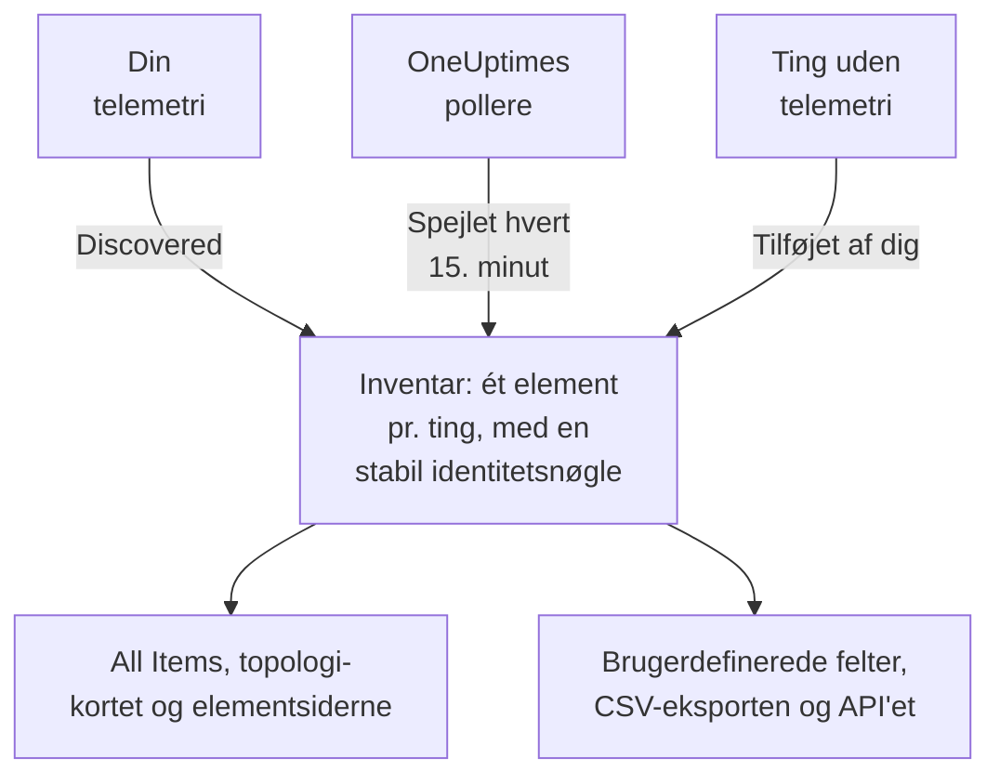

# Inventar – Oversigt

Inventaret er én liste over alt, hvad OneUptime ved om dit miljø: tjenester, værter, Kubernetes-objekter, virtuelle maskiner, netværksenheder, cloudressourcer, IoT-enheder, serverless-funktioner og de ting, der slet ikke sender telemetri. Det meste udfylder sig selv ud fra det, OneUptime allerede holder øje med. Du tilføjer det, som overvågning ikke kan fortælle: hvad en ting er til, hvem der ejer den, hvornår garantien udløber.

:::cards
- [Sådan kommer elementer ind i inventaret](#sådan-kommer-elementer-ind-i-inventaret): Fundet, spejlet eller tilføjet af dig.
- [Find rundt](#find-rundt): Inventarets sider og hvert elements egne sider.
- [Tilføj noget manuelt](#tilføj-noget-manuelt): En tredjeparts-API, en ekstern database eller en appliance.
- [Arkivér i stedet for at slette](#arkivér-i-stedet-for-at-slette): Den måde at rydde op i listen på, der holder.
:::

## Sådan kommer elementer ind i inventaret

OneUptime holder allerede øje med dit miljø for at overvåge det, så kataloget bygges ud fra det, det ser, og ikke ud fra det, nogen huskede at skrive ind. Hvert element har en kilde, og kilden afgør, hvem der ejer elementet: om du kan redigere det, og om det kan forsvinde af sig selv.

| Kilde | I API'et | Hvor det kommer fra | Hvor længe det bliver |
| --- | --- | --- | --- |
| **Discovered** | `discovered` | OpenTelemetry-ressourceattributter, læst efterhånden som telemetri ankommer: en tjeneste, vært, et Kubernetes-objekt eller en virtuel maskine, der sender telemetri. | Registreres igen med hver batch. Fjernes, når det har været stille længere end vinduet for dets type (se nedenfor). |
| **Mirrored** | `inventory` | En post, som en OneUptime-poller vedligeholder: netværksenheder, cloudressourcer, IoT-enheder, serverless-funktioner, RUM-applikationer, Docker-værter og Podman-værter. Kopieres hvert 15. minut. | Så længe dets post findes. Slet posten, og elementet forsvinder med den. |
| **Added by you** | `manual` | Tilføjet af dig, for noget OneUptime ikke kan se: en tredjeparts-API, en database, som en leverandør administrerer, en appliance i et rack. | Indtil du sletter det. Intet får det til at udløbe. |

Et fundet eller spejlet element kan ikke omdøbes eller få en anden type: kilden ville overskrive ændringen ved næste gennemløb. Elementets side **Indstillinger** fortæller i stedet, hvor en varig ændring skal foretages. Det, du altid kan tilføje til ethvert element, uanset kilde, er værdier i brugerdefinerede felter: se [Brugerdefinerede inventarfelter](/docs/inventory/custom-fields).

### Hvor længe et stille element bliver

Et fundet element har et hjerteslag. Hver gang der ankommer telemetri for det, rykker tidspunktet for, hvornår det sidst blev set, frem, og listens kolonne **Status** viser, hvor nyligt det er. Spejlede elementer og dem, du har tilføjet, har intet hjerteslag, så deres status forbliver tom i stedet for at slå alarm.

| Status | Hvad det betyder |
| --- | --- |
| **Live** | Set inden for de seneste 30 minutter. |
| **Recent** | Set inden for det seneste døgn. |
| **Forældet** | Ikke set i mere end et døgn. Siden **Gone Quiet** viser dem. |

Hver tredje time fjerner OneUptime de fundne elementer, der har været stille længere end vinduet for deres type, også de arkiverede, og deres værdier i brugerdefinerede felter forsvinder med dem. Spejlede elementer og dem, du har tilføjet, fjernes aldrig på denne måde.

| Type element | Fjernes efter så lang tid uden telemetri |
| --- | --- |
| Pods, deployments, Proxmox-gæster og virtuelle VMware-maskiner | 1 dag |
| Kubernetes-noder og -navnerum, Proxmox-noder, VMware-værter, -klynger og -datastores samt de databaser og fjerntjenester, dine traces kalder | 7 dage |
| Tjenester, værter, Kubernetes-, Proxmox- og Ceph-klynger, lagerarrays, vCenters og Docker Swarm-klynger | 30 dage |

En relation, som OneUptime har fundet, fjernes, når den ikke er set igen i 30 dage.

## Find rundt

Åbn **Produkter → Ressourcer → Inventar**. Dens sidemenu har disse sider. **By Source**, **Indstillinger**, **Hjælp** og **Avanceret** starter foldet sammen: klik på en sektions titel for at åbne den.

| Side | Hvad du finder der |
| --- | --- |
| **Oversigt** | Hvor mange elementer du har, hvad de er, hvor mange der er blevet stille, og hvad der senest er tilføjet. |
| **All Items** | Alle elementer. Søg efter navn, beskrivelse eller identitetsnøgle, afgræns listen efter type, kilde, status eller brugerdefineret felt, og tilføj et element manuelt. |
| **Topology Map** | Hvordan elementerne hænger sammen: tjenester, hvad de kalder, og de værter, pods og enheder, de kører på. |
| **Gone Quiet** | De fundne elementer, der ikke har sendt telemetri i mere end et døgn. |
| **By Source** | Elementerne fra én kilde: **Discovered**, **Mirrored** eller **Added by You**. |
| **Indstillinger → Brugerdefinerede felter** | De felter, dit projekt fører på hvert element. |
| **Hjælp → Dokumentation** | En kort guide til inventaret med de typer elementer, det genkender. |
| **Avanceret → Arkiveret** | De elementer, du har arkiveret. Gendan dem herfra. |

Åbn et element, og dets egen sidemenu har dets **Oversigt** (type, kilde og status og hver attribut, der er observeret på det), dets **Forbindelser** og dets **Brugerdefinerede felter**; dets **Protokoller**, **Spor**, **Metrikker**, **Ydeevneprofiler** og **Undtagelser**; og dets **Hændelser**, **Advarsler** og **Planlagt vedligeholdelse**. Under **Avanceret** ligger dets **Indstillinger**, dets **Auditlogs** og **Delete Item**. Telemetrisiderne viser det, elementet selv har sendt. Hændelserne, advarslerne og vedligeholdelsesbegivenhederne er dem for den tjeneste, vært eller Kubernetes-klynge, elementet repræsenterer; på ethvert andet element fortæller de sider, hvilken ressource du skal se på i stedet.

### Aktivdetaljer

En vært eller en netværksenhed har et kort **Aktivdetaljer**, der beskriver begge på samme måde: værtsnavn, IP-adresse, MAC-adresse, serienummer, producent, model, firmwareversion, operativsystem, OS-version, enhedstype og placering. En oplysning, som intet har rapporteret, står som **Ukendt**, og kortet forklarer, hvordan de ukendte bliver udfyldt.

- En værts oplysninger kommer fra ressourceattributterne på dens telemetri: dens IP- og MAC-adresser, arkitektur og operativsystem fra start, og dens serienummer, mærke, model og firmware, når du stempler dem på.
- En netværksenheds oplysninger kommer fra dens SNMP-polling, dens rolle og dens site. Det, dens polling ikke har læst, kommer fra discovery: den seneste scanning af dens adresse, en routers ARP-tabel eller dens sondes DNS-opslag. En enhed uden ENTITY-MIB, som en Meraki MX, får stadig sit mærke og sin model fra sin systembeskrivelse. Dens IP-adresse vises aldrig som dens værtsnavn.

Kortet viser, hvor hver oplysning kom fra, og hvornår. Den kilde, de fleste oplysninger deler, som en værts collector, en netværksenheds egen SNMP-polling eller den discovery-scanning, der læste den, nævnes én gang, under oplysningerne. Enhver anden kilde, som en routers ARP-tabel eller en værdi gemt på enheden, nævnes under sin oplysning. En værdi, der er gemt på en netværksenhed, erstattes aldrig af det, discovery læser, og når de to er forskellige, viser kortet begge.

De samme oplysninger er kolonner i listen **All Items**, skjult indtil du slår dem til, og de kommer med i dens CSV-eksport. [Eksport til en CMDB](/docs/inventory/cmdb-sync#aktivdetaljer) viser deres nøgler.

### Forbindelser

Et elements side **Forbindelser** viser dets naboer i begge retninger, grupperet i **Kald**, **Kaldt af**, **Kører på** og **Relateret**. Hver gruppe viser sit samlede antal (en gruppe med mere end 100.000 forbindelser viser "100.000+"), og **Vis mere** bladrer gennem resten, så en travl klynge, et travlt navnerum eller en travl node viser hver forbindelse i stedet for kun de første. Siden er ikke begrænset til et tidsinterval: den indeholder relationer, der er tilføjet manuelt via API'et, og naboer, der er arkiveret. En nabo, der ikke længere er i inventaret, vises med sin nøgle.

## Tilføj noget manuelt

Tilføj et element for noget, OneUptime aldrig selv vil se, så en afhængighed ender et virkeligt sted, og tingen kan bære dine brugerdefinerede felter.

:::steps
### Åbn All Items

Gå til **Produkter → Ressourcer → Inventar**, og derefter **All Items**.

### Tilføj elementet

Klik på **Tilføj Item**. Vælg dets **Type**, giv det et **Navn** og eventuelt en **Beskrivelse**. Navn og type udgør tilsammen elementets identitet, så to elementer af samme type kan ikke have samme navn.

### Udfyld dets brugerdefinerede felter

Åbn det nye element. Dets kilde står som **Added by you**, og dets side **Brugerdefinerede felter** tager imod de værdier, dit projekt følger.
:::

Tre typer kan du tilføje manuelt:

- `external.service` (**Ekstern tjeneste**): en tredjeparts-API eller en software-as-a-service-afhængighed.
- `external.database` (**Ekstern database**): en database, der ikke er en server, OneUptime kan modellere. En databaseserver, selvhostet eller administreret, fra PostgreSQL til Snowflake, hører i stedet hjemme under **Databases → Opret Database** ([Databaser](/docs/telemetry/databases)): den post forbindes med de traces, containere og motormetrikker, der nævner samme adresse, hvilket et inventarelement aldrig gør, og tilføjer du samme server begge veje, står du med to uforbundne poster.
- `appliance` (**Appliance**): hardware eller software uden agent.

Begrænsningen forhindrer dubletter. Et manuelt oprettet element af en type, OneUptime kan observere, som en vært, ville blive nøglet på det navn, du skrev, mens det fundne element for samme maskine nøgles på de attributter, den rapporterer. De to ville aldrig smelte sammen, så den samme vært ville stå to gange i din liste for altid.

## Arkivér i stedet for at slette

Arkivering tager et element ud af listen, mens det beholder sin identitet, sin historik og sine værdier i brugerdefinerede felter. Det siger: Det her har jeg set, og jeg vil ikke have det i min liste. Et arkiveret element bliver ved med at indsamle telemetri.

| Kilde | Arkivér | Slet |
| --- | --- | --- |
| **Discovered** | Forbliver arkiveret. | Kommer tilbage med næste batch af dets telemetri. |
| **Mirrored** | Forbliver arkiveret. | Kommer tilbage med næste kopi. Slet i stedet den oprindelige post. |
| **Added by you** | Forbliver arkiveret. | Væk for altid. |

For at arkivere elementer markerer du dem i **All Items** og arkiverer dem på én gang, eller du åbner et element og bruger kortet **Arkiver** på dets side **Indstillinger**. Arkiverede elementer ligger under **Inventar → Avanceret → Arkiveret**, hvor du kan markere dem og gendanne dem.

> [!NOTE]
> Når en spejlet enhed fjernes fra sin egen post, fjerner OneUptime også dens element, medmindre elementet bærer værdier i brugerdefinerede felter, som du har indtastet. De værdier er den eneste kopi, og der er ingen fortryd, så elementet arkiveres i stedet for at blive slettet. Du finder det under **Avanceret → Arkiveret** med alt, hvad du skrev, intakt.

## Relationer og topologi

OneUptime forbinder elementer med rettede relationer, efterhånden som det observerer dem. **Inventar → Topology Map** tegner dem, og et elements side **Forbindelser** viser dets egne. Se [Topologi](/docs/telemetry/topology).

| Relation | For eksempel |
| --- | --- |
| `runs-on` | En pod kører på en node; en virtuel maskine kører på sin vært. |
| `member-of` | En pod, node eller et navnerum er medlem af en klynge. |
| `hosted-on` | En tjeneste hostes på en vært. |
| `part-of` | En pod er en del af sit deployment. |
| `depends-on` | En tjeneste kalder en anden, ud fra de spans, der går imellem dem. |

## Næste trin

:::cards
- [Brugerdefinerede inventarfelter](/docs/inventory/custom-fields): Følg serienumre, garantidatoer, ejere og livscyklusstatus.
- [Eksport til en CMDB](/docs/inventory/cmdb-sync): Hent kataloget ind i dit eget styrende system.
- [Databaser](/docs/telemetry/databases): Overvåg de databaseservere, dine tjenester bruger.
:::
