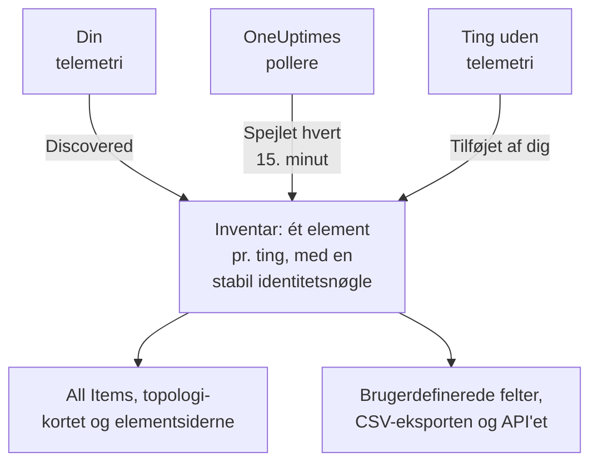

# Inventar – Oversigt

Inventaret er én liste over alt, hvad OneUptime ved om dit miljø: tjenester, værter, Kubernetes-objekter, virtuelle maskiner, netværksenheder, cloudressourcer, IoT-enheder, serverless-funktioner og de ting, der slet ikke sender telemetri. Det meste udfylder sig selv ud fra det, OneUptime allerede holder øje med. Du tilføjer det, som overvågning ikke kan fortælle: hvad en ting er til, hvem der ejer den, hvornår garantien udløber. I [Ordliste](/docs/introduction/glossary#det-du-overvåger) kan du se, hvad hver slags post i inventaret er.

:::cards
- [Sådan kommer elementer ind i inventaret](#sådan-kommer-elementer-ind-i-inventaret): Fundet, spejlet eller tilføjet af dig.
- [Find rundt](#find-rundt): Inventarets sider og hvert elements egne sider.
- [Importer enheder fra Esper](#importer-enheder-fra-esper): Alle Android- og Apple-enheder, som din Esper-lejer tilmelder, holdt ajour.
- [Importer enheder fra Microsoft Intune](#importer-enheder-fra-microsoft-intune): Alle Windows-pc'er, Mac'er, iPhones, iPads og Android-enheder, som Intune administrerer, holdt ajour.
- [Importer enheder fra Workspace ONE UEM](#importer-enheder-fra-workspace-one-uem): Alle telefoner, tablets og computere, som Workspace ONE administrerer, holdt ajour.
- [Importer enheder fra SOTI MobiControl](#importer-enheder-fra-soti-mobicontrol): Alle robuste enheder, telefoner, tablets og computere, som MobiControl administrerer, holdt ajour.
- [Tilføj noget manuelt](#tilføj-noget-manuelt): En tredjeparts-API, en ekstern database eller en appliance.
- [Arkiver i stedet for at slette](#arkiver-i-stedet-for-at-slette): Den måde at rydde op i listen på, der holder.
:::

## Sådan kommer elementer ind i inventaret

OneUptime holder allerede øje med dit miljø for at overvåge det, så kataloget bygges ud fra det, det ser, og ikke ud fra det, nogen huskede at skrive ind. Hvert element har en kilde, og kilden afgør, hvem der ejer elementet: om du kan redigere det, og om det kan forsvinde af sig selv.

| Kilde | I API'et | Hvor det kommer fra | Hvor længe det bliver |
| --- | --- | --- | --- |
| **Opdaget** | `discovered` | OpenTelemetry-ressourceattributter, læst efterhånden som telemetri ankommer: en tjeneste, vært, et Kubernetes-objekt eller en virtuel maskine, der sender telemetri. | Registreres igen med hver batch. Fjernes, når det har været stille længere end vinduet for dets type (se nedenfor). |
| **Spejlet** | `inventory` | En post, som en OneUptime-poller vedligeholder: netværksenheder, cloudressourcer, IoT-enheder, serverless-funktioner, RUM-applikationer, Docker-værter, Podman-værter og de enheder, som en MDM-forbindelse importerer. Kopieres hvert 15. minut. En administreret enhed, hver gang dens forbindelse læses. | Så længe dets post findes. Slet posten, og elementet forsvinder med den. |
| **Tilføjet af dig** | `manual` | Tilføjet af dig, for noget OneUptime ikke kan se: en tredjeparts-API, en database, som en leverandør administrerer, en appliance i et rack. | Indtil du sletter det. Intet får det til at udløbe. |

Et fundet eller spejlet element kan ikke omdøbes eller få en anden type: kilden ville overskrive ændringen ved næste gennemløb. Elementets side **Indstillinger** fortæller i stedet, hvor en varig ændring skal foretages. Det, du altid kan tilføje til ethvert element, uanset kilde, er værdier i brugerdefinerede felter: se [Brugerdefinerede inventarfelter](/docs/inventory/custom-fields).

### Hvor længe et stille element bliver

Et fundet element har et hjerteslag. Hver gang der ankommer telemetri for det, rykker tidspunktet for, hvornår det sidst blev set, frem, og listens kolonne **Status** viser, hvor nyligt det er. Det samme gør en administreret enhed: hver gang den tjekker ind hos sin MDM. Andre spejlede elementer og dem, du har tilføjet, har intet hjerteslag, så deres status forbliver tom i stedet for at slå alarm.

| Status | Hvad det betyder |
| --- | --- |
| **Live** | Set inden for de seneste 30 minutter. |
| **Nylig** | Set inden for det seneste døgn. |
| **Forældet** | Ikke set i mere end et døgn. Siden **Blevet stille** viser dem. |

Hver tredje time fjerner OneUptime de fundne elementer, der har været stille længere end vinduet for deres type, også de arkiverede, og deres værdier i brugerdefinerede felter forsvinder med dem. Spejlede elementer og dem, du har tilføjet, fjernes aldrig på denne måde.

| Type element | Fjernes efter så lang tid uden telemetri |
| --- | --- |
| Pods, deployments, Proxmox-gæster, OpenStack-instanser og virtuelle VMware-maskiner | 1 dag |
| Kubernetes-noder og -navnerum, Proxmox-noder, OpenStack-hypervisorer, VMware-værter, -klynger og -datastores samt de databaser og fjerntjenester, dine traces kalder | 7 dage |
| Tjenester, værter, Kubernetes-, Proxmox- og Ceph-klynger, OpenStack-clouds, lagerarrays, vCenters og Docker Swarm-klynger | 30 dage |

En relation, som OneUptime har fundet, fjernes, når den ikke er set igen i 30 dage.

## Find rundt

Åbn **Produkter → Ressourcer → Inventar**. Dens sidemenu har disse sider. **Efter kilde**, **Indstillinger**, **Hjælp** og **Avanceret** starter foldet sammen: klik på en sektions titel for at åbne den.

| Side | Hvad du finder der |
| --- | --- |
| **Oversigt** | Hvor mange elementer du har, hvad de er, hvor mange der er blevet stille, og hvad der senest er tilføjet. |
| **Alle elementer** | Alle elementer. Søg efter navn, beskrivelse eller identitetsnøgle, afgræns listen efter type, kilde, status eller brugerdefineret felt, og tilføj et element manuelt. |
| **Administrerede enheder** | Dine MDM-forbindelser – Esper, Microsoft Intune, Workspace ONE UEM og SOTI MobiControl – og alle de enheder, de importerer, med deres status, gruppe, model og operativsystem. |
| **Topologikort** | Hvordan elementerne hænger sammen: tjenester, hvad de kalder, og de værter, pods og enheder, de kører på. |
| **Blevet stille** | De elementer, der ikke er hørt fra i mere end et døgn: fundne elementer, der ikke har sendt telemetri, og enheder, der er holdt op med at tjekke ind hos deres MDM. |
| **Efter kilde** | Elementerne fra én kilde: **Opdaget**, **Spejlet** eller **Tilføjet af dig**. |
| **Indstillinger → Brugerdefinerede felter** | De felter, dit projekt fører på hvert element. |
| **Hjælp → Dokumentation** | En kort guide til inventaret med de typer elementer, det genkender. |
| **Avanceret → Arkiveret** | De elementer, du har arkiveret. Gendan dem herfra. |

Åbn et element, og dets egen sidemenu har dets **Oversigt** (type, kilde og status og hver attribut, der er observeret på det), dets **Forbindelser** og dets **Brugerdefinerede felter**; dets **Protokoller**, **Spor**, **Metrikker**, **Profiler** og **Undtagelser**; og dets **Hændelser**, **Advarsler** og **Planlagt vedligeholdelse**. Under **Avanceret** ligger dets **Indstillinger**, dets **Auditlogs** og **Slet element**. Telemetrisiderne viser det, elementet selv har sendt. Hændelserne, advarslerne og vedligeholdelseshændelserne er dem for den tjeneste, vært eller Kubernetes-klynge, elementet repræsenterer; på ethvert andet element fortæller de sider, hvilken ressource du skal se på i stedet.

### Aktivdetaljer

En vært eller en netværksenhed har et kort **Aktivdetaljer**, der beskriver begge på samme måde: værtsnavn, IP-adresse, MAC-adresse, serienummer, producent, model, firmwareversion, operativsystem, OS-version, enhedstype og placering. Kortet for en Android-enhed har også dens sikkerhedspatchniveau, fra Android-agenten eller dens MDM. Det siger også, om patchen er **Ikke opdateret**, som kolonnen **Sikkerhedspatchniveau** gør, og hvor mange dage gammel den er. En oplysning, som intet har rapporteret, står som **Ukendt**, og kortet forklarer, hvorfor det er sådan, og hvordan de ukendte bliver udfyldt: en enhed, der ikke rapporterer dem over SNMP, en enhed, der ikke er læst endnu, eller en Meraki-enhed, hvis dashboard har dem.

- En værts oplysninger kommer fra ressourceattributterne på dens telemetri: dens IP- og MAC-adresser, arkitektur og operativsystem fra start, og dens serienummer, mærke, model og firmware, når du stempler dem på.
- En netværksenheds oplysninger kommer fra dens SNMP-polling, dens rolle og dens site. Det, dens polling ikke har læst, kommer fra discovery: den seneste scanning af dens adresse, en routers ARP-tabel eller dens sondes DNS-opslag. En enhed uden ENTITY-MIB, som en Meraki MX, får stadig sit mærke, sin model og sit operativsystem fra sin systembeskrivelse og sin MAC-adresse fra sine egne porte. Dens IP-adresse vises aldrig som dens værtsnavn.
- En Meraki-enhed henter også det, dens polling lader stå tomt, fra Meraki-dashboardet, blandt andet dens serienummer, model og firmware, når en [Meraki-forbindelse](/docs/monitor/network-traffic#cisco-meraki-uden-netflow) læser dens organisation.

**Alle elementer** finder de Android-enheder, der kræver handling. Filteret **Sikkerhedspatchniveau** viser under **Ikke opdateret** de enheder, hvis sikkerhedspatchniveau er mere end 90 dage gammelt, den samme regel, som advarslen Security Patch Out of Date i [Værts-monitor](/docs/monitor/host-monitor) bruger. Filteret **Agenttilladelser** viser de enheder, hvor [Android-agenten](/docs/telemetry/android-agent) stadig mangler READ_LOGS, READ_DROPBOX_DATA eller adgang til forbrugsdata. Hvert filter har en kolonne med samme navn, skjult indtil du slår den til, og den kommer med i CSV-eksporten. Ved siden af dem rummer kolonnen **MDM-ID** det id, som en enheds MDM kender den under, fx det Esper-id, som `espercli secureadb connect --device` tager.

Kortet viser, hvor hver oplysning kom fra, og hvornår. Den kilde, de fleste oplysninger deler, som en værts collector, en netværksenheds egen SNMP-polling eller den discovery-scanning, der læste den, nævnes én gang, under oplysningerne. Enhver anden kilde, som en routers ARP-tabel eller en værdi gemt på enheden, nævnes under sin oplysning. En værdi, der er gemt på en netværksenhed, erstattes aldrig af det, discovery læser, og når de to er forskellige, viser kortet begge.

En netværksenheds kort har en knap **Opdater** for dem, der må redigere netværksenheder. Den læser enheden igen nu: dens sonde poller den inden for et minut, og dens Meraki-forbindelse læser organisationen igen. Kortet fortæller, hvornår den nye aflæsning er landet, eller at sonden ikke kunne nå enheden, og elementet kopieres fra enheden, så snart aflæsningen er landet.

De samme oplysninger er kolonner i listen **Alle elementer**, skjult indtil du slår dem til, og de kommer med i dens CSV-eksport. [Eksport til en CMDB](/docs/inventory/cmdb-sync#aktivdetaljer) viser deres nøgler.

### Forbindelser

Et elements side **Forbindelser** viser dets naboer i begge retninger, grupperet i **Kald**, **Kaldt af**, **Kører på** og **Relateret**. Hver gruppe viser sit samlede antal (en gruppe med mere end 100.000 forbindelser viser "100.000+"), og **Vis mere** bladrer gennem resten, så en travl klynge, et travlt navnerum eller en travl node viser hver forbindelse i stedet for kun de første. Siden er ikke begrænset til et tidsinterval: den indeholder relationer, der er tilføjet manuelt via API'et, og naboer, der er arkiveret. En nabo, der ikke længere er i inventaret, vises med sin nøgle.

## Importer enheder fra Esper

Forbind en Esper-lejer, og alle de enheder, den tilmelder, er i inventaret: dens Android-enheder, også dem, hvis app aldrig er startet, og dens iPhones, iPads og Apple TV'er. Hver enhed er én vært med det, kun Esper ved om den: dens gruppe, dens operativsystem og build, dens serienummer og IMEI, dens batteri og lagerplads og, for en Android-enhed, dens sikkerhedspatchniveau og installerede apps. Esper sender intet af sig selv, så OneUptime læser lejeren efter en tidsplan: enhederne hvert 15. minut og hver Android-enheds apps hver 6. time.

:::steps
### Opret en API-nøgle i Esper

Opret en nøgle i Esper-konsollen under API Key Management. OneUptime læser kun, så nøglen fra en bruger, hvis Esper-rolle kan læse enheder, grupper og apps, er nok. En nøgle holder op med at virke, når den bliver erstattet, eller når dens bruger bliver slettet.

### Forbind lejeren

Gå til **Produkter → Ressourcer → Inventar**, derefter **Administrerede enheder**, klik på **Forbind MDM**, og vælg **Esper**. Angiv **Lejer**, navnet før `.esper.cloud` i adressen på din Esper-konsol (`acme` for `acme.esper.cloud`), og **API-nøgle**. **Flere felter** rummer forbindelsens navn, og hvor ofte den læses.

### Tjek den første læsning

**Forbind** tester nøglen, før noget gemmes: den fortæller, hvor mange enheder en læsning vil importere, eller hvad der er galt, og hvordan det rettes. Den første læsning starter inden for et minut, og forbindelsens række viser, hvordan det gik.
:::

| Hvad Esper rapporterer | Hvor det vises |
| --- | --- |
| Model, producent, serienummer, operativsystem og dets version, build samt IP- og MAC-adresser | Enhedens kort **Aktivdetaljer** og kolonnerne i **Alle elementer** |
| Status, seneste check-in, gruppe, sikkerhedspatchniveau, IMEI, batteri, lagerplads og Esper-agent | Enhedens kort **Esper** og listen **Enheder** under **Administrerede enheder** |
| Apps og deres versioner | Enhedens liste **Installerede apps** |
| Dens Esper-enheds-id | Kolonnen **MDM-ID** i **Alle elementer** |

### Én enhed, ikke to

En app eller Android Agent, der sender telemetri fra en enhed, bliver ét element sammen med den enhed, Esper importerer, når den navngiver enheden på samme måde som Esper. Sæt disse ressourceattributter ud fra den administrerede konfiguration, som Esper udfylder på hver enhed:

| Ressourceattribut | Værdi i den administrerede konfiguration | Hvad det er |
| --- | --- | --- |
| `host.name` | `${esper.deviceName}` | Enhedens navn i Esper, f.eks. `ESP-ID-AAAAW`. Påkrævet. |
| `host.serial_number` | `${esper.serialNumber}` | Enhedens serienummer. Valgfri. |

OneUptime finder en enheds element ud fra dens navn i Esper og derefter ud fra dens serienummer og opretter kun et, når ingen passer. Android Agent sætter begge ud fra sine indstillinger `device_name` og `device_serial`, og [Android-opsætning](/docs/rum/android-setup#importer-flåden-fra-esper) viser en apps administrerede konfiguration.

### Når en enhed bliver stille eller forlader Esper

En Android-enhed, der ikke har tjekket ind i 30 minutter, er **Offline** og viser, hvor længe siden den sidst gjorde det; en iPhone, iPad eller Apple TV, der tjekker ind, når Apples push-tjeneste vækker den, ofte med timers mellemrum, er **Offline** efter et døgn. Dens elements **Status** følger dens seneste check-in, eller dens telemetri, når den er nyere, så en enhed, der har været stille i et døgn, står på siden **Blevet stille**.

En enhed, der fjernes fra Esper, markeres som **Fjernet**, og dens element arkiveres: det forsvinder fra listen og venter under **Avanceret → Arkiveret**. En enhed, der kommer tilbage til Esper, kommer tilbage på listen. 30 dage efter at den forsvandt, slettes enheden, og det samme gør dens element, medmindre telemetri eller du har tilføjet noget til det.

### Få en advarsel, når en enhed holder op med at tjekke ind

Under **Administrerede enheder** klikker du på **Opsæt advarsler** i forbindelsens række og opretter **Esper Android Device Stopped Checking In** og **Esper Apple Device Stopped Checking In**. Den første åbner én advarsel for hver Android-enhed, der ikke har tjekket ind hos Esper i mere end en time, den anden for hver Apple-enhed efter mere end et døgn, hver opkaldt efter enheden og løst, så snart den tjekker ind igen.

Hver læsning af forbindelsen registrerer som metrikken `oneuptime.managed_device.check_in.age`, hvor mange minutter siden hver enhed sidst tjekkede ind, og monitoren tjekker hver enheds seneste værdi hvert 5. minut. En enhed, der også kører Android Agent, overlades til **Host Stopped Reporting**, så den aldrig advarer to gange, og en enhed, der er fjernet fra Esper, løser sin advarsel. En læsning, der fejler, registrerer intet, så ingen advarsel åbnes eller løses før den næste. Hæv monitorens tærskel for en flåde, der slukkes om natten.

Opret også **Esper Security Patch Out of Date**, så åbner hver Android-enhed, hvis sikkerhedspatchniveau ifølge Esper er mere end 90 dage gammelt, sin egen advarsel, som løses, når enheden er opdateret. Hver læsning registrerer som metrikken `oneuptime.managed_device.security_patch.age`, hvor mange dage gammelt hver Android-enheds patchniveau er. En enhed, der kører Android Agent, overlades til sin værts **Security Patch Out of Date**, så den aldrig advarer to gange.

## Importer enheder fra Microsoft Intune

Forbind en Microsoft Intune-lejer, og alle de enheder, Intune administrerer, er i inventaret: dens Windows-pc'er, Mac'er, iPhones, iPads, Android-enheder og Linux-maskiner. Hver enhed er én vært med det, Intune ved om den: dens kategori, dens operativsystem og dets version, dens serienummer og IMEI, dens overholdelse, ejerskab og tilmelding, dens lagerplads og de apps, Intune har fundet på den. Intune sender intet af sig selv, så OneUptime læser lejeren efter en tidsplan: enhederne hvert 15. minut og hver enheds apps hver 6. time.

:::steps
### Registrer en app i Microsoft Entra

Åbn `App registrations` i Microsoft Entra Administration, og klik på `New registration`. Giv den et navn, behold `Accounts in this organizational directory only`, og registrer den. Dens side `Overview` viser de to id'er, OneUptime beder om: `Application (client) ID` og `Directory (tenant) ID`.

### Lad den læse Intunes enheder

Under `API permissions` klikker du på `Add a permission`, derefter `Microsoft Graph`, derefter `Application permissions`, og tilføjer `DeviceManagementManagedDevices.Read.All`. Klik så på `Grant admin consent`, hvilket kun en administrator af lejeren kan. Den ene tilladelse er alt, hvad OneUptime har brug for: den viser enhederne og de apps, Intune har fundet på dem, og kan intet ændre.

### Opret en klienthemmelighed

Under `Certificates & secrets` klikker du på `New client secret` og kopierer dens `Value`, ikke dens `Secret ID`: Microsoft viser værdien én gang. En hemmelighed holder op med at virke, når den udløber, så opret en ny inden da, og angiv den, når du redigerer forbindelsen.

### Forbind Intune-lejeren

Gå til **Produkter → Ressourcer → Inventar**, derefter **Administrerede enheder**, klik på **Forbind MDM**, og vælg **Microsoft Intune**. Angiv **Lejer-id**, **Program-id (klient)** og **Klienthemmelighed**. Er lejeren i en sky for den amerikanske regering, så vælg den som **Cloud** under **Flere felter**. **Forbind** tester appregistreringen, før noget gemmes: den fortæller, hvor mange enheder en læsning vil importere, eller hvad der er galt, og hvordan det rettes.
:::

En enhed tjekker ind hos Intune cirka hver ottende time, og dens seneste check-in er, da den sidst gjorde det: en enhed, der ikke har gjort det i et døgn, er **Offline**. Dens apps er dem, Intune har fundet på den, som Microsoft Graph kun viser i sin betaversion: for en personlig enhed de apps, Intune administrerer. Intunes grupper er Microsoft Entra-grupper, som denne tilladelse ikke læser, så en enheds gruppe er dens enhedskategori. Intet om en enheds bruger læses.

Intune navngiver en enhed det, dens ejer kaldte den, så to enheder kan have samme navn: alle iPhones, som ingen har omdøbt, hedder `iPhone`. Et navn, som to enheder i en forbindelse deler, tilhører ingen af dem i inventaret: hver navngives i stedet efter sit serienummer og får sit navn tilbage, så snart ingen anden enhed har det.

For at få en advarsel, når en enhed holder op med at tjekke ind, klikker du på **Opsæt advarsler** i forbindelsens række og opretter **Intune Device Stopped Checking In**. Den åbner én advarsel for hver enhed, der ikke har tjekket ind hos Intune i mere end et døgn, opkaldt efter enheden. En bærbar, der er slukket en weekend, ser ens ud, så hæv monitorens tærskel, hvis et døgn er for kort tid for dine. **Intune Security Patch Out of Date** advarer for hver Android-enhed, hvis sikkerhedspatchniveau er mere end 90 dage gammelt, ligesom Espers skabelon.

## Importer enheder fra Workspace ONE UEM

Forbind en Workspace ONE UEM-server, og alle de enheder, den administrerer, er i inventaret: dens iPhones, iPads, Mac'er, Windows-pc'er, Android-enheder og Linux-maskiner. Hver enhed er én vært med det, Workspace ONE ved om den: dens organisationsgruppe, dens operativsystem og dets version, dens model, serienummer og IMEI, dens overholdelse, tilmelding og ejerskab, dens batteri, lagerplads og hukommelse og dens apps. Workspace ONE sender intet af sig selv, så OneUptime læser serveren efter en tidsplan: enhederne hvert 15. minut og hver enheds apps hver 6. time.

:::steps
### Opret en skrivebeskyttet rolle

Gå til `Accounts`, derefter `Administrators`, derefter `Roles` i Workspace ONE UEM-konsollen, og klik på `Add Role`. Under `API`, derefter `REST`, vælger du `Read` for `Devices` og for `Apps` og intet andet. Den rolle er alt, hvad OneUptime har brug for: den viser enhederne og deres apps og kan intet ændre.

### Opret en OAuth-klient

Gå til `Groups & Settings`, derefter `Configurations`, derefter `OAuth Client Management`, og klik på `Add`. Vælg den organisationsgruppe, hvis enheder OneUptime læser, og giv klienten den rolle, du oprettede. Kopiér dens `Client ID` og dens `Client Secret`: Workspace ONE viser hemmeligheden én gang.

### Forbind serveren

Gå til **Produkter → Ressourcer → Inventar**, derefter **Administrerede enheder**, klik på **Forbind MDM**, og vælg **Workspace ONE UEM**. Angiv **REST API-URL**, som `Groups & Settings`, `All Settings`, `System`, `Advanced`, `API`, `REST API` viser, f.eks. `https://as1234.awmdm.com`. Behold **OAuth-klient** under **Log ind med**, angiv **Klient-ID** og **Klienthemmelighed**, og vælg **Region** for dit datacenters tokentjeneste. **Forbind** tester klienten, før noget gemmes: den fortæller, hvor mange enheder en læsning vil importere, eller hvad der er galt, og hvordan det rettes.
:::

En Workspace ONE-server on-premises har ingen tokentjeneste: vælg **Administratorkonto** under **Log ind med**, og angiv **Brugernavn** og **Adgangskode** for en administrator med den skrivebeskyttede rolle samt **REST API-nøgle** fra de samme REST API-indstillinger, hvor basisgodkendelse skal være tilladt. OneUptime Cloud læser kun servere på det offentlige internet, så en server på et privat netværk læses af en selvhostet OneUptime.

En enhed rapporterer til Workspace ONE efter sin egen tidsplan, en iPhone med timers mellemrum, så en enhed, der ikke har gjort det i et døgn, er **Offline**. En enhed, der ikke længere er tilmeldt, udelades. En enhed navngives efter det navn, den rapporterer, ikke efter sit visningsnavn, som Workspace ONE danner ud fra brugerens navn, og intet om en enheds bruger læses. Hver forespørgsel tæller med i lejerens daglige API-kvote, så en læsning læser apps for højst 25 enheder og den næste læsning for de følgende.

En app eller Android Agent, der sender telemetri fra en enhed, bliver ét element sammen med enheden via dens serienummer: sæt Android Agents indstilling `device_serial` til opslagsværdien `{DeviceSerialNumber}` i dens administrerede konfiguration.

For at få en advarsel, når en enhed holder op med at tjekke ind, klikker du på **Opsæt advarsler** i forbindelsens række og opretter **Workspace ONE Device Stopped Checking In**. Den åbner én advarsel for hver enhed, der ikke har rapporteret til Workspace ONE i mere end et døgn, opkaldt efter enheden. **Workspace ONE Security Patch Out of Date** advarer for hver Android-enhed, hvis sikkerhedspatchniveau er mere end 90 dage gammelt, ligesom Espers skabelon.

## Importer enheder fra SOTI MobiControl

Forbind en SOTI MobiControl-server, i SOTI's sky eller on-premises, og alle de enheder, den administrerer, er i inventaret: dens robuste Android-enheder, telefoner, tablets og scannere, dens iPhones, iPads og Mac'er og dens Windows- og Linux-computere. Hver enhed er én vært med det, MobiControl ved om den: dens enhedsgruppe, dens operativsystem og dets version, dens model, serienummer og IMEI, dens overholdelse, dens agent, dens batteri, lagerplads og hukommelse og dens installerede programmer. MobiControl sender intet af sig selv, så OneUptime læser serveren efter en tidsplan: enhederne hvert 15. minut og hver enheds apps hver 6. time.

:::steps
### Opret en skrivebeskyttet MobiControl-bruger

Tilføj en af MobiControls egne brugere i MobiControl-webkonsollen, ikke en SOTI Identity-bruger. Tillad `Web Console Access` og `View Installed Applications` i dens generelle tilladelser og intet andet, og giv den `View Groups` på de enhedsgrupper, OneUptime læser. Den bruger er alt, hvad OneUptime har brug for: den kan se enhederne og deres apps og intet ændre.

### Opret en API-klient

Gå til `Global Settings`, derefter `Services`, derefter `API Client` i webkonsollen, og tilføj en. Kopiér dens `Client ID` og dens `Client Secret`: MobiControl viser hemmeligheden én gang. En server, der er ældre end MobiControl 2024.0, opretter en på serveren med `MCAdmin.exe APIClientAdd -n:OneUptime`.

### Forbind MobiControl-serveren

Gå til **Produkter → Ressourcer → Inventar**, derefter **Administrerede enheder**, klik på **Forbind MDM**, og vælg **SOTI MobiControl**. Angiv **Server**, adressen på din webkonsol uden `/MobiControl`, f.eks. `https://acme.mobicontrolcloud.com`, og API-klientens **Klient-ID** og **Klienthemmelighed**, derefter brugerens **Brugernavn** og **Adgangskode**. **Forbind** tester loginoplysningerne, før noget gemmes: den fortæller, hvor mange enheder en læsning vil importere, eller hvad der er galt, og hvordan det rettes.
:::

En MobiControl-agent holder en aktiv forbindelse til sin server, så en enhed, hvis agent er forbundet, er online, og en, hvis agent ikke har været forbundet i 30 minutter, er **Offline**. En iPhone, iPad eller Mac tjekker ind via Apples push-tjeneste, med timers mellemrum, og er **Offline** efter et døgn. En enhed, som en administrator har deaktiveret, er **Deaktiveret**, og en, der er ved at blive afmeldt, udelades. OneUptime Cloud læser kun servere på det offentlige internet, så en server på et privat netværk læses af en selvhostet OneUptime. Intet om en enheds bruger læses.

En app eller Android Agent, der sender telemetri fra en enhed, bliver ét element sammen med enheden via dens serienummer: sæt Android Agents indstilling `device_serial` til makroen `%SERIALNUM%` i dens administrerede konfiguration.

For at få en advarsel, når en enhed holder op med at tjekke ind, klikker du på **Opsæt advarsler** i forbindelsens række og opretter **SOTI Device Stopped Checking In** og **SOTI Apple Device Stopped Checking In**. Den første åbner én advarsel for hver Android-, Windows- eller Linux-enhed, hvis agent ikke har været forbundet i mere end en time, og den anden for hver Apple-enhed, der ikke har tjekket ind i mere end et døgn, hver opkaldt efter enheden. **SOTI Security Patch Out of Date** advarer for hver Android-enhed, hvis sikkerhedspatchniveau er mere end 90 dage gammelt, ligesom Espers skabelon.

## Tilføj noget manuelt

Tilføj et element for noget, OneUptime aldrig selv vil se, så en afhængighed ender et virkeligt sted, og tingen kan bære dine brugerdefinerede felter.

:::steps
### Åbn Alle elementer

Gå til **Produkter → Ressourcer → Inventar**, og derefter **Alle elementer**.

### Tilføj elementet

Klik på **Tilføj Element**. Vælg dets **Type**, giv det et **Navn** og eventuelt en **Beskrivelse**. Navn og type udgør tilsammen elementets identitet, så to elementer af samme type kan ikke have samme navn.

### Udfyld dets brugerdefinerede felter

Åbn det nye element. Dets kilde står som **Tilføjet af dig**, og dets side **Brugerdefinerede felter** tager imod de værdier, dit projekt følger.
:::

Tre typer kan du tilføje manuelt:

- `external.service` (**Ekstern tjeneste**): en tredjeparts-API eller en software-as-a-service-afhængighed.
- `external.database` (**Ekstern database**): en database, der ikke er en server, OneUptime kan modellere. En databaseserver, selvhostet eller administreret, fra PostgreSQL til Snowflake, hører i stedet hjemme under **Databaser → Opret Database** ([Databaser](/docs/telemetry/databases)): den post forbindes med de traces, containere og motormetrikker, der nævner samme adresse, hvilket et inventarelement aldrig gør, og tilføjer du samme server begge veje, står du med to uforbundne poster.
- `appliance` (**Appliance**): hardware eller software uden agent.

Begrænsningen forhindrer dubletter. Et manuelt oprettet element af en type, OneUptime kan observere, som en vært, ville blive nøglet på det navn, du skrev, mens det fundne element for samme maskine nøgles på de attributter, den rapporterer. De to ville aldrig smelte sammen, så den samme vært ville stå to gange i din liste for altid.

## Arkiver i stedet for at slette

Arkivering tager et element ud af listen, mens det beholder sin identitet, sin historik og sine værdier i brugerdefinerede felter. Det siger: Det her har jeg set, og jeg vil ikke have det i min liste. Et arkiveret element bliver ved med at indsamle telemetri.

| Kilde | Arkiver | Slet |
| --- | --- | --- |
| **Opdaget** | Forbliver arkiveret. | Kommer tilbage med næste batch af dets telemetri. |
| **Spejlet** | Forbliver arkiveret. | Kommer tilbage med næste kopi. Slet i stedet den oprindelige post. |
| **Tilføjet af dig** | Forbliver arkiveret. | Væk for altid. |

For at arkivere elementer markerer du dem i **Alle elementer** og arkiverer dem på én gang, eller du åbner et element og bruger kortet **Arkiver** på dets side **Indstillinger**. Arkiverede elementer ligger under **Inventar → Avanceret → Arkiveret**, hvor du kan markere dem og gendanne dem.

> [!NOTE]
> Når en spejlet enhed fjernes fra sin egen post, fjerner OneUptime også dens element, medmindre elementet bærer værdier i brugerdefinerede felter, som du har indtastet. De værdier er den eneste kopi, og der er ingen fortryd, så elementet arkiveres i stedet for at blive slettet. Du finder det under **Avanceret → Arkiveret** med alt, hvad du skrev, intakt.

## Relationer og topologi

OneUptime forbinder elementer med rettede relationer, efterhånden som det observerer dem. **Inventar → Topologikort** tegner dem, og et elements side **Forbindelser** viser dets egne. Se [Topologi](/docs/telemetry/topology).

| Relation | For eksempel |
| --- | --- |
| `runs-on` | En pod kører på en node; en virtuel maskine kører på sin vært. |
| `member-of` | En pod, node eller et navnerum er medlem af en klynge. |
| `hosted-on` | En tjeneste hostes på en vært. |
| `part-of` | En pod er en del af sit deployment. |
| `depends-on` | En tjeneste kalder en anden, ud fra de spans, der går imellem dem. |

## Næste trin

:::cards
- [Brugerdefinerede inventarfelter](/docs/inventory/custom-fields): Følg serienumre, garantidatoer, ejere og livscyklusstatus.
- [Eksport til en CMDB](/docs/inventory/cmdb-sync): Hent kataloget ind i dit eget styrende system.
- [Databaser](/docs/telemetry/databases): Overvåg de databaseservere, dine tjenester bruger.
:::
