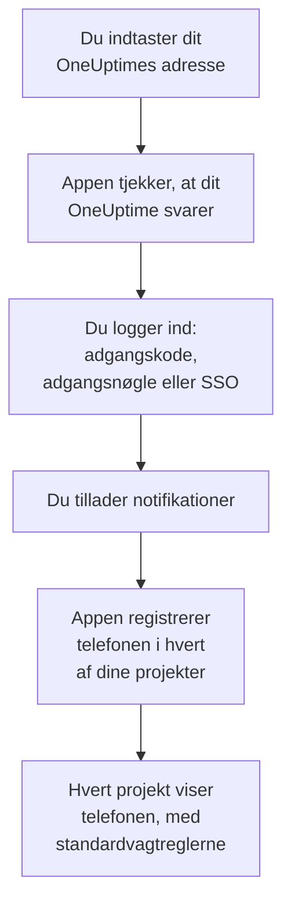
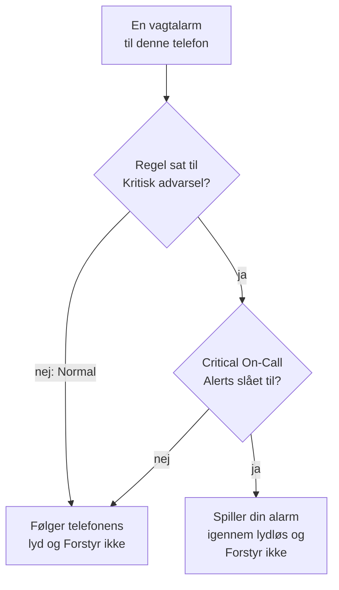

# Android-installation

Installer **OneUptime On-Call** på en Android-telefon eller -tablet, forbind den med dit OneUptime, og log ind. Send dig selv en testnotifikation bagefter, og lad akutte vagtalarmer ringe igennem lydløs og Forstyr ikke.

:::cards
- [Installer appen](#installer-appen): Fra Google Play, eller APK'en på en telefon uden Google Play.
- [Log ind](#log-ind): Dit OneUptimes adresse, derefter din konto.
- [Tjek, at alarmer når telefonen](#tjek-at-alarmer-når-telefonen): Find telefonen i dashboardet, og test den.
- [Ring igennem lydløs](#ring-igennem-lydløs): Kritiske advarsler og alarmlyden.
- [Fejlfinding](#fejlfinding): Problemer med login, notifikationer og installation.
:::

## Før du begynder

- En telefon eller tablet med Android 7.0 eller nyere.
- En konto i et OneUptime-projekt. For at blive tilkaldt skal du også have vagt: se [Eskaleringsregler](/docs/on-call/escalation-rules).
- Dit OneUptimes adresse: `https://oneuptime.com` på OneUptime Cloud, eller din egen, for eksempel `https://oneuptime.example.com`. Appen forbinder kun over HTTPS.

## Installer appen

:::tabs
@tab Google Play
1. Åbn [OneUptime On-Call på Google Play](https://play.google.com/store/apps/details?id=com.oneuptime.oncall) på telefonen, eller søg efter OneUptime On-Call i Google Play.
2. Tryk på **Installer** og derefter på **Åbn**.

Google Play holder appen opdateret.
@tab APK
Til en telefon uden Google Play. APK'en bygges fra den samme kode til hver OneUptime-udgivelse og vedhæftes udgivelsen på GitHub.

1. Åbn [den nyeste APK](https://github.com/OneUptime/oneuptime/releases/latest/download/oneuptime-on-call-android-app.apk) på telefonen.
2. Åbn den hentede fil. Hvis Android spørger, så lad din browser installere ukendte apps, og tryk derefter på **Installer**.
3. Åbn OneUptime On-Call fra dine apps.

En APK opdaterer ikke sig selv: installer den nyeste oven på den en gang imellem. Dit login og dine indstillinger bevares.
:::

## Log ind

:::steps
### Indtast dit OneUptimes adresse
Åbn appen. Behold `https://oneuptime.com` på **Connect your workspace** til OneUptime Cloud, eller indtast adressen på dit eget OneUptime, og tryk på **Connect**. Appen går videre, så snart `https://<your-oneuptime>/api/status` svarer.

### Log ind på din konto
Brug den måde, din konto logger ind på:

- Din e-mail og adgangskode, derefter **Sign In**. **Forgot password?** e-mailer dig et link til at vælge en ny.
- **Sign in with a passkey**, når du har tilføjet en i dashboardet: se [Tilføj en adgangsnøgle](/docs/introduction/your-account#tilføj-en-adgangsnøgle). Din browser åbner for at bekræfte den og sender dig derefter tilbage.
- **Sign in with SSO**, hvis din organisation bruger single sign-on. Vælg din udbyder, eller indtast din arbejds-e-mail og tryk på **Continue**. En sikker browser åbner, og du er tilbage i appen, så snart du er logget ind.

Med totrinsgodkendelse slået til indtaster du den sekscifrede kode fra din godkendelsesapp, eller en af dine backupkoder. En sikkerhedsnøgle kan ikke bruges i appen. Kræver din administrator totrinsgodkendelse, og har du ikke sat den op endnu, sætter appen først en godkendelsesapp op sammen med dig.

### Tillad notifikationer
Når Android spørger, om OneUptime On-Call må sende notifikationer, trykker du på **Tillad**. Android 13 og nyere spørger; ældre versioner tillader dem, så længe du ikke slår dem fra.

Appen registrerer derefter telefonen i hvert af dine projekter. Hvert projekt viser den blandt dine push-enheder med standardvagtreglerne, så dine alarmer når den fra nu af.
:::

Appen viser ét projekt ad gangen: tryk på projektets navn øverst på en skærm for at skifte. Et projekt, der kræver single sign-on, står som **SSO Required** under **Settings → Manage Projects**, indtil du trykker på **Authenticate with SSO** dér.

## Tjek, at alarmer når telefonen

:::steps
### Find telefonen i dashboardet
Åbn **Brugerindstillinger → Notifikationsmetoder** og fanen **Push Notifications** i dashboardet. Telefonen står under **Enheder til push-notifikationer** med sit modelnavn. Hvert projekt har sin egen liste.

### Send en test
Klik på **Testnotifikation** i telefonens række. En notifikation kommer frem på telefonen; tryk på den for at åbne appen.
:::

Dine vagtregler bestemmer, hvilke alarmer der går til telefonen, og hvor hurtigt: se **Brugerindstillinger → Vagtregler**. En ny telefon får de samme standardregler som enhver anden metode, du tilføjer.

## Ring igennem lydløs

Som standard følger en vagtalarm telefonens lydindstillinger: en telefon på lydløs forbliver stille, og Forstyr ikke holder alarmen tilbage. Kritiske advarsler lader vagtalarmer ringe igennem begge. De er slået fra, indtil du slår dem til, telefon for telefon.

:::steps
### Slå Critical On-Call Alerts til
Åbn **Settings** i appen, og slå **Critical On-Call Alerts** til under **Notifications**.

### Tillad adgang til Forstyr ikke
Android åbner sin liste **Adgang til Forstyr ikke**. Slå adgangen til for OneUptime On-Call, og gå tilbage til appen: den tjekker adgangen og siger under kontakten, om alarmer vil ringe igennem.

### Vælg en alarmlyd
Tryk på **Alarm sound** under kontakten. Ud over telefonens egen lyd tilbyder appen Klaxon, Siren, Digital alarm, Smoke alarm og Rising alarm, som starter blødt og bliver højere. Tryk på afspil ud for en lyd for at høre den. En kritisk alarm spiller med telefonens alarmlydstyrke, så hold den skruet op.
:::

Kun vagtalarmer ringer igennem, og kun fra vagtregler sat til **Kritisk advarsel**, standarden. En regel sat til **Normal** følger telefonens indstillinger, uanset hvad kontakten siger, så du kan blive vækket af en kritisk hændelse og tilkaldt stille for en mindre. Send en **Testnotifikation** med telefonen på lydløs for at høre, hvad en alarm vil gøre.

## Undgå, at alarmer kommer for sent

OneUptime sender vagtalarmer med høj prioritet, som Android leverer selv til en telefon, der har ligget stille i timevis. En telefon, der begrænser appens batteriforbrug, kan stadig holde dem tilbage:

- Åbn **Indstillinger → Apps → OneUptime On-Call → Batteri**, og vælg **Ubegrænset**. Nogle telefoner kalder det **Appens batteriforbrug**.
- Tjek, at appens notifikationer er slået til, under **Indstillinger → Apps → OneUptime On-Call → Notifikationer**.
- Hold OneUptime On-Call uden for enhver liste over batteribesparelse eller sovende apps, som din telefon har.

## Lås appen

Slå **Biometrics Login** til under **Settings** i appen, så spørger appen om dit fingeraftryk, dit ansigt eller telefonens skærmlås, hver gang den starter. Kontakten vises, når telefonen har oplåsning med fingeraftryk eller ansigt sat op. **Appearance** på samme skærm vælger det lyse eller mørke udseende, eller følger telefonen.

## Opdater, log ud eller afinstaller

- **Opdater.** Google Play opdaterer appen. Til APK'en installerer du den nyeste oven på. Appens version står nederst på dens skærm **Settings**.
- **Log ud.** **Settings → Log Out** logger dig ud og fjerner telefonen fra dine push-enheder i alle projekter, sammen med dens vagtregler. Logger du ind igen, kommer den tilbage med standardreglerne.
- **Afinstaller.** Fjern appen som enhver anden. Var du stadig logget ind, bliver telefonen på din liste, indtil et push til den mislykkes: OneUptime markerer den så som **Modtager ikke notifikationer**. Slet den post med **Slet**: installerer du appen igen og logger ind, tilføjes telefonen som en ny post med standardreglerne.

## Fejlfinding

:::details »Could not connect to the server«
Appen kunne ikke nå `https://<your-oneuptime>/api/status`. Tjek adressen, inklusive `https://`. Er dit OneUptime på et privat netværk, så forbind telefonen til det først, for eksempel via dit VPN. Åbn den adresse i telefonens browser: den viser `{"status":"ok"}`, når telefonen kan nå OneUptime.
:::

:::details Der kommer ingen notifikationer
- Tjek i Androids indstillinger, at notifikationer er slået til for appen, og at Forstyr ikke er slået fra eller kritiske advarsler slået til.
- Tjek, at telefonen står under **Push Notifications** i **Brugerindstillinger → Notifikationsmetoder**, og send den en **Testnotifikation**.
- Er telefonen markeret som **Modtager ikke notifikationer**, så åbn appen, mens du er logget ind. Den registrerer telefonen igen; se [Når en telefon skal registreres igen](/docs/mobile-desktop-apps/faq-troubleshooting#når-en-telefon-skal-registreres-igen).
- Tjek dine vagtregler under **Brugerindstillinger → Vagtregler**.
- På et selv-hostet OneUptime skal du tjekke, at din server kan nå sit push-relæ: se [Push-notifikationer](/docs/self-hosted/push-notifications#netværksadgang).
:::

:::details Kritiske advarsler er tavse i Forstyr ikke
Åbn **Settings** i appen: linjen under **Critical On-Call Alerts** siger, hvad der mangler. Oftest blev adgang til Forstyr ikke ikke tilladt: tillad den under **Indstillinger → Notifikationer → Adgang til Forstyr ikke**, og gå tilbage til appen. Har du valgt en alarmlyd, skal den lyds notifikationskanal også have lov til at tilsidesætte Forstyr ikke.
:::

:::details »Appen blev ikke installeret«, når du installerer APK'en
OneUptime On-Call er allerede på telefonen fra en anden kilde, som Google Play, og Android installerer ikke den ene oven på den anden. Afinstaller den, installer APK'en, og log ind igen.
:::

:::details Ingen kontakt til Biometrics Login
Kontakten vises, når oplåsning med fingeraftryk eller ansigt er sat op i Androids indstillinger.
:::

## Næste trin

:::cards
- [Ofte stillede spørgsmål og fejlfinding](/docs/mobile-desktop-apps/faq-troubleshooting): Hvad du gør, når en telefon holder op med at få alarmer.
- [iOS-installation](/docs/mobile-desktop-apps/ios-installation): Den samme app på en iPhone eller iPad.
- [Eskaleringsregler](/docs/on-call/escalation-rules): Bestem, hvem der tilkaldes, og hvornår.
- [Push-notifikationer](/docs/self-hosted/push-notifications): Sådan sender et selv-hostet OneUptime alarmer til telefoner.
:::
