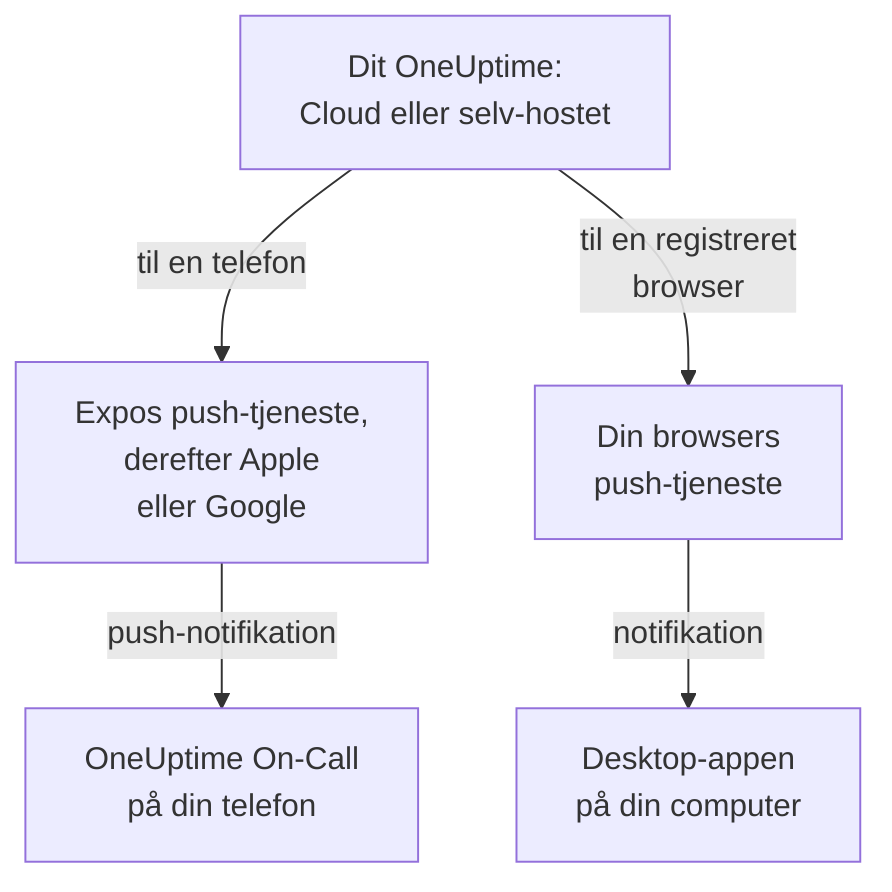

# Apps – Oversigt

OneUptime har en app til din telefon og en til din computer. **OneUptime On-Call**, til iPhone, iPad og Android, tilkalder dig, når du har vagt, og lader dig kvittere og løse, uanset hvor du er. På Windows, macOS og Linux installerer du OneUptime-dashboardet fra din browser som en desktop-app med sit eget vindue. Begge virker med OneUptime Cloud og med et OneUptime, du selv hoster.

:::cards
- [Vælg en app](#vælg-en-app): Hvad hver app er til, side om side.
- [Sådan når apps OneUptime](#sådan-når-apps-oneuptime): Hvilken vej login og vagtalarmer går.
- [Hent mobilappen](#hent-mobilappen): Fra App Store, Google Play eller GitHub.
- [Hent desktop-appen](#hent-desktop-appen): Installer dashboardet fra Edge, Chrome eller Safari.
:::

## Vælg en app

|  | Mobilapp | Desktop-app |
| --- | --- | --- |
| Hvad den er | OneUptime On-Call, en native app til iPhone, iPad og Android | OneUptime-dashboardet, installeret fra din browser |
| Hvor du får den | App Store, Google Play eller en APK fra GitHub | Dit eget OneUptime: der er intet at downloade |
| Vagtalarmer | Push-notifikationer, der kan ringe igennem lydløs og Forstyr ikke | Browsernotifikationer, når du har registreret browseren |
| Hvad du kan | Hændelser, advarsler, sikkerhedssager, monitorer og hvem der har vagt; kvittere, løse, godkende playbook-trin og tilføje noter | Alt, hvad dashboardet kan |
| Opdateringer | Fra butikken, eller ved at installere en nyere APK | Hver gang den åbner, henter den dashboardet fra dit OneUptime |
| Kører på | iOS 16.4 eller nyere, Android 7.0 eller nyere | Windows, macOS og Linux, med Edge eller Chrome, eller Safari på macOS Sonoma 14 eller nyere |

Du kan bruge begge: hold desktop-appen åben på arbejdet, og lad telefonen vække dig om natten.

## Sådan når apps OneUptime

Mobilappen logger ind på dit OneUptime og registrerer telefonen i hvert projekt, du er medlem af. Derefter sender OneUptime telefonens push-notifikationer, heriblandt vagtalarmerne, gennem Expos push-tjeneste, som giver dem videre til Apple eller Google til levering. Som standard sender et selv-hostet OneUptime dem gennem OneUptimes push-relæ, så det behøver ingen egen konto hos Apple, Google eller Expo: se [Push-notifikationer](/docs/self-hosted/push-notifications).

Desktop-appen er selve dashboardet i sit eget vindue. Den viser notifikationer, når du har registreret dens browser til push-notifikationer: siderne om Windows, macOS og Linux viser hvordan.

## Før du begynder

- En konto i et OneUptime-projekt. For at blive tilkaldt skal du også have vagt: se [Eskaleringsregler](/docs/on-call/escalation-rules).
- Dit OneUptimes adresse. På OneUptime Cloud er det `https://oneuptime.com`; et selv-hostet OneUptime har sin egen, for eksempel `https://oneuptime.example.com`.
- Dit OneUptime over HTTPS. Mobilappen forbinder ikke over almindelig HTTP, og browsere viser kun notifikationer, og Edge og Chrome installerer kun apps, for HTTPS-websteder.

## Hent mobilappen

:::steps
### Installer OneUptime On-Call
Hent den fra [App Store](https://apps.apple.com/us/app/oneuptime-on-call/id6759615391) på en iPhone eller iPad, eller fra [Google Play](https://play.google.com/store/apps/details?id=com.oneuptime.oncall) på Android. Til en Android-telefon uden Google Play installerer du i stedet [APK'en](https://github.com/OneUptime/oneuptime/releases/latest/download/oneuptime-on-call-android-app.apk). De samme links står i dashboardet under **Projektindstillinger → Notifikationer → Mobilapps**.

### Forbind den med dit OneUptime
Åbn appen, behold `https://oneuptime.com` til OneUptime Cloud eller indtast adressen på dit eget OneUptime, og log ind med din adgangskode, en adgangsnøgle eller single sign-on.

### Tillad notifikationer
Tillad dem, når telefonen spørger. Appen registrerer telefonen i hvert af dine projekter, og dine vagtalarmer når den fra da af.
:::

Hvert trin i detaljer, med hvad du tjekker bagefter: [Android-installation](/docs/mobile-desktop-apps/android-installation) og [iOS-installation](/docs/mobile-desktop-apps/ios-installation).

## Hent desktop-appen

:::steps
### Åbn dit dashboard
Log ind på dit OneUptime i Microsoft Edge eller Google Chrome, eller i Safari på en Mac.

### Installer det
Klik i Edge eller Chrome på installationsikonet til højre i adresselinjen. Vælg i Safari **Arkiv → Føj til Dock**.

### Åbn det som enhver anden app
Det åbner i sit eget vindue, fra menuen Start, Dock eller din appstarter.
:::

Hver browser trin for trin: [Windows-installation](/docs/mobile-desktop-apps/windows-installation), [macOS-installation](/docs/mobile-desktop-apps/macos-installation) og [Linux-installation](/docs/mobile-desktop-apps/linux-installation).

## Næste trin

:::cards
- [Android-installation](/docs/mobile-desktop-apps/android-installation): Installer appen på Android, log ind, og tjek, at alarmer kommer frem.
- [iOS-installation](/docs/mobile-desktop-apps/ios-installation): Installer appen på en iPhone eller iPad, og slå kritiske advarsler til.
- [Windows-installation](/docs/mobile-desktop-apps/windows-installation): Installer dashboardet fra Edge eller Chrome.
- [macOS-installation](/docs/mobile-desktop-apps/macos-installation): Føj dashboardet til Dock fra Safari, Chrome eller Edge.
- [Linux-installation](/docs/mobile-desktop-apps/linux-installation): Installer dashboardet fra Chrome, Chromium eller Edge.
- [Ofte stillede spørgsmål og fejlfinding](/docs/mobile-desktop-apps/faq-troubleshooting): Svar, løsninger, og hvad du gør, når en telefon holder op med at få alarmer.
:::
