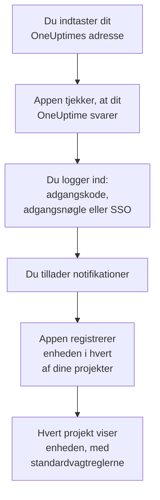
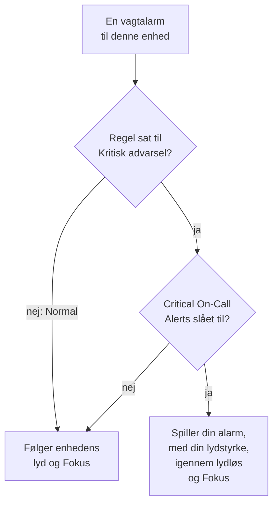

# iOS-installation

Installer **OneUptime On-Call** fra App Store på en iPhone eller iPad, forbind den med dit OneUptime, og log ind. Send dig selv en testnotifikation bagefter, og lad akutte vagtalarmer ringe igennem lydløs og Fokus.

:::cards
- [Installer appen](#installer-appen): Fra App Store.
- [Log ind](#log-ind): Dit OneUptimes adresse, derefter din konto.
- [Tjek, at alarmer når enheden](#tjek-at-alarmer-når-enheden): Find den i dashboardet, og test den.
- [Ring igennem lydløs](#ring-igennem-lydløs): Kritiske advarsler, alarmlyden og dens lydstyrke.
- [Fejlfinding](#fejlfinding): Problemer med login, notifikationer og kritiske advarsler.
:::

## Før du begynder

- En iPhone eller iPad med iOS 16.4 eller nyere, eller iPadOS 16.4 eller nyere.
- En konto i et OneUptime-projekt. For at blive tilkaldt skal du også have vagt: se [Eskaleringsregler](/docs/on-call/escalation-rules).
- Dit OneUptimes adresse: `https://oneuptime.com` på OneUptime Cloud, eller din egen, for eksempel `https://oneuptime.example.com`. Appen forbinder kun over HTTPS.

## Installer appen

1. Åbn [OneUptime On-Call i App Store](https://apps.apple.com/us/app/oneuptime-on-call/id6759615391) på din iPhone eller iPad, eller søg efter OneUptime On-Call i App Store.
2. Tryk på **Hent**, og bekræft med Face ID, Touch ID eller adgangskoden til din Apple-konto.
3. Tryk på **Åbn**, eller åbn OneUptime On-Call fra hjemmeskærmen.

App Store holder appen opdateret, så længe **Appopdateringer** er slået til under **Indstillinger → App Store**.

## Log ind

:::steps
### Indtast dit OneUptimes adresse
Åbn appen. Behold `https://oneuptime.com` på **Connect your workspace** til OneUptime Cloud, eller indtast adressen på dit eget OneUptime, og tryk på **Connect**. Appen går videre, så snart `https://<your-oneuptime>/api/status` svarer.

### Log ind på din konto
Brug den måde, din konto logger ind på:

- Din e-mail og adgangskode, derefter **Sign In**. **Forgot password?** e-mailer dig et link til at vælge en ny.
- **Sign in with SSO**, hvis din organisation bruger single sign-on. Vælg din udbyder, eller indtast din arbejds-e-mail og tryk på **Continue**. En sikker browser åbner, og du er tilbage i appen, så snart du er logget ind.
- **Sign in with a passkey**, når du har tilføjet en i dashboardet: se [Tilføj en adgangsnøgle](/docs/introduction/your-account#tilføj-en-adgangsnøgle). Et browserark åbner for at bekræfte den og sender dig derefter tilbage.

Med totrinsgodkendelse slået til indtaster du den sekscifrede kode fra din godkendelsesapp, eller en af dine backupkoder. En sikkerhedsnøgle kan ikke bruges i appen. Kræver din administrator totrinsgodkendelse, og har du ikke sat den op endnu, sætter appen først en godkendelsesapp op sammen med dig.

### Tillad notifikationer
Når iOS spørger, om OneUptime On-Call må sende dig notifikationer, trykker du på **Tillad**.

Appen registrerer derefter din iPhone eller iPad i hvert af dine projekter. Hvert projekt viser den blandt dine push-enheder med standardvagtreglerne, så dine alarmer når den fra nu af.
:::

Appen viser ét projekt ad gangen: tryk på projektets navn øverst på en skærm for at skifte. Et projekt, der kræver single sign-on, står som **SSO Required** under **Settings → Manage Projects**, indtil du trykker på **Authenticate with SSO** dér.

## Tjek, at alarmer når enheden

:::steps
### Find enheden i dashboardet
Åbn **Brugerindstillinger → Notifikationsmetoder** og fanen **Push Notifications** i dashboardet. Din iPhone eller iPad står under **Enheder til push-notifikationer** med sit modelnavn. Hvert projekt har sin egen liste.

### Send en test
Klik på **Testnotifikation** i enhedens række. En notifikation kommer frem på enheden; tryk på den for at åbne appen.
:::

Dine vagtregler bestemmer, hvilke alarmer der går til enheden, og hvor hurtigt: se **Brugerindstillinger → Vagtregler**. En ny enhed får de samme standardregler som enhver anden metode, du tilføjer.

## Ring igennem lydløs

Som standard følger en vagtalarm enhedens lydindstillinger: lydløs holder den stille, og et Fokus som Forstyr ikke holder den tilbage. Kritiske advarsler lader vagtalarmer ringe igennem begge. De er slået fra, indtil du slår dem til, enhed for enhed.

:::steps
### Slå Critical On-Call Alerts til
Åbn **Settings** i appen, og slå **Critical On-Call Alerts** til under **Notifications**.

### Tillad kritiske advarsler
Når iOS spørger, om OneUptime On-Call må sende kritiske advarsler, trykker du på **Tillad**. iOS tilføjer så en kontakt **Kritiske advarsler** for appen under **Indstillinger → Notifikationer → OneUptime On-Call**, hvor du kan ombestemme dig senere. Linjen under appens kontakt siger, om alarmer vil ringe igennem.

### Vælg en alarmlyd og dens lydstyrke
Tryk på **Alarm sound** under kontakten. Ud over enhedens egen lyd til kritiske advarsler tilbyder appen Klaxon, Siren, Digital alarm, Smoke alarm og Rising alarm, som starter blødt og bliver højere. Tryk på afspil ud for en lyd for at høre den. Vælg derefter den lydstyrke, en alarm spiller med: 25 %, 50 %, 75 % eller 100 %, standarden.
:::

Kun vagtalarmer ringer igennem, og kun fra vagtregler sat til **Kritisk advarsel**, standarden. En regel sat til **Normal** følger enhedens indstillinger, uanset hvad kontakten siger, så du kan blive vækket af en kritisk hændelse og tilkaldt stille for en mindre. Send en **Testnotifikation** med enheden på lydløs for at høre, hvad en alarm vil gøre. Eksemplet på skærmen **Alarm sound** spiller med ringelydstyrken og slet ikke på lydløs; en rigtig alarm ringer igennem lydløs med den lydstyrke, du valgte.

> [!NOTE]
> Kritiske advarsler kræver OneUptime On-Call 1.5.0 eller nyere fra App Store. Tidligere versioner blev bygget uden Apples tilladelse til kritiske advarsler, så iOS tilbød dem aldrig kontakten.

## Undgå, at alarmer bliver holdt tilbage

Uden kritiske advarsler kan et Fokus eller en opsummering holde alarmer tilbage:

- **Fokus.** Føj OneUptime On-Call til de apps, hvert Fokus tillader, under **Indstillinger → Fokus**.
- **Planlagt opsummering.** Hold OneUptime On-Call uden for den, under **Indstillinger → Notifikationer → Planlagt opsummering**: en notifikation i opsummeringen venter til opsummeringens næste tidspunkt.
- **Notifikationer.** Lad **Tillad notifikationer** være slået til under **Indstillinger → Notifikationer → OneUptime On-Call**.

## Lås appen

Slå **Biometrics Login** til under **Settings** i appen, så spørger appen om Face ID, Touch ID eller din kode, hver gang den starter. Kontakten vises, når Face ID eller Touch ID er sat op på enheden. **Appearance** på samme skærm vælger det lyse eller mørke udseende, eller følger enheden.

## Opdater, log ud eller slet appen

- **Opdater.** App Store opdaterer appen; du kan også opdatere den fra din konto i App Store. Appens version står nederst på dens skærm **Settings**.
- **Log ud.** **Settings → Log Out** logger dig ud og fjerner enheden fra dine push-enheder i alle projekter, sammen med dens vagtregler. Logger du ind igen, kommer den tilbage med standardreglerne.
- **Slet.** Hold fingeren på appens symbol, og tryk på **Fjern app** og derefter **Slet app**. Var du stadig logget ind, bliver enheden på din liste, indtil et push til den mislykkes: OneUptime markerer den så som **Modtager ikke notifikationer**. Installerer du appen igen og logger ind, kommer den post som regel tilbage med sine regler; bruger du ikke enheden mere, så slet posten med **Slet**.

## Fejlfinding

:::details »Could not connect to the server«
Appen kunne ikke nå `https://<your-oneuptime>/api/status`. Tjek adressen, inklusive `https://`. Er dit OneUptime på et privat netværk, så forbind enheden til det først, for eksempel via dit VPN. Åbn den adresse i Safari på enheden: den viser `{"status":"ok"}`, når enheden kan nå OneUptime.
:::

:::details Der kommer ingen notifikationer
- Tjek, at **Tillad notifikationer** er slået til under **Indstillinger → Notifikationer → OneUptime On-Call**, og at intet Fokus holder alarmer tilbage.
- Tjek, at enheden står under **Push Notifications** i **Brugerindstillinger → Notifikationsmetoder**, og send den en **Testnotifikation**.
- Er enheden markeret som **Modtager ikke notifikationer**, så åbn appen, mens du er logget ind. Den registrerer enheden igen; se [Når en telefon skal registreres igen](/docs/mobile-desktop-apps/faq-troubleshooting#når-en-telefon-skal-registreres-igen).
- Tjek dine vagtregler under **Brugerindstillinger → Vagtregler**.
- På et selv-hostet OneUptime skal du tjekke, at din server kan nå sit push-relæ: se [Push-notifikationer](/docs/self-hosted/push-notifications#netværksadgang).
:::

:::details Ingen kontakt til kritiske advarsler i iOS' indstillinger
Slå først **Critical On-Call Alerts** til i appen: iOS tilføjer først sin kontakt, når appen har bedt om kritiske advarsler. Siger appen, at denne version ikke kan modtage kritiske advarsler, så opdater OneUptime On-Call fra App Store.
:::

:::details Kritiske advarsler er tavse
Åbn **Settings** i appen: linjen under **Critical On-Call Alerts** siger, hvad der mangler. Tjek, at **Kritiske advarsler** er slået til under **Indstillinger → Notifikationer → OneUptime On-Call**, og at lydstyrken på appens skærm **Alarm sound** ikke står lavt.
:::

:::details Ingen kontakt til Biometrics Login
Kontakten vises, når Face ID eller Touch ID er sat op under **Indstillinger → Face ID & kode** eller **Indstillinger → Touch ID & kode**.
:::

## Næste trin

:::cards
- [Ofte stillede spørgsmål og fejlfinding](/docs/mobile-desktop-apps/faq-troubleshooting): Hvad du gør, når en telefon holder op med at få alarmer.
- [Android-installation](/docs/mobile-desktop-apps/android-installation): Den samme app på Android.
- [Eskaleringsregler](/docs/on-call/escalation-rules): Bestem, hvem der tilkaldes, og hvornår.
- [Push-notifikationer](/docs/self-hosted/push-notifications): Sådan sender et selv-hostet OneUptime alarmer til telefoner.
:::
