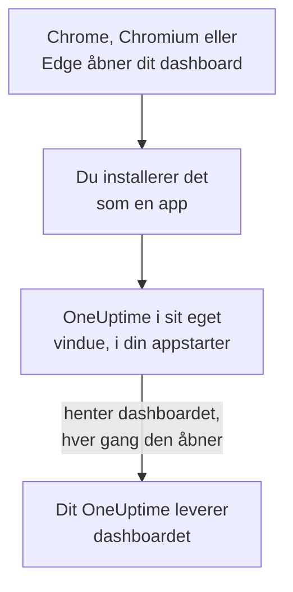

# Linux-installation

OneUptime-dashboardet installeres på Linux som en app, fra Google Chrome, Chromium eller Microsoft Edge. Det åbner i sit eget vindue, med sin egen post i dit skrivebords appstarter, og kan vise notifikationer. Der er intet at downloade: appen er dashboardet fra dit OneUptime, og den er opdateret, så snart dit OneUptime er det.

:::cards
- [Installer appen](#installer-appen): Fra Chrome, Chromium eller Edge.
- [Åbn den fra din appstarter](#åbn-den-fra-din-appstarter): Som enhver anden desktop-app.
- [Få notifikationer på denne computer](#få-notifikationer-på-denne-computer): Registrer browseren til push-notifikationer.
- [Fejlfinding](#fejlfinding): Intet installationsikon, ingen notifikationer, ingen post i appstarteren.
:::

## Sådan virker desktop-appen

Den installerede app deler login, indstillinger og notifikationstilladelse med sin browser. Luk browseren, og appen kører videre i sit eget vindue.

## Før du begynder

- Et Linux-skrivebord med en nyere Google Chrome, Chromium eller Microsoft Edge.
- Dit OneUptimes adresse, over HTTPS: `https://oneuptime.com` på OneUptime Cloud, eller din egen, for eksempel `https://oneuptime.example.com`.
- En konto, du kan logge ind på dashboardet med.

## Installer appen

:::tabs
@tab Chrome
1. Åbn dit OneUptime i Chrome eller Chromium, og log ind.
2. Klik på installationsikonet til højre i adresselinjen på en vilkårlig dashboardside, og derefter på **Installer**. Eller åbn **⋮ → Cast, gem og del → Installer side som app…**.
3. Chrome åbner OneUptime i sit eget vindue og føjer det til din appstarter.
@tab Edge
1. Åbn dit OneUptime i Edge, og log ind.
2. Klik på installationsikonet til højre i adresselinjen på en vilkårlig dashboardside, og derefter på **Installer**. Eller åbn **Indstillinger og mere (…) → Flere værktøjer → Apps → Installer dette websted som en app**.
3. Edge åbner OneUptime i sit eget vindue og føjer det til din appstarter.
:::

Installer fra en dashboardside, efter du er logget ind: loginsiden er ikke appen.

## Åbn den fra din appstarter

Browseren tilføjer en skrivebordspost for appen, en `.desktop`-fil i `~/.local/share/applications`, så OneUptime vises i GNOME, KDE Plasma og andre appstartere. Fastgør den til din dock eller dit panel derfra, som enhver anden app.

## Få notifikationer på denne computer

Appen viser notifikationer gennem sin browser, når du har registreret browseren til push-notifikationer i hvert projekt, du vil have dem fra.

:::steps
### Åbn dine push-enheder
Åbn **Brugerindstillinger → Notifikationsmetoder** og fanen **Push Notifications** i appen.

### Registrer denne browser
Klik på **Registrer enhed**, behold det foreslåede **Enhedsnavn**, for eksempel `Chrome on Linux`, eller ret det, og klik på **Registrer enhed** igen. Når browseren spørger, om OneUptime må vise notifikationer, vælger du **Tillad**.

### Send en test
Klik på **Send Test Notification** i dialogen **Browser Registered**. Dit skrivebord viser den gennem sin notifikationstjeneste; vises der intet, så se [Fejlfinding](#fejlfinding).
:::

En browser kan ikke ringe igennem dit skrivebords Forstyr ikke. Brug mobilappen med kritiske advarsler til alarmer, der skal vække dig: se [Android-installation](/docs/mobile-desktop-apps/android-installation#ring-igennem-lydløs).

På et selv-hostet OneUptime kræver browsernotifikationer serverens VAPID-nøgler: se [Push-notifikationer](/docs/self-hosted/push-notifications#selvhostet-opsætning).

## Opdateringer

Der er intet at opdatere. Appen henter dashboardet fra dit OneUptime, hver gang den åbner, så den ændrer sig, når dit OneUptime bliver opgraderet. Har et vindue været åbent siden opgraderingen, så genindlæs det med Ctrl+R.

## Afinstaller

:::tabs
@tab Chrome
Åbn menuen **⋮** i appens vindue, vælg punktet, der afinstallerer appen, og derefter **Fjern**.
@tab Edge
Åbn `edge://apps` i Edge, vælg **Detaljer** ved OneUptime, og derefter **Afinstaller**.
:::

At afinstallere appen afregistrerer ikke dens browser: den får stadig notifikationer. Vil du stoppe dem, så slet browseren under **Brugerindstillinger → Notifikationsmetoder** på fanen **Push Notifications** med **Slet**.

## Fejlfinding

:::details Intet installationsikon i adresselinjen
Åbn en dashboardside efter login, ikke loginsiden, og tjek, at adressen starter med `https://`: browsere installerer kun apps fra sikre websteder. Vises ikonet stadig ikke, så brug browserens menu som ovenfor. Andre browsere installerer måske ikke websteder som apps; brug Chrome, Chromium eller Edge.
:::

:::details Der vises ingen notifikationer
- Tjek under **Brugerindstillinger → Notifikationsmetoder** på fanen **Push Notifications**, at denne browser står på listen, og send den en **Testnotifikation**.
- Tjek, at dit skrivebords Forstyr ikke er slået fra, og at dets notifikationsindstillinger tillader browseren.
- Blokerer browseren notifikationer for OneUptime, så klik på ikonet til venstre i adresselinjen, tillad notifikationer for webstedet, og registrer browseren igen.
- På et selv-hostet OneUptime siger dialogen **Registrer enhed**, når serveren ikke har VAPID-nøgler.
:::

:::details Appen mangler i appstarteren
Åbn den fra browseren i stedet: `chrome://apps` i Chrome eller Chromium, `edge://apps` i Edge. En appstarter, der kun læser skrivebordsposter ved login, viser den, når du har logget ud og ind igen.
:::

## Næste trin

:::cards
- [Android-installation](/docs/mobile-desktop-apps/android-installation): Bliv tilkaldt på din telefon, med kritiske advarsler.
- [Windows-installation](/docs/mobile-desktop-apps/windows-installation): Den samme app på Windows.
- [Ofte stillede spørgsmål og fejlfinding](/docs/mobile-desktop-apps/faq-troubleshooting): Svar om begge apps.
- [Din konto](/docs/introduction/your-account): Sådan når OneUptime dig i hvert projekt.
:::
