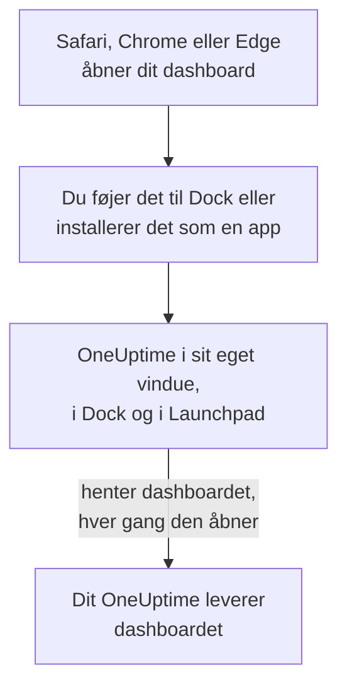

# macOS-installation

OneUptime-dashboardet installeres på en Mac som en app: føj det til Dock fra Safari, eller installer det fra Google Chrome eller Microsoft Edge. Det åbner i sit eget vindue, med sit eget symbol i Dock og i Launchpad, og kan vise notifikationer. Der er intet at downloade: appen er dashboardet fra dit OneUptime, og den er opdateret, så snart dit OneUptime er det.

:::cards
- [Installer appen](#installer-appen): Fra Safari, Chrome eller Edge.
- [Behold den i Dock](#behold-den-i-dock): Åbn den med ét klik, eller ved login.
- [Få notifikationer på denne Mac](#få-notifikationer-på-denne-mac): Registrer appen til push-notifikationer.
- [Fejlfinding](#fejlfinding): Ingen Føj til Dock, ingen notifikationer, log ind igen.
:::

## Sådan virker desktop-appen

En Safari-webapp har sit eget login, sine egne cookies og indstillinger, adskilt fra Safari. En app installeret fra Chrome eller Edge deler dem med den browser.

## Før du begynder

- macOS Sonoma 14 eller nyere til Safari. Chrome og Edge installerer apps på enhver macOS, de kører på.
- Dit OneUptimes adresse, over HTTPS: `https://oneuptime.com` på OneUptime Cloud, eller din egen, for eksempel `https://oneuptime.example.com`.
- En konto, du kan logge ind på dashboardet med.

## Installer appen

:::tabs
@tab Safari
1. Åbn dit OneUptime i Safari, og log ind.
2. Vælg **Arkiv → Føj til Dock** på en vilkårlig dashboardside, eller klik på deleknappen i værktøjslinjen og derefter på **Føj til Dock**.
3. Behold navnet eller ret det, og klik på **Tilføj**.
4. Åbn OneUptime fra Dock, og log ind én gang til: webappen deler ikke Safaris login.
@tab Chrome
1. Åbn dit OneUptime i Chrome, og log ind.
2. Klik på installationsikonet til højre i adresselinjen på en vilkårlig dashboardside, og derefter på **Installer**. Eller åbn **⋮ → Cast, gem og del → Installer side som app…**.
3. Chrome åbner OneUptime i sit eget vindue og føjer det til Launchpad.
@tab Edge
1. Åbn dit OneUptime i Edge, og log ind.
2. Klik på installationsikonet til højre i adresselinjen på en vilkårlig dashboardside, og derefter på **Installer**. Eller åbn **Indstillinger og mere (…) → Flere værktøjer → Apps → Installer dette websted som en app**.
3. Edge åbner OneUptime i sit eget vindue og føjer det til Launchpad.
:::

Installer fra en dashboardside, efter du er logget ind: loginsiden er ikke appen. Safari gemmer webappen i mappen Programmer i din hjemmemappe.

## Behold den i Dock

- **Dock.** Ctrl-klik på appens symbol i Dock, mens den er åben, og vælg **Valgmuligheder → Behold i Dock**. En Safari-webapp er allerede i Dock.
- **Åbn ved login.** Ctrl-klik på symbolet i Dock, og vælg **Valgmuligheder → Åbn ved login**.
- **Spotlight.** Tryk på Kommando-mellemrum, og skriv OneUptime.

## Få notifikationer på denne Mac

Appen viser notifikationer, når du har registreret den til push-notifikationer i hvert projekt, du vil have dem fra. Registrer Safari-webappen inde fra selve webappen: den er en browser for sig. En app installeret fra Chrome eller Edge registreres med sin browser.

:::steps
### Åbn dine push-enheder
Åbn **Brugerindstillinger → Notifikationsmetoder** og fanen **Push Notifications** i appen.

### Registrer denne app
Klik på **Registrer enhed**, behold det foreslåede **Enhedsnavn**, for eksempel `Safari on macOS`, eller ret det, og klik på **Registrer enhed** igen. Når macOS eller browseren spørger, om OneUptime må sende notifikationer, vælger du **Tillad**.

### Send en test
Klik på **Send Test Notification** i dialogen **Browser Registered**. Vises der intet, så se på Mac'ens notifikationsindstillinger: se [Fejlfinding](#fejlfinding).
:::

En browser kan ikke ringe igennem et Fokus som Forstyr ikke. Brug mobilappen med kritiske advarsler til alarmer, der skal vække dig: se [iOS-installation](/docs/mobile-desktop-apps/ios-installation#ring-igennem-lydløs).

På et selv-hostet OneUptime kræver browsernotifikationer serverens VAPID-nøgler: se [Push-notifikationer](/docs/self-hosted/push-notifications#selvhostet-opsætning).

## Opdateringer

Der er intet at opdatere. Appen henter dashboardet fra dit OneUptime, hver gang den åbner, så den ændrer sig, når dit OneUptime bliver opgraderet. Har et vindue været åbent siden opgraderingen, så genindlæs det med Kommando-R.

## Afinstaller

:::tabs
@tab Safari
Åbn din hjemmemappe i Finder, derefter dens mappe Programmer, og træk OneUptime til papirkurven.
@tab Chrome
Åbn menuen **⋮** i appens vindue, vælg punktet, der afinstallerer appen, og derefter **Fjern**.
@tab Edge
Åbn `edge://apps` i Edge, vælg **Detaljer** ved OneUptime, og derefter **Afinstaller**.
:::

At afinstallere appen afregistrerer den ikke: dens browser får stadig notifikationer. Vil du stoppe dem, så slet den under **Brugerindstillinger → Notifikationsmetoder** på fanen **Push Notifications** med **Slet**.

## Fejlfinding

:::details Ingen Føj til Dock i Safari
Safari føjer webapps til Dock fra macOS Sonoma 14. Opdater macOS, eller installer appen fra Chrome eller Edge i stedet.
:::

:::details Der vises ingen notifikationer
- Tjek under **Brugerindstillinger → Notifikationsmetoder** på fanen **Push Notifications**, at appen eller dens browser står på listen, og send en **Testnotifikation**.
- Åbn **Systemindstillinger → Notifikationer** på din Mac, og tjek, at OneUptime eller browseren, det blev installeret fra, må sende notifikationer, og at intet Fokus holder dem tilbage.
- Blokerer browseren notifikationer for OneUptime, så tillad dem i dens indstillinger for webstedet, og registrer igen.
- På et selv-hostet OneUptime siger dialogen **Registrer enhed**, når serveren ikke har VAPID-nøgler.
:::

:::details Appen beder dig logge ind igen
En Safari-webapp har sit eget login: log ind i appen. En app installeret fra Chrome eller Edge deler sin browsers login, så logger du ud i browseren, eller sletter du dens cookies, bliver den også logget ud.
:::

## Næste trin

:::cards
- [iOS-installation](/docs/mobile-desktop-apps/ios-installation): Bliv tilkaldt på din iPhone, med kritiske advarsler.
- [Windows-installation](/docs/mobile-desktop-apps/windows-installation): Den samme app på Windows.
- [Ofte stillede spørgsmål og fejlfinding](/docs/mobile-desktop-apps/faq-troubleshooting): Svar om begge apps.
- [Din konto](/docs/introduction/your-account): Sådan når OneUptime dig i hvert projekt.
:::
