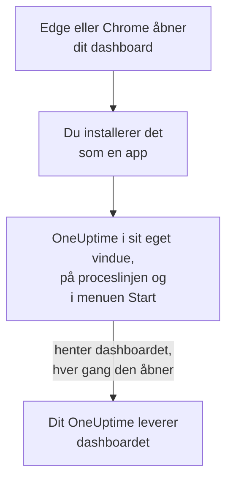

# Windows-installation

OneUptime-dashboardet installeres på Windows som en app, fra Microsoft Edge eller Google Chrome. Det åbner i sit eget vindue, med sit eget ikon på proceslinjen og i menuen Start, og kan vise notifikationer. Der er intet at downloade: appen er dashboardet fra dit OneUptime, og den er opdateret, så snart dit OneUptime er det.

:::cards
- [Installer appen](#installer-appen): Fra Edge eller Chrome, med få klik.
- [Fastgør den, og start den med Windows](#fastgør-den-og-start-den-med-windows): Hav den ét klik væk.
- [Få notifikationer på denne computer](#få-notifikationer-på-denne-computer): Registrer browseren til push-notifikationer.
- [Fejlfinding](#fejlfinding): Intet installationsikon, ingen notifikationer, log ind igen.
:::

## Sådan virker desktop-appen

Den installerede app deler login, indstillinger og notifikationstilladelse med sin browser. Luk browseren, og appen kører videre i sit eget vindue.

## Før du begynder

- Windows 10 eller Windows 11, med en nyere Microsoft Edge eller Google Chrome.
- Dit OneUptimes adresse, over HTTPS: `https://oneuptime.com` på OneUptime Cloud, eller din egen, for eksempel `https://oneuptime.example.com`.
- En konto, du kan logge ind på dashboardet med.

## Installer appen

:::tabs
@tab Edge
1. Åbn dit OneUptime i Edge, og log ind.
2. Klik på installationsikonet til højre i adresselinjen på en vilkårlig dashboardside, og derefter på **Installer**. Eller åbn **Indstillinger og mere (…) → Flere værktøjer → Apps → Installer dette websted som en app**.
3. Edge åbner OneUptime i sit eget vindue og tilbyder måske at fastgøre det til proceslinjen eller Start.
@tab Chrome
1. Åbn dit OneUptime i Chrome, og log ind.
2. Klik på installationsikonet til højre i adresselinjen på en vilkårlig dashboardside, og derefter på **Installer**. Eller åbn **⋮ → Cast, gem og del → Installer side som app…**.
3. Chrome åbner OneUptime i sit eget vindue og føjer det til menuen Start.
:::

Installer fra en dashboardside, efter du er logget ind: loginsiden er ikke appen. Søg efter OneUptime i menuen Start for at åbne den senere.

## Fastgør den, og start den med Windows

- **Proceslinje.** Højreklik på appens ikon på proceslinjen, mens den er åben, og vælg **Fastgør til proceslinje**.
- **Start med Windows.** Åbn `edge://apps` i Edge, vælg **Detaljer** ved OneUptime, og slå **Start automatisk ved logon på enheden** til. Samme side fastgør appen til proceslinjen eller Start, eller lægger en genvej på skrivebordet.

## Få notifikationer på denne computer

Appen viser notifikationer gennem sin browser, når du har registreret browseren til push-notifikationer i hvert projekt, du vil have dem fra.

:::steps
### Åbn dine push-enheder
Åbn **Brugerindstillinger → Notifikationsmetoder** og fanen **Push Notifications** i appen.

### Registrer denne browser
Klik på **Registrer enhed**, behold det foreslåede **Enhedsnavn**, for eksempel `Edge on Windows`, eller ret det, og klik på **Registrer enhed** igen. Når browseren spørger, om OneUptime må vise notifikationer, vælger du **Tillad**.

### Send en test
Klik på **Send Test Notification** i dialogen **Browser Registered**. Vises der intet, så se på Windows' egne notifikationsindstillinger: se [Fejlfinding](#fejlfinding).
:::

En browser ringer ikke højere, end Windows tillader: den kan ikke tilsidesætte Forstyr ikke. Brug mobilappen med kritiske advarsler til alarmer, der skal vække dig: se [Android-installation](/docs/mobile-desktop-apps/android-installation#ring-igennem-lydløs) eller [iOS-installation](/docs/mobile-desktop-apps/ios-installation#ring-igennem-lydløs).

På et selv-hostet OneUptime kræver browsernotifikationer serverens VAPID-nøgler: se [Push-notifikationer](/docs/self-hosted/push-notifications#selvhostet-opsætning).

## Opdateringer

Der er intet at opdatere. Appen henter dashboardet fra dit OneUptime, hver gang den åbner, så den ændrer sig, når dit OneUptime bliver opgraderet. Har et vindue været åbent siden opgraderingen, så genindlæs det med Ctrl+R.

## Afinstaller

:::tabs
@tab Edge
Åbn `edge://apps`, vælg **Detaljer** ved OneUptime, og derefter **Afinstaller**.
@tab Chrome
Åbn menuen **⋮** i appens vindue, vælg punktet, der afinstallerer appen, og derefter **Fjern**.
:::

Windows viser også appen under **Indstillinger → Apps → Installerede apps**, hvor **Afinstaller** også fjerner den.

At afinstallere appen afregistrerer ikke dens browser: den får stadig notifikationer. Vil du stoppe dem, så slet browseren under **Brugerindstillinger → Notifikationsmetoder** på fanen **Push Notifications** med **Slet**.

## Fejlfinding

:::details Intet installationsikon i adresselinjen
Åbn en dashboardside efter login, ikke loginsiden, og tjek, at adressen starter med `https://`: browsere installerer kun apps fra sikre websteder. Vises ikonet stadig ikke, så brug browserens menu som ovenfor. Andre browsere installerer måske ikke websteder som apps; brug Edge eller Chrome.
:::

:::details Der vises ingen notifikationer
- Tjek under **Brugerindstillinger → Notifikationsmetoder** på fanen **Push Notifications**, at denne browser står på listen, og send den en **Testnotifikation**.
- Åbn **Indstillinger → System → Meddelelser** i Windows: notifikationer skal være slået til, også for browseren, og Forstyr ikke slået fra. Windows 10 kalder siden »Meddelelser og handlinger«.
- Blokerer browseren notifikationer for OneUptime, så klik på ikonet til venstre i adresselinjen, tillad notifikationer for webstedet, og registrer browseren igen.
- På et selv-hostet OneUptime siger dialogen **Registrer enhed**, når serveren ikke har VAPID-nøgler.
:::

:::details Appen beder dig logge ind igen
Appen deler sin browsers login. Logger du ud i browseren, eller sletter du dens cookies, bliver appen også logget ud.
:::

## Næste trin

:::cards
- [macOS-installation](/docs/mobile-desktop-apps/macos-installation): Den samme app på en Mac.
- [Android-installation](/docs/mobile-desktop-apps/android-installation): Bliv tilkaldt på din telefon.
- [Ofte stillede spørgsmål og fejlfinding](/docs/mobile-desktop-apps/faq-troubleshooting): Svar om begge apps.
- [Din konto](/docs/introduction/your-account): Sådan når OneUptime dig i hvert projekt.
:::
