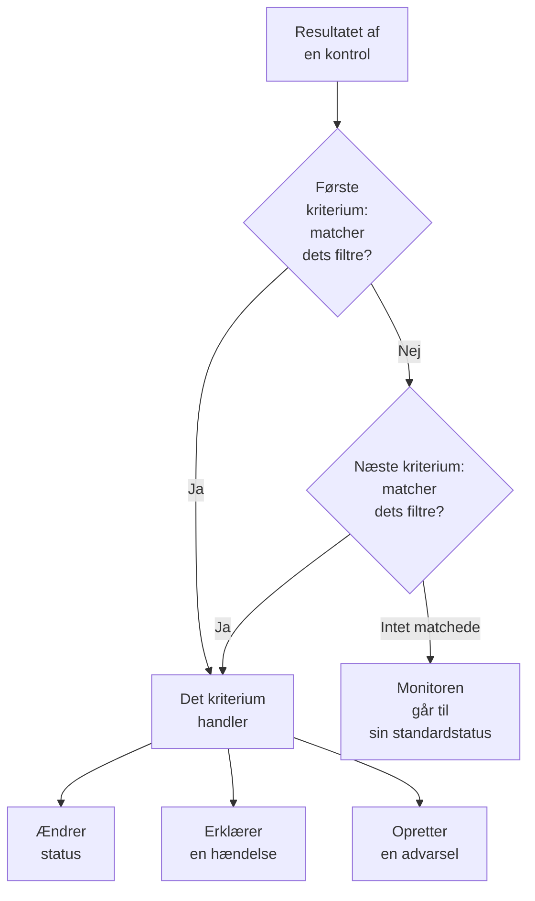
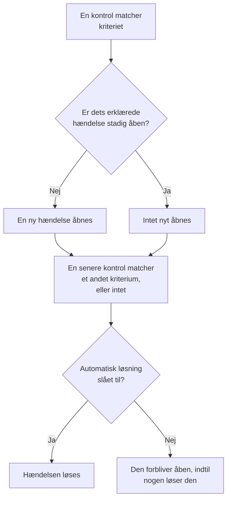

# Kriterier og statusser

En monitors kriterier afgør, hvad hver kontrol betyder: om monitoren er oppe eller nede, og om OneUptime erklærer en hændelse eller opretter en advarsel. Statusser er dit projekts liste over, hvad en monitor kan være, fra **I drift** til **Offline**. Denne side forklarer begge dele for alle monitortyper; hver types egen side viser de filtre, den tilbyder.

:::cards
- [Sådan afgør kriterierne](#sådan-afgør-kriterierne): Oppefra og ned, og det første match vinder.
- [Hvad et kriterium indeholder](#hvad-et-kriterium-indeholder): Filtre, en matchbetingelse, handlinger og indstillinger.
- [Bedømme et vindue af kontroller](#bedømme-et-vindue-af-kontroller): Tæl mislykkede kontroller, opdag ustabilitet, aflæs en percentil.
- [Ændr en monitors kriterier](#ændr-en-monitors-kriterier): Rediger, tilføj, omorganiser og test kriterier.
- [Monitorstatusser](#monitorstatusser): De indbyggede statusser og dine egne statusser.
:::

## Sådan afgør kriterierne

Hver gang en monitor kontrolleres, vurderer dens kriterier resultatet fra toppen af listen og nedad. Det første kriterium, hvis filtre matcher, afgør, hvad der sker, og kriterierne under det bliver ikke set på ved den kontrol. Matcher intet, går monitoren til sin **Standardstatus for monitor**. Den beholder i stedet sin status, så længe et kriterium, der bringer den tilbage, endnu ikke har matchet: se [Hvornår et kriterium gendannes](#hvornår-et-kriterium-gendannes).

Rækkefølgen er en del af reglen. En ny monitor viser sine kriterier fra det værste tilfælde: offline, så en advarsel, hvor dens type har en (et certifikat eller et domæne, der snart udløber), så online. Et bredt sundt kriterium, som **Er online** sat til **Sand**, matcher næsten alle kontroller, så det kommer sidst: over de andre ville det matche først hver gang, og de andre ville aldrig handle.

Et kriterium, der matcher, men ikke ændrer nogen status, afgør stadig kontrollen: monitoren beholder sin status, og kriterierne under det venter på næste kontrol. **Standardstatus for monitor** gælder kun, når intet kriterium matcher. For en ny monitor er den **I drift**; skift den under **Flere felter** under kriterierne.

> [!NOTE]
> En monitor, der åbner en hændelse eller en advarsel pr. vært, container, disk eller interface, vurderer alle kriterier ved hver kontrol, så to værter kan matche to forskellige kriterier på samme tid. Det er en monitor, hvis forespørgsel har en **Gruppér efter**, som en metrik- eller logmonitor, eller et kriterium, der angiver `*` for hver disk eller hvert interface. Det samme gælder en metrikmonitor, der holder øje med et PromQL-udtryk: hver serie, udtrykket returnerer, bedømmes for sig. En monitor for indgående anmodninger, der grupperer hændelser efter et payload-felt, stopper stadig ved det første match.
>
> En sådan monitor har stadig én status, der sættes af det første kriterium, der matcher. Et kriterium, der kun bringer den tilbage til dens **Standardstatus for monitor** og ikke åbner nogen hændelse eller advarsel, venter på de værter, der opfyldte et kriterium, som satte en anden status: det matcher, når hver af dem opfylder det, uanset hvad de andre værter gør. Indtil da beholder monitoren sin status, selv når intet kriterium matcher, mens hver værts hændelser og advarsler stadig løses hver for sig.

## Hvad et kriterium indeholder

Åbn et kriterium: det har et navn og tre sektioner, der hver kan klappes sammen til et resumé på én linje.

| Del | Hvad den indeholder |
| --- | --- |
| **Kriterienavn** | Navnet i listen over kriterier og i grundårsagen til hver hændelse og advarsel, som kriteriet åbner. **Tilføj kriterier** navngiver et nyt kriterium efter dets filtre, og navnet følger dem, indtil du skriver dit eget. |
| **Filtre** | Hvad kontrollen skal vise, som et eller flere filtre. Kubernetes- og metrikmonitorer kalder dem **Advarselsregler**. |
| **Handlinger** | Hvad der sker, når filtrene matcher: skift status, opret en advarsel, erklær en hændelse eller en kombination. |
| **Indstillinger** | **Aktivér disse kriterier**, en valgfri **Beskrivelse**, hvornår det gendannes, og hvornår det evalueres, og, på monitorer for indgående forespørgsler, **Group incidents and alerts by a payload field**. |

### Filtre

Et filter læser én ting fra kontrollen og sammenligner den: en **Filtertype** (hvad der læses, som **Svarstatuskode**), en **Filterbetingelse** (hvordan der sammenlignes, som **Større end**) og en **Værdi**. Monitorer, der sammenligner metrikker, som Kubernetes- og metrikmonitorer, beder i stedet om en **Betingelse** og en **Tærskel**. Hver monitortype tilbyder sine egne filtertyper, som står på dens side, for eksempel [Websted-monitor](/docs/monitor/website-monitor#overvågningskriterier).

Fra to filtre og opefter vises **Matchbetingelse** under dem: **Alle** betyder, at hvert filter skal matche, **Enhver**, at ét er nok. Et nyt kriterium starter på **Alle**.

Filtre, der måler hver kontrol, som **Er online**, **Svarstatuskode** og **Svartid (i ms)**, tilbyder **Evaluér disse kriterier over en periode**. Det vurderer et vindue af nylige kontroller i stedet for kun den seneste og starter på de seneste 5 minutter med **Alle værdier**, som først matcher, når hver kontrol i vinduet har matchet. Vinduet kan være op til 24 timer langt og tælle kontrollerne, som [Bedømme et vindue af kontroller](#bedømme-et-vindue-af-kontroller) forklarer. Se [Evaluering over en periode](/docs/monitor/website-monitor#evaluering-over-en-periode).

### Handlinger

Hver handling er en kontakt under **Handlinger**:

| Kontakt | Hvad den gør |
| --- | --- |
| **Når filtre matcher, ændres monitorstatus.** | Flytter monitoren til den status, der er valgt i **Skift monitorstatus til**. |
| **Når filtre matcher, oprettes en advarsel.** | Opretter de advarsler, der er sat op under **Opret advarsel**. En advarsel giver dit team besked og vises aldrig på en statusside. |
| **Når filtre matcher, erklæres en hændelse.** | Erklærer de hændelser, der er sat op under **Opret hændelse**. Dine statussider kan vise dem. |

En hændelse eller en advarsel beder om en titel, en **Alvorlighed** og, sammenklappet, en beskrivelse, ejere, etiketter og vagtpolitikker. Titler og beskrivelser kan indeholde værdier fra kontrollen, som `{{monitorName}}`: se [Hændelse- og advarselsskabeloner](/docs/monitor/incident-alert-templating). For at tilkalde nogen, når kriteriet matcher, vælger du en politik under **Vagt**: se [Vagtpolitikker](/docs/on-call/policies).

### Indstillinger

**Aktivér disse kriterier** er slået til for hvert nyt kriterium. Slå det fra for at beholde et kriterium uden at bruge det: det springes over ved hver kontrol, ændrer ingen status, åbner intet, og dets overskrift viser **Deaktiveret**.

**Group incidents and alerts by a payload field** åbner én hændelse pr. værdi fundet i en indgående anmodning, så én webhook-adresse kan holde flere hændelser åbne. Se [Slå hændelsesgruppering til](/docs/monitor/incoming-request-monitor#slå-gruppering-af-hændelser-til).

**Gendan kun, når en egen betingelse er opfyldt** og **Evaluér kun disse kriterier på bestemte dage og tidspunkter** er slået fra for et nyt kriterium. Se [Hvornår et kriterium gendannes](#hvornår-et-kriterium-gendannes) og [Kun på bestemte dage og tidspunkter](#kun-på-bestemte-dage-og-tidspunkter).

## Bedømme et vindue af kontroller

Med **Evaluér disse kriterier over en periode** markeret angiver **Evaluér**, hvordan vinduets kontroller bedømmes, og **For de seneste**, hvor langt vinduet er, fra 2 minutter til 24 timer. Filterets egen betingelse, for eksempel **Er online** sat til **Falsk**, siger, hvad hver kontrol skal vise.

| Evaluér | Matcher, når |
| --- | --- |
| **Alle værdier** | Hver kontrol i vinduet opfyldte betingelsen. |
| **Vilkårlig værdi** | Mindst én kontrol i vinduet opfyldte betingelsen. |
| **Gennemsnit**, **Sum**, **Maksimumværdi**, **Minimumværdi** | Den værdi af vinduets værdier opfylder betingelsen, for eksempel en gennemsnitlig svartid over 300 ms. |
| **Percentil** | Den percentil, der er valgt under **Percentil**, fra p50 til p99, opfylder betingelsen: p95 over 300 ms betyder, at de langsomste 5 % af kontrollerne ligger over 300 ms. |
| **Antal** | Antallet af kontroller, der opfyldte betingelsen, sammenlignes som angivet under **Kontroller, der matcher**: for eksempel **Større end** 30. |
| **Procentdel** | Deres andel af vinduets kontroller sammenlignes som angivet under **Andel af kontroller, der matcher**: for eksempel **Større end** 10 %. |
| **Statusskift** | Antallet af gange, kontrollerne skiftede mellem at opfylde betingelsen og ikke at opfylde den, sammenlignes som angivet under **Antal skift**. En enhed, der går ned og kommer op igen, skifter to gange. |

En sætning under vinduets indstillinger gengiver filteret, som det er indstillet: »Tjek: "Er online" er falsk ved flere end 30 kontroller i den seneste periode på 8 timer«.

- **Hver sonde for sig.** **Antal**, **Procentdel** og **Statusskift** tæller kontrollerne fra den sonde, der udførte kontrollen, så en monitor, der kontrolleres fra tre sonder, tæller ikke tre gange så hurtigt, og dens sonder skal derefter være enige som for ethvert kriterium.
- **Et vindue, der endnu ikke er fuldt.** Indtil kontrollerne når tilbage til vinduets start, har en monitor, der lige er startet, færre kontroller, end den vil få. **Antal** og **Statusskift** matcher tidligt, når de allerede er forbi **Større end** eller **Større end eller lig med**, da flere kontroller kun øger dem; alt andet venter på et fuldt vindue.
- **Et vindue uden kontroller.** Så længe vinduet ikke har nogen kontroller eller endnu ikke er fuldt, afgør **Hvis ingen data**: **Ignore** venter, **Trigger** matcher, og **Treat As Zero** bedømmer det, som om de manglende kontroller ikke havde opfyldt betingelsen.

Gennemsnit og percentiler læser værdierne fra alle sonders kontroller, som **Gennemsnit** altid har gjort. **Antal**, **Procentdel** og **Statusskift** tilbydes for hvert filter, der tilbydes et vindue: på Website-, API-, Ping-, IP- og Port-monitorer, for en servers CPU, hukommelse, diske og belastning, for en netværksenheds **SNMP-enhed er online** og svartid samt på DNS-, NTP-, database-, eksterne statusside- og sondestatus-monitorer. En Server-monitors **Er online** tælles ikke: den bedømmes på tiden siden serverens seneste rapport. Metrics- og andre telemetrimonitorer bedømmer i stedet tidsintervallet for deres forespørgsel med forespørgslens egen aggregering, som også læser percentiler.

### Eksempel: et adgangspunkt, der er nede, og et, der er ustabilt

En Ping-monitor kontrollerer et adgangspunkt på kontoret hvert minut. Før vinduer kunne tælle kontroller, lignede et adgangspunkt, der blev ved med at falde ud, et, der var nede, eller slet ingenting. Disse tre kriterier, i denne rækkefølge, skelner mellem de to:

| Kriterium | Filter | Evaluér | Ændrer status til |
| --- | --- | --- | --- |
| Adgangspunktet er nede | **Er online** er **Falsk** | **Alle værdier**, **For de seneste** 5 minutter | **Offline**, og erklærer en nedbrudshændelse |
| Adgangspunktet er ustabilt | **Er online** er **Falsk** | **Statusskift**, **Større end** 5, **For de seneste** 1 time | **Forringet**, og erklærer en ustabilitetshændelse |
| Adgangspunktet er online | **Er online** er **Sand** | Ikke over en periode | **I drift** |

For det andet skal du slå **Gendan kun, når en egen betingelse er opfyldt** til med **Statusskift**, **Mindre end eller lig med** 1, **For de seneste** 1 time: ustabilitetshændelsen forbliver åben, indtil adgangspunktet har været stabilt i en time, i stedet for at lukke det første minut, det er oppe. For at advare, når det fejler mere end 30 ping på 8 timer, skal du i stedet sætte det andet kriterium til **Antal**, **Større end** 30, **For de seneste** 8 timer.

## Hvornår et kriterium gendannes

Et kriterium holder op med at virke, så snart dets filtre holder op med at matche: ved den kontrol løses dets hændelse og alarm, når **Løs hændelse automatisk** og **Løs advarsel automatisk** er slået til, og monitoren går videre til det næste kriterium, der matcher.

**Gendan kun, når en egen betingelse er opfyldt** holder kriteriet gældende, efter at dets filtre holder op med at matche, indtil filtrene under **Gendannes når** matcher. De starter som det modsatte af kriteriets filtre, over de seneste 10 minutter, og kan bruge alt, hvad et filter tilbyder, for eksempel et vindue, der tæller kontroller. Et kriterium er gældende, så længe monitoren har den status, det sætter, eller en hændelse eller alarm, det har erklæret, er åben. Mens det holder, er det et match på sin plads i listen: et kriterium over det, der matcher, overtager stadig.

Når intet kriterium matcher, beholder en monitor, som et kriterium har flyttet væk fra dens **Standardstatus for monitor**, den status, den har, så længe den også har et kriterium, der kun bringer den tilbage til den status og ikke åbner noget. Det er gendannelsesmarginen: skabelonerne udløses over 90 % og vender tilbage ved 81 % eller derunder, så ved 89 % bliver monitoren, hvor den er. Dens hændelser og alarmer løses stadig, når deres eget kriterium holder op med at matche. En monitor uden et sådant kriterium går til sin **Standardstatus for monitor**, som den altid har gjort.

## Kun på bestemte dage og tidspunkter

**Evaluér kun disse kriterier på bestemte dage og tidspunkter** angiver dagene, **Starttidspunkt** og **Sluttidspunkt** samt **Tidszone**, som starter som din. Uden for disse tider springes kriteriet over som et deaktiveret kriterium: det matcher intet, så det, det åbnede, løses, og evalueringsloggen siger, at det var uden for sine tider. Tiderne læses på den tidszones ur, så 08:00 forbliver 08:00, når uret stilles, og tider, der slutter tidligere, end de starter, løber ind i næste morgen.

## Hvornår hændelser og advarsler åbner og lukker

Et kriterium, der erklærer hændelser, åbner én, når det matcher. Når monitoren kommer sig, lukker hændelsen af sig selv, hvis kriteriet siger det.

- **Én ad gangen.** Så længe en hændelse, som et kriterium har erklæret, stadig er åben, erklærer det samme kriterium ingen ny, når det matcher igen. Advarsler fungerer på samme måde. En monitor, der grupperer efter vært eller payload-felt, holder én åben pr. vært eller værdi, og et kriterium på en monitor for indgående e-mail med **Åbn en ny hændelse for hver e-mail** åbner én pr. e-mail.
- **Lukning.** Ved en senere kontrol, hvor et andet kriterium matcher, eller intet, løses en hændelse, hvis kriterium har **Løs hændelse automatisk** slået til, og det samme gælder en advarsel med **Løs advarsel automatisk**. Begge ligger under **Flere felter** i hændelsen eller advarslen, og de kriterier, en ny monitor starter med, har dem slået til.
- **Flere sonder.** En monitor, som mere end én sonde kontrollerer, skifter kun, når dens sonder er enige. Se [Sådan evalueres kriterierne](/docs/monitor/create-monitor#sådan-evalueres-kriterier).
- **En overordnet monitor, der er nede.** På en monitors side **Konfiguration → Afhængigheder** angiver **Afhænger af monitorer** de monitorer, den afhænger af. Så længe en af dem er i en status, der står i **Undertryk, når den overordnedes status er** (enhver offline-status, hvis feltet står tomt), åbner monitoren ingen hændelser eller advarsler. Dens status skifter stadig, og det, der er åbent, løses stadig.
- **Planlagt vedligeholdelse.** En monitor i en vedligeholdelseshændelse, der er i gang, kontrolleres ikke, så dens kriterier kører ikke. Se [Planlagt vedligeholdelse – Oversigt](/docs/scheduled-maintenance/index).

For at se, hvordan en kontrol blev vurderet, skal du åbne monitorens **Oversigt**: kortet **Monitor-resumé** viser, hvilket kriterium der matchede, og hvad hvert kriterium gjorde, også en hændelse, der blev sprunget over, fordi der allerede var en åben.

## Hvem der får besked, når den går ned

**Når den går ned** fortæller i få sætninger, hvad der sker, når monitoren fejler, og hvem der får besked: den status, den sætter, den hændelse eller advarsel, den åbner, hvem der får en e-mail, og hvem den tilkalder, med navn. Alt, der ville forhindre nogen i at få besked, står på sin egen linje med et link til den side, hvor det rettes. Du finder det i en monitors **Oversigt**, under kriterierne på siden **Kriterier**, i kriterietrinnet i **Opret monitor** for den monitor, du er ved at oprette, og i den guidede opsætning af websites.

Det finder kæden, sådan som en rigtig hændelse eller advarsel gør: med dit projekts ejerregler, privatlivsregler, etiketregler og vagtregler, hændelsesreglen for advarsler, der gør en advarsel til en hændelse, og hvem den første eskaleringsregel i hver vagtpolitik når lige nu. En vagtregel, der spørger, hvem der ejer en advarsel (**Ejer af advarsel**), matches med de ejere, advarslen får: de personer og teams, dens kriterier angiver, ejerne af den netværksenhed, monitoren overvåger, og dem, ejerregler tilføjer. En pladsholder i titlen, som først en kontrol udfylder, vises, som den er skrevet. **Vis kæden** åbner den række for række:

| Række | Hvad den siger |
| --- | --- |
| **Status** | Den status, kriterierne sætter. |
| **Åbner** | Hændelsen eller advarslen, dens alvorlighed i parentes og dens titel. |
| **E-mails** | Hvem e-mailen om oprettelsen når: dens ejere, de ejere, ejerregler tilføjer, eller Projektejerne, når der ingen er. Den, som tilkaldet når først, får ikke også e-mailen som ejer. |
| **Ejerregler** | De ejerregler, der tilføjer dens ejere. |
| **Privat** | Hvorfor den er privat: en privatlivsregel eller kriterierne. En privat hændelse vises ikke på nogen statusside og giver ingen abonnenter besked, og kun dens ejere, Projektejerne og Projektadministratorerne kan se den. |
| **Etiketregler** | De etiketregler, hvis etiketter ændrer, hvilke vagtregler der tilkalder. |
| **Vagtregler** | De vagtregler, der matcher den. For en regel, der matcher, hvem der ejer en advarsel, står der, hvilken ejer der får den til at matche. |
| **Vagtpolitik** | Hver politik, som de regler kører: hvem dens første eskaleringsregel når lige nu og hvordan, og hvem den ikke når, og hvorfor. |
| **Statussider** | De statussider, der viser den, hver med den monitorgruppe, siden viser monitoren gennem. |
| **Hændelsesregel** | For en advarsel: den hændelsesregel for advarsler, der opretter en hændelse ud fra den, straks eller når advarslen er forblevet åben, og den hændelse, beskrevet som enhver hændelse. |

### Hvad der forhindrer, at nogen får besked

| Hvad der forhindrer det | Link |
| --- | --- |
| Ingen kriterier ændrer status eller åbner en hændelse eller advarsel. | **Åbn kriterier** |
| Ingen tilkaldes: ingen vagtregel matcher, eller projektet har endnu ingen vagtpolitik. | **Opsæt tilkald** |
| Monitoren åbner advarsler, og kun hændelser har vagtregler. | **Opsæt tilkald** |
| En vagtpolitik har ingen eskaleringsregler. | **Åbn vagtpolitik** |
| En vagtpolitik når ingen lige nu. | **Åbn vagtpolitik** |
| En person, som en politik tilkalder, kan ikke nås: vedkommende har fravalgt det, har ingen bekræftet metode eller har ingen regel for alvorligheden i et projekt uden reserveløsning. | **Åbn parathed** |
| SMS, opkald, WhatsApp eller Telegram er slået fra i projektet. | **Åbn notifikationskanaler** |
| Projektet har ingen saldo tilbage til SMS og opkald (OneUptime Cloud). | **Åbn fakturering** |
| Serveren kan endnu ikke sende e-mails eller SMS eller foretage opkald. | **Åbn Admin-dashboardet**, for serverens administratorer |

En advarsel, som en hændelsesregel for advarsler gør til en hændelse, der tilkalder nogen, er ikke et brud: I stedet tjekkes hændelsens egne politikker.

Ejere, der ikke får e-mail, står efter bruddene, hver med årsagen og stedet, hvor de er angivet: en person, der ikke er medlem af projektet, et team, hvor ingen er medlem (**Åbn team**), eller et team fra et andet projekt, angivet i kriterierne (**Åbn kriterier**), på den netværksenhed, monitoren overvåger (**Åbn netværksenhed**), eller af en ejerregel (**Åbn ejerregler**). E-mailen sendes stadig, til de ejere, den når, eller til Projektejerne, så de er ikke brud. Opsætningens tilstand viser dem også, som noget, der er værd at rette.

### Kontrollér igen, og hvad du kan se

Svaret er højst et minut gammelt, og **Kontrollér igen** finder det igen. Når en ny kontrol mislykkes, beholder kortet det seneste svar og siger nedenunder hvorfor.

Kortet nævner kun det, du må læse. En vagtpolitik, en regel, en statusside eller en monitorgruppe, du ikke kan se, beholder sin plads uden sit navn, og en privat hændelse eller advarsel, du ikke vil kunne se, siger kun, at den åbnes, og at den er privat.

## Hvad en hændelse eller advarsel beholder af kontrollen

En hændelse eller advarsel, som en monitor åbner, beholder den kontrol, der åbnede den, så du kan se hvorfor længe efter, at monitorens egne logfiler er væk. Under grundårsagen nævner **Evalueringsdetaljer** det kriterium, der matchede, og for hvert filter, der matchede, hvad kontrollen fandt. **Vis detaljer** tilføjer resten af beviserne, de filtre, der ikke matchede, og selve kontrollen: anmodningen, hvornår den kørte, fra hvilken sonde og hvad der kom tilbage. Det, et filter fandt, kan være:

- **Feltet.** Hvor et filter **Svarets brødtekst** matchede i et JSON-indhold, fx `checks[1].status`, eller den header, hvor et filter **Svar-headerværdi** matchede.
- **Værdierne.** Hvad hver værdi, et **JavaScript-udtryk** læser, indeholdt, da den blev evalueret, fx `responseBody.status = "down"`.
- **Et uddrag.** Et kort stykke af svaret omkring matchet, med matchet markeret: aldrig hele indholdet.

Hemmeligheder og personoplysninger maskeres, før noget gemmes: headere som `Authorization`, `Cookie` og `Set-Cookie`, felter, hvis navn siger `password`, `token`, `key`, `session` eller `email`, og tekst, der ligner et bearer-token, en JWT, et kortnummer eller en e-mailadresse. Anmodningens URL er den, monitoren blev sat op med, så `{{monitorSecrets.NAME}}` forbliver et navn, og en hemmelig forespørgselsværdi maskeres. Monitorens **Overvågningslogs** og enhver værdi, som en grundårsag citerer, maskeres på samme måde. En hændelse eller advarsel, der er åbnet manuelt eller før evalueringsdetaljer blev gemt, har ingen.

> [!TIP]
> Når svarene fra en website- eller API-monitor er følsomme i sig selv, så slå **Behold svarindhold** fra på kortet **Svarindhold** på dens side **Avanceret → Indstillinger**. Dens overvågningslogs, hændelser og advarsler beholder så, hvilke filtre der matchede, statuskoden og svartiden, og ingen del af svaret. En monitor for indgående anmodninger har den samme kontakt for de anmodninger, den modtager: **Behold anmodningsindhold**, på kortet **Anmodningsindhold**. Kontakten gælder for de kontroller, der kører, og de hændelser og advarsler, der åbnes, efter du ændrer den. Den seneste anmodning i oversigten over en monitor for indgående anmodninger følger kontakten med det samme.

## Ændr en monitors kriterier

:::steps
### Åbn kriteriesiden

Gå til **Monitorer** og åbn monitoren. Fold **Konfiguration** ud i dens sidemenu, og klik på **Kriterier**. Kortet **Kriterier** viser hvert kriterium, hvad det kontrollerer, og hvad det gør.

### Klik på Rediger overvågningskriterier

Editoren viser hvert kriterium foldet ud. Klik på et kriteriums overskrift for at folde det sammen til én linje: navnet, hvor mange filtre det har, og hvad det gør.

### Tilføj, ændr eller omorganiser kriterier

**Tilføj kriterier** tilføjer et nederst, foldet ud og navngivet efter dets filter. Træk et kriterium i håndtaget til venstre for at flytte det: det første match vinder, så sæt det værste tilfælde først. **Slet kriterier** fjerner et; en monitor beholder mindst ét kriterium.

### Gem kriterierne

Klik på **Gem ændringer**. Den næste kontrol vurderes efter de nye kriterier.

### Test monitoren

På en monitor, som sonder kontrollerer, klikker du på **Test monitor** på kortet: testen starter på en sonde, der kontrollerer monitoren. Vælg en anden under **Vælg sonde**, hvis du vil, og klik så på **Kør test**. **Monitortestresultat** viser, hvad kontrollen fandt. Det fortæller også, hvilket kriterium svaret opfylder, og hvad der ville følge: status, hændelsen eller advarslen, og hvem der får besked.
:::

En manuel monitor har ingen kriterier: du sætter selv dens status. Se [Opdatering af status](/docs/monitor/manual-monitor#opdater-status).

## Monitorstatusser

En monitor er altid i en af dit projekts statusser. Et nyt projekt har tre, fra den sundeste til den værste:

| Status | Plads | Farve | Hvad OneUptime gør med den |
| --- | --- | --- | --- |
| **I drift** | 1 | Grøn | Nye monitorer starter i den, og den er en ny monitors **Standardstatus for monitor**. Indbygget. |
| **Forringet** | 2 | Gul | Intet af sig selv: et af dine kriterier flytter en monitor hertil. |
| **Offline** | 3 | Rød | En ny monitors offline-kriterium flytter den hertil, og OneUptime behandler en monitor i denne status som nede. Indbygget. |

Listen er en rækkefølge. Hvor monitorer vises sammen, vinder den status, der står længst nede på listen: en monitorgruppe, en statussidegruppe og en statussides samlede status viser hver den værste status blandt deres monitorer.

### Hvor en status tæller

| Hvor | Hvad statussen afgør |
| --- | --- |
| Listen **Monitorer** | Hver monitors aktuelle status. **Ikke operationel** viser monitorerne i enhver status undtagen den driftsklare, med et rødt tal ved siden af. Monitorer med overvågning slået fra er udeladt: intet tjekker dem, og **Deaktiveret** viser dem. **Deaktiveret** ligger under **Alle monitorer** i sidemenuen med et gråt tal: at slå overvågning fra er et valg, ikke en fejl. Ved siden af **Ikke operationel**, under **Opmærksomhed kræves**, viser **Sonder afbrudt** de monitorer, hvis aktiverede sonder alle er afbrudt, og **Ingen sonde aktiveret** de monitorer, som ingen aktiveret sonde tjekker: deres sonder er alle deaktiveret, eller de har ingen. |
| Statussider | Farven på hver række og dens oppetid: kun statusserne i sidens **Tæller som nedetid** tæller imod den. En ny statusside starter med alle statusser undtagen den driftsklare. Se [Vælg, hvad siden viser](/docs/status-pages/index#at-vælge-hvad-der-vises-på-siden). |
| Monitorgrupper | Gruppens status: den værste blandt dens monitorer. Se [Monitorgrupper](/docs/monitor/monitor-groups). |
| SLO'er | Den nedetid, et SLO tæller, ud fra dets egen liste over statusser. Se [Hvilke statusser tæller som nedetid](/docs/slo/introduction#hvilke-statusser-der-tæller-som-nedetid). |
| Afhængigheder | Om en overordnet monitor holder sine afhængige monitorers hændelser og advarsler tilbage: som standard, så længe den er i en offline-status. |

En status, du tilføjer senere, kommer ikke med på listen **Tæller som nedetid** på en eksisterende statusside: tilføj den selv der.

### Tilføj din egen status

:::steps
### Åbn Monitorstatus

Gå til **Monitorer → Indstillinger → Monitorstatus**. **Indstillinger** er foldet sammen i sidemenuen: fold den ud først. Kortet **Monitorstatusser** viser statusserne fra den sundeste til den værste.

### Opret statussen

Klik på **Opret Monitorstatus**, og udfyld **Navn**, **Beskrivelse** og **Farve**. Den nye status placeres lige over offline-statussen, så et nedbrud stadig regnes som det værste.

### Sæt den på plads

Træk statussen i dens håndtag. En status længere nede på listen regnes som værre end alle statusser over den.

### Brug den i et kriterium

En status gør intet, før et kriterium flytter monitorer ind i den. Vælg den i **Skift monitorstatus til** på det kriterium, der skal sætte den.
:::

Den driftsklare status og offline-statussen er markeret som **Indbygget**: du kan omdøbe dem og ændre deres farve, men ikke slette dem. På OneUptime Cloud kræver det Growth-planen at oprette eller ændre en status. At administrere statusser kræver rollen Projektejer, Projektadministrator eller Monitoradministrator, eller en brugerdefineret rolle med den tilsvarende tilladelse til monitorstatusser.

### Statustidslinjen

Hver statusændring gemmes på monitorens **Statustidslinje**: hvornår den startede, hvor længe den varede, og **Vis årsag** for det kriterium, der satte den. **Opret Statusbegivenhed for monitor** tilføjer en status manuelt. På en monitor, som sonder kontrollerer, sætter den næste kontrol, der matcher et kriterium med en status, den status igen.

En statusændring giver kun monitorens ejere besked, hvis de har slået **Monitorstatus ændret** til i deres notifikationsindstillinger: den er slået fra fra start. En monitor, der går tilbage til sin **Standardstatus for monitor**, fordi intet kriterium matchede, giver ingen besked. Se [Hvad der er slået til for et nyt medlem](/docs/notifications/notification-settings#hvad-der-er-slået-til-for-et-nyt-medlem).

## Arkiver en monitorstatus

Arkiver en status, som dit team ikke længere skal bruge, i stedet for at slette den. Arkivering ændrer ingen monitor: En monitor i statussen bliver i den, indtil dens status ændres, og dens tidslinje over statusser viser den stadig.

- **Arkiver** findes i rækkens menu **⋯**. Den spørger først og viser de monitorkriterier, skabeloner og statussider, der er sat op til at bruge statussen: De bliver ved med at bruge den, indtil du ændrer dem.
- **Ingen kan vælge den igen.** Et kriterium, en monitors statusmenu, monitorstatus for en hændelse eller en vedligeholdelseshændelse og en statussides nedetidsstatusser udelader den. API'et, Terraform og MCP afviser den.
- **Arkiverede statusser vises for sig**, i den sammenfoldede sektion **Arkiverede monitorstatusser** under tabellen. **Fjern fra arkivet** sætter en tilbage, som den var.
- **De indbyggede statusser kan ikke arkiveres.** Nye monitorer starter i driftsstatussen, og OneUptime betragter en monitor i offlinestatussen som nede. Deres **Arkiver** er låst, med begrundelsen.

## Fejlfinding

:::details Webstedet er nede, men monitoren bliver ved med at være I drift
Et kriterium højere oppe på listen matchede først. Åbn **Konfiguration → Kriterier**, og tjek rækkefølgen: det sunde kriterium kommer sidst. Tjek også, at offline-kriteriet har **Aktivér disse kriterier** slået til, og at dets handling **Når filtre matcher, ændres monitorstatus.** er slået til med en valgt status.
:::

:::details Der blev ikke åbnet nogen hændelse, da monitoren gik ned
Tjek det kriterium, der matchede: **Når filtre matcher, erklæres en hændelse.** skal være slået til. Der erklæres ingen hændelse, så længe det samme kriteriums hændelse stadig er åben, så længe en overordnet monitor i **Afhænger af monitorer** er nede, eller så længe monitoren er i planlagt vedligeholdelse. Kortet **Monitor-resumé** på monitorens **Oversigt** fortæller, hvilken det var.
:::

:::details Hændelsen forbliver åben, efter at monitoren er kommet sig
Åbn hændelsens kriterium, og fold **Flere felter** ud i dens hændelse: **Løs hændelse automatisk** skal være slået til. En hændelse fra et kriterium, du siden har slettet, løses ikke af monitoren: løs den manuelt.
:::

:::details Sletteknappen for Offline er låst
**I drift** og **Offline** er indbyggede: OneUptime flytter monitorer ind i dem, så de kan omdøbes, men ikke slettes. Slet i stedet en af dine egne statusser, eller omdøb den indbyggede.
:::

## Næste trin

:::cards
- [Opret en monitor](/docs/monitor/create-monitor): De tre trin for en ny monitor.
- [Hændelse- og advarselsskabeloner](/docs/monitor/incident-alert-templating): Sæt værdier fra kontrollen ind i titler og beskrivelser.
- [Monitorgrupper](/docs/monitor/monitor-groups): Saml flere monitorer i én status.
- [Hændelser – Oversigt](/docs/incidents/index): Hvad der sker, efter at et kriterium har erklæret en hændelse.
:::
