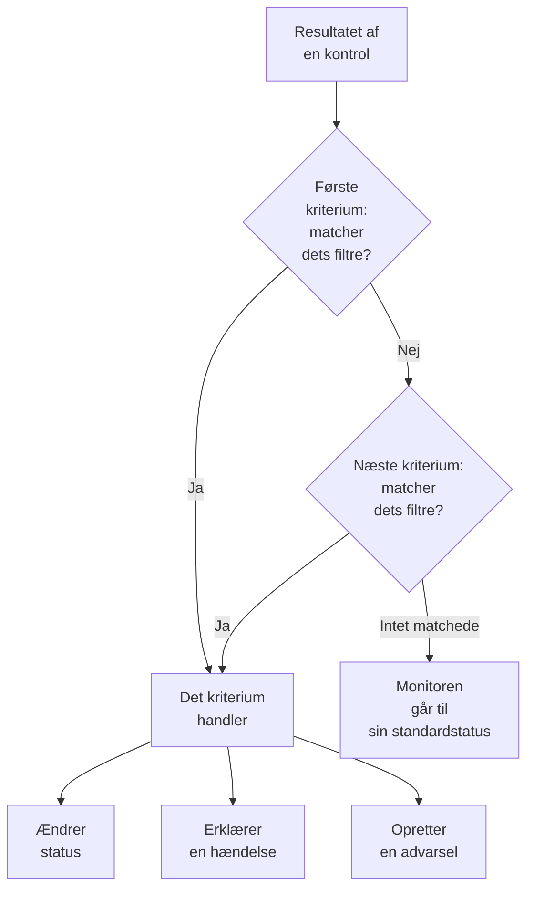
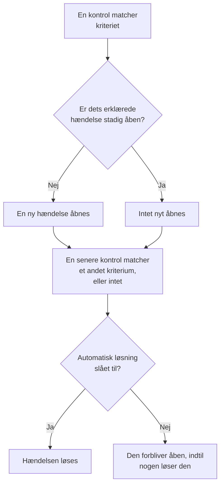

# Monitorkriterier og statusser

En monitors kriterier afgør, hvad hver kontrol betyder: om monitoren er oppe eller nede, og om OneUptime erklærer en hændelse eller opretter en advarsel. Statusser er dit projekts liste over, hvad en monitor kan være, fra **I drift** til **Offline**. Denne side forklarer begge dele for alle monitortyper; hver types egen side viser de filtre, den tilbyder.

:::cards
- [Sådan afgør kriterierne](#sådan-afgør-kriterierne): Oppefra og ned, og det første match vinder.
- [Hvad et kriterium indeholder](#hvad-et-kriterium-indeholder): Filtre, en matchbetingelse, handlinger og indstillinger.
- [Ændr en monitors kriterier](#ændr-en-monitors-kriterier): Rediger, tilføj, omorganiser og test kriterier.
- [Monitorstatusser](#monitorstatusser): De indbyggede statusser og dine egne statusser.
:::

## Sådan afgør kriterierne

Hver gang en monitor kontrolleres, vurderer dens kriterier resultatet fra toppen af listen og nedad. Det første kriterium, hvis filtre matcher, afgør, hvad der sker, og kriterierne under det bliver ikke set på ved den kontrol. Matcher intet, går monitoren til sin **Standardstatus for overvågning**.

Rækkefølgen er en del af reglen. En ny monitor viser sine kriterier fra det værste tilfælde: offline, så en advarsel, hvor dens type har en (et certifikat eller et domæne, der snart udløber), så online. Et bredt sundt kriterium, som **Is Online** sat til **Sand**, matcher næsten alle kontroller, så det kommer sidst: over de andre ville det matche først hver gang, og de andre ville aldrig handle.

Et kriterium, der matcher, men ikke ændrer nogen status, afgør stadig kontrollen: monitoren beholder sin status, og kriterierne under det venter på næste kontrol. **Standardstatus for overvågning** gælder kun, når intet kriterium matcher. For en ny monitor er den **I drift**; skift den under **Flere felter** under kriterierne.

> [!NOTE]
> En monitor, der åbner en hændelse eller en advarsel pr. vært, container, disk eller interface, vurderer alle kriterier ved hver kontrol, så to værter kan matche to forskellige kriterier på samme tid. Det er en monitor, hvis forespørgsel har en **Gruppér efter**, som en metrik- eller logmonitor, eller et kriterium, der angiver `*` for hver disk eller hvert interface. En monitor for indgående anmodninger, der grupperer hændelser efter et payload-felt, stopper stadig ved det første match.

## Hvad et kriterium indeholder

Åbn et kriterium: det har et navn og tre sektioner, der hver kan klappes sammen til et resumé på én linje.

| Del | Hvad den indeholder |
| --- | --- |
| **Kriterienavn** | Navnet i listen over kriterier og i grundårsagen til hver hændelse og advarsel, som kriteriet åbner. **Tilføj kriterier** navngiver et nyt kriterium efter dets filtre, og navnet følger dem, indtil du skriver dit eget. |
| **Filtre** | Hvad kontrollen skal vise, som et eller flere filtre. Kubernetes- og metrikmonitorer kalder dem **Alert Rules**. |
| **Handlinger** | Hvad der sker, når filtrene matcher: skift status, opret en advarsel, erklær en hændelse eller en kombination. |
| **Indstillinger** | **Aktivér disse kriterier**, en valgfri **Beskrivelse** og, på monitorer for indgående anmodninger, **Group incidents and alerts by a payload field**. |

### Filtre

Et filter læser én ting fra kontrollen og sammenligner den: en **Filtertype** (hvad der læses, som **Svarstatuskode**), en **Filterbetingelse** (hvordan der sammenlignes, som **Større end**) og en **Værdi**. Monitorer, der sammenligner metrikker, som Kubernetes- og metrikmonitorer, beder i stedet om en **Betingelse** og en **Tærskel**. Hver monitortype tilbyder sine egne filtertyper, som står på dens side, for eksempel [Websted-monitor](/docs/monitor/website-monitor#overvågningskriterier).

Fra to filtre og opefter vises **Matchbetingelse** under dem: **Alle** betyder, at hvert filter skal matche, **Enhver**, at ét er nok. Et nyt kriterium starter på **Alle**.

Filtre, der måler hver kontrol, som **Is Online**, **Svarstatuskode** og **Svartid (i ms)**, tilbyder **Evaluér disse kriterier over en periode**. Det vurderer et vindue af nylige kontroller i stedet for kun den seneste og starter på de seneste 5 minutter med **All Values**, som først matcher, når hver kontrol i vinduet har matchet. Se [Evaluering over en periode](/docs/monitor/website-monitor#evaluering-over-en-periode).

### Handlinger

Hver handling er en kontakt under **Handlinger**:

| Kontakt | Hvad den gør |
| --- | --- |
| **Når filtre matcher, ændres overvågningsstatus.** | Flytter monitoren til den status, der er valgt i **Skift overvågningsstatus til**. |
| **Når filtre matcher, oprettes en advarsel.** | Opretter de advarsler, der er sat op under **Opret advarsel**. En advarsel giver dit team besked og vises aldrig på en statusside. |
| **Når filtre matcher, erklæres en hændelse.** | Erklærer de hændelser, der er sat op under **Opret hændelse**. Dine statussider kan vise dem. |

En hændelse eller en advarsel beder om en titel, en **Alvorlighed** og, sammenklappet, en beskrivelse, ejere, etiketter og vagtpolitikker. Titler og beskrivelser kan indeholde værdier fra kontrollen, som `{{monitorName}}`: se [Hændelse- og advarselsskabeloner](/docs/monitor/incident-alert-templating). For at tilkalde nogen, når kriteriet matcher, vælger du en politik under **Vagt**: se [Vagtpolitikker](/docs/on-call/policies).

### Indstillinger

**Aktivér disse kriterier** er slået til for hvert nyt kriterium. Slå det fra for at beholde et kriterium uden at bruge det: det springes over ved hver kontrol, ændrer ingen status, åbner intet, og dets overskrift viser **Deaktiveret**.

**Group incidents and alerts by a payload field** åbner én hændelse pr. værdi fundet i en indgående anmodning, så én webhook-adresse kan holde flere hændelser åbne. Se [Slå hændelsesgruppering til](/docs/monitor/incoming-request-monitor#slå-gruppering-af-hændelser-til).

## Hvornår hændelser og advarsler åbner og lukker

Et kriterium, der erklærer hændelser, åbner én, når det matcher. Når monitoren kommer sig, lukker hændelsen af sig selv, hvis kriteriet siger det.

- **Én ad gangen.** Så længe en hændelse, som et kriterium har erklæret, stadig er åben, erklærer det samme kriterium ingen ny, når det matcher igen. Advarsler fungerer på samme måde. En monitor, der grupperer efter vært eller payload-felt, holder én åben pr. vært eller værdi, og et kriterium på en monitor for indgående e-mail med **Åbn en ny hændelse for hver e-mail** åbner én pr. e-mail.
- **Lukning.** Ved en senere kontrol, hvor et andet kriterium matcher, eller intet, løses en hændelse, hvis kriterium har **Løs hændelse automatisk** slået til, og det samme gælder en advarsel med **Løs advarsel automatisk**. Begge ligger under **Flere felter** i hændelsen eller advarslen, og de kriterier, en ny monitor starter med, har dem slået til.
- **Flere sonder.** En monitor, som mere end én sonde kontrollerer, skifter kun, når dens sonder er enige. Se [Sådan evalueres kriterierne](/docs/monitor/create-monitor#sådan-evalueres-kriterier).
- **En overordnet monitor, der er nede.** På en monitors side **Konfiguration → Afhængigheder** angiver **Depends On Monitors** de monitorer, den afhænger af. Så længe en af dem er i en status, der står i **Suppress When Parent Status Is** (enhver offline-status, hvis feltet står tomt), åbner monitoren ingen hændelser eller advarsler. Dens status skifter stadig, og det, der er åbent, løses stadig.
- **Planlagt vedligeholdelse.** En monitor i en vedligeholdelsesbegivenhed, der er i gang, kontrolleres ikke, så dens kriterier kører ikke. Se [Planlagt vedligeholdelse – Oversigt](/docs/scheduled-maintenance/index).

For at se, hvordan en kontrol blev vurderet, skal du åbne monitorens **Oversigt**: kortet **Monitor-resumé** viser, hvilket kriterium der matchede, og hvad hvert kriterium gjorde, også en hændelse, der blev sprunget over, fordi der allerede var en åben.

## Ændr en monitors kriterier

:::steps
### Åbn kriteriesiden

Gå til **Monitorer** og åbn monitoren. Fold **Konfiguration** ud i dens sidemenu, og klik på **Kriterier**. Kortet **Overvågningskriterier** viser hvert kriterium, hvad det kontrollerer, og hvad det gør.

### Klik på Rediger overvågningskriterier

Editoren viser hvert kriterium foldet ud. Klik på et kriteriums overskrift for at folde det sammen til én linje: navnet, hvor mange filtre det har, og hvad det gør.

### Tilføj, ændr eller omorganiser kriterier

**Tilføj kriterier** tilføjer et nederst, foldet ud og navngivet efter dets filter. Træk et kriterium i håndtaget til venstre for at flytte det: det første match vinder, så sæt det værste tilfælde først. **Slet kriterier** fjerner et; en monitor beholder mindst ét kriterium.

### Gem kriterierne

Klik på **Gem ændringer**. Den næste kontrol vurderes efter de nye kriterier.

### Test monitoren

På en monitor, som sonder kontrollerer, klikker du på **Test monitor** på kortet, vælger en sonde under **Vælg sonde** og klikker på **Kør test**. **Overvågningstestresultat** viser, hvad kontrollen fandt.
:::

En manuel monitor har ingen kriterier: du sætter selv dens status. Se [Opdatering af status](/docs/monitor/manual-monitor#opdater-status).

## Monitorstatusser

En monitor er altid i en af dit projekts statusser. Et nyt projekt har tre, fra den sundeste til den værste:

| Status | Plads | Farve | Hvad OneUptime gør med den |
| --- | --- | --- | --- |
| **I drift** | 1 | Grøn | Nye monitorer starter i den, og den er en ny monitors **Standardstatus for overvågning**. Indbygget. |
| **Forringet** | 2 | Gul | Intet af sig selv: et af dine kriterier flytter en monitor hertil. |
| **Offline** | 3 | Rød | En ny monitors offline-kriterium flytter den hertil, og OneUptime behandler en monitor i denne status som nede. Indbygget. |

Listen er en rækkefølge. Hvor monitorer vises sammen, vinder den status, der står længst nede på listen: en monitorgruppe, en statussidegruppe og en statussides samlede status viser hver den værste status blandt deres monitorer.

### Hvor en status tæller

| Hvor | Hvad statussen afgør |
| --- | --- |
| Listen **Monitorer** | Hver monitors aktuelle status. **Ikke operationel** viser monitorerne i enhver status undtagen den driftsklare, med et rødt tal ved siden af. |
| Statussider | Farven på hver række og dens oppetid: kun statusserne i sidens **Tæller som nedetid** tæller imod den. En ny statusside starter med alle statusser undtagen den driftsklare. Se [Vælg, hvad siden viser](/docs/status-pages/index#at-vælge-hvad-der-vises-på-siden). |
| Monitorgrupper | Gruppens status: den værste blandt dens monitorer. Se [Monitorgrupper](/docs/monitor/monitor-groups). |
| SLO'er | Den nedetid, et SLO tæller, ud fra dets egen liste over statusser. Se [Hvilke statusser tæller som nedetid](/docs/slo/introduction#hvilke-statusser-der-tæller-som-nedetid). |
| Afhængigheder | Om en overordnet monitor holder sine afhængige monitorers hændelser og advarsler tilbage: som standard, så længe den er i en offline-status. |

En status, du tilføjer senere, kommer ikke med på listen **Tæller som nedetid** på en eksisterende statusside: tilføj den selv der.

### Tilføj din egen status

:::steps
### Åbn Monitorstatus

Gå til **Overvågninger → Indstillinger → Monitorstatus**. **Indstillinger** er foldet sammen i sidemenuen: fold den ud først. Kortet **Monitor Statusser** viser statusserne fra den sundeste til den værste.

### Opret statussen

Klik på **Opret Monitorstatus**, og udfyld **Navn**, **Beskrivelse** og **Farve**. Den nye status placeres lige over offline-statussen, så et nedbrud stadig regnes som det værste.

### Sæt den på plads

Træk statussen i dens håndtag. En status længere nede på listen regnes som værre end alle statusser over den.

### Brug den i et kriterium

En status gør intet, før et kriterium flytter monitorer ind i den. Vælg den i **Skift overvågningsstatus til** på det kriterium, der skal sætte den.
:::

Den driftsklare status og offline-statussen er markeret som **Indbygget**: du kan omdøbe dem og ændre deres farve, men ikke slette dem. På OneUptime Cloud kræver det Growth-planen at oprette eller ændre en status. At administrere statusser kræver rollen Project Owner, Project Admin eller Monitor Admin, eller en brugerdefineret rolle med den tilsvarende tilladelse til monitorstatusser.

### Statustidslinjen

Hver statusændring gemmes på monitorens **Statustidslinje**: hvornår den startede, hvor længe den varede, og **Vis årsag** for det kriterium, der satte den. **Opret Monitor Status Begivenhed** tilføjer en status manuelt. På en monitor, som sonder kontrollerer, sætter den næste kontrol, der matcher et kriterium med en status, den status igen.

En statusændring giver kun monitorens ejere besked, hvis de har slået **Overvågningsstatus ændret** til i deres notifikationsindstillinger: den er slået fra fra start. En monitor, der går tilbage til sin **Standardstatus for overvågning**, fordi intet kriterium matchede, giver ingen besked. Se [Hvad der er slået til for et nyt medlem](/docs/notifications/notification-settings#hvad-der-er-slået-til-for-et-nyt-medlem).

## Arkivér en monitorstatus

Arkivér en status, som dit team ikke længere skal bruge, i stedet for at slette den. Arkivering ændrer ingen monitor: En monitor i statussen bliver i den, indtil dens status ændres, og dens tidslinje over statusser viser den stadig.

- **Arkiver** findes i rækkens menu **⋯**. Den spørger først og viser de monitorkriterier, skabeloner og statussider, der er sat op til at bruge statussen: De bliver ved med at bruge den, indtil du ændrer dem.
- **Ingen kan vælge den igen.** Et kriterium, en monitors statusmenu, monitorstatus for en hændelse eller en vedligeholdelsesbegivenhed og en statussides nedetidsstatusser udelader den. API'et, Terraform og MCP afviser den.
- **Arkiverede statusser vises for sig**, i den sammenfoldede sektion **Arkiverede monitorstatusser** under tabellen. **Fjern fra arkiv** sætter en tilbage, som den var.
- **De indbyggede statusser kan ikke arkiveres.** Nye monitorer starter i driftsstatussen, og OneUptime betragter en monitor i offlinestatussen som nede. Deres **Arkiver** er låst, med begrundelsen.

## Fejlfinding

:::details Webstedet er nede, men monitoren bliver ved med at være I drift
Et kriterium højere oppe på listen matchede først. Åbn **Konfiguration → Kriterier**, og tjek rækkefølgen: det sunde kriterium kommer sidst. Tjek også, at offline-kriteriet har **Aktivér disse kriterier** slået til, og at dets handling **Når filtre matcher, ændres overvågningsstatus.** er slået til med en valgt status.
:::

:::details Der blev ikke åbnet nogen hændelse, da monitoren gik ned
Tjek det kriterium, der matchede: **Når filtre matcher, erklæres en hændelse.** skal være slået til. Der erklæres ingen hændelse, så længe det samme kriteriums hændelse stadig er åben, så længe en overordnet monitor i **Depends On Monitors** er nede, eller så længe monitoren er i planlagt vedligeholdelse. Kortet **Monitor-resumé** på monitorens **Oversigt** fortæller, hvilken det var.
:::

:::details Hændelsen forbliver åben, efter at monitoren er kommet sig
Åbn hændelsens kriterium, og fold **Flere felter** ud i dens hændelse: **Løs hændelse automatisk** skal være slået til. En hændelse fra et kriterium, du siden har slettet, løses ikke af monitoren: løs den manuelt.
:::

:::details Sletteknappen for Offline er låst
**I drift** og **Offline** er indbyggede: OneUptime flytter monitorer ind i dem, så de kan omdøbes, men ikke slettes. Slet i stedet en af dine egne statusser, eller omdøb den indbyggede.
:::

## Næste trin

:::cards
- [Opret en monitor](/docs/monitor/create-monitor): De tre trin for en ny monitor.
- [Hændelse- og advarselsskabeloner](/docs/monitor/incident-alert-templating): Sæt værdier fra kontrollen ind i titler og beskrivelser.
- [Monitorgrupper](/docs/monitor/monitor-groups): Saml flere monitorer i én status.
- [Hændelser – Oversigt](/docs/incidents/index): Hvad der sker, efter at et kriterium har erklæret en hændelse.
:::
