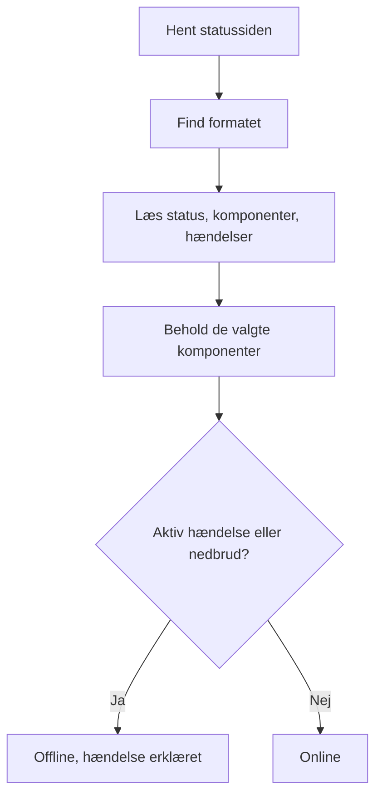

# Ekstern statusside-monitor

En monitor for eksterne statussider holder øje med den offentlige statusside for en tjeneste, du er afhængig af — AWS, GCP, Azure, GitHub, OpenAI, Anthropic og mange flere — og advarer dig, når udbyderen melder om et nedbrud eller forringet ydeevne. Brug den til at høre om problemer hos dine leverandører, så snart udbyderen melder dem, og til at skelne dem fra dine egne.

Den læser også statussider, der er lavet med OneUptime, ressource for ressource, og skelner planlagt vedligeholdelse fra et nedbrud: hold øje med et andet teams projekt eller en leverandør, hvis statusside kører på OneUptime.

:::cards
- [Opret monitoren](#opret-en-monitor-for-eksterne-statussider): Indsæt URL'en til en statusside, og vælg, hvad der skal overvåges.
- [Vælg komponenter](#komponenter): Hold kun øje med de komponenter, du er afhængig af.
- [Kriterier](#overvågningskriterier): Hvad der som standard tæller som nede.
- [OneUptime-statussider](#oneuptime-statussider): Et andet projekts ressourcer og dets vedligeholdelse.
- [Populære statussider](#populære-statusside-urler): URL'er til de tjenester, de fleste teams er afhængige af.
:::

## Sådan fungerer det

Ved hver kontrol henter en sonde statussiden, finder ud af, hvilket format den bruger, og læser den samlede status, komponenterne og de aktive hændelser. Hvis du har valgt komponenter eller en komponentgruppe, tæller kun de med. Derefter afgør kriterierne, om monitoren er online eller offline.

Du kan bruge den til at:

- Overvåge tilgængeligheden af tredjepartstjenester, din applikation er afhængig af
- Blive advaret, når dine leverandører har nedbrud
- Følge status for de enkelte komponenter
- Kun holde øje med de komponenter, du er afhængig af (f.eks. GitHubs Git Operations og Pull Requests eller OpenAI's gruppe "APIs"), så hændelser andre steder på siden, der ikke har noget med dig at gøre, ikke udløser din monitor
- Opdage forringet ydeevne, før det rammer dine brugere
- Sammenholde dine egne hændelser med problemer hos dine leverandører

## Understøttede udbydere

| Udbyder | Beskrivelse |
| ------------------------ | ---------------------------------------------------------------------- |
| **Auto** (standard) | Finder automatisk statussidens format |
| **Atlassian Statuspage** | Statussider, der kører på Atlassian Statuspage (JSON-API) |
| **incident.io** | Statussider, der kører på incident.io (f.eks. `https://status.openai.com`) |
| **OneUptime Status Page** | Statussider, der er lavet med OneUptime: hver ressources status, og hvad der er under vedligeholdelse |
| **RSS** | Statussider, der tilbyder et RSS-feed |
| **Atom** | Statussider, der tilbyder et Atom-feed |

### Automatisk genkendelse

Når udbyderen er sat til **Auto**, finder OneUptime automatisk statussidens format i denne rækkefølge:

1. Først prøver den statusside-API'et fra incident.io (`/proxy/<host>`).
2. Derefter prøver den JSON-API'et fra Atlassian Statuspage (`/api/v2/status.json`, `/api/v2/components.json` og `/api/v2/incidents/unresolved.json`).
3. Så beder den om en OneUptime-statussides resumé (`/status-page-api/summary/<page>`).
4. Mislykkes de, forsøger den at læse siden som et RSS- eller Atom-feed.
5. Som sidste udvej udfører den et simpelt tjek af, om siden kan nås over HTTP.

> [!NOTE]
> incident.io tjekkes først, fordi nogle statussider fra incident.io (som `https://status.openai.com`) også udstiller et begrænset, Atlassian-kompatibelt endpoint, der udelader komponentgrupper og aktive hændelser. Når incident.io tjekkes først, bruges de rigere data med grupper.

Tjekket af, om siden kan nås, er også udvejen, når en udbyder, du udtrykkeligt har valgt, fejler. Det fortæller dig kun, om siden svarer — online ved et svar `2xx` eller `3xx` — og melder ingen komponenter eller hændelser.

## Opret en monitor for eksterne statussider

:::steps
### Start en ny monitor

Gå til **Monitorer**, og klik på **Opret monitor**. Under **Monitortype** skal du klikke på **Flere monitortyper** og vælge **External Status Page** under **Basic Monitoring** eller skrive `statuspage` i søgefeltet. Angiv et **Navn**, og klik derefter på **Næste**.

### Angiv statussidens URL

Angiv **Statusside-URL**. Lad **Udbyder** stå på **Auto**, medmindre du kender formatet.

### Vælg komponenter, hvis du har brug for det

Åbn **Komponenter**, og vælg de komponenter, du er afhængig af, fra sidens egen liste, som `Git Operations` og `Pull Requests` på GitHubs; lad feltet være tomt for at holde øje med hele siden. Vil du i stedet holde øje med én gruppe, så åbn **Flere felter**, og angiv et **Component Group Filter**, som `APIs`.

### Test den

Klik på **Test monitor** for at hente siden én gang, og tjek den udbyder, de komponenter og de hændelser, den fandt.

### Gennemgå kriterierne

Kriterietrinnet starter med [standardkriterierne](#standardkriterier), som markerer monitoren som offline, når udbyderen melder om en aktiv hændelse eller et nedbrud inden for afgrænsningen. Ret dem, hvis du har brug for det, og klik derefter på **Næste**.

### Vælg sonder, og opret

Vælg **Sonder** og et **Overvågningsinterval** — det starter på **Hvert 5. minut** — og klik derefter på **Opret monitor**.
:::

## Konfigurationsmuligheder

| Mulighed | Hvad du angiver | Standard |
| --- | --- | --- |
| **Statusside-URL** | URL'en til statussiden. For sider, der kører på Atlassian Statuspage og incident.io, er det typisk rod-URL'en (f.eks. `https://status.example.com`). For RSS-/Atom-feeds skal du angive feedets URL direkte. | — |
| **Udbyder** | **Auto** for at finde formatet, eller **Atlassian Statuspage**, **incident.io**, **OneUptime Status Page**, **RSS** eller **Atom**, hvis du kender det. | **Auto** |
| **Komponenter** | De komponenter, der skal holdes øje med, valgt fra sidens egen liste eller skrevet. | Hele siden |
| **Component Group Filter** | Den gruppe, monitoren afgrænses til. Under **Flere felter**. | Alle grupper |
| **Timeout (ms)** | Den længste tid, der ventes på statussiden. Under **Flere felter**. | `10000` (10 sekunder) |
| **Genforsøg** | Hvor mange gange der prøves igen, med et sekunds mellemrum, efter at det første forsøg er mislykkedes; `0` betyder et enkelt forsøg. Under **Flere felter**. | `3` (op til 4 forsøg) |

### Komponenter

Vælg de komponenter, du er afhængig af, så holder monitoren kun øje med dem: **External Status Page Component Status** sammenligner kun deres status, den samlede status er den værste af deres, og **External Status Page Active Incidents** tæller kun de hændelser, der rammer mindst én af dem. Det er stadig ét tjek af siden, uanset hvor mange du vælger.

Når du åbner **Komponenter**, læser din browser sidens egen liste fra en Atlassian Statuspage, en incident.io-side eller en OneUptime-statusside og viser den i sidens grupper; hver komponent, der ikke er i drift, fortæller, hvordan den har det. Et navn, du vælger, holder øje med komponenten med præcis det navn, uden hensyn til store og små bogstaver: `Copilot` på GitHubs side er ikke `Copilot AI Model Providers`.

Når listen ikke kan læses (en intern side, en side, der ikke deler sin liste med din browser, et RSS- eller Atom-feed), så skriv et navn, og tryk på Enter. En `*` står for vilkårlig tekst: `*us-east-1*` holder øje med hver komponent med `us-east-1` i navnet. På et RSS- eller Atom-feed tæller et element, når dets titel indeholder et af navnene.

En hændelse, der ikke nævner nogen komponent, tæller ikke med, mens du holder øje med valgte komponenter: intet siger, at den rammer dem. Er intet valgt, holder monitoren øje med hele siden, og hver hændelse tæller med.

En monitor, der er gemt med det gamle Filter for komponentnavn, holder fortsat øje med det, den holdt øje med: filteret vises i **Komponenter** som navnet mellem stjerner, som `*API*`, der matcher hver komponent, hvis navn indeholder det.

> [!WARNING]
> Et navn, der ikke matcher noget, holder øje med ingenting og ser sundt ud. **Komponenter** og **Test monitor** nævner begge de valgte komponenter, som siden ikke viser.

### Component Group Filter

Hvis statussiden inddeler sine komponenter i grupper, kan du afgrænse monitoren til en enkelt gruppe. På `https://status.openai.com` afgrænser du for eksempel monitoren til OpenAI's API-tjenester ved at angive `APIs`.

Når en komponentgruppe er angivet, beregnes **antallet af aktive hændelser** og den **samlede status** kun ud fra komponenterne i den gruppe — en hændelse, der rammer en gruppe uden forbindelse til din (for eksempel ChatGPT), udløser ikke en monitor, der er afgrænset til gruppen "APIs". Er der også valgt komponenter, tæller kun gruppens valgte komponenter.

Filtrering på komponentgruppe understøttes for udbyderne **Atlassian Statuspage**, **incident.io** og **OneUptime Status Page**. RSS- og Atom-feeds har ingen komponentgrupper.

## Overvågningskriterier

Du kan konfigurere kriterier, der afgør, hvornår den eksterne tjeneste betragtes som online eller offline, ud fra:

| Filtertype | Hvad den tjekker | Filterbetingelser |
| --- | --- | --- |
| **External Status Page Is Online** | Om statussiden kan nås og returnerer statusdata | Sand eller Falsk |
| **External Status Page Overall Status** | Den samlede status, siden melder | Lig med, Ikke lig med, Indeholder, Indeholder ikke, Starter med, Slutter med |
| **External Status Page Component Status** | Status for hver komponent inden for afgrænsningen (de valgte komponenter eller gruppens, når de er angivet): I drift, Under Maintenance, Degraded Performance, Partial Outage, Major Outage eller Full Outage | Lig med, Ikke lig med, Indeholder, Indeholder ikke, Starter med, Slutter med |
| **External Status Page Active Incidents** | Antallet af aktuelt aktive hændelser på statussiden (kun dem, der rammer en komponent inden for afgrænsningen, når komponenter eller en gruppe er valgt) | Lig med, Ikke lig med og de numeriske sammenligninger |
| **External Status Page Response Time (in ms)** | Hvor lang tid det tager at hente statussidens data | Større end, Mindre end, Større end eller lig med, Mindre end eller lig med |

Den samlede status er det, siden siger, så dens værdier afhænger af udbyderen: en Atlassian Statuspage melder sin egen beskrivelse, som `All Systems Operational`; en OneUptime-statusside den værste status blandt sine komponenter i omfanget, som `under_maintenance`; et feed melder `operational` eller `degraded_performance`; tjekket af, om siden kan nås, melder `reachable` eller `unreachable`. Med valgte komponenter eller en gruppe er det den værste status blandt dem, på enhver side. Disse sammenligninger skelner mellem store og små bogstaver. Monitorens oversigt viser den samlede status i ord og farve, ligesom hver komponents (`under_maintenance` står som **Under Maintenance**), mens kriterierne sammenligner den værdi, siden melder. Til advarsler om nedbrud er **External Status Page Active Incidents** og **External Status Page Component Status** som regel mere pålidelige.

På et RSS- eller Atom-feed tæller elementerne fra de seneste 24 timer som aktive hændelser: et RSS-element ud fra dets udgivelsesdato, et Atom-element ud fra dets opdateringsdato. Et element, der er dateret ud i fremtiden, tæller først fra sin dato.

### Standardkriterier

Som standard opretter OneUptime kriterier ud fra det, der virkelig betyder noget for en statusside — dens aktive hændelser og komponenternes tilstand frem for blot, om den kan nås:

| Kriterium | Filtre | Virkning |
| --- | --- | --- |
| Offline | **Enhver** af: siden er ikke online; der er mindst én aktiv hændelse inden for afgrænsningen; en komponent inden for afgrænsningen melder Degraded Performance, Partial Outage, Major Outage eller Full Outage | Markerer monitoren som offline og erklærer en hændelse, der løser sig selv, når kriteriet ikke længere matcher |
| Online | **Alle** af: siden er online; der er ingen aktive hændelser inden for afgrænsningen | Markerer monitoren som online |

Fordi antallet af aktive hændelser og komponenternes status respekterer de valgte komponenter og gruppen, rammer disse standardkriterier automatisk kun de komponenter, du interesserer dig for.

## OneUptime-statussider

Vælg **OneUptime Status Page** som udbyder, eller lad **Auto** stå, for at holde øje med en statusside, der er lavet med OneUptime: et andet teams projekt eller en leverandørs side på OneUptime Cloud eller på en selvhostet OneUptime. Indtast sidens egen adresse i **Statusside-URL**: dens domæne, som `https://status.example.com`, eller `https://oneuptime.com/status-page/<status-page-id>` for en side uden eget domæne.

Monitoren læser sidens resumé, `/status-page-api/summary/<page>` (se [Læs resuméet](/docs/status-pages/public-api#læs-resuméet)): kun det, siden viser sine besøgende, og intet andet fra det andet projekt. Hver ressource på siden, en monitor eller en monitorgruppe, er en komponent under det navn, siden giver den, i sidens gruppe; en gruppe inde i en anden hedder `Core / Databases`. Vælg ressourcer i **Komponenter**, eller hold øje med én gruppe med **Component Group Filter**.

En komponents status er den værdi, dens status på siden står for, så kriterierne for komponentstatus virker som på enhver statusside:

| På siden | Komponentstatus |
| --- | --- |
| Projektets driftsstatus | `operational` |
| En status med navnet `Degraded` | `degraded_performance` |
| En status med navnet `Offline`, `Down` eller `Major Outage` | `major_outage` |
| En status med navnet `Partial Outage` | `partial_outage` |
| En status med navnet `Full Outage` | `full_outage` |
| En status med navnet `Maintenance` | `under_maintenance` |
| Enhver anden status | `degraded_performance` |
| En status, siden skjuler, med **Show current status** slået fra | `unknown` |

Mens en igangværende planlagt vedligeholdelsesbegivenhed berører en ressource, fordi den nævner en af ressourcens monitorer eller en monitor i dens monitorgruppe, er komponenten `under_maintenance`, uanset hvilken status dens monitorer har: en monitor bliver ikke tjekket, mens en begivenhed holder den. En begivenhed, der endnu ikke er begyndt, eller som er slut, ændrer intet. Sidens aktive hændelser tæller for de ressourcer, de berører.

[Standardkriterierne](#standardkriterier) tager aldrig vedligeholdelse for et nedbrud: monitoren forbliver online under det andet projekts planlagte arbejde.

### Vis det andet projekts vedligeholdelse på din monitor

:::steps
### Tilføj kriteriet

Klik på **Tilføj kriterier** i monitorens kriterier. Giv det filteret **External Status Page Component Status**, **Lig med**, **Under Maintenance**, og vælg din vedligeholdelsesstatus i **Skift overvågningsstatus til**.

### Flyt det helt op

Træk det nye kriterium op over de andre: det første kriterium, der passer, vinder.

### Tjek det med Test monitor

Klik på **Test monitor**, mens det andet projekt har vedligeholdelse i gang: den komponent, den berører, viser **Under Maintenance**.
:::

### Hvad en OneUptime-statusside lader monitoren læse

En side, som alle kan åbne, bliver læst, som dens besøgende ser den. En privat side, der kræver login, SSO eller en adgangskode, kan ikke læses: med **OneUptime Status Page** valgt fejler tjekket og siger hvorfor. En side med en tilladelsesliste over IP-adresser skal lukke sondens adresse ind: hold øje med den fra en sonde inde i det netværk.

## Skabelonvariabler

Når du opretter hændelser eller advarsler fra monitorer for eksterne statussider, kan du bruge disse variabler i titler, beskrivelser og afhjælpningsnoter (se [Hændelse- og advarselsskabeloner](/docs/monitor/incident-alert-templating)):

| Variabel | Beskrivelse |
| ------------------------- | ------------------------------------------------------------------------------- |
| `{{isOnline}}`            | Om statussiden er online (true/false) |
| `{{responseTimeInMs}}`    | Svartid i millisekunder |
| `{{failureCause}}`        | Årsagen til fejlen, hvis der er en |
| `{{overallStatus}}`       | Værdien af den samlede statusindikator |
| `{{activeIncidentCount}}` | Antal aktive hændelser (for de komponenter, den holder øje med, hvis der er valgt nogen) |
| `{{componentStatuses}}`   | JSON-array med komponenternes status (`name`, `status`, `description`, `groupName`) |
| `{{provider}}`            | Den fundne udbyder (Atlassian Statuspage, incident.io, OneUptime Status Page, RSS, Atom); tom efter et tjek af, om siden kan nås |
| `{{componentGroup}}`      | Den komponentgruppe, monitoren er afgrænset til, hvis der er en |
| `{{componentName}}`       | De komponenter, monitoren holder øje med, adskilt af kommaer, hvis der er valgt nogen |

## Populære statusside-URL'er

Her er en liste over statussider for populære tjenester. Mange af dem bruger Atlassian Statuspage eller incident.io, så udbyderen **Auto** genkender dem automatisk. En side, der ikke er bygget på nogen af dem og ikke er et feed, får kun tjekket af, om den kan nås — overvåg i stedet udbyderens RSS- eller Atom-feed for dem, hvis den udgiver et.

| Tjeneste | Statusside-URL |
| ---------------------------- | --------------------------------------------- |
| AWS                          | `https://health.aws.amazon.com/health/status` |
| Google Cloud Platform        | `https://status.cloud.google.com`             |
| Microsoft Azure              | `https://status.azure.com`                    |
| GitHub                       | `https://www.githubstatus.com`                |
| OpenAI                       | `https://status.openai.com`                   |
| Anthropic                    | `https://status.anthropic.com`                |
| Cloudflare                   | `https://www.cloudflarestatus.com`            |
| Datadog                      | `https://status.datadoghq.com`                |
| PagerDuty                    | `https://status.pagerduty.com`                |
| Twilio                       | `https://status.twilio.com`                   |
| Stripe                       | `https://status.stripe.com`                   |
| Slack                        | `https://status.slack.com`                    |
| Atlassian (Jira, Confluence) | `https://status.atlassian.com`                |
| Vercel                       | `https://www.vercel-status.com`               |
| Netlify                      | `https://www.netlifystatus.com`               |
| DigitalOcean                 | `https://status.digitalocean.com`             |
| Heroku                       | `https://status.heroku.com`                   |
| MongoDB Atlas                | `https://status.cloud.mongodb.com`            |
| Fastly                       | `https://status.fastly.com`                   |
| New Relic                    | `https://status.newrelic.com`                 |
| Sentry                       | `https://status.sentry.io`                    |
| CircleCI                     | `https://status.circleci.com`                 |

## Bedste praksis

- **Brug udbyderen Auto**, medmindre du kender det nøjagtige format — automatisk genkendelse virker godt for de fleste statussider.
- **Vælg de komponenter, du er afhængig af** (f.eks. GitHubs Git Operations og Pull Requests), så hændelser uden forbindelse til dig ikke giver støj.
- **Hold øje med en hel gruppe**, når du er afhængig af det hele (f.eks. OpenAI's "APIs"), så de komponenter, den får senere, også bliver holdt øje med.
- **Kombinér med dine egne monitorer** — sæt monitorer for eksterne statussider sammen med dine egne API- og websitemonitorer. Når begge går ned på samme tid, peger leverandørens statusside dig hurtigere hen til årsagen.

## Fejlfinding

:::details Monitoren er offline, men hændelsen gælder en del af tjenesten, som jeg ikke bruger
Vælg de komponenter, du er afhængig af, i **Komponenter**, eller én gruppe i **Component Group Filter**. Antallet af aktive hændelser og komponenternes status tæller så kun dem; en hændelse, der ikke nævner nogen komponent, tæller ikke med.
:::

:::details Monitoren går aldrig offline, heller ikke under et nedbrud
Et valgt navn matcher måske ingenting på siden, hvilket ser sundt ud, eller siden får måske kun tjekket af, om den kan nås. Kør **Test monitor**: den viser den udbyder og de komponenter, den fandt, og nævner hver valgt komponent, som siden ikke viser.
:::

:::details Auto vælger det forkerte format eller finder ingen komponenter
Sæt **Udbyder** til den, du ved, at siden bruger. For et RSS- eller Atom-feed skal du angive feedets egen URL i stedet for statussidens.
:::

:::details Listen i Komponenter indlæses ikke
Din browser læser listen direkte fra statussiden. En intern side, som din browser ikke kan nå, en side, der ikke deler sin liste med andre websteder, og et RSS- eller Atom-feed har ingen liste at vælge fra: skriv hver komponents navn, som siden viser det, og tryk på Enter. Sonderne læser siden som før.
:::

:::details En OneUptime-statusside viser ingen komponenter
Vælg **OneUptime Status Page** som **Udbyder** og klik på **Test monitor**: resultatet siger, om siden er privat, eller om dens tilladelsesliste over IP-adresser holder sonden ude. En selvhostet OneUptime, der ikke er blevet opdateret i et stykke tid, leverer endnu intet resumé: indtil den bliver det, får siden tjekket af, om den kan nås, eller læses som et feed.
:::

:::details En intern statusside kan ikke nås
En sonde afviser adresser i private netværk, medmindre den har lov til at nå dem. Sæt `PROBE_ALLOW_PRIVATE_NETWORK_MONITORS=true` på en sonde inde i dit netværk — se [Adgang til privat netværk](/docs/self-hosted/private-network-access).
:::

## Næste trin

:::cards
- [Hændelse- og advarselsskabeloner](/docs/monitor/incident-alert-templating): Sæt udbyderens status ind i dine hændelsestitler.
- [API-monitor](/docs/monitor/api-monitor): Tjek dine egne endpoints ved siden af din udbyders status.
- [Opret en monitor](/docs/monitor/create-monitor): De trin, alle monitortyper har til fælles.
:::
