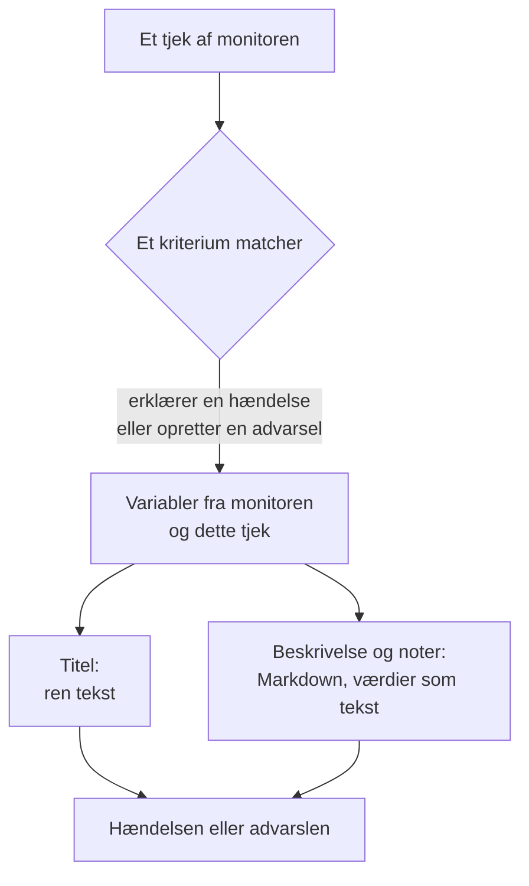

# Hændelse- og advarselsskabeloner

Når en monitors kriterier erklærer en hændelse eller opretter en advarsel, udfylder de titlen, beskrivelsen og afhjælpningsnoterne ud fra en skabelon, du selv skriver. Sæt pladsholdere `{{variable}}` ind, som `{{monitorName}}` eller `{{responseStatusCode}}`, så siger hver hændelse, hvad der gik galt, med værdierne fra det tjek, der åbnede den.

:::cards
- [Hvor du skriver en skabelon](#hvor-du-skriver-en-skabelon): Titlen, beskrivelsen og afhjælpningsnoterne for et kriteriums hændelse eller advarsel.
- [Grundlæggende brug](#grundlæggende-brug): Pladsholdere, stier ind i objekter og lister.
- [Variabler, som alle monitorer har](#variabler-som-alle-monitorer-har): Monitorens navn og den ressource, der overskred grænsen.
- [Variabler efter monitortype](#variabler-efter-monitortype): Hvad hver slags tjek rapporterer.
:::

## Sådan fungerer skabeloner

En skabelon udfyldes én gang, når kriteriet opretter hændelsen eller advarslen. OneUptime samler variablerne fra monitoren og fra det tjek, der matchede, sætter hver værdi ind, hvor dens pladsholder står, og gemmer resultatet. Ændrer du skabelonen senere, ændrer det de hændelser og advarsler, der oprettes derefter, ikke dem, der allerede er åbne.



- **Titlen er ren tekst.** Uanset hvor den vises, læses den præcis, som skabelonen gengav den.
- **Beskrivelsen og afhjælpningsnoterne er Markdown.** Den Markdown, du skriver, gengives, og hver værdi, som det overvågede system sendte, indsættes som tekst, så intet i den kan tilføje et link, et billede eller en omtale. Se [Værdier i beskrivelser og afhjælpningsnoter](#værdier-i-beskrivelser-og-afhjælpningsnoter).
- **En grupperet monitor udfylder hver hændelse for sin egen serie.** En monitor, der åbner én hændelse pr. vært, pod eller enhed, udfylder hver skabelon med den series værdier, og føjer seriens navn til titlen, når din skabelon ikke allerede nævner det.

## Hvor du skriver en skabelon

:::steps
### Åbn monitorens kriterier

Gå til **Monitorer**, åbn monitoren, og klik på **Kriterier** i dens sidemenu. Klik på **Rediger Overvågningskriterier**.

### Slå hændelsen eller advarslen til

Slå i et kriterium under **Handlinger** **Når filtre matcher, erklæres en hændelse.** eller **Når filtre matcher, oprettes en advarsel.** til. Formularen for hændelsen eller advarslen åbner nedenunder.

### Skriv titlen

Skriv titlen i **Hændelsestitel** eller **Advarselstitel**, for eksempel `{{monitorName}} is down`. **Learn about dynamic templates** ved siden af åbner **Dynamic Template Variables**: hver variabel, denne monitors type har, med hvad den indeholder. Klik på en variabel for at kopiere den.

### Skriv beskrivelsen og afhjælpningsnoterne

Åbn **Beskrivelse** for **Hændelsesbeskrivelse** eller **Beskrivelse af advarsel**, og **Flere felter** for **Afhjælpningsnoter**. Disse editorer tilbyder selv variablerne: **Skabelonvariabler** viser dem under editoren, **Indsæt variabel** i værktøjslinjen åbner den samme liste, og når du skriver `{{`, åbnes den ved markøren.

### Gem kriterierne

Klik på **Gem ændringer**. Den næste hændelse eller advarsel, som dette kriterium opretter, bruger de nye skabeloner.
:::

## Grundlæggende brug

En pladsholder er en variabels navn i dobbelte krøllede parenteser. Når hændelsen oprettes, erstatter OneUptime den med variablens værdi og lader teksten omkring den stå, som du skrev den.

```text title="Title template"
{{monitorName}} returned {{responseStatusCode}} in {{responseTimeInMs}} ms
```

Hvis monitoren hedder `Checkout API`, svarets statuskode er `502` og svaret tog `842` millisekunder, får hændelsen titlen:

```text title="Title as created"
Checkout API returned 502 in 842 ms
```

### Stier ind i objekter og lister

En variabel, der indeholder et objekt eller en liste, læses med en sti, på samme måde som i [JavaScript-udtryk](/docs/monitor/javascript-expression):

| Skriv | For at læse | Eksempel |
| --- | --- | --- |
| `{{object.field}}` | Et felt i et objekt, i enhver dybde | `{{responseBody.error.message}}` |
| `{{list[0]}}` eller `{{list.0}}` | Et element i en liste, talt fra 0 | `{{diskMetrics[0].usagePercent}}` |
| `{{list[last]}}` | Det sidste element i en liste | `{{processes[last].name}}` |
| `{{object}}` | Hele objektet eller hele listen, som JSON | `{{responseBody}}` |

Et feltnavn kan indeholde en bindestreg, som i `{{responseHeaders.content-type}}`. Et negativt indeks, som `[-1]`, læser intet: brug `[last]`.

### Når en værdi mangler

En pladsholder, hvis sti ikke fører nogen steder hen, bliver stående i teksten, som du skrev den, med krøllede parenteser og det hele: hvis svaret ikke har et felt `error`, vises `{{responseBody.error.id}}` som det er i titlen. Det samme gælder en variabel, som dette tjek ikke rapporterede, som `failureCause` på et tjek, der ikke fejlede. En værdi, som tjekket rapporterede som tom tekst, erstattes med ingenting.

For at skrive én skabelon, der virker, uanset om monitoren er grupperet eller ej, bruger du variablerne for [berørt ressource](#berørt-ressource): de findes altid og er tomme, når monitoren ikke er grupperet.

### Værdier i beskrivelser og afhjælpningsnoter

En beskrivelse og afhjælpningsnoter er Markdown: de vises på hændelsens eller advarslens side, i e-mail og i dens Slack- og Microsoft Teams-kanaler. De værdier, en skabelon indsætter der, er det, det overvågede system sendte - en svartekst eller -header, en indgående anmodning eller e-mail, labels for en enhed eller en serie -, så hver værdi indsættes som tekst. Den læses præcis, som den blev sendt, uanset hvor skabelonen sætter den, og et link, et billede, et HTML-tag eller en Slack-omtale som `<!channel>` i den vises som tekst i stedet for at virke. En bar webadresse i en værdi bliver stadig til et link, et der viser, hvor det fører hen. Den Markdown, du selv skriver i skabelonen, gengives, som du skrev den.

En værdi kan have enhver størrelse - en svartekst eller en log på mange megabyte - og notifikationen går stadig ud med den. Hver kanal bærer det, den kan tage, og en beskrivelse, der er for lang til den, skæres af ved et linjeskift, hvis der er et, og slutter med "… (truncated — see OneUptime for the full text)":

- **E-mail**: hver beskrivelse, note eller grundårsag bærer op til cirka 256 KB af e-mailens tekst, og noten i slutningen af en længere tekst linker til hændelsen eller advarslen. En hel e-mail - teksten og skærmbillederne - holder sig under 3 MB, hvilket enhver mailserver og Microsoft Graph accepterer: et skærmbillede, der ikke kan være ved siden af teksten, udelades, med en note i stedet.
- **Hændelsens eller advarslens side** viser det hele. En beskrivelse på over 128 KB, som ville tage lang tid at layoute, vises som ren tekst, linje for linje.
- **Slack** bærer højst det, Slack viser af en besked (cirka 30.000 tegn). **Microsoft Teams** bærer cirka 40.000 tegn i en besked fra OneUptime-appen og cirka 12.000 via en indgående webhook (abonnenter på statussider, workflows) - målt, når beskeden sendes, så en tabel tæller som den HTML, den bliver til.
- **SMS, telefonopkald, push-notifikationer, WhatsApp og Telegram** bærer det, deres udbydere tager imod: se [Sådan kalder niveauerne folk op](/docs/on-call/escalation-rules#sådan-tilkalder-niveauerne-folk).

Hver kanal gengiver teksten på en tid, der vokser med længden. En del, der ville tage en renderer langt længere tid - en linje på over 64 KB, et langt afsnit af rene linjer, et afsnit fuld af `*`, `_` eller `[`, der aldrig lukkes, citater eller lister indlejret mere end seksten niveauer, og på hændelsens eller advarslens side en tabel eller liste på mere end tusind linjer - læses som ren tekst, hvor den står, og resten af beskrivelsen gengives som normalt.

## Avanceret brug

### Gennemløb en liste

`{{#each path}}` gentager teksten frem til `{{/each}}` én gang for hvert element i listen ved `path`:

```text title="Loop syntax"
{{#each arrayPath}}
  ...text with {{field}} placeholders for each item...
{{/each}}
```

Inde i løkken:

- `{{field}}` og `{{field.nested}}` læser det aktuelle element. Et navn, som elementet ikke har, slås op i det omsluttende element og derefter i hele skabelonens variabler.
- `{{@index}}` er elementets position, talt fra 0.
- `{{this}}` er selve elementet, for en liste af simple værdier som strenge.
- En løkke over en sti, der ikke er en liste, eller over en tom liste, skriver intet.
- Løkker kan indlejres: en `{{#each}}` inde i en anden læser den indre liste for hvert ydre element.

For eksempel en [Indgående anmodning-monitor](/docs/monitor/incoming-request-monitor), der modtager denne advarselsnotifikation:

```json title="Request body"
{
  "receiver": "payments",
  "alerts": [
    { "status": "firing", "labels": { "alertname": "HighLatency" } },
    { "status": "resolved", "labels": { "alertname": "DiskFull" } }
  ]
}
```

og har denne beskrivelsesskabelon:

```text title="Description template"
Alerts for {{requestBody.receiver}}:
{{#each requestBody.alerts}}
- {{@index}}: {{labels.alertname}} ({{status}})
{{/each}}
```

opretter en hændelse, hvis beskrivelse lyder som nedenfor. Hvert element beholder linjeskiftene omkring sig, så en tom linje adskiller elementerne, og beskrivelsen viser stadig én liste:

```text title="Description as created"
Alerts for payments:

- 0: HighLatency (firing)

- 1: DiskFull (resolved)
```

### Værdier fra en grupperet monitor

En metrikbaseret monitor med attributter i **Group by** åbner én hændelse pr. serie, og hvert attributs værdi er en variabel under attributtens navn. Gruppering efter `host.name` giver `{{host.name}}`, og gruppering efter `resource.k8s.pod.name` giver `{{resource.k8s.pod.name}}`. `{{seriesLabels}}` indeholder dem alle, som et objekt.

En grupperet [Log-monitor](/docs/monitor/logs-monitor) fungerer på samme måde: hver grupperingsattributs værdi er en variabel under dens nøgle.

## Variabler, som alle monitorer har

### Monitor

| Variabel | Hvad den indeholder | Eksempel |
| --- | --- | --- |
| `monitorName` | Monitorens navn. | `Checkout API` |
| `monitorId` | Monitorens ID. | `a0f78958-da0a-4775-9fd9-c9fc63d3456f` |
| `monitorType` | Monitorens type. | `Website`, `Synthetic Monitor` |

### Berørt ressource

Disse beskriver den serie, som en grupperet monitor åbnede hændelsen for: en pod, en container, en vært, en disk. De er tomme for en monitor, der ikke er grupperet, så en skabelon kan bruge dem på enhver monitor.

| Variabel | Hvad den indeholder |
| --- | --- |
| `seriesResourceSuffix` | Seriens identitet, begyndende med en separator, til at sætte i slutningen af en titel. |
| `seriesResourceSummary` | Samme identitet uden separatoren, til at sætte i en sætning. |
| `seriesResourceBlock` | Hver label for serien, som en Markdown-liste. Bedst i en beskrivelse. |
| `seriesDebugCommands` | Skrivebeskyttede kommandoer for netop denne ressource, som `kubectl` eller `docker`, som en Markdown-liste. |

## Variabler efter monitortype

### Website- og API-monitorer

| Variabel | Hvad den indeholder | Type |
| --- | --- | --- |
| `responseBody` | Svarets body: et objekt, når det er JSON, ellers teksten. | `JSON` eller `string` |
| `responseHeaders` | Svarets headers, efter navn med små bogstaver. | `Dictionary<string>` |
| `responseStatusCode` | HTTP-statuskoden. | `number` |
| `responseTimeInMs` | Svartiden, i millisekunder. | `number` |
| `isOnline` | Om monitoren regnede svaret som online. | `boolean` |

### Indgående anmodning-monitorer

| Variabel | Hvad den indeholder | Type |
| --- | --- | --- |
| `requestBody` | Anmodningens body: et objekt, når det er JSON. | `JSON` eller `string` |
| `requestHeaders` | Anmodningens headers, efter navn med små bogstaver. | `Dictionary<string>` |
| `requestMethod` | HTTP-metoden, som `POST`. | `string` |
| `incomingRequestReceivedAt` | Hvornår anmodningen blev modtaget, som et ISO 8601-tidsstempel. | `string` |

Når kriteriet har **Group incidents and alerts by a payload field** slået til, er grupperingsnøglen også en variabel, opkaldt efter det **sidste segment** af grupperingsstien: gruppering efter `requestBody.alerts[*].labels.alertname` giver `{{alertname}}`, og gruppering efter `requestBody.alerts[*].fingerprint` giver `{{fingerprint}}`. Hele `requestBody` findes stadig ved siden af.

> [!NOTE]
> `[*]` virker kun i felterne for grupperingsstien. I en skabelon læser den intet, så pladsholderen bliver stående, som den er skrevet. `{{requestBody.alerts[0].annotations.summary}}` læser altid den første advarsel i payloaden, ikke den, hændelsen blev åbnet for: brug grupperingsvariablen og payloadens fælles felter, som `commonLabels` og `commonAnnotations`. Se [Indgående anmodning-monitor](/docs/monitor/incoming-request-monitor).

### Indgående e-mail-monitorer

| Variabel | Hvad den indeholder | Type |
| --- | --- | --- |
| `emailSubject` | E-mailens emne. | `string` |
| `emailFrom` | Afsenderens e-mailadresse. | `string` |
| `emailTo` | Hvem e-mailen blev sendt til, med monitorens egen adresse maskeret. | `string` |
| `emailBody` | E-mailens body som ren tekst. | `string` |
| `emailReceivedAt` | Hvornår e-mailen blev modtaget, som et ISO 8601-tidsstempel i UTC. | `string` |

I en titel afkortes hver af dem til én linje på højst 150 tegn. Beskrivelser og afhjælpningsnoter får hele værdien. Se [Indgående e-mail-monitor](/docs/monitor/incoming-email-monitor#skabelonvariabler).

### Ping-, IP- og port-monitorer

| Variabel | Hvad den indeholder | Type |
| --- | --- | --- |
| `isOnline` | Om målet svarede. | `boolean` |
| `responseTimeInMs` | Svartiden, i millisekunder. For en port DNS-opslaget og TCP-forbindelsen tilsammen. | `number` |
| `failureCause` | Hvorfor tjekket fejlede, når det gjorde. | `string` |
| `isTimeout` | Om tjekket fik timeout. | `boolean` |

### NTP-monitorer

| Variabel | Hvad den indeholder | Type |
| --- | --- | --- |
| `isOnline` | Om tidsserveren svarede på probens anmodning. | `boolean` |
| `isSynchronized` | Om den svarede med stratum 1 til 15, uden leap-alarmen og med rigtige tidsstempler. | `boolean` |
| `stratum` | Det stratum, serveren rapporterede: 1 for en primær server, 16 når den ikke er synkroniseret, 0 for en kiss-o'-death. | `number` |
| `clockOffsetInMs` | Hvor langt serverens ur er fra probens, i millisekunder. Positiv betyder, at serveren er foran. | `number` |
| `referenceId` | Hvad serveren synkroniserer med: en kilde som `GPS` på stratum 1, eller adressen på dens upstream-server. | `string` |
| `leapIndicator` | 0 til 2, når alt er i orden, 3 når serveren siger, at dens ur ikke er synkroniseret. | `number` |
| `kissCode` | Med stratum 0 den firebogstavskode, serveren sendte i stedet for tiden, som `RATE`. | `string` |
| `responseTimeInMs` | Tiden fra anmodning til svar, i millisekunder. | `number` |
| `roundTripDelayInMs` | Udvekslingens rundtur over netværket, uden serverens egen behandlingstid. | `number` |
| `rootDelayInMs` | Rundturen fra serveren til dens referenceur, i millisekunder. | `number` |
| `rootDispersionInMs` | Serverens eget skøn over sin maksimale fejl, i millisekunder. | `number` |
| `serverTime` | Serverens ur, da den sendte svaret, som et ISO 8601-tidsstempel. | `string` |
| `referenceTime` | Hvornår serverens ur sidst blev stillet eller rettet, som et ISO 8601-tidsstempel. | `string` |
| `serverAddress` | Den adresse, anmodningen gik til. | `string` |
| `port` | Den UDP-port, anmodningen gik til. | `number` |
| `failureCause` | Hvorfor serveren ikke svarede, eller hvorfor den ikke er synkroniseret. | `string` |
| `isTimeout` | Om serveren ikke svarede i tide. | `boolean` |

### SSL-certifikat-monitorer

| Variabel | Hvad den indeholder | Type |
| --- | --- | --- |
| `isOnline` | Om certifikattjekket lykkedes. | `boolean` |
| `isSelfSigned` | Om certifikatet er selvsigneret. | `boolean` |
| `createdAt` | Hvornår certifikatet blev udstedt, som et ISO 8601-tidsstempel. | `string` |
| `expiresAt` | Hvornår certifikatet udløber, som et ISO 8601-tidsstempel. | `string` |
| `commonName` | Certifikatets common name (CN). | `string` |
| `organizationalUnit` | Dets organisatoriske enhed (OU). | `string` |
| `organization` | Dets organisation (O). | `string` |
| `locality` | Dets lokalitet (L). | `string` |
| `state` | Dets stat eller provins (ST). | `string` |
| `country` | Dets land (C). | `string` |
| `serialNumber` | Dets serienummer. | `string` |
| `fingerprint` | Dets SHA-1-fingeraftryk. | `string` |
| `fingerprint256` | Dets SHA-256-fingeraftryk. | `string` |
| `failureCause` | Hvorfor tjekket fejlede, når det gjorde. | `string` |

### DNS-monitorer

| Variabel | Hvad den indeholder | Type |
| --- | --- | --- |
| `isOnline` | Om forespørgslen blev besvaret. | `boolean` |
| `responseTimeInMs` | Forespørgselstiden, i millisekunder. | `number` |
| `isTimeout` | Om forespørgslen fik timeout. | `boolean` |
| `isDnssecValid` | Resultatet af DNSSEC-valideringen. | `boolean` |
| `records` | De returnerede records, hver som `{type, value, ttl}`. | `Array<Object>` |
| `recordValues` | Kun recordernes værdier. | `Array<string>` |
| `failureCause` | Hvorfor forespørgslen fejlede, når den gjorde. | `string` |

### DNSSEC-monitorer

| Variabel | Hvad den indeholder | Type |
| --- | --- | --- |
| `isOnline` | Om tjekket blev gennemført. | `boolean` |
| `domainName` | Den tjekkede zone. | `string` |
| `isZoneSigned` | Om zonen har DNSKEY-records. | `boolean` |
| `isParentDsPresent` | Om forældrezonen har DS-records for den. | `boolean` |
| `isChainValid` | Om tillidskæden validerer. | `boolean` |
| `resolverConsensusAd` | Om hver resolver returnerede AD-flaget. | `boolean` |
| `isNameserverConsistent` | Om hver autoritativ navneserver returnerede det samme SOA-serienummer. | `boolean` |
| `earliestSignatureExpiration` | Hvornår den første RRSIG-signatur udløber, som et ISO 8601-tidsstempel. | `string` |
| `daysUntilSignatureExpiry` | Dage, til den signatur udløber. | `number` |
| `dnskeyCount` | Antallet af DNSKEY-records. | `number` |
| `dsRecordCount` | Antallet af DS-records hos forælderen. | `number` |
| `rrsigCount` | Antallet af sete RRSIG-records. | `number` |
| `responseTimeInMs` | Hvor lang tid tjekket tog, i millisekunder. | `number` |
| `failureCause` | Hvorfor tjekket fejlede, når det gjorde. | `string` |

### Domæne-monitorer

| Variabel | Hvad den indeholder | Type |
| --- | --- | --- |
| `isOnline` | Om opslaget af registreringen lykkedes. | `boolean` |
| `domainName` | Det opslåede domæne. | `string` |
| `lookupMethod` | Den protokol, der svarede: RDAP eller WHOIS. | `string` |
| `registrar` | Registratoren. | `string` |
| `createdDate` | Hvornår domænet blev registreret. | `string` |
| `updatedDate` | Hvornår registreringen sidst blev ændret. | `string` |
| `expiresDate` | Hvornår registreringen udløber. | `string` |
| `nameServers` | Domænets navneservere. | `Array<string>` |
| `domainStatus` | Registrets statuskoder, som `clientTransferProhibited`. | `Array<string>` |
| `dnssec` | Registrets DNSSEC-status. | `string` |
| `responseTimeInMs` | Hvor lang tid opslaget tog, i millisekunder. | `number` |
| `failureCause` | Hvorfor opslaget fejlede, når det gjorde. | `string` |

### Server- / VM-monitorer

| Variabel | Hvad den indeholder | Type |
| --- | --- | --- |
| `hostname` | Serverens værtsnavn. | `string` |
| `requestReceivedAt` | Hvornår serverens rapport blev modtaget, som et ISO 8601-tidsstempel. | `string` |
| `cpuUsagePercent` | CPU i brug, fra 0 til 100. | `number` |
| `cpuCores` | Antallet af CPU-kerner. | `number` |
| `memoryUsagePercent` | Hukommelse i brug, fra 0 til 100. | `number` |
| `memoryFreePercent` | Fri hukommelse, fra 0 til 100. | `number` |
| `memoryTotalBytes` | Samlet hukommelse, i bytes. | `number` |
| `diskMetrics` | Én post pr. monteret disk. | `Array<Object>` |
| `diskMetrics[].diskPath` | Diskens monteringspunkt. | `string` |
| `diskMetrics[].usagePercent` | Plads i brug på disken, fra 0 til 100. | `number` |
| `diskMetrics[].freePercent` | Fri plads på disken, fra 0 til 100. | `number` |
| `diskMetrics[].totalBytes` | Diskens størrelse, i bytes. | `number` |
| `processes` | De kørende processer, som agenten rapporterede. | `Array<Object>` |
| `processes[].pid` | Proces-ID'et. | `number` |
| `processes[].name` | Procesnavnet. | `string` |
| `processes[].command` | Den kommando, processen blev startet med. | `string` |
| `failureCause` | Hvorfor tjekket fejlede, når det gjorde. | `string` |

### Syntetiske monitorer

En syntetisk monitor kører sit script én gang for hver browser og skærmstørrelse, den er sat til at bruge, som Chromium på en desktopskærm og Firefox på en mobilskærm. `syntheticResponses` indeholder én post pr. kørsel: læs én kørsel efter dens position, som i `{{syntheticResponses[0].browserType}}`, eller alle kørsler med `{{#each syntheticResponses}}`.

| Variabel | Hvad den indeholder | Type |
| --- | --- | --- |
| `failureCause` | Hvorfor tjekket fejlede, når det gjorde. | `string` |
| `syntheticResponses` | Én post pr. browser og skærmstørrelse, scriptet kørte på. | `Array<Object>` |
| `syntheticResponses[].executionTimeInMs` | Hvor lang tid kørslen tog, i millisekunder. | `number` |
| `syntheticResponses[].result` | Hvad scriptet returnerede. | `string`, `number`, `boolean` eller `JSON` |
| `syntheticResponses[].scriptError` | Den fejl, kørslen sluttede med, hvis nogen. | `string` |
| `syntheticResponses[].logMessages` | Hvad kørslen loggede. | `Array<string>` |
| `syntheticResponses[].screenshots` | De skærmbilleder, kørslen tog, efter navn, hvert som base64-tekst. Se [Vis et skærmbillede](#vis-et-skærmbillede). | `Object` |
| `syntheticResponses[].browserType` | Kørslens browser. | `string` |
| `syntheticResponses[].screenSizeType` | Kørslens skærmstørrelse. | `string` |

#### Vis et skærmbillede

Hver post i `screenshots` er et skærmbillede, scriptet tog, under det navn, scriptet gav det (`screenshots["login-page"] = await page.screenshot()`), som base64-tekst. For at vise et i en hændelses eller advarsels beskrivelse eller afhjælpningsnoter skriver du et billede omkring det:

```text title="Description template"
{{syntheticResponses[0].scriptError}}


```

Skærmbilledet vises så på hændelsens eller advarslens side, på de statussider, der viser hændelsen, i e-mailnotifikationerne om den og i Slack- og Microsoft Teams-beskederne om den. I en e-mail vedhæftes det og vises i selve beskeden, hvilket Gmail, Outlook og Apple Mail alle viser, så den, der har vagten, kan se, hvordan siden så ud, uden at åbne OneUptime.

- PNG-, JPEG-, GIF- og WebP-skærmbilleder vises. `image/png` virker også for et JPEG-skærmbillede (`page.screenshot({ type: "jpeg" })`).
- Én e-mail bærer højst 2 MB billeder, og højst 20. Et billede, der ikke kan være der, erstattes af en note med dets alt-tekst, så giv hvert billede en alt-tekst. Et JPEG-skærmbillede er meget mindre end et PNG, og ét skærmbillede af den fejlede kørsel siger som regel mere end alle skærmbilleder af alle kørsler.
- I Slack og Microsoft Teams vises skærmbilledet, hvor beskrivelsen har det: et billede på sin egen linje tager den linjes plads, og et billede midt i en sætning, en liste eller en tabel efterlader sin alt-tekst der og vises efter den. Slack viser PNG-, JPEG- og GIF-skærmbilleder, højst 10 og 10 MB pr. besked; OneUptime-appen uploader hvert billede privat til dit Slack-arbejdsområde og viser det i beskeden. Teams viser PNG-, JPEG- og GIF-skærmbilleder på op til 1 MB hver inde i beskedens kort, højst 10 og 2 MB pr. besked.
- Upload til Slack kræver appens tilladelse `files:write`. Hvis dit arbejdsområde forbandt Slack, før OneUptime bad om den, så forbind Slack igen under **Projektindstillinger → Arbejdsområde → Slack** (på en selvhostet server skal du først føje tilladelsen til din Slack-app - se [Slack-integration](/docs/self-hosted/slack-integration#billeder-i-beskeder)).
- Et skærmbillede, som en chat ikke kan vise - et WebP, et over de grænser, et som Slack eller Teams afviser, eller ethvert skærmbillede i en besked sendt via en indgående webhook - vises som sin alt-tekst, eller "[image]", når det ikke har en, så giv hvert billede en alt-tekst. Billedets base64 når aldrig chatten.
- Kun et billede, du skriver i skabelonen, vises. Et billede i en værdi, som den overvågede side eller det overvågede script rapporterede - en fejlmeddelelse, en loglinje - vises stadig som tekst (se [Værdier i beskrivelser og afhjælpningsnoter](#værdier-i-beskrivelser-og-afhjælpningsnoter)).
- OneUptime AI læser teksten omkring et skærmbillede, ikke skærmbilledet. Det, en undersøgelse, en udkastet postmortem eller note, et runbooks AI-trin eller et workflows AI-trin giver modellen, har en kort note i billedets sted, som `[image omitted: PNG, 340 KB]`: en model læser tekst, ikke billeder, og et skærmbilledes base64 ville være hundredtusindvis af tokens ved hvert kald. Undersøgelsens aktivitet fortæller, hvad der blev udeladt.

For at vise skærmbilledet af hver fejlet kørsel sætter du billedet i en løkke. Her gemmer scriptet hvert skærmbillede som `screenshots["failure"]`:

```text title="Description template"
### What the page looked like
{{#each syntheticResponses}}
**{{browserType}} / {{screenSizeType}}**: {{scriptError}}


{{/each}}
```

### Brugerdefinerede JavaScript-kode-monitorer

| Variabel | Hvad den indeholder | Type |
| --- | --- | --- |
| `result` | Hvad scriptet returnerede. Læs et felt med en sti, som i `{{result.status}}`. | `string`, `number`, `boolean` eller `JSON` |
| `executionTimeInMs` | Hvor længe scriptet kørte, i millisekunder. | `number` |
| `scriptError` | Den fejl, scriptet sluttede med, hvis nogen. | `string` |
| `logMessages` | Hvad scriptet loggede med `console.log`. | `Array<string>` |
| `failureCause` | Hvorfor tjekket fejlede, når det gjorde. | `string` |

### Netværksenheds-monitorer

| Variabel | Hvad den indeholder | Type |
| --- | --- | --- |
| `isOnline` | Om enheden kan nås, via ping **eller** SNMP. Sættes ved hver polling. | `boolean` |
| `responseTimeInMs` | SNMP-**gennemgangens** svartid, i millisekunder. Aldrig pingens rundtur. | `number` |
| `failureCause` | Hvorfor SNMP-gennemgangen fejlede, når den gjorde. | `string` |
| `isTimeout` | Om SNMP-gennemgangen fik timeout. | `boolean` |
| `oidResponses` | De forespurgte OID'er, hver som `{oid, name, value, type}`. | `Array<Object>` |
| `{{OID_NAME}}` | En navngivet OID's værdi, efter dens navn, som i `{{sysUpTime}}`. | `string` eller `number` |
| `sysName` | Enhedens navn, fra SNMP-systemgruppen. | `string` |
| `sysDescr` | Enhedens beskrivelse, fra SNMP-systemgruppen. | `string` |
| `sysObjectId` | Leverandørens registrerede enterprise-OID: enhedens fingeraftryk. | `string` |
| `sysLocation` | Enhedens placering, fra SNMP-systemgruppen. | `string` |
| `downInterfaces` | Interfaces, der er administrativt oppe, men operationelt nede, hver som `{name, alias, interfaceIndex}`. Kræver interfaceovervågning. | `Array<Object>` |
| `interfacesTotal` | Antallet af gennemgåede interfaces. | `number` |
| `interfacesUp` | Interfaces, der er administrativt og operationelt oppe. | `number` |
| `interfacesDown` | Interfaces, der er administrativt oppe, men operationelt nede. | `number` |
| `interfaceWalkFailure` | Fejlen, når gennemgangen af interfaces fejlede. | `string` |
| `tables` | Enhedens SNMP-tabeller, efter nøgle: `rowCount`, `rows`, `unhealthyRowCount` og `unhealthyRows` for hver, som i `{{tables.ipsec_tunnels.unhealthyRowCount}}`. | `Object` |
| `snmpTable` | Den SNMP-tabel, en advarsel pr. række handler om. | `string` |
| `snmpTableRow` | Den række, en advarsel pr. række handler om: en tunnel, en radio, en nabo. | `string` |
| `trapOid` | Trappens OID. Kun når en SNMP-trap udløste tjekket. | `string` |
| `trapSourceIp` | Den adresse, trappen kom fra. Kun når en SNMP-trap udløste tjekket. | `string` |
| `trapVarbinds` | Trappens varbinds, hver som `{oid, value}`. Kun når en SNMP-trap udløste tjekket. | `Array<Object>` |

En netværksenhed pinges ved hver polling og gennemgås kun via SNMP, når den har legitimationsoplysninger, så **`isOnline` er den eneste variabel ovenfor, som en enhed med kun ping udfylder**: alle de andre kommer fra SNMP-gennemgangen og bliver stående, som de er skrevet, uden den. Begynd med `{{isOnline}}` og enhedens navn i skabeloner, der kan blive brugt til enheder uden legitimationsoplysninger. Se [Netværksenheds-monitor](/docs/monitor/network-device-monitor#what-a-poll-actually-does) for, hvad hver slags polling indsamler.

### Databasesundheds-monitorer

| Variabel | Hvad den indeholder | Type |
| --- | --- | --- |
| `isOnline` | Om proben kunne forbinde og køre basisforespørgslen. Manglende metrikker gør den aldrig falsk. | `boolean` |
| `responseTimeInMs` | Tiden til at forbinde og køre basisforespørgslen, i millisekunder. | `number` |
| `failureCause` | Hvorfor tjekket fejlede, når det gjorde. | `string` |
| `connectionError` | Forbindelsesfejlen, uden legitimationsoplysninger eller forbindelsesstrengen. | `string` |
| `engineVersion` | Den version, databaseserveren rapporterede. | `string` |
| `collectedGroups` | De metrikgrupper, der gav værdier ved dette tjek. | `Array<string>` |
| `unavailableGroups` | De grupper, der ikke kunne indsamles, hver som `{group, reason, message, remediation}`. | `Array<Object>` |
| `collectionIssueSummary` | Én linje om hver utilgængelig gruppe, klar til en titel. Tom, når alt blev indsamlet. | `string` |
| `metrics` | De indsamlede værdier, efter serienavn. | `Object` |

Serienavnene i `metrics` indeholder punktummer, som `oneuptime.monitor.database.connections.used.percent`, og en sti læser hvert punktum som et skridt ind i et objekt, så en skabelon kan ikke plukke én værdi ud af `metrics`. Indsæt `{{metrics}}` i sin helhed, som JSON, eller brug `{{collectionIssueSummary}}`. En metrik, der ikke blev indsamlet, mangler i `metrics`; den er ikke nul. For at handle på én værdi sammenligner du den i kriteriet med et [JavaScript-udtryk](/docs/monitor/javascript-expression).

### Monitorer for eksterne statussider

| Variabel | Hvad den indeholder | Type |
| --- | --- | --- |
| `overallStatus` | Statussidens samlede status, som `major_outage`. | `string` |
| `activeIncidentCount` | Antallet af åbne hændelser på statussiden. | `number` |
| `componentStatuses` | Dens komponenter, hver som `{name, status, description, groupName}`. | `Array<Object>` |
| `provider` | Typen af statusside: Atlassian Statuspage, incident.io, RSS eller Atom. | `string` |
| `componentGroup` | Den komponentgruppe, monitoren holder øje med, hvis den holder øje med en. | `string` |
| `componentName` | Den komponent, monitoren holder øje med, hvis den holder øje med en. | `string` |
| `isOnline` | Om statussiden svarede. | `boolean` |
| `responseTimeInMs` | Hvor lang tid statussiden tog om at svare, i millisekunder. | `number` |
| `failureCause` | Hvorfor tjekket fejlede, når det gjorde. | `string` |

### Metrik- og infrastruktur-monitorer

Metrics-, Kubernetes-, Docker-, Host-, Podman-, Docker Swarm-, Proxmox-, VMware-, Ceph- og Storage Array-monitorer har én variabel for sig selv:

| Variabel | Hvad den indeholder | Type |
| --- | --- | --- |
| `metricName` | Navnet på den metrik, monitorens første forespørgsel læser, som `container.cpu.time`. | `string` |

Grupperede har de også værdien af hver attribut i **Group by** samt `seriesLabels`: se [Værdier fra en grupperet monitor](#værdier-fra-en-grupperet-monitor). En IoT Device-monitor har ingen `metricName`, men en grupperet, som dens skabeloner er, har `{{device.id}}`.

### Andre monitortyper

Logs-, Traces-, Exceptions-, Security Events-, AI / LLM- og SQL Query-monitorer har ingen variabler for sig selv. Brug [variablerne, som alle monitorer har](#variabler-som-alle-monitorer-har), og på en grupperet Logs-monitor [gruppeværdierne](#værdier-fra-en-grupperet-monitor).

## Eksempler

### Et langsomt API

```text title="Title"
{{monitorName}} is slow: {{responseTimeInMs}} ms
```

```text title="Description"
### API error
Status: **{{responseStatusCode}}**
Latency: **{{responseTimeInMs}} ms**
Message: `{{responseBody.error.message}}`
```

### Et certifikat, der snart udløber

```text title="Title"
Certificate for {{commonName}} expires {{expiresAt}}
```

### En server, der er ved at løbe tør for plads

```text title="Description"
### {{hostname}}
CPU: **{{cpuUsagePercent}}%**
Memory: **{{memoryUsagePercent}}%**

**Disks:**
{{#each diskMetrics}}
- {{diskPath}}: {{usagePercent}}% used ({{freePercent}}% free)
{{/each}}

**Processes:**
{{#each processes}}
- [{{pid}}] {{name}}: {{command}}
{{/each}}
```

### Et ping-, IP- eller porttjek, der fejlede

```text title="Description"
{{monitorName}} could not be reached: {{failureCause}}
Timed out: {{isTimeout}}
Response time: {{responseTimeInMs}} ms
```

### Hver kørsel af en syntetisk monitor

```text title="Description"
### Synthetic monitor results
{{#each syntheticResponses}}
- **{{browserType}} / {{screenSizeType}}**: {{result}} in {{executionTimeInMs}} ms
  - Script error: {{scriptError}}
  - First log line: {{logMessages[0]}}
{{/each}}
```

### Et tjek med brugerdefineret kode

```text title="Description"
The script ran for {{executionTimeInMs}} ms and returned {{result}}.
Last log line: {{logMessages[last]}}
```

### En netværksenhed

Disse forudsætter, at enheden har SNMP-legitimationsoplysninger: på en enhed med kun ping bliver alt undtagen `{{isOnline}}` stående, som det er skrevet.

```text title="Title"
{{sysName}}: {{interfacesDown}} interfaces down
```

```text title="Description"
### {{sysName}} ({{sysLocation}})
Online: {{isOnline}}
SNMP walk: {{responseTimeInMs}} ms

{{#each downInterfaces}}
- {{name}} ({{alias}}) is down
{{/each}}
```

### Advarsler fra Alertmanager eller Grafana

```text title="Title"
[{{requestBody.status}}] {{requestBody.receiver}}
```

```text title="Description"
### Alerts from {{requestBody.receiver}}
{{#each requestBody.alerts}}
**Alert {{@index}}**: {{labels.alertname}}
- Status: {{status}}
- Summary: {{annotations.summary}}
- Source: {{generatorURL}}
{{/each}}
```

## Fejlfinding

:::details Titlen viser pladsholderen, med krøllede parenteser og det hele
Stien fører ikke til en værdi i dette tjek. Tjek variablens navn og store og små bogstaver mod tabellerne ovenfor, eller åbn **Learn about dynamic templates** i kriteriet: den viser variablerne for denne monitors type. En sti ind i en svar- eller anmodningsbody skal passe til bodyen, som den blev sendt, og `[*]` og negative indeks som `[-1]` læser intet: brug `[0]` eller `[last]`.
:::

:::details En værdi vises som JSON
Stien stopper ved et objekt eller en liste, så det hele indsættes som JSON. Føj det felt, du vil have, til stien, som i `{{responseBody.error.message}}`, eller gennemløb en liste med `{{#each}}`.
:::

:::details En løkke skriver intet
Stien efter `#each` er ikke en liste i dette tjek, eller listen er tom. Tjek stien mod payloaden, og at hver `{{#each}}` har sin `{{/each}}`.
:::

:::details Markdown i en værdi vises som tekst
Det er med vilje: en værdi, som det overvågede system sendte, indsættes som tekst, så den aldrig kan tilføje et link, et billede eller en omtale til beskrivelsen. Skriv formateringen i skabelonen omkring værdien i stedet. Se [Værdier i beskrivelser og afhjælpningsnoter](#værdier-i-beskrivelser-og-afhjælpningsnoter).
:::

:::details Et skærmbillede vises ikke i Slack, Microsoft Teams eller e-mail
Tjek billedets format og størrelse mod [Vis et skærmbillede](#vis-et-skærmbillede). I Slack skal OneUptime-appen have tilladelsen `files:write`: forbind Slack igen under **Projektindstillinger → Arbejdsområde → Slack**, hvis dit arbejdsområde forbandt den, før OneUptime bad om den.
:::

## Næste skridt

:::cards
- [JavaScript-udtryk](/docs/monitor/javascript-expression): De samme pladsholdere, i et kriteriums betingelser.
- [Opret en hændelse](/docs/incidents/declaring-incidents): Hvad der sker, efter at et kriterium har erklæret en.
- [Syntetisk monitor](/docs/monitor/synthetic-monitor): Tag de skærmbilleder, en beskrivelse kan vise.
- [Indgående anmodning-monitor](/docs/monitor/incoming-request-monitor): Gør webhooks til hændelser opkaldt efter hver advarsel.
:::
