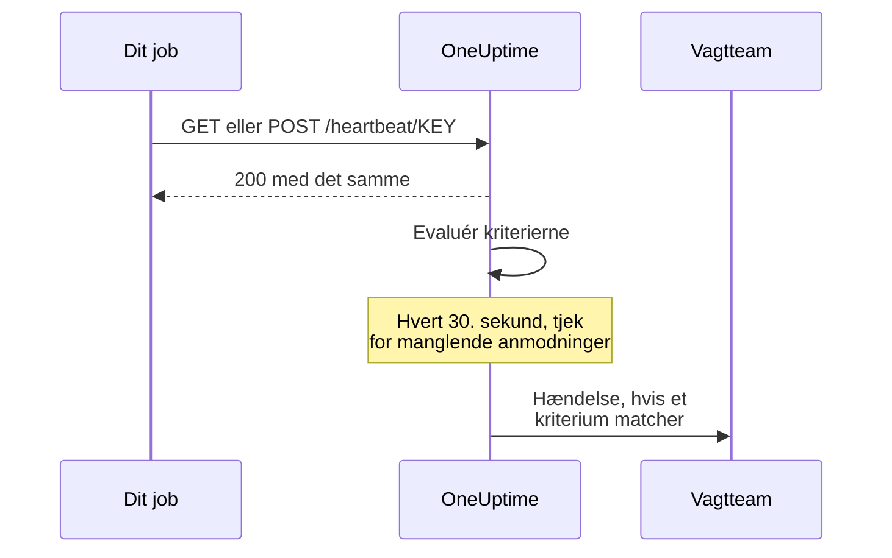

# Indgående anmodning-monitor

En monitor for indgående anmodninger giver dig en URL, som andre systemer sender HTTP-anmodninger til. OneUptime evaluerer hver anmodning ud fra dine kriterier og kan ændre monitorens status, erklære hændelser og tilkalde dem, der har vagt.

Den dækker to forskellige opgaver:

- **Heartbeat-overvågning** — et cronjob, en worker eller en enhed kalder URL'en efter en tidsplan, og OneUptime opretter en hændelse, når kaldene holder op med at komme.
- **Modtagelse af advarsler fra et andet system** — Prometheus Alertmanager, Grafana eller alt andet, der kan sende JSON med POST, skubber advarsler ind, og OneUptime gør hver enkelt til en hændelse med eskalering til vagten og automatisk løsning, når problemet er væk.

Begge bruger den samme monitortype. Det, der skiller dem ad, er de kriterier, du konfigurerer.

:::cards
- [Opret monitoren](#opret-en-monitor-for-indgående-anmodninger): Få en heartbeat-URL i nogle få trin.
- [Send et heartbeat](#send-et-heartbeat): Fra curl, cron, Node.js, Python eller Go.
- [Advar, når kaldene stopper](#markér-som-offline-hvis-der-ikke-er-noget-heartbeat-i-10-minutter-en-dødmandsknap): Gør monitoren til en dødmandsknap.
- [Modtag advarsler](#modtagelse-af-advarsler-fra-et-andet-system): Én hændelse pr. advarsel fra Alertmanager eller Grafana.
- [Abonnér på SNS eller Event Grid](#abonnement-på-amazon-sns-eller-azure-event-grid): Bekræft abonnementet med ét klik.
:::

## Sådan fungerer det

Intet tjekker dit system udefra: dit system kalder monitorens URL, OneUptime svarer med det samme og evaluerer derefter anmodningen ud fra monitorens kriterier. Et kriterium, der leder efter anmodninger, som er *holdt op* med at komme, tjekkes desuden igen i baggrunden hvert 30. sekund, så også stilhed kan oprette en hændelse.



Brug den til at:

- Overvåge cronjobs og planlagte opgaver
- Bekræfte, at baggrunds-workers kører
- Overvåge tjenester bag firewalls, som ikke kan nås udefra
- Modtage advarsler fra Prometheus Alertmanager, Grafana og andre advarselssystemer
- Følge heartbeat-signaler fra ethvert system, der kan tale HTTP

## Opret en monitor for indgående anmodninger

:::steps
### Start en ny monitor

Gå til **Monitorer**, og klik på **Opret monitor**.

### Vælg Indgående anmodning

Under **Monitortype** skal du vælge **Indgående anmodning** — den er en af de almindelige typer øverst. Angiv et **Navn**, og klik derefter på **Næste**.

### Gennemgå kriterierne

Trinnet **Kriterier** starter med [standardkriterierne](#hvad-du-får-fra-start). Til et heartbeat skal du klikke på **Tilføj kriterier** og give det nye kriterium et filter **Indgående anmodning** / **Ikke modtaget inden for minutter**, der ændrer status til offline og erklærer en hændelse, med **Løs hændelse automatisk** slået til. Træk det derefter øverst på listen — se [Eksempler på kriterier](#eksempler-på-kriterier) for at se hvorfor.

### Opret monitoren

Klik på **Opret monitor**. Monitoren åbner på sin side **Oversigt**, hvor kortet **Send the first heartbeat** viser **Heartbeat URL** med en kopiknap og en eksempelkommando med `curl`.

### Send den første anmodning

Konfigurér din tjeneste til at sende anmodninger til den URL (se [Send et heartbeat](#send-et-heartbeat)). Når den første anmodning kommer, giver kortet plads til monitorens historik, og et kort **Heartbeat URL** viser URL'en, og hvornår den seneste anmodning kom.
:::

> [!NOTE]
> URL'en indeholder monitorens hemmelige nøgle, så kun personer, der kan redigere monitorer, kan se den. Du kan altid finde den igen på monitorens side **Dokumentation** i afsnittet **Konfiguration** i sidemenuen.

## Anmodnings-URL'en

Din monitor har en unik URL i dette format:

```text
https://oneuptime.com/heartbeat/YOUR_SECRET_KEY
```

Erstat `https://oneuptime.com` med URL'en til din OneUptime-instans, hvis du selv hoster.

Send **GET**- eller **POST**-anmodninger til denne URL. HEAD accepteres og behandles som GET; PUT, PATCH og DELETE returnerer 404. Den hemmelige nøgle i stien er legitimationen: Der kræves ingen header eller token, medmindre projektet [kræver en hemmelighed ved hver anmodning](#kræv-en-hemmelighed-ved-hver-anmodning). Querystrenge ignoreres: send det, kriterierne skal læse, i brødteksten eller i headerne.

> [!WARNING]
> Alle, der kender denne URL, kan markere monitoren som sund, så behandl den som en hemmelighed. Hvis den slipper ud, skal du åbne monitorens side **Indstillinger** og klikke på **Nulstil hemmelig nøgle for indgående anmodning** og derefter opdatere hver afsender. Monitorens oversigt viser den seneste anmodning, som dens logge gemmer den: med hemmeligheder og personoplysninger maskeret og uden headere og brødtekst, når **Behold anmodningsindhold** er slået fra. Maskeringen fanger kun de navne og mønstre, den kender, så send ikke API-nøgler eller tokens til dette endpoint.

> [!IMPORTANT]
> OneUptime svarer straks `200` med et tomt JSON-objekt (`{}`) og behandler anmodningen via en kø. Svaret skrives, før nogen validering finder sted, så en `200` er **ikke** en bekræftelse på, at anmodningen blev accepteret — en forkert hemmelig nøgle, en slettet monitor og en deaktiveret monitor returnerer også `200`. Tjek monitorens egen tidslinje for at bekræfte, at anmodningerne lander. Et projekt, der kræver en hemmelighed ved hver anmodning, besvarer en anmodning uden en hemmelighed med `401`, og en tjeneste, der tjekker URL'en, før den leverer noget, får det svar, den forventer: se [Tjenester, der tjekker URL'en først](#tjenester-der-tjekker-urlen-først).

### Send en brødtekst i anmodningen

Hvis du vil bruge felter inde i brødteksten — `{{requestBody.status}}` i en hændelsestitel, en JSON-sti i grupperingen af hændelser eller et kriterium med et JavaScript-udtryk — skal du sende `Content-Type: application/json`. Det er det format, denne dokumentation går ud fra overalt. Brødteksten skal være et JSON-objekt eller et JSON-array: ugyldig JSON eller en enkeltstående værdi som `"error"` afvises med en `500`.

| Indholdstype | Hvad kriterier og skabeloner ser |
| --- | --- |
| `application/json` | Den fortolkede JSON. |
| `application/x-www-form-urlencoded` | Den fortolkede formular. Nøgler i firkantede parenteser indlejres (`alerts[0][status]=firing`), og alle værdier er strenge. |
| `text/plain` | Den fortolkede JSON, når teksten er et JSON-objekt eller et JSON-array: sådan sender Amazon SNS sine beskeder. Al anden tekst er selve teksten, så `backup failed: error 42` sætter monitoren offline med standardkriterierne. |
| `application/cloudevents+json` eller en anden `+json`-type | Den fortolkede JSON: sådan leverer Azure Event Grid CloudEvents. |
| Alt andet eller ingen | En tom brødtekst (`{}`), så ingen henvisning til `requestBody` løses op, og en skabelon skriver den ordret. |

Brødtekster på op til 50 MB accepteres; en større afvises med en `413`. Komprimér ikke brødteksten med `Content-Encoding: gzip`: så gemmes den ikke som JSON, og stier ind i den bliver ikke løst op.

### Send et heartbeat

Hvert eksempel sender én anmodning. Erstat `YOUR_SECRET_KEY` med nøglen fra din monitors URL.

:::tabs
@tab curl
```bash
# Simple GET request
curl https://oneuptime.com/heartbeat/YOUR_SECRET_KEY

# POST request with a JSON body
curl -X POST https://oneuptime.com/heartbeat/YOUR_SECRET_KEY \
  -H "Content-Type: application/json" \
  -d '{"status": "healthy", "version": "1.2.3"}'
```
@tab Cron
```bash
# Send a heartbeat every 5 minutes
*/5 * * * * curl -fsS https://oneuptime.com/heartbeat/YOUR_SECRET_KEY > /dev/null

# Or ping only when the job succeeds, so a failed run counts as a missed heartbeat
0 2 * * * /usr/local/bin/backup.sh && curl -fsS https://oneuptime.com/heartbeat/YOUR_SECRET_KEY > /dev/null
```
@tab Node.js
```javascript title="heartbeat.mjs"
// Node.js 18 or later: fetch is built in. Run with `node heartbeat.mjs`.
const response = await fetch(
  "https://oneuptime.com/heartbeat/YOUR_SECRET_KEY",
  {
    method: "POST",
    headers: { "Content-Type": "application/json" },
    body: JSON.stringify({ status: "healthy", version: "1.2.3" }),
  },
);

console.log(response.status); // 200
```
@tab Python
```python title="heartbeat.py"
# Python 3, standard library only. Run with `python3 heartbeat.py`.
import json
import urllib.request

request = urllib.request.Request(
    "https://oneuptime.com/heartbeat/YOUR_SECRET_KEY",
    data=json.dumps({"status": "healthy", "version": "1.2.3"}).encode(),
    headers={"Content-Type": "application/json"},
    method="POST",
)

with urllib.request.urlopen(request, timeout=10) as response:
    print(response.status)  # 200
```
@tab Go
```go title="heartbeat.go"
// Run with `go run heartbeat.go`.
package main

import (
	"bytes"
	"fmt"
	"net/http"
)

func main() {
	body := []byte(`{"status": "healthy", "version": "1.2.3"}`)

	resp, err := http.Post(
		"https://oneuptime.com/heartbeat/YOUR_SECRET_KEY",
		"application/json",
		bytes.NewReader(body),
	)
	if err != nil {
		panic(err)
	}
	defer resp.Body.Close()

	fmt.Println(resp.StatusCode) // 200
}
```
@tab PowerShell
```powershell
# Windows PowerShell 5.1 or PowerShell 7
Invoke-RestMethod -Method Post `
  -Uri "https://oneuptime.com/heartbeat/YOUR_SECRET_KEY" `
  -ContentType "application/json" `
  -Body '{"status": "healthy", "version": "1.2.3"}'
```
:::

## Kræv en hemmelighed ved hver anmodning

Alle, der har en monitor URL, kan sende den anmodninger. En Projektejer eller Projektadministrator kan få alle monitorer af indgående anmodninger i projektet til også at kræve en af projektets egne hemmeligheder, uanset hvem der har sat monitoren op: slå **Kræv en hemmelighed ved hver anmodning** til. En anmodning uden en hemmelighed afvises med `401` og årsagen, før den tæller som heartbeat, gemmes som monitorens seneste anmodning eller når nogen kriterier. En anmodning med en hemmelighed går videre til monitorens egne kriterier som hidtil.

Projektejere og Projektadministratorer administrerer hemmelighederne og kontakten, og det gør en brugerdefineret rolle med tilladelserne Create, Read, Edit og Delete Incoming Request Secret også: Read viser hemmelighedernes værdier, og Edit slår også kontakten til og fra.

:::steps
### Opret en hemmelighed

Gå til **Monitorer → Indstillinger → Hemmeligheder til indgående anmodninger** og opret en hemmelighed. Giv den et navn, så genererer OneUptime værdien; kopiér den fra listen.

### Send den fra alle afsendere

Send hemmeligheden i headeren `X-OneUptime-Secret` eller som Bearer-token i headeren `Authorization`, alt efter hvad din afsender kan sætte. En afsender, der ikke selv kan sætte en header, kan i stedet signere hver anmodning med hemmeligheden: se [Signér anmodninger med hemmeligheden](#signér-anmodninger-med-hemmeligheden).

### Find de afsendere, du har glemt

Så snart projektet har en hemmelighed, tjekker OneUptime hver anmodning for en, uden at afvise nogen endnu. **Anmodninger uden hemmelighed** på samme side viser hver monitor af indgående anmodninger, der har fået en anmodning uden en gyldig hemmelighed inden for de seneste 24 timer, og hvorfor: Der blev ikke sendt nogen, eller der blev sendt en forkert. Ret de afsendere. En monitor, hvis afsendere er rettet, viser et senere tidspunkt under **Sidst med hemmelighed** end under **Sidst uden hemmelighed** og forsvinder fra listen inden for 24 timer.

### Slå kravet til

Slå **Kræv en hemmelighed ved hver anmodning** til. Kravet kan ikke slås til, mens projektet ingen hemmelighed har, så ingen afsender afvises ved en fejl. Før kravet slås til, oplyses det, hvor mange monitorer af indgående anmodninger der har fået en anmodning uden en gyldig hemmelighed inden for de seneste 24 timer, hvis der er nogen: Deres afsendere afvises fra da af.
:::

```bash
curl -X POST https://oneuptime.com/heartbeat/YOUR_SECRET_KEY \
  -H "X-OneUptime-Secret: YOUR_PROJECT_SECRET"

# Or as a bearer token
curl -X POST https://oneuptime.com/heartbeat/YOUR_SECRET_KEY \
  -H "Authorization: Bearer YOUR_PROJECT_SECRET"
```

OneUptime gemmer aldrig hemmeligheden: Den fjerner headeren fra anmodningen og maskerer et Bearer-token, der er en af projektets hemmeligheder, før den gemmer noget.

En adresse, der sender en monitor mere end 10 forskellige forkerte hemmeligheder på 15 minutter, afvises derefter med `429` for hver hemmelighed, den sender, rigtig eller forkert, indtil det tidspunkt, dens header `Retry-After` angiver, højst 15 minutter. Afsendere på andre adresser påvirkes ikke, og en afsender, der bliver ved med at sende en gammel hemmelighed, får fortsat den `401`, der siger, hvad der er galt.

> [!TIP]
> For at udskifte en hemmelighed uden at afvise nogen skal du oprette en ny, flytte dine afsendere til den og slette den gamle, når dens **Sidst brugt** holder op med at ændre sig. Enhver af projektets hemmeligheder accepteres, medmindre den er begrænset til andre monitorer, og den sidste, der dækker en monitor, kan ikke slettes, mens kravet er slået til.

### Signér anmodninger med hemmeligheden

En afsender kan signere hver anmodning med hemmeligheden i stedet for at sende den, og det er mere sikkert: Intet hemmeligt sendes, og en anmodning, som nogen har opsnappet, kan ikke sendes igen senere. Foretræk det overalt, hvor en afsender kan signere. OneUptime tjekker disse signaturer, hver en HMAC-SHA256 i hex med hemmeligheden som nøgle:

| Afsender | Header | Hvad der signeres |
| --- | --- | --- |
| Din egen kode | `X-OneUptime-Signature: t=<time>,v1=<signature>` | `<time>.<body>` |
| GitHub-webhooks | `X-Hub-Signature-256` | Body'en |
| Slack | `X-Slack-Signature`, med `X-Slack-Request-Timestamp` | `v0:<time>:<body>` |
| Stripe | `Stripe-Signature` | `<time>.<body>` |

`<time>` er det tidspunkt, anmodningen blev signeret, i sekunder siden 1970. En signatur, der er mere end 5 minutter fra OneUptimes ur, afvises, og det samme gør en signeret anmodning, der sendes en gang til; GitHubs signatur har ingen tid, så OneUptime husker hver af dem i et døgn. Giv ved GitHub webhooken en af projektets hemmeligheder som dens secret. Slack og Stripe laver deres egen signeringshemmelighed: Opret projektets hemmelighed med den værdi under **Flere felter**.

```bash
body='{"status":"healthy"}'
t=$(date +%s)
sig=$(printf '%s.%s' "$t" "$body" | openssl dgst -sha256 -hmac "YOUR_PROJECT_SECRET" | sed 's/^.* //')

curl -X POST https://oneuptime.com/heartbeat/YOUR_SECRET_KEY \
  -H "Content-Type: application/json" \
  -H "X-OneUptime-Signature: t=$t,v1=$sig" \
  -d "$body"
```

En hemmelighed i URL'ens query string accepteres ikke: Proxyer og adgangslogs gemmer hele URL'er ved siden af monitorens egen nøgle. En sondes indgående anmodning ingress videresender en signeret anmodnings body, som den kom, så signaturen holder også den vej.

### Begræns en hemmelighed til bestemte monitorer

En hemmelighed accepteres af alle monitorer af indgående anmodninger i projektet, medmindre du begrænser den, som et projekt gør, hvis lejere hver sender deres egen hemmelighed: Vælg under **Flere felter** enten **Bestemte monitorer** eller **Monitorer med etiketter**. Alle andre monitorer afviser den med `401`, som de afviser en forkert hemmelighed, og **Anmodninger uden hemmelighed** angiver årsagen som **Hemmelighed ikke til denne monitor**. Så længe kravet er slået til, beholder projektet mindst én hemmelighed, der dækker en monitor.

## Overvågningskriterier

Du kan konfigurere kriterier, der afgør, hvornår din tjeneste betragtes som online, forringet eller offline. Hvert kriteriefilter har en **Filtertype** (hvad der ses på), en **Filterbetingelse** (hvordan der sammenlignes) og en **Værdi**.

### Hvad du får fra start

En ny monitor for indgående anmodninger oprettes med to kriterier, der læser anmodningens brødtekst:

| Kriterium | Filtertype | Filterbetingelse | Værdi | Virkning |
| -------- | ------------ | ---------------- | ------- | -------------------------------------------- |
| Offline  | Anmodningsbrødtekst | Indeholder | `error` | Markerer monitoren som offline, åbner en hændelse |
| Online   | Anmodningsbrødtekst | Indeholder ikke | `error` | Markerer monitoren som online |

Det passer til det almindelige tilfælde, hvor afsenderen rapporterer sit eget helbred i payloaden: en anmodning, hvis brødtekst nævner `error`, tager monitoren ned, og den næste anmodning uden ordet bringer monitoren op igen og løser hændelsen. En anmodning helt uden brødtekst tæller som "indeholder ikke `error`", så et rent heartbeat-kald holder monitoren online.

Ret værdien til det, din afsender faktisk sender (`"status":"firing"`, `FAILED` og så videre) — sammenligningen er en søgning efter en delstreng, der skelner mellem store og små bogstaver, i hele brødteksten inklusive nøgler, så også `{"error":null}` matcher `error`.

> [!NOTE]
> Disse standarder er **ikke** en dødmandsknap: intet her udløses, når anmodningerne holder op med at komme. Vil du advares ved stilhed, så tilføj et kriterium **Indgående anmodning** / **Ikke modtaget inden for minutter** som beskrevet nedenfor.

### Tilgængelige filtertyper

| Filtertype | Tjekker | Bemærkninger |
| --------------------- | ------------------------------------------------------ | -------------------------------------------------------------------------------------------- |
| Indgående anmodning | Om der er modtaget en anmodning inden for et tidsvindue | Det eneste tjek, der kan udløses, når intet kommer |
| Anmodningsbrødtekst | Anmodningens brødtekst | Søgning efter en delstreng. Objekter som brødtekst sammenlignes som kompakt JSON |
| Anmodningsheader | Navnene på anmodningens headere | Nøjagtig sammenligning med et helt headernavn, uden hensyn til store og små bogstaver |
| Anmodningsheaderværdi | Værdierne af anmodningens headere | Nøjagtig sammenligning med en hel headerværdi, uden hensyn til store og små bogstaver |
| JavaScript-udtryk | Ethvert udtryk over `requestBody` og `requestHeaders` | Den mest fleksible mulighed — se [JavaScript-udtryk](/docs/monitor/javascript-expression) |

### Filterbetingelser

Hver filtertype har sine egne betingelser:

| Filtertype | Betingelser |
| --- | --- |
| **Indgående anmodning** | **Modtaget inden for minutter** — der er modtaget en anmodning inden for det angivne antal minutter. **Ikke modtaget inden for minutter** — der er ikke modtaget nogen anmodning inden for det angivne antal minutter. |
| **Anmodningsbrødtekst**, **Anmodningsheader**, **Anmodningsheaderværdi** | **Indeholder** og **Indeholder ikke** |
| **JavaScript-udtryk** | **Evalueres til sand** |

> [!NOTE]
> Headernavne og -værdier sammenlignes med små bogstaver og med hele navnet eller hele værdien, ikke som delstreng: `application/json` matcher ikke `application/json; charset=utf-8`. Kun **Anmodningsbrødtekst** søger efter en delstreng. Headere, som din proxy eller OneUptimes egen load balancer tilføjer (`x-forwarded-for`, `x-real-ip`), gemmes også.

Objekter som brødtekst sammenlignes som kompakt JSON uden mellemrum, så et filter **Anmodningsbrødtekst** / **Indeholder** skal skrives `"status":"firing"` — kopierer du `"status": "firing"` fra en pænt formateret payload, matcher det aldrig.

### Eksempler på kriterier

#### Markér som offline, hvis der ikke er noget heartbeat i 10 minutter (en dødmandsknap)

| Felt | Værdi |
| --- | --- |
| **Filtertype** | Indgående anmodning |
| **Filterbetingelse** | Ikke modtaget inden for minutter |
| **Værdi** | `10` |

#### Markér som forringet ud fra indholdet af anmodningens brødtekst

| Felt | Værdi |
| --- | --- |
| **Filtertype** | Anmodningsbrødtekst |
| **Filterbetingelse** | Indeholder |
| **Værdi** | `"status":"degraded"` |

> [!IMPORTANT]
> Placér dødmandsknappen **over** standardkriterierne. Kriterier tjekkes oppefra, og det første, der matcher, afgør det. Baggrundstjekket læser den seneste anmodning igen, så standardkriteriet for online — "Anmodningsbrødtekst Indeholder ikke `error`" — bliver ved med at matche den, og et kriterium under det kommer aldrig til. **Tilføj kriterier** tilføjer et kriterium nederst: træk det op.

> [!WARNING]
> En monitor evalueres kun igen i baggrunden, hvis mindst ét af dens kriterier tjekker **Indgående anmodning**. En monitor, hvis kriterier kun tjekker brødteksten, Anmodningsheader eller et JavaScript-udtryk, evalueres, når en anmodning kommer, og på intet andet tidspunkt — så den kan aldrig gå offline af sig selv. Vil du have en alarm for manglende heartbeats, har du brug for et kriterium med **Indgående anmodning**.

Baggrundstjekket tæller hele minutter og udløses, så snart *mere* end værdien er gået: "Ikke modtaget inden for minutter: 10" udløses omkring 11 minutter efter den seneste anmodning (tjekket kører hvert 30. sekund). En monitor, der aldrig har modtaget en anmodning, behandles, som om dens oprettelsestidspunkt var den seneste anmodning, så det samme kriterium på en helt ny monitor udløses omkring 11 minutter efter, at du opretter den, også selv om afsenderen aldrig blev koblet på. Kun minutter, hvor OneUptime modtog, tæller med i værdien: minutter, hvor OneUptime selv genstarter, opgraderes eller indhenter et efterslæb, tæller ikke, som [Når OneUptime ikke modtager data](/docs/monitor/when-oneuptime-is-not-receiving) forklarer.

## Modtagelse af advarsler fra et andet system

Alertmanager, Grafana og lignende værktøjer sender med POST et JSON-dokument, der beskriver én eller flere advarsler. Som standard åbner et kriterium **én** hændelse, så en payload med fem advarsler ville give en enkelt hændelse. Gruppering af hændelser ændrer det: den trækker en værdi ud af payloaden og åbner **en separat hændelse pr. særskilt værdi**, som alle kan være åbne på samme tid.

```mermaid title="Gruppering af hændelser: én hændelse pr. advarsel i payloaden"
flowchart TB
    payload["Webhook-payload"] --> keys["Én nøgle pr. advarsel"]
    keys --> state{"Advarsel løst?"}
    state -->|Nej| open["Åbn eller behold dens hændelse"]
    state -->|Ja| resolve["Løs dens hændelse"]
```

### Slå gruppering af hændelser til

:::steps
1. Åbn kriteriet, og fold **Indstillinger** ud.
2. Slå **Group incidents and alerts by a payload field** til.
3. Udfyld **Open a separate incident for each…**. Skal hver hændelse løse sig selv, så udfyld også feltet og værdien under **Auto-resolve each incident when…** (se nedenfor). Gem derefter monitoren.
:::

| Felt | Eksempel | Hvad det gør |
| ---------------------------------- | ---------------------------------------- | ---------------------------------------------------------------------- |
| Open a separate incident for each… | `requestBody.alerts[*].labels.alertname` | Den sti, hvis særskilte værdier deler hændelserne op |
| Field that signals recovery | `requestBody.alerts[*].status` | Den sti, der tjekkes for at afgøre, at en advarsel er ovre |
| Value that means recovered | `resolved` | Den nøjagtige værdi, der markerer, at problemet er ovre |
| Max incidents per request | `100` (standard) | Sikkerhedsloft, så et felt med mange værdier ikke kan åbne et ubegrænset antal hændelser |

Grupperingen hører til det kriterium, den er slået til i. Monitorens andre kriterier grupperer ikke: når et af dem matcher en anmodning, åbner det sin hændelse og advarsel, som det ville på en monitor, hvor intet kriterium grupperer.

### Syntaks for stier

Stier skal starte med det bogstavelige præfiks `requestBody.`. En sti uden det — `alerts[*].labels.alertname` — finder ingen værdi i nogen anmodning. Indpakningen `{{ }}` er valgfri: `requestBody.status` og `{{requestBody.status}}` opfører sig ens.

- `[*]` folder sig ud over et array — én hændelse pr. **særskilt** værdi. To elementer med samme værdi slås sammen til én hændelse, og den hændelses tilstand (aktiv/løst) tages fra det **første** matchende element. **Kun den første `[*]` i en sti er et jokertegn**; `requestBody.groups[*].alerts[*].name` matcher ingenting.
- `[0]` og `[last]` vælger et enkelt element og må komme efter en `[*]`.
- Objekt- og arrayværdier, tomme strenge og null-værdier springes over. `0` og `false` er gyldige nøgler.
- Brødteksten skal være et JSON-objekt; en payload, hvis øverste niveau er et array, grupperes ikke.

### Anmodninger uden feltet

En anmodning, der matcher et grupperet kriterium, men ikke har nogen værdi ved dets sti — feltet mangler eller er tomt, indeholder et objekt eller en liste, eller brødteksten er ikke et JSON-objekt — åbner stadig kriteriets hændelse og advarsel: én for hele monitoren, som kriteriet ville uden gruppering. Det samme gør et grupperet kriterium, der matcher, fordi anmodningerne holdt op med at komme. En titel, der nævner grupperingsvariablen, som `{{alertname}}`, viser den, som den er skrevet, da der ikke er nogen værdi at sætte ind.

Den hændelse løses, hvis **Løs hændelse automatisk** er slået til, når en senere anmodning uden feltet melder, at problemet er ovre, eller når en senere anmodning matcher et andet kriterium. En sådan melding åbner ikke noget nyt.

Når nogle elementer i et array har en værdi og andre ikke, åbner hver værdi sin egen hændelse, og elementerne uden en værdi åbner ikke noget for sig selv.

Kortet **Monitor-resumé** på monitorens **Oversigt** viser, hvad hver anmodning gjorde, også når et kriterium håndterede den for hele monitoren eller ikke åbnede noget nyt.

### Løsning sker på baggrund af hændelser

En webhook beskriver kun det, der står i den payload, så OneUptime løser aldrig en hændelse, fordi dens nøgle holdt op med at dukke op. En hændelse løses kun, når en payload udtrykkeligt siger, at den nøgle er ovre. To ting skal begge være sande:

1. **Field that signals recovery** og **Value that means recovered** er udfyldt og matcher payloaden. Sammenligningen er nøjagtig og skelner mellem store og små bogstaver — `Resolved` matcher ikke `resolved`.
2. Kriteriets hændelse har **Løs hændelse automatisk** slået til under **Flere felter** i hændelsesformularen. Uden det ignoreres matchende meldinger om, at problemet er ovre, og hændelserne forbliver åbne. (Det samme gælder for advarsler og **Løs advarsel automatisk**.) Standardkriteriet for offline starter med det slået til; en hændelse, du selv føjer til et kriterium, starter med det slået fra.

En advarsel, du selv føjer til et kriterium, starter også med **Løs advarsel automatisk** slået fra, så en genoprettelse lader advarslen stå åben, indtil den er slået til. **Auto-resolve each incident when…** viser, hvilke af kriteriets hændelser og advarsler en genoprettelse løser, og nævner hver, den ville lade stå åben, med en knap, der slår den tilhørende indstilling til. Kortet **Monitor-resumé** på monitorens **Oversigt** nævner hver hændelse og advarsel, som en genoprettelse lod stå åben, og hvorfor.

En genopretning løser kun hændelserne og advarslerne fra det kriterium, der læser den: det, hvis **Field that signals recovery** og **Value that means recovered** matcher payloaden. Et andet kriteriums hændelser og advarsler for samme værdi forbliver åbne, og dem fra et kriterium, der lader felterne stå tomme, løses manuelt.

**Max incidents per request** begrænser udtrækningen, ikke kun oprettelsen. Nøgler ud over loftet er også usynlige for løsningen, så i en payload med flere særskilte nøgler end loftet lukker en advarsel, der melder `resolved` ud over loftet, ikke sin hændelse.

> [!NOTE]
> En monitor med et kriterium, der grupperer efter et felt i indholdet, evaluerer hver anmodning, den modtager, én ad gangen og i den rækkefølge, de kom, så en byge af advarsler og genopretninger åbner og løser hver værdis hændelse og advarsel. Op til 1.000 anmodninger, eller 16 MB af dem, venter på at blive evalueret; derudover springes de ældste ventende over, og kortet **Monitor-resumé** siger hvor mange. En monitor uden gruppering evaluerer kun den nyeste af de anmodninger, der venter på den.

> [!NOTE]
> Hvis **Field that signals recovery** indeholder `[*]`, men **Open a separate incident for each…** ikke gør, er en anmodning først ovre, når hvert element i det array siger det. Med `requestBody.alerts[*].status` og `resolved` løses en hændelse grupperet efter `requestBody.groupLabels.alertname`, når alle en anmodnings advarsler er løst, og den forbliver åben, så længe én stadig er aktiv.

> [!WARNING]
> En sti for løsning uden `[*]` evalueres mod hele payloaden, så en `status: resolved` på payloadens niveau løser hver nøgle i den payload — også advarsler, hvis egen status stadig er aktiv.

### Navngiv hændelserne

Grupperingsnøglen gøres tilgængelig for hændelses- og advarselsskabeloner som en variabel, der er opkaldt efter **stiens sidste segment**:

| Sti | Variabel |
| ---------------------------------------- | ----------------- |
| `requestBody.alerts[*].labels.alertname` | `{{alertname}}`   |
| `requestBody.alerts[*].fingerprint`      | `{{fingerprint}}` |
| `requestBody.commonLabels.severity`      | `{{severity}}`    |

Hele payloaden er tilgængelig ved siden af, så både en hændelsestitel `{{alertname}}` og en beskrivelse, der henviser til `{{requestBody.commonAnnotations.summary}}`, virker. Se [Hændelse- og advarselsskabeloner](/docs/monitor/incident-alert-templating).

> [!WARNING]
> Variablens navn er en del af den identitet, OneUptime bruger til at matche en melding om, at problemet er ovre, med en åben hændelse. Ændrer du grupperingsstien til en med et andet sidste segment, bliver alle hændelser, der står åbne under den gamle sti, forældreløse — de kan ikke længere løses automatisk og skal lukkes manuelt.

`[*]` virker **kun** i de to felter til grupperingsstier. Andre steder løses den ikke op, og en pladsholder, der ikke løses op, skrives **ordret** i stedet for at blive tømt — en titel `{{requestBody.alerts[*].labels.alertname}}` vises med tuborgklammerne stadig i. En titel `{{requestBody.alerts[0].annotations.summary}}` løses op, men læser altid den første advarsel i payloaden, ikke den, hændelsen blev åbnet for. Foretræk grupperingsvariablen plus payloadens fælles felter `commonAnnotations`.

### Gennemgået eksempel

En komplet Alertmanager-konfiguration finder du under [Prometheus Alertmanager](/docs/integrations/prometheus-alertmanager). For Grafana, se [Grafana](/docs/integrations/grafana).

## Tjenester, der tjekker URL'en først

Nogle tjenester tjekker et nyt endpoint, før de leverer noget til det: De sender det en anmodning og leverer først, når det svarer, som de forventer. OneUptime besvarer selv disse tjek, så du skal kun indsætte monitorens **Heartbeat URL** i tjenesten.

| Tjeneste | Tjekket | Det, OneUptime svarer |
| --- | --- | --- |
| Azure Event Grid, Event Grid-skema | En `SubscriptionValidationEvent` | Dens `validationCode`, som `validationResponse` |
| Azure Event Grid, CloudEvents-skema | En `OPTIONS`-anmodning, der nævner sin oprindelse | `WebHook-Allowed-Origin`, med den oprindelse |
| Slack Events API | En `url_verification`-anmodning | Dens `challenge` |
| Ændringsnotifikationer fra Microsoft Graph | En `POST` med et `validationToken` | Tokenet, som `text/plain` |
| Event hooks fra Okta | En `GET` med `X-Okta-Verification-Challenge` | Udfordringen, som `verification` |

Et tjek besvares kun på en monitors egen URL, og kun når anmodningen tæller: I et projekt, der kræver en hemmelighed ved hver anmodning, afvises et tjek uden en hemmelighed med `401` som enhver anmodning, så tjenesten skal sende hemmeligheden i en header. Svaret indeholder det, tjenesten sendte for at få det tilbage, og intet andet fra anmodningen, og kun når det har den form, tjenesten giver det.

Et tjek når monitoren som enhver anmodning, så dens kriterier vurderer det, og det vises på monitorens **Oversigt**; CloudEvents-tjekket besvares og intet andet. En sondes indgående anmodning ingress besvarer et tjek, som den besvarer enhver anmodning, med `{}`, så send disse tjenester til OneUptimes egen URL.

## Abonnement på Amazon SNS eller Azure Event Grid

Amazon SNS sender intet til et nyt endpoint, før nogen bekræfter abonnementet ved at åbne et link, som SNS sender dertil. Azure Event Grid sender også sådan et link, til et endpoint, der ikke besvarer dens tjek, og OneUptime besvarer det. Når der kommer et link, som endnu skal åbnes, viser kortet **Monitor-resumé** på monitorens **Oversigt**, hvad tjenesten venter på, emnet og én knap, der åbner linket i en ny fane.

| Tjeneste | Anmodningen | Knap | Linket virker i |
| --- | --- | --- | --- |
| Amazon SNS | `SubscriptionConfirmation`, for et nyt HTTPS-abonnement | **Bekræft abonnement** | To dage |
| Amazon SNS | `UnsubscribeConfirmation`, når abonnementet slettes | **Gendan abonnement** | To dage |
| Azure Event Grid | `SubscriptionValidationEvent`, for et nyt hændelsesabonnement med en webhook | **Valider abonnement** | 10 minutter |

Knappen bliver stående, indtil monitorens næste anmodning kommer, også efter at du har åbnet linket. Når linkets tid er udløbet, siger kortet i stedet, hvordan du får et nyt. Er der kommet nyere anmodninger, så åbn **Overvågningslogs**, og klik på **Vis oversigt** i anmodningens række.

Linket og det token, det indeholder, gemmes umaskeret overalt, hvor anmodningen gemmes: i dens detaljer, i dens logge og i de hændelser og advarsler, den åbner. Det eneste, linket kan, er at starte leveringer til denne monitor. Kun et link til tjenestens egen adresse tæller: alle andre maskeres som sædvanligt og får ingen knap.

### Amazon SNS

:::steps
1. Åbn emnet i Amazon SNS-konsollen, og vælg **Create subscription**. Vælg `HTTPS` som protokol, og indsæt monitorens **Heartbeat URL** som endpoint.
2. Åbn monitorens **Oversigt**, og klik på **Bekræft abonnement** i kortet **Monitor-resumé**. I SNS-konsollen skifter abonnementets status fra **Pending confirmation** til bekræftet.
:::

SNS sender sine beskeder som JSON mærket `text/plain`, og monitoren læser dem som JSON, så kriterier, skabeloner og gruppering af hændelser kan bruge deres felter, for eksempel `{{requestBody.Subject}}` og `{{requestBody.Message}}`. En notifikations egen JSON, for eksempel en CloudWatch-alarms, kommer som tekst i `Message`.

Hvis kortet siger, at linket ikke længere kan åbnes, så markér abonnementet i SNS-konsollen, og vælg **Request confirmation**. SNS sletter et abonnement, der ikke er bekræftet inden for 48 timer; sker det, så opret abonnementet igen.

### Azure Event Grid

:::steps
1. Åbn i Azure-portalen den ressource, hvis hændelser du vil have, og tilføj et hændelsesabonnement. Vælg **Event Grid Schema** eller **Cloud Event Schema v1.0** som hændelsesskema, **Web Hook** som endpointtype og monitorens **Heartbeat URL** som endpoint.
2. Opret hændelsesabonnementet. OneUptime besvarer Event Grids tjek, så abonnementet valideres, mens det oprettes, og dets hændelser begynder at komme.
:::

Event Grid validerer et endpoint, der sender en kode tilbage til Event Grid, eller hvis ejer åbner det link, Event Grid sender. OneUptime sender koden tilbage, så kortet **Monitor-resumé** tilbyder kun **Valider abonnement** for en validering, OneUptime ikke besvarede: Åbn det inden for 10 minutter. Linket peger på Event Grid på port 553, som en firewall foran din browser skal tillade. Går der 10 minutter først, mislykkes hændelsesabonnementet: opret det igen.

## Bedste praksis

1. **Sæt tidsvinduet passende** — Hvis dit cronjob kører hvert 5. minut, så sæt tærsklen for "Ikke modtaget inden for minutter" til 10–15 minutter for at give plads til lejlighedsvise forsinkelser, og placér det kriterium først.
2. **Send meningsfulde data med** — Send statusoplysninger i anmodningens brødtekst, så du kan opsætte detaljerede kriterier.
3. **Brug POST med `Content-Type: application/json`** — alt, der læser inde i brødteksten, afhænger af det.
4. **Bland ikke de to opgaver på én monitor** — en monitor, der modtager hændelsesdrevne advarsler, har ingen fast rytme, så et kriterium "Ikke modtaget inden for minutter" på den vil skifte frem og tilbage. Brug en separat monitor til dødmandsknappen.
5. **Overvåg overvågningen** — Sørg for, at den tjeneste, der sender anmodningerne, håndterer fejl ordentligt, så mislykkede anmodninger ikke går ubemærket hen.

## Fejlfinding

:::details Min afsender får en 200, men intet vises på monitoren
`200` sendes, før anmodningen valideres, så den beviser ikke, at anmodningen blev accepteret. Tjek, at den hemmelige nøgle i URL'en svarer til monitorens **Heartbeat URL**, og at monitoren ikke er deaktiveret. Se derefter på monitorens tidslinje, om anmodningerne lander.
:::

:::details Min afsender får en 401
Projektet kræver en hemmelighed ved hver anmodning, og anmodningen sendte ingen eller en, der ikke er projektets: Svaret siger hvilken. Send en af projektets hemmeligheder i headeren `X-OneUptime-Secret` eller som Bearer-token, som [Kræv en hemmelighed ved hver anmodning](#kræv-en-hemmelighed-ved-hver-anmodning) viser. En afvist anmodning når aldrig frem til monitoren. Den får også `401` med en af projektets hemmeligheder, der er begrænset til andre monitorer, og for en signeret anmodning, hvis signatur er mere end 5 minutter gammel, er sendt før, eller er lavet med en anden hemmelighed eller over en body, der ændrede sig undervejs.
:::

:::details Min afsender får en 429
Dens adresse har sendt en monitor mere end 10 forskellige forkerte hemmeligheder eller signaturer på 15 minutter, så hver anmodning med en hemmelighed, den sender til den monitor, afvises indtil tidspunktet i dens header `Retry-After`. En afsender, der signerer med en forkert hemmelighed, laver en ny forkert signatur hver gang og havner hurtigt her: Giv den en hemmelighed, som monitoren accepterer, som [Kræv en hemmelighed ved hver anmodning](#kræv-en-hemmelighed-ved-hver-anmodning) viser, så accepteres dens anmodninger, når tiden er gået.
:::

:::details Monitoren får ikke længere anmodninger, efter at der kræves en hemmelighed
Dens afsendere sender ingen hemmelighed eller en forkert, så hver anmodning, de sender, afvises. En linje under monitorens **Heartbeat URL** siger, hvornår den seneste afviste anmodning kom, og **Anmodninger uden hemmelighed** viser hver monitor, der har fået en inden for de seneste 24 timer, og hvorfor. Send en af projektets hemmeligheder fra de afsendere, som [Kræv en hemmelighed ved hver anmodning](#kræv-en-hemmelighed-ved-hver-anmodning) viser.
:::

:::details Monitoren går aldrig offline, når heartbeats stopper
Kun et kriterium med **Indgående anmodning** (**Ikke modtaget inden for minutter**) kan opdage stilhed. Tilføj et, hvis der ikke er noget, og træk det op over standardkriterierne: standardkriteriet for online matcher den seneste anmodning ved hvert baggrundstjek, og det første kriterium, der matcher, afgør det.
:::

:::details Et filter på Anmodningsbrødtekst matcher aldrig
Send `Content-Type: application/json`, og skriv værdien som kompakt JSON — `"status":"firing"` uden mellemrum efter kolonet. Uden en indholdstype for JSON, formularer eller `text/plain` er brødteksten tom, og et filter på den matcher aldrig.
:::

:::details En tjeneste siger, at URL'en ikke besvarede dens tjek
Giv tjenesten monitorens **Heartbeat URL**, på OneUptime selv og ikke på en sonde. Kræver projektet en hemmelighed ved hver anmodning, afvises tjekket med `401`, medmindre tjenesten sender hemmeligheden. Lad derefter tjenesten tjekke URL'en igen: Den besvares med det samme.
:::

:::details Et filter på Anmodningsheader matcher aldrig
Headernavne og -værdier sammenlignes i deres helhed. Angiv hele værdien, for eksempel `application/json; charset=utf-8`, i stedet for en del af den.
:::

:::details Amazon SNS siger, at abonnementet afventer bekræftelse
Klik på **Bekræft abonnement** i kortet **Monitor-resumé** på monitorens **Oversigt**. Er der kommet nyere anmodninger, så åbn **Overvågningslogs**, og klik på **Vis oversigt** i bekræftelsens række. Med **Behold anmodningsindhold** slået fra gemmer monitoren ingen brødtekst og dermed heller intet link: slå det til i monitorens **Indstillinger**, så vises den seneste anmodning igen med sit link.
:::

:::details Afsenderen får en 500
Anmodningen siger `Content-Type: application/json`, men dens brødtekst er ikke et JSON-objekt eller et JSON-array. Send gyldig JSON eller en anden indholdstype.
:::

## Næste trin

:::cards
- [Prometheus Alertmanager](/docs/integrations/prometheus-alertmanager): En komplet opsætning til indgående advarsler.
- [Grafana](/docs/integrations/grafana): Det samme for advarsler fra Grafana.
- [Hændelse- og advarselsskabeloner](/docs/monitor/incident-alert-templating): Alle variabler, der er tilgængelige i titler og beskrivelser.
- [JavaScript-udtryk](/docs/monitor/javascript-expression): Syntaks for udtryk og regler for anførselstegn.
:::
