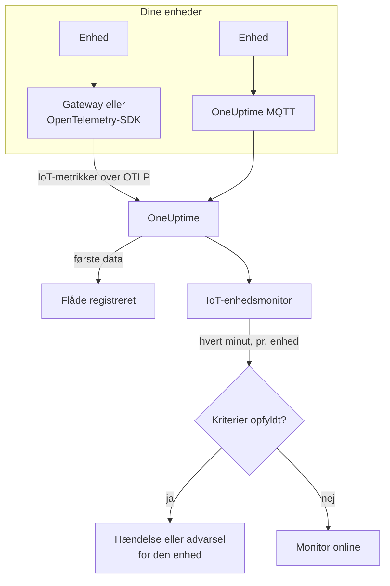

# IoT-enheds-monitor

En IoT-enhedsmonitor holder øje med én flåde af enheder og fortæller dig, når en enhed går offline, dens batteri løber tør, dens signal svækkes, den bliver overophedet, eller dens CPU bliver ved med at være optaget. Den læser de `iot_*`-metrikker, dine enheder sender til OneUptime over OpenTelemetry eller MQTT, så intet tjekkes udefra, og ingen probe er involveret.

:::cards
- [Opret monitoren](#opret-en-iot-enhedsmonitor): Seks trin i dashboardet.
- [Skabeloner](#færdige-advarselsskabeloner): Fem færdige advarsler, én hændelse pr. enhed.
- [Offline-registrering](#offline-registrering): Hvordan en død eller tavs enhed opdages.
- [Metrikker](#indsamlede-metrikker): De `iot_*`-serier, monitoren læser.
:::

## Sådan fungerer det

Dine enheder, eller den gateway, de taler med, sender deres målinger til OneUptime: over OpenTelemetry eller direkte til OneUptimes MQTT-endpoint. Hver måling bærer flådens navn, `iot.fleet.name`, og enhedens eget ID, `device.id`. De første data registrerer flåden.

En IoT-enhedsmonitor er knyttet til én flåde. Hvert minut kører den sin forespørgsel på den flådes metrikker og sammenligner resultatet med sine kriterier. Skabelonerne grupperer efter `device.id`, så 30 sensorer, der er offline, åbner 30 hændelser, der hver nævner sin enhed og hver løser sig selv, når enheden kommer sig.



## Før du begynder

- **Få dine enheder til at sende data.** [Vejledningen til IoT-enheder](/docs/telemetry/iot-devices) viser, hvordan du sender metrikker med en OpenTelemetry-SDK eller -Collector, eller over MQTT.
- **Tjek, at flåden er registreret.** Den vises under **Produkter → Infrastruktur → IoT → All Fleets**, opkaldt efter det `iot.fleet.name`, enhederne sender.
- **Registrér de enheder, du forventer**, under flådens **Device Registry**, så du får besked, når en bliver tavs: se [Offline-registrering](#offline-registrering).

## Opret en IoT-enhedsmonitor

:::steps
### Start en ny monitor

Gå til **Monitorer**, og klik på **Opret monitor**.

### Vælg IoT Device

Klik under **Monitortype** på **Flere monitortyper**, og vælg **IoT Device** under **Infrastruktur**, eller skriv `iot` i søgefeltet. Angiv et **Navn** - det bruges i titlerne på hændelser og advarsler - og klik på **Næste**.

### Vælg flåden

Vælg under **IoT Monitor Configuration** flåden i **IoT Fleet**. Hver flåde, der har sendt data, står på listen.

### Vælg, hvad der skal overvåges

Vælg en af de tre faner:

- **Quick Setup** - klik på en [skabelon](#færdige-advarselsskabeloner). Den sætter metrikken, aggregeringen, tidsintervallet, en gruppering på `device.id` og tærsklerne og erstatter kriterierne nedenfor med sine egne. Du kan stadig ændre **Tidsinterval**.
- **Custom Metric** - vælg én metrik i **IoT Metric**, og sæt derefter **Aggregering** og **Tidsinterval**. [Filtrene](#monitorindstillinger) indsnævrer den til én enhed eller én enhedstype. En brugerdefineret metrik grupperes ikke: den bedømmer flåden som helhed.
- **Avanceret** - byg selv forespørgsler og formler under **Vælg målinger**, også over dine egne metriknavne, for eksempel hukommelse i brug i procent af en enheds hukommelsesstørrelse. Brug **Group by** `device.id` for at bedømme hver enhed for sig.

### Tjek kriterierne

Åbn hvert kriterium under **Monitorkriterier**, og tjek dets **Select Metric Variable**, **Aggregering**, **Betingelse** og **Threshold**. En skabelon udfylder dem. Med **Custom Metric** eller **Avanceret** starter monitoren med [standardkriterierne](#standardkriterier), som kun opdager, at en metrik falder til nul, så sæt din egen tærskel.

### Opret monitoren

Klik på **Opret monitor**. OneUptime åbner monitorens side og evaluerer den hvert minut. Hændelser og advarsler, den udsender, når dine vagtpolitikker, Slack, Microsoft Teams, e-mail, SMS og webhooks som enhver anden monitors.
:::

> [!TIP]
> For at sætte flere skabeloner op på én gang åbner du flåden fra **Produkter → Infrastruktur → IoT** og går til **Recommendations**. Vælg de skabeloner, du vil have, vælg, hvem der tilkaldes, og OneUptime opretter én monitor pr. skabelon.

## Monitorindstillinger

| Felt | Fane | Hvad det gør |
| --- | --- | --- |
| **IoT Fleet** | Alle | Påkrævet. Begrænser hver forespørgsel til `resource.iot.fleet.name`. |
| **Ressourceomfang** | Custom Metric, Avanceret | Valgfrit. **Enhed** eller **Fleet**: et nøjagtigt match på attributten `iot.scope`. At vælge en metrik sætter det til **Enhed**. |
| **Device ID** | Custom Metric, Avanceret | Valgfrit. Én enhed, via dens `device.id`, som `sensor-001`. |
| **Device Type** | Custom Metric, Avanceret | Valgfrit. De enheder, der rapporterer dette `iot.device.type`, som `sensor` eller `gateway`. |
| **IoT Metric** | Custom Metric | Én metrik fra [kataloget](#indsamlede-metrikker). |
| **Aggregering** | Custom Metric | Hvordan prøver kombineres: **Gennemsnit**, **Maksimum**, **Minimum**, **Sum** eller **Antal**. Starter ved metrikkens sædvanlige aggregering. |
| **Tidsinterval** | Alle | Det glidende vindue, forespørgslen læser, fra **Past 1 Minute** til **Past 365 Days**. En ny monitor starter ved **Past 1 Minute**; skabeloner sætter deres eget. |
| **Vælg målinger** | Avanceret | Forespørgselsbyggeren: **Metrik**, **Aggregate by**, **Filter by attributes**, **Group by**, plus **Tilføj metrik** og **Tilføj formel** til at kombinere forespørgsler. |

Filtrene virker sammen: med et **Device ID** og en **Device Type** matcher en enhed af en anden type intet.

## Færdige advarselsskabeloner

**Quick Setup** tilbyder 5 skabeloner. Hver bygger en komplet monitor: metrikforespørgslen, en gruppering på `device.id`, et kriterium, der udløser, og et, der genopretter. Tærskler er udgangspunkter, du kan redigere.

Et kriterium udløser kun, når betingelsen gælder for hvert minut i dets vindue - undtagen **Device Offline**, som udløser ved den første måling under 1. Et tærskelkriterium genopretter 10 % forbi sin tærskel, så en værdi, der svinger omkring linjen, ikke skifter frem og tilbage.

| Skabelon | Kategori | Alvorlighed | Overvåger | Udløser når | Genopretter når |
| --- | --- | --- | --- | --- | --- |
| Device Offline | Tilgængelighed | Kritisk | `iot_device_up`, Min pr. `device.id`, seneste 30 minutter | En måling er under 1, eller en registreret enhed sender intet i hele vinduet | Tilbage på 1 |
| Low Battery | Power | Warning | `iot_battery_percent`, Avg pr. `device.id`, seneste 5 minutter | Under 20 % | Ved 22 % eller derover |
| Weak Signal | Connectivity | Warning | `iot_signal_strength_dbm`, Avg pr. `device.id`, seneste 5 minutter | Under -100 dBm | Ved -90 dBm eller derover |
| High Temperature | Miljø | Kritisk | `iot_temperature_celsius`, Max pr. `device.id`, seneste 5 minutter | Over 70 °C | Ved 63 °C eller derunder |
| High CPU Usage | System | Warning | `iot_cpu_usage_ratio`, Avg pr. `device.id`, seneste 5 minutter | Over 0.9 (90 % af dens CPU) | Ved 0.81 eller derunder |

**Alvorlighed** er den label, vælgeren viser. Den hændelse og den advarsel, en skabelon opretter, starter på dit projekts mest alvorlige hændelses- og advarselsalvorlighed; skift dem i kriteriet.

- **Device Offline læser 30 minutter**, så en enhed, der rapporterer med få minutters mellemrum, ikke kaldes offline mellem to rapporter. En enhed, der rapporterer sjældnere end cirka hvert 15. minut, har brug for et længere vindue.
- **High Temperature bruger Max** i hvert minut, så en varm måling ikke skjules af køligere målinger i samme minut. Den skal stadig forblive varm i hvert minut af vinduet.
- **High CPU Usage sammenligner et forhold:** `iot_cpu_usage_ratio` går fra 0 til 1, så 0.9 er 90 %.

## Offline-registrering

**Device Offline** udløser, når en enhed rapporterer `iot_device_up = 0`. En død eller tavs enhed udløser den på tre måder:

| Hvordan | Hvad der sker |
| --- | --- |
| **Gatewayen rapporterer det** | Gatewayen eller collectoren sender `iot_device_up = 0` for en enhed, den ikke længere kan nå. |
| **MQTT Last Will** | En enhed, der er forbundet til OneUptimes MQTT-endpoint, registrerer en Last Will på sit emne `status`. Når enheden dør, sender brokeren `iot_device_up = 0` for den i det øjeblik, sessionen falder: ingen polling, ingen venten på en manglende rapport. Se [Send metrikker via MQTT](/docs/telemetry/iot-devices#afsendelse-af-metrikker-via-mqtt). |
| **Enheden er registreret** | En enhed i flådens **Device Registry** forventes. Når den intet sender i hele vinduet, behandler monitoren den, som om den rapporterede `0`, så den får sin egen hændelse, som løser sig selv, når enheden rapporterer igen. |

En registreret enhed bevares også som offline i flådens inventar, mens en uregistreret fjernes efter 15 minutters stilhed. Registrering af stilhed kræver politikken **Treat As Zero** for manglende data på kriteriet for `iot_device_up`, som Device Offline-monitorer oprettet fra skabelonen har. En Device Offline-monitor, der blev oprettet, før enhedsregistrering fandtes, skal have den sat manuelt eller oprettes igen fra skabelonen.

> [!NOTE]
> En uregistreret enhed, der bliver tavs uden en Last Will eller en gatewayrapport, holder bare op med at sende data, og en monitor, der grupperer pr. enhed, kan ikke udpege den. Registrér dine enheder, eller giv en kritisk enhed sin egen monitor (**Custom Metric**, med dens **Device ID**), og sæt **Hvis ingen data** til **Trigger**. Registrering af stilhed kræver også, at mindst én anden enhed i flåden stadig rapporterer: en flåde, der går helt i sort, for eksempel under et gatewaynedbrud, udsender én hændelse for monitoren, ikke én pr. enhed.

## Indsamlede metrikker

Hver serie bærer enhedens label `device.id` og attributterne `iot.scope`, `iot.device.type` og `iot.device.kind`.

| Metrik | Enhed | Beskrivelse |
| --- | --- | --- |
| `iot_device_up` | — | 1, når enheden kører, 0, når den er nede eller offline. |
| `iot_battery_percent` | `%` | Resterende batteriladning, fra 0 til 100. Et faldende niveau betyder, at enheden snart holder op med at rapportere. |
| `iot_signal_strength_dbm` | `dBm` | Det trådløse signals styrke. Tættere på 0 er stærkere; et svagt signal kommer før tabte forbindelser. |
| `iot_temperature_celsius` | `°C` | Enhedens temperatur. En høj måling kan betyde overophedet hardware eller et problem omkring den. |
| `iot_cpu_usage_ratio` | `ratio` | CPU i brug, fra 0 til 1, hvor 1 er fuldt udnyttet. |
| `iot_memory_usage_bytes` | `bytes` | Hukommelse i brug. Sammenlign den med enhedens hukommelsesstørrelse for at se hukommelsespres. |
| `iot_uptime_seconds` | `s` | Hvor længe enheden har kørt. Falder til nul, når den genstarter. |

## Overvågningskriterier

Et kriterium sammenligner en af monitorens forespørgsler eller formler med en tærskel. En IoT-enhedsmonitors kriterier tilbyder én **Filtertype**, **Metric Value**: hver regel tjekker metrikværdien, med disse felter.

| Felt | Hvad det gør |
| --- | --- |
| **Filtertype** | Altid **Metric Value**, det eneste tjek, denne monitor tilbyder. |
| **Select Metric Variable** | Den forespørgsel eller formel, der skal tjekkes, efter dens variabelnavn. |
| **Aggregering** | Hvordan værdierne i vinduet bliver til ét svar: **Gennemsnit**, **Sum**, **Maximum Value**, **Minimum Value**, **All Values** (hver værdi skal matche) eller **Any Value** (én er nok). |
| **Betingelse** | **Greater Than**, **Less Than**, **Greater Than Or Equal To**, **Less Than Or Equal To** eller **Equal To** — eller en anomalibetingelse: **Anomalously High**, **Anomalously Low** eller **Anomalous**. |
| **Threshold** | Den værdi, der sammenlignes med. En enhedsliste står ved siden af, når metrikken har en enhed. Vises ikke for anomalibetingelser. |
| **Følsomhed** | Kun anomalibetingelser. **Lav** (4σ), **Mellem** (3σ, standarden) eller **Høj** (2σ). |
| **Baseline-vindue** | Kun anomalibetingelser. 14 dage (standarden), 28, 60 eller 90 dages historik. |
| **Hvis ingen data** | Under **Flere felter**. Hvad der sker, når en serie ingen prøver har i vinduet: **Ignore** (standarden) springer den over, **Treat As Zero** læser den som `0`, og **Trigger** får kriteriet til at matche. |

Anomalibetingelser sammenligner hver værdi med den samme time på ugen i baselinen. De forbliver i tilstanden "Learning", og udsender intet, indtil baseline-vinduet indeholder nok historik.

### Standardkriterier

En monitor, du ikke bygger ud fra en skabelon, starter med to kriterier:

| Rækkefølge | Kriterium | Matcher når | Så |
| --- | --- | --- | --- |
| 1 | Check if _monitor name_ is offline | En vilkårlig værdi i den første forespørgsel er `0` | Markerer monitoren som **Offline** og erklærer hændelsen "_monitor name_ is offline", som løser sig selv, når monitoren kommer sig. |
| 2 | Check if _monitor name_ is online | En vilkårlig værdi er over `0` | Markerer monitoren som **I drift**. |

> [!IMPORTANT]
> Stilhed matcher ingen af kriterierne: en flåde, der holder op med at sende data, efterlader monitoren, som den var. For at få besked, når data udebliver, sætter du **Hvis ingen data** til **Trigger** på et kriterium. Tid, hvor OneUptime selv ikke modtog noget, tæller aldrig som manglende data: et tjek, hvis vindue indeholder den tid, venter i stedet, som [Når OneUptime ikke modtager data](/docs/monitor/when-oneuptime-is-not-receiving) forklarer.

## Terraform

[OneUptimes Terraform-provider](/docs/terraform/monitor-steps) bærer konfigurationen af et trin i en IoT-enhedsmonitor i attributten `iot_monitor`: den rå JSON for konfigurationen `iotMonitor` (`fleetIdentifier`, `resourceFilters`, `metricViewConfig`, `rollingTime`), skrevet med `jsonencode()`:

```hcl title="main.tf"
monitor_steps = [{
  iot_monitor = jsonencode({
    fleetIdentifier = "building-a-sensors"
    resourceFilters = {}
    rollingTime     = "Past 5 Minutes"
    metricViewConfig = {
      queryConfigs = [{
        metricAliasData = { metricVariable = "battery_percent", title = "Battery", description = "", legend = "" }
        metricQueryData = {
          filterData = {
            metricName     = "iot_battery_percent"
            attributes     = {}
            aggegationType = "Avg"
            aggregateBy    = {}
          }
          groupByAttributeKeys = ["device.id"]
        }
      }]
      formulaConfigs = []
    }
  })
  criteria = [ /* ... */ ]
}]
```

`fleetIdentifier` er flådens `iot.fleet.name`, ikke dens OneUptime-ID.

## Fejlfinding

:::details Flåden står ikke på listen IoT Fleet
Flåder registrerer sig selv ud fra enhedernes data. Tjek, at enhederne sender `iot.fleet.name`, og følg [vejledningen til IoT-enheder](/docs/telemetry/iot-devices) for at bekræfte, at data kommer frem.
:::

:::details Én hændelse udløses for hele flåden i stedet for én pr. enhed
Forespørgslen er ikke grupperet. Monitorer med **Custom Metric** bedømmer flåden som helhed; brug en skabelon, eller **Avanceret** med **Group by** `device.id`.
:::

:::details En enhed døde, men Device Offline udløste ikke
Enheden sendte ingen Last Will, og ingen gateway rapporterede den, så den blev bare tavs. Registrér den under flådens **Device Registry**, og tjek, at **Hvis ingen data** på kriteriet for `iot_device_up` står på **Treat As Zero**. Se [Offline-registrering](#offline-registrering).
:::

:::details Device Offline udløser for enheder, der har det fint
De rapporterer sjældnere, end vinduet på 30 minutter dækker, så nogle vinduer indeholder intet fra dem. Forlæng **Tidsinterval**, eller lad enhederne rapportere oftere. På WebSocket-MQTT-endpointet skal du holde MQTT-keepalive under 5 minutter: OneUptime lukker inaktive WebSocket-forbindelser efter 300 sekunder, hvilket sender Last Will.
:::

:::details En skabelon viser ingen data
Skabelonerne læser `iot_*`-metriknavnene præcist og grupperer efter labelen `device.id`. Sammenlign, hvad dine enheder sender, på flådens side **Metrikker**, med [metrikkonventionerne](/docs/telemetry/iot-devices#metrikkonventioner).
:::

## Næste skridt

:::cards
- [IoT-enheder](/docs/telemetry/iot-devices): Send enhedsmetrikker over OpenTelemetry eller MQTT.
- [Metrik-monitor](/docs/monitor/metrics-monitor): Advar på enhver metrik, ikke kun IoT-metrikker.
- [Hændelse- og advarselsskabeloner](/docs/monitor/incident-alert-templating): Sæt enhedens ID i hændelsestitler.
:::
