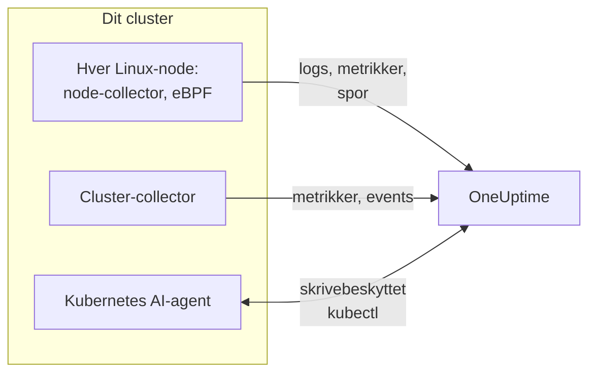

# Kubernetes-agent (Helm-installation)

OneUptimes Kubernetes-agent er et Helm-chart, der indsamler dit clusters metrikker, events og pod-logs, applikationsspor fanget med eBPF og hver nodes styresystemmetrikker, og sender dem til OneUptime. Én `helm install` sætter den op, uden kodeændringer i dine apps. [Kubernetes-monitorer](/docs/monitor/kubernetes-monitor) advarer ud fra det, den sender.

:::cards
- [Installér agenten](#installér-agenten): Fire trin med Helm.
- [Vælg et preset](#vælg-et-preset): Standardclustere, GKE Autopilot eller EKS Fargate.
- [Almindelige indstillinger](#almindelige-indstillinger): De indstillinger, de fleste clustere ændrer.
- [Fejlfinding](#fejlfinding): Et diagnosescript og de sædvanlige problemer.
:::

## Hvad chartet installerer

Chartet kører nogle få workloads i sit eget namespace. Hver af dem sender det, den indsamler, til din OneUptime-URL over OTLP, med den indtagelsesnøgle, du giver den.



| Workload | Type | Hvad den gør | Slået til som standard |
| --- | --- | --- | --- |
| Cluster-collector | Deployment | Clustermetrikker, Kubernetes-events og de fulde specifikationer for pods, noder og workloads, fra Kubernetes-API'et. | Ja |
| Node-collector | DaemonSet | Pod-logs fra `/var/log/pods`, kubelet- og cAdvisor-metrikker og nodens styresystemmetrikker. | Ja |
| eBPF-instrumentering (OBI) | DaemonSet | HTTP-, gRPC-, SQL- og Redis-spor og anmodningsmetrikker fra hver pod, og servicekortet. | Ja |
| Kubernetes AI-agent | Deployment | Lader OneUptime AI køre skrivebeskyttet `kubectl`, mens den undersøger en hændelse eller advarsel på dette cluster. | Ja |
| Log-tailer | Deployment | Pod-logs gennem Kubernetes-API'et, hvor node-collectoren ikke kan læse dem. | Med presets `gke-autopilot` og `eks-fargate` |
| eBPF-profiler | DaemonSet | Løbende CPU-flamegrafer for hver proces. | Nej |
| kube-state-metrics | Deployment | Pod-faser, containeres venteårsager og ressourcekvoter. | Nej |

Hvert agent-image kører kun på Linux, så hver workload er fastlåst til Linux-noder.

## Før du begynder

- **En indtagelsesnøgle.** Opret en i OneUptime under **Projektindstillinger → Telemetri og APM → Indtagelsesnøgler**. Agenten sender den som headeren `x-oneuptime-token`, så en projekt-API-nøgle virker ikke her.
- **Helm 3** og `kubectl`-adgang til clusteret. Opgraderinger bruger `--reset-then-reuse-values`, som kræver Helm 3.14 eller nyere.
- **Et navn til clusteret**, unikt i dit projekt. Chartet nægter at installere uden et: to clustere med samme navn ville blive vist som ét.
- **Udgående HTTPS** fra clusteret til din OneUptime-URL.

## Installér agenten

:::steps
### Tilføj Helm-repositoriet

```bash
helm repo add oneuptime https://helm-chart.oneuptime.com
helm repo update
```

### Installér chartet

Erstat URL'en med din OneUptime-URL, og de to pladsholdere med din indtagelsesnøgle og clusterets navn:

```bash
helm install oneuptime-agent oneuptime/kubernetes-agent \
  --namespace oneuptime-kubernetes-agent \
  --create-namespace \
  --set oneuptime.url=https://oneuptime.com \
  --set oneuptime.apiKey=<YOUR_API_KEY> \
  --set clusterName=<A_UNIQUE_NAME_FOR_THIS_CLUSTER>
```

Dette bruger presettet `standard`. På GKE Autopilot eller EKS Fargate skal du i stedet [vælge deres preset](#vælg-et-preset).

### Tjek, at podsene kører

```bash
kubectl get pods -n oneuptime-kubernetes-agent
```

Hver pod bør nå `Running` inden for et minut eller to.

### Find clusteret i OneUptime

Åbn **Produkter → Infrastruktur → Kubernetes → Alle klynger**. Clusteret vises under sit navn inden for få minutter, og dets noder, pods og workloads fyldes ud.
:::

## Vælg et preset

Nogle Kubernetes-platforme lader ikke en workload montere et `hostPath`-volume eller køre et DaemonSet, som node-collectoren bruger. Indstillingen `preset` vælger det, der virker på din:

| Preset | Bruges til | Pod-logs | På hver node |
| --- | --- | --- | --- |
| `standard` (standard) | Selvadministreret, **EKS on EC2**, **GKE Standard**, **AKS**, minikube, kind, k3s | Node-collectoren læser `/var/log/pods` | Kubelet-, cAdvisor- og styresystemmetrikker |
| `gke-autopilot` | **GKE Autopilot** | Log-taileren læser dem gennem Kubernetes-API'et | Kubelet- og cAdvisor-metrikker, uden `hostPath` |
| `eks-fargate` | **EKS Fargate** | Log-taileren læser dem gennem Kubernetes-API'et | Intet: Fargate kører ingen DaemonSets |

Er du i tvivl, så lad `preset` være tom for at få `standard`. Hvis installationen fejler med en Pod Security-fejl, der nævner `hostPath`, så installér igen med `gke-autopilot`, eller `eks-fargate` på EKS Fargate.

GKE Autopilot og EKS Fargate afviser også privilegerede pods, som eBPF-instrumenteringen og profileringen har brug for, så deres presets udelader begge:

:::tabs
@tab Standard
```bash
helm install oneuptime-agent oneuptime/kubernetes-agent \
  --namespace oneuptime-kubernetes-agent --create-namespace \
  --set oneuptime.url=https://oneuptime.com \
  --set oneuptime.apiKey=<YOUR_API_KEY> \
  --set clusterName=prod
```
@tab GKE Autopilot
```bash
helm install oneuptime-agent oneuptime/kubernetes-agent \
  --namespace oneuptime-kubernetes-agent --create-namespace \
  --set oneuptime.url=https://oneuptime.com \
  --set oneuptime.apiKey=<YOUR_API_KEY> \
  --set clusterName=prod-gke-autopilot \
  --set preset=gke-autopilot
```
@tab EKS Fargate
```bash
helm install oneuptime-agent oneuptime/kubernetes-agent \
  --namespace oneuptime-kubernetes-agent --create-namespace \
  --set oneuptime.url=https://oneuptime.com \
  --set oneuptime.apiKey=<YOUR_API_KEY> \
  --set clusterName=prod-eks-fargate \
  --set preset=eks-fargate
```
:::

## Mærk clusteret med labels

Labels, du angiver ved installationen, knyttes til clusteret og til de services og værter, som denne agent rapporterer. `--set oneuptime.labels.<key>=<value>` bliver til en projektlabel ved navn `<key>:<value>`:

```bash
helm install oneuptime-agent oneuptime/kubernetes-agent \
  --namespace oneuptime-kubernetes-agent \
  --create-namespace \
  --set oneuptime.url=https://oneuptime.com \
  --set oneuptime.apiKey=<YOUR_API_KEY> \
  --set clusterName=prod \
  --set oneuptime.labels.team=payments \
  --set oneuptime.labels.env=production \
  --set oneuptime.labels.region=us-east-1
```

Eller hold dem i en values-fil:

```yaml title="values.yaml"
oneuptime:
  url: https://oneuptime.com
  apiKey: <YOUR_API_KEY>
  labels:
    team: payments
    env: production
    region: us-east-1
clusterName: prod
```

```bash
helm install oneuptime-agent oneuptime/kubernetes-agent \
  --namespace oneuptime-kubernetes-agent --create-namespace \
  -f values.yaml
```

Hver post, denne agent sender - logs, metrikker, spor og profiler - bærer så `team:payments`, `env:production` og `region:us-east-1`. Hver label er en ressourceattribut `oneuptime.label.<key>=<value>`, og OneUptime gør hver attribut, der begynder med `oneuptime.label.`, til en label. Labels sammenlignes uden hensyn til store og små bogstaver, så en eksisterende label `Production` genbruges i stedet for at blive dubleret. Agenten fjerner aldrig en label, du har tilføjet i OneUptime.

## Pod-logs

`preset` sætter `logs.mode`, som du også selv kan sætte:

| `logs.mode` | Hvordan logs læses | Fordele | Pas på |
| --- | --- | --- | --- |
| `daemonset` | Én node-collector pr. node følger filerne under `/var/log/pods`. | Mindst overhead, skalerer med noderne, ingen belastning på Kubernetes' API-server, følger logrotation. | Kræver `hostPath` og DaemonSets. |
| `api` | Én log-tailer streamer hver containers log fra Kubernetes-API'et, som `kubectl logs -f` gør. | Virker, hvor `hostPath` er blokeret, eller Pod Security Standard `restricted` gælder. | Hver containerstream er en langvarig forbindelse til API-serveren. Én replika håndterer et par tusind containere. |
| `disabled` | Intet. | Til apps, der allerede sender deres logs på en anden måde. | |

For at slå logindsamling fra sætter du `--set logs.enabled=false` og sender i stedet applikationslogs med [OpenTelemetry](/docs/telemetry/open-telemetry)-SDK'erne. Metrikker påvirkes ikke: node-collectoren bliver ved med at køre.

### Clustere med flere styresystemer (Windows-nodepuljer)

Windows-noder kører aldrig en agent-pod. Data på clusterniveau om dem og deres pods kommer stadig ind, fordi de kommer fra Kubernetes-API'et: nodebetingelser, pod-faser, Kubernetes-events og kube-state-metrics. Det, Windows-noder mangler, er det, der indsamles på noden: styresystemmetrikker, kubelet- og cAdvisor-metrikker, eBPF-spor, profiler og, i logtilstanden `daemonset`, pod-logs.

For også at indsamle logs fra pods på Windows-noder slår du hybridtilstanden til:

```bash
helm upgrade oneuptime-agent oneuptime/kubernetes-agent \
  --namespace oneuptime-kubernetes-agent --reset-then-reuse-values \
  --set logs.windowsPods.enabled=true
```

Log-taileren kører så ved siden af node-collectorerne, kun for podsene på Windows-noder. Linux-pods beholder den billigere fillæsning, og de to deler podsene efter nodens styresystem, så ingen loglinje sendes to gange.

- **Tailer-imagets version.** Opdelingen, der kun gælder Windows, er indbygget i imaget `kubernetes-log-tailer`. Et ældre image ignorerer den og følger *alle* pods, så hver Linux-pods logs sendes to gange. Lås ikke `logs.api.image.tag` til en version, der er ældre end chartets udgivelse, og hvis en node kan have et gammelt `release`-image i cachen, så tilføj `--set logs.api.image.pullPolicy=Always` til opgraderingen.
- **Filtrering efter alvorlighed.** Med `filters.logs.minSeverity` sat bliver en linje uden genkendelig alvorlighed smidt væk på node-collectorens vej, men beholdt på log-tailerens - se [Filtrering efter log-alvorlighed](/docs/telemetry/kubernetes-agent#filtrering-efter-log-alvorlighed). Windows-pods kan så sende flere linjer uden niveau end Linux-pods.

## Applikationsspor med eBPF

Chartet kører [OpenTelemetry eBPF Instrumentation (OBI)](https://opentelemetry.io/docs/zero-code/obi/) på hver node. OBI indlæser eBPF-programmer i Linux-kernen og overvåger hver pods netværkstrafik, så det kan genskabe HTTP- og HTTPS-, gRPC- og SQL- og Redis-kald uden nogen ændring i dine apps: ingen SDK, ingen sidecar. Det sender dem til OneUptime som spor og anmodningsmetrikker.

Dine services vises under **Produkter → Spor** og på servicekortet inden for et minut eller to, med `k8s.cluster.name` sat til clusterets navn, så du kan filtrere efter cluster.

### Hvornår du slår eBPF fra

eBPF er slået til som standard. Slå det fra med `--set ebpf.enabled=false`, når:

- Clusteret er **GKE Autopilot** eller **EKS Fargate**. Deres presets gør det for dig: de platforme afviser privilegerede pods, og OBI skal være privilegeret for at indlæse sine programmer.
- Noderne kører en kerne, der er ældre end **Linux 5.8**, uden BTF. Debian 11, Ubuntu 20.10, Fedora 34, RHEL 9 og nyere er fine.
- Dine apps allerede sender spor med en OpenTelemetry-SDK, og du ikke vil have dem dobbelt.

### Hvad eBPF sender

OBI sender flere slags signaler. Hvert kan slås fra med `--set ebpf.features.<key>=false`:

| Indstilling | Standard | Hvad den tilføjer |
| --- | --- | --- |
| `ebpf.features.httpMetrics` | til | HTTP- og gRPC-anmodningsmetrikker pr. service: anmodningsrate, latenshistogrammer og fejl. |
| `ebpf.features.spanMetrics` | til | Span-metrikker: kald og varighed pr. service, rute eller operation, span-type og status - `traces.span.metrics.calls` og `traces.span.metrics.duration` (sekunder). |
| `ebpf.features.serviceGraph` | til | Raten og latensen for hvert kald fra én service til en anden, som tegner servicekortet. |
| `ebpf.features.networkMetrics` | til | Bytes og pakker mellem hvert par af pods, over TCP og UDP, med deres Kubernetes-navne. Viser hvert par af pods, der taler sammen, selv over protokoller, OBI ikke kan læse. |
| `ebpf.features.networkInterZoneMetrics` | fra | Det samme mellem zoner. Fordobler antallet af serier: slå det kun til, hvis du planlægger efter zone. |
| `ebpf.features.tcpStats` | til | TCP-statistik pr. node: rundturstider, mislykkede forbindelser og genudsendelser. |

### Knyt spor sammen på tværs af services

OBI kan også føre sporet videre gennem et kald: når pod A kalder pod B over HTTP eller gRPC, slutter spannet på B's side sig til A's spor, uden SDK i nogen af de to apps. **Dette er slået fra som standard.** Slå det til med `--set ebpf.contextPropagation=true`, efter at du har læst advarslen nedenfor.

| Indstilling | Standard | Hvad den gør |
| --- | --- | --- |
| `ebpf.contextPropagation` | fra | Skriver en W3C-`traceparent` ind i udgående trafik, så spans knyttes sammen på tværs af services. |
| `ebpf.contextPropagationMode` | `headers` | Hvordan: `headers` (HTTP/1.1-anmodningsheaders, det snævreste), `tcp` (en TCP-option, gennem Linux Traffic Control) eller `all` (begge). Læses kun, når `contextPropagation` er slået til. |
| `ebpf.trackRequestHeaders` | til | Sporer anmodningsheaders i kernen, så den modtagende side også finder `traceparent` på almindelige HTTP-servere. Har kun virkning, når `contextPropagation` er slået til. |

> [!WARNING]
> Hver propageringstilstand ændrer trafik, der allerede er undervejs. For almindelig HTTP gør OBI den udgående anmodning større i kernen, så headeren kan være der; for TLS og rå TCP tilføjer det en TCP-option fra en Traffic Control-hook og omskriver pakken og dens checksum. Hvis forbindelsens bytetælling så ikke rettes præcist, **desynkroniseres** streamen: overførsler gennem en proxy som nginx hænger halvvejs, så snart et svar passerer cirka 64 KB, indtil forbindelsen får timeout. Små anmodninger virker fortsat, så det ligner en fejl i applikationen eller proxyen. Ingen kerneversion får omskrivningen til at forsvinde. Spor, anmodningsmetrikker og servicekortet virker alle uden den; en OpenTelemetry-SDK i dine services knytter spor sammen helt uden omskrivning i kernen. Slår du den til, så prøv den først på et cluster, der ikke er produktion, og tjek store overførsler gennem din proxy.

### Knyt logs til spor

**Slået fra som standard.** Når det er slået til, sætter OBI en probe på systemkaldet `write()` for hver proces, det instrumenterer, og:

- En **JSON-loglinje** får felterne `trace_id` og `span_id` (felter, linjen allerede har, beholdes). Node-collectoren flytter dem over i logpostens egne sporfelter, så et spans logs er ét klik væk i OneUptime, ligesom en loglinjes spor er.
- **Enhver anden loglinje** indsamles uændret, uden koblingen.

```bash
helm upgrade oneuptime-agent oneuptime/kubernetes-agent \
  --namespace oneuptime-kubernetes-agent --reset-then-reuse-values \
  --set ebpf.logToTraceCorrelation=true
```

| Indstilling | Standard | Hvad den gør |
| --- | --- | --- |
| `ebpf.logToTraceCorrelation` | `false` | Slår OBI's log-beriger til og node-collectorens løft af `trace_id`. |
| `ebpf.logEnricher.services` | `[{service: [{exe_path: "*"}]}]` | Hvilke processer berigeren rører. Hver post er en OBI-[GlobAttributes](https://opentelemetry.io/docs/zero-code/obi/configure/options/#service-discovery)-selektor, med felter som `exe_path`, `languages`, `k8s_pod_labels`, `k8s_pod_annotations`, `open_ports` og `cmd_args`. |

#### APM-agenter, der går ned med det

Berigeren omskriver appens outputbuffer **inde i processen**: når en valgt proces kalder `write()`, blanker OBI de oprindelige bytes og skriver en beriget kopi. APM-agenter, der indlæses gennem `LD_PRELOAD` og selv pakker `write()` ind, overlever det ikke:

| APM-agent | Bibliotek | Hvad der sker |
| --- | --- | --- |
| Dynatrace OneAgent | `liboneagentproc.so` | Appen går ned med SIGSEGV (exitkode 139). Dynatrace-watchdoggens egen `write()` går i stå ud over sin grænse på 10 sekunder, og OneAgent genstarter i en løkke. |
| New Relic | `libnewrelic*.so` | Samme slags nedbrud. |
| AppDynamics | `libappdynamics*.so` | Samme slags nedbrud. |
| Datadog | `libdd*.so` | Samme slags nedbrud. |
| Instana | `libinstana*.so` | Samme slags nedbrud. |

**.NET-apps er de mest udsatte:** Dynatraces .NET-agent indlæses altid gennem `LD_PRELOAD`, og konsolloggen fra Microsoft.Extensions.Logging er ubufret, så hver linje tager den vej. Python- og Go-apps er som regel ikke berørt.

For at bruge det ved siden af en af disse agenter peger du `logEnricher.services` kun på de pods, der ikke har en. Berigeren kan ikke udelukke, så angiv dem, der skal beriges:

```yaml title="values.yaml"
ebpf:
  logToTraceCorrelation: true
  logEnricher:
    services:
      # Enrich only pods with the apm-agent=none label
      - service:
          - k8s_pod_labels:
              apm-agent: "none"
```

Eller vælg efter runtime. Dynatraces indlæsning gennem `LD_PRELOAD` rammer .NET, så hvis du kun beriger Python, Go, Ruby og Node.js, undgår du det:

```yaml title="values.yaml"
ebpf:
  logToTraceCorrelation: true
  logEnricher:
    services:
      - service:
          - languages: "python,go,ruby,nodejs"
```

#### Logs skal være JSON og ubufrede

- **Kun JSON-linjer får et `trace_id`.** Skift loggeren til et JSON-format: `structlog`, `pino`, `winston`, `serilog`, `logback-json`, klog `--logging-format=json` og lignende.
- **Bufret output bryder koblingen**, fordi `write()` så sker på en anden tråd end anmodningen. I **Python** sætter du `PYTHONUNBUFFERED=1`. I **.NET** kalder du `Console.SetOut(new StreamWriter(Console.OpenStandardOutput()) { AutoFlush = true })` ved opstart; `AddConsole()` fra Microsoft.Extensions.Logging og Serilogs asynkrone sinks virker ikke, Serilogs almindelige `WriteTo.Console()` gør.
- Greenlet, gevent, Tornado og andre brugerdefinerede asynkrone runtimes er ikke dækket.

### Finjustér eBPF

| Indstilling | Standard | Hvad den gør |
| --- | --- | --- |
| `ebpf.enabled` | `true` | Kører eBPF-DaemonSettet. `false` udelader det. |
| `ebpf.image.tag` | `v0.14.0` | OBI-imaget. OBI er før 1.0: lås en version, du har testet, og test igen, før du skifter den. |
| `ebpf.autoTargetExe` | `*` | Globs for de eksekverbare filer, der skal instrumenteres, adskilt af kommaer. Indsnævr den, som i `*/python,*/java`, for at instrumentere færre runtimes. |
| `ebpf.excludeExePaths` | Shells, clusterets infrastruktur, service mesh-sidecars, CNI-agenter, browsere, ClickHouse, collectorer og OBI selv | Globs for eksekverbare filer, der skal springes over, adskilt af kommaer. En bred glob springer også dine egne binærfiler over. |
| `ebpf.logLevel` | `info` | `debug`, `info`, `warn` eller `error`. |
| `ebpf.printTraces` | `false` | Skriver også spans til OBI's egen log, så du kan tjekke, hvad det fanger. |
| `ebpf.resources.*` | `100m` CPU og `512Mi` hukommelse anmodet, grænser på `2000m` og `2Gi` | Hæv dem for noder med meget trafik eller mange kortlivede processer. |

For at tjekke, at OBI kører og ser trafik:

```bash
kubectl get pods -n oneuptime-kubernetes-agent -l component=ebpf-instrument
kubectl logs -n oneuptime-kubernetes-agent -l component=ebpf-instrument --tail=200
```

## Løbende CPU-profilering

[OpenTelemetry eBPF Profiler](https://github.com/open-telemetry/opentelemetry-ebpf-profiler) kan også køre på hver node, som imaget `otel/opentelemetry-collector-ebpf-profiler`. Den tager prøver af, hvad hver proces kører, 19 gange i sekundet, i Go, Java, .NET, Python, Ruby, Node.js, PHP, Perl, C, C++ og Rust, og sender profilerne til OneUptime. De vises under **Produkter → Ydeevneprofiler** og som en flamegraf på hvert span i et spor.

**Profilering er slået fra som standard:** det koster mere CPU og hukommelse pr. node end eBPF-instrumenteringen. Slå det til med `--set profiling.enabled=true`.

Med eBPF-instrumenteringen også slået til (standarden) bærer hver prøve det spor, den hører til, så et span har sin egen flamegraf. Til det beder chartet OBI om at holde den igangværende sporkontekst tilgængelig (`OTEL_EBPF_BPF_POPULATE_TRACE_CONTEXT=true`), hvilket koster instrumenterede apps lidt ved hvert asynkront kontekstskift. Sæt `profiling.obiProcessContext=false` for flamegrafer uden koblingen til spans.

Profilering kræver **Linux 5.10** eller nyere og en privilegeret pod med nodens proces-ID'er: den kan ikke køre på GKE Autopilot eller EKS Fargate, og deres presets lader den være slået fra. På noder, der selv er containere, som kind eller k3d, kan den ikke skelne processer fra hinanden, og næsten ingen prøve knyttes til et span.

| Indstilling | Standard | Hvad den gør |
| --- | --- | --- |
| `profiling.enabled` | `false` | Kører profiler-DaemonSettet. |
| `profiling.image.tag` | `0.152.0` | Profiler-imaget. Det er før 1.0: lås en version, du har testet. |
| `profiling.samplesPerSecond` | `19` | Hvor mange prøver pr. sekund. 19 undgår at falde sammen med almindelige timerfrekvenser. |
| `profiling.offCpuThreshold` | `0` | En værdi over 0 og op til 1 profilerer også tid brugt uden for CPU'en, hvilket viser låsekonflikter og blokerende I/O, mod en ekstra omkostning. |
| `profiling.tracers` | `""` (alle runtimes) | De sprogtracere, der skal indlæses, adskilt af kommaer, som `go,python`. |
| `profiling.obiProcessContext` | `true` | Knytter prøver til OBI's spor og får OBI til at holde sporkonteksten tilgængelig til det. |

## Anden dataindsamling

| Indstilling | Standard | Hvad den tilføjer |
| --- | --- | --- |
| `hostMetrics.enabled` | til | Hver nodes styresystemmetrikker fra `/proc` og `/sys`: diskens I/O-køer, filsystemernes inoder, netværksinterfacefejl, paging og load average. Kører i node-collectoren, uden ekstra pods. |
| `kubeletstats.utilizationMetrics.enabled` | til | CPU og hukommelse for containere og pods i procent af deres request og limit, som CPU- og hukommelsesmætningsmonitorerne læser. Altid 0 for en pod uden request eller limit. |
| `kubeletstats.volumeMetrics.enabled` | til | Hver PVC's ledige og samlede plads (`k8s.volume.available`, `k8s.volume.capacity`), som monitoren PVC Low Disk Space læser. Én serie pr. PVC pr. pod. |
| `cadvisor.enabled` | til | CPU-throttling og OOM-nedlukninger fra hver kubelets `/metrics/cadvisor`: `container_cpu_cfs_throttled_seconds_total`, `container_cpu_cfs_periods_total` og `container_oom_events_total`, og intet andet. |
| `kubeStateMetrics.enabled` | fra | Pod-faser (Pending, Terminating), pods der ikke kan planlægges, containeres venteårsager (CrashLoopBackOff, ImagePullBackOff) og brug af ressourcekvoter, fra kube-state-metrics. `kubeStateMetrics.mode: bundled` (standarden) kører en lille kube-state-metrics for dig; `external` læser en, du allerede kører, på `kubeStateMetrics.endpoint`. |
| `auditLogs.enabled` | fra | Kubernetes' auditlog, `/var/log/kubernetes/audit.log`: hver anmodning til API'et, fra hvem og på hvad. Kun selvadministrerede clustere: administrerede (EKS, GKE, AKS, DOKS) sender den til cloududbyderen. |
| `csi.enabled` | fra | Metrikker fra CSI-lagerdrivere, fra pods med labelen `app=csi-driver` eller `app.kubernetes.io/component=csi-driver`: tider for at tilknytte og frakoble volumes, provisioneringsfejl, IOPS. |
| `coreDns.enabled` | fra | CoreDNS' metrikker på `:9153/metrics`: forespørgselsrate, latens, cache-hits og fejl. |
| `controlPlane.enabled` | fra | etcd, API-serveren, scheduleren og controller manageren. Kun selvadministrerede clustere: administrerede eksponerer dem ikke. |
| `cost.enabled` | fra | Hvad hver workload koster. Se [Observability for Kubernetes-omkostninger](/docs/telemetry/kubernetes-cost). |

## Almindelige indstillinger

| Indstilling | Standard | Hvad den gør |
| --- | --- | --- |
| `oneuptime.url` | (påkrævet) | Din OneUptime-URL. |
| `oneuptime.apiKey` | (påkrævet) | Indtagelsesnøglen, fra **Projektindstillinger → Telemetri og APM → Indtagelsesnøgler**. Sendes som headeren `x-oneuptime-token`; en projekt-API-nøgle virker ikke. |
| `clusterName` | (påkrævet) | Clusterets navn, unikt i projektet. Hver post bærer det som `k8s.cluster.name`. |
| `preset` | (tom: `standard`) | `standard`, `gke-autopilot` eller `eks-fargate`. Se [Vælg et preset](#vælg-et-preset). |
| `oneuptime.labels` | `{}` | Labels for hver post fra denne agent. Se [Mærk clusteret med labels](#mærk-clusteret-med-labels). |
| `namespaceFilters.rules` | Holder `kube-system` uden for `podLogs` og `ebpfDiscovery` | Regler, der medtager eller udelukker namespaces, for `podLogs`, `ebpfDiscovery`, `metrics` og `traces`. Mønstre kan bruge `*`, og udelukkelse vinder altid. |
| `filters.logs.minSeverity` | `""` | Smider pod-loglinjer under dette niveau væk: `TRACE`, `DEBUG`, `INFO`, `WARN`, `ERROR` eller `FATAL`. |
| `filters.metrics.exclude` | `[]` | Metriknavne, der skal smides væk. |
| `sampling.traces.percentage` | `100` | Andelen af spor, der skal beholdes, fra 0 til 100. Hele spor beholdes eller smides væk. |
| `logs.enabled` | `true` | Indsamler pod-logs. |
| `logs.mode` | (fra `preset`) | `daemonset`, `api` eller `disabled`. Tilsidesætter presettet. |
| `logs.windowsPods.enabled` | `false` | Følger også pods på Windows-noder. Se [Clustere med flere styresystemer](#clustere-med-flere-styresystemer-windows-nodepuljer). |
| `logs.api.replicas` | `1` | Log-tailer-replikaer, i tilstanden `api`. |
| `ebpf.enabled` | `true` | eBPF-spor og anmodningsmetrikker. Se [Applikationsspor med eBPF](#applikationsspor-med-ebpf). |
| `profiling.enabled` | `false` | CPU-flamegrafer. Se [Løbende CPU-profilering](#løbende-cpu-profilering). |
| `kubeStateMetrics.enabled` | `false` | Clustertilstand fra kube-state-metrics. |
| `aiAgent.enabled` | `true` | Kubernetes AI-agenten. Se [Kubernetes AI-agent](/docs/telemetry/kubernetes-agent) for, hvad den må gøre. |

Chartets [`values.yaml`](https://github.com/OneUptime/oneuptime/blob/master/HelmChart/Public/kubernetes-agent/values.yaml) viser og forklarer hver indstilling, og [Kubernetes-agent](/docs/telemetry/kubernetes-agent) dækker filtrering, sampling og at holde datamængden nede.

## Opgradering

```bash
helm repo update
helm upgrade oneuptime-agent oneuptime/kubernetes-agent \
  --namespace oneuptime-kubernetes-agent \
  --reset-then-reuse-values
```

`--reset-then-reuse-values` (Helm 3.14 og nyere) beholder de værdier, du har sat - presettet, clusterets navn, filtre - og tager alle andre værdier fra det nye chart. Tilføj eventuelle nye `--set` efter den. På Helm 3.13 eller ældre opgraderer du i stedet med de værdier, du har sat:

```bash
helm repo update
helm get values oneuptime-agent --namespace oneuptime-kubernetes-agent -o yaml > values.yaml && \
  helm upgrade oneuptime-agent oneuptime/kubernetes-agent \
  --namespace oneuptime-kubernetes-agent -f values.yaml
```

Opgradér ikke med `--reuse-values`: den beholder også standardværdierne fra det chart, du opgraderer fra, så et nyere charts standardværdier, herunder dets eBPF-image, aldrig træder i kraft. Når en release kører på et ældre charts standardværdier, slutter de noter, Helm skriver efter installationen eller opgraderingen, med en advarsel og den kommando, der retter det.

> [!WARNING]
> **eBPF-span-metrikker har nye navne.** `ebpf.features.spanMetrics` sender nu `traces.span.metrics.calls` og `traces.span.metrics.duration` (sekunder) i stedet for `traces_spanmetrics_calls_total` og `traces_spanmetrics_latency`: de samme serier, under de navne, OBI beholder (det har udfaset de gamle). Et dashboard, en graf eller en metrikmonitor på et gammelt navn får ingen nye data efter opgraderingen, uden nogen fejl - flyt det til det nye navn, og opdatér enhver post i `filters.metrics`, der nævner et gammelt navn.

## Afinstallation

```bash
helm uninstall oneuptime-agent --namespace oneuptime-kubernetes-agent
kubectl delete namespace oneuptime-kubernetes-agent
```

## Fejlfinding

:::details Clusteret vises som Disconnected, eller der kommer ingen data
Kør chartets diagnosescript. Det tjekker podsene, indtagelsesnøglen og vejen ud af clusteret, spørger OneUptime, om nøglen accepteres, og skriver én konklusion. Det læser kun og ændrer intet:

```bash
curl -fsSL https://raw.githubusercontent.com/OneUptime/oneuptime/master/HelmChart/Public/kubernetes-agent/troubleshoot.sh \
  | bash -s -- -n oneuptime-kubernetes-agent
```

Den sædvanlige årsag, især efter en geninstallation, er en forkert eller tilbagekaldt indtagelsesnøgle: OneUptime afviser den, og collectoren smider hver batch væk, mens dens pods forbliver `Running`.
:::

:::details Installationen fejler med "hostPath volumes are not allowed"
Clusteret blokerer `hostPath`. Skift til et preset, der læser logs gennem Kubernetes-API'et; det udelader også eBPF:

```bash
helm repo update
helm upgrade oneuptime-agent oneuptime/kubernetes-agent \
  --namespace oneuptime-kubernetes-agent \
  --reset-then-reuse-values \
  --set preset=gke-autopilot
```

På EKS Fargate bruger du `--set preset=eks-fargate`.
:::

:::details Agent-pods sidder fast i ImagePullBackOff på Windows-noder
Ældre charts planlagde agentens DaemonSets på Windows-noder, hvor deres Linux-images aldrig kan hentes. Kør `helm upgrade`: det nuværende chart låser hver workload til Linux-noder, og de fastlåste pods forsvinder. For at indsamle logs fra pods på Windows-noder, se [Clustere med flere styresystemer](#clustere-med-flere-styresystemer-windows-nodepuljer).
:::

:::details Der kommer ingen logs ind i OneUptime
Tjek agentens pods og deres logs:

```bash
kubectl get pods -n oneuptime-kubernetes-agent
kubectl logs -n oneuptime-kubernetes-agent -l app.kubernetes.io/part-of=oneuptime --tail=200
```

I tilstanden `api` svarer log-taileren på `/healthz`, port 13133, med tilstanden af sine eksporter: nå den med `kubectl port-forward`.
:::

:::details eBPF-podsene er i CrashLoopBackOff, eller starter ikke
Læs OBI's log:

```bash
kubectl logs -n oneuptime-kubernetes-agent -l component=ebpf-instrument --tail=200
```

- **Kernen er for gammel, eller har ingen BTF.** OBI kræver Linux 5.8 eller nyere med BTF; tjek med `uname -r` på en node. Kan du ikke opgradere den, så slå eBPF fra med `--set ebpf.enabled=false`.
- **Privilegerede pods afvises.** Nogle clustere afviser dem selv uden for Autopilot og Fargate. Slå eBPF fra.
- **OBI kører, men der kommer ingen spor.** Sæt `--set ebpf.printTraces=true` og læs OBI's log igen. Spans der betyder, at eksporten til OneUptime fejler: tjek URL'en og indtagelsesnøglen. Ingen spans der kan betyde, at trafikken er krypteret af et TLS-bibliotek, som OBI ikke kan læse, som et statisk linket.
:::

:::details Store overførsler hænger efter at have slået sporkobling til
Det er `ebpf.contextPropagation`, der omskriver trafikken: se advarslen i [Knyt spor sammen på tværs af services](#knyt-spor-sammen-på-tværs-af-services). Slå det fra med `--set ebpf.contextPropagation=false`.
:::

:::details Apps går ned med exitkode 139 efter at have slået logkobling til
En APM-agent, der indlæses gennem `LD_PRELOAD`, er i de samme pods: se [APM-agenter, der går ned med det](#apm-agenter-der-går-ned-med-det). Slå `ebpf.logToTraceCorrelation` fra, eller peg `ebpf.logEnricher.services` på pods uden den agent.
:::

:::details Én log-tailer er ikke nok til clusteret (api-tilstand)
Fordel namespaces på flere releases, hver installeret med sine egne namespace-regler:

```bash
helm install oneuptime-agent-ns-a oneuptime/kubernetes-agent \
  --set preset=gke-autopilot \
  --set-json 'namespaceFilters.rules=[{"action":"include","namespaces":["app-a","app-b"],"scopes":["podLogs"]}]' \
  ...
```

Hæver du `logs.api.replicas`, tilføjes der tailere, men hver af dem læser alle tilladte namespaces, så du skal stadig fordele namespaces for at undgå dubletter.
:::

## Næste skridt

:::cards
- [Kubernetes-monitor](/docs/monitor/kubernetes-monitor): Advar ud fra det, agenten sender.
- [Kubernetes-agent](/docs/telemetry/kubernetes-agent): Filtrering, sampling, AI-agenten og at holde datamængden nede.
- [Observability for Kubernetes-omkostninger](/docs/telemetry/kubernetes-cost): Se, hvad hver workload koster.
- [Trace-monitor](/docs/monitor/traces-monitor): Advar ud fra de spor, eBPF fanger.
:::
