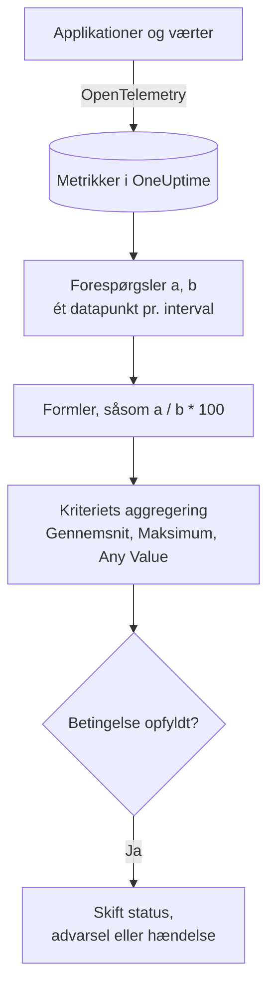

# Metrik-monitor

En metrik-monitor forespørger de metrikker, dine applikationer og din infrastruktur sender til OneUptime, kombinerer dem med formler, når du har brug for et forhold eller en sum, og sammenligner resultatet med dine kriterier over et glidende tidsinterval. Brug den til anmodningsrater, fejlforhold, kødybder, CPU, hukommelse og disk (enhver numerisk serie), med én advarsel pr. vært eller pr. container, når du grupperer den.

:::cards
- [Opret monitoren](#opret-en-metrik-monitor): Forespørgsler, formler, et tidsinterval og kriterier.
- [Sådan evalueres den](#sådan-evalueres-den): Datapunkter, formler og kriteriernes aggregering.
- [Gennemgået eksempel](#gennemgået-eksempel-en-voksende-kø): De samme data under hver aggregering.
- [Advarsler pr. serie](#advarsler-pr-serie-group-by): Én advarsel pr. vært, container eller monteringspunkt.
:::

## Sådan virker det

Hvert minut kører OneUptime hver af monitorens metrikforespørgsler over dens tidsinterval. En forespørgsel returnerer ét datapunkt pr. tidsinterval, og formler kombinerer forespørgslerne interval for interval. Hvert kriterium reducerer derefter datapunkterne fra den forespørgsel eller formel, det tjekker (til deres gennemsnit, deres maksimum eller en test af hvert punkt), og sammenligner resultatet med sin tærskel.

## Før du starter

- Dine applikationer eller din infrastruktur sender metrikker til OneUptime via OpenTelemetry. Se [OpenTelemetry](/docs/telemetry/open-telemetry).
- Kend metrikkens navn og de attributter, du vil filtrere eller gruppere på. Listerne **Metrik** og **Gruppér efter** tilbyder kun navne og attributter, som OneUptime har modtaget.

## Opret en metrik-monitor

:::steps
### Start en ny monitor

Gå til **Monitorer**, og klik på **Opret monitor**. Eller byg i metrics-explorer det diagram, du vil holde øje med, og klik på **Opret monitor fra denne visning**: den nye monitor starter med dens forespørgsler.

### Vælg Metrics

Under **Monitortype** klikker du på **Flere monitortyper** og vælger **Metrikker** under **Telemetri**, eller du skriver `metrics` i søgefeltet. Angiv et **Navn**, og klik derefter på **Næste**.

### Tilføj metrikforespørgslerne

I **Metrik at holde øje med** vælger du en **Metrik**, og hvordan den aggregeres med **Aggregate by**. Åbn **Filters & grouping** for at filtrere efter attributter eller gruppere med **Gruppér efter**. Klik på **Tilføj metrik** for endnu en forespørgsel eller på **Tilføj formel** for at kombinere dem. Diagrammet under forespørgslerne viser de seneste timer med reglens værdi som en rød linje, så du kan se de værdier, reglen vil tjekke.

### Sig, hvornår der skal advares

I **Hvornår der advares** vælger du under **Målt som**, hvordan metrikken måles, og derefter et **Tidsvindue**, en **Betingelse** og en **Værdi**. Når trinnet har mere end én forespørgsel eller formel, vælger du også den **Metrik**, reglen læser. Sætningen under dem gentager reglen med almindelige ord.

### Vælg, hvad der sker

I **Hvad der sker** vælger du **Opret en advarsel**, **Erklær en hændelse** eller **Begge**, og giver den en titel og en alvorlighed. Mens reglen matcher, viser monitoren statussen under **Flere felter**; når den holder op med at matche, går monitoren tilbage til sin standardstatus, og advarslen eller hændelsen løser sig selv.

### Opret monitoren

Klik på **Opret monitor**. Monitoren åbner på sin side **Oversigt**, og dens første evaluering kører inden for et minut.
:::

## Hvad den forespørger

### Metrikforespørgsler

| Felt | Hvad det gør | Standard |
| --- | --- | --- |
| **Metrik** | Den metrik, der forespørges. | Påkrævet |
| **Aggregate by** | Hvordan værdierne i hvert tidsinterval kombineres til ét datapunkt: Gns., Sum, Min, Max, Antal eller en percentil (P50, P75, P90, P95 eller P99). | Gns. |
| **Filter by attributes** (under **Filters & grouping**) | Kun serier, hvis attributter opfylder disse betingelser. | Intet filter |
| **Gruppér efter** (under **Filters & grouping**) | Én serie pr. unik værdi af disse attributter (se [Advarsler pr. serie](#advarsler-pr-serie-group-by)). | Én serie |

Hver forespørgsel og formel får en variabel (`a`, `b`, `c` og så videre) i den rækkefølge, du tilføjer dem.

### Formler

En formel kombinerer forespørgselsvariabler med `+`, `-`, `*`, `/`, `%`, `^` og parenteser, interval for interval. Du kan skrive variablerne med eller uden et `$` foran:

- `a / b * 100`: den andel af `b`, som `a` udgør, i procent
- `a + b`: to metrikker lagt sammen
- `a - b`: forskellen mellem dem

### Glidende tidsvindue

**Tidsvindue** i **Hvornår der advares** bestemmer, hvor langt hver evaluering kigger tilbage: **Seneste 1 minut**, **Seneste 5 minutter**, **Seneste 10 minutter**, **Seneste 15 minutter**, **Seneste 30 minutter**, **Seneste 1 time**, **Seneste 2 timer**, **Seneste 3 timer**, **Seneste 6 timer**, **Seneste 12 timer**, **Seneste 24 timer**, **Seneste 2 dage**, **Seneste 3 dage**, **Seneste 7 dage**, **Seneste 14 dage**, **Seneste 30 dage**, **Seneste 60 dage**, **Seneste 90 dage**, **Seneste 180 dage** eller **Seneste 365 dage**.

Jo længere vinduet er, jo bredere er hvert tidsinterval, så ét datapunkt står for mere tid:

| Tidsvindue | Ét datapunkt pr. |
| --- | --- |
| Seneste 1 minut til Seneste 3 timer | minut |
| Seneste 6 timer, Seneste 12 timer | 5 minutter |
| Seneste 24 timer | 15 minutter |
| Seneste 2 dage, Seneste 3 dage | 30 minutter |
| Seneste 7 dage | time |
| Seneste 14 dage, Seneste 30 dage | dag |
| Seneste 60 dage til Seneste 180 dage | uge |
| Seneste 365 dage | måned |

## Sådan evalueres den

- **Hvert minut.** En metrik-monitor tjekkes ikke af sonder, så den har intet interval at angive og ingen side **Sonder og interval**.
- **Først forespørgsler, så formler.** Hver forespørgsel returnerer ét datapunkt pr. tidsinterval i tidsintervallet ved hjælp af sin **Aggregate by**. Formler beregnes for hvert interval ud fra forespørgslernes datapunkter.
- **Derefter reglens mål.** Reglen reducerer datapunkterne for sin metrik til det, den sammenligner med sin værdi, som **Målt som** siger:

| Målt som | I de egne kriterier | Betingelsen tjekkes mod… |
| --- | --- | --- |
| Gennemsnittet | Gennemsnit | gennemsnittet af datapunkterne |
| Summen | Sum | summen af datapunkterne |
| Den højeste værdi | Maximum Value | det højeste datapunkt |
| Den laveste værdi | Minimum Value | det laveste datapunkt |
| Hver værdi (hele vinduet) | All Values | hvert datapunkt: de skal alle opfylde betingelsen og dække hele tidsintervallet |
| En vilkårlig værdi (på et vilkårligt tidspunkt) | Any Value | hvert datapunkt: det er nok, at ét af dem opfylder betingelsen |

- **Kriterier fra top til bund.** På en monitor uden Group By afgør det første kriterium, der matcher, så sæt det alvorligste øverst. En grupperet monitor tjekker alle kriterier for hver serie (se [Evalueringen af kriterier er anderledes](#evalueringen-af-kriterier-er-anderledes)).
- **Ingen data er ikke nul.** Når forespørgslen ikke returnerer nogen datapunkter i tidsintervallet, gør reglen det, som **Hvis der ikke er data** siger, under **Flere felter** i **Hvornår der advares**: **Intet** (standard: reglen matcher ikke), **Tæl det som nul** eller **Advar, som om den matchede**.
- **Hver værdi kræver hele tidsintervallet.** En serie opfylder først en regel målt som **Hver værdi (hele vinduet)**, når dens datapunkter dækker tidsintervallet, fra starten til nu, uden et hul på mere end ét manglende datapunkt. Når alle monitorens data ankommer forsinket, som CloudWatchs gør, træder det nyeste datapunkt i stedet for nu. En vært, container eller deployment, der lige er begyndt at sende data, eller som har været stille et stykke tid, venter, til den har data for et helt tidsinterval, og evalueringsloggen viser, hvor langt den er nået: `Waiting for 15 minutes of data: 2 of 15 minutes so far`. En serie, hvis advarsel eller hændelse allerede er åben, bedømmes kun på sine datapunkter, så et kort hul i dens data løser den ikke. Når metrikken rapporterer sjældnere, end tidsintervallet er langt, tæller et enkelt datapunkt for hele intervallet, når det er et par minutter gammelt; for at bedømme, hvor længe en værdi varer, skal tidsintervallet være mindst to rapporteringsintervaller langt.
- **OneUptimes egen nedetid er ikke stilhed.** Så længe tidsintervallet rummer tid, hvor OneUptime selv ikke modtog data (det genstartede, blev opgraderet eller indhentede et efterslæb), venter tjekket: statussen ændres ikke, og ingen hændelse eller advarsel åbnes eller løses, uanset hvad **Hvis der ikke er data** siger. Se [Når OneUptime ikke modtager data](/docs/monitor/when-oneuptime-is-not-receiving).

## Kriterier

Disse monitorer evaluerer altid **Metric Value**: den aggregerede værdi af den konfigurerede metrikforespørgsel eller formel. **Hvornår der advares** opretter ét kriterium ud fra **Målt som**, **Tidsvindue**, **Betingelse** og **Værdi**. Når metrikken har en enhed, vælger du værdiens enhed ved siden af den. Dens **Betingelse** er **Over**, **På eller over**, **Under**, **På eller under**, **Præcis**, **Usædvanligt høj**, **Usædvanligt lav** eller **Usædvanligt høj eller lav**. For flere kriterier, f.eks. alvorlighedsbånd, klikker du på **Rediger som egne kriterier** under **Flere felter** i **Hvad der sker**: hvert kriterium der har en **Metrik**, en **Aggregering**, en **Betingelse** og en **Tærskel**.

| Betingelse | Matcher, når værdien er… |
| --- | --- |
| **Større end** | over tærsklen |
| **Større end eller lig med** | lig med tærsklen eller derover |
| **Mindre end** | under tærsklen |
| **Mindre end eller lig med** | lig med tærsklen eller derunder |
| **Lig med** | præcis tærsklen |
| **Anomalously High** | over det forventede interval for denne time på ugen |
| **Anomalously Low** | under det interval |
| **Anomalous** | uden for det interval, i begge retninger |
| **Har ingen data** | fraværende: forespørgslen sendte intet i vinduet |
| **Har data** | til stede: forespørgslen sendte noget i vinduet |

Anomalibetingelserne har ingen tærskel. **Hvornår der advares** viser i stedet **Følsomhed** (Lav, Middel, som er standard, eller Høj), og de egne kriterier også et **Baseline-vindue** (14 dage, som er standard, 28, 60 eller 90), og hvert datapunkt sammenlignes med baselinen for samme time på ugen, bygget ud fra det vindue. Indtil den time på ugen har nok historik, er kriteriet stadig ved at lære og giver ingen advarsler.

En metrik-monitor, der er oprettet i Opret monitor, starter med én regel på sin første forespørgsel: **Gennemsnittet** over **Seneste 5 minutter**, **Over** den **Værdi**, du angiver, og **Opret en advarsel**.

En ny metrik-monitor, der er oprettet via API'et eller Terraform uden kriterier, starter med to kriterier på sin første forespørgsel, begge med aggregeringen **Any Value**:

| Kriterium | Betingelse | Effekt |
| --- | --- | --- |
| Check if … is offline | **Lig med** `0` | Sætter monitoren offline og erklærer en hændelse, der løses automatisk |
| Check if … is online | **Større end** `0` | Sætter monitoren online |

> [!NOTE]
> Offline-kriteriet udløses af en rapporteret værdi på 0, ikke af stilhed. For at få en advarsel, når en metrik holder op med at komme, sætter du dens **Hvis ingen data** til **Trigger**.

## Gennemgået eksempel: en voksende kø

Du vil have en hændelse, når checkout-køen forbliver dyb. Forespørgsel `a` er gaugen `checkout.queue.depth` med **Aggregate by** Max, og **Tidsvindue** er **Seneste 5 minutter**. Én evaluering ser disse fem datapunkter på ét minut hver:

| Minut | 10:01 | 10:02 | 10:03 | 10:04 | 10:05 |
| --- | --- | --- | --- | --- | --- |
| `a` | 640 | 980 | 1.500 | 1.620 | 1.100 |

En regel **Over** `1000` giver et forskelligt svar for hvert valg under **Målt som**:

| Målt som | Sammenlignet med 1.000 | Matcher? |
| --- | --- | --- |
| Gennemsnittet | 1.168 | Ja |
| Summen | 5.840 | Ja |
| Den højeste værdi | 1.620 | Ja |
| Den laveste værdi | 640 | Nej |
| Hver værdi (hele vinduet) | 640, 980, 1.500, 1.620, 1.100 | Nej: to punkter er ikke over 1.000 |
| En vilkårlig værdi (på et vilkårligt tidspunkt) | 640, 980, 1.500, 1.620, 1.100 | Ja: 1.500 er |

**Gennemsnittet** advarer om et vedvarende efterslæb og ignorerer et enkelt dybt minut; **Hver værdi (hele vinduet)** venter, til hvert minut i intervallet er dybt; **En vilkårlig værdi (på et vilkårligt tidspunkt)** advarer ved det første dybe minut.

## Advarsler pr. serie (Group By)

**Gruppér efter** på en metrikforespørgsel deler forespørgslen op i én serie pr. unik attributværdi (én pr. vært, én pr. container, én pr. monteringspunkt), og en monitor med Group By evaluerer hver serie uafhængigt. Den ene indstilling er forskellen mellem "flåden er usund" og "`prod-db-01` er usund".

### Én advarsel pr. gruppe

Med Group By sat til `host.name` giver en monitor for diskforbrug, der holder øje med halvtreds værter, **én advarsel (eller hændelse) pr. vært over tærsklen**. Når vært A fyldes op, åbner den sin egen advarsel; når vært B fyldes op ti minutter senere, åbner den en anden, separat advarsel ved siden af.

Uden Group By er den samme monitor én skalar: forespørgslen samler alle værter i ét tal, og monitoren giver **én advarsel for hele monitoren**. Mens den advarsel er åben, giver en anden vært over tærsklen intet (monitoren advarer allerede, så der er intet nyt at give), og vagthavende ingeniør hører aldrig om vært B. **Group By er måden at få advarsler pr. vært på.** Vil du kaldes pr. vært, pr. container eller pr. monteringspunkt, så angiv det.

### Uafhængig løsning

Hver advarsel pr. gruppe følger sin egen gruppe. Når vært A falder under tærsklen igen, løses dens advarsel af sig selv, og advarslen for vært B forbliver åben, indtil vært B kommer sig. Når én gruppe kommer sig, lukker det aldrig en anden gruppes advarsel.

### Evalueringen af kriterier er anderledes

- **Grupperede monitorer evaluerer alle kriterier.** Alvorlighedsniveauer kan derfor udløses for forskellige grupper på samme tid: med "Critical: større end 95" over "Warning: større end 80" åbner en vært på 96 % en kritisk advarsel, mens en vært på 85 % åbner en almindelig advarsel i samme tjek. En vært, der overskrider begge niveauer, får stadig præcis én advarsel, fra det første kriterium, der matcher, så **sorter kriterierne med det alvorligste først**.
- **Ugrupperede monitorer stopper ved det første kriterium, der matcher.** Kun det ene kriterium udløses, endnu en grund til at sætte advarselskriteriet over det sunde: et bredt sundt kriterium øverst matcher i næsten hvert tjek og forhindrer, at advarselskriteriet under det nogensinde evalueres.

| Vært | Disk brugt | Critical (> 95) | Warning (> 80) | Givet advarsel |
| --- | --- | --- | --- | --- |
| `prod-db-01` | 96 % | Ja | Ja | Critical |
| `prod-db-02` | 85 % | Nej | Ja | Warning |
| `prod-db-03` | 40 % | Nej | Nej | Ingen |

### Vælg en attribut at gruppere efter

Gruppér efter en attribut, der virkelig identificerer en særskilt ting, du ville kalde nogen ud for: værtsattributten for en værtsmetrik på tværs af flåden, container- eller pod-attributten for en containermetrik, monteringspunkt- eller enhedsattributten for en filsystem- eller disk-I/O-metrik, interface-attributten for en netværksmetrik. Rullelisten **Gruppér efter** udfyldes med de attributter, din collector faktisk sender, så vælg fra listen i stedet for at skrive en nøgle i hånden.

Gruppér ikke en metrik, der allerede er én skalar for hele systemet (et leder-flag for hele klyngen, et efterslæb i scheduleren eller CPU'en på én vært i en monitor for én vært). At gruppere sådanne metrikker giver præcis én serie og ændrer intet ud over advarslernes titler.

Grupperingsattributtens værdier er også tilgængelige som [skabelonvariabler](/docs/monitor/incident-alert-templating) i titlen, beskrivelsen og afhjælpningsnoterne for advarslen eller hændelsen: gruppering efter `host.name` lader titlen lyde `Disk almost full on {{host.name}}`.

## Fejlfinding

:::details Diagrammet viser en overskridelse, men monitoren advarede ikke
Tjek først **Målt som**: **Hver værdi (hele vinduet)** matcher kun, når hvert datapunkt i tidsintervallet overskrider værdien, og **Gennemsnittet** udglatter en kort spids. **Hver værdi (hele vinduet)** venter også, til en serie har data for hele tidsintervallet, så en vært eller deployment, der lige er begyndt at sende data, bliver ikke bedømt endnu. Tjek derefter, at reglen læser den forespørgsel eller formel, du mener (`a` er ikke formlen `c`), og at **Værdi** er i den enhed, du tror.
:::

:::details Metrikken holdt op med at komme, og intet skete
Et tidsinterval uden datapunkter er ikke en værdi på 0. Med **Hvis der ikke er data** på standardværdien, **Intet**, matcher reglen ikke. Sæt det til **Advar, som om den matchede** under **Flere felter** i **Hvornår der advares** for at få en advarsel om stilhed.
:::

:::details Jeg får én advarsel for hele flåden
Forespørgslen har ingen **Gruppér efter**, så alle værter samles i ét tal. Gruppér forespørgslen efter vært-, container- eller monteringspunktattributten (se [Advarsler pr. serie](#advarsler-pr-serie-group-by)).
:::

:::details Et anomalikriterium udløses aldrig
Det er stadig ved at lære: den time på ugen, det sammenligner med, har endnu ikke nok historik inden for **Baseline-vindue**.
:::

## Næste skridt

:::cards
- [Hændelse- og advarselsskabeloner](/docs/monitor/incident-alert-templating): Sæt værten og værdien ind i advarslernes titler.
- [Log-monitor](/docs/monitor/logs-monitor): Få advarsler om logmængde og -indhold, pr. gruppe.
- [Værts-monitor](/docs/monitor/host-monitor): Færdige tjek af CPU, hukommelse og disk for dine værter.
- [OpenTelemetry](/docs/telemetry/open-telemetry): Send metrikker til OneUptime.
:::
