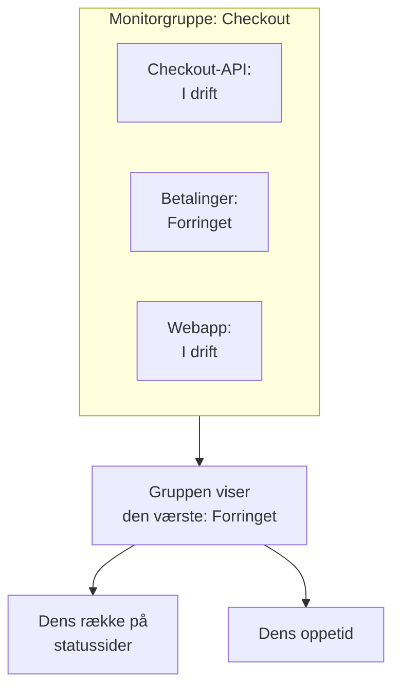

# Monitorgrupper

En monitorgruppe samler flere monitorer i én status. Gruppér de monitorer, der tilsammen udgør én tjeneste, som Checkout: dens API, dens betalingstjeneste og dens webapp. Gruppen viser den værste status blandt dem, har sin egen oppetid, og en statusside kan vise hele gruppen som én række.

:::cards
- [Sådan beregnes en gruppes status](#sådan-beregnes-en-gruppes-status): Den værste status blandt dens monitorer.
- [Slå monitorgrupper til](#slå-monitorgrupper-til): Én kontakt i projektindstillingerne.
- [Opret en monitorgruppe](#opret-en-monitorgruppe): Giv den et navn, og tildel så dens monitorer.
- [Vis en gruppe på en statusside](#vis-en-gruppe-på-en-statusside): Én række for hele gruppen.
:::

## Sådan beregnes en gruppes status

En gruppe starter ved din driftsklare status og overtager den værste status blandt sine monitorer: den, der står længst nede på dit projekts liste over monitorstatusser. Går én monitor til **Forringet**, er hele gruppen **Forringet**; går én til **Offline**, er den **Offline**.

- **Arkiverede monitorer tæller ikke.** En arkiveret monitor kontrolleres ikke, så dens status er frosset; gruppen udelader den.
- **En tom gruppe er driftsklar.** En gruppe uden monitorer, eller kun med arkiverede, viser din driftsklare status.
- **Rækkefølgen er din.** Hvilken status der er den værste, følger rækkefølgen under **Overvågninger → Indstillinger → Monitorstatus**. Se [Monitorstatusser](/docs/monitor/criteria-and-statuses#monitorstatusser).

En monitorgruppe er ikke en statussidegruppe. En statussidegruppe er en overskrift på én statusside, der rummer rækker. En monitorgruppe er én række, der står for flere monitorer, og enhver statusside kan vise den.

## Før du begynder

- **Din plan.** På OneUptime Cloud kræver monitorgrupper Scale-planen.
- **Kontakten.** Monitorgrupper er skjult, indtil **Monitorgrupper** er slået til for projektet (se nedenfor). At slå den til kræver rollen Project Owner, eller en brugerdefineret rolle med tilladelsen Edit Project eller Manage Billing.
- **Din rolle.** At oprette, ændre og slette grupper kræver rollen Project Owner, Project Admin, Project Member, Monitor Admin eller Monitor Member, eller en brugerdefineret rolle med de tilsvarende tilladelser til monitorgrupper. En Viewer kan se grupper, men ikke ændre dem.

## Slå monitorgrupper til

:::steps
### Åbn funktionsflag

Gå til **Projektindstillinger → Avanceret → Funktionsflag**. **Avanceret** er foldet sammen i sidemenuen: fold den ud først.

### Slå kontakten til

Slå kontakten **Monitorgrupper** til. Den gemmes med det samme: **Monitorgrupper** vises i sidemenuen for **Monitorer**, og hver statussides punkt **Monitorer** hedder nu **Ressourcer**, hvor du kan tilføje en gruppe.
:::

Slår du kontakten fra igen, skjules **Monitorgrupper** i menuen. Ingen gruppe slettes.

## Opret en monitorgruppe

:::steps
### Åbn Monitorgrupper

Gå til **Overvågninger → Monitorgrupper**. Kortet **Monitorgrupper** viser hver gruppe med dens **Aktuel status**, etiketter og ejere.

### Opret gruppen

Klik på **Opret Monitor Gruppe**, indtast et **Navn** og, hvis du vil, en **Beskrivelse**, og klik på **Opret Monitor Gruppe** nederst i formularen. Gruppen starter uden monitorer.

### Tildel dens monitorer

Åbn gruppen, og klik på **Monitorer** i dens sidemenu. Klik på **Tildel overvågning**, vælg en monitor under **Vælg overvågning**, og klik på **Tildel**. Gør det for hver monitor i gruppen.

### Tjek dens status

Klik på **Oversigt**. **Aktuel status** viser gruppens status lige nu, og **Oppetidgraf** viser dens seneste 90 dage, én søjle pr. dag.
:::

For at tage en monitor ud af gruppen klikker du på **Fjern tildeling** i dens række under **Overvågninger i gruppe**. Selve monitoren ændres ikke. En monitor kan høre til mere end én gruppe.

## En gruppes sider

Åbn en gruppe for at se dens sider i sidemenuen:

| Side | Hvad den viser |
| --- | --- |
| **Oversigt** | **Detaljer om overvågningsgruppe**, **Aktuel status** og **Oppetidgraf** med gruppens oppetidsprocent over de seneste 90 dage. |
| **Ejere** | De personer og teams, der er ansvarlige for gruppen. |
| **Monitorer** | **Overvågninger i gruppe**, med **Tildel overvågning** og **Fjern tildeling**. |
| **Hændelser** | Hændelserne på enhver monitor i gruppen. |
| **Advarsler** | Advarslerne på enhver monitor i gruppen. |
| **Auditlogs** | Hvem der ændrede gruppen, og hvornår. Den ligger under **Avanceret**, som starter foldet sammen. |
| **Slet gruppe** | Sletter gruppen, også under **Avanceret**. |

Oppetiden på **Oversigt** tæller enhver status undtagen den driftsklare som nedetid. En statusside tæller kun statusserne på sin egen liste **Tæller som nedetid**: se [Vælg, hvad siden viser](/docs/status-pages/index#at-vælge-hvad-der-vises-på-siden).

Listen **Monitorgrupper** kan filtrere grupper efter ejer og etiket, sætte etiketter og ejere på mange grupper på én gang og eksportere eller importere grupper som JSON.

## Vis en gruppe på en statusside

:::steps
### Åbn statussidens ressourcer

Gå til **Statussider**, åbn siden, og klik på **Ressourcer** i dens sidemenu.

### Skift dialogen til en gruppe

Klik på **Tilføj monitor**. Under rullelisten med monitorer klikker du på **Add a Monitor Group instead.** Rullelisten bliver til **Monitor Gruppe**.

### Vælg gruppen, og tilføj den

Vælg gruppen. **Visningsnavn**, det navn, besøgende læser, overtager gruppens navn, indtil du skriver dit eget. Klik på **Tilføj monitor**: rækken vises på siden med gruppens status.
:::

På statussiden står rækken for hver monitor i gruppen:

- **Dens status.** Det er gruppens: den værste blandt dens monitorer.
- **Dens hændelser.** En hændelse på enhver monitor i gruppen vises på siden, med gruppen nævnt blandt de berørte ressourcer.
- **Dens abonnenter.** En abonnent, der vælger gruppen, hører om hver monitor i den. Se [Lad abonnenter vælge ressourcer og begivenhedstyper](/docs/status-pages/subscribers#lad-abonnenter-vælge-ressourcer-og-hændelsestyper).

For rækkens øvrige indstillinger, som dens oppetid og historikdiagram, se [Statusside – ressourcer og grupper](/docs/status-pages/resources-and-groups).

> [!WARNING]
> Når du sletter en monitorgruppe, slettes dens række også fra hver statusside, der viser den. Gruppens monitorer, og deres hændelser, slettes ikke.

## API og Terraform

En gruppe er `/api/monitor-group`, og hver monitor i den er en række i `/api/monitor-group-resource`, der parrer et `monitorGroupId` med et `monitorId`. I Terraform er de `oneuptime_monitor_group` og `oneuptime_monitor_group_resource`: se [Monitorgruppe](/docs/terraform/examples#monitorgruppe).

## Fejlfinding

:::details Monitorgrupper er ikke i menuen Monitorer
Kontakten **Monitorgrupper** er slået fra. Slå den til under **Projektindstillinger → Avanceret → Funktionsflag**. På OneUptime Cloud kræver grupper også Scale-planen.
:::

:::details Gruppen viser Offline, men de fleste af dens monitorer kører
Det er reglen: gruppen viser sin værste monitor. Åbn **Monitorer** i gruppen for at finde den monitor, der er nede, eller fjern tildelingen af en monitor, der ikke hører til i gruppen.
:::

:::details En statusside kan ikke tilføje gruppen
**Add a Monitor Group instead.** vises kun i dialogen, så længe kontakten **Monitorgrupper** er slået til for projektet.
:::

## Næste trin

:::cards
- [Monitorkriterier og statusser](/docs/monitor/criteria-and-statuses): Hvad der sætter hver monitors status.
- [Statusside – ressourcer og grupper](/docs/status-pages/resources-and-groups): Læg rækkerne på en statusside til rette.
- [Abonnenter og meddelelser](/docs/status-pages/subscribers): Fortæl kunderne om en gruppes hændelser.
:::
