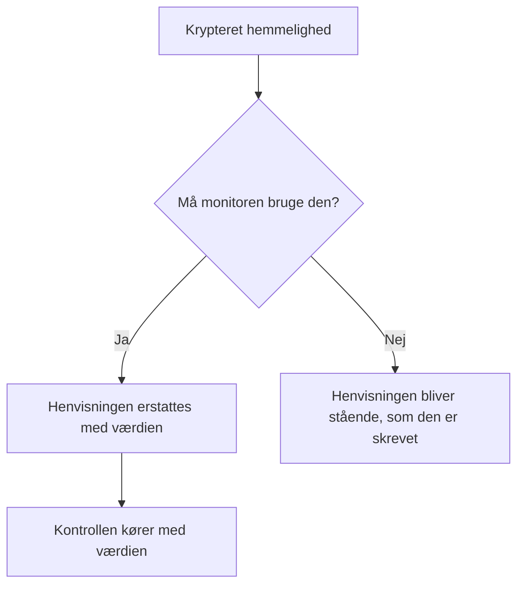

# Monitorhemmeligheder

Monitorhemmeligheder holder de adgangskoder, API-nøgler og tokens, dine monitorer har brug for, uden for selve monitoren. Du gemmer en værdi én gang, krypteret, vælger, hvilke monitorer der må bruge den, og henviser til den som `{{monitorSecrets.NAME}}`, hvor monitoren har brug for den.

:::cards
- [Tilføj en hemmelighed](#tilføj-en-hemmelighed): Gem en værdi, og vælg, hvem der må bruge den.
- [Vælg adgang](#vælg-hvilke-monitorer-der-må-bruge-en-hemmelighed): Alle monitorer, bestemte monitorer eller monitorer med etiketter.
- [Brug en hemmelighed](#brug-en-hemmelighed): Hvor `{{monitorSecrets.NAME}}` virker.
- [Log ind med en engangskode](#log-ind-med-en-engangskode): Lad en monitor logge ind på et websted, der kræver tofaktorgodkendelse.
:::

## Sådan når hemmeligheder frem til en monitor

En hemmelighed gemmes krypteret og vises aldrig igen, når du har gemt den. Før OneUptime giver en monitor videre til en sonde, erstatter den hver henvisning, som monitoren må bruge, med den dekrypterede værdi; en henvisning, som monitoren ikke må bruge, bliver stående, som den er skrevet. En engangskodehemmelighed er undtagelsen: sonden genererer dens kode, når kontrollen kører (se [Log ind med en engangskode](#log-ind-med-en-engangskode)).



Den sonde, der udfører kontrollen, modtager værdien, så en monitor, der bruger en hemmelighed, bør køre på sonder, du stoler på: OneUptimes egne eller en [brugerdefineret sonde](/docs/probe/custom-probe), som du selv driver.

## Før du starter

- **Growth-abonnementet eller højere**, på OneUptime Cloud. Selvhostede installationer har ingen abonnementer.
- **En rolle, der kan administrere hemmeligheder**: Projektejer, Projektadministrator eller en brugerdefineret rolle med tilladelsen Create Monitor Secret.

## Arbejd med hemmeligheder

### Tilføj en hemmelighed

:::steps
1. Gå til **Monitorer → Indstillinger → Hemmeligheder**, og klik på **Opret Monitorhemmelighed**.
2. Indtast et **Navn** og **Værdi af hemmelighed**. Navnet er det, du henviser til, for eksempel `ApiKey`. Det må kun indeholde bogstaver, tal, bindestreger (`-`) og understregninger (`_`), og to hemmeligheder i et projekt kan ikke have det samme. Til et websteds opsætningsnøgle til tofaktorgodkendelse skal du først vælge **Engangskode (TOTP)** (se [Log ind med en engangskode](#log-ind-med-en-engangskode)).
3. Vælg i trinnet **Adgang**, hvilke monitorer der må bruge den (se næste afsnit), og klik derefter på **Opret Monitorhemmelighed**.
:::

> [!IMPORTANT]
> Hemmeligheder krypteres og opbevares sikkert. Hemmelighedens værdi vises aldrig igen, efter at den er gemt — hverken i tabellen, i redigeringsformularen eller via API'et. Hvis du mister værdien, skal du hente den, hvor den kom fra, og indstille den igen. For at rotere en hemmelighed skal du bruge knappen **Opdater hemmelig værdi** i dens række; du behøver ikke at slette og genoprette den.

### Vælg, hvilke monitorer der må bruge en hemmelighed

Hver hemmelighed har én af tre adgangsmuligheder:

| Mulighed | Hvilke monitorer der må bruge hemmeligheden | Brug den til |
| --- | --- | --- |
| **Alle monitorer** | Hver monitor i projektet, også monitorer, du opretter senere. | En loginoplysning, som mange monitorer deler. |
| **Bestemte monitorer** | Kun de monitorer, du vælger. Det er standarden, og hemmeligheder, der blev oprettet, før disse muligheder fandtes, virker sådan. | En loginoplysning til én eller nogle få monitorer. |
| **Monitorer med etiketter** | Monitorer, der har mindst én af de etiketter, du vælger. Når en af de etiketter føjes til en monitor, får den adgang, og når etiketten fjernes, mister den adgangen, næste gang monitoren kører. | En loginoplysning til en gruppe monitorer, der ændrer sig over tid. |

Du kan når som helst ændre muligheden med **Rediger** i hemmelighedens række. Kun listen for den valgte mulighed gemmes: et skift til **Alle monitorer** rydder hemmelighedens lister over monitorer og etiketter, og et skift mellem **Bestemte monitorer** og **Monitorer med etiketter** rydder den liste, du skifter væk fra.

En hemmelighed er aldrig tilgængelig for monitorer i et andet projekt.

> [!WARNING]
> Alle, der kan redigere en monitor, som må bruge en hemmelighed, kan sende den hemmelighed hen, hvor monitoren forbinder til. Med **Alle monitorer** er det alle, der kan oprette eller redigere monitorer i projektet. Med **Monitorer med etiketter** omfatter det også alle, der kan føje en af de etiketter til en monitor.

Via API'et er adgangsmuligheden feltet `monitorAccess`: `All Monitors`, `Specific Monitors` eller `Monitors With Labels`. Felterne `monitors` og `labels` indeholder listerne. En hemmelighed, der oprettes uden `monitorAccess`, får `Specific Monitors`.

### Brug en hemmelighed

For at bruge en hemmelighed skal du skrive `{{monitorSecrets.SECRET_NAME}}` i et felt, der accepterer hemmeligheder. For eksempel sender en anmodningsheader `Authorization: Bearer {{monitorSecrets.ApiKey}}` værdien af hemmeligheden `ApiKey`.

Disse monitortyper og felter accepterer hemmeligheder:

| Monitortype | Felter |
| --- | --- |
| API | URL'en, anmodningens headere og brødtekst samt klientcertifikatet, den private nøgle og adgangssætningen (mTLS) |
| Websted | URL'en samt klientcertifikatet, den private nøgle og adgangssætningen (mTLS) |
| Ping, IP, Port, NTP, SSL-certifikat | Den vært eller URL, der kontrolleres |
| DNS | Domænenavnet og DNS-serveren |
| DNSSEC, Domæne | Domænenavnet |
| SQL-forespørgsel | Værten, databasenavnet, brugernavnet, adgangskoden og forespørgslen |
| Databasesundhed | Værten, databasenavnet, brugernavnet og adgangskoden |
| Ekstern statusside | Statussidens URL |
| Syntetisk monitor, Brugerdefineret JavaScript-kode | Scriptet |
| Netværksenhed | SNMP-community-strengen samt SNMPv3-godkendelses- og privatlivsnøglerne |

Hemmeligheder udfyldes, før scriptet i en monitor af typen Syntetisk monitor eller Brugerdefineret JavaScript-kode kører, så en henvisning som `{{monitorSecrets.ApiKey}}` i scriptet er den dekrypterede værdi, når det udføres.

Hvis en monitor henviser til en hemmelighed, den ikke må bruge, bliver henvisningen stående, som den er, og erstattes ikke med værdien.

Når du tester en monitor, før du gemmer den, udfyldes kun hemmeligheder, der er tilgængelige for **Alle monitorer**, fordi en ny monitor ikke står på nogen liste og endnu ikke har nogen etiketter. Når du har gemt monitoren, bruger testene hver hemmelighed, som monitoren må bruge.

## Log ind med en engangskode

Nogle websteder beder om en kode fra en godkendelsesapp, når du logger ind. En hemmelighed af typen **Engangskode (TOTP)** indeholder webstedets opsætningsnøgle, så en monitor kan logge ind, som du gør: overalt, hvor monitoren bruger hemmeligheden, genererer sonden den aktuelle kode ud fra sit eget ur i det øjeblik, kontrollen har brug for den. Opsætningsnøglen gemmes krypteret og vises aldrig igen, ligesom enhver anden hemmelig værdi, og den skrives aldrig ind i monitoren.

1. Slå tofaktorgodkendelse til for den konto, monitoren logger ind med. Hvor webstedet viser en QR-kode, skal du i stedet bede om at indtaste nøglen manuelt og kopiere opsætningsnøglen eller linket `otpauth://`.
2. Gå til **Monitorer → Indstillinger → Hemmeligheder**, klik på **Opret Monitorhemmelighed**, vælg **Engangskode (TOTP)**, og indsæt nøglen eller linket i **Opsætningsnøgle**.
3. Kontrollér, at **Aktuel kode** under feltet svarer til den kode, din godkendelsesapp viser lige nu, og vælg derefter i trinnet **Adgang**, hvilke monitorer der må bruge hemmeligheden, som for enhver anden hemmelighed.

| Det, du indsætter | De koder, monitoren genererer |
| --- | --- |
| En opsætningsnøgle, for eksempel `JBSW Y3DP EHPK 3PXP` | SHA1, 6 cifre og en ny kode hvert 30. sekund: det, som enhver godkendelsesapp går ud fra |
| Et `otpauth://totp/`-link | Linkets `algorithm` (`SHA1`, `SHA256` eller `SHA512`), `digits` (`6` eller `8`) og `period` i sekunder (`30`, når linket ikke angiver nogen) |

| Monitortype | Hvor koden indsættes, og hvornår den genereres |
| --- | --- |
| API | `{{monitorSecrets.NAME}}` i URL'en, en anmodningsheader eller anmodningens brødtekst, lige før hvert forsøg sendes |
| Syntetisk monitor, Brugerdefineret JavaScript-kode | `{{monitorSecrets.NAME}}` i scriptet, når scriptet starter, og `await oneuptime.getTotpCode("NAME")`, når scriptet beder om koden |

Alle andre felter beholder `{{monitorSecrets.NAME}}`, som det er skrevet. I en JSON-brødtekst i en anmodning skal du sætte henvisningen i anførselstegn, som i `{"otp": "{{monitorSecrets.LoginCode}}"}`, fordi en kode kan starte med et nul.

Et login beder som regel først om koden et par sider efter, at scriptet er startet, så bed om koden dér. Dette script logger ind med en adgangskode og en engangskode:

```javascript
await page.goto("https://app.example.com/login");
await page.fill("#email", "monitoring@example.com");
await page.fill("#password", "{{monitorSecrets.AppPassword}}");
await page.click("button[type=submit]");

// The code is made now, when the sign-in asks for it.
await page.waitForSelector("#otp");
await page.fill("#otp", await oneuptime.getTotpCode("AppLoginCode"));
await page.click("button[type=submit]");

await page.waitForSelector(".dashboard", { timeout: 10000 });

return {
  data: { signedIn: true },
};
```

Sonden udleverer aldrig en kode, der har mindre end fem sekunder tilbage, eller en tredjedel af perioden, når perioden er kortere: i stedet venter den på den næste kode, højst fem sekunder, og regner ikke ventetiden med i kontrollens udførelsestid. Hver kode, en kontrol genererer, vises som stjerner, for eksempel `******`, i dens logmeddelelser, dens resultat, dens fejl og navnene på dens skærmbilleder. Et skærmbillede er et billede af siden, så tag det, før koden indtastes, eller efter at siden er gået videre.

> [!NOTE]
> Det er sonden, der genererer koderne, så opdater en brugerdefineret sonde, før du bruger en engangskodehemmelighed: en ældre sonde sender `{{monitorSecrets.NAME}}`, som det er skrevet. Sondens ur skal også gå rigtigt, for en sonde, der går et minut forkert, genererer koder, som webstedet allerede er gået videre fra.

## Fejlfinding

:::details `{{monitorSecrets.NAME}}` sendes bogstaveligt
Monitoren må ikke bruge hemmeligheden, eller navnet passer ikke. Kontrollér hemmelighedens adgangsmulighed med **Rediger** i dens række, og at navnet i henvisningen er præcis hemmelighedens navn.
:::

:::details Når en ny monitor testes, udfyldes hemmeligheden ikke
Før en monitor er gemt, udfyldes kun hemmeligheder, der er tilgængelige for **Alle monitorer**. Gem monitoren, og test den igen.
:::

:::details Et felt ignorerer hemmeligheden
Kun felterne i tabellen ovenfor accepterer hemmeligheder. I ethvert andet felt sendes `{{monitorSecrets.NAME}}`, som det er skrevet.
:::

:::details Webstedet afviser engangskoden
Kontrollér, at **Aktuel kode** svarede til din godkendelsesapp, da du gemte hemmeligheden, at sondens ur går rigtigt, og at en henvisning i en JSON-brødtekst i en anmodning står i anførselstegn. Hvis der går et stykke tid, før webstedet beder om koden under login, så bed om koden dér med `oneuptime.getTotpCode`.
:::

## Næste skridt

:::cards
- [API-monitor](/docs/monitor/api-monitor): Send en hemmelighed i en anmodningsheader.
- [Syntetisk monitor](/docs/monitor/synthetic-monitor): Brug en hemmelighed i et browserscript.
- [SQL-forespørgsel-monitor](/docs/monitor/sql-monitor): Hold en databaseadgangskode krypteret.
:::
