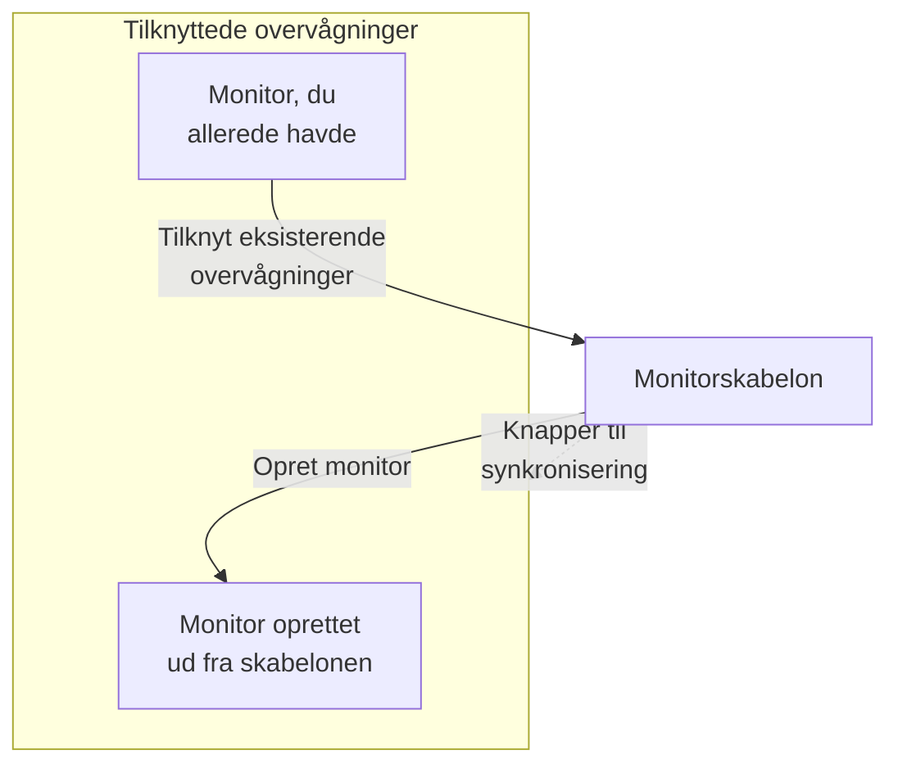

# Monitorskabeloner

En monitorskabelon er en gemt monitorkonfiguration (en type, kriterier, et interval, etiketter og standardværdier for brugerdefinerede felter), som du opretter monitorer ud fra med ét klik. Monitorer, der er oprettet ud fra den eller knyttet til den, forbliver forbundet: ret skabelonen, og synkronisér så ændringen til dem alle. Brug skabeloner, når mange monitorer skal opføre sig ens, som det samme sundhedstjek på hver tjeneste eller de samme API-tjek i produktion og staging.

:::cards
- [Opret en skabelon](#opret-en-skabelon): Fire trin, som Opret monitor.
- [Opret monitorer ud fra den](#opret-monitorer-ud-fra-en-skabelon): Ét klik, eller tilknyt monitorer, du allerede har.
- [Synkronisér ændringer](#synkronisér-ændringer-til-tilknyttede-monitorer): Hvad hver synkroniseringsknap kopierer.
- [Flyt monitorer til en anden skabelon](#flyt-monitorer-til-en-anden-skabelon): En bedre skabelon, og hver monitor beholder sin historik.
- [Behold værdier for hver monitor](#behold-værdier-for-hver-monitor): Beskyt en destination eller headere mod en synkronisering.
:::

## Sådan virker skabeloner

En skabelon overvåger ikke selv noget. Monitorer oprettes ud fra den eller knyttes til den, og skabelonens side viser dem som **Tilknyttede monitorer**. Når du ændrer skabelonen, ændres intet på de monitorer, før du synkroniserer: hver synkroniseringsknap kopierer én del af skabelonen til hver tilknyttet monitor, og felter, du beskytter, beholder hver monitors egen værdi.



## Før du starter

- **En rolle, der kan oprette skabeloner**: Projektejer, Projektadministrator, Projektmedlem, Monitoradministrator eller Monitormedlem eller en brugerdefineret rolle med tilladelsen Create Monitor Template. At ændre en skabelon kræver de samme roller eller tilladelsen Edit Monitor Template.
- **Tilladelse til at opdatere de tilknyttede monitorer.** En synkronisering skriver til hver tilknyttet monitor som dig og springer de monitorer over, som dine tilladelser ikke dækker.

## Opret en skabelon

:::steps
### Åbn Skabeloner

Gå til **Monitorer → Indstillinger → Skabeloner**, og klik på **Opret Monitorskabelon**.

### Navngiv skabelonen

Angiv under **Skabeloninformation** et **Skabelonnavn**, som `Production API Health`. En **Skabelonbeskrivelse** er valgfri. Klik så på **Næste**.

### Angiv monitorens standarder

Vælg under **Monitorstandarder** **Monitortype** med den samme vælger som i Opret monitor. Angiv eventuelt et **Standardnavn for monitor**; lades det stå tomt, får hver monitor navn efter den ressource, den overvåger. **Standardbeskrivelse for monitor** og **Etiketter** venter under **Flere felter**. Klik på **Næste**.

### Angiv kriterierne og intervallet

Udfyld under **Kriterier**, hvad der skal tjekkes, og kriterierne, som i [Opret monitor](/docs/monitor/create-monitor#kriterier). Med kortet **Indstillinger for skabelonsynkronisering** øverst kan du beskytte felter mod synkroniseringer (se [Behold værdier for hver monitor](#behold-værdier-for-hver-monitor)). For en monitortype, som sonder tjekker, beder det sidste trin, **Interval**, om **Overvågningsinterval**. Klik på **Opret Monitorskabelon** på det sidste trin.
:::

Skabelonen tilføjes listen. Åbn den for at se dens side med et kort for hver del: **Skabeloninformation**, **Monitorstandarder**, **Kriterier**, **Overvågningsinterval** (med **Minimum sondeenighed**), **Etiketter**, **Standardværdier for brugerdefinerede felter** (når projektet har brugerdefinerede monitorfelter) og **Tilknyttede monitorer**. Du ændrer hver del på dens eget kort, for eksempel med **Rediger kriterier** eller **Rediger interval**.

## Opret monitorer ud fra en skabelon

- **Ny monitor.** Klik på **Opret monitor** i skabelonens række på listen eller på **Opret monitor fra skabelon** på dens side. **Opret monitor** åbner med skabelonens type og indstillinger udfyldt; ret det, du har brug for, og opret den. Den nye monitor er knyttet til skabelonen.
- **Monitorer, du allerede har.** Klik på **Tilknyt eksisterende monitorer** under **Tilknyttede monitorer**, og vælg dem. Med **Brug skabelonens kriterier og interval** slået til får de skabelonens kriterier, interval og sondeenighed, når de tilknyttes; slået fra beholder de deres indstillinger, indtil du synkroniserer. En monitor, der er tilknyttet en anden skabelon, flyttes til denne.

Værdier, der er sat under **Standardværdier for brugerdefinerede felter**, skrives til hver monitor, der oprettes ud fra skabelonen, også monitorer, som regler for automatisk import og advarselspolitikker opretter ud fra den.

## Synkronisér ændringer til tilknyttede monitorer

At redigere en skabelon ændrer kun skabelonen. For at kopiere en ændring til de tilknyttede monitorer bruger du synkroniseringsknappen på det kort, du har ændret. Hver knap nævner, hvor mange monitorer den når, som **Synkronisér kriterier til 3 tilknyttede monitorer**, og er nedtonet, så længe intet er tilknyttet. En synkronisering kan ikke fortrydes.

| Knap | Kopierer til hver tilknyttet monitor | Lader være |
| --- | --- | --- |
| **Synkronisér kriterier til tilknyttede monitorer** | Kriterierne og trinindstillingerne, som destinationer og anmodningsindstillinger, undtagen beskyttede felter | Overvågningsintervallet, minimum sondeenighed, navnet, beskrivelsen, etiketterne og værdierne i brugerdefinerede felter |
| **Synkronisér interval til tilknyttede monitorer** | Overvågningsintervallet og minimum sondeenighed | Kriterierne, navnet, beskrivelsen, etiketterne og værdierne i brugerdefinerede felter |
| **Synkronisér etiketter til tilknyttede monitorer** | Etiketterne og intet andet | Alt andet |
| **Synkroniser brugerdefinerede felter til tilknyttede monitorer** | De brugerdefinerede felter, som skabelonen har en standardværdi for, i stedet for det, hver monitor havde | Brugerdefinerede felter, som skabelonen lader stå tomme, og alt andet |

For at synkronisere en enkelt monitor klikker du på **Synkronisér fra skabelon** i dens række under **Tilknyttede monitorer**. Det kopierer kriterierne og trinindstillingerne (undtagen beskyttede felter), overvågningsintervallet, minimum sondeenighed og etiketterne og lader monitorens navn, beskrivelse og værdier i brugerdefinerede felter være. Se [Frakobl monitorer fra en skabelon](#frakobl-monitorer-fra-en-skabelon) for at frakoble en monitor.

Efter en synkronisering siger en opsummering, hvor mange monitorer der blev opdateret. **Delvist synkroniseret** betyder, at nogle tilknyttede monitorer stadig har den tidligere konfiguration, som regel fordi dine tilladelser ikke dækker dem.

## Flyt monitorer til en anden skabelon

Når en bedre skabelon afløser en anden, så flyt dens monitorer til den i stedet for at slette dem. Hver monitor beholder sit navn, sin statushistorik, sine etiketter, ejere og hændelser og får den nye skabelons kriterier.

:::steps
### Vælg monitorerne

Åbn den skabelon, de er tilknyttet nu. Vælg monitorerne under **Tilknyttede monitorer**, eller dem alle. Du kan også vælge monitorer på monitorlisten, filtreret efter en hvilken som helst kolonne.

### Flyt dem

Klik på **Flyt til en anden skabelon** under **Massehandlinger** (på monitorlisten **Tilknyt til skabelon**). Vælg skabelonen.

### Lad skabelonens indstillinger være slået til

Lad **Brug skabelonens kriterier og interval** være slået til, så hver monitor får skabelonens kriterier, trinindstillinger, interval og sondeenighed med det samme. Slået fra beholder hver monitor sine egne, indtil du synkroniserer. Bekræft derefter.
:::

Det gør flytningen:

- Monitorernes kriterier, interval og sondeenighed erstattes af skabelonens. En åben hændelse eller advarsel, som deres gamle kriterier var sat til at løse automatisk, bliver løst, og de nye kriterier åbner en ny, hvis problemet stadig er der. Hver netværksenhedsmonitor bliver ved med at holde øje med sin egen enhed, og hver monitor, der tjekker en adresse eller URL, bliver ved med at tjekke sin egen enheds adresse.
- Navne, beskrivelser, statushistorik, etiketter, ejere, værdier i brugerdefinerede felter og hændelsestilknytninger forbliver, som de er.
- En monitor, som en import, en regel for automatisk import eller en netværksadvarselspolitik har oprettet, beholder den skabelon, den blev oprettet fra. Den regel opretter den aldrig igen, og en advarselspolitik slipper den: den sletter eller erstatter den ikke længere.
- En enhed har én monitor fra hver skabelon. Når en enhed allerede har en monitor, der er oprettet til den fra den nye skabelon, udelades dens anden monitor, og ændringen nævner den, der står i vejen: slet en af de to, og flyt derefter igen.
- En monitor af en anden type end skabelonens udelades.

Ændringen kører på serveren, op til 10.000 monitorer ad gangen, og viser sit fremskridt: hvad der blev flyttet, hvad der blev udeladt og hvorfor, og de åbne hændelser og advarsler, den løste. Den stopper ikke, når du lukker dialogen, og skabelonens side viser en ændring, der stadig kører. **Stands** standser den før næste monitor, og **Prøv igen** prøver igen med de monitorer, der mislykkedes eller ikke blev nået.

> [!TIP]
> Flytter du enhederne fra en regel for automatisk import til en ny skabelon? Flyt monitorerne først, og peg derefter reglen på den nye skabelon. I den modsatte rækkefølge giver reglen hver enhed endnu en monitor fra den nye skabelon ved siden af den, den har.

## Frakobl monitorer fra en skabelon

Klik på **Fjern kæde fra skabelon** i en monitors række under **Tilknyttede monitorer**, eller vælg monitorer der eller på monitorlisten, og brug **Fjern kæde fra skabelon** under **Massehandlinger**. Vælg, hvad monitorerne beholder:

| Valg | Hvad monitorerne gør bagefter |
| --- | --- |
| **Behold deres indstillinger** | De bliver ved med at tjekke og advare med de kriterier, de har nu, som selvstændige monitorer, og får ikke længere skabelonens opdateringer. |
| **Ryd skabelonens kriterier fra dem** | De bliver ved med at tjekke, men åbner ingen hændelser eller advarsler og sætter ingen status, før du tilknytter dem til en skabelon igen. En åben hændelse eller advarsel, som deres kriterier var sat til at løse automatisk, bliver løst. |

Uanset valget beholder de deres navne, statushistorik, etiketter, ejere og hændelser, og en regel, der har oprettet dem, opretter dem aldrig igen.

## Slet en skabelon

En skabelon, som en netværksadvarselspolitik eller en regel for automatisk import opretter monitorer ud fra, kan ikke slettes: peg først politikken eller reglen på en anden skabelon. Når monitorer er tilknyttet skabelonen, spørger sletningen, hvad der skal ske med dem:

- **Behold deres indstillinger** (standard): sletningen frakobler dem, og de bliver ved med at tjekke og advare med de kriterier, de har.
- **Ryd denne skabelons kriterier fra dem**: hver monitor frakobles, og dens kriterier ryddes, som ovenfor, og derefter slettes skabelonen. Når en monitor forbliver tilknyttet, som en, dine tilladelser ikke dækker, bevares skabelonen, og dialogen siger, hvor mange.

Hvis du i stedet vil flytte monitorerne til en anden skabelon, så brug **Flyt til en anden skabelon**, før du sletter den.

## Behold værdier for hver monitor

En kriteriesynkronisering kopierer også trinindstillinger som destinationer, anmodningsheadere og timeouts, medmindre du beskytter de felter. Beskyt et felt, så hver tilknyttet monitor beholder sin egen værdi for det.

:::steps
### Åbn skabelonen

Gå til **Monitorer → Indstillinger → Skabeloner**, og åbn skabelonen.

### Rediger dens kriterier

Klik på **Rediger kriterier** på kortet **Kriterier**.

### Beskyt felterne

Sæt under **Indstillinger for skabelonsynkronisering** flueben i **Synkronisér ikke dette felt** ud for hvert felt, du vil beholde på de tilknyttede monitorer.

### Gem

Gem dine ændringer. Kortet **Kriterier** og bekræftelsen af begge synkroniseringer nedenfor viser de beskyttede felter.

### Synkronisér

Brug **Synkronisér kriterier til tilknyttede monitorer** eller **Synkronisér fra skabelon** på en enkelt tilknyttet monitor.
:::

Beskyt for eksempel **Monitor-mål** og **Anmodningsheadere** på en API-skabelon. Produktions- og staging-monitorer beholder deres egne URL'er og headere, mens begge får skabelonens opdaterede kriterier og de øvrige ubeskyttede indstillinger.

Hvilke muligheder der findes, afhænger af monitortypen. De omfatter destinationer og porte, HTTP-anmodningsindstillinger, databaseforbindelser, DNS-indstillinger, infrastrukturvælgere og telemetriforespørgsler. Relaterede legitimationsoplysninger, som et klientcertifikat og dets private nøgle, holdes sammen.

### Sådan opfører undtagelser sig

- Felter med flueben beholder hver eksisterende monitors aktuelle værdi, også en tom eller ikke-sat værdi. Anmodningsheadere og andre samlinger bevares fuldt ud.
- Felter uden flueben synkroniseres fortsat fra skabelonen. Fjern fluebenet fra et beskyttet felt, og gem for at kopiere dets skabelonværdi ved næste synkronisering.
- Undtagelser gælder for samlede og enkelte synkroniseringer. De gemmes på skabelonen og vælges ikke særskilt for hver synkronisering.
- Nye monitorer starter stadig med skabelonens feltværdier. Undtagelser påvirker kun synkronisering af eksisterende monitorer.
- Kriterier synkroniseres altid. En synkronisering af kun kriterier lader overvågningsintervallet, etiketterne og andre indstillinger på monitorniveau være.
- Eksisterende skabeloner har ingen feltundtagelser, før du sætter dem op. Netværksenhedsmonitorer beholder fortsat automatisk deres egen enhedstilknytning, og de Ping-, IP-, Port- og NTP-monitorer, som en import fra netværksopdagelse har oprettet til enheder, bliver ved med at tjekke hver enheds egen adresse. Importens Websted-, API- og SSL-certifikatmonitorer beholder hver enheds adresse som vært i deres URL og overtager skabelonens skema, port og sti.

I skabeloner med flere trin matches beskyttede værdier via trin-id'erne. Uafhængigt oprettede monitorer med ét trin kan også modtage en skabelon med ét trin. Kan et beskyttet trin ikke matches, afvises synkroniseringen, før nogen monitor opdateres, så et nyt eller omrokeret trin ikke ved et uheld kan kopiere et andet trins destination eller legitimationsoplysninger.

> [!IMPORTANT]
> Før du ændrer monitortypen for en gemt skabelon (med **Rediger monitorens standarder**), skal du under **Rediger kriterier** fjerne de undtagelser, der ikke gælder for den nye type. Alle en skabelons undtagelser skal findes for dens monitortype.

## Konfiguration via API

Hvert skabelontrin accepterer et array `doNotSyncFields` i sit objekt `MonitorStep.value`. For en API-monitor beskytter du dens destination og hele samlingen af headere med:

```json title="monitorSteps (excerpt)"
{
  "_type": "MonitorSteps",
  "value": {
    "monitorStepsInstanceArray": [
      {
        "_type": "MonitorStep",
        "value": {
          "id": "<step id>",
          "doNotSyncFields": ["monitorDestination", "requestHeaders"]
        }
      }
    ]
  }
}
```

Udelad arrayet, eller sæt det til `[]`, for at synkronisere alle understøttede trinindstillinger. Feltnavne, der ikke understøttes, og felter, der ikke gælder for skabelonens monitortype, afvises. Skabelonens array styrer synkroniseringen; den slags metadata på en tilknyttet monitor tilsidesætter det ikke.

:::details Feltnavne for doNotSyncFields efter monitortype
| Monitortype | Feltnavne |
| --- | --- |
| Websted, API, Ping, IP, Port, SSL-certifikat, NTP | `monitorDestination`, `requestTimeoutInMs`, `retryCount` |
| Kun API | `requestHeaders`, `requestType`, `requestBody` |
| Websted og API | `doNotFollowRedirects`, `allowSelfSignedCertificates`, `tlsClientAuthentication` (klientcertifikatet, nøglen og adgangsudtrykket samlet) |
| Port, NTP | `monitorDestinationPort` |
| Syntetisk monitor, Brugerdefineret JavaScript-kode | `customCode` |
| Syntetisk monitor | `browserTypes`, `screenSizeTypes`, `retryCountOnError` |
| DNS | `dnsMonitor.queryName`, `dnsMonitor.recordType`, `dnsMonitor.resolver` (DNS-serveren og porten samlet), `dnsMonitor.timeout`, `dnsMonitor.retries` |
| Domæne | `domainMonitor.domainName`, `domainMonitor.lookupMethod`, `domainMonitor.timeout`, `domainMonitor.retries` |
| DNSSEC | `dnssecMonitor.domainName`, `dnssecMonitor.resolvers`, `dnssecMonitor.checkNameserverConsistency`, `dnssecMonitor.signatureExpiryWarningDays`, `dnssecMonitor.timeout`, `dnssecMonitor.retries` |
| SQL-forespørgsel | `sqlMonitor.connection`, `sqlMonitor.connectionTimeoutInMs`, `sqlMonitor.statementTimeoutInMs`, `sqlMonitor.query`, `sqlMonitor.maxRows` |
| Databasesundhed | `databaseMonitor.connection`, `databaseMonitor.connectionTimeoutInMs`, `databaseMonitor.statementTimeoutInMs`, `databaseMonitor.enabledMetricGroups` |
| Ekstern statusside | `externalStatusPageMonitor.statusPageUrl`, `externalStatusPageMonitor.provider`, `externalStatusPageMonitor.components`, `externalStatusPageMonitor.timeout`, `externalStatusPageMonitor.retries` |
| Protokoller, Sikkerhedshændelser, Spor, AI / LLM, Metrikker, Undtagelser, Profiler | `logMonitor`, `securityEventsMonitor`, `traceMonitor`, `llmMonitor`, `metricMonitor`, `exceptionMonitor`, `profileMonitor` (monitorens hele konfiguration) |
| Sondestatus | `probeStatusMonitor.probeIds` |

Infrastrukturmonitorer (Kubernetes, Docker-container, Vært, Podman-container, Proxmox, Docker Swarm, Ceph, Lagerarray, IoT-enhed) tilbyder deres ressourcevælger, filtre (alle undtagen Vært), metrikforespørgsler og forespørgslens tidsvindue. Deres navne vises under **Indstillinger for skabelonsynkronisering** på en skabelon af den type.
:::

## Fejlfinding

:::details En synkronisering siger "Delvist synkroniseret"
Nogle tilknyttede monitorer blev ikke opdateret, som regel fordi dine tilladelser ikke dækker dem. Bed en person, der kan opdatere alle tilknyttede monitorer, om at køre synkroniseringen igen.
:::

:::details En synkronisering fejler med "a template step cannot be matched to an existing monitor step"
Et beskyttet felt kunne ikke matches til et trin på en af monitorerne, så synkroniseringen stoppede, før nogen af dem blev ændret. Giv skabelonens trin de samme id'er som monitorernes trin, eller brug en skabelon med ét trin sammen med monitorer med ét trin.
:::

:::details Synkroniseringsknapperne er nedtonede
Ingen monitor er knyttet til skabelonen endnu. Opret en monitor ud fra den, eller klik på **Tilknyt eksisterende monitorer** under **Tilknyttede monitorer**.
:::

:::details En flytning udelader en monitor: "Den enhed, som denne monitor blev oprettet til, har allerede en monitor, der er tilknyttet denne skabelon"
Enheden har en monitor, der er oprettet til den fra den skabelon, du flytter til, som regel fordi en regel for automatisk import blev peget på den skabelon før flytningen. Slet den, du ikke har brug for, den nyeste har mindst historik, og flyt derefter igen.
:::

:::details Efter at en regel for automatisk import er flyttet til en ny skabelon, har enheder to monitorer
Reglen gav hver enhed den nye skabelons monitor ved siden af den, den havde. Slet de nye monitorer, og flyt derefter de gamle til den nye skabelon: de beholder deres historik, og reglen opretter ingen igen.
:::

:::details Gem fejler med "Unsupported do not sync field"
Et navn i `doNotSyncFields` er ikke et felt for skabelonens monitortype. Tjek det mod feltnavnene ovenfor.
:::

## Næste skridt

:::cards
- [Opret en monitor](/docs/monitor/create-monitor): Den formular, en skabelon udfylder.
- [API-monitor](/docs/monitor/api-monitor): De indstillinger, en API-skabelon har med.
- [Monitorhemmeligheder](/docs/monitor/monitor-secrets): Del legitimationsoplysninger mellem monitorer uden at kopiere dem.
- [Terraform-monitortrin](/docs/terraform/monitor-steps): Administrér monitorer og deres trin som kode.
:::
