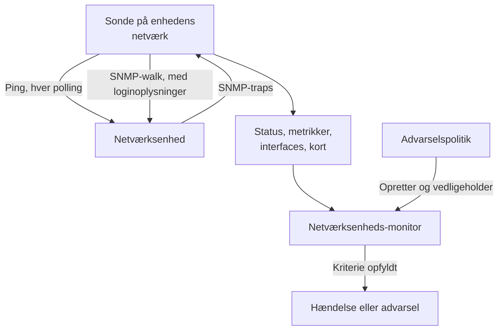
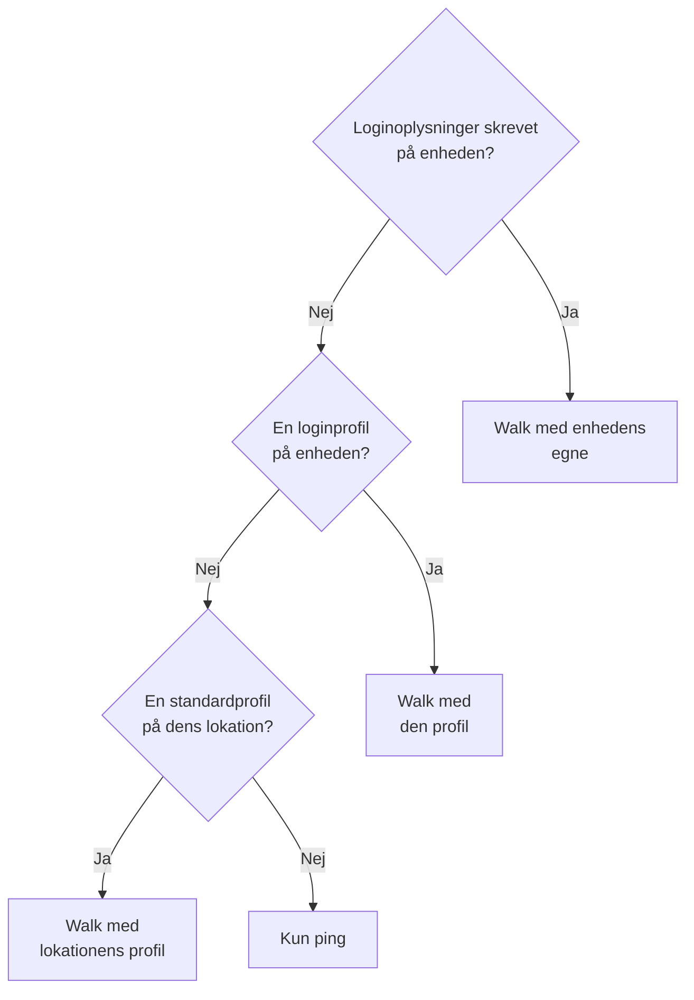
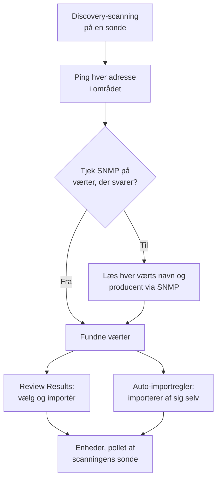
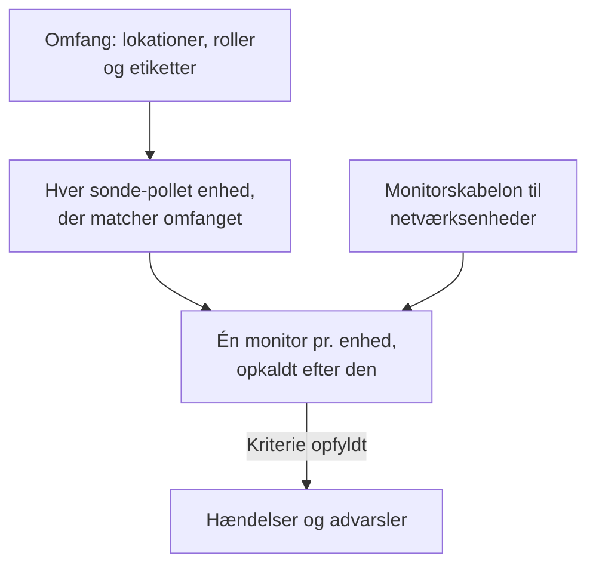
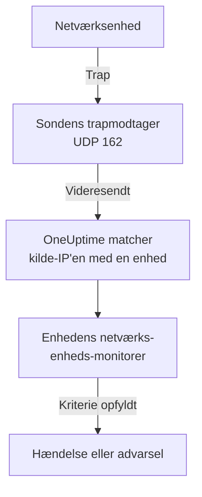

# Netværksenheds-monitor

Overvåg switches, routere, firewalls, access points, PDU'er, kameraer og printere: alt med en adresse på dit netværk, uanset om det taler SNMP eller ej.

Tilføj en enhed med dens adresse og en sonde, og sonden pinger den efter en tidsplan: enheden får en status som oppe eller nede, en plads på netværkskortet og en stemme i sin lokations tilstand. Giv den SNMP-loginoplysninger, og den samme sonde laver også et SNMP-walk af den: interfaces og optikken i dem, hardwareinventar, LLDP- og CDP-naboer og tilstands-OID'er. Tilføj en monitor, eller en advarselspolitik for en hel flåde, og dens pollinger og traps opretter hændelser og advarsler.

:::cards
- [Tilføj en enhed](#tilføj-en-netværksenhed): Dens adresse og en sonde, på én side.
- [Find et netværk](#find-enheder-med-en-netværksscanning): Scan et adresseområde, og importér det, der svarer.
- [Læs enheder via SNMP](#snmp-loginoplysninger-og-loginprofiler): Interfaces, optik, inventar og tilstand.
- [Få advarsler](#advarsler): En monitor til én enhed, en politik til en flåde.
- [Se kortet](#netværkstopologi): Naboer tegnet live, eksporteret som PDF.
- [Løs et problem](#fejlfinding): Afventende enheder, walks der fejler, traps der ikke kommer.
:::

## Sådan virker det



Enheden og monitoren udfører forskellige opgaver:

| Del | Hvad den gør | Hvornår du har brug for den |
| --- | --- | --- |
| Enheden | Dens sonde poller den efter enhedens egen tidsplan. Hver polling registrerer tilgængelighed, ping-svartid og pakketab; en polling med SNMP-loginoplysninger læser også enhedens identitet, interfaces, naboer og tilstands-OID'er. | Altid: enheden er det, du tilføjer. |
| En monitor | Vurderer kriterier mod hvert pollingresultat og hver trap fra enheden og opretter hændelser og advarsler. | Kun til hændelser og advarsler. Status, inventar, grafer og kortet kræver ingen monitor. |

## Før du begynder

- **En sonde, der kan nå enheden.** Sonden pinger og walker enheden fra sit eget netværk, så en enhed på en privat adresse kræver en [brugerdefineret sonde](/docs/probe/custom-probe) inde i det netværk: en sonde på det offentlige internet kan ikke nå den.
- **SNMP, til mere end ping.** Valgfrit. En v1- eller v2c-community string, eller en SNMPv3-bruger, sat op på enheden, med UDP 161 åben fra sonden. Uden det bliver enheden kun pinget.
- **Traps, syslog og flows.** Valgfrit. Sonden modtager SNMP-traps på UDP 162, syslog på UDP 5140, når du slår det til, og flowposter på UDP 2055, 4739 og 6343, så åbn dem fra dine enheder til sonden.

## Netværksoversigten

**Netværk → Oversigt** er der, hvor Netværk-området åbner, og den starter med svaret: én sætning, der siger, om dit netværk har det godt, og når det ikke har, hvad der er galt, de værste nyheder først.

| Hvad der står | Hvornår |
| --- | --- |
| **3 enheder er nede** | En enheds sonde eller monitor kan ikke nå den. |
| **2 lokationer kræver opmærksomhed** | Alle enheder svarer, men en lokations tilstand er ikke driftsklar. |
| **5 interfaces er nede** | Alle enheder svarer, men porte er mørke. |
| **2 enheder rapporterer ikke deres detaljer** | De svarer på ping, men deres SNMP-walk fejler, så deres interfaces og tilstand bliver ikke opdateret: som regel loginoplysningerne. |
| **Venter på første tjek** | Der er tilføjet enheder, og deres sonde har ikke tjekket dem endnu. |
| **Alle 40 enheder er oppe** | Alle enheder svarer. Enheder, der stadig venter på deres første tjek, tælles på en linje for sig. |

Under den siger én linje, om noget opretter en hændelse, når en enhed går ned: hvor mange [advarselspolitikker](#advarselspolitikker) der er slået til, eller et link **Set up alerts**, når der ingen er. Knapperne **Add Device** og **Discover Devices** ved siden af åbner de formularer, og felterne og listerne nedenunder giver detaljerne: enheder og lokationer, der kræver opmærksomhed, flåden pr. producent og de seneste scanninger.

Før noget er tilføjet, viser oversigten i stedet de to måder at komme i gang på: **Find enheder** scanner et adresseområde, så du kan vælge, hvad du vil tilføje, bedst til et helt netværk eller en ny lokation, og **Tilføj én enhed** tilføjer én ud fra dens IP-adresse eller værtsnavn.

Netværk-menuen holder det, du åbner hver dag, synligt: **Oversigt**, **Devices**, **Lokationer**, **Map**, **Traffic** og **Discovery**. Resten er foldet sammen i sektioner, og en sektion folder sig selv ud på hver af sine sider:

| Sektion | Sider |
| --- | --- |
| **Topologi** | **Device Topology**, **Endepunkter**, **Latency Matrix**, **Site Links**, **Device Links** |
| **Regler** | **Auto Import Rules**, **Site Assignment Rules**, **Ejerregler**, **Etiketregler**, **Link Rules** |
| **Indstillinger** | **Alert Policies**, **SNMP-loginoplysninger**, **Device Roles**, **Site Types**, **OID Collection Templates** |
| **Avanceret** | **Archived Devices** |

## Tilføj en netværksenhed

:::steps
### Åbn listen over enheder
Gå til **Netværk → Devices**, og klik på **Add Device**. **Add Device** på Netværk-**Oversigt** åbner den samme formular.

### Skriv enhedens adresse
Skriv dens IP-adresse eller værtsnavn i **Værtsnavn**. Lad **Navn** være tomt for at opkalde enheden efter dens værtsnavn.

### Kontrollér lokationen og sonden
Vælg den **Site**, enheden står i, hvis du bruger lokationer. **Sonde** udfylder sig selv med lokationens standardsonde, eller med projektets eneste brugerdefinerede sonde; sørg for, at det er en sonde, der kan nå enheden.

### Tilføj enheden
Klik på **Add Device**. Inden for et par minutter pinger sonden enheden, og dens status skifter til **Up** eller **Down**. Med SNMP-loginoplysninger udfyldes enhedens oversigt også med dens identitet, interfaces og tilstand efter det første vellykkede walk.
:::

Formularen er én side — værtsnavnet, et navn, lokationen og sonden — med **SNMP** og **Flere felter** foldet sammen nedenunder. Den spørger ikke om, hvordan enheden overvåges: hver enhed, du tilføjer, polles af sin sonde, og [tilsidesættelsen med bundet monitor](#tilsidesættelsen-med-bundet-monitor) ligger på enhedens side **Indstillinger** til de få enheder, der har brug for den.

En enheds oplysninger — navn, beskrivelse, rolle, lokation, etiketter og adresser — redigeres bagefter ét sted: kortet **Device Settings** på dens side **Indstillinger**. Kortet **Enhedsoplysninger** på dens oversigt viser dem med et link **Rediger i Indstillinger**.

### Enheden

| Felt | Beskrivelse | Påkrævet |
| --- | --- | --- |
| Værtsnavn | Den IP-adresse eller det værtsnavn, sonden pinger og walker via SNMP, når enheden har loginoplysninger. | Ja |
| Navn | Et genkendeligt navn, såsom core-switch-01. Lad det være tomt, og enheden bliver opkaldt efter sit værtsnavn. API'et gør det samme: en enhed, der oprettes uden navn, bliver opkaldt efter sit værtsnavn. | Nej |
| Site | Den [netværkslokation](/docs/monitor/network-sites), enheden står i. Lokationens tilstand opsummeres fra dens enheder, og en lokation med en standardsonde udfylder sonden nedenfor. | Nej |
| Sonde | Den sonde, der pinger enheden, walker den via SNMP, når den har loginoplysninger, og modtager dens traps, syslog og [flowposter](/docs/monitor/network-traffic). Den skal kunne nå enheden direkte: en sonde på det offentlige internet kan ikke nå en privat adresse. | Ja |

**Sonde** udfylder sig selv, hvor den kan: et projekt med præcis én brugerdefineret sonde starter med den, og valg af en lokation erstatter den med [lokationens standardsonde](/docs/monitor/network-sites#overvågningsstandarder). Den overskriver aldrig en sonde, du selv har valgt. Sæt en standardsonde på dine lokationer, så kan en enhed tilføjes alene med sin adresse.

### Flere felter (foldet sammen)

| Felt | Beskrivelse | Påkrævet |
| --- | --- | --- |
| Beskrivelse | Fritekst. | Nej |
| Device Role | Core-switch, access-switch, firewall og så videre. Bestemmer enhedens niveau på kortet og afgrænser advarselspolitikker. | Nej |
| MAC-adresse | Enhedens egen MAC. Kortet bruger den til at placere en enhed, der hverken taler LLDP eller CDP, på den switchport, der lærte den; se [Enheder kun med ping og deres switchport](#enheder-kun-med-ping-og-deres-switchport). Læres som regel for dig fra en routers ARP-tabel. | Nej |
| Opret også en Ping-overvågning til hændelser | Sonden pinger allerede enheden og giver den en status; en Ping-monitor er det, der gør mislykkede ping til en hændelse. Sæt kryds, og der oprettes en på værtsnavnet, bundet til enheden, når du gemmer. Den tæller med i dit abonnement, og dens hændelser er slået fra, indtil du slår dem til fra monitorens side. | Nej |

Når du sætter kryds ved Ping-monitoren, vises **Ping from probes**, monitorens egne sonder. De skal kunne nå enhedens netværk; lad feltet være tomt for at bruge projektets standardsonder. Brug hellere [advarselspolitikker](#advarselspolitikker) til at advare om mange enheder på én gang.

### SNMP (foldet sammen, valgfrit)

Lad den være foldet sammen, og enheden bliver kun pinget: den sammenfoldede sektion siger det i én sætning. Enheden får stadig en status fra sin første polling og står stadig i sin lokation og på kortet, men har ingen interfaces, inventar eller tilstands-OID'er, før den har loginoplysninger. Fold sektionen ud for at skrive en community string eller en v3-bruger, eller for at vælge en gemt loginprofil.

:::tabs
@tab SNMP v1 / v2c
| Felt | Beskrivelse | Påkrævet |
| --- | --- | --- |
| SNMP-version | V1, V2c eller V3. | Ja, starter på V2c |
| SNMP Community String | v1- eller v2c-community string'en, såsom `public`. | Nej: tom betyder kun ping |
| SNMP Port | Den UDP-port, agenten lytter på. | Nej, 161 som standard |
| SNMP Credential Profile | Et gemt sæt loginoplysninger, der bruges i stedet for at skrive loginoplysninger her. | Nej |
@tab SNMPv3
| Felt | Beskrivelse | Påkrævet |
| --- | --- | --- |
| SNMP v3 Security Level | No Auth, No Priv; Auth, No Priv; eller Auth, Priv. | Ja |
| SNMP v3 Username | Sikkerhedsnavnet (brugeren), der er sat op på enheden. | Ja: tom betyder kun ping |
| SNMP v3 Authentication Protocol | MD5, SHA, SHA-256 eller SHA-512. | Med godkendelse |
| SNMP v3 Authentication Key | Adgangsfrasen til godkendelse. | Med godkendelse |
| SNMP v3 Privacy Protocol | DES, AES eller AES-256. | Med privatliv |
| SNMP v3 Privacy Key | Adgangsfrasen til privatliv (kryptering). | Med privatliv |
:::

Loginoplysninger, der er skrevet på enheden, vinder over en loginprofil, der er valgt ved siden af dem, og enhedens lokation kan også have en standardprofil. Loginoplysninger i en profil er krypteret i hvile. Loginoplysninger, der er skrevet på en enhed, er beskyttet af de samme læserettigheder, men er ikke krypteret i hvile: endnu en grund til at holde delte loginoplysninger i en profil.

## Ændr mange enheder på én gang

En discovery-scanning af en kundes netværk henter snesevis af enheder, der hører til én lokation, deler én rolle og kommer fra én producent. Du åbner dem ikke én ad gangen: markér dem på listen **Devices**, ved at sætte kryds ved rækker eller markere alle enheder, filtrene matcher, og åbn **Massehandlinger**.

| Handling | Hvad den gør |
| --- | --- |
| **Angiv lokation** / **Ryd lokation** | Flytter hver markeret enhed til den lokation, du vælger, hvor den tæller med i lokationens tilstand; en enhed uden egen sonde overtager lokationens standardsonde. **Ryd lokation** tager dem ud af deres lokationer. En enhed, som en lokationstildelingsregel matcher, vender tilbage til reglens lokation ved sin næste polling, så til enheder, som discovery bliver ved med at finde, skal du hellere tilføje en regel under **Netværk → Regler → Site Assignment Rules**; dialogen **Angiv lokation** linker til den. |
| **Angiv enhedsrolle** / **Ryd enhedsrolle** | Giver hver markeret enhed én rolle, som de tyve switches, der alle er "Access Switch". Rollerne er projektets egne, under **Netværk → Indstillinger → Device Roles**, som dialogen linker til. **Ryd enhedsrolle** udleder hver enheds rolle fra dens SNMP-identitet igen. |
| **Anvend producentskabelon** | Tilføjer en [producentskabelon](#producenternes-tilstandsskabeloner)s tilstands-OID'er og SNMP-tabeller til hver markeret enhed. **Match hver enheds producent**, dialogens første valg, vælger hver enheds egen skabelon ud fra det, dens SNMP-walk rapporterer, så en blandet markering får den rigtige overalt; eller vælg én skabelon til dem alle. |

Hver handling er én dialog og én gemning for hele markeringen, og hver enhed går gennem de samme kontroller som en redigering på dens egen side Indstillinger: rettigheder, din rolles etiket- og ejeromfang og grænserne for, hvad en enhed må indsamle.

**Anvend producentskabelon** viser, hvad den vil gøre, før den gør noget: hvor mange enheder der får hvilken skabelon, og hvor mange den lader være og hvorfor. Den tilføjer til det, hver enhed allerede indsamler, og fjerner intet, og en enhed, der allerede har alt i skabelonen, skrives ikke igen. Den lader være: en enhed med bundet monitor (intet poller den), en enhed, der er knyttet til en [OID Collection Template](#oid-collection-templates) (skabelonen bestemmer, hvad den indsamler, så tilføj producentens OID'er dér) og, ved matchning, en enhed, der endnu ikke er walket via SNMP, eller hvis producent ikke har nogen skabelon.

Når en handling er færdig, viser den, hvor mange enheder der blev ændret, hvilke der fejlede og hvorfor — en enhed, din rolle ikke må redigere, en liste over sin grænse — og hvilke den ikke ændrede og hvorfor: en enhed, der allerede var i den lokation eller rolle, eller en, som producentskabelonen lader være.

De øvrige massehandlinger beskrives der, hvor de hører til: **Set OID Collection Template** under [OID Collection Templates](#oid-collection-templates), **Set SNMP Credential Profile**, **Switch to Probe Polling** og **Create Ping Monitors** under [Samlet](#samlet), og **Shorten Names to Hostname** under [Sådan navngives fundne enheder](#sådan-navngives-fundne-enheder).

## Hvad en polling faktisk gør

Hver polling af en sonde-pollet enhed er et ping. Når enheden har brugbare SNMP-loginoplysninger, kører sonden også et fuldt SNMP-walk. De to kører side om side, og walket venter aldrig på pinget, så SNMP-udstyr bag en ACL, der smider ICMP væk, stadig rapporterer **Up**.

| Resultat | Enhed kun med ping | Enhed med SNMP-loginoplysninger |
| --- | --- | --- |
| Status (Up eller Down) | Fra pinget | Fra pinget eller walket: det er nok, at én af dem svarer |
| Ping-svartid og pakketab | Registreret som enhedsmetrikker | Registreret som enhedsmetrikker |
| SNMP-svartid | — | Walkets tid, aldrig pingets |
| Interfaces, naboer, endepunkter | — | Fra et vellykket walk |
| Systemidentitet, producent, model, serienummer | — | Fra et vellykket walk |
| Tilstands-OID'er og SNMP-tabeller | — | Fra et vellykket walk |

Brugbare loginoplysninger er et v1- eller v2c-sæt med en community string, eller et v3-sæt med et brugernavn, fundet gennem [kæden af loginoplysninger](#snmp-loginoplysninger-og-loginprofiler). Et tomt sæt springes over, så en enhed bliver aldrig walket med et gættet standard-community.

Pakketab genbruger [Ping-monitorens](/docs/monitor/ping-monitor) serie, så det læses ens i hele produktet. Svartiden har sin egen serie, `oneuptime.monitor.ping.round.trip.time`, fordi den almindelige svartid på en netværksenhed er SNMP-walkets. Enhedens side **Metrikker** viser interfaceudnyttelse og tilstands-OID'er i grafer; svartiden for den seneste time tegnes i enhedens skuffe på kortet.

### "SNMP failing" er ikke "Down"

En enhed, der svarer på ping, men hvis walk fejler, er **Up**, markeret med **SNMP failing**, og begge halvdele betyder noget:

- Den er oppe, fordi noget svarer på den adresse. At farve den rød ville lægge en enhed, der kører fint, ind i din hændelsesoptælling.
- Den er SNMP failing, fordi dens interfaces, inventar og tilstands-OID'er er holdt op med at blive opdateret, næsten altid på grund af loginoplysninger, en deaktiveret SNMP-agent eller en ACL. Intet andet på siden ville fortælle dig, at tallene er frosset.

En enhed, hvis ping og walk begge fejler, er simpelthen **Down**, så markeringen står kun nogensinde ved siden af en grøn status.

### Sådan læser du en enheds status

Hvert sted, der viser en enhed — listen Devices, en lokations Devices-side, oversigten, kortet — bruger de samme tre afgørelser og de samme tilføjelser ved siden af.

| Afgørelse | Betyder |
| --- | --- |
| **Up** | Den seneste polling (ping eller SNMP), eller den bundne monitor, nåede enheden. |
| **Down** | Den seneste polling (ping eller SNMP), eller den bundne monitor, kunne ikke nå enheden. |
| **Afventer** | Endnu ingen afgørelse: aldrig pollet, ingen sonde tildelt eller ingen monitor bundet. |

| Tilføjelse | Vises når | Hvad du gør |
| --- | --- | --- |
| **Stale** | Der er ikke forsøgt nogen polling i et godt stykke længere end enhedens interval. | Kontrollér, at enhedens sonde er online og følger med sin flåde. |
| **No probe** | Enheden polles af en sonde, men har ingen, eller dens polling er slået fra. | Tildel en sonde, der kan nå den; indtil da poller intet den. |
| **No monitor** | Enheden bruger [tilsidesættelsen med bundet monitor](#tilsidesættelsen-med-bundet-monitor), og intet er bundet. | Bind en monitor, eller skift den tilbage til polling med sonde. |
| **SNMP failing** | Oppe på ping, men det seneste SNMP-walk fejlede. | Kontrollér loginoplysningerne, SNMP-agenten eller en ACL. |

Listen **Devices** har et filter **SNMP** med tre værdier: **OK** (det seneste walk lykkedes), **Failing** (det seneste walk fejlede) og **Not configured** (kun ping, ingen loginoplysninger eller aldrig pollet). "Hvilke enheder har loginoplysninger, der er holdt op med at virke" er ét klik væk. Listens kolonne **Interfaces (Up / Down)** viser **No SNMP** i stedet for `0 / 0` for en enhed, der pinges og aldrig walkes: nul fungerende porte ville være en anden påstand, og en forkert.

## SNMP-loginoplysninger og loginprofiler

En enhed walkes med det første brugbare sæt loginoplysninger, der findes i denne rækkefølge, og søgningen stopper ved det første fund:



Lokationstrinnet læser enhedens egen lokation og ikke længere: en enhed i en Unit overtager ikke en profil, der er sat på Region'en over den. En lokations standardsonde rækker derimod ned gennem træet, fordi en sonde kopieres til enheden én gang, mens loginoplysninger læses igen ved hver polling; [Netværkslokationer](/docs/monitor/network-sites#overvågningsstandarder) har detaljerne.

### Siden SNMP-loginoplysninger

**Netværk → Indstillinger → SNMP-loginoplysninger** rummer projektets loginprofiler. En profil er ét navngivet sæt — en v1- eller v2c-community string, eller en v3-bruger med sit sikkerhedsniveau, sine protokoller og nøgler — som så mange enheder og lokationer, du vil, peger på. Intet kopieres til enhederne, så det at skifte en community string er én redigering her, og hver enhed, der bruger profilen, får den nye værdi ved sin næste polling.

Hemmeligheder i en profil er krypteret i hvile, og kun roller, der må læse en enheds egne loginoplysninger, må læse dem. En enhed eller lokation, der viser sin profil, viser profilens navn og version, aldrig dens hemmeligheder.

En profil, som en enhed eller lokation stadig peger på, kan ikke slettes: sletningen afvises med en optælling af det, der står i vejen. Flyt de enheder og lokationer til en anden profil, eller ryd profilen på dem, og slet den så.

### Gør en enhed til kun ping igen

På enhedens side **Indstillinger** har **Rediger indstillinger** et afkrydsningsfelt **Ping only — clear this device's own SNMP credentials** i trinnet **SNMP-loginoplysninger**. Det rydder enhedens egen community string og v3-brugernavn, når du gemmer. Det findes, fordi det ikke er indlysende at tømme det rigtige felt: en v3-enhed kan stadig walkes, så længe dens brugernavn findes, uanset hvad du ellers tømmer.

At rydde enhedens egne loginoplysninger rydder ikke en profil. Hvis enheden eller dens lokation stadig nævner en, bliver enheden ved med at blive walket med den; ryd også profilen for kun at få enheden pinget.

### Samlet

Markér enheder på listen **Devices**, og brug:

- **Set SNMP Credential Profile** / **Clear SNMP Credential Profile**: knyt en profil til en markering, eller tag den af.
- **Switch to Probe Polling**: til enheder med tilsidesættelsen med bundet monitor. Vælg en sonde, og hver markeret enhed pinges derefter efter sin tidsplan og walkes, når den har loginoplysninger. En monitor, der allerede er bundet, forbliver bundet; enhedens status kommer nu fra sonden.
- **Create Ping Monitors**: til enheder med tilsidesættelsen med bundet monitor; opretter en Ping-monitor på hver enheds værtsnavn og binder den, så enheden viser Up eller Down.

Siden **Devices** viser et banner, når projektet har enheder med tilsidesættelsen med bundet monitor uden noget bundet — enheder, som intet poller, og som intet rapporterer om — og linker til den markering, der retter dem.

## Lokationens standarder for overvågning

En [netværkslokation](/docs/monitor/network-sites#overvågningsstandarder) har to standarder for enhederne i den. Dens **Default Probe** kopieres til en enhed, der oprettes i lokationen, eller flyttes ind i den, uden egen sonde. Dens **Default SNMP Credential Profile** læses ved hver polling af en enhed i lokationen, der ikke har egne loginoplysninger. Sæt begge på en lokation, så kan en enhed dér tilføjes alene med sin adresse og derefter pinges og walkes fra sin første polling. Vejledningen om lokationer fortæller, hvor langt ned i lokationstræet hver standard rækker.

## Tilsidesættelsen med bundet monitor

Noget udstyr kan ingen sonde nå eller pinge meningsfuldt: en enhed bag en NAT, en appliance, hvis tilstand bedre vurderes med et HTTP-tjek, en tjeneste, hvis reelle signal er et porttjek. Til dem har **Rediger indstillinger** på enhedens side **Indstillinger** en **Monitoring Method**:

| Metode | Hvad den betyder |
| --- | --- |
| **Sonde** | Standarden. Pinges af den tildelte sonde efter dens tidsplan og walkes via SNMP, når den har loginoplysninger. |
| **Bound monitor** | En eksisterende monitors status er denne enheds status. |

At skifte en enhed til **Bound monitor** stopper pollingen af den. Sonden, intervallet og pollingkontakten forsvinder fra kortet **Polling & Data Collection**, enhedens gamle pollingresultater ryddes, og dens status kommer fra den monitor, du binder. Det er valgfrit at binde en: indtil du gør det, viser enheden **Afventer**, markeret med **No monitor**.

At skifte tilbage til **Sonde** genopretter pollingen og beder om en sonde. En monitor, der var bundet, forbliver bundet og bliver ved med at advare; den bestemmer bare ikke længere enhedens status.

De fleste enheder har ikke brug for det. Hver sonde-pollet enhed har allerede en tilgængelighedsstatus, så du behøver ikke binde en Ping-monitor for at få en; bind en monitor, når du vil have den monitors hændelser.

## Polling og dataindsamling

Polling ligger på enhedens side **Indstillinger**, på kortet **Polling & Data Collection** (**Rediger Polling**). Standarderne passer til en ny enhed, så den kræver ingen finjustering:

| Indstilling | Beskrivelse | Standard |
| --- | --- | --- |
| Sonde | Den sonde, der poller enheden. | Sat, når enheden tilføjes |
| Polling Enabled | Sonden poller enheden efter tidsplanen nedenfor. Slå den fra for at sætte pollingen på pause uden at slette enheden. | Til |
| Polling Interval (Minutes) | Hvor ofte sonden poller enheden. Mindst 1 minut. | 5 |
| Walk Interfaces | Walker interfacetabellerne (IF-MIB) ved hver polling: status, båndbredde, udnyttelse og fejl for hver port, plus LLDP- og CDP-naboer til kortet. | Til |
| Collect Connected Endpoints | Walker også ARP- og bridge-forwardingtabellerne for at finde det, der er sat i enheden: betalingsterminaler, printere, telefoner, bærbare. Ud fra en ARP-tabel udfylder den også MAC-adressen på enheder, der er registreret på de adresser. Koster ekstra walks pr. polling. | Fra |
| OID Collection Template | En delt, navngivet OID-liste, som enheden indsamler. Redigering af skabelonen ændrer hver tilknyttet enhed ved dens næste polling. | Ingen |
| Device-Specific Health OIDs | Ekstra OID'er, som kun denne enhed indsamler, oven i dem fra dens skabelon. | Ingen |
| Auto-Apply Vendor Health Template | Når enhedens producent genkendes, og dens egen OID-liste er tom, udfyldes listen fra producentens skabelon ved næste polling. | Fra; til for enheder, som discovery importerer |
| Device-Specific SNMP Tables | Ekstra [SNMP-tabeller](#snmp-tabeller), som kun denne enhed walker, oven i dem fra dens skabelon. En tabel med samme nøgle som en skabelontabel erstatter den på denne enhed. | Ingen |

Alt fra **Walk Interfaces** og ned kræver SNMP-loginoplysninger: på en enhed kun med ping bevares de indstillinger og har intet walk at gælde for.

### Walk af interfaces

Med **Walk Interfaces** slået til og loginoplysninger fundet følger hver polling hvert interfaces driftsmæssige og administrative status, bits ind og ud, udnyttelse og fejl. Det samme walk indsamler LLDP- og CDP-naboerne til kortet.

Gør et interface lydløst på enhedens side **Interfaces**, til en laboratorieport eller en forbindelse, der med vilje er taget ud, så forbliver det i inventaret, men falder uden for advarsler og metrikker. Et mislykket walk rydder aldrig halvdelen af det indsamlede: det seneste øjebliksbillede af interfaces bliver stående, og enheden markeres med **SNMP failing**, så ingen forveksler det med et aktuelt.

### Producenternes tilstandsskabeloner

I editoren **Health OIDs** anvender **Vendor Health Template** et færdigt sæt OID'er til enhedens producent. Mange skabeloner leverer også [SNMP-tabeller](#snmp-tabeller), der tilføjes med **Add a Vendor's Tables** i editoren **SNMP Tables**.

| Producentskabelon | Tilstands-OID'er | SNMP-tabeller |
| --- | --- | --- |
| Generic (Host Resources MIB) | CPU-belastning, samlet og tilgængelig RAM, load average | CPU-kerner (én række pr. kerne, uanset hvordan platformen nummererer dem) |
| Arista EOS | CPU-belastning, load average, samlet og tilgængelig RAM | — |
| Cambium Networks cnMatrix | CPU, RAM, flash, temperatur, forsyningsspænding | Blæsere, PoE-porte, redundant strømforsyning |
| Cambium Networks Enterprise Wi-Fi (cnPilot, XV, XE, XH) | CPU, ledig hukommelse, Wi-Fi-klienter, forbindelse til cnMaestro | Wi-Fi-radioer (bånd, kanal, bredde, sendestyrke, klienter, støjgulv, airtime, tilstand), SSID'er |
| Cisco IOS / IOS-XE | CPU, brugt og ledig hukommelse, temperatur, blæsertilstand, strømforsyningstilstand | — |
| Dell Force10 / OS9 | CPU, hukommelse | — |
| Extreme Networks EXOS / Switch Engine | CPU, temperatur, alarm for overtemperatur, strømtilstand | Strømforsyninger, blæsere, hukommelse pr. slot, stakmedlemmer |
| Extreme Networks Fabric Engine / VOSS | vIST-session, antal I-SID'er | Fabric-adjacencies (IS-IS) navngivet efter naboen, CPU og hukommelse pr. slot, temperatursensorer, blæsere, strømforsyninger |
| Extreme Networks IQ Engine (HiveOS) Access Points | CPU, hukommelse, Wi-Fi-klienter, temperatur | Wi-Fi-radioer (kanal, sendestyrke, støjgulv), SSID'er |
| Extreme Networks Wireless Controller (XIQ-C, ExtremeWireless) | Access points, aktive access points, Wi-Fi-klienter | Access points (tilstand, klienter, adresse, software), Wi-Fi-radioer (bånd, kanal, bredde, støjgulv, optaget airtime), WLAN'er (SSID, klienter) |
| Fortinet FortiGate | CPU, hukommelse, disk | — |
| HPE / Aruba ProCurve | CPU, samlet og ledig hukommelse | — |
| HPE Aruba Instant (AOS 8) | Klyngenavn, firmwareversion, conductor | Access points (status, model, CPU, hukommelse), Wi-Fi-radioer navngivet efter access point (kanal, sendestyrke, støjgulv, udnyttelse, klienter, tilstand), SSID'er (klienter) |
| HPE Aruba Mobility Controller (AOS 8) | Access points, Wi-Fi-klienter, controllerens rolle | Access points (status, model, AP-gruppe), Wi-Fi-radioer navngivet efter access point (bånd, kanal, sendestyrke, udnyttelse, klienter, tilstand), SSID'er (klienter, access points oppe og nede), processorer, hukommelse |
| Huawei VRP | CPU, hukommelse, temperatur | — |
| Juniper Junos | CPU, hukommelsesbuffer, temperatur | — |
| MikroTik RouterOS | CPU-belastning, temperatur, spænding | — |
| Palo Alto PAN-OS | Management-CPU, sessionsudnyttelse, aktive sessioner | — |
| Sophos Firewall (SFOS / XGS) | Hukommelse, disk, swap, HA-tilstand og peerens tilstand, IPsec-tjeneste, CPU-temperatur (SFOS v22 og nyere) | IPsec-tunneler (status kræver SFOS v20 og nyere), CPU-kerner |
| TP-Link Omada Access Points (EAP) | Wi-Fi-klienter | — |
| Ubiquiti EdgeOS / EdgeSwitch / UniFi Switches | CPU-belastning, samlet og tilgængelig RAM | — |
| Ubiquiti UniFi Access Points | Isoleret tilstand, load average, samlet og tilgængelig RAM | Wi-Fi-radioer (bånd, airtime), SSID'er (bånd, kanal, klienter, sendestyrke, forbindelseskvalitet), CPU-kerner |

Skabelonens OID'er kopieres til enhedens egen liste, hvor du kan beskære eller udvide dem. Når det første walk har identificeret producenten, foreslår enhedssiden den tilsvarende skabelon. Matchningen læser enhedens `sysObjectID`, og dens `sysDescr`, hvor ét enterprisenummer rummer to operativsystemer: Extreme Fabric Engine på universel hardware rapporterer samme enterprisenummer (1916) som EXOS, og kun dens beskrivelse (`…-FabricEngine (9.0.4.0)`) skiller dem ad. UniFi-access points skilles fra Ubiquitis routere på samme måde (`U6-Pro 6.6.50.15098`), også når ældre firmware svarer med Net-SNMP's gren, og IQ Engine-access points fra de Aerohive-switches, der deler deres gren (`AP230, HiveOS 8.2r1`).

Enheder med **Auto-Apply Vendor Health Template** slået til får skabelonens OID'er og tabeller ved deres første polling: enheder, som en auto-importregel henter ind, og enheder importeret fra **Review Results** med kontakten for producentskabelon slået til, hvilket den er, medmindre du slår den fra. For at give mange enheder deres skabelon på én gang, som en fundet flåde fra før kontakten fandtes, markerer du dem på listen **Devices** og bruger **Anvend producentskabelon** (se [Ændr mange enheder på én gang](#ændr-mange-enheder-på-én-gang)).

At anvende en producentskabelon er en engangskopi, så intet spreder sig, når skabelonen ændres. Til alt ud over en enkelt enhed skal du hellere bruge en **OID Collection Template**; producentskabelonerne tilbydes som udgangspunkt, når du opretter en.

### OID Collection Templates

En **OID Collection Template** (**Netværk → Indstillinger → OID Collection Templates**) er en navngivet OID-liste, som regel opkaldt efter en enhedstype som "Cisco Catalyst 9300", som så mange enheder, du vil, knyttes til. Tilknytningen er levende, ikke en kopi: en enheds OID-liste sættes sammen ved hver polling, så redigering af en skabelon ændrer, hvad hver tilknyttet enhed indsamler ved sin næste polling, uden noget synkroniseringstrin.

Før du bygger en, så tjek, at du har brug for den. Bits ind og ud pr. port, driftsstatus, udnyttelse og fejl pr. sekund indsamles for hver port ved hver polling uden nogen OID'er overhovedet (se [Walk af interfaces](#walk-af-interfaces)), og de kan allerede give advarsler pr. port. Skabeloner er til det, der ikke er pr. port: CPU, hukommelse, temperatur, blæsere, strømforsyninger, BGP-peers.

Hvis du kommer fra Zabbix:

| Zabbix | OneUptime |
| --- | --- |
| Template | OID Collection Template |
| Item | En OID på den skabelon |
| Discovery-reglen "Network interfaces by SNMP" med item-prototyper | Indbygget og altid slået til for interfacetællerne: intet at skrive |
| Trigger | Monitorkriterier |
| Trigger-prototype, én pr. fundet interface | Et kriterie med **Interface** sat til `*`, som spredes ud pr. port |
| Discovery-regel over enhver anden SNMP-tabel (tunneler, radioer, blæsere) med item-prototyper | En [SNMP-tabel](#snmp-tabeller) på skabelonen |
| Trigger-prototype på sådan en tabel | Et kriterie SNMP Table Value eller SNMP Table Row Is Unhealthy med **Row** sat til `*` |
| Værtsgruppe | Etiketter |
| Handlingen "Link template on host discovery" | En auto-importregels **OID Collection Template** |
| Handling på en værtsgruppe ("advar om hver switch") | En [advarselspolitik](#advarselspolitikker) |

En OID på en skabelon indsamles, som den er skrevet, så en OID, der navngiver én række i en tabel (`…ifSpeed.3`), indsamler kun den række, hvad der end står på indeks 3 den dag, der polles. Alt, der er en liste — tunneler, radioer, blæsere, naboer — hører hjemme i en [SNMP-tabel](#snmp-tabeller), som walker hver række og følger rækker, efterhånden som de kommer og går. Interfacedata pr. port behøver ingen af delene: interface-walket registrerer driftsstatus, bits ind og ud pr. sekund, udnyttelse og en samlet fejlrate pr. sekund som serier. Fejl pr. retning, discards, administrativ status og linkhastighed går ind i enhedens interfaceinventar, men er ikke serier og kan ikke give advarsler.

Der er tre måder at knytte enheder til på, og på en flåde, som discovery bliver ved med at finde, betyder den tredje mest:

- Én enhed ad gangen, på enhedens kort **Polling & Data Collection**.
- Samlet, ved at markere enheder på listen **Devices** og bruge **Set OID Collection Template**. Listens kolonne **Template** viser, hvilke enheder der er knyttet til hvad.
- Automatisk, ved at sætte en OID Collection Template på en auto-importregel, så hver enhed, en scanning importerer, knyttes til i det øjeblik, den oprettes.

En enhed indsamler først sin skabelons OID'er og derefter sine egne **Device-Specific Health OIDs**. Når begge nævner den samme OID, indsamles den én gang, med enhedens navn og beskrivelse som vinder, og skabelonens poster beholder deres plads, så enhedsspecifikke tilføjelser aldrig kan skubbe dem ud.

| Grænse | Værdi |
| --- | --- |
| Tilstands-OID'er, en enhed poller | 200 |
| OID'er på en skabelon | 150 |
| En tilknyttet enheds egne OID'er | 50 |
| En ikke-tilknyttet enheds egne OID'er | 200 |

Grænserne lægges sammen, så en tilknyttet enhed aldrig kan polle mere end 200 OID'er. At gå over er en valideringsfejl, når du gemmer, aldrig en stille afkortning ved polling, og at knytte en enhed, der allerede har mere end 50 egne, afvises med en besked, der siger, hvor mange der skal fjernes.

En skabelon, som enheder stadig er knyttet til, kan ikke slettes. Fjern tilknytningen først, for eksempel med massehandlingen **Clear OID Collection Template**, så en sletning aldrig i stilhed stopper indsamlingen på tværs af en flåde.

### Egne OID'er

Tilføj de OID'er, du vil have indsamlet ved hver polling, på en skabelon eller som enhedsspecifikke tilføjelser:

| Felt | Beskrivelse | Påkrævet |
| --- | --- | --- |
| OID | Den numeriske OID, såsom 1.3.6.1.2.1.1.1.0. | Ja |
| Navn | Et genkendeligt navn til OID'en, såsom sysDescr. | Nej |
| Beskrivelse | Hvad OID'en repræsenterer. | Nej |

Indsamlede værdier vises i grafer på enhedens side **Metrikker**, og kriterierne **SNMP OID Value** og **SNMP OID Exists** advarer om dem. OID-vælgeren på de kriterier viser de OID'er, den valgte enhed indsamler, dens skabelons og dens egne, så der er intet at skrive.

Lange OID-lister deles over flere SNMP GET-forespørgsler, så hver passer i ét UDP-datagram. Hvis du holdt dine OID-lister korte, fordi en ældre version rapporterede en enhed, der svarede `tooBig`, som offline, behøver du ikke længere.

### SNMP-tabeller

Noget af det, en enhed ved, er en liste: én række pr. IPsec-tunnel, Wi-Fi-radio, SSID, fabric-nabo, blæser eller strømforsyning. En SNMP-tabel defineres af sine kolonner, og hver række walkes ved hver polling, så en tunnel, der tilføjes, omdøbes eller slettes, følges, uden at nogen redigerer noget.

| Felt | Hvad det gør |
| --- | --- |
| Navn og nøgle | Hvad tabellen hedder. Nøglen (bogstaver, cifre og understreger, dannet ud fra navnet, når den står tom) er det, kriterier, metrikker og skabelonvariabler bruger, så det at omdøbe en tabel aldrig ødelægger en advarsel. |
| Type | Hvad rækkerne er: VPN-tunneler, Wi-Fi-access points, Wi-Fi-radioer, Wi-Fi-SSID'er, routingnaboer, hardware eller generisk. Wi-Fi-typerne fodrer enhedens [Wi-Fi-side](#fanen-wi-fi). |
| Kolonner | Kolonne-OID'erne, der skal indsamles (tabelpostens OID plus kolonnenummeret, såsom `1.3.6.1.4.1.2604.5.1.6.1.1.1.1.9` for status på en Sophos-tunnel), hver med et navn og eventuelt en enhed, en rolle (status, bånd, kanal, kanalbredde, sendestyrke, klienter, støjgulv, udnyttelse, SSID), værdietiketter og sunde værdier. |
| Rækkenavne | Valgfrie kolonner, hvis værdier navngiver hver række, såsom en tunnels forbindelsesnavn. Uden dem navngives rækker efter deres indeks. Et navn kan komme fra en søstertabel, der deler indekset (Fabric Engine navngiver IS-IS-adjacencies ud fra `rcIsisAdjHostName`), eller fra en overordnet tabel, hvis indeks indleder denne tabels (Aruba Instant navngiver hver radio efter dens access point). En tabel, der er indekseret efter et navn (ArubaOS indekserer sine SSID'er efter SSID'en), navngives efter sit afkodede indeks. |
| Rækkegrænse | Hvor mange rækker der gemmes: 100 som standard, højst 250. |

Tal læses som tal, og tekst, der starter med et tal, læses som det tal (`"36"`, `"-95 dBm"`, `"80MHz"`), fordi mange producenter lægger tal i strenge. Sæt en kolonnes værditype til **Text only** for værdier, der kun ser numeriske ud. **Value labels** gør koder til ord (`0=inactive, 1=active`): den rå værdi er stadig det, der vises i grafer og sammenlignes, etiketten er det, der vises. **Healthy values** (`1`) siger, hvilke værdier der betyder, at alt er godt: de farver rækken på enhedens side **SNMP Tables** og driver kriteriet **SNMP Table Row Is Unhealthy**.

Nogle kolonner i producentskabeloner **justerer** også det tal, de læser, til MIB'er, der gemmer en værdi i en enhed for sig: ArubaOS rapporterer sendestyrken fordoblet (læst × 0.5), Aruba Instant støjgulvet uden fortegn (× −1), Aerohive støjgulvet plus 256 (− 256) og Extremes controller kanalbredden i trin på 20 MHz (× 20). Det justerede tal er det, der vises, sættes i grafer og sammenlignes, så **Noise Floor Greater Than -80** betyder det samme hos hver producent, og tabeleditoren viser regnestykket under kolonnen.

Tabeller kommer fra en [OID Collection Template](#oid-collection-templates), delt af hver tilknyttet enhed (op til 10 tabeller), eller fra enheden selv under **Device-Specific SNMP Tables** (op til 10 mere). De flettes efter nøgle ved hver polling, skabelonen først, og en enhedstabel med samme nøgle erstatter skabelonens. Begge editorer tilbyder **Add a Vendor's Tables**.

Sonden walker hver kolonne som et undertræ inden for et budget på 30 sekunder, som alle tabeller på enheden deler. En tabel, der ikke kan walkes, siger hvorfor og får aldrig pollingen til at fejle: enhedens side **SNMP Tables** beholder dens seneste gode rækker og siger, at det seneste walk fejlede, mens kriterier kun vurderer, hvad dette walk producerede, så en timeout aldrig læses som en tom tabel. Hver numerisk celle registreres som metrikken `oneuptime.monitor.snmp.table.value` med attributterne `snmpTableKey`, `snmpTableName`, `snmpTableColumn`, `snmpTableColumnOid`, `snmpTableRow` og `snmpTableRowIndex`, så et dashboard kan vise hver tunnels status eller hver radios sendestyrke i en graf, og en metrik-monitor kan gruppere efter `snmpTableRow`.

### Fanen Wi-Fi

En enhed, hvis walk omfatter en Wi-Fi-tabel — access points, radioer eller SSID'er, som Wi-Fi-producentskabelonerne medbringer dem — får en side **Wi-Fi**. Den åbner med access points oppe (på en controller), radioer tændt, klienter og SSID'er og viser derefter hvert access point, en controller styrer, med dets tilstand, radioer og klienter; hver radio med bånd, kanal, frekvens, kanalbredde, sendestyrke, klienter, støjgulv og airtime; og hver SSID med dens bånd og klienter. Kolonner findes efter deres rolle, så enhver producents tabeller, der mærker deres kolonner, vises på samme måde.

Producenterne fordeler disse oplysninger forskelligt, og siden samler dem igen:

- Frekvensen udledes af båndet og kanalen med 802.11-kanalplanen (2.4, 5 og 6 GHz). En controller, der rapporterer frekvensen, hvor dens MIB siger kanal (Extremes), læses omvendt.
- En radio, der ikke rapporterer noget bånd, placeres efter sin kanal: 1 til 14 er 2.4 GHz, 32 til 177 er 5 GHz, og et nummer, som kun 6 GHz bruger (37, 53, 181…), er 6 GHz.
- UniFi rapporterer kanal, sendestyrke og klienter pr. SSID: en radio henter dem fra SSID'erne på sit bånd.
- Aruba tæller klienter pr. radio: et access points klienter er dets radioers.
- Et interface, der ikke udsender noget netværk (IQ Engine viser hvert interface, med N/A for dem), vises ikke som SSID.

På en enhed, der endnu ikke rapporterer Wi-Fi, nævner siden dens producents skabelon, matchet ud fra den seneste polling på samme måde som automatisk anvendelse, og anvender den med **Anvend skabelon**; radioerne dukker op efter næste polling.

### Understøttede Wi-Fi-producenter

Hvad hver Wi-Fi-producent rapporterer via SNMP, og hvad kun dens cloud har:

| Producent | Access points og controllere | Producentskabelon | Læst via SNMP | Kræver producentens cloud-API (ikke bygget) |
| --- | --- | --- | --- | --- |
| Cambium Networks | Enterprise Wi-Fi-access points (cnPilot, XV, XE, XH) | Cambium Networks Enterprise Wi-Fi (cnPilot, XV, XE, XH) | Hver radios bånd, kanal, bredde, sendestyrke, klienter, støjgulv, airtime og tilstand; SSID'er; CPU, hukommelse | Flådevisninger i cnMaestro |
| Ubiquiti UniFi | UniFi-access points (UAP, U6, U7, UK) | Ubiquiti UniFi Access Points | Hver radios bånd og airtime; hver SSID's kanal, klienter og sendestyrke; CPU pr. kerne, hukommelse | Data pr. klient og visninger pr. site i UniFi Network-applikationen |
| HPE Aruba | Instant-klynger (AOS 8), gennem deres virtuelle controller | HPE Aruba Instant (AOS 8) | Hvert access points status, CPU og hukommelse; hver radios kanal, sendestyrke, støjgulv, udnyttelse, klienter og tilstand; SSID'er med klienter | — |
| HPE Aruba | Mobility Controllers (AOS 8) | HPE Aruba Mobility Controller (AOS 8) | Hvert styret access points status; hver radios bånd, kanal, sendestyrke, udnyttelse og klienter; SSID'er med klienter; controllerens CPU og hukommelse | — |
| HPE Aruba | Access points på AOS 10, styret af Aruba Central | — | Tilgængelighed (ping) | Radioer, SSID'er og klienter: Aruba Central-API'et |
| Extreme Networks | IQ Engine-access points (HiveOS) | Extreme Networks IQ Engine (HiveOS) Access Points | Hver radios kanal, sendestyrke og støjgulv; SSID'er; CPU, hukommelse, klienter, temperatur | Klient- og flådevisninger i ExtremeCloud IQ |
| Extreme Networks | ExtremeCloud IQ Controller (tidligere Extreme Campus Controller) og ExtremeWireless-controllere | Extreme Networks Wireless Controller (XIQ-C, ExtremeWireless) | Hvert access points tilstand og klienter; hver radios bånd, kanal, bredde, støjgulv og optaget airtime; WLAN'er med klienter | — |
| TP-Link | Omada-access points (EAP) | TP-Link Omada Access Points (EAP) | Antallet af klienter, på firmware med TP-Links EAP-klient-MIB | Radioer, kanaler og SSID'er: Omada Controller-API'et |
| Juniper | Mist-access points | — | Tilgængelighed (ping); access points, der går op og ned, gennem Mists webhooks | Alt andet: Mists cloud-API |

Skabelonerne matches ud fra hver enheds `sysObjectID` og `sysDescr`, så automatisk anvendelse, **Match hver enheds producent** i massehandlingen **Anvend producentskabelon** og Wi-Fi-siden vælger dem uden at få besked, undtagen TP-Links, som du selv anvender. Sådan slår du SNMP til, pr. producent:

- **Cambium**: i cnMaestro sættes SNMP pr. AP-gruppe (Configuration → Wi-Fi Profiles → AP Groups → Management → SNMP), med et v2c-community eller en v3-bruger. Tilføj hvert access point.
- **Ubiquiti UniFi**: slå SNMP til i UniFi Network-applikationen, som sætter det på de enheder, den styrer. Tilføj hvert access point.
- **HPE Aruba Instant**: slå SNMP til for klyngen, og tilføj dens virtuelle controllers adresse som én enhed; den svarer for hvert access point.
- **HPE Aruba Mobility Controller**: tilføj controlleren; campus-access points svarer ikke selv på SNMP.
- **Extreme IQ Engine**: slå SNMP til i den netværkspolitik, som ExtremeCloud IQ sender til access points, og tilføj hvert access point.
- **Extreme Wireless Controller**: slå SNMP til i controllerens administrationsindstillinger, og tilføj controlleren.
- **TP-Link Omada**: slå SNMP til for sitet i Omada Controller (Network Config → SNMP), tilføj access points, og anvend skabelonen fra deres side Indstillinger eller med **Anvend producentskabelon**.
- **Juniper Mist**: Mist-access points svarer ikke på SNMP. Tilføj dem som enheder kun med ping for tilgængeligheden, og send Mists webhook `device-updowns` til en [monitor for indgående forespørgsler](/docs/monitor/incoming-request-monitor) for at gøre et access point, der går offline, til en hændelse.

En controllers tabel gemmer op til 250 rækker: på en controller med mere end 250 access points eller radioer vises resten ikke, og tabellen siger det. Dens antal af access points og klienter er tilstands-OID'er, så de tæller det hele.

### Transceivere

SFP-, SFP+-, SFP28- og QSFP-optikken i en enheds porte læses ved hver polling, der walker interfaces: der er intet at slå til og ingen skabelon at anvende. For hvert optikmodul gemmer OneUptime:

- Hvad det er: producent, varenummer, serienummer, revision, type og bølgelængde, som modulet rapporterer dem. Tredjepartsmoduler (FS.com, FLEXOPTIX, Carritech og resten) læses på samme måde som switchproducentens egne.
- Dets målinger: temperatur, forsyningsspænding, laserens biasstrøm og sendt og modtaget effekt, fra dets digitale optiske overvågning (DOM, også kaldet DDM). Et QSFP-modul rapporterer effekt og bias pr. lane.
- Enhedens egne tærskler: de lave og høje advarsels- og alarmgrænser, som switchen rapporterer for hver måling. Et modul vurderes mod dem og intet andet; OneUptime opfinder aldrig egne grænser.
- En måneds modtaget effekt: døgngennemsnittet for den svageste lane over de seneste 30 dage. Et snavset stik, en bøjet fiber eller et modul, der slides, viser sig her uger før, forbindelsen falder.

Enhedens side **Interfaces** åbner med et kort **Transceivere**: problemerne først, derefter én række pr. modul med dets port, hvad det er, en status i ord og dets målinger. En måling forbi en tærskel farves og navngives (**Lav alarm**, **Høj advarsel**), og en lille graf over månedens modtagne effekt står ved siden af RX-værdien; et QSFP-moduls række viser dets værste lane. Klik på en række for at se hver lane mod hver tærskel, udviklingen i modtaget effekt med den bedste dag og modulets identitet. En enhed, der ikke rapporterer nogen optik, med kun kobberporte eller en agent, der ikke eksponerer dem, viser slet intet kort.

| Status | Betyder |
| --- | --- |
| Sund | Hver måling, som enheden har tærskler for, ligger inden for dem. |
| Advarsel | En måling er ved eller forbi en advarselstærskel. |
| Alarm | En måling er ved eller forbi en alarmtærskel, eller enheden melder signaltab eller senderfejl. |
| Ikke registreret | Porten havde et modul og rapporterer ikke længere noget, mens porten stadig er aktiveret. Siden nævner stadig, hvad der sad der. |
| Ingen tærskler | Modulet rapporterer målinger, men enheden rapporterer ingen grænser at vurdere dem efter. Advar om dem med **SNMP Transceiver Reading**. |
| Registreret | Modulet rapporterer slet ingen diagnostik: almindeligt for kobber-SFP'er og direct-attach-kabler. |
| Port deaktiveret | Porten er lukket, så dens laser er slukket med vilje: dens målinger vises, men vurderes aldrig. |

Enhedens `sysObjectID` vælger, hvor målingerne kommer fra: producentens egen tabel først, hvor den indeholder det, standardtabellen ikke har, og ENTITY-SENSOR-MIB som reserve.

| Enheder | Læst fra | Tærskler |
| --- | --- | --- |
| Cisco | CISCO-ENTITY-SENSOR-MIB, matchet til porte gennem ENTITY-MIB | Ja |
| Arista | ENTITY-SENSOR-MIB, med tærskler fra ARISTA-ENTITY-SENSOR-MIB | Ja |
| Juniper | JUNIPER-DOM-MIB, med målinger pr. lane for moduler med flere lanes | Ja |
| HPE Comware og H3C | HH3C-TRANSCEIVER-INFO-MIB | Ja |
| HPE Aruba ProCurve / ArubaOS-Switch | HP-ICF-TRANSCEIVER-MIB | Ja |
| MikroTik RouterOS | MIKROTIK-MIB (`mtxrOpticalTable`), med flag for signaltab og senderfejl | Nej |
| Cambium Networks cnMatrix (4.5 og nyere) | CAMBIUM-NETWORKS-TRANSCEIVER-MIB | Nej |
| Alle andre enheder | ENTITY-SENSOR-MIB (RFC 3433), matchet til porte gennem ENTITY-MIB | Nej |

Den første polling læser alt. Senere pollinger læser kun det, der ændrer sig — målingerne og de serienumre, der afslører et udskiftet modul — og resten (tærskler, identitet, hvilket modul der sidder i hvilken port) læses igen, når et modul sættes i, tages ud eller udskiftes, og mindst én gang i timen. En enhed uden nogen af disse MIB'er koster én forespørgsel pr. afprøvet MIB. Læsningen har sit eget budget på 20 sekunder, og en læsning, der får timeout eller afbrydes, beholder enhedens seneste gode moduler i stedet for at melde dem væk.

Et modul, der mangler i en aktiveret port, vises straks som **Ikke registreret** på siden og tæller som manglende for advarsler efter to pollinger i træk, så en agent, der svarer tomt én gang, ikke kalder nogen ud. Et modul, der trækkes ud af en lukket port, glemmes simpelthen, og et lydløst interface beholder sit modul på siden, men giver aldrig advarsler.

Hver måling er også en enhedsmetrik, én serie pr. port og lane, i de enheder, siden viser: `oneuptime.monitor.snmp.transceiver.temperature` (°C), `oneuptime.monitor.snmp.transceiver.voltage` (V), `oneuptime.monitor.snmp.transceiver.bias.current` (mA), `oneuptime.monitor.snmp.transceiver.tx.power` og `oneuptime.monitor.snmp.transceiver.rx.power` (dBm), med attributterne `interfaceName`, `interfaceIndex` og `lane`. Et dashboard kan vise en forbindelses lys over måneder, og en metrik-monitor kan advare om det.

En undersøgelse fra OneUptime AI af en hændelse eller advarsel fra en netværksenheds-monitor starter med optikken i de berørte porte: stadig registreret eller ej, hver måling mod enhedens tærskler og de seneste ugers modtagne effekt. AI'en kan også læse enhver enheds optik, når du spørger om den.

### Enhedsidentitet

Efter det første vellykkede walk læser OneUptime SNMPv2-systemgruppen og, hvor enheden understøtter det, ENTITY-MIB og udfylder enhedens post: systemnavn, beskrivelse, placering, kontakt, oppetid, producent, model, serienummer og firmwareversion. Producentens enterprise-OID (`sysObjectID`) er enhedens fingeraftryk: den navngiver producenten og vælger den tilsvarende producentskabelon. De samme oplysninger vises i [inventaret](/docs/inventory/cmdb-sync#network-device-asset-attributes) sammen med alle dine andre aktiver.

En enhed kun med ping beholder det navn og den adresse, du, eller en discovery-scanning, gav den: der er ingen SNMP-agent at spørge om noget bedre.

## Find enheder med en netværksscanning

I stedet for at tilføje enheder én ad gangen kan du scanne et adresseområde fra en sonde og importere det, der svarer.



:::steps
### Åbn Discovery
Gå til **Netværk → Discovery**, og klik på **Start scanning**. **Discover Devices** på Netværk-**Oversigt** åbner den samme formular.

### Sig, hvad der skal scannes
I trinnet **Scanmål** skriver du området, kontrollerer **Sonde** og beslutter, om du vil bruge **Check SNMP on hosts that answer**.

### Tilføj loginoplysninger at prøve
Med SNMP slået til beder trinnet **SNMP-loginoplysninger** om de sæt loginoplysninger, der skal prøves. Med det slået fra er der intet andet trin: scanningen er en [scanning kun med ping](#scanninger-kun-med-ping), og **Start scanning** står på første side.

### Start scanningen
Klik på **Start scanning**. Sonden scanner området og rapporterer, hvor mange værter den scannede, og hvor mange der svarede: hvor mange der svarede på SNMP, eller, ved en scanning kun med ping, hvor mange der svarede på ping.

### Importér det, den fandt
Klik på **Review Results** på den færdige scanning, markér de enheder, du vil have, og klik på **Import Selected**.
:::

| Felt | Beskrivelse | Påkrævet |
| --- | --- | --- |
| Scanmål | De adresser, der skal scannes, i [CIDR- eller oktetområdenotation](#notation-for-scanmål). | Ja |
| Sonde | Den sonde, der kører scanningen. Den skal kunne nå området direkte. Et projekt med præcis én brugerdefineret sonde starter med den. | Ja |
| Check SNMP on hosts that answer | En scanning pinger først området; dette afgør, om de værter, der svarer, derefter spørges via SNMP om deres navn og producent. Slå det fra for en [scanning kun med ping](#scanninger-kun-med-ping). Vælges, når scanningen oprettes, og ligger fast derefter. Til som standard. | Nej |
| SNMP Configs | Det andet trin: de sæt loginoplysninger, der skal prøves, i rækkefølge. Hver vært spørges med hvert sæt, indtil ét svarer, så tilføj ét sæt pr. gruppe af enheder, der deler version og community eller v3-bruger. | Når SNMP-tjek er slået til |

Foldet sammen under **Flere felter** på første trin, til de scanninger, der har brug for dem:

| Felt | Beskrivelse | Standard |
| --- | --- | --- |
| Navn | Hvad scanningen er til, så du kan skelne den fra andre scanninger. Listen viser scanmålet, når dette er tomt. | Tom |
| Slå Windows-navne op (NetBIOS) | Spørg hver vært uden SNMP-systemnavn om dens NetBIOS-navn, dens Windows-computernavn, over UDP 137. Det navn vinder over værtens reverse DNS-navn. Kun private adresser og brugerdefinerede sonder; se [Sådan navngives fundne enheder](#sådan-navngives-fundne-enheder). | Til |
| Name devices by their short hostname | Navngiv importerede enheder efter den første del af et fuldt kvalificeret værtsnavn: `core-sw-01` i stedet for `core-sw-01.corp.example.com`. | Fra |
| Repeat this scan | Kør scanningen igen med et interval, **Rescan Interval (Minutes)**, på mindst 15 minutter, for at holde discovery i gang; se [auto-importregler](#importér-automatisk-med-auto-importregler). Værter, som en gentaget scanning finder, venter på din gennemgang, medmindre en auto-importregel matcher dem. | Fra |

### Notation for scanmål

Scanmålet tager to notationer, begge kun IPv4. CIDR er ét sammenhængende subnet:

```text
192.168.1.0/24
10.0.5.0/28
```

Netværks- og broadcastadresserne springes over, så et `/24` scanner 254 værter. `/31` og `/32` har ingen netværks- eller broadcastadresse at springe over, så hver adresse i dem scannes.

I et oktetområde må hver af de fire oktetter være et inklusivt område `low-high` i stedet for ét tal:

```text
10.16-22.0-255.51-66
10.48-50.0-255.51-66
192.168.1.10-40
10.0.0.5
```

Hver adresse i resultatet scannes, og ingen behandles som en netværks- eller broadcastadresse, fordi der ikke er nogen præfikslængde at udlede den fra: `10.0.0.0-255` omfatter `10.0.0.0` og `10.0.0.255`.

- Hver oktet er et tal fra 0 til 255, eller et område, hvis nedre grænse kommer først. `10.22-16.0.1` afvises som et omvendt område i stedet for i stilhed at scanne ingenting.
- En enkelt adresse (`10.0.0.5`) scanner præcis den vært.
- Én scanning dækker højst 32.768 adresser. Et større mål afvises, når du gemmer scanningen: del det op i flere scanninger, eller indsnævr områderne.

Mål kontrolleres, når scanningen gemmes, så en tastefejl vises på formularen i stedet for minutter senere som en mislykket scanning.

Oktetområder findes til netværk, der ikke er formet som CIDR-blokke. `10.16-22.0-255.51-66` scanner `.51` til `.66` i hvert `/24` fra `10.16` til `10.22`: 28.672 adresser. Skrevet i CIDR kræver det 1.792 scanninger, og den mindste CIDR-blok, der indeholder det (`10.16.0.0/13`), er 512k adresser, hvoraf 95 % ikke er værd at afsøge.

### Hvad en scanning importerer

Hver vært, en scanning finder, importeres som en sonde-pollet enhed med scanningens sonde tildelt og polling slået til, så den har en status fra sin første polling. Det, der adskiller værterne, er det, de har med:

- Værter, der svarede på SNMP, importeres med den adresse, der svarede, som værtsnavn, navnet valgt som beskrevet nedenfor, og de loginoplysninger, der svarede, så en v3-scanning importerer enheder, der er klar til v3-walk og straks begynder at indsamle interfaces og inventar.
- Værter, der svarede på ping, men ikke på SNMP — hver vært, en [scanning kun med ping](#scanninger-kun-med-ping) finder, og de værter, en SNMP-scanning ikke kunne identificere — importeres uden loginoplysninger. Sonden pinger dem efter deres tidsplan; tilføj loginoplysninger senere, på enheden eller som en profil på den eller dens lokation, og den samme sonde begynder også at walke dem.

Enheder, der allerede er registreret, markeres og springes over. Bind kun en [Ping](/docs/monitor/ping-monitor)- eller [IP](/docs/monitor/ip-monitor)-monitor til en importeret enhed, hvis du vil have den monitors hændelser; til en flåde er en [advarselspolitik](#advarselspolitikker) som regel det bedre svar.

Når en scanning fandt SNMP-værter, tilbyder **Review Results** **Anvend hver SNMP-værts producentskabelon ved første polling (anbefalet)**, slået til som standard: hver importeret SNMP-enhed får den [producentskabelon](#producenternes-tilstandsskabeloner), der passer til det, dens første walk rapporterer, dens tilstands-OID'er og SNMP-tabeller, ligesom enheder, som en auto-importregel henter ind. En enhed, hvis producent ikke har nogen skabelon, forbliver, som den er. Slå kontakten fra for en batch, der skal starte uden.

### Sådan navngives fundne enheder

En fundet vært navngives efter det første af disse, den har:

1. Dens SNMP-systemnavn (`sysName`), det navn, enheden rapporterer om sig selv. En pladsholder som `localhost`, eller en IP-adresse, tæller ikke.
2. Dens NetBIOS-navn, det computernavn, en Windows- eller Samba-vært rapporterer om sig selv, når scanningen har **Slå Windows-navne op (NetBIOS)** slået til. Det beholder værtens store og små bogstaver: `WB0024KDS03`.
3. Dens reverse DNS-navn, den PTR-post, som sonden slår op efter scanningen.
4. Dens IP-adresse.

Enhedens egne navne kommer først, fordi det er de navne, dens ejere bruger: en Windows-vært, der hedder `WB0024KDS03`, beholder det navn, også når dens reverse-zone kalder den `wb-0024-kds03.wbhq.com`. Reverse DNS-navnet bevares også: **Review Results** viser det ved siden af adressen, og enheden beholder det som sit **DNS Name**. NetBIOS afkorter et computernavn til 15 tegn, så et NetBIOS-navn, der er begyndelsen på et længere reverse DNS-navn (`WB-0024-KITCHEN` for `wb-0024-kitchen-display-03.wbhq.com`), viger for reverse DNS-navnet.

**Review Results** viser det navn, en enhed vil få, og den får det samme navn, uanset om du importerer den dér, eller en [auto-importregel](#importér-automatisk-med-auto-importregler) gør det. Enhedens værtsnavn er altid dens IP-adresse. Så længe en enheds navn stadig er det, discovery gav den, viser dens oversigt, hvor navnet kom fra, som **Navnekilde**.

**Name devices by their short hostname** afkorter et fuldt kvalificeret navn til dets første label: `core-sw-01.corp.example.com` importeres som `core-sw-01`. Det gælder et reverse DNS-navn og et `sysName`, der er et fuldt kvalificeret værtsnavn; alt andet (`Core Switch`, `ubuntu-22.04`, en IP-adresse) forbliver, som det er. Det ændrer kun, hvad enheder hedder, så der kræves ingen ny scanning: **Review Results** og auto-importregler bruger det, næste gang de navngiver en vært, og enheder, der allerede er importeret, beholder deres navne.

En enhed, der er importeret fra en vært med et reverse DNS-navn, beholder det fulde navn som sit **DNS Name**, uanset om scanningen bruger korte navne. Det vises på enhedens oversigt, søgningen på listen **Devices** finder det, og lokationstildelingsregler matcher værtsnavnsmønstre mod det, så en regel `*.store-0660.corp.example.com` bliver ved med at placere en enhed, hvis navn har mistet sit domæne. Et NetBIOS-navn gemmes aldrig som DNS Name: værten rapporterer det om sig selv, og det er ikke en DNS-post.

> [!WARNING]
> Etiket- og ejerregler matcher på enhedens navn. Et mønster, der er skrevet til DNS-navne (`*.wbhq.com`) eller fulde navne (`*.corp.example.com`), matcher ikke en enhed, der er navngivet efter sit eget navn eller sit korte navn. Lokationstildelingsregler prøver også DNS Name, så de bliver ved med at matche.

For at afkorte enheder, du allerede har importeret, markerer du dem på listen **Devices** og bruger **Shorten Names to Hostname**. Bekræftelsen viser, hvor mange enheder der omdøbes, med eksempler. En enhed uden DNS Name beholder sit fulde navn som DNS Name, medmindre det navn også er dens SNMP-systemnavn eller er langt nok til at være blevet afkortet ved import. En enhed springes over, når en anden enhed allerede har dens korte navn, når to markerede enheder ville få det samme korte navn, eller når dens navn er ændret, efter du markerede den. Lokationstildelingsregler kører igen for hver omdøbt enhed; etiket- og ejerregler gør ikke, så brug [Run Now](/docs/configuration/run-rules-now) på en regel, der matcher enhedsnavne. Eksisterende Ping-monitorer beholder deres navne, og metrikserier mærket med enhedsnavnet starter en ny serie under det nye navn.

:::details NetBIOS-navne: sådan virker opslaget
Windows- og Samba-værter har ofte ingen SNMP-agent, så uden dette vises de med et reverse DNS-navn, som deres ejere måske ikke bruger, eller med deres adresse. Med **Slå Windows-navne op (NetBIOS)** slået til spørger sonden efter scanningen hver vært uden SNMP-systemnavn om dens NetBIOS-navn med en NBSTAT-forespørgsel til UDP 137, værter uden reverse DNS-navn først. Indstillingen er slået til for nye scanninger og slået fra for scanninger, der blev oprettet, før den fandtes; at slå den til eller fra beholder scanningens resultater og træder i kraft, næste gang scanningen kører. Den er bedst mulig:

- Kun værter på private adresser (`10.0.0.0/8`, `172.16.0.0/12`, `192.168.0.0/16`) og carrier-grade NAT-adresser (`100.64.0.0/10`) spørges. Offentlige adresser aldrig.
- Globale sonder sender aldrig forespørgslerne, uanset hvad scanningen siger. Kør scanningen fra en [brugerdefineret sonde](/docs/probe/custom-probe) inde i netværket, og tillad UDP 137 fra sonden og svarene tilbage.
- Navnet beholder værtens store og små bogstaver (`FILESRV01`) og bruges kun, når det er 1 til 15 tegn, en gyldig værtsnavnslabel og indeholder et bogstav.
- Opslaget spørger højst 2.000 værter pr. scanning og lægger op til cirka et minut til slutningen af scanningen. En brugerdefineret sonde kan hæve antallet af værter med `PROBE_DISCOVERY_NETBIOS_MAX_HOSTS`. Når grænsen eller tidsgrænsen stopper det før tid, siger scanningens statusmeddelelse, hvor mange værter der ikke blev spurgt, og en vært, der ikke svarer, beholder sit reverse DNS-navn, eller sin adresse, som navn.
- NBSTAT-forespørgsler til mange værter kan udløse regler for indtrængningsdetektion. Slå indstillingen fra på scanninger af netværk, hvor det betyder noget, eller sig det til dit sikkerhedsteam først.
:::

:::details Når en vært ikke har noget navn
En vært, der vises med sin adresse i **Review Results**, viser **No name found** og et (i) ved siden af. Hold musen over (i), eller giv det fokus, for at se, hvad hver måde at navngive den på gav:

- SNMP: scanningen tjekkede ikke SNMP, værten svarede ikke, eller den svarede uden systemnavn eller med et, der ikke kan være et navn, såsom `localhost` eller en IP-adresse.
- NetBIOS: indstillingen er slået fra for scanningen, scanningen kørte på en global sonde, adressen blev ikke spurgt (en offentlig adresse, eller værts- eller tidsgrænsen blev nået), eller værten svarede ikke på UDP 137.
- Reverse DNS: sondens DNS-server har ingen PTR-post for adressen, returnerede en, der ikke er et gyldigt værtsnavn, svarede ikke i tide, fejlede (SERVFAIL), afviste forespørgslen eller kunne ikke nås; eller adressen blev aldrig slået op, fordi scanningen løb tør for tid til navneopslag, eller DNS-serveren slet ikke svarede.

Sonden slår navne op gennem sine egne DNS-servere, dem i `/etc/resolv.conf`, hvor den kører: værtens for de medfølgende Docker Compose-sonder, klyngens DNS for en sonde i Kubernetes. Det er måske ikke de servere, din arbejdsstation spørger, så når en vært, du ved har en PTR-post, ikke viser nogen, så kør `nslookup <address>` inde fra sondens container eller pod for at sammenligne. Et opslag, der får timeout eller fejler, prøves igen én gang, så længe scanningens tid til navneopslag rækker, hvor hver konfigureret navneserver spørges på skift (op til tre), og kun den første navneservers "ingen PTR-post" er endeligt. Når opslag bliver ved med at fejle, siger scanningens statusmeddelelse, for hvor mange værter, og en ny scanning prøver igen. Navne i sondens `/etc/hosts` bruges, før DNS spørges.
:::

:::details Bedre navne fundet senere
En scanning finder ikke altid en værts bedste navn første gang. De delresultater, en kørende scanning uploader, har ingen navne, fordi reverse DNS- og NetBIOS-navne slås op én gang, efter scanningen, så en vært, der importeres fra dem — af en auto-importregel, eller fra **Review Results**, mens scanningen stadig kører — navngives først efter sin IP-adresse. Et NetBIOS-svar kan gå tabt, og en vært kan få en SNMP-agent, efter den er importeret.

Derfor husker en enhed, som discovery navngav, hvor dens navn kom fra. Når en færdig scanning af dens adresse finder et bedre navn — dens SNMP-systemnavn eller NetBIOS-navn i stedet for dens reverse DNS-navn, et hvilket som helst navn i stedet for dens IP-adresse —, omdøbes enheden til det navn, en import ville give den nu, og dens DNS Name udfyldes, hvis den ikke har et. Hvis en anden enhed allerede har det navn, navngives enheden med sin adresse i parentes (`FILESRV01 (10.0.0.5)`), og hvis det også er optaget, beholder den sit navn.

Et navn bliver kun bedre: en enhed beholder sit navn, når dens DNS-post ændres, eller når en senere scanning ikke får noget NetBIOS-svar. En enhed med et DNS-navn omdøbes kun af en scanning, der finder det samme DNS-navn på dens adresse, så når adressen nu tilhører en anden maskine (et DHCP-lease, der er flyttet, for eksempel), overtager enheden ikke den maskines navn. En enhed, du har omdøbt — på dens side Indstillinger, via API'et eller med **Shorten Names to Hostname** — omdøbes aldrig af en scanning. Enheder, der blev importeret, før discovery registrerede, hvor navne kom fra, beholder deres navne, bortset fra en, som en stadig kørende scanning importerede med dens IP-adresse; den omdøbes, når scanningen er færdig.
:::

### Importér automatisk med auto-importregler

At gennemgå hver scanning i hånden skalerer ikke ud over de første par subnet. **Netværk → Regler → Auto Import Rules** er der, hvor du skriver importen ned én gang: en regel siger, hvilke fundne værter den gør krav på (et IP-område og valgfrie mønstre for systemnavn, beskrivelse og `sysObjectID`), og eventuelt hvilken monitorskabelon og hvilken [OID Collection Template](#oid-collection-templates) de enheder, den importerer, får. En regel, der er markeret som undtagelse, gør ikke krav på noget og nedlægger veto mod de andre: sådan skæres printere og telefoner ud af en bred subnetregel.

Regler har ingen egen tidsplan og behøver ingen. Aktiverede regler kører af sig selv mod hver scannings resultater, efterhånden som de kommer, inklusive de delresultater, en lang scanning uploader, mens den stadig kører, så værter importeres inden for et minut efter at være fundet i stedet for ved slutningen af området. Slå **Repeat this scan** til på en discovery-scanning, og parret bliver en stående ordning: scanningen scanner sit område igen med dit interval, og hver ny vært, den finder, importeres, uden at nogen trykker på noget.

At gemme en regel anvender den også på resultater, projektet allerede har: en regel, du skriver eller aktiverer i dag, når værter fundet inden for de seneste 24 timer inden for cirka et minut, så en regel, der skrives efter en enkeltstående scanning, ikke bliver stående og venter på en scanning, der aldrig kører igen. Ældre resultater lades være, fordi det at importere et miljø, der blev fundet i sidste måned, er en beslutning, ikke en bivirkning af at gemme en regel. Reglens to knapper er måden at træffe den beslutning på, og de når hver scanning i projektet, uanset hvor gammel:

- **Dry Run** vurderer hver færdig scanning og rapporterer, hvad reglen ville importere og overvåge. Intet skrives, så det er den sikre måde at se, hvad en regel ville gøre krav på, før du aktiverer den på et miljø i drift. En deaktiveret regel kan få en Dry Run; kun en rigtig kørsel kræver, at den er aktiveret, og derfor starter en regel, der oprettes i dashboardet, med **Aktiveret** slået fra: kør Dry Run, og slå den så til.
- **Run Rule** udfører den samme vurdering og gennemfører importen.

**Hvem må køre en regel.** En kørsel når hver scanning i projektet, så det at trykke på **Dry Run** eller **Run Rule** kræver rettigheder, der når hele projektet: ret til at redigere reglen, til at oprette netværksenheder og - når reglen har en monitorskabelon - til at oprette monitorer, hver med omfang over alle ressourcer i projektet. En rettighed, der er begrænset til etiketter eller til ejede enheder, er ikke nok, og et teams blokering med etiketter på oprettelse af enheder eller monitorer afviser kørslen. **Run Now** på en lokationstildelingsregel eller en regel for enhedsetiketter kræver ret til at redigere reglen og til at redigere netværksenheder, med omfang over hele projektet på samme måde (se [Kør regler på eksisterende ressourcer](/docs/configuration/run-rules-now#før-du-begynder), som nævner hver rettighed).

Store miljøer importeres i afmålte batches. At oprette en enhed eller en monitor kører hele pipelinen — lokationstildeling, ejere, etiketter og, for monitorer, abonnementet, statussen og arbejdet med statussider —, så en kørsel opretter nogle hundrede af hver ad gangen i stedet for titusinder på én gang. Ét tryk på **Run Rule** driver så mange batches, som miljøet kræver, og rapporterer det samlede antal, så en scanning af 900 routere er ét tryk. Hvis en kørsel stopper med arbejde tilbage, siger rapporten præcis hvor meget ("Stopped at the run cap with 409 active Network Device monitors still to create"), og et nyt tryk på knappen fortsætter: værter, der allerede er importeret, og monitorer, der allerede er oprettet, springes over, så en ny kørsel aldrig tilføjer to gange.

Enheder og monitorer er adskilt arbejde med adskilte grænser: en regel, der får en monitorskabelon, efter dens enheder er importeret, opretter slet ingen enheder, kun monitorer, og dens rapport siger det.

### Scanninger kun med ping

Slå **Check SNMP on hosts that answer** fra, og scanningen er en almindelig ICMP-scanning: den pinger hver adresse i området, rapporterer dem, der svarede, og sender slet ingen SNMP-pakker. Trinnet SNMP-loginoplysninger forsvinder fra formularen, så den er én side med **Start scanning** på, og der spørges ikke om, og gemmes ikke, nogen version, community string eller v3-loginoplysning på scanningen.

Valget træffes, når scanningen oprettes, og kan ikke ændres: en scanning, der er oprettet kun med ping, forbliver kun med ping, også ved hver kørsel af en gentaget scanning. For at scanne det samme område på den anden måde opretter du en anden scanning.

Grib til en, når:

- Du ingen SNMP-loginoplysninger har til området: et laboratorium, en lejers netværk, et subnet, du har arvet. En scanning kun med ping fortæller dig, hvad der er i live dér, uden at du først skal gætte en community string.
- Du vil have en inventarscanning snarere end et identitetstjek: hvad der svarer i dette område, ikke hvilken model det er. Den er også den hurtigste af de to, fordi den springer SNMP-forespørgslen og dens timeout pr. vært over på værter, der svarer på ping, men ikke vil tale SNMP med dig.

To ting, du skal vide, før du kører en:

- Sonden har brug for et runtime-miljø, der tillader ICMP. Scanningen kører operativsystemets `ping`, så sondens container har brug for kapabiliteten `NET_RAW` og programmet. OneUptimes egne udrulninger har begge: `docker-compose.base.yml` og Helm-chartets `probeContainerSecurityContext` tilføjer `NET_RAW`, og sondens image installerer `iputils-ping`. En fejl her betyder som regel, at en hærdet Kubernetes-`securityContext` har fjernet `NET_RAW`, eller at et brugerdefineret sonde-image har udeladt `ping`. En scanning kun med ping har så intet andet at prøve, så den fejler med en besked, der siger det, i stedet for at rapportere et tomt område. Hvis ping holder op med at virke undervejs, beholder scanningen de værter, den allerede har bekræftet, og siger, at området ikke blev fuldt tjekket.
- Alt, den finder, importeres som en sonde-pollet enhed uden loginoplysninger, som scanningens sonde pinger fra dens første polling. Tilføj loginoplysninger, på enheden eller som en profil på den eller dens lokation, når du har dem, og sonden begynder også at walke enheden.

En scanning kun med ping finder kun værter, der svarer på ICMP-ekko. Værter, der smider ping væk (Windows-værter som standard og ofte administrations-VLAN'er), forbliver usynlige for den, også når de svarer på SNMP. En SNMP-scanning dækker det tilfælde: når dens ping-runde slet ikke finder nogen, der svarer på SNMP, går den tilbage og spørger også de tavse adresser via SNMP. Så hvis du forventer administrerede enheder i et område, og en scanning kun med ping kommer tom tilbage, så scan det igen med **Check SNMP on hosts that answer** slået til.

## Advarsler

Polling giver dig status, inventar og grafer. Hændelser, advarsler og tilkald kræver en monitor, og der er to måder at få en på: en advarselspolitik, der holder en monitor på hver enhed i et sæt, eller en monitor, du opretter til én enhed.

### Advarselspolitikker

**Netværk → Indstillinger → Alert Policies** er der, hvor en flådes advarsler skrives ned én gang. En politik siger, hvilke enheder (et omfang af lokationer, enhedsroller og etiketter) og hvad de advarer om (en monitorskabelon til netværksenheder), så "hver lagerswitch opretter en hændelse, når den bliver utilgængelig" er én række i stedet for to hundrede monitorer.



OneUptime holder derefter én netværksenheds-monitor pr. matchende enhed, lavet ud fra skabelonen, efterhånden som enheder tilføjes, flyttes mellem lokationer, får nye etiketter, arkiveres og fjernes; switch nummer to hundrede og et er dækket i det øjeblik, den findes. En ændring af nogle få enheder anvendes med det samme, og en runde hvert femte minut henter større ændringer ind, som at flytte tusind enheder ind i en lokation.

- **Omfang** er OG på tværs af typer og ELLER inden for en type: en enhed skal matche lokationerne og rollerne og etiketterne, hvor "i lokation A eller lokation B" opfyldes af hver af dem. En tom type matcher alt, så en politik med hver type tom dækker hver enhed i projektet, og tabellen viser **All devices** ved den.
- Kun sonde-pollede enheder, der har en sonde, er dækket. En enhed med tilsidesættelsen med bundet monitor har allerede sin egen monitor, og en arkiveret enhed lades være.
- Oprettede monitorer opkaldes efter enheden og holdes i takt med skabelonen: rediger skabelonens kriterier, og hver monitor følger med; rediger en oprettet monitor i hånden, og den næste synkronisering overskriver den. At deaktivere en politik sætter dens monitorer i bero uden at slette dem; at slette en politik sletter de monitorer, den har oprettet.
- En skabelon kan kun bære én politik og kan ikke samtidig vælges af en auto-importregel, fordi en oprettet monitor tilhører én enhed og én skabelon. Formularen afviser de valg med en sætning. En politik overlever sin skabelon: den beholder sit navn og omfang, opretter intet, før en anden skabelon vælges, og vises uden skabelon i tabellen.

> [!IMPORTANT]
> Hver monitor, en politik opretter, tæller med i dit abonnement. En politik over et stort miljø er mange monitorer fra én gemning, så bekræftelsen af den anbefalede politik nævner projektets antal enheder, før den opretter noget.

Tabellens kolonne **Covered Devices** viser **Not counted yet** indtil politikkens første synkronisering, og **Last Sync** siger, hvornår det var, eller hvorfor den fejlede.

Uden politikker endnu tilbyder siden **Create the recommended policy**: en monitorskabelon **Network device alert pack (recommended)**, der bærer den [anbefalede advarselspakke](#anbefalet-advarselspakke), og en politik **Alert on every device**, der anvender den på hele projektet. Skabelonen findes igen ved en markør i dens beskrivelse, så handlingen aldrig opretter en ekstra kopi, og den er en monitorskabelon, du også kan bruge til monitorer, du selv opretter. Indsnævr politikkens omfang bagefter, hvis hele projektet er for meget.

### Én enhed ad gangen

Åbn enhedens side, og klik på **Opret monitor** på kortet **Monitors alerting on this device**. Monitorformularen åbner med typen Network Device og enheden valgt og den [anbefalede advarselspakke](#anbefalet-advarselspakke) udfyldt: gennemgå den, sæt alvorsgrader og vagtpolitikker, og gem.

For at oprette en fra **Monitorer** i stedet:

1. Gå til **Monitorer**, og klik på **Opret monitor**.
2. Vælg **Network Device** som monitortype.
3. Vælg den netværksenhed, der skal advares om. Alt om indsamling af data — værtsnavn, loginoplysninger, tidsplan, interface-walks, tilstands-OID'er — kommer fra enheden; monitoren vælger kun, hvad der skal advares om, gennem sine kriterier.

En netværksenheds-monitor har intet eget interval: den vurderes, hver gang enhedens pollingresultater ankommer, og hver gang en trap fra enheden ankommer.

### Standardværdier for brugerdefinerede felter

Hvis dit projekt definerer brugerdefinerede monitorfelter — producent, konfigurationselement, ansvarlig tjeneste, hvad end din CMDB har brug for —, kan en monitorskabelon udfylde dem. Åbn skabelonen fra **Monitorer → Indstillinger → Skabeloner**, og sæt dens **Custom Field Defaults**.

Hver monitor, der derefter laves ud fra den skabelon, får de værdier med: dem, du opretter med **Opret overvågning fra skabelon**, og dem, som en auto-importregel eller en advarselspolitik opretter, når en [discovery-scanning](#find-enheder-med-en-netværksscanning) henter tusind enheder ind på én gang.

- Et felt, der står tomt på skabelonen, er ikke en standard: hver monitor bliver ved med at udfylde det selv, så en skabelon kan sætte producenten for en hel switchflåde, mens konfigurationselementet forbliver pr. enhed.
- Standarder gælder, når en monitor oprettes, ikke for monitorer, der allerede findes. **Sync Custom Fields to Linked Monitors**, på samme kort, skubber dem ud på de eksisterende monitorer. Den overskriver de felter, skabelonen sætter, inklusive værdier skrevet i hånden, og dens bekræftelse nævner de felter først; felter, som skabelonen lader stå tomme, røres aldrig.

En almindelig **Synkronisér fra skabelon** lader brugerdefinerede felter være: at skubbe kriterier eller et interval ud omskriver aldrig værdierne på dine monitorer.

## Overvågningskriterier

Kriterier tjekker hvert pollingresultat og hver trap og opretter hændelser eller advarsler.

### Tilgængelige filtertyper

| Filtertype | Hvad den tjekker | Ved en polling kun med ping |
| --- | --- | --- |
| SNMP Device Is Online | Om enheden kan nås, via ping eller SNMP: samme afgørelse som dens status. | Vurderes |
| SNMP Walk Is Succeeding | Om det seneste SNMP-walk lykkedes. Falsk er tilstanden "SNMP failing": tilgængelig, men interfaces og inventar er holdt op med at blive opdateret. | Vurderes ikke |
| SNMP Response Time (in ms) | Walkets svartid i millisekunder, aldrig pingets. | Vurderes ikke |
| SNMP OID Value | Den værdi, én OID returnerede. | Vurderes ikke |
| SNMP OID Exists | Om en OID returnerer en værdi. | Vurderes ikke |
| SNMP Interface Is Down | Sand, når et administrativt aktiveret interface er driftsmæssigt nede. | Vurderes ikke |
| SNMP Interface Utilization (in %) | Linkudnyttelsen på det travleste interface. | Vurderes ikke |
| SNMP Interface Errors (per second) | Fejlraten på det værste interface. | Vurderes ikke |
| SNMP Transceiver Not Detected | Sand, når en port, der havde et modul, ikke har rapporteret noget i to pollinger i træk, mens porten er aktiveret. | Vurderes ikke |
| SNMP Transceiver Past Alarm Threshold | Sand, når et moduls måling er ved eller forbi en alarmtærskel, som enheden rapporterer, eller enheden melder signaltab eller senderfejl. | Vurderes ikke |
| SNMP Transceiver Past Warning Threshold | Det samme ved advarselstærsklerne; et modul forbi en alarmtærskel tæller også. | Vurderes ikke |
| SNMP Transceiver RX Power Drop (in dB) | Hvor langt et moduls modtagne effekt ligger under dets bedste døgngennemsnit for de seneste 30 dage. | Vurderes ikke |
| SNMP Transceiver Reading | Én måling — RX- eller TX-effekt (dBm), temperatur (°C), forsyningsspænding (V) eller biasstrøm (mA) — mod en værdi, du selv sætter, til enheder, der ikke rapporterer tærskler. Opfyldt, når en lane på et modul inden for omfanget matcher. | Vurderes ikke |
| SNMP Table Value | Én kolonne i en [SNMP-tabel](#snmp-tabeller), række for række. Opfyldt, når en række inden for omfanget matcher; Row `*` giver én advarsel pr. række. | Vurderes ikke |
| SNMP Table Row Is Unhealthy | Sand, når en række inden for omfanget har en status uden for sin kolonnes sunde værdier. Row `*` giver én advarsel pr. række. | Vurderes ikke |
| SNMP Table Row Count | Hvor mange rækker en tabel, eller rækkerne inden for omfanget, har. | Vurderes ikke |
| SNMP Trap Received (Trap OID) | Opfyldt, når en trap med den angivne OID ankommer fra enheden. | Drevet af traps |
| SNMP Trap Varbind Value | De værdier, en trap bærer, eller én varbind i den. | Drevet af traps |

Ved en polling, hvor intet walk kørte, giver kriterierne markeret "Vurderes ikke" ingen afgørelse i stedet for en fejlende. Et kriterie, der opretter en hændelse, når SNMP-svartiden er for høj, kan ikke udløses på en enhed, der kun pinges, så en enhed kun med ping, der overvåges af walk-baserede kriterier, giver aldrig falsk alarm.

Interfacetjekkene kræver **Walk Interfaces** slået til i enhedens pollingindstillinger, som det er som standard. OID-tjekkene læser enhedens konfigurerede tilstands-OID'er. Administrativt deaktiverede interfaces er nede med vilje og tæller aldrig som fejl.

Kriterier for SNMP-tabeller vælger en tabel, en kolonne (for SNMP Table Value) og et rækkeomfang. Tom vurderer hver række som én samlet advarsel; `*` giver en separat advarsel for hver række, der hver løses for sig og er opkaldt efter sin række; alt andet navngiver én række efter navn eller indeks. Tal sammenlignes som tal, og tekst sammenlignes både med den rå værdi og med dens etiket, så Not Equal To `active` og Not Equal To `1` begge fanger en Sophos-tunnel, der er nede. En tabel, hvis walk fejlede ved denne polling, vurderes ikke i stedet for at blive læst som tom, og tabelkriterier vurderer kun det aktuelle walk, ikke et tidsrum.

Transceiverkriterier har omfang som interfacetjekkene: tom vurderer hvert modul som én samlet advarsel, `*` giver en separat advarsel for hver port med et modul (hver løst for sig og opkaldt efter sin port), og alt andet navngiver én port efter navn eller alias. De vurderer enhedens [transceivere](#transceivere), som de er ved denne polling, der allerede bærer deres historik — hvor mange pollinger et modul har manglet, en måneds modtagne effekt —, så heller ikke de vurderes over et tidsrum. En polling, hvis læsning af transceivere fejlede, lader dem vurdere den seneste gode læsning, så en åben advarsel ikke løses ved en polling, der ikke kunne se.

### Anbefalet advarselspakke

Klik på **Add Recommended Alerts** på kriterieformularen for at tilføje et færdigt sæt kriterier: de advarsler, de fleste netværksoperatører vil have, uden at bygge dem i hånden hver gang. Pakken udfyldes, når du opretter en monitor fra enhedens side, og det er den, skabelonen i den anbefalede advarselspolitik bærer.

| Kriterie | Udløses når | Opretter |
| --- | --- | --- |
| Device unreachable | Enheden holder op med at svare på ping og SNMP. | Hændelse |
| SNMP walk failing | Enheden svarer på ping, men dens SNMP-walk fejler. | Advarsel |
| Interface down | Et administrativt aktiveret interface går driftsmæssigt ned. | Hændelse |
| Interface saturated | Et interface kører over 80 % udnyttelse. | Advarsel |
| Interface errors | Et interface registrerer mere end 1 fejl pr. sekund. | Advarsel |
| Transceiver not detected | Et modul registreres ikke længere i en port, der stadig er aktiveret, i to pollinger i træk. | Advarsel |
| Transceiver past its alarm threshold | Et moduls måling er forbi en alarmtærskel, som enheden rapporterer, eller enheden melder signaltab eller senderfejl. | Advarsel |
| Transceiver RX power dropping | Et modul modtager mindst 2 dB mindre lys end på sin bedste dag i de seneste 30. | Advarsel |

Når enheden walker [SNMP-tabeller](#snmp-tabeller), der erklærer sunde værdier, tilføjer pakken også ét kriterie **SNMP Table Row Is Unhealthy** pr. sådan tabel, med Row `*`: en hændelse pr. række for tunneler, routingnaboer og en controllers access points ("IPsec Tunnels: row unhealthy", eller "Access Points: row unhealthy" for et access point, der er forsvundet fra sin controller), og en advarsel pr. række for hardwaretabeller og radioer.

SNMP walk failing er med vilje en advarsel og ikke en hændelse: enheden er ikke nede, så det ville være forkert at vække nogen klokken 2 om natten for det, men dens inventar er holdt op med at blive opdateret, og nogen bør rette loginoplysningerne. Den udløses aldrig på en enhed kun med ping, fordi kriteriet ikke vurderes, når der ikke kørte noget walk.

De tre transceiverkriterier giver én advarsel pr. port (`*`) og er advarsler i stedet for hændelser af samme grund: et mørkt modul tager allerede sit interface ned, og Interface down kalder ud for det, mens disse siger hvorfor, eller advarer, før det sker. 2 dB er omkring en tredjedel af lyset væk: et godt stykke over de få tiendedele af en dB, en sund forbindelse svinger med fra dag til dag, og tidligt nok til at rense et stik, før forbindelsen mister sin margin. Ingen af dem kan udløses på en enhed, der ikke rapporterer nogen optik.

Når du har tilføjet pakken, vælger du alvorsgrader og vagtpolitikker for hvert kriterie som sædvanligt; tærsklerne kan redigeres som ethvert kriterie, du selv bygger.

## SNMP-traps

Polling fanger et problem ved næste polling; traps fanger det på sekunder. Hver sonde kører en SNMP-trapmodtager, der tager imod v1- og v2c-traps og -informs og videresender dem til OneUptime.



### Slå trapmodtageren til

Modtageren er slået til som standard og lytter på UDP 162. Konfigurér den på sonden med miljøvariabler:

| Miljøvariabel | Beskrivelse | Standard |
| --- | --- | --- |
| `PROBE_SNMP_TRAP_RECEIVER_ENABLED` | Sæt til `false` for at slå trapmodtageren fra. | `true` |
| `PROBE_SNMP_TRAP_RECEIVER_PORT` | Den UDP-port, modtageren lytter på. | `162` |
| `PROBE_SNMP_TRAP_RATE_LIMIT_PER_MINUTE` | Hvor mange traps den videresender pr. minut, før den smider resten væk. | `300` |

Hvis sonden kører i Docker, så publicér UDP-porten, så traps kan nå den:

```bash
docker run ... -p 162:162/udp oneuptime/probe
```

Uden for Docker kræver en port under 1024 forhøjede rettigheder: kør sonden med dem, eller sæt `PROBE_SNMP_TRAP_RECEIVER_PORT` til en port over 1024, og send dine enheders traps dertil. En mislykket bind logges og påvirker aldrig polling.

Peg derefter dine enheders trapdestination mod sonden; på Cisco IOS for eksempel:

```text
snmp-server host <probe-ip> traps version 2c <community>
```

### Sådan knyttes traps til monitorer

Traps matches gennem enhedsinventaret:

1. En trap ankommer til en sondes modtager og videresendes til OneUptime.
2. OneUptime leder efter de netværksenheder, der er tildelt den sonde, hvis værtsnavn, eller en af hvis **Andre adresser**, er trappens kilde-IP-adresse.
3. Trappen logges i enhedens traphistorik, og hver netværksenheds-monitor på en matchende enhed vurderer den mod sine kriterier, typisk et filter **SNMP Trap Received (Trap OID)**.

Matchning sker på adresse, ikke på loginoplysninger, så en enhed kun med ping kan stadig modtage traps: en enhed, du ikke har læseloginoplysninger til, kan stadig sende dem. Registrér enheden med den adresse, den sender traps fra, eller tilføj den adresse til dens **Andre adresser** på dens side **Indstillinger**. Generiske SNMPv1-traps (coldStart, linkDown, linkUp og så videre) omsættes til deres standard-SNMPv2-notifikations-OID'er, så linkDown matcher trap-OID `1.3.6.1.6.3.1.1.5.3` uanset SNMP-version.

#### Eksempel: opret en hændelse ved linkDown

- **Filtertype**: SNMP Trap Received (Trap OID)
- **Filterbetingelse**: Equal To
- **Værdi**: `1.3.6.1.6.3.1.1.5.3`

Filteret tilbyder også Contains, Starts With og Ends With, så ét kriterie kan matche en familie af enterprise-traps efter OID-præfiks.

#### Eksempel: skeln mellem begivenheder, der deler én trap-OID

Nogle producenter sender hver begivenhed som den samme trap og lægger begivenheden i en tekst-varbind: hver meddelelse fra en Sophos Firewall er `sfosNotification` (`1.3.6.1.4.1.2604.5.1.8.1.1`) med beskeden i `sfosTrapMessage` (`1.3.6.1.4.1.2604.5.1.8.1.2`). Kombinér de to i ét kriterie:

- **SNMP Trap Received (Trap OID)**: Equal To `1.3.6.1.4.1.2604.5.1.8.1.1`
- **SNMP Trap Varbind Value**: varbind-OID `1.3.6.1.4.1.2604.5.1.8.1.2`, Contains `IPSec`

Et negativt filter (Not Contains, Not Equal To, Is Empty) er kun opfyldt, når ingen varbind inden for omfanget matcher dets positive form. Lad varbind-OID'en være tom for at søge i hver varbind, trappen bærer.

## Skabelonvariabler til advarsler

Hændelses- og advarselsskabeloner på en netværksenheds-monitor kan bruge disse variabler:

| Variabel | Beskrivelse |
| --- | --- |
| `{{isOnline}}` | Om enheden kan nås via ping eller SNMP (true eller false) |
| `{{responseTimeInMs}}` | SNMP-walkets tid i millisekunder |
| `{{failureCause}}` | Fejlmeddelelsen, når SNMP-walket fejlede |
| `{{isTimeout}}` | Om SNMP-walket fik timeout (true eller false) |
| `{{oidResponses}}` | OID-svarene som et array |
| `{{OID_NAME}}` | Én OID's værdi efter dens navn: `{{sysUpTime}}` |
| `{{sysName}}` | Enhedens navn fra SNMP-systemgruppen |
| `{{sysDescr}}` | Enhedens beskrivelse fra SNMP-systemgruppen |
| `{{sysObjectId}}` | Producentens enterprise-OID (enhedens fingeraftryk) |
| `{{sysLocation}}` | Enhedens placering fra SNMP-systemgruppen |
| `{{downInterfaces}}` | De interfaces, der er administrativt oppe, men driftsmæssigt nede, hver med `name`, `alias` og `interfaceIndex` |
| `{{interfacesTotal}}` | Hvor mange interfaces der blev walket |
| `{{interfacesUp}}` | Interfaces, der er administrativt og driftsmæssigt oppe |
| `{{interfacesDown}}` | Interfaces, der er administrativt oppe, men driftsmæssigt nede |
| `{{interfaceWalkFailure}}` | Fejlmeddelelsen, når interface-walket fejlede |
| `{{trapOid}}` | Trappens OID, ved tjek som en trap udløste |
| `{{trapSourceIp}}` | Den adresse, trappen kom fra, ved tjek som en trap udløste |
| `{{trapVarbinds}}` | De varbinds, trappen bar, hver med `oid` og `value` |
| `{{tables.<key>.rowCount}}` | De rækker, der blev walket i en [SNMP-tabel](#snmp-tabeller), efter dens nøgle: `{{tables.ipsec_tunnels.rowCount}}` |
| `{{tables.<key>.unhealthyRowCount}}` / `{{tables.<key>.unhealthyRows}}` | Rækkerne med en status uden for deres sunde værdier, hver med `name`, `index` og `values.<column>` |
| `{{tables.<key>.rows}}` | Hver række (op til 50), hver med `name`, `index` og `values.<column>`, med kolonnenavne med små bogstaver og mellemrum som `_` |
| `{{snmpTable}}` / `{{snmpTableRow}}` | Ved en advarsel pr. række (Row `*`), den tabel og den række, det handler om |

`{{isOnline}}` udfyldes ved hver polling. Alle andre variabler kommer fra SNMP-walket, så ved en polling kun med ping er de alle tomme: skriv skabeloner, der indleder med `{{isOnline}}` og enhedens navn, hvis en politiks omfang kan omfatte enheder uden loginoplysninger. Interface- og systemvariablerne kræver også interface-walk slået til, og trapvariablerne sættes kun, når en trap udløste tjekket. En hændelsestitel som denne:

```text
{{downInterfaces.0.name}} on {{sysName}} is down
```

bliver til "Gi0/1 on core-switch-01 is down". [Skabeloner til hændelser og advarsler](/docs/monitor/incident-alert-templating) forklarer skabeloner generelt.

## Netværkstopologi

**Netværk → Topologi → Device Topology** er et live kort over dit netværk, bygget ud fra de LLDP-naboer, som interface-walks indsamler, med CDP tilføjet i Cisco-miljøer. Administrerede enheder er udfyldte, og ikke-administrerede LLDP-peers er hule; en knudes farve er dens enheds status, og et klik på en administreret enhed åbner den.

For at kortet fyldes ud:

- Giv enhederne SNMP-loginoplysninger. Nabotabeller kommer fra walket, så en enhed kun med ping vises på kortet, men rapporterer ingen egne naboer.
- Hold **Walk Interfaces** slået til i enhedernes pollingindstillinger: nabotabellerne walkes sammen med interfaces.
- Slå LLDP, eller CDP på Cisco-enheder, til på enhederne selv.

Klik på en ikke-administreret peer, og **Add to Monitoring** registrerer den som en sonde-pollet enhed. Den tager den sonde, som dens naboer er enige om, så den pinges fra sin første polling, og du kan tilføje loginoplysninger senere, hvis den viser sig at have SNMP.

### Eksportér kortet som PDF

**Eksportér PDF**, øverst på kortet, downloader det kort, du kigger på, som en PDF, du kan vedhæfte en vurdering, en ændringsanmodning eller en hændelsesgennemgang, eller læse offline. Hver visning af enhedskortet har den: **Device Topology**, en lokation på **Map** og fanen **Netværk** under **Topologi**.

PDF'en indeholder:

- Hele kortet, ikke kun den del, der er på skærmen, tegnet som vektorer, så det forbliver skarpt ved enhver zoom. Hver enhed har sit navn, formen for sin type og farven for sin status (Up, Down eller Unknown). Hver forbindelse tegnes i sin tilstand, og enheder uden forbindelser grupperes under **Not linked to anything**.
- Din visning af det: det layout, du valgte, de enheder, du trak, og dine filtre — skjulte knudetyper, endepunkternes VLAN, et tilstandsfilter eller en søgning, som toner de enheder, der ikke matcher, ned. Sidehovedet siger, hvilke filtre der var slået til.
- Signaturforklaringen og et sidehoved med projektet, lokationen og tidspunktet for eksporten.
- To tabeller: hver enhed (type, slags, status, producent og model, adresse, interfaces og antal forbindelser), og hver forbindelse (porten i hver ende, dens tilstand, dens udnyttelse og hvordan den blev fundet).

En lille lokation fylder én A4-side. Et større netværk får en større første side, så enhedsnavne forbliver læselige, når du zoomer ind, og tabellerne følger på A4-sider. PDF'en er altid lys, uanset hvilket tema du bruger, og laves i din browser ud fra kortet på skærmen. Dens tekst er på engelsk: navne i skrifttyper, som dens indbyggede skrifttype ikke kan tegne, såsom kinesisk, japansk eller kyrillisk, erstattes, og PDF'en siger det.

### Ping og traceroute fra kortet

Et klik på en administreret enhed på kortet åbner dens skuffe, og skuffens sektion **Connectivity** besvarer de to spørgsmål, der som regel følger efter "er den oppe?": hvordan har den haft det, og kan jeg nå den lige nu.

- **Round-trip time, past hour** er en lille graf over enhedens ping-svartid fra dens egne pollinger, med den aktuelle, gennemsnitlige og højeste værdi under og timens værste pakketab ved siden af. **Open metrics** åbner enhedens side **Metrikker**. En enhed, der ikke er pinget i den seneste time, viser **No ping data in the last hour.**
- **Ping** sender fem ICMP-ekkoforespørgsler til enheden og rapporterer, om den svarede, den mindste, gennemsnitlige og største svartid, jitter og pakketab. En enhed, der svarer på nogle af dem, rapporteres som tilgængelig, med pakketab.
- **Traceroute** rapporterer stien fra sonden til enheden hop for hop — hopnummeret, den vært, der svarede, og dens svartid —, med hop uden svar markeret `* * *` og, når ruten ikke nåede enheden, det hop, hvor den brød sammen.

Begge kører fra enhedens tildelte sonde, ikke fra OneUptime-serveren, så svaret er udsigten fra der, hvor enheden faktisk overvåges. Sonden henter forespørgslen inden for cirka ti sekunder, og resultatet vises, så snart den rapporterer tilbage. Hvis sonden ikke har svaret inden for to minutter, siger skuffen det og foreslår at kontrollere, at sonden er online og kører en version, der understøtter diagnostik. En enhed uden sonde viser en note, der peger på dens side **Indstillinger**, i stedet for knapperne. At køre en diagnostik kræver rettigheden **Create Network Device Diagnostic**, som projektmedlemmer har; uden den er knapperne skjult, men svartidsgrafen vises stadig.

Resultater gemmes i to dage og slettes derefter. De samme værktøjer findes på enhedens oversigt, på kortet **Connectivity tools**, til når du kommer til enheden i stedet for til kortet.

### Enheder kun med ping og deres switchport

En kasse, et håndsæt, en kiosk eller et kamera taler hverken LLDP eller CDP, så intet, de rapporterer, kan placere dem på kortet. Deres switch ved det dog: hver walket switch rapporterer sin forwardingtabel, hvilken MAC den lærte på hvilken port, og kortet bruger det til at tegne enhedens kabel, fra switchen til enhedens egen knude, med den port og det VLAN, den blev lært på. Forbindelsen udledes af det seneste walk, hver gang kortet indlæses, så når enheden flytter til en anden port eller switch, følger kortet med ved næste polling.

For det skal kortet vide, hvilken lært MAC der er enhedens. Der er to måder, og du har sjældent brug for nogen af dem i hånden:

- Fra en ARP-tabel: når en router på lokationen, eller en hvilken som helst walket enhed, hvis walk returnerer en ARP-tabel, har **Collect Connected Endpoints** slået til, binder tabellen hver adresse til en MAC, og en registreret enhed, hvis værtsnavn er den adresse, får sin **MAC-adresse** udfyldt. En MAC, der er lært på denne måde, rettes, når et senere walk binder adressen til en anden MAC; en MAC, du selv har skrevet, røres aldrig. Enheder, der er registreret efter IP-adresse, som discovery importerer dem, behøver intet andet.
- Ved at skrive den: sæt **MAC-adresse** på enheden, på dens side **Indstillinger** eller kortet på oversigten, når dens værtsnavn er et DNS-navn, eller ingen router på lokationen walkes. Alle de sædvanlige skrivemåder accepteres.

Den switch, enheden hænger på, skal også have **Collect Connected Endpoints** slået til: det er derfra, porten kommer. Adresser matches inden for enhedens lokation, da hver filial har en `10.0.0.5`; en MAC matcher uanset lokationen.

Enhedens oversigt har et kort **Connected to**, der nævner switchen, porten og VLAN'et. På kortet viser enhedens skuffe det samme under **Connected to**, og forbindelsens skuffe siger, at den blev lært fra switchens forwardingtabel. Parent-Child-visningen tegner enheden under dens switch. En forbindelse, du har tegnet i hånden under **Device Links** for det samme par, smelter sammen med den lærte i stedet for at fordoble den: den lærte port erstatter en fejlskrevet, og en forælder, du har sat på den håndtegnede forbindelse, bevares.


## Bedste praksis

- **Registrér alt, tilføj loginoplysninger, hvor du kan.** En enhed uden SNMP-loginoplysninger har stadig en status, en lokation og en plads på kortet, så udelad intet, mens du leder efter en community string.
- **Sæt overvågningsstandarder på dine lokationer.** En standardsonde og en standardloginprofil pr. lokation betyder, at en ny enhed kan tilføjes alene med sin adresse, og at et skift af loginoplysninger for en hel lokation er én redigering.
- **Foretræk loginprofiler frem for loginoplysninger pr. enhed, og SNMPv3 frem for v2c.** At skifte en community string rører så én profil i stedet for hundredvis af enheder, og v3 tilføjer godkendelse og kryptering.
- **Find, og importér så.** En discovery-scanning er hurtigere og mindre fejlbehæftet end at tilføje enheder i hånden, og alt, den finder, polles fra det øjeblik, det importeres.
- **Skriv en flådes advarsler ned som en politik.** En politik dækker de enheder, du er ved at finde, såvel som dem, du har; monitorer bygget i hånden dækker kun dem, du havde.
- **Registrér enheder med den adresse, de sender traps fra**, eller angiv den adresse under **Andre adresser**: traps matches på kilde-IP.
- **Hold interface-walk slået til for switches og routere, og slå Collect Connected Endpoints til på hver lokations switches og router.** Interface-walket driver interfaceadvarsler, udnyttelse og kortet; endepunkt-walkene placerer hver enhed kun med ping på den port, den er sat i.
- **Reservér tilsidesættelsen med bundet monitor til udstyr, som ingen sonde kan nå.** Den slår polling fra, og med den interfaces, inventar og enhedens egne metrikker.

## Fejlfinding

:::details En enhed bliver ved med at stå som Afventer
En enhed viser **Afventer**, så længe intet har rapporteret om den endnu. Læs tilføjelsen ved siden af statussen:

- **No probe**: tildel en sonde, eller slå **Polling Enabled** til igen. Intet poller enheden, før du gør det.
- **No monitor**: enheden er på [tilsidesættelsen med bundet monitor](#tilsidesættelsen-med-bundet-monitor) uden noget bundet. Bind en monitor, eller brug **Switch to Probe Polling** for at få dens sonde til at pinge den.
- Ingen tilføjelse overhovedet: enheden har en sonde og venter på sin første polling. På en stor flåde deler en sonde et begrænset antal enheder ud pr. cyklus, så den første polling kan tage længere tid end enhedens interval.

Hvis en enhed kun med ping bliver ved med at stå som Afventer i timevis, mens enheder med loginoplysninger på den samme sonde er fine, så tjek sondens version. En sonde fra før polling med ping først kan ikke pinge en enhed, og at give den en enhed uden loginoplysninger ville få den til at walke med et standard-community og rapportere en sund enhed som Down. Derfor holder serveren enheder kun med ping tilbage fra en gammel sonde og logger én advarsel pr. batch, der nævner sonden, og hvor mange enheder den holdt tilbage. De enheder bliver ved med at stå som Afventer, synligt ventende og aldrig fejlagtigt Down, indtil sonden opgraderes; så rapporterer de ved næste cyklus uden at skulle gøre andet.
:::

:::details En enhed er Up, men markeret med "SNMP failing"
Enheden svarer på ping, og dens SNMP-walk gør ikke. I rækkefølge efter sandsynlighed:

- Loginoplysningerne er forkerte eller blev skiftet. Tjek [kæden af loginoplysninger](#snmp-loginoplysninger-og-loginprofiler): enhedens egne loginoplysninger vinder over dens profil, som vinder over dens lokations.
- SNMP er ikke aktiveret på enheden, eller agenten er stoppet.
- En ACL eller firewall blokerer UDP 161 fra sonden.
- For v3 matcher brugernavnet, godkendelsesprotokollen eller -nøglen, privatlivsprotokollen eller -nøglen eller sikkerhedsniveauet ikke enheden.

Enheden beholder imens sine seneste interfaces og sit seneste inventar: de er frosset, ikke ryddet, hvilket præcis er det, markeringen fortæller dig.
:::

:::details Kolonnen Interfaces viser "No SNMP"
Enheden blev pollet, og der blev ikke forsøgt noget walk, fordi der ikke blev fundet brugbare loginoplysninger nogen steder i dens kæde. Tilføj loginoplysninger på enheden, peg den på en loginprofil, eller sæt en standardprofil på dens lokation. Det er en normal tilstand for en telefon, et kamera eller en PDU: ikke hver enhed behøver at blive walket.
:::

:::details Interfaces vises ikke på en enhed med loginoplysninger
- Tjek, at **Walk Interfaces** er slået til i enhedens pollingindstillinger.
- Tjek skabelonvariablen `{{interfaceWalkFailure}}` og monitorens logs: enheden begrænser måske IF-MIB-undertræet for dine loginoplysninger.
:::

:::details En enhed kun med ping er ikke knyttet til sin switch
Kortet tegner en enhed kun med pings kabel ud fra dens switchs forwardingtabel, og det kræver, at tre ting passer sammen:

- Switchen indsamler endepunkter: **Collect Connected Endpoints** slået til i dens pollingindstillinger, med loginoplysninger, der lader walket lykkes. Enhedens oversigt viser et kort **Connected to**, så snart en switch har lært den.
- Enhedens MAC er kendt: dens **MAC-adresse** er sat, eller en router på lokationen indsamler endepunkter, og enhedens værtsnavn er den adresse, som routerens ARP-tabel binder. En enhed, der er registreret efter DNS-navn uden MAC, kan ikke matches, så skriv MAC'en ind.
- Samme lokation: en adresse matches kun med en enhed i samme lokation som den switch, der lærte den. En enhed uden lokation matches kun efter adresse, når switchen heller ingen lokation har; hvis switchen er i en lokation, så sæt enheden i den samme. En MAC matcher uanset lokationen.

Hvis enheden står bag en ikke-administreret switch eller en hub, lærer den administrerede switch hver MAC bag den på én port, og det er den port, kortet tegner: den fysiske sandhed, som den administrerede switch ser den.
:::

:::details Kun nogle af de fundne enheder blev importeret
Kørselsrapporten besvarer det, i den dialog, der åbner, når en kørsel er færdig, ikke i en log. En kørsel, der stoppede ved sin batchgrænse, siger det og nævner, hvad der er tilbage: tryk på **Run Rule** igen, og den fortsætter, hvor den stoppede. En kørsel, der blev færdig, men gjorde krav på færre værter, end du forventede, siger, hvor resten blev af: nedlagt veto af en undtagelsesregel, allerede registreret på den adresse eller ikke matchet af reglens kriterier.

Når enhederne alle er der, men monitorerne ikke er: enheder og monitorer er adskilt arbejde, så en regel, der fik sin monitorskabelon, efter dens enheder blev importeret, rapporterer ingen importerede enheder og kun oprettede monitorer. Det er reglen, der udfører præcis det arbejde, der var tilbage, ikke en mislykket import; se [Importér automatisk med auto-importregler](#importér-automatisk-med-auto-importregler).
:::

:::details En SNMP-tabel viser ingen rækker
- Enheden returnerede intet under de kolonne-OID'er. Walk en af dem fra sondens netværk (`snmpwalk -v2c -c <community> <device> <column OID>`): en kolonne, som enheden ikke implementerer, har ingen rækker.
- Den SNMP-visning, dine loginoplysninger bruger, omfatter måske ikke det undertræ; en begrænset v3-bruger ser ofte kun systemgruppen og IF-MIB.
- Sophos' tunnelstatus kræver SFOS v20 eller nyere; Cambiums klientantal viser 0 før firmware 6.5.3.
- En Wi-Fi-tabel forbliver tom, indtil SNMP er slået til der, hvor producenten sætter det (se [Understøttede Wi-Fi-producenter](#understøttede-wi-fi-producenter)); Juniper Mist-access points og Aruba Centrals AOS 10-access points svarer slet ikke på SNMP.
- En tabel, der står under **Waiting for the first walk**, er endnu ikke walket; den dukker op efter enhedens næste vellykkede SNMP-polling.
:::

:::details Kortet Transceivere vises ikke
- Enheden rapporterer ingen optik, eller ingen, den eksponerer via SNMP. Walk ENTITY-SENSOR-MIB fra sondens netværk (`snmpwalk -v2c -c <community> <device> 1.3.6.1.2.1.99.1.1.1.1`): ingen rækker betyder, at agenten ikke rapporterer sensorer på den måde.
- **Walk Interfaces** er slået fra i enhedens pollingindstillinger: transceivere læses med interface-walket og matches til de porte, det finder.
- Den SNMP-visning, dine loginoplysninger bruger, omfatter måske ikke ENTITY-MIB eller producentens transceivertabel; en begrænset v3-bruger ser ofte kun systemgruppen og IF-MIB.
- En Cambium cnMatrix-switch rapporterer sine transceivere fra firmware 4.5.
:::

:::details Traps ankommer ikke
- Publicér og tillad UDP 162 hele vejen til sonden, eller porten i `PROBE_SNMP_TRAP_RECEIVER_PORT`.
- Tjek, at enhedens værtsnavn, eller en af dens **Andre adresser**, er den adresse, den sender traps fra: det er sådan, traps matches til enheder.
- Tjek sondens logs for bind-fejl: porten er i brug, eller der mangler rettigheder til en port under 1024.
:::

:::details Test SNMP fra sondens netværk
Før du tilføjer loginoplysninger til en enhed, så test dem med kommandolinjeværktøjerne fra sondens eget netværk:

:::tabs
@tab SNMP v2c
```bash
snmpget -v2c -c public 192.168.1.1 1.3.6.1.2.1.1.1.0
```
@tab SNMPv3
```bash
snmpget -v3 -u username -l authPriv -a SHA -A authpassword -x AES -X privpassword 192.168.1.1 1.3.6.1.2.1.1.1.0
```
:::

Et svar med enhedens beskrivelse betyder, at sonden kan walke den med de loginoplysninger.
:::

## Næste trin

:::cards
- [Netværkslokationer](/docs/monitor/network-sites): Grupper enheder i steder, og opsummer deres tilstand op gennem træet.
- [Netværkstrafik](/docs/monitor/network-traffic): Se, hvem der taler med hvem, ud fra dine enheders flowposter.
- [Vejledninger pr. netværksleverandør](/docs/monitor/network-vendor-guides): Sophos, Extreme og Cambium, fra start til slut.
- [Pakkeopsamling](/docs/probe/packet-capture): Opsaml pakker på en enheds sonde til Wireshark.
:::
