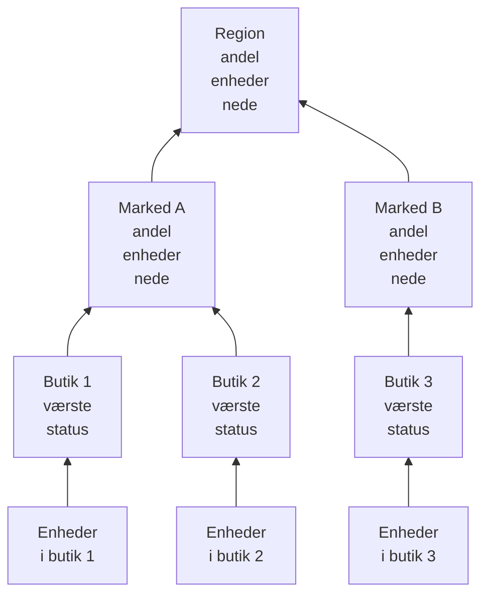

# Netværkslokationer (tilstandsoversigt og oppetid)

En netværkslokation er et sted: en region, et marked, en franchisetager, et distributionscenter, én butik. Lokationer ligger inden i hinanden, netværksenheder knyttes til dem, og OneUptime opsummerer enhedernes tilstand op gennem træet, så én status på en region besvarer "er der noget galt derude?".

Du finder dem under **Netværk → Lokationer** og på et kort under **Netværk → Map**. Denne side fastlægger, hvordan en lokations status udledes af det, der ligger under den, hvad dens oppetid betyder, og hvordan planlagt vedligeholdelse ændrer begge dele.

:::cards
- [Tilføj en lokation](#tilføj-en-lokation): Tre trin, eller en CSV-fil til et helt miljø.
- [Sæt overvågningsstandarder](#overvågningsstandarder): En sonde og loginoplysninger til hver enhed i en lokation.
- [Vælg, hvordan tilstand opsummeres](#sådan-beregnes-forælderens-tilstand): Den værste status til en butik, en andel til en region.
- [Læs oppetid](#oppetid): Hvad procenterne tæller, dag for dag.
:::

## Sådan virker det



Hver lokations status kommer fra hver enhed i dens undertræ, vurderet efter lokationens egen [opsummeringspolitik](#sådan-beregnes-forælderens-tilstand). En lokations oppetid kommer fra dens egen statustidslinje, og et [vedligeholdelsesvindue](#planlagt-vedligeholdelse-for-netværkslokationer) på en lokation tager dens enheder ud af afstemningen over den.

## Hierarkiet

Lokationer danner et træ. Hver lokation har en **Site Type** og eventuelt en overordnet lokation. Lokationstyper er projektets egen liste, under **Netværk → Indstillinger → Site Types**, og et nyt projekt starter med Account Type, Region, Franchisee, Market og Unit, i den rækkefølge oppefra, plus Data Center og Other. Typerne danner deres eget hierarki (**Parent Site Type**), som afgør, hvilke lokationer der kan være forælder til en lokation. En type, der er markeret som **Is Unit Level**, er det nederste niveau i dit miljø, den enkelte butik eller filial: dens lokationer rummer enheder, ikke andre lokationer.

En lokations type, navn, beskrivelse, forælder og placering redigeres ét sted: kortet **Site Settings** på lokationens side **Indstillinger**. Lokationens oversigt viser dem med et link **Rediger i Indstillinger**, og listen **Lokationer** tilføjer lokationer, men redigerer dem ikke.

Hver enhed knyttes til én lokation. En lokations undertræ er lokationen selv plus hver lokation under den, og undertræets enheder er det, dens tilstand opsummeres fra, så en region uden egne enheder stadig har en status, fordi enhederne under den har.

> [!NOTE]
> En opsummering beregnes igen, når en enheds status ændres, når en enhed flytter til en anden lokation, når en lokation flytter i træet, og ved en runde hvert femte minut, der fanger de tilfælde, hvor kun tidens gang ændrede svaret.

## Tilføj en lokation

:::steps
### Start en ny lokation
Gå til **Netværk → Lokationer**, og klik på **Tilføj Site**.

### Sig, hvad lokationen er
I trinnet **Site Details** vælger du **Site Type** (hvilken slags sted det er: en region, en butik, et datacenter) og skriver et **Navn**. Beskrivelsen, adressen og den bredde- og længdegrad, der placerer lokationen på kortet, er foldet sammen under **Flere felter**: udfyld dem nu eller senere.

### Placér den i træet
I trinnet **Hierarchy** vælger du **Parent Site**, hvis lokationen ligger under en anden. Lad det være tomt for at holde lokationen på øverste niveau.

### Sæt dens standarder
I trinnet **Monitoring Defaults** vælger du [standardsonden og standardloginprofilen](#overvågningsstandarder) til enheder, der tilføjes til lokationen, og klikker på **Tilføj Site**.
:::

På en lokations egen side **Child Sites** spørger **Tilføj Underordnet lokation** kun om typen og navnet, på én side med placeringen foldet sammen, og placerer den nye lokation under den.

### Importér lokationer fra en CSV-fil

For at hente et helt miljø ind på én gang åbner du menuen øverst på listen **Lokationer** og klikker på **Import from CSV**. Filen skal have en overskriftsrække; kolonnerne kan komme i vilkårlig rækkefølge, og deres navne skelner ikke mellem store og små bogstaver:

```csv title="sites.csv"
name,siteType,parentName,address,latitude,longitude
North,Region,,,,
Leeds,Market,North,,,
Store 0660,Unit,Leeds,"1 High Street, Leeds",53.7997,-1.5492
```

- `name` og `siteType` er påkrævede. `siteType` skal være en af projektets lokationstyper.
- `parentName` navngiver den overordnede lokation, som kan ligge i samme fil: rækker uden forælder, eller med en forælder, der allerede findes, går først, derefter deres børn. Lad det være tomt for en lokation på øverste niveau.
- En række, hvis forælder ikke kan findes, springes over, og resultaterne viser den. **Preview Import** viser, hvad filen vil oprette, før noget skrives.

## Kortet

**Netværk → Map** viser dine lokationer på et kort, beskåret til der, hvor de ligger; klik på en lokation for at gå ned i den. En lokation med lokationer under sig viser dem, på kortet og som en graf over forbindelserne mellem dem. En lokation uden lokationer under sig, men med egne enheder, eller en lokation, hvis type er på enhedsniveau, åbner disse enheders live topologi.

Et projekt uden lokationer endnu har stadig et kort: Map viser i stedet dets enheders topologi, og at gruppere enheder i lokationer sætter dem på kortet efter placering.

## Overvågningsstandarder

En lokation er også der, hvor du én gang siger, hvordan enhederne i den overvåges. **Rediger indstillinger** på kortet **Site Settings** har et trin **Monitoring Defaults** med to felter:

| Indstilling | Virkning |
| --- | --- |
| **Default Probe** | Den sonde, der pinger enheder i denne lokation og walker dem via SNMP, når de har loginoplysninger. En enhed, der oprettes i lokationen uden egen sonde, overtager den, og det gør en enhed, der flyttes ind uden en, også. |
| **Default SNMP Credential Profile** | Den [loginprofil](/docs/monitor/network-device-monitor#snmp-loginoplysninger-og-loginprofiler), som enheder i denne lokation walkes med, når hverken enheden eller dens egen profil har loginoplysninger. |

Sæt begge på en lokation, så kan en ny enhed dér tilføjes alene med sin adresse: den pinges fra sin første polling og walkes fra sin første polling.

De to opfører sig forskelligt, med vilje:

- Sonden kopieres til enheden, når enheden oprettes i eller flyttes ind i lokationen. At ændre en lokations standardsonde senere flytter ikke enheder, der allerede har en: hvilken sonde der kan nå en enhed, er et faktum om netværket, ikke en præference, der skal omskrives samlet fra en lokationsformular.
- Loginprofilen læses live, ved hver polling. Sæt en på en lokation, og hver enhed i den uden loginoplysninger begynder at blive walket ved sin næste polling, uden redigering pr. enhed; ryd den, og de bliver igen kun pinget.

De rækker også forskellige afstande ned gennem træet:

- Sonden rækker gennem hele træet. En enhed, der lander i en lokation uden standardsonde, overtager den nærmeste overordnede lokations, så én sonde sat på en region dækker hvert marked og hver enhed under den, og et marked, der navngiver sin egen, tilsidesætter den for sit undertræ.
- Loginprofilen læses kun fra enhedens egen lokation. En enhed i en Unit overtager ikke en profil, der er sat på dens Region, så sæt den på de lokationer, enhederne faktisk er knyttet til.

## Sådan beregnes forælderens tilstand

Hver lokation vælger én af to opsummeringspolitikker, på kortet **Health Rollup** på dens side **Indstillinger** (**Rollup Policy**).

### Værste status for nogen enhed (standard)

Den værste status, nogen enhed i undertræet rapporterer, bliver lokationens status. Hvor slem en status er, kommer fra dens prioritet som monitorstatus: et nyt projekts statusser er Operational (1), Degraded (2) og Offline (3), og højere er værre. Én offline enhed gør lokationen offline, uanset hvor mange sunde enheder der står ved siden af den.

Det er det rigtige svar for en Unit. Fire switches og en firewall i én bygning er ikke uafhængige: at én af dem er mørk, er et problem på den adresse, og at tage gennemsnittet skjuler et reelt nedbrud.

Det er som regel det forkerte svar for en region over fire hundrede butikker. Én mørk switch i butik 12.000 maler hele regionen Offline: sandt i den snævreste forstand og ubrugeligt i enhver praktisk forstand, fordi regionen så er rød, hver gang en butik et eller andet sted har et problem, og holder op med at fortælle dig noget.

### Procentdel af enheder nede

Lokationens status afgøres af den andel af undertræets rapporterende enheder, der ikke er i en driftsklar status:

| Andel enheder nede | Lokationens status |
| --- | --- |
| 0 % | Operational |
| Over 0 %, under tærsklen | Degraded: projektets status, der hverken er driftsklar eller offline, eller Offline, når projektet ingen har |
| Ved eller over tærsklen | Offline |

Tærsklen sættes pr. lokation som **Offline Threshold (%)** og er 50 som standard.

Intet nede er Operational, uanset hvor lavt tærsklen sættes: en tærskel på 0 betyder "enhver enhed nede gør dette offline", ikke "en sund region er offline".

### Hvilke enheder får en stemme

Begge politikker er enige her, og det betyder mere, end det lyder:

- Arkiverede enheder stemmer aldrig. De er taget ud af drift: de beholder deres lokation, men holdes udenfor.
- Enheder, der aldrig har rapporteret noget, stemmer aldrig. En enhed, der venter på sin første polling, er ikke bevis på et nedbrud, så den holdes uden for begge sider af andelen, og en region, der er halvvejs gennem onboarding, vurderes på den halvdel, der har svaret.
- En sonde-pollet enhed, den normale slags, stemmer med udfaldet af sin seneste polling: tilgængelig via ping eller SNMP, ikke hvor længe siden den sidst lykkedes. En enhed, der svarer på ping, mens dens SNMP-walk fejler, er tilgængelig og stemmer derefter; lokationen siger, at den er oppe, og enhedens række siger **SNMP failing**, så nogen retter loginoplysningerne.
- En enhed med bundet monitor, en der er skiftet til tilsidesættelsen med bundet monitor på sin side Indstillinger, stemmer med status på den monitor, der er bundet til den, fordi intet poller den. Uden noget bundet har den aldrig rapporteret, så den stemmer slet ikke.

En netværksenheds-monitor på en sonde-pollet enhed ændrer ikke, hvordan enheden stemmer. En monitor med et kriterie "interface nede, altså Offline" ville stemple Offline på en switch, der svarer på hvert ping, og én mørk port ville gøre en hel lokation rød, mens hver enhedsrække under den viser Up: lokationen ville være uenig med den liste, den opsummerer. For en pollet enhed er pollingen kilden til dens tilstand; monitoren er der for at oprette hændelser.

### Vælg en politik

En fornuftig start for et franchisemiljø:

| Niveau | Politik | Hvorfor |
| --- | --- | --- |
| Unit eller butik | Værste status | Én enhed nede er én lokation i problemer. |
| Marked | Procentdel, tærskel omkring 50 % | Et marked med halvdelen af sine butikker nede er nede. |
| Region | Procentdel, tærskel 25 % til 50 % | En fejl i en enkelt butik gør regionen Degraded, ikke Offline, og den bliver Offline, når der sker noget systemisk. |

Politikken sættes pr. lokation, så du kan give regionsrækkerne procentpolitikken og lade alt under dem stå på standarden.

## Oppetid

Hver lokation har en statustidslinje: én række pr. ændring af dens opsummerede status, åbnet når statussen ændres og lukket når den ændres igen. Oppetid beregnes ud fra den:

- Tid i en status, der ikke er markeret som driftsklar, er nedetid.
- Overlappende rækker flettes, så intet sekund tæller to gange.
- Tid, der ikke dækkes af nogen række, tæller som oppe. Tidslinjen får først rækker, når en opsummering har kørt, og manglende beviser er ikke et nedbrud.
- En række, der stadig er åben, løber til slutningen af det målte vindue.

Degraded er ikke driftsklar, så det tæller også som nede. Under begge politikker er en lokations oppetid altså den andel af tiden, hvor ingen rapporterende enhed under den var nede: politikken ændrer den status, et delvist nedbrud viser, Degraded eller Offline, ikke om det tæller.

En lokation helt uden tidslinjerækker viser `—` i stedet for 100 %: en lokation, intet nogensinde er blevet opsummeret for, er ikke overvåget, ikke perfekt.

### Daglig oppetid

Ved siden af tallet for 30 dage viser hver lokations oversigt **Uptime (24h)**, og dens side **Statustidslinje** viser de seneste 24 timer, 7, 30 og 90 dage og en søjle pr. dag for de seneste 30.

Et gennemsnit over 30 dage kan ikke vise en dårlig dag. En hel dags nedbrud i et vindue på 30 dage koster 3,3 point, så en lokation, der var mørk en hel tirsdag, stadig rapporterer 96,7 % for måneden, et tal, der ligner en afrunding. De daglige søjler placerer de samme data, så én dårlig dag er én dårlig søjle.

Dage er glidende udsnit på 24 timer, der slutter nu, ikke kalenderdage: enhederne, den, der kigger, og serveren kan hver især være i en anden tidszone, og der er ingen "dag", de ville være enige om.

### Forælderens oppetid er ikke et gennemsnit af børnenes oppetid

En forælders oppetid kommer fra forælderens egen tidslinje, som dens opsummeringspolitik har produceret, ikke fra gennemsnittet af dens børns procenter.

Et gennemsnit over børn vægter en butik med to enheder lige så højt som et distributionscenter med to hundrede. En forælders egen tidslinje giver i stedet en aflæsning, du kan sige i én sætning: den andel af tiden, hvor slet intet i regionen var nede. Den er streng med vilje, så på en stor region skal du læse den sammen med de daglige søjler og med statussen, som siger, om et delvist nedbrud var Degraded eller Offline.

## Planlagt vedligeholdelse for netværkslokationer

Knyt lokationer til en planlagt vedligeholdelse under **Andre berørte ressourcer**, i hændelsens trin **Berørte ressourcer**, som du ville gøre med en vært. En lokations egen side **Planlagt vedligeholdelse** viser de hændelser, der er knyttet til den, og dens **Opret planlagt vedligeholdelseshændelse** åbner formularen med lokationen allerede valgt.

Et vindue på en forælder dækker alt under den: et vindue på en region dækker hvert marked og hver enhed i den, inklusive lokationer oprettet efter, at vinduet blev planlagt, så et regionalt skift af operatør ikke behøver at opremse fire hundrede butikker.

Dækningen rækker kun nedad. Et vindue på én Unit sætter ikke dens region i vedligeholdelse: regionen forventes stadig at være oppe, og en reel fejl i en anden enhed i de samme timer tæller stadig imod den.

### Hvad et vedligeholdelsesvindue ændrer

| I vinduet | Hvad der sker |
| --- | --- |
| Lokationens live status | Uændret. En enhed, der er slukket for planlagt arbejde, viser stadig Offline på kortet og i træet, med et mærke "I vedligeholdelse" ved siden af: den, der kigger på den, skal vide, at den er slukket. |
| Lokationens oppetid | Vinduet tages ud af både nedetiden og den målte periode. To timers vedligeholdelse gør dagen 22 timer lang, og intet inden for de to timer tæller nogen vej. |
| Tilstandsopsummeringen for dens overordnede lokationer | Det vedligeholdte undertræs enheder holder op med at stemme, så regionen ikke bliver rød på grund af et skift, der stod i kalenderen. |
| Oppetiden for dens overordnede lokationer | Upåvirket, uden noget at rette, fordi det planlagte nedbrud aldrig nåede deres tidslinjer. |

Den sidste række er grunden til, at overordnede lokationer håndteres ved at holde stemmer tilbage i stedet for at tage vinduet ud af deres oppetid: at tage det ud af regionens periode ville også slette en reel fejl andre steder i regionen i de samme timer.

Oppetiden rettes med hændelsens erklærede start- og sluttidspunkt, ikke med det tidspunkt, hvor en proces flyttede den mellem tilstande, så tallet kan kontrolleres i hånden mod kalenderen. En dag, der falder helt inden for et vindue, tegnes som vedligeholdelse i de daglige søjler i stedet for som en perfekt dag og bidrager ikke til gennemsnittet.

### Samspil med monitorer

At knytte en monitor til den samme hændelse gør stadig det, det altid har gjort: aktiv overvågning af den monitor sættes på pause i vinduet. De to er uafhængige: knyt lokationen for at holde den uden for opsummeringen og dens oppetid, og knyt monitorerne for at få dem til at holde op med at advare.

## Advarsler på en lokation

Kortet **Alerting** på en lokations side **Indstillinger** har **Alert When Unhealthy**: en advarsel åbnes, når lokationens opsummering skifter til en status, der ikke er driftsklar, og løses af sig selv, når lokationen kommer sig. **Advarselsalvor** sætter dens alvor; tom er det projektets mest alvorlige.

Den advarer kun om ændringen: at slå den til for en lokation, der allerede er usund, gør klar til den næste ændring i stedet for at advare om fortiden. Degraded er ikke driftsklar, så en lokation på procentpolitikken advarer, så snart en af dens rapporterende enheder er nede, ligesom en lokation på politikken for værste status; advarslen forbliver åben, uden en ekstra, mens lokationen skifter mellem Degraded og Offline, og dens titel nævner den status, lokationen nåede først.

## Fejlfinding

:::details En region er altid rød
Lokationen er på politikken for værste status, så én offline enhed et sted under den gør den offline. Skift regionen til **Percentage of devices down** på dens kort **Health Rollup**, med en tærskel, der svarer til, hvor meget af regionen der skal være nede, før du kalder den nede.
:::

:::details En lokation viser — i stedet for en oppetid
Der har aldrig kørt en opsummering for lokationen, så den har ingen tidslinjerækker: den er ikke overvåget, ikke perfekt. Tilføj enheder til lokationen, eller til lokationerne under den, og den næste opsummering starter dens tidslinje.
:::

:::details En enhed tæller ikke med i sin lokation
Arkiverede enheder, og enheder, der endnu ikke har rapporteret, stemmer aldrig. En enhed med bundet monitor uden nogen monitor bundet har heller aldrig rapporteret. Tjek enhedens status: en enhed, der står som **Afventer**, begynder at stemme efter sin første polling.
:::

:::details En lokations advarsel blev ikke udløst
**Alert When Unhealthy** udløses ved et skift fra en driftsklar status til en hvilken som helst anden, så en lokation, der allerede var usund, da du slog den til, advarer ved sin næste ændring, efter den er kommet sig. Tjek også, at dens enheder stemmer: arkiverede enheder og enheder, der venter på deres første polling, gør det aldrig, og enhederne i en lokation i vedligeholdelse stemmer ikke i opsummeringerne over den.
:::

## Næste trin

:::cards
- [Netværksenheds-monitor](/docs/monitor/network-device-monitor): Tilføj, poll og advar om de enheder, der knyttes til disse lokationer.
- [Netværkstrafik](/docs/monitor/network-traffic): Se en lokations trafik ud fra dens enheders flowposter.
- [Inventar](/docs/inventory/overview): Netværksenheder ved siden af alle dine andre aktiver.
:::
