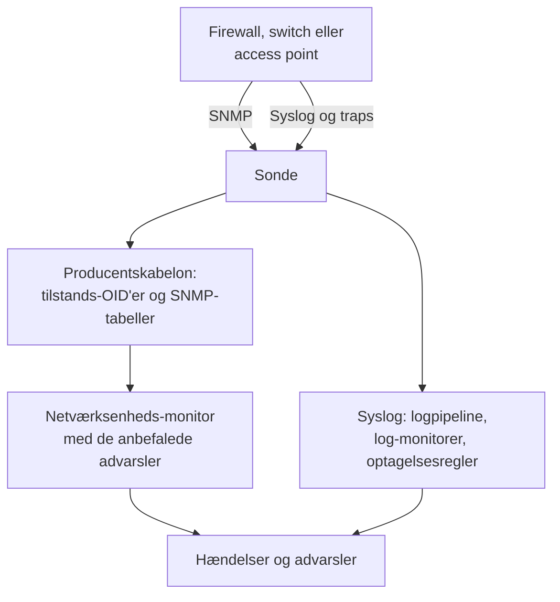

# Vejledninger pr. netværksleverandør (Sophos, Extreme, Cambium)

Sådan overvåger du tre almindelige miljøer fra start til slut med OneUptime: en Sophos Firewall (XGS, SFOS) med dens IPsec-tunneler, WAN-forbindelser og SD-WAN; Extreme Networks-switches (EXOS / Switch Engine og Fabric Engine / VOSS) med deres fabric; og Cambium Networks cnMatrix-switches og Enterprise Wi-Fi-access points, helt ned til hver radios kanal og sendestyrke.

:::cards
- [Sophos Firewall](#sophos-firewall-xgs-sfos): Tunneler, WAN-forbindelser, gateways og SD-WAN.
- [Extreme Networks](#extreme-networks-exos-switch-engine-og-fabric-engine-voss): Switches, fabricen og dens hardware.
- [Cambium Networks](#cambium-networks-enterprise-wi-fi-og-cnmatrix): Access points ned til hver radio, og cnMatrix-switches.
:::

## Sådan virker det

Hver vejledning bruger de samme dele:

- En [netværksenhed](/docs/monitor/network-device-monitor) pr. boks, pollet af en sonde, der kan nå den, med en producentskabelon, der medbringer de rigtige tilstands-OID'er og [SNMP-tabeller](/docs/monitor/network-device-monitor#snmp-tabeller).
- En netværksenheds-monitor pr. enhed til advarsler. Opret den fra enhedens side, så de [anbefalede advarsler](/docs/monitor/network-device-monitor#anbefalet-advarselspakke), inklusive én advarsel pr. række for hver tabel, der ved, hvordan sund ser ud, udfyldes for dig. Til en flåde holder en [advarselspolitik](/docs/monitor/network-device-monitor#advarselspolitikker) en på hver enhed.
- Til det, en producent kun rapporterer i sine logs: syslog til sonden, en [logpipeline](/docs/telemetry/log-pipelines) til at gøre hver linje til attributter, [log-monitorer med Group By](/docs/monitor/logs-monitor#advarsler-pr-gruppe-group-by) til at advare én gang pr. tunnel eller gateway, og [optagelsesregler for logs](/docs/telemetry/log-recording-rules) til at vise tallene i de logs i grafer.

## Sophos Firewall (XGS / SFOS)

| Hvad du vil se | Hvor det kommer fra |
| --- | --- |
| Firewallens tilstand: hukommelse, disk, swap, HA-tilstand, IPsec-tjeneste, CPU pr. kerne | SNMP, med producentskabelonen **Sophos Firewall (SFOS / XGS)** |
| Hver IPsec-tunnels status, efter navn | SNMP-tabellen `ipsec_tunnels` (SFOS v20 og nyere) |
| Hver WAN-forbindelses status, gennemløb, udnyttelse og fejl | Interface-walket af WAN-portene |
| Hver WAN-forbindelses latens, pakketab og jitter | Ping-monitorer og enhedspollinger fra OneUptime-sonder |
| Gateway oppe og nede, SD-WAN-SLA opfyldt eller ej, ændringer i SD-WAN-ruter | Firewallens syslog |
| SD-WAN-latens, -jitter og -pakketab pr. gateway, som grafer | Optagelsesregler for logs over SD-WAN-SLA-logs |

Sophos rapporterer ikke gateways' eller SD-WAN's tilstand via SNMP, i nogen SFOS-version: den findes kun i firewallens logs og i Sophos Centrals advarsler, og derfor går de sidste tre rækker gennem syslog.

### Registrér firewallen

:::steps
1. Slå SNMP til på firewallen under **Administration → SNMP**: tilføj en SNMPv3-bruger, eller et v2c-community, og tillad sondens adresse at forespørge den.
2. Gå i OneUptime til **Netværk → Devices**, og klik på **Add Device**. Skriv firewallens administrationsadresse, vælg en sonde, der kan nå den, og tilføj SNMP-loginoplysningerne under **SNMP**.
3. På enhedens side **Indstillinger**, under **Polling & Data Collection**, anvender du skabelonen **Sophos Firewall (SFOS / XGS)** fra **Vendor Health Template** og tilføjer dens tabeller fra **Add a Vendor's Tables**. Eller slå **Auto-Apply Vendor Health Template** til, så gør den første polling begge dele.
:::

Efter næste polling viser enhedens side **SNMP Tables** hver IPsec-forbindelse med dens status (active, inactive, partially active) og CPU-kernerne. SFOS nummererer sine kerner fra 196608, og derfor kommer CPU'en fra en tabel i stedet for fra én enkelt `hrProcessorLoad.1`.

### Advar om hver IPsec-tunnel

Klik på **Opret monitor** på enhedens side. De anbefalede advarsler omfatter **IPsec Tunnels: row unhealthy**, et kriterie **SNMP Table Row Is Unhealthy** på tabellen `ipsec_tunnels` med Row `*`: det opretter én hændelse pr. tunnel, der ikke er aktiv, opkaldt efter tunnelen, og løser hver af dem, når dens tunnel kommer tilbage.

En tunnel, som Sophos rapporterer som aktiv, har kun sine security associations oppe. For at bevise, at trafik krydser den, tilføjer du en [Ping-monitor](/docs/monitor/ping-monitor) fra en sonde på én lokation til en vært på den anden side af hver tunnel og tegner tunnelen som en lokationsforbindelse under **Netværk → Topologi → Site Links** mellem de to [lokationer](/docs/monitor/network-sites), bundet til den monitor: forbindelsen på kortet får så monitorens farve.

### WAN-forbindelser

- **Porttilstand.** Interface-walket måler allerede hver WAN-ports status, bits ind og ud, udnyttelse og fejl. På firewallens monitor advarer et kriterie **SNMP Interface Is Down** eller **SNMP Interface Utilization (in %)** med **Interface** sat til WAN-portens navn, eller `*` for hver port, pr. forbindelse.
- **Stiens kvalitet.** Hver forbindelses latens, pakketab og jitter måles uden for firewallen: en Ping-monitor fra OneUptimes cloud-sonder til hver WAN-forbindelses offentlige adresse, og en Ping-monitor fra en sonde på lokationen til hver udbyders gateway. Kriterier for pakketab og jitter på de monitorer advarer pr. forbindelse, og **Netværk → Topologi → Latency Matrix** viser hver sonde mod hver monitor med ét blik.
- **Trafik.** SFOS eksporterer NetFlow v5. Send det til sonden på UDP 2055, hvor sondens flow-collector lytter som standard, så viser enhedens side **Traffic**, hvem der taler med hvem over hver WAN-forbindelse; [Netværkstrafik](/docs/monitor/network-traffic) har detaljerne.

### Gateways og SD-WAN fra syslog

:::steps
1. Slå sondens syslog-modtager til: sæt `PROBE_SYSLOG_RECEIVER_ENABLED=true` på sonden. Den lytter på UDP 5140 som standard (`PROBE_SYSLOG_RECEIVER_PORT` ændrer det); publicér porten, hvis sonden kører i Docker. Beskeder matches til den netværksenhed, hvis værtsnavn, eller en af hvis **Andre adresser**, er afsenderens adresse, og vises på enhedens side **Protokoller**.
2. Tilføj på firewallen, under **System services → Log settings**, en syslog-server, der peger på sonden og den port, og sæt kryds ved logtyperne **Event** for IPsec og gateways og logtypen **SD-WAN**: SLA-logs forbliver slået fra, indtil der er sat kryds ved den.
3. Opret under **Protokoller → Indstillinger → Pipelines** en pipeline, hvis filter matcher firewallens logs, såsom `attributes.networkDevice.name = 'hq-firewall'`, og tilføj en **Key=Value Parser** med **Target Prefix** `sophos`. Indsæt en linje fra firewallen i dens tester for at se de præcise attributnavne, din SFOS-version producerer; [Sophos-eksemplet](/docs/telemetry/log-pipelines#eksempel-sophos-xgs-firewall) gennemgår det.
4. Opret [log-monitorer](/docs/monitor/logs-monitor) på firewallens logs, hver med **Group by Attributes**, så hver tunnel eller gateway advarer for sig, og kriteriet **Log Count** **Greater Than** `0` over et par minutter. Rækkerne nedenfor er de tre at starte med.
5. Vis SD-WAN-kvaliteten i grafer: med SD-WAN-logning slået til skriver firewallen en SLA-opsummering pr. profil og gateway (`latency`, `jitter`, `packet_loss`). Opret under **Protokoller → Indstillinger → Optagelsesregler** én regel pr. tal, såsom gennemsnittet af `sophos.latency` grupperet efter `sophos.gw_name` og `sophos.profile_name`, og vis så resultaterne i grafer, eller advar om dem med en [metrik-monitor](/docs/monitor/metrics-monitor), der grupperer efter gateway. [Optagelsesregler for logs](/docs/telemetry/log-recording-rules) gennemgår dette eksempel.
:::

| Advarsel | Logs, der skal tælles | Gruppér efter |
| --- | --- | --- |
| IPsec-tunnel afsluttet | Attribut `sophos.log_component` = `IPSec`, brødtekst indeholder `terminated` | `sophos.con_name` |
| Gateway nede | Attribut `sophos.log_component` = `Gateway`, brødtekst indeholder `is Down` | `sophos.gatewayname` |
| SD-WAN-SLA ikke opfyldt | Attribut `sophos.log_type` = `SD-WAN`, brødtekst indeholder `SLA not met` | `sophos.gw_name` |

Syslog-begivenhederne supplerer SNMP-tabellen: de ankommer i det øjeblik, en tunnel falder, mens tabellen også fanger en tunnel, der aldrig kom op.

### Traps

Hver Sophos-meddelelse er den samme trap, `sfosNotification` (`1.3.6.1.4.1.2604.5.1.8.1.1`), med begivenheden som tekst i `sfosTrapMessage` (`1.3.6.1.4.1.2604.5.1.8.1.2`). For at advare om én slags begivenhed kombinerer du **SNMP Trap Received (Trap OID)** Equal To `1.3.6.1.4.1.2604.5.1.8.1.1` med **SNMP Trap Varbind Value** på den varbind, Contains `IPSec` for eksempel. Sæt firewallens trapdestination til SNMP v2c: sondens trapmodtager tager imod v1- og v2c-traps.

## Extreme Networks (EXOS / Switch Engine og Fabric Engine / VOSS)

| Hvad du vil se | Hvor det kommer fra |
| --- | --- |
| EXOS: CPU, temperatur og dens alarm, strømtilstand, strømforsyninger, blæsere, hukommelse pr. slot, stakmedlemmer | Skabelonen **Extreme Networks EXOS / Switch Engine** |
| Fabric Engine: CPU og hukommelse pr. slot, temperatursensorer, blæsere, strømforsyninger, vIST-session, antal I-SID'er | Skabelonen **Extreme Networks Fabric Engine / VOSS** |
| Hver Fabric Connect-adjacency (IS-IS), navngivet efter naboen | Fabric Engine-skabelonens tabel `isis_adjacencies` |
| Porte, LLDP-naboer, netværkskortet | Interface-walket, på begge |

### Hvilken skabelon

Fabric Engine på Extremes universelle hardware (5000- og 7000-serierne) rapporterer det samme enterprisenummer som EXOS: kun dens systembeskrivelse (`7520-48Y-8C-FabricEngine (9.0.4.0)`) siger, hvilket operativsystem der kører. OneUptime læser begge, så automatisk anvendelse og enhedssidens forslag vælger den rigtige skabelon, og ældre VSP-switches rapporterer Avaya/Nortel-grenen og genkendes direkte som Fabric Engine.

### Advarsler for fabric og hardware

De anbefalede advarsler på en Fabric Engine-switch omfatter **Fabric Adjacencies (IS-IS): row unhealthy**, en hændelse pr. nabo, hvis adjacency ikke er oppe. Fabric Engine sender også en trap, når en adjacency ændres, `rcnIsisPlsbAdjStateTrap` (`1.3.6.1.4.1.2272.1.21.0.281`), og et kriterie **SNMP Trap Received (Trap OID)** på den advarer inden for sekunder, før næste polling.

Strømforsyninger, blæsere, temperatursensorer og stakmedlemmer er tabeller, der erklærer deres sunde værdier, så hver får en advarsel pr. række i de anbefalede advarsler.

### Flows og Wi-Fi

EXOS og Fabric Engine eksporterer flows som sFlow og IPFIX. Send sFlow til sonden på UDP 6343, eller IPFIX på UDP 4739, så viser enhedens side **Traffic** dens trafik; se [Netværkstrafik](/docs/monitor/network-traffic).

IQ Engine-access points (HiveOS) og ExtremeCloud IQ Controller har deres egne producentskabeloner, som udfylder enhedens side **Wi-Fi**. [Understøttede Wi-Fi-producenter](/docs/monitor/network-device-monitor#understøttede-wi-fi-producenter) dækker dem, sammen med Ubiquiti UniFi, HPE Aruba, TP-Link Omada og Juniper Mist.

## Cambium Networks (Enterprise Wi-Fi og cnMatrix)

### Access points

:::steps
1. Slå SNMP til på access points. I cnMaestro sættes SNMP pr. AP-gruppe: **Configuration → Wi-Fi Profiles → AP Groups → Management → SNMP**. Slå det til med et v2c-læsecommunity eller en SNMPv3-bruger.
2. Tilføj hvert access point med dets administrationsadresse og de loginoplysninger, og anvend skabelonen **Cambium Networks Enterprise Wi-Fi (cnPilot, XV, XE, XH)**, eller slå automatisk anvendelse til.
3. Åbn enhedens side **Wi-Fi**. Den viser, hvor mange radioer der er tændt, klienterne og SSID'erne, derefter hver radios bånd, kanal, frekvens, kanalbredde, sendestyrke, klienter, støjgulv og airtime og hver SSID med dens klienter. Frekvensen udledes af båndet og kanalen; access pointet rapporterer den ikke.
:::

Nyttige advarsler, alle på tabellen `wifi_radios` med Row `*`, så hver radio advarer for sig:

| Advarsel | Kriterie |
| --- | --- |
| En radio slukket | **SNMP Table Row Is Unhealthy**, en del af de anbefalede advarsler |
| Sendestyrken ændret | **SNMP Table Value**, kolonnen TX Power, Not Equal To din planlagte styrke |
| En overfyldt radio | **SNMP Table Value**, kolonnen Clients, Greater Than din grænse |
| En støjende kanal | **SNMP Table Value**, kolonnen Noise Floor, Greater Than `-80` |

Hver numerisk radioværdi er også en metrik (`oneuptime.monitor.snmp.table.value`, én serie pr. radio og kolonne), så kanal, styrke og klienter kan vises i grafer over tid på et dashboard; en kanal, der bliver ved med at skifte, er DFS på arbejde.

Cambium rapporterer først det samlede antal klienter fra firmware 6.5.3; ældre firmware returnerer 0.

### cnMatrix-switches

Skabelonen **Cambium Networks cnMatrix** indsamler CPU, RAM, flash, temperatur og forsyningsspænding og, som tabeller, blæsere, den redundante strømforsyning og hver ports PoE-forbrug. Porte og LLDP-naboer kommer fra interface-walket, som på enhver switch.

### cnMaestro-alarmer

cnMaestro kan sende sine alarmer, såsom et access point, der går offline, til en HTTPS-webhook. Peg den mod en [monitor for indgående forespørgsler](/docs/monitor/incoming-request-monitor) for at gøre de alarmer til OneUptime-hændelser ved siden af SNMP-dataene.

## Fejlfinding

:::details Tabellen IPsec Tunnels har ingen status
Tunnelstatus kræver SFOS v20 eller nyere. Tjek også, at SNMP-visningen for dine loginoplysninger omfatter Sophos' enterprise-træ (`1.3.6.1.4.1.2604`): en begrænset v3-bruger ser ofte kun systemgruppen og IF-MIB.
:::

:::details Der kommer ingen syslog fra firewallen
Sondens syslog-modtager er slået fra som standard: sæt `PROBE_SYSLOG_RECEIVER_ENABLED=true`, og publicér UDP 5140, eller din `PROBE_SYSLOG_RECEIVER_PORT`, til sonden. Beskeder matches til en enhed efter afsenderens adresse, så firewallens værtsnavn i OneUptime, eller en af dens **Andre adresser**, skal være den adresse, den sender syslog fra.
:::

:::details En Fabric Engine-switch fik EXOS-skabelonen
Skabelonen vælges ud fra switchens systembeskrivelse. Tjek, at enhedens oversigt viser en beskrivelse, der nævner Fabric Engine (såsom `7520-48Y-8C-FabricEngine (9.0.4.0)`); hvis den gør, så fjern EXOS' OID'er og tabeller, og anvend **Extreme Networks Fabric Engine / VOSS** fra **Vendor Health Template**.
:::

:::details Cambium-access points rapporterer 0 klienter
Det samlede antal klienter kræver firmware 6.5.3 eller nyere. På ældre firmware rapporterer radioerne stadig deres kanal, styrke og støjgulv.
:::

## Næste trin

:::cards
- [Netværksenheds-monitor](/docs/monitor/network-device-monitor): Alt, hvad en enhed indsamler, og hvert kriterie, den kan advare om.
- [Logpipelines](/docs/telemetry/log-pipelines): Opdel firewall-logs i attributter.
- [Log-monitor](/docs/monitor/logs-monitor): Advar én gang pr. tunnel eller gateway.
:::
