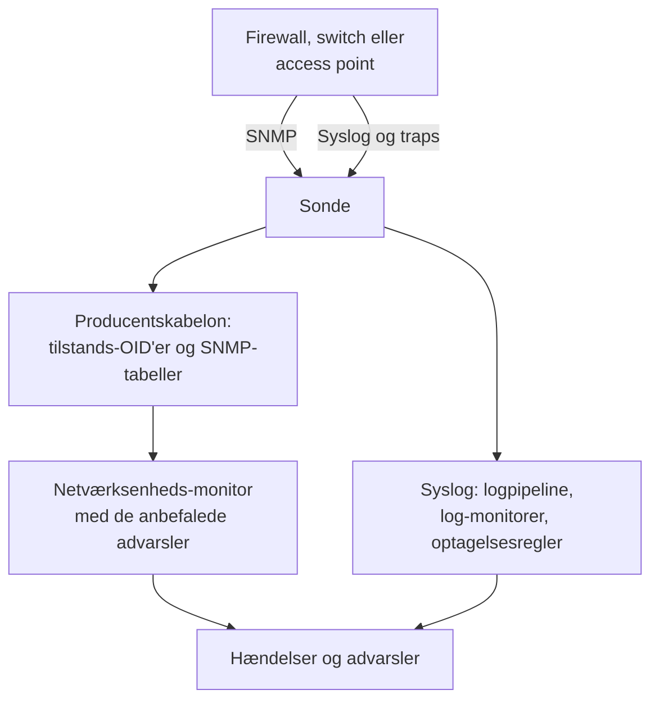

# Vejledninger pr. netværksleverandør (Sophos, Extreme, Cambium)

Sådan overvåger du tre almindelige miljøer fra start til slut med OneUptime: en Sophos Firewall (XGS, SFOS) med dens IPsec-tunneler, WAN-forbindelser og SD-WAN; Extreme Networks-switches (EXOS / Switch Engine og Fabric Engine / VOSS) med deres fabric; og Cambium Networks cnMatrix-switches og Enterprise Wi-Fi-access points, helt ned til hver radios kanal og sendestyrke. De dækker også SAN-switche, Brocade Fabric OS og Cisco MDS 9000, helt ned til fejlene på hver Fibre Channel-port.

:::cards
- [Sophos Firewall](#sophos-firewall-xgs-sfos): Tunneler, WAN-forbindelser, gateways og SD-WAN.
- [Extreme Networks](#extreme-networks-exos-switch-engine-og-fabric-engine-voss): Switches, fabricen og dens hardware.
- [Cambium Networks](#cambium-networks-enterprise-wi-fi-og-cnmatrix): Access points ned til hver radio, og cnMatrix-switches.
- [Brocade Fabric OS](#brocade-fabric-os): Fibre Channel-porte, optikker, sensorer og fabric-hændelser.
- [Cisco MDS 9000](#cisco-mds-9000): Fibre Channel-grænseflader, VSAN'er, slow drain og port-monitor-alarmer.
:::

## Sådan virker det

Hver vejledning bruger de samme dele:



- En [netværksenhed](/docs/monitor/network-device-monitor) pr. boks, pollet af en sonde, der kan nå den, med en producentskabelon, der medbringer de rigtige tilstands-OID'er og [SNMP-tabeller](/docs/monitor/network-device-monitor#snmp-tabeller).
- En netværksenheds-monitor pr. enhed til advarsler. Opret den fra enhedens side, så de [anbefalede advarsler](/docs/monitor/network-device-monitor#anbefalet-advarselspakke), inklusive én advarsel pr. række for hver tabel, der ved, hvordan sund ser ud, udfyldes for dig. Til en flåde holder en [advarselspolitik](/docs/monitor/network-device-monitor#advarselspolitikker) en på hver enhed.
- Til det, en producent kun rapporterer i sine logs: syslog til sonden, som OneUptime selv læser som [netværksbegivenheder](/docs/monitor/network-events), [log-monitorer med Group By](/docs/monitor/logs-monitor#advarsler-pr-gruppe-group-by) til at advare én gang pr. tunnel eller gateway, og [optagelsesregler for logs](/docs/telemetry/log-recording-rules) til at vise tallene i de logs i grafer.

## Sophos Firewall (XGS / SFOS)

| Hvad du vil se | Hvor det kommer fra |
| --- | --- |
| Firewallens tilstand: hukommelse, disk, swap, HA-tilstand, IPsec-tjeneste, CPU pr. kerne | SNMP, med producentskabelonen **Sophos Firewall (SFOS / XGS)** |
| Hver IPsec-tunnels status, efter navn | SNMP-tabellen `ipsec_tunnels` (SFOS v20 og nyere) |
| Hver WAN-forbindelses status, gennemløb, udnyttelse og fejl | Interface-walket af WAN-portene |
| Hver WAN-forbindelses latens, pakketab og jitter | Ping-monitorer og enhedspollinger fra OneUptime-sonder |
| Gateway oppe og nede, SD-WAN-SLA opfyldt eller ej, ændringer i SD-WAN-ruter | Firewallens syslog |
| SD-WAN-latens, -jitter og -pakketab pr. gateway, som grafer | Optagelsesregler for logs over SD-WAN-SLA-logs |

Sophos rapporterer ikke gateways' eller SD-WAN's tilstand via SNMP, i nogen SFOS-version: den findes kun i firewallens logs og i Sophos Centrals advarsler, og derfor går de sidste tre rækker gennem syslog.

### Registrér firewallen

:::steps
1. Slå SNMP til på firewallen under **Administration → SNMP**: tilføj en SNMPv3-bruger, eller et v2c-community, og tillad sondens adresse at forespørge den.
2. Gå i OneUptime til **Netværk → Enheder**, og klik på **Tilføj enhed**. Skriv firewallens administrationsadresse, vælg en sonde, der kan nå den, og tilføj SNMP-loginoplysningerne under **SNMP**.
3. På enhedens side **Indstillinger**, under **Polling & Data Collection**, anvender du skabelonen **Sophos Firewall (SFOS / XGS)** fra **Vendor Health Template** og tilføjer dens tabeller fra **Add a Vendor's Tables**. Eller slå **Auto-Apply Vendor Health Template** til, så gør den første polling begge dele.
:::

Efter næste polling viser enhedens side **SNMP-tabeller** hver IPsec-forbindelse med dens status (active, inactive, partially active) og CPU-kernerne. SFOS nummererer sine kerner fra 196608, og derfor kommer CPU'en fra en tabel i stedet for fra én enkelt `hrProcessorLoad.1`.

### Advar om hver IPsec-tunnel

Klik på **Opret monitor** på enhedens side. De anbefalede advarsler omfatter **IPsec Tunnels: row unhealthy**, et kriterie **SNMP-tabelrække er usund** på tabellen `ipsec_tunnels` med Row `*`: det opretter én hændelse pr. tunnel, der ikke er aktiv, opkaldt efter tunnelen, og løser hver af dem, når dens tunnel kommer tilbage.

En tunnel, som Sophos rapporterer som aktiv, har kun sine security associations oppe. For at bevise, at trafik krydser den, tilføjer du en [Ping-monitor](/docs/monitor/ping-monitor) fra en sonde på én lokation til en vært på den anden side af hver tunnel og tegner tunnelen som en lokationsforbindelse under **Netværk → Topologi → Lokationslinks** mellem de to [lokationer](/docs/monitor/network-sites), bundet til den monitor: forbindelsen på kortet får så monitorens farve.

### WAN-forbindelser

- **Porttilstand.** Interface-walket måler allerede hver WAN-ports status, bits ind og ud, udnyttelse og fejl. På firewallens monitor advarer et kriterie **SNMP-interface er nede** eller **SNMP-interfaceudnyttelse (i %)** med **Interface** sat til WAN-portens navn, eller `*` for hver port, pr. forbindelse.
- **Stiens kvalitet.** Hver forbindelses latens, pakketab og jitter måles uden for firewallen: en Ping-monitor fra OneUptimes cloud-sonder til hver WAN-forbindelses offentlige adresse, og en Ping-monitor fra en sonde på lokationen til hver udbyders gateway. Kriterier for pakketab og jitter på de monitorer advarer pr. forbindelse, og **Netværk → Topologi → Latensmatrix** viser hver sonde mod hver monitor med ét blik.
- **Trafik.** SFOS eksporterer NetFlow v5. Send det til sonden på UDP 2055, hvor sondens flow-collector lytter som standard, så viser enhedens side **Trafik**, hvem der taler med hvem over hver WAN-forbindelse; [Netværkstrafik](/docs/monitor/network-traffic) har detaljerne.

### Gateways og SD-WAN fra syslog

:::steps
1. Sondens syslog-modtager er slået til som standard. Den lytter på port 5140, over UDP og TCP (`PROBE_SYSLOG_RECEIVER_PORT` ændrer det); publicér porten, hvis sonden kører i Docker. Beskeder matches til den netværksenhed, hvis værtsnavn, eller en af hvis **Andre adresser**, er afsenderens adresse, og vises på enhedens sider **Begivenheder** og **Protokoller**.
2. Tilføj på firewallen, under **System services → Log settings**, en syslog-server, der peger på sonden og den port, og sæt kryds ved logtyperne **Event** for IPsec og gateways og logtypen **SD-WAN**: SLA-logs forbliver slået fra, indtil der er sat kryds ved den.
3. Der er intet at fortolke. OneUptime læser firewallens `key=value`-felter som `sophos.*`-attributter og læser tunneler, gateways, SD-WAN-SLA-ændringer, failovers og login ud af dem som [netværksbegivenheder](/docs/monitor/network-events). Åbn en log på enhedens side **Protokoller** for at se de præcise attributnavne, din SFOS-version producerer.
4. Klik på **Opret advarsel** på enhedens side **Begivenheder**, og vælg en advarsel. Den åbner en udfyldt [log-monitor](/docs/monitor/logs-monitor) med **Gruppér efter attributter**, så hver tunnel eller gateway advarer for sig, og **Løst af attributter**, så hver advarsel lukker, når firewallen melder den tilbage. Rækkerne nedenfor er de tre at starte med.
5. Vis SD-WAN-kvaliteten i grafer: med SD-WAN-logning slået til skriver firewallen en SLA-opsummering pr. profil og gateway (`latency`, `jitter`, `packet_loss`). Opret under **Protokoller → Indstillinger → Optagelsesregler** én regel pr. tal, såsom gennemsnittet af `sophos.latency` grupperet efter `sophos.gw_name` og `sophos.profile_name`, og vis så resultaterne i grafer, eller advar om dem med en [metrik-monitor](/docs/monitor/metrics-monitor), der grupperer efter gateway. [Optagelsesregler for logs](/docs/telemetry/log-recording-rules) gennemgår dette eksempel.
:::

| Advarsel | Begivenhed, der tælles | Én advarsel pr. | Lukkes af |
| --- | --- | --- | --- |
| En VPN-tunnel går ned | `vpn.tunnel_down` | `vpn.tunnel.name` | `vpn.tunnel_up` |
| Et WAN-link går ned | `gateway.down` | `network.gateway.name` | `gateway.up` |
| SD-WAN-link under sin SLA | `sdwan.sla_not_met` | `network.gateway.name` | `sdwan.sla_met` |

De to første står på listen under **Opret advarsel**; til den tredje åbner du en af dens begivenheder og klikker på **Opret advarsel for denne begivenhed**. Syslog-begivenhederne supplerer SNMP-tabellen: de ankommer i det øjeblik, en tunnel falder, mens tabellen også fanger en tunnel, der aldrig kom op.

### Traps

Hver Sophos-meddelelse er den samme trap, `sfosNotification` (`1.3.6.1.4.1.2604.5.1.8.1.1`), med begivenheden som tekst i `sfosTrapMessage` (`1.3.6.1.4.1.2604.5.1.8.1.2`). For at advare om én slags begivenhed kombinerer du **SNMP-trap modtaget (trap-OID)** Lig med `1.3.6.1.4.1.2604.5.1.8.1.1` med **Varbind-værdi for SNMP-trap** på den varbind, Indeholder `IPSec` for eksempel. Sæt firewallens trapdestination til SNMP v2c: sondens trapmodtager tager imod v1- og v2c-traps.

## Extreme Networks (EXOS / Switch Engine og Fabric Engine / VOSS)

| Hvad du vil se | Hvor det kommer fra |
| --- | --- |
| EXOS: CPU, temperatur og dens alarm, strømtilstand, strømforsyninger, blæsere, hukommelse pr. slot, stakmedlemmer | Skabelonen **Extreme Networks EXOS / Switch Engine** |
| Fabric Engine: CPU og hukommelse pr. slot, temperatursensorer, blæsere, strømforsyninger, vIST-session, antal I-SID'er | Skabelonen **Extreme Networks Fabric Engine / VOSS** |
| Hver Fabric Connect-adjacency (IS-IS), navngivet efter naboen | Fabric Engine-skabelonens tabel `isis_adjacencies` |
| Porte, LLDP-naboer, netværkskortet | Interface-walket, på begge |

### Hvilken skabelon

Fabric Engine på Extremes universelle hardware (5000- og 7000-serierne) rapporterer det samme enterprisenummer som EXOS: kun dens systembeskrivelse (`7520-48Y-8C-FabricEngine (9.0.4.0)`) siger, hvilket operativsystem der kører. OneUptime læser begge, så automatisk anvendelse og enhedssidens forslag vælger den rigtige skabelon, og ældre VSP-switches rapporterer Avaya/Nortel-grenen og genkendes direkte som Fabric Engine.

### Advarsler for fabric og hardware

De anbefalede advarsler på en Fabric Engine-switch omfatter **Fabric Adjacencies (IS-IS): row unhealthy**, en hændelse pr. nabo, hvis adjacency ikke er oppe. Fabric Engine sender også en trap, når en adjacency ændres, `rcnIsisPlsbAdjStateTrap` (`1.3.6.1.4.1.2272.1.21.0.281`), og et kriterie **SNMP-trap modtaget (trap-OID)** på den advarer inden for sekunder, før næste polling.

Strømforsyninger, blæsere, temperatursensorer og stakmedlemmer er tabeller, der erklærer deres sunde værdier, så hver får en advarsel pr. række i de anbefalede advarsler.

### Flows og Wi-Fi

EXOS og Fabric Engine eksporterer flows som sFlow og IPFIX. Send sFlow til sonden på UDP 6343, eller IPFIX på UDP 4739, så viser enhedens side **Trafik** dens trafik; se [Netværkstrafik](/docs/monitor/network-traffic).

IQ Engine-access points (HiveOS) og ExtremeCloud IQ Controller har deres egne producentskabeloner, som udfylder enhedens side **Wi-Fi**. [Understøttede Wi-Fi-producenter](/docs/monitor/network-device-monitor#understøttede-wi-fi-producenter) dækker dem, sammen med Ubiquiti UniFi, HPE Aruba, TP-Link Omada og Juniper Mist.

## Cambium Networks (Enterprise Wi-Fi og cnMatrix)

### Access points

:::steps
1. Slå SNMP til på access points. I cnMaestro sættes SNMP pr. AP-gruppe: **Configuration → Wi-Fi Profiles → AP Groups → Management → SNMP**. Slå det til med et v2c-læsecommunity eller en SNMPv3-bruger.
2. Tilføj hvert access point med dets administrationsadresse og de loginoplysninger, og anvend skabelonen **Cambium Networks Enterprise Wi-Fi (cnPilot, XV, XE, XH)**, eller slå automatisk anvendelse til.
3. Åbn enhedens side **Wi-Fi**. Den viser, hvor mange radioer der er tændt, klienterne og SSID'erne, derefter hver radios bånd, kanal, frekvens, kanalbredde, sendestyrke, klienter, støjgulv og airtime og hver SSID med dens klienter. Frekvensen udledes af båndet og kanalen; access pointet rapporterer den ikke.
:::

Nyttige advarsler, alle på tabellen `wifi_radios` med Row `*`, så hver radio advarer for sig:

| Advarsel | Kriterie |
| --- | --- |
| En radio slukket | **SNMP-tabelrække er usund**, en del af de anbefalede advarsler |
| Sendestyrken ændret | **SNMP-tabelværdi**, kolonnen TX Power, Ikke lig med din planlagte styrke |
| En overfyldt radio | **SNMP-tabelværdi**, kolonnen Clients, Større end din grænse |
| En støjende kanal | **SNMP-tabelværdi**, kolonnen Noise Floor, Større end `-80` |

Hver numerisk radioværdi er også en metrik (`oneuptime.monitor.snmp.table.value`, én serie pr. radio og kolonne), så kanal, styrke og klienter kan vises i grafer over tid på et dashboard; en kanal, der bliver ved med at skifte, er DFS på arbejde.

Cambium rapporterer først det samlede antal klienter fra firmware 6.5.3; ældre firmware returnerer 0.

### cnMatrix-switches

Skabelonen **Cambium Networks cnMatrix** indsamler CPU, RAM, flash, temperatur og forsyningsspænding og, som tabeller, blæsere, den redundante strømforsyning og hver ports PoE-forbrug. Porte og LLDP-naboer kommer fra interface-walket, som på enhver switch.

### cnMaestro-alarmer

cnMaestro kan sende sine alarmer, såsom et access point, der går offline, til en HTTPS-webhook. Peg den mod en [monitor for indgående forespørgsler](/docs/monitor/incoming-request-monitor) for at gøre de alarmer til OneUptime-hændelser ved siden af SNMP-dataene.

## Brocade Fabric OS

| Hvad du vil se | Hvor det kommer fra |
| --- | --- |
| Switchens tilstand, firmware, CPU og hukommelse | SNMP, med leverandørskabelonen **Brocade Fabric OS (SAN switches)** |
| Switchens status, dens sensorer og dens udskiftelige enheder (FRU'er), række for række | Skabelonens tabeller `switch_status`, `sensors` og `frus` |
| Hver Fibre Channel-ports type, hvorfor en nede port er nede, og dens fejl, kasserede rammer og kreditventetider pr. sekund | SW-MIB og FCMGMT-MIB, på enhedens side **Interfaces** |
| Hver optiks modtagne og udsendte effekt, temperatur, spænding og bias-strøm | FA-EXT-MIB, på kortet **Transceivere** |
| En nede forbindelse mellem switche, en opdelt eller omkonfigureret fabric, en zoning-ændring, en MAPS-advarsel, en ændret FRU | SNMPv3-traps |

Hver switch og director med Fabric OS rapporterer et systemobjekt-ID under `1.3.6.1.4.1.1588.2.1.1`, så skabelonen gælder for dem alle og for intet andet fra Brocade: VDX- og SLX-switche beholder deres skabelon.

### Opsæt SNMP på Fabric OS

:::steps
1. Tilføj en SNMPv3-bruger med godkendelse og kryptering, SHA og AES: `snmpconfig --set snmpv3` spørger om brugeren, dens protokoller og dens adgangssætninger.
2. Slå FA-MIB til med `snmpconfig --set mibCapability`. Den indeholder hver ports 64-bit fejltællere og dens optik; uden den rapporterer en port kun sine CRC-fejl, kodningsfejl, kasserede klasse 3-rammer og kreditventetider, som 32-bit tællere.
3. Tilføj i OneUptime switchen med dens administrationsadresse og den bruger. Med **Auto-Apply Vendor Health Template** slået til anvender den første forespørgsel skabelonen **Brocade Fabric OS (SAN switches)**; ellers anvend den fra **Vendor Health Template** på enhedens side **Indstillinger**.
:::

Enhedens side **Interfaces** markerer derefter hver Fibre Channel-port med dens type, som E-Port eller F-Port, og siger, hvorfor en nede port er nede, som `switchshow` siger det: No light, No module, Disabled. Dens kort **Fibre Channel-porte** viser pr. sekund hver ports fejl, kasserede rammer og kredittællere.

En ports CRC-fejl, ugyldige transmissionsord, forbindelsesfejl og tab af synkronisering og af signal er dens fejl: **SNMP-interfacefejl (pr. sekund)** advarer om dem, og de anbefalede advarsler omfatter **Fibre Channel port errors**, ved mere end én fejl på ti sekunder. Kasserede rammer og kreditventetider er ikke fejl; advar om en af dem med **SNMP Fibre Channel-tæller (pr. sekund)**.

### Virtual Fabrics

Et chassis med Virtual Fabrics svarer for hver logisk switch i sin egen SNMPv3-kontekst: `VF:` og den logiske switchs fabric-ID. Tilføj én enhed pr. logisk switch, alle på chassisets administrationsadresse, og angiv for hver sin **SNMP v3-kontekst** (`VF:128`, `VF:20`); en enhed uden kontekst læser den logiske standardswitch.

### Brocade-traps

Fabric OS sender sine traps over SNMPv3. Tilføj med `snmpconfig --set snmpv3` sonden som trap-modtager for den bruger, OneUptime forespørger med, på UDP-port 162: sonden tager imod SNMPv3-traps fra brugerne af de enheder, den forespørger (se [SNMPv3-traps og informs](/docs/monitor/network-device-monitor#snmpv3-traps-og-informs)), og hver logisk switchs traps nævner dens kontekst, så de kun udløses på dens enhed. En opgradering af Fabric OS kan slå enkelte traps fra igen: tjek dem med `snmpconfig --show mibCapability` efter en opgradering, og slå en til igen med `snmpconfig --enable mibCapability -mib_name SW-MIB -trap_name swFCPortScn`.

De anbefalede advarsler på en Brocade-switch omfatter én for hver fabric-hændelse, der betyder noget: **Inter-switch link down** (en E-Port, der går offline), **Fabric segmented**, **Fabric reconfigured**, **Zone configuration changed**, **MAPS alert** og **Field-replaceable unit changed**.

## Cisco MDS 9000

| Hvad du vil se | Hvor det kommer fra |
| --- | --- |
| CPU og hukommelse | SNMP, med leverandørskabelonen **Cisco MDS 9000 (SAN switches)** |
| Strømforsyninger, moduler og blæserbakker, række for række | Skabelonens tabeller `power_supplies`, `modules` og `fan_trays` |
| Hvert VSAN med dets tilstand | Skabelonens tabel `vsans` |
| Hver fc-grænseflades type, hvorfor en nede grænseflade er nede, og dens fejl, kasserede rammer, kredittab og kreditventetider pr. sekund | CISCO-FC-FE-MIB, på enhedens side **Interfaces** |
| Hver optiks målinger og alarmtærskler | CISCO-ENTITY-SENSOR-MIB, på kortet **Transceivere** |
| Port-monitor-alarmer, nede forbindelser, ændringer i zoner, VSAN'er, fabric og FRU'er | Traps |

En MDS deler Ciscos enterprise-nummer med alle andre Cisco-enheder, så OneUptime genkender den på dens model eller på en systembeskrivelse, der begynder med `Cisco NX-OS(tm) m9`: IOS-, IOS-XE- og Nexus-switche beholder deres Cisco-skabelon.

### Opsæt SNMP på NX-OS

:::steps
1. Tilføj en SNMPv3-bruger med kun læseadgang: `snmp-server user oneuptime network-operator auth sha <auth-passphrase> priv aes-128 <priv-passphrase>`. Rollen `network-operator` læser og kan ikke ændre noget.
2. Send traps til sonden som den bruger: `snmp-server host <probe-address> traps version 3 priv oneuptime`.
3. Slå de traps til, der som standard er slået fra: `snmp-server enable traps zone`, `snmp-server enable traps vsan`, `snmp-server enable traps fcdomain`, `snmp-server enable traps fspf` og, for optikkerne, `snmp-server enable traps link cisco-xcvr-mon-status-chg`.
4. Tilføj i OneUptime switchen med dens administrationsadresse og den bruger: skabelonen **Cisco MDS 9000 (SAN switches)** anvendes på samme måde.
:::

De anbefalede advarsler på en MDS omfatter **Credit loss (slow drain)** og **Timeout discards (slow drain)**, én gang pr. grænseflade: en vært eller et array, der holder op med at returnere bufferkredit, sinker hvert flow bag sig, og disse tællere viser det først.

### Port-monitor-alarmer

En port-monitor-politik på en MDS udløser en RMON-alarm, når en ports tæller krydser sin tærskel. De anbefalede advarsler omfatter **Port monitor alarm**, hvis advarsel nævner tælleren og grænsefladen, som "Port monitor: Credit loss rising on fc1/5". En politik, der holder øje med slow drain:

```text
port-monitor name slow-drain
  logical-type edge
  counter credit-loss-reco poll-interval 1 delta rising-threshold 1 event 4 falling-threshold 0 event 4
  counter timeout-discards poll-interval 60 delta rising-threshold 200 event 4 falling-threshold 10 event 4
port-monitor activate slow-drain
```

## Fejlfinding

:::details Tabellen IPsec Tunnels har ingen status
Tunnelstatus kræver SFOS v20 eller nyere. Tjek også, at SNMP-visningen for dine loginoplysninger omfatter Sophos' enterprise-træ (`1.3.6.1.4.1.2604`): en begrænset v3-bruger ser ofte kun systemgruppen og IF-MIB.
:::

:::details Der kommer ingen syslog fra firewallen
Sonden lytter efter syslog på port 5140, over UDP og TCP, medmindre den er startet med `PROBE_SYSLOG_RECEIVER_ENABLED=false`: publicér den port, eller din `PROBE_SYSLOG_RECEIVER_PORT`, hvis sonden kører i Docker. Beskeder matches til en enhed efter afsenderens adresse, så firewallens værtsnavn i OneUptime, eller en af dens **Andre adresser**, skal være den adresse, den sender syslog fra; indtil da står de på netværkets side **Begivenheder** som **Endnu ikke en enhed**.
:::

:::details En Fabric Engine-switch fik EXOS-skabelonen
Skabelonen vælges ud fra switchens systembeskrivelse. Tjek, at enhedens oversigt viser en beskrivelse, der nævner Fabric Engine (såsom `7520-48Y-8C-FabricEngine (9.0.4.0)`); hvis den gør, så fjern EXOS' OID'er og tabeller, og anvend **Extreme Networks Fabric Engine / VOSS** fra **Vendor Health Template**.
:::

:::details Cambium-access points rapporterer 0 klienter
Det samlede antal klienter kræver firmware 6.5.3 eller nyere. På ældre firmware rapporterer radioerne stadig deres kanal, styrke og støjgulv.
:::

## Næste trin

:::cards
- [Netværksenheds-monitor](/docs/monitor/network-device-monitor): Alt, hvad en enhed indsamler, og hvert kriterie, den kan advare om.
- [Netværksbegivenheder](/docs/monitor/network-events): Hvad hver producents syslog siger, som begivenheder og advarsler.
- [Logpipelines](/docs/telemetry/log-pipelines): Opdel firewall-logs i attributter.
- [Log-monitor](/docs/monitor/logs-monitor): Advar én gang pr. tunnel eller gateway.
:::
