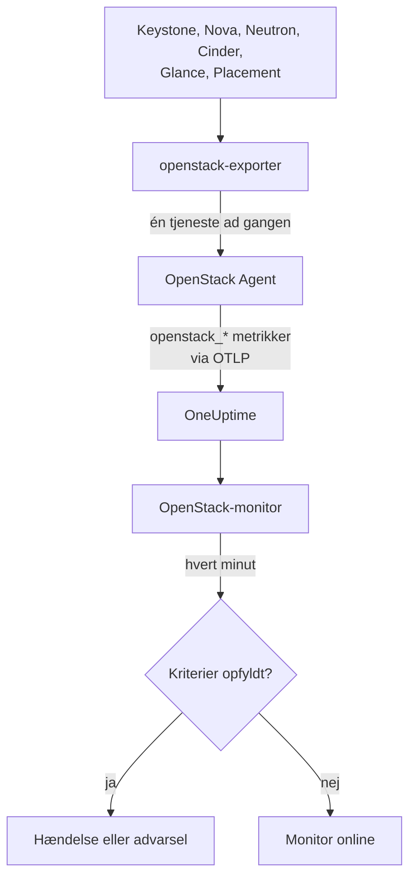

# OpenStack-monitor

En OpenStack-monitor overvåger én cloud - dens API'er, de workers der ligger bag dem, hypervisorer, instanser, netværk, lagerpuljer og projektkvoter - og giver dig besked, når et API holder op med at svare, en worker går ned, en hypervisor ikke har mere plads at give, eller en pulje løber fuld. Den læser de `openstack_*`-serier, som OneUptime OpenStack Agent indsamler fra openstack-exporter, eller en probe indsamler fra cloudens API'er.

:::cards
- [Opret monitoren](#opret-en-openstack-monitor): Seks trin i dashboardet.
- [Skabeloner](#færdige-advarselsskabeloner): Færdige advarsler, én hændelse pr. worker, instans, netværk eller region.
- [Tjek udefra](#tjek-udefra): Om nogen faktisk kan starte en instans, set fra en probe uden for cloudet.
- [Identitetsattributter](#identitetsattributter): Sådan retter du dig mod én region, vært eller ét projekt.
- [Metrikker](#indsamlede-metrikker): Alle serier, som monitoren kan advare om.
:::

## Sådan fungerer det

Agenten er en OpenTelemetry Collector og en openstack-exporter, som du kører på en maskine, der kan nå cloudets API'er. Den læser hver OpenStack-tjeneste i sin egen indsamling, så en Nova, der fejler, kun koster Novas serier, og den læser skånsomt: compute, netværk, volumen og placement hvert 2. minut, identitet og image hvert 5.

Hver serie er stemplet med cloudets navn, `openstack.cloud.name`, og hvert datapunkt med `openstack.region.name` og `openstack_service`. Et cloud er én Keystone, og en OpenStack-monitor er knyttet til ét cloud. Hvert minut kører den sin forespørgsel over cloudets metrikker og sammenligner resultatet med sine kriterier.



## Før du begynder

- **Indsaml cloudets metrikker** med OpenStack Agent eller [en probe](/docs/telemetry/openstack-agentless). **Dokumentation** under **Produkter → Infrastruktur → OpenStack** guider dig gennem installationen af agenten.
- **Kontrollér, at cloudet er registreret.** Det vises under **Produkter → Infrastruktur → OpenStack**, opkaldt efter agentens `OPENSTACK_CLOUD_NAME`, efter den første indsamling.

## Opret en OpenStack-monitor

:::steps
### Start en ny monitor

Gå til **Monitorer** og klik på **Opret monitor**.

### Vælg OpenStack

Under **Monitortype** klikker du på **Flere monitortyper** og vælger **OpenStack** under **Infrastruktur**, eller du skriver `openstack` i søgefeltet. Angiv et **Navn** - det bruges i titlerne på hændelser og advarsler - og klik på **Næste**.

### Vælg cloudet

Under **OpenStack Monitor Configuration** vælger du cloudet i **OpenStack-cloud**. Alle clouds, der har sendt data, står på listen. Når du har valgt, fortæller en linje under feltet, om der kommer data.

### Vælg, hvad der skal overvåges

En ny monitor starter på **Cloud Stopped Reporting** under **Hvad der skal advares om**. Sådan overvåger du noget andet:

- **Skift** - vælg en anden [skabelon](#færdige-advarselsskabeloner). Den sætter metrikken, attributfiltrene, aggregeringen, tidsintervallet, gruppering og tærskler og erstatter kriterierne nedenfor med sine egne. Du kan stadig ændre **Tidsinterval**.
- **Custom Metric** (under **Flere felter**) - vælg én metrik i **OpenStack-metrik**, indstil derefter **Aggregering** og **Tidsinterval**, og afgræns med [filtrene](#monitorindstillinger).
- **Avanceret** (under **Flere felter**) - byg selv forespørgsler og formler under **Vælg målinger**, med filtre på attributter som `status`, `adminState` eller `resourcetype`. Brug **Gruppér efter** en [identitetsattribut](#identitetsattributter) for at bedømme hver del for sig.

### Kontrollér kriterierne

Åbn hvert kriterium under **Kriterier**, og kontrollér dets **Metrik**, **Aggregering**, **Betingelse** og **Tærskel**. En skabelon udfylder disse. Med **Custom Metric** eller **Avanceret** starter monitoren med standardkriterierne, som kun opdager, at metrikken ikke sender data, så sæt din egen tærskel.

### Opret monitoren

Klik på **Opret monitor**. OneUptime åbner monitorens side og evaluerer den hvert minut. Hændelser og advarsler, den udløser, vises også på cloudets sider **Hændelser** og **Advarsler**.
:::

> [!TIP]
> Hvis du vil sætte flere skabeloner op på én gang, skal du åbne cloudet fra **Produkter → Infrastruktur → OpenStack** og gå til **Anbefalinger**. Vælg de skabeloner, du vil have, vælg hvem der skal alarmeres, og OneUptime opretter én monitor pr. skabelon.

## Monitorindstillinger

| Felt | Fane | Hvad det gør |
| --- | --- | --- |
| **OpenStack-cloud** | Alle | Påkrævet. Afgrænser hver forespørgsel til `resource.openstack.cloud.name`. |
| **Region** | Custom Metric, Avanceret | Valgfri. Én region: `openstack.region.name`. Alle serier har den. |
| **Tilgængelighedszone** | Custom Metric, Avanceret | Valgfri. Én zone: `availability_zone` på hypervisorer, instanser, volumener og Neutron-agenter, `zone` på Novas og Cinders workers. |
| **Hypervisor** | Custom Metric, Avanceret | Valgfri. Én vært: `hostname` på workers, hypervisorer og Placement, `hypervisor_hostname` på instanser. Novas workers angiver værtens korte navn, og hypervisorer, Placement og instanser dets fulde navn, så brug det, som serien angiver. |
| **Tjeneste** | Custom Metric, Avanceret | Valgfri. Én workers binære fil, fx `nova-compute`: `service`. |
| **Projekt-ID** | Custom Metric, Avanceret | Valgfri. Ét projekt: `tenant_id` på Novas og Cinders serier og på netværk og subnet, `project_id` på floating IP'er, routere og adressetilgængelighed. |
| **OpenStack-metrik** | Custom Metric | Én metrik fra [kataloget](#indsamlede-metrikker). |
| **Aggregering** | Custom Metric | Hvordan prøver kombineres: **Gennemsnit**, **Maksimum**, **Minimum**, **Sum** eller **Antal**. Starter på metrikkens sædvanlige aggregering. |
| **Tidsinterval** | Alle | Det glidende vindue, forespørgslen læser, fra **Past 1 Minute** til **Past 365 Days**. En ny monitor starter på **Seneste 15 minutter**; skabeloner sætter deres eget. |
| **Vælg målinger** | Avanceret | Forespørgselsbyggeren: **Metrik**, **Aggregate by**, **Filter by attributes**, **Gruppér efter**, plus **Tilføj metrik** og **Tilføj formel** til at kombinere forespørgsler. |

Et filter afgrænser kun en serie, der har dets label: `openstack_nova_up` har intet projekt, så et projektfilter lader den være uændret.

Hold vinduet på tre indsamlinger eller flere af det, du læser: 6 minutter for compute, netværk, volumen og placement, 15 for identitet og image. Et kortere vindue rummer ikke nok indsamlinger til, at **Alle værdier** kan betyde en varighed.

## Identitetsattributter

Hver serie har `openstack.cloud.name` som en **ressourceattribut**, og `openstack.region.name` og `openstack_service` som datapunktattributter. Exporterens egne labels fortæller resten:

| Del | Serie | Labels, der identificerer den |
| --- | --- | --- |
| API | `openstack_*_up` | `openstack.region.name`, `openstack_service` |
| Worker | `openstack_nova_agent_state`, `openstack_neutron_agent_state`, `openstack_cinder_agent_state` | `hostname`, `service`. `adminState` fortæller, om en operatør lod den være slået til. Gruppér aldrig efter `uuid` på Cinders: exporteren finder på en ny ved hver indsamling |
| Hypervisor | `openstack_placement_resource_*`, `openstack_nova_vcpus_*` | `hostname` (dets fulde navn), `resourcetype` på Placements |
| Instans | `openstack_nova_server_status` | `uuid`, `name`, `tenant_id`, `hypervisor_hostname`, `status`. Værdien er en kode: filtrér på ordet i `status` |
| Volumen | `openstack_cinder_volume_gb` | `id`, `name`, `tenant_id`, `status` |
| Lagerpulje | `openstack_cinder_pool_capacity_*` | `name`, `volume_backend_name` |
| Netværk | `openstack_neutron_network_ip_availabilities_*` | `network_id`, `network_name`, `cidr`, `ip_version` |
| Router | `openstack_neutron_l3_agent_of_router` | `router_id`, `agent_host`, `ha_state`, `agent_alive`, `agent_admin_up` |
| Projekt | `openstack_nova_limits_*`, `openstack_cinder_limits_*` | `tenant_id`, `tenant` |

I monitorfiltre og gruppér-efter-nøgler starter en ressourceattribut med `resource.` (`resource.openstack.cloud.name`), og en datapunktattribut gør ikke (`openstack.region.name`, `hostname`, `status`). En tom label når ikke frem til OneUptime, så `disabledReason` findes kun på en worker, som nogen har deaktiveret.

## Færdige advarselsskabeloner

OneUptime leveres med 120 skabeloner til almindelige OpenStack-problemer, og listen **Hvad der skal advares om** tilbyder dem. Et clouds side Anbefalinger tilbyder kun en skabelon for Heat, Magnum, Ironic, Manila, Octavia, Trove, Designate, Gnocchi eller Swift til et cloud, der kører den, en over en serie, som kun en probe sender, til et cloud, som en probe indsamler fra, og en over et [tjek udefra](#tjek-udefra) til et cloud, hvor det tjek er slået til: på ethvert andet cloud findes dens serier ikke, så den ville aldrig kunne udløses. Hver bygger en komplet monitor: metrikforespørgslen, dens attributfiltre, en gruppering på det, én hændelse handler om, et kriterium der udløser og et der genopretter. Tærsklerne er de samme linjer, som cloudets egne sider tegner, og er udgangspunkter, du kan redigere.

Hver skabelon læser mindst tre indsamlinger af det, den overvåger, og udløser kun, når betingelsen holder i hele sit vindue. En tærskel på en andel genopretter 10 % forbi sin linje, så en værdi, der svinger omkring den, ikke flakker.

| Skabelon | Kategori | Alvorlighed | Overvåger | Udløser når | Genopretter når |
| --- | --- | --- | --- | --- | --- |
| Cloud Stopped Reporting | Tilgængelighed | Kritisk | `openstack_identity_up`, Count over hele cloudet, **seneste 15 minutter** | Ingen data i hele vinduet: agenten stoppede eller kan ikke nå OneUptime, eller exporteren kan ikke logge ind i Keystone | Data kommer igen |
| Identity API Down | Tilgængelighed | Kritisk | `openstack_identity_up` og `scrape_samples_scraped` for `identity`, Min pr. region, **seneste 15 minutter** | Alle kald fejlede, eller indsamlingen kom tilbage tom, fordi exporteren ikke kunne logge ind | Begge viser 1 eller mere |
| Compute API Down | Tilgængelighed | Kritisk | `openstack_nova_up` og `scrape_samples_scraped` for `compute`, Min pr. region, **seneste 10 minutter** | Alle kald fejlede, eller indsamlingen kom tilbage tom, fordi exporteren ikke kunne nå Novas API | Begge viser 1 eller mere |
| Netværks-API nede | Tilgængelighed | Kritisk | `openstack_neutron_up` og `up` for `network`, Min pr. region, **seneste 10 minutter** | Alle kald fejlede, eller exporteren svarede ikke | Begge viser 1 |
| Bloklager-API nede | Tilgængelighed | Kritisk | `openstack_cinder_up` og `up` for `volume`, Min pr. region, **seneste 10 minutter** | Alle kald fejlede, eller exporteren svarede ikke | Begge viser 1 |
| Image-API nede | Tilgængelighed | Kritisk | `openstack_glance_up` og `up` for `image`, Min pr. region, **seneste 15 minutter** | Alle kald fejlede, eller exporteren svarede ikke | Begge viser 1 |
| Placement API Down | Tilgængelighed | Kritisk | `openstack_placement_up` og `up` for `placement`, Min pr. region, **seneste 10 minutter** | Alle kald fejlede, eller exporteren svarede ikke | Begge viser 1 |
| Compute Service Down | Kontrolplan | Kritisk | `openstack_nova_agent_state` filtreret på `service = nova-compute` og `adminState = enabled`, Min pr. vært, **seneste 10 minutter** | Under 1: en aktiveret nova-compute er nede. En, som nogen har deaktiveret, udløser aldrig | Oppe eller deaktiveret |
| Compute-tjeneste deaktiveret | Kontrolplan | Advarsel | `openstack_nova_agent_state` filtreret på `service = nova-compute` og `adminState = disabled`, et Count pr. vært, **seneste 10 minutter** | Over 0: en `nova-compute` blev deaktiveret, og ingen igangværende vedligeholdelseshændelse dækker dens vært, dens tilgængelighedszone eller cloudet. En, der deaktiverede sig selv, fordi libvirt gik ned (dens årsag starter med `AUTO:`), forholder sig i ro, mens libvirt-tjeneste nede er åben. Projekter får ikke besked om den | Den er aktiveret igen, eller en hændelse dækker den |
| Scheduler eller Conductor nede | Kontrolplan | Advarsel | `openstack_nova_agent_state` filtreret på `nova-scheduler` eller `nova-conductor` og `adminState = enabled`, Min pr. vært og binær fil, **seneste 10 minutter** | Under 1. De andre kører videre, så længe nogen er tilbage | Oppe eller deaktiveret |
| Alle Schedulere eller Conductors nede | Kontrolplan | Kritisk | Det samme, Max pr. region og binær fil, **seneste 10 minutter** | Under 1: ingen er i live, så intet nyt kan starte | Én er oppe |
| Netværksagent nede | Kontrolplan | Kritisk | `openstack_neutron_agent_state` filtreret på `adminState = up`, Min pr. vært og binær fil, **seneste 10 minutter** | Under 1: en agent, der er sat op, er ikke i live. En, som nogen har sat ned, udløser aldrig | I live eller sat ned |
| Bloklagertjeneste nede | Kontrolplan | Kritisk | `openstack_cinder_agent_state` filtreret på `adminState = enabled`, Min pr. vært og binær fil, **seneste 10 minutter** | Under 1: en aktiveret Cinder-tjeneste er nede. En, som nogen har deaktiveret, udløser aldrig | Oppe eller deaktiveret |
| vCPU-allokering høj | Compute | Advarsel | `openstack_placement_resource_*` filtreret på `resourcetype = VCPU`, brug / ((total - reserveret) x forhold), pr. hypervisor, **seneste 10 minutter** | Over 90 %: allokering, ikke belastning | Ved eller under 81 % |
| Hukommelsesallokering høj | Compute | Advarsel | Det samme, `resourcetype = MEMORY_MB` | Over 90 % | Ved eller under 81 % |
| Lokal diskallokering høj | Compute | Advarsel | Det samme, `resourcetype = DISK_GB` | Over 90 % | Ved eller under 81 % |
| Hypervisor-CPU mættet | Compute | Advarsel | `openstack.hypervisor.instances.cpu.utilization`, pr. hypervisor, **seneste 15 minutter**. Kræver libvirts eller Ceilometers exporter | Over 90 % af dens CPU-tråde: belastning, ikke allokering. Dens side nævner de ansvarlige instanser | Ved eller under 81 % |
| Hypervisor-hukommelsespres | Compute | Advarsel | `openstack.hypervisor.instances.memory.utilization`, pr. hypervisor, **seneste 15 minutter**. Kræver libvirts exporter eller Ceilometers polling af `memory.resident` | Over 90 % af dens hukommelse: i brug, ikke lovet væk | Ved eller under 81 % |
| Instans-CPU mættet | Compute | Advarsel | `openstack.instance.cpu.utilization`, Max pr. instans, **seneste 15 minutter**. Kræver libvirts eller Ceilometers exporter | Over 95 % af dens vCPU'er | Ved eller under 85,5 % |
| Instansens disklatens høj | Compute | Advarsel | `openstack.instance.disk.read.latency` og `openstack.instance.disk.write.latency`, Max pr. instans og disk, **seneste 15 minutter**. Kræver libvirts exporter eller Ceilometers polling af `disk.device.read.latency` og `disk.device.write.latency` | Over 50 ms pr. forespørgsel. En disk uden forespørgsler har ingen latens, så en ledig udløser aldrig | Ved eller under 45 ms, eller den holder op med at blive brugt |
| Instanser i fejl | Compute | Advarsel | `openstack_nova_server_status` filtreret på `status = ERROR`, Count pr. region, **seneste 10 minutter** | Over 0 | Ingen tilbage |
| Instans hænger i opbygning | Compute | Advarsel | `openstack_nova_server_status` filtreret på `status = BUILD` eller `BUILD(spawning)`, Max pr. instans, **seneste 1 time** | I den status ved hver indsamling i en time | Forlod den |
| Instans hænger i overgang | Compute | Advarsel | Det samme for `REBUILD`, `RESIZE`, `REVERT_RESIZE`, `MIGRATING`, `REBOOT`, `HARD_REBOOT` og `PASSWORD`, **seneste 1 time** | I en af dem ved hver indsamling i en time | Forlod den |
| Instans hænger i Verify Resize | Compute | Advarsel | Det samme for `VERIFY_RESIZE`, **seneste 1 time** | Venter i en time på, at nogen bekræfter eller fortryder | Bekræftet eller fortrudt |
| Router ikke aktiv | Netværk | Advarsel | `openstack_neutron_routers_not_active`, Max pr. region, **seneste 10 minutter** | Over 0 | På 0 |
| Floating IP ikke aktiv | Netværk | Advarsel | `openstack_neutron_floating_ips_associated_not_active`, Max pr. region, **seneste 10 minutter** | Over 0: en i brug er ikke ACTIVE. En reserve er ment til at være nede | På 0 |
| Ekstern IP-pulje næsten fuld | Netværk | Advarsel | `openstack_neutron_network_ip_availabilities_*` for `ip_version = 4`, sammen med `is_external = true` på `openstack_neutron_network`, pr. netværk, **seneste 10 minutter** | Over 90 % af et eksternt netværks IPv4-adresser. Et tenant-netværk udløser aldrig | Ved eller under 81 % |
| Netværk løbet tør for IP'er | Netværk | Kritisk | Det samme | Ved 100 %: ingen adresse tilbage | Under 90 % |
| Router uden aktiv agent | Netværk | Kritisk | `openstack_neutron_l3_agent_of_router` filtreret på `agent_admin_up = true`, Max pr. router, **seneste 10 minutter** | Under 1: ingen agent, der har den, er i live. Stille på OVN, som ikke har den slags agenter | Én er i live |
| Router med to aktive agenter | Netværk | Kritisk | Det samme filtreret på `ha_state = active` og `agent_alive = true`, Count pr. router, **seneste 10 minutter** | Over 1: en split brain. Stille på OVN | Ved eller under 1 |
| Lagerpulje advarsel | Lager | Advarsel | `openstack_cinder_pool_capacity_*`, (total - ledig) / total, pr. pulje, **seneste 10 minutter** | Over 85 % | Ved eller under 76,5 % |
| Lagerpulje kritisk | Lager | Kritisk | Det samme | Over 95 % | Ved eller under 85,5 % |
| Volumener i fejl | Lager | Advarsel | `openstack_cinder_volume_status_counter` for hvert fejlord, Max pr. region og ord, **seneste 10 minutter** | Over 0 | På 0 |
| Volumen hænger | Lager | Advarsel | `openstack_cinder_volume_gb` for hvert ord for en gyldig status, Max pr. volumen, **seneste 30 minutter** | I den status ved hver indsamling i 30 minutter | Forlod den |
| Image hænger | Lager | Advarsel | `openstack_glance_image_created_at` for hvert ord for en gyldig status, Max pr. image, **seneste 1 time** | I den status ved hver indsamling i en time | Forlod den eller blev slettet |
| Orkestrerings-API nede | Tilgængelighed | Kritisk | `openstack_heat_up` og `up` for `orchestration`, Min pr. region, **seneste 15 minutter** | Alle kald fejlede, hvilket en stoppet `heat-engine` også læses som, eller exporteren svarede ikke | Begge viser 1 |
| Kubernetes-klynge-API nede | Tilgængelighed | Kritisk | `openstack_container_infra_up` og `up` for `container-infra`, Min pr. region, **seneste 15 minutter** | Alle kald fejlede, eller exporteren svarede ikke | Begge viser 1 |
| Rating-API nede | Tilgængelighed | Kritisk | `openstack_cloudkitty_up` og `up` for `rating`, Min pr. region, **seneste 15 minutter**. Kun en probe sender denne | CloudKittys API svarer ikke, så det, hvert projekt er blevet afregnet for, står stille | Begge viser 1 |
| Heat Engine nede | Kontrolplan | Advarsel | `openstack_heat_agent_state`, Min pr. vært, **seneste 15 minutter**. Kun en probe sender denne | Heat viser en `heat-engine` som nede. Med alle engines stoppet kan Heat ikke vise dem, og Orkestrerings-API nede udløses i stedet | Den viser 1, eller Heat fjerner sin registrering |
| Magnum Conductor nede | Kontrolplan | Kritisk | `openstack_container_infra_agent_state` med `adminState=enabled`, Min pr. vært, **seneste 15 minutter**. Kun en probe sender denne | Magnum viser en aktiveret `magnum-conductor` som nede. Magnums API svarer fortsat, så intet andet fortæller dette | Den viser 1, eller nogen deaktiverer den |
| Stack fejlet | Orkestrering | Advarsel | `openstack_heat_stack_status` med hver `*_FAILED`-status, pr. stack, **seneste 15 minutter** | En stack har en fejlstatus i hele vinduet | Den opdateres eller slettes |
| Stack hænger under udførelse | Orkestrering | Advarsel | `openstack_heat_stack_status` med hver `*_IN_PROGRESS`-status, pr. stack, **seneste 2 timer** | En stack har en status under udførelse i hele vinduet, ud over den time Heat giver en, medmindre nogen valgte længere | Den når sin næste status eller slettes |
| Kubernetes-klynge fejlet | Orkestrering | Advarsel | `openstack_container_infra_cluster_status` med hver `*_FAILED`-status, pr. klynge, **seneste 15 minutter** | En klynge har en fejlstatus i hele vinduet | Den opdateres eller slettes |
| Kubernetes-klynge hænger | Orkestrering | Advarsel | `openstack_container_infra_cluster_status` med hver `*_IN_PROGRESS`-status, pr. klynge, **seneste 2 timer** | En klynge har en status under udførelse i hele vinduet. Kun Magnums conductor flytter en videre | Den når sin næste status eller slettes |
| Delte filsystemer-API nede | Tilgængelighed | Kritisk | `openstack_sharev2_up` og `up` for `sharev2`, Min pr. region, **seneste 15 minutter** | Alle kald fejlede, eller exporteren svarede ikke. Alle legitimationsoplysninger, der kan logge ind, viser 1, så det kan ikke være en afvist legitimation | Begge viser 1 |
| Manila-tjeneste nede | Kontrolplan | Advarsel | `openstack_sharev2_agent_state` med `adminState=enabled`, Min pr. vært og tjeneste, **seneste 15 minutter**. Kun en probe sender denne | Manila viser en aktiveret tjeneste som stoppet eller nede. Dens API svarer fortsat, så intet andet fortæller dette | Den viser 1, eller nogen deaktiverer den |
| Share i fejl | Lager | Advarsel | `openstack_sharev2_share_gb` med hver fejlstatus, pr. share, **seneste 15 minutter** | En share har en fejlstatus i hele vinduet | Den rettes eller slettes |
| Share hænger | Lager | Advarsel | `openstack_sharev2_share_gb` med hver gyldig status, pr. share, **seneste 1 time** | En share har en gyldig status i hele vinduet. Manila har ingen egen timeout for en langsom backend. En, der migreres eller sikkerhedskopieres, overvåges ikke | Den når sin næste status eller slettes |
| Load balancer-API nede | Load balancere | Kritisk | `openstack_loadbalancer_up`, Min pr. region, **seneste 15 minutter** | Under 1. Et stoppet Octavia-API giver agentens exporter et tomt svar frem for et 0, ligesom et cloud uden Octavia, så på en agents cloud forholder dette sig i ro, og cloudets sider fortæller, hvornår Octavia sidst lod høre fra sig | Viser 1 eller er væk |
| Load balancer i fejl | Load balancere | Kritisk | `openstack_loadbalancer_loadbalancer_status` med `provisioning_status=ERROR`, Count pr. load balancer, **seneste 15 minutter** | En load balancer har provisioning ERROR i hele vinduet. Octavia prøver ingen af disse igen | Den er tilbage på ACTIVE eller slettet |
| Load balancer hænger i afventende | Load balancere | Advarsel | `openstack_loadbalancer_loadbalancer_status` med hver `PENDING_*`-provisioning-status, Count pr. load balancer, **seneste 1 time** | En load balancer har en PENDING-status i hele vinduet: Octavias worker er stoppet eller mistede forespørgslen | Den når ACTIVE eller ERROR, eller slettes |
| Load balancer med to masters | Load balancere | Kritisk | `openstack_loadbalancer_amphora_status` med `role=MASTER` og `status=ALLOCATED`, Count pr. load balancer, **seneste 15 minutter**. Kræver en legitimation, der må vise amphorae | Mere end én allokeret amphora siger MASTER for én load balancer | Kun én gør |
| Amphora i fejl | Load balancere | Kritisk | `openstack_loadbalancer_amphora_status` med `status=ERROR`, Count pr. amphora, **seneste 15 minutter**. Kræver en legitimation, der må vise amphorae | En amphora har ERROR i hele vinduet: health manager kunne ikke erstatte den | Den er erstattet |
| Pulje uden sunde medlemmer | Load balancere | Kritisk | `openstack_loadbalancer_pool_status` med `operating_status=ERROR`, Count pr. pulje, **seneste 15 minutter** | Alle medlemmer af en pulje fejler deres sundhedstjek, mens puljen og dens load balancer stadig provisionerer ACTIVE | Et medlem er sundt igen |
| DNS-API nede | Tilgængelighed | Kritisk | `openstack_designate_up`, Min pr. region, **seneste 15 minutter**. Kun en probe tilbyder denne | Under 1. En stoppet Designate giver agentens exporter et tomt svar, ligesom et cloud uden Designate, så et cloud, agenten indsamler fra, kan kun sige, at det blev stille | Viser 1 |
| DNS-zone i fejl | Netværk | Advarsel | Et antal af `openstack_designate_zone_status` med `status=ERROR`, pr. zone, **seneste 15 minutter** | En zone viser `ERROR` i hele vinduet: dens worker opgav at skrive den til en DNS-server | Den viser noget andet |
| DNS-zone hænger i afventende | Netværk | Advarsel | Et antal af `openstack_designate_zone_status` med `status=PENDING`, pr. zone, **seneste 30 minutter** | En zone viser `PENDING` i hele vinduet. Dens worker opgiver efter få minutter, så intet arbejder på den | Den viser noget andet |
| DNS-recordset i fejl | Netværk | Advarsel | Et antal af `openstack_designate_recordsets_status` med `status=ERROR` og hver type, nogen beder om, pr. zone, **seneste 15 minutter** | Et recordset, der ikke er en zones egen SOA og NS, viser `ERROR`. Disse to viser `ERROR` sammen med deres zone, så DNS-zone i fejl fortæller det | Det viser noget andet |
| Metrics API Down | Tilgængelighed | Kritisk | `openstack_gnocchi_up` og `up` for `gnocchi`, Min pr. region, **seneste 15 minutter** | Exporterens læsning af Gnocchi fejlede, eller exporteren svarede ikke. En legitimation, som Gnocchi afviser, læses på samme måde, så et cloud, hvis legitimation aldrig har læst Gnocchi, får ikke tilbudt denne | Begge viser 1 |
| Gnocchi uden processorer | Metrikker | Kritisk | `openstack_gnocchi_status_metricd_processors`, Max pr. region, **seneste 15 minutter** | Gnocchis status nævner ingen processor. Dens API svarer og modtager fortsat målinger, så **Metrics API Down** siger intet om dette | Den nævner en |
| Gnocchi-backlog vokser | Metrikker | Advarsel | `openstack_gnocchi_status_measures_to_process`, en linje gennem de **seneste 2 timer** | Linjen passerer 10.000 målinger inden for den næste time. En backlog over det, som falder, udløser ikke | Linjen når ikke længere 9.000 |
| Objektlager-API nede | Tilgængelighed | Kritisk | `openstack_object_store_up` og `up` for `object-store`, Min pr. region, **seneste 15 minutter** | Exporterens læsning af Swift fejlede, eller exporteren svarede ikke. En legitimation, som Swift afviser, læses på samme måde, så et cloud, hvis legitimation aldrig har læst Swift, får ikke tilbudt denne | Begge viser 1 |
| Prognose for vækst i objektcontainer | Lager | Advarsel | `openstack_object_store_bytes`, en linje gennem de **seneste 7 dage**, pr. container | Linjen passerer 1 TiB inden for den næste uge. Ændr den til det, dit cloud skal høre om | Linjen når ikke længere 90 % af det |
| Nøglehåndterings-API nede | Tilgængelighed | Kritisk | `openstack_barbican_up`, Min pr. region, **seneste 15 minutter**. Kun en probe tilbyder denne | Under 1. Exporteren har slet ingen læser til Barbican | Viser 1 |
| Swift-lagerserver svarer ikke | Lager | Advarsel | `openstack_object_store_recon_up`, Min pr. server, **seneste 15 minutter**. Kun en probe tilbyder denne, hvor cloudets indstillinger nævner dets lagerservere | Serveren svarer ikke på `/recon`. Swifts proxy svarer videre uden den | Den svarer |
| Swift-ringe afviger | Lager | Advarsel | `openstack_object_store_recon_rings_differ`, Min pr. ring, **seneste 15 minutter**. Kun en probe tilbyder denne | De nævnte servere rapporterer forskellige kontrolsummer for en ring | De er enige |
| Swift-replikering forældet | Lager | Advarsel | `openstack_object_store_recon_replication_age_seconds`, Min pr. server og ring, **seneste 15 minutter**. Kun en probe tilbyder denne | En server afsluttede sidst et gennemløb for mere end 6 timer siden | Én afslutter |
| Database-API nede | Tilgængelighed | Kritisk | `openstack_trove_up` og `up` for `database`, Min pr. region, **seneste 15 minutter** | Exporterens læsning af Trove fejlede, eller exporteren svarede ikke. Den læser Troves mgmt-API, så en afvist legitimation læses som et stoppet API, og et cloud, hvis legitimation aldrig har læst Trove, får ikke tilbudt denne | Begge viser 1 |
| Databaseinstans i fejl | Databaser | Advarsel | Et antal af `openstack_trove_instance_status` med hver fejlstatus, pr. instans, **seneste 15 minutter** | En instans har en fejlstatus i hele vinduet | Den rettes eller slettes |
| Databaseinstans hænger | Databaser | Advarsel | Et antal af `openstack_trove_instance_status` med hver gyldig status, pr. instans, **seneste 1 time** | En instans har en gyldig status i hele vinduet. Trove har ingen liste over sine workers, så dette er det, der fortæller, at `trove-taskmanager` stoppede | Den når sin næste status eller slettes |
| Databasevolumen næsten fuld | Databaser | Advarsel | `openstack_trove_instance_volume_used_gb` over `openstack_trove_instance_volume_size_gb`, pr. instans, **seneste 15 minutter** | Ved eller over 85 %. En instans, der ikke kører, viser 0 brugt. Ingen optagelse rummer en kørende | Den ændres i størrelse eller skrumper |
| Bare metal-API nede | Bare metal | Kritisk | `openstack_ironic_up`, Min pr. region, **seneste 15 minutter** | Under 1. Taler kun, hvor en læsning af Ironic kan sige det: en probe eller exporter 1.7.0. En stoppet Ironic giver agentens exporter intet at læse, ligesom et cloud uden Ironic, så der forholder den sig i ro, og cloudets sider fortæller, hvornår Ironic sidst lod høre fra sig | Viser 1 eller er væk |
| Bare metal-conductor nede | Bare metal | Advarsel | `openstack_ironic_agent_state`, Min pr. vært, **seneste 15 minutter**. Kun en probe sender denne, og kun hvor cloudets politik lader dens legitimation læse Ironics conductors: som standard afviser den et projekts | Ironic viser en conductor som ikke i live. Dens API svarer fortsat, og alle noder viser, som de gjorde, så intet andet fortæller dette | Den viser 1, eller Ironic fjerner sin registrering |
| Bare metal-node i fejl | Bare metal | Advarsel | `openstack_ironic_node` for hver fejlet `provision_state`, Max pr. node, **seneste 15 minutter** | I den tilstand ved hver indsamling i 15 minutter, i vedligeholdelse eller ej | Forlod den eller blev slettet |
| Bare metal-node hænger i overgang | Bare metal | Advarsel | `openstack_ironic_node` for hver gyldig `provision_state` med `maintenance = false`, Max pr. node, **seneste 2 timer** | I den tilstand ved hver indsamling i 2 timer. En lang diskrydning kan helt reelt tage så lang tid, hvilket en nodes side kan se, og dette ikke kan | Forlod den eller blev slettet |
| Bare metal-node for længe i vedligeholdelse | Bare metal | Advarsel | `openstack_ironic_node` med `maintenance = true`, Max pr. node, **seneste 7 dage** | I vedligeholdelse ved hver indsamling i 7 dage. Kræver, at dine metrikker gemmes så længe | Ude af vedligeholdelse eller blev slettet |
| Bare metal-strømtilstand uventet | Bare metal | Advarsel | `openstack_ironic_node` med `provision_state = active`, `power_state = power off` og `maintenance = false`, Max pr. node, **seneste 15 minutter** | Ved hver indsamling i 15 minutter. En instans, som dens ejer stoppede, viser det samme, hvilket en nodes side kan se, og dette ikke kan | Tændt eller ikke længere udrullet |
| Project Quota Nearly Reached | Projekter | Advarsel | `openstack_nova_limits_*` og `openstack_cinder_limits_volume_*`, brugt / max pr. projekt, **seneste 3 timer** | Over 90 % af dets kvote for vCPU, hukommelse, instanser eller volumener. Kræver, at [limits-serierne er slået til](#slå-limits-serierne-til) | Ved eller under 81 % |
| Token-udstedelse fejler | Tilgængelighed | Kritisk | `openstack_check_token_success`, Min pr. region, **seneste 5 minutter**. Kræver, at API-tjek er slået til | Under 1: Keystone udstedte intet token til proben | Et token udstedes |
| Tjeneste-API-tjek fejler | Tilgængelighed | Kritisk | `openstack_check_api_success`, Min pr. region og `service_type`, **seneste 5 minutter**. Kræver, at API-tjek er slået til | Under 1: den tjeneste svarede ikke, for enhver tjeneste i kataloget | Den svarer eller forlader kataloget |
| Offentligt certifikat udløber inden for 30 dage | Tilgængelighed | Advarsel | `openstack_check_certificate_expiry_days`, Min pr. region, vært og port, **seneste 5 minutter**. Kræver, at API-tjek er slået til | Under 30 dage tilbage | 33 dage eller mere tilbage, eller endepunktet forlader kataloget |
| Offentligt certifikat udløber inden for 7 dage | Tilgængelighed | Kritisk | Det samme | Under 7 dage tilbage | 7,7 dage eller mere tilbage, eller endepunktet forlader kataloget |
| Instansstart fejler | Compute | Kritisk | `openstack_check_lifecycle_phase_success` filtreret på `phase = boot`, Min pr. region, **seneste 5 minutter**. Kræver, at livscyklustjekket er slået til | Under 1: den seneste kørsel kunne ikke starte en instans | En kørsel starter en |
| Instansstart langsom | Compute | Advarsel | `openstack_check_lifecycle_step_duration_seconds` filtreret på `step = server_active`, Max pr. region, **seneste 5 minutter**. Kræver, at livscyklustjekket er slået til | Over 300 sekunder, Tempests eget `build_timeout` | Ved eller under 270 sekunder, eller en kørsel, der ikke startede, hvilket Instansstart fejler taler for |
| Volumentilknytning fejler | Lager | Kritisk | `openstack_check_lifecycle_phase_success` filtreret på `phase = volume`, Min pr. region, **seneste 5 minutter**. Kræver, at tjekkets volumendel er slået til | Under 1: den seneste kørsel kunne ikke oprette eller tilknytte en volumen | En kørsel tilknytter en |
| Floating IP kan ikke nås | Netværk | Kritisk | `openstack_check_lifecycle_phase_success` filtreret på `phase = floating_ip`, Min pr. region, **seneste 5 minutter**. Kræver, at tjekkets floating IP-del er slået til | Under 1: den seneste kørsel kunne ikke nå sin server via en floating IP | En kørsel når en |
| Flavor kan ikke længere placeres | Kapacitet | Advarsel | `openstack_capacity_flavor_fits`, **pr. flavor pr. region** | Ingen vært har plads til en mere i 10 minutter. Kun flavors, som nogen kan bede om, og aldrig en, der er for stor til alle værter, eller hvis eneste plads er på en vært, som nogen har deaktiveret | En vært har plads, eller flavoren overvåges ikke længere |
| Kapacitetsprognose under 14 dage | Kapacitet | Advarsel | `openstack_capacity_days_until_full`, **pr. zone og ressourceklasse, eksternt netværk eller lagerpulje** | Under 14 dage til fuld ved dens vækst den seneste uge, i 10 minutter. Stille med under en dags historik, eller når den ikke vokser | Over 15,4 dage, eller ingen prognose mere |
| Reserveret frirum væk | Kapacitet | Advarsel | `openstack_capacity_can_lose_a_host`, **pr. zone** | Den kunne ikke miste sin største vært og stadig rumme det, der kører på den, i 10 minutter. Stille på en zone med én vært, eller med en vært, som nogen har deaktiveret | Den kunne, eller zonen bedømmes ikke længere |

**Alvorlighed** er den label, vælgeren viser. Hændelsen og advarslen, en skabelon opretter, starter på dit projekts mest alvorlige hændelses- og advarselsalvorlighed; ændr dem i kriterierne.

- **Op-, i-live- og tilstandsserier bruger Min**, så en enkelt nede viser 0. **Antal- og infoserier bruger Max.** Intet bruger Sum, fordi en monitor læser etminutshinks på tværs af serier og indsamlinger, og en Sum lægger dem sammen.
- **Hver skabelon undtagen Cloud Stopped Reporting grupperer efter det, en hændelse handler om:** en workers vært og binære fil, et API's region, en instans, en router, et netværk, en pulje, et projekt. Hændelsen nævner det sammen med [kommandoerne, du skal køre bagefter](#kommandoer-at-køre-bagefter).
- **En statusseries værdi er en kode**, ikke et antal: `openstack_nova_server_status` viser 4 for en instans i ERROR. Skabeloner filtrerer på ordet i `status`.
- **En serie, der lige er dukket op, venter et helt vindue,** så en instans, volumen eller image, der er set én gang på vej til noget andet, udløser intet. Hver skabelon ved, hvor ofte dens tjeneste indsamles, ud fra den tjenestes egen `_up`-serie.
- **En serie, der forsvinder, tæller som genoprettet:** en worker, som nogen deaktiverede, den sidste instans i ERROR slettet, en pulje fjernet. Hver skabelon læser sin tjenestes egen `_up`-serie ved siden af sin egen, så den kan skelne en del, der forsvandt, fra et cloud, der blev stille. Når der slet ikke kommer noget, forbliver dens hændelser åbne, og **Cloud Stopped Reporting** tager ordet.
- **Når et API er nede, forsvinder dets egne serier også**, så den tjenestes andre skabeloner genoprettes og udløser igen et vindue efter, at det er tilbage, hvis fejlen stadig er der. Hvis alle API'er viser nede på én gang, så kig først på exporteren.
- **Et cloud, der ikke har en sådan tjeneste, forholder sig i ro.** Exporteren svarer med ingenting for en tjeneste, der ikke er i cloudets katalog, og **Netværk**, **Bloklager**, **Billede** og **Placement API Down** læser ikke det som et udfald. **Identitet** og **Compute API Down** gør, fordi det også er sådan, exporteren melder, at Keystones eller Novas API er stoppet helt, og alle clouds har dem.

### Når en udløses

Når `nova-compute` er stoppet, går dens række på cloudets side **Tjenester** ned inden for få minutter:


Når det har varet i skabelonens hele vindue, åbner **Compute Service Down** én hændelse, som nævner værten og løses af sig selv, når tjenesten er tilbage:


### Hvad tjenesterne siger

Syv skabeloner mere læser et clouds logge frem for dets metrikker, så de er logmonitorer, og de kræver agentens [logprofil](/docs/telemetry/openstack#tjenesteprotokoller). Hver læser kun dette clouds logge, tæller det, den leder efter, og løses af sig selv, når antallet falder.

| Skabelon | Kategori | Alvorlighed | Læser | Udløser når | Genopretter når |
| --- | --- | --- | --- | --- | --- |
| Ingen gyldig vært | Tjenestelogge | Advarsel | Linjer, en tjeneste skrev på `WARNING` eller værre med `No valid host was found`, **seneste 15 minutter** | En eller flere | Ingen tilbage i vinduet |
| RabbitMQ-forbindelse tabt | Tjenestelogge | Kritisk | `AMQP server on <host> is unreachable`, `Unable to connect to AMQP server`, oslo.messagings `Connection failed` eller `MessagingTimeout`, **seneste 5 minutter** | 5 eller flere | Færre end 5 |
| Databaseforbindelse tabt | Tjenestelogge | Kritisk | `DBConnectionError`, `SQL connection failed`, eller MySQL's `Lost connection` og `Can't connect`, **seneste 5 minutter** | 5 eller flere | Færre end 5 |
| For mange fejl fra en tjeneste | Tjenestelogge | Advarsel | `ERROR`- og `CRITICAL`-linjer, pr. tjeneste og maskine, **seneste 5 minutter** | 50 eller flere | Færre end 50 |
| Tokenvalidering fejler | Tjenestelogge | Kritisk | En tjenestes `Authorization failed for token`, **seneste 5 minutter** | 10 eller flere. Én er en forældet session hos nogen. En controller, hvis Fernet-nøgler afviger fra de andres, viser sig som dette, og ingen linje siger mere, så sammenlign `/etc/keystone/fernet-keys` på hver | Færre end 10 |
| Instanshandling fejlede | Begivenheder | Advarsel | `compute.exception` og enhver `instance.*.error`, pr. instans, begivenhed og årsag, **seneste 15 minutter**. Kræver [notifikationer](/docs/telemetry/openstack#slå-notifikationer-til) eller en probe | En eller flere | Ingen tilbage i vinduet |
| Planlægning fejlede | Begivenheder | Advarsel | En compute-opgaves fejl, der nævner `NoValidHost`, fx `compute_task.build_instances.error`, som er det, Nova sender. Også Cinders `scheduler.create_volume` og `scheduler.select_destinations.error`, som Novas dokumentation nævner, og som vores testclouds aldrig sendte. Pr. instans, begivenhed og årsag, **seneste 15 minutter**. Kræver det samme | En eller flere | Ingen tilbage i vinduet |

### Hvad cloudet hviler på

Disse læser det, [agenten læser under cloudet](/docs/telemetry/openstack#hvad-clouden-står-på), når du har navngivet det. Et vindue læser mindst tre indsamlinger. Intet bruger Sum, og en serie, der forsvinder, tæller som genoprettet. Hver er skrevet ud fra, hvad rigtige klynger sagde, da de med vilje blev ødelagt.

| Skabelon | Alvorlighed | Overvåger | Udløser når | Én hændelse pr. |
| --- | --- | --- | --- | --- |
| RabbitMQ nede | Kritisk | `up`, **seneste 5 minutter** | Ingen node svarer | Region |
| RabbitMQ-node nede | Advarsel | `up`, **seneste 10 minutter** | En node svarer ikke | Maskine |
| RabbitMQ-partition registreret | Kritisk | `erlang_vm_dist_node_state`, **seneste 5 minutter** | Alle noder svarer, og et link mellem to er ikke oppe | Region |
| RabbitMQ-hukommelsesalarm | Kritisk | `rabbitmq_alarms_memory_used_watermark`, **seneste 5 minutter** | Over 0: den har holdt op med at modtage beskeder | Maskine |
| RabbitMQ-diskalarm | Kritisk | `rabbitmq_alarms_free_disk_space_watermark`, **seneste 5 minutter** | Over 0: den har holdt op med at modtage beskeder | Maskine |
| RabbitMQ-filbeskrivere høje | Advarsel | Åbne i forhold til tilladte, **seneste 5 minutter** | Over 90 % | Maskine |
| RabbitMQ-beskeder uden kvittering | Advarsel | `rabbitmq_queue_messages_unacked`, **seneste 10 minutter** | Over 1000 | Maskine |
| RabbitMQ-kø uden forbrugere | Advarsel | Hver kø fra `/metrics/detailed`, **seneste 10 minutter** | Beskeder klar og ingen læser. En svar- eller fanout-kø er udeladt | Kø |
| MariaDB-klynge nede | Kritisk | `up`, `mysql_up` og `wsrep_cluster_status`, **seneste 5 minutter** | Ingen node svarer, eller ingen node er i Primary-komponenten | Region |
| Galera-klyngestørrelse faldet | Advarsel | Noder læst mod `wsrep_cluster_size`, **seneste 10 minutter** | Galera tæller færre noder, end du har navngivet | Region |
| Galera-node ikke klar | Advarsel | `wsrep_ready`, **seneste 10 minutter** | Under 1 med Galera slået til | Maskine |
| Galera-node ude af sync | Advarsel | `wsrep_local_state`, **seneste 10 minutter** | Ikke Synced, medmindre `wsrep_desync` siger, at nogen bad om det, som en sikkerhedskopi gør | Maskine |
| MariaDB for mange forbindelser | Advarsel | Forbundne i forhold til tilladte, **seneste 5 minutter** | Over 80 % | Maskine |
| MariaDB langsomme forespørgsler | Advarsel | `mysql_slow_queries_increase`, **seneste 10 minutter** | Over 10 i minuttet | Maskine |
| Memcached-klynge nede | Advarsel | `memcached_up`, **seneste 5 minutter** | Ingen svarer. Intet stopper, og API'erne bliver langsommere | Region |
| Memcached uden forbindelser | Advarsel | `memcached_current_connections` og kommandoer, **seneste 15 minutter** | Under 10 forbindelser og ingen spørger. Den viser aldrig 0: dens egne lyttere og exporteren holder nogle få | Region |
| Memcached-fjernelser høje | Advarsel | `memcached_items_evicted_increase`, **seneste 10 minutter** | Over 100 i minuttet | Maskine |
| HAProxy nede | Kritisk | `up`, **seneste 5 minutter** | Ingen svarer | Region |
| HAProxy-backend nede | Kritisk | `haproxy_backend_status` for `DOWN`, **seneste 5 minutter** | Nede på hver load balancer, der svarer | Backend |
| HAProxy-server nede | Advarsel | `haproxy_server_status` for `DOWN`, **seneste 10 minutter** | En server er nede, og dens backend har andre | Backend |
| API 5xx-rate høj | Kritisk | `haproxy_backend_http_responses_increase`, **seneste 5 minutter** | Over 5 %, med servere tilbage til at svare | Backend |
| API 4xx-rate høj | Advarsel | Det samme, **seneste 5 minutter** | Over 25 %. HAProxy tæller efter klasse, så det er her, et udbrud af 401'ere viser sig | Backend |
| OVN Controller kører ikke | Kritisk | `ovnc_encap_ip` og `ovnc_rconn_queued`, **seneste 5 minutter** | En chassis, der havde en, har ingen | Maskine |
| Northbound- eller Southbound-database uden leder | Kritisk | `ovn_raft_cluster_leader`, **seneste 5 minutter** | Intet medlem siger, at det leder | Database |
| OVN Northd ikke aktiv | Kritisk | `ovn_northd_status`, **seneste 10 minutter** | Ingen er aktiv, hvilket også er, hvad alle OVN's databaser, der stopper, læses som | Region |
| Geneve-sendefejl | Advarsel | `ovs_interface_tx_errors_increase` for `type = geneve`, **seneste 10 minutter** | Fejl hvert minut | Maskine |
| Open vSwitch-tjeneste nede | Kritisk | `ovs_memory_rules_total`, **seneste 5 minutter** | Væk fra en maskine, der havde den, mens exporteren svarer | Maskine |
| Exporter mistede Open vSwitchs database | Advarsel | `ovs_build_info`, **seneste 10 minutter** | Væk fra en maskine, der havde den, mens Open vSwitch svarer. Genstart exporteren | Maskine |
| Netværksexporter-mål nede | Advarsel | `up`, **seneste 10 minutter** | openstack-network-exporter svarer ikke | Maskine |
| libvirt-tjeneste nede | Kritisk | `libvirt_up`, **seneste 5 minutter** | Under 1. nova-compute deaktiverer sig selv, så Compute Service Down og Compute-tjeneste deaktiveret forholder sig i ro | Maskine |
| libvirt-exporter-mål nede | Advarsel | `up`, **seneste 10 minutter** | prometheus-libvirt-exporter svarer ikke | Maskine |

**Ét udfald åbner én hændelse.** En stoppet RabbitMQ tager `nova-compute` og, på ML2/OVS, Neutrons agenter med sig, hver med en skabelon for sig. Så det, der følger med noget, venter længere end det, og dets monitor er knyttet til den, det venter på: en monitorafhængighed, som oprettes for dig, når begge kommer fra disse skabeloner, uanset hvilken du opretter først. Mens RabbitMQ nede er åben i en region, åbner det, der afhænger af den, intet dér og viser nede på sin egen side. Det fortsætter med at vente i 10 minutter, efter RabbitMQ nede er løst, fordi agenten læser disse workers hvert 2. til 5. minut, og en worker, der stadig er nede efter det, har noget andet galt.

| Hvad går ned | Hvad venter på det |
| --- | --- |
| RabbitMQ nede | RabbitMQ-node nede, alle worker- og API-skabeloner, og logs' RabbitMQ-forbindelse tabt og For mange fejl fra en tjeneste |
| MariaDB-klynge nede | Galeras node- og størrelsesskabeloner, alle worker- og API-skabeloner, Cloud Stopped Reporting, og logs' Databaseforbindelse tabt, Tokenvalidering fejler og For mange fejl fra en tjeneste |
| HAProxy nede | HAProxys andre skabeloner, alle API-skabeloner og Cloud Stopped Reporting |
| OVN Controller kører ikke, Open vSwitch-tjeneste nede | Netværksagent nede, for `ovn-controller`, `neutron-ovn-agent` og `neutron-openvswitch-agent` og ingen andre, i den region |
| Northbound- eller Southbound-database uden leder | OVN Northd ikke aktiv |

En exporter navngiver en maskine ved den adresse, den når den på, og Neutron ved dens værtsnavn, så de to kan ikke matches på maskine. Mens én maskines ovn-controller er nede, venter en `ovn-controller`-agent, der er nede på en anden maskine i regionen, sammen med den.

Hændelsen fortæller, hvad den tager med sig ned, og en advarsel på en worker, mens dens afhængighed er nede, fortæller, hvad den sandsynligvis skyldes.

### Slå limits-serierne til

De tre **Kapacitet**-skabeloner læser serier, OneUptime selv skriver ud fra cloudets inventar, hvert andet minut, mens cloudet rapporterer. Ingen exporter-serie har en zone eller en flavors antal i sig. Se [Kapacitet](/docs/telemetry/openstack#kapacitet) for, hvad de betyder. Alle tre handler om allokering, det der er lovet væk, og ingen handler om belastning.

**Project Quota Nearly Reached** læser `openstack_nova_limits_*` og `openstack_cinder_limits_*`, som er slået fra som standard, fordi de koster API-kald pr. projekt. Skabelonen forholder sig i ro, indtil du slår dem til: kør agentens `install.sh` igen med `OPENSTACK_COLLECT_QUOTAS=true`. En anden exporter læser dem derefter en gang i timen, og skabelonen venter på tre af de aflæsninger. På et cloud, en probe læser, slår du **Projektgrænser** til under **Dataindsamling** på dets side **Indstillinger**.

### Kommandoer at køre bagefter

En hændelse, en skabelon åbner, fortæller, hvad du skal køre for den del, den nævner, altid skrivebeskyttet og for sin egen region. For eksempel:

| Hændelsen nævner | Den foreslår |
| --- | --- |
| En nova-compute | `openstack compute service list --host <host> --service nova-compute --long`, `openstack server list --all-projects --host <host>` |
| En Neutron-agent | `openstack network agent list --host <host> --long` |
| En Cinder-tjeneste | `openstack volume service list --host <host> --service <binary> --long` |
| En hypervisor | `openstack hypervisor show <hypervisor>` |
| En instans | `openstack server show <instance>`, `openstack server event list <instance> --long` |
| En router | `openstack router show <router>`, `openstack network agent list --router <router> --long` |
| Et netværk | `openstack ip availability show <network>`, `openstack floating ip list --network <network> --long` |
| Et projekt | `openstack limits show --absolute --project <project>` |
| En bare metal-node | `openstack baremetal node show <node>`, `openstack baremetal node maintenance unset <node>` når den er færdig |

## Indsamlede metrikker

Metrikkerne nedenfor er det katalog, monitorformularen tilbyder. **Læsninger** er dens sædvanlige aggregering, som en formular starter på. Størrelser i GiB og MiB er det, OpenStacks egne `_gb`- og `_mb`-felter rummer.

### Tilgængelighed

| Metrik | Enhed | Læsninger | Beskrivelse |
| --- | --- | --- | --- |
| `up` | - | Min | Om exporteren overhovedet svarede på denne indsamling (1) eller ikke gjorde (0): den var stoppet, den fik timeout, eller den svarede med en fejl. 1 siger intet om selve API'et, fordi exporteren svarer, selv når den ikke kunne nå det. Rapporteret af agentens collector, én serie pr. tjeneste pr. region. |
| `scrape_samples_scraped` | `count` | Min | Hvor mange serier exporteren svarede på en indsamling med. 0 betyder, at den intet havde at sige: den kunne ikke logge ind i Keystone, eller den kunne ikke nå Novas API for at blive enig om en microversion, og de fejl efterlader slet ingen serier fra exporteren. Rapporteret af agentens collector, én serie pr. tjeneste pr. region. |
| `openstack_identity_up` | - | Min | Om Keystones API svarede på exporterens kald (1) eller alle fejlede (0). Når der slet ikke kan logges ind i Keystone, svarer exporteren med ingenting, så denne serie forsvinder frem for at vise 0. |
| `openstack_nova_up` | - | Min | Om Novas API svarede på exporterens kald (1) eller alle fejlede (0). Når Novas API slet ikke kan nås, svarer exporteren med ingenting, så denne serie forsvinder frem for at vise 0. |
| `openstack_neutron_up` | - | Min | Om Neutrons API svarede på exporterens kald (1) eller alle fejlede (0). |
| `openstack_cinder_up` | - | Min | Om Cinders API svarede på exporterens kald (1) eller alle fejlede (0). |
| `openstack_glance_up` | - | Min | Om Glances API svarede på exporterens kald (1) eller alle fejlede (0). |
| `openstack_placement_up` | - | Min | Om Placements API svarede på exporterens kald (1) eller alle fejlede (0). |

### Kontrolplan

| Metrik | Enhed | Læsninger | Beskrivelse |
| --- | --- | --- | --- |
| `openstack_nova_agent_state` | - | Min | Om en Nova-worker (nova-compute, nova-scheduler, nova-conductor) er oppe (1) eller nede (0), én serie pr. worker. adminState angiver enabled eller disabled, og en deaktiveret er planlagt arbejde, med sin årsag i disabledReason. hostname er Novas korte værtsnavn, hvor hypervisor- og Placement-serier angiver det fulde navn. forced_down angiver, at en operatør har fortalt Nova, at den er nede: kun en probe sender den. |
| `openstack_neutron_agent_state` | - | Min | Om en Neutron-agent er i live (1) eller ej (0), én serie pr. vært og binær fil. adminState angiver up eller down, og en, der er sat ned, er planlagt arbejde. dhcp_network_count angiver, hvor mange netværk en DHCP-agent betjener: kun en probe sender den. |
| `openstack_cinder_agent_state` | - | Min | Om en Cinder-tjeneste (cinder-volume, cinder-scheduler, cinder-backup) er oppe (1) eller nede (0), én serie pr. vært og binær fil. adminState angiver enabled eller disabled, og en deaktiveret er planlagt arbejde. Labelen uuid findes på ny ved hver indsamling, så gruppér aldrig efter den. |

### RabbitMQ

| Metrik | Enhed | Læsninger | Beskrivelse |
| --- | --- | --- | --- |
| `erlang_vm_dist_node_state` | - | Min | Tilstanden af denne nodes link til en anden: 3 er oppe, 1 er afventende, hvilket en peer afskåret af en partition viser. En peer, der er stoppet, har slet ingen serie. |
| `rabbitmq_alarms_memory_used_watermark` | - | Max | 1, mens denne node har passeret sin hukommelsesgrænse. RabbitMQ stopper alle publishere i klyngen, så længe det varer. |
| `rabbitmq_alarms_free_disk_space_watermark` | - | Max | 1, mens denne node har mindre ledig disk end sin grænse. RabbitMQ stopper alle publishere i klyngen, så længe det varer. |
| `rabbitmq_process_open_fds` | `count` | Max | Filbeskrivere, denne node har åbne. Hver forbindelse holder en. |
| `rabbitmq_process_max_fds` | `count` | Max | Hvor mange filbeskrivere denne node må åbne. |
| `rabbitmq_queue_messages_unacked` | `count` | Max | Beskeder, denne nodes køer har leveret og ikke fået kvitteret for. Et antal, der kun stiger, er en forbruger, der er holdt op med at virke uden at slippe. |
| `rabbitmq_queue_messages` | `count` | Max | Beskeder i denne nodes køer, klar eller uden kvittering. |
| `rabbitmq_connections` | `count` | Max | Forbindelser, denne node holder. |
| `rabbitmq_detailed_queue_messages_ready` | `count` | Max | Beskeder, der venter i én kø, fra RabbitMQs detaljerede endepunkt. Svar- og fanout-køer er udeladt. |
| `rabbitmq_detailed_queue_consumers` | `count` | Max | Forbrugere på én kø, fra RabbitMQs detaljerede endepunkt. Svar- og fanout-køer er udeladt. |

### MariaDB og Galera

| Metrik | Enhed | Læsninger | Beskrivelse |
| --- | --- | --- | --- |
| `mysql_up` | - | Min | Om MariaDB svarede sin exporter (1) eller ej (0). Exporteren sidder ved siden af, så en stoppet MariaDB lader denne vise 0 frem for at forsvinde. |
| `mysql_global_status_wsrep_cluster_status` | - | Max | 1, mens denne node er i Primary-komponenten, ellers 0. En MariaDB, som ingen har sat i klynge, viser også 0, så læs den sammen med Galera On. |
| `mysql_global_variables_wsrep_on` | - | Max | 1, hvor Galera er slået til. MariaDBs pakker bygger Galera ind, så en server, som ingen har sat i klynge, også rapporterer resten af disse serier, med denne på 0. |
| `mysql_global_status_wsrep_cluster_size` | `count` | Min | Hvor mange noder denne node siger, at klyngen har. |
| `mysql_global_status_wsrep_ready` | - | Min | 1, mens denne node tager imod forespørgsler, 0, mens den afviser dem. |
| `mysql_global_status_wsrep_local_state` | - | Min | Hvor denne node står, som en kode frem for en mængde: 4 er Synced, 3 Joined, 2 Donor eller Desynced, 1 Joining og 0 uden for Primary-komponenten. |
| `mysql_global_variables_wsrep_desync` | - | Max | 1, mens nogen har bedt denne node om at falde ud af takt, som regel til en sikkerhedskopi. Det er planlagt arbejde, og ingen advarsel udløses af det. |
| `mysql_global_status_threads_connected` | `count` | Max | Forbindelser, denne node holder. |
| `mysql_global_variables_max_connections` | `count` | Max | Hvor mange forbindelser denne node tager. |
| `mysql_slow_queries_increase` | `count` | Max | Hvor mange forespørgsler over long_query_time denne node har talt siden sidste indsamling: hvor meget mysql_global_status_slow_queries voksede. |

### Memcached

| Metrik | Enhed | Læsninger | Beskrivelse |
| --- | --- | --- | --- |
| `memcached_up` | - | Min | Om Memcached svarede sin exporter (1) eller ej (0). Exporteren sidder ved siden af, så en stoppet Memcached lader denne vise 0 frem for at forsvinde. |
| `memcached_current_connections` | `count` | Max | Forbindelser, denne Memcached holder. Den viser aldrig 0, fordi dens egne lyttere og exporteren holder nogle få. |
| `memcached_commands_increase` | `count` | Max | Hvor mange gange denne Memcached blev bedt om hver ting siden sidste indsamling: hvor meget memcached_commands_total voksede. |
| `memcached_items_evicted_increase` | `count` | Max | Hvor mange elementer denne Memcached smed ud for tidligt for at skaffe plads siden sidste indsamling: hvor meget memcached_items_evicted_total voksede. |

### HAProxy

| Metrik | Enhed | Læsninger | Beskrivelse |
| --- | --- | --- | --- |
| `haproxy_backend_status` | - | Max | Én serie pr. tilstand, en backend kunne være i, med 1 på den tilstand, den er i. Labelen state er ordet. |
| `haproxy_server_status` | - | Max | Én serie pr. tilstand, en backends server kunne være i, med 1 på den tilstand, den er i. Labelen state er ordet. Maintenance læses som hverken oppe eller nede. |
| `haproxy_backend_active_servers` | `count` | Min | Hvor mange servere hver backend har oppe. En sektion uden servere viser 0 for evigt, så denne alene siger aldrig, at en backend er nede. |
| `haproxy_backend_http_responses_increase` | `count` | Max | Hvor mange svar hver backend gav siden sidste indsamling, efter klasse: 2xx, 3xx, 4xx og 5xx. HAProxy tæller dem ikke finere, så en 401 er en 4xx. |

### OVN og Open vSwitch

| Metrik | Enhed | Læsninger | Beskrivelse |
| --- | --- | --- | --- |
| `ovnc_encap_ip` | - | Min | 1 på en maskine sat op som OVN-chassis, mærket med dens tunneladresse. Den læses fra Open vSwitch, så den bliver, mens ovn-controller er stoppet, og forsvinder med Open vSwitch. |
| `ovnc_rconn_queued` | `count` | Max | Hvor mange OpenFlow-beskeder ovn-controller har sat i kø, siden den startede. Kun en kørende ovn-controller har denne serie, hvilket er det, den læses for her. |
| `ovn_raft_cluster_leader` | - | Max | 1 på det medlem af en OVN-database, der leder den, og 0 på de andre. openstack-network-exporter læser Southbound på en maskine med begge databasers sockets, så Northbound vises kun, hvor en maskine ikke har nogen Southbound at læse. |
| `ovn_northd_status` | - | Max | 1 på den ovn-northd, der er aktiv, og 0 på en standby. Den viser 0 overalt, når OVN's databaser er stoppet. |
| `ovs_memory_rules_total` | `count` | Max | Hvor mange OpenFlow-regler ovs-vswitchd holder. Den spørges over ovs-vswitchds egen socket, så denne forsvinder, når den stopper, og kommer straks tilbage, når den starter. |
| `ovs_build_info` | - | Max | 1, mens openstack-network-exporter kan læse Open vSwitchs database, mærket med dens version. Version 0.3.0 forbinder til den database én gang, så efter Open vSwitch genstarter, forbliver denne væk, indtil exporteren også genstarter. |
| `ovs_interface_tx_errors_increase` | `count` | Max | Hvor mange sendefejl en maskines Geneve-tunneler rapporterede siden sidste indsamling. Agenten beholder Geneves interfaces og ingen af de andre, fordi en maskine har ét interface pr. port. |

### libvirt

| Metrik | Enhed | Læsninger | Beskrivelse |
| --- | --- | --- | --- |
| `libvirt_up` | - | Min | Om libvirt svarede sin exporter (1) eller ej (0). Exporteren sidder ved siden af, så en stoppet libvirt lader den svare med denne på 0. |

### Compute

| Metrik | Enhed | Læsninger | Beskrivelse |
| --- | --- | --- | --- |
| `openstack_placement_resource_total` | - | Max | Hvor meget af en ressource en hypervisor har, før noget allokeringsforhold: vCPU'er for VCPU, MiB for MEMORY_MB, GiB for DISK_GB, efter labelen resourcetype. hostname er hypervisorens fulde navn. |
| `openstack_placement_resource_reserved` | - | Max | Hvor meget af en ressource Placement holder tilbage fra instanser på en hypervisor, i samme enheder som Placement Capacity. |
| `openstack_placement_resource_allocation_ratio` | `ratio` | Max | Hvor mange gange over Placement vil love en hypervisors ressource. Det, den vil love, er (kapacitet - reserveret) x dette forhold. |
| `openstack_placement_resource_usage` | - | Max | Hvor meget af en ressource Placement har lovet til instanser på en hypervisor. Dette er allokering, ikke belastning: en ledig instans holder det hele. |
| `openstack_placement_resource_generation` | `count` | Max | Hvor mange gange en hypervisors inventar er ændret, som Placement tæller det. Den stiger ved hver ændring, så den siger, at noget ændrede sig, ikke hvad. |
| `openstack_placement_resource_provider_allocations` | - | Max | Hvor meget af en ressource én forbruger, dens uuid, holder på en hypervisor. |
| `openstack_placement_flavor_fits` | `count` | Max | Hvor mange flere af en flavor Placement siger ville kunne være der, talt vært for vært, fra `GET /allocation_candidates`: én serie for regionen og én for hver zone og aggregat. Læst på skift, nogle få flavors pr. indsamling, og sendt som sidst læst imellem. Kun en probe spørger om dette. |
| `openstack_nova_vcpus_available` | `count` | Max | De vCPU'er, en hypervisor har, uanset hvad navnet siger, før noget allokeringsforhold. Nova holdt op med at rapportere dette ved microversion 2.88, så Placements serier er dem, man kan stole på. |
| `openstack_nova_vcpus_used` | `count` | Max | De vCPU'er, Nova har lovet til instanser på en hypervisor. Allokering, ikke belastning. |
| `openstack_nova_memory_available_bytes` | `bytes` | Max | Den hukommelse, en hypervisor har, uanset hvad navnet siger, før noget allokeringsforhold. |
| `openstack_nova_memory_used_bytes` | `bytes` | Max | Den hukommelse, Nova har lovet til instanser på en hypervisor. Allokering, ikke belastning. |
| `openstack_nova_local_storage_available_bytes` | `bytes` | Max | Den lokale disk, en hypervisor har, uanset hvad navnet siger, før noget allokeringsforhold. |
| `openstack_nova_local_storage_used_bytes` | `bytes` | Max | Den lokale disk, Nova har lovet til instanser på en hypervisor. Allokering, ikke brug. |
| `openstack_nova_free_disk_bytes` | `bytes` | Min | Den lokale disk, Nova regner som ledig på en hypervisor. Den kan blive negativ, når en hypervisor har lovet mere, end den har. |
| `openstack_nova_current_workload` | `count` | Max | Hvor mange build-, resize-, snapshot-, migrate- og rescue-operationer der kører på en hypervisor. Det er ikke CPU-belastning. |
| `openstack_nova_running_vms` | `count` | Max | Hvor mange ACTIVE-instanser en hypervisor har. hostname er hypervisorens fulde navn. |
| `openstack_nova_server_status` | - | Max | Én serie pr. instans, hvis værdi er en numerisk kode for dens status: ACTIVE er 0, BUILD er 1, ERROR er 4. Læs ordet fra labelen status, og filtrér på den: koden er ikke et antal og ikke en alvorlighed. Agentens exporter lader address_ipv4 og address_ipv6 stå tomme på et rigtigt cloud, og en probe udfylder dem fra de adresser, Nova viser. hypervisor_hostname, host_id og availability_zone er tomme, indtil instansen er planlagt. image_id navngiver det image, den startede fra: kun en probe sender den, og ikke for en instans startet fra en volumen. network_names viser de netværk, den har en adresse på, som et JSON-array af deres navne: kun en probe sender den. |
| `openstack_nova_server_local_gb` | `GiB` | Max | Den lokale disk, én instans holder. _Slået fra som standard:_ slet `--disable-metric=nova-server_local_gb` fra exporteren. |
| `openstack_nova_total_vms` | `count` | Max | Hvor mange instanser regionen har, i enhver status. |
| `openstack_nova_instances_by_status` | `count` | Max | Hvor mange instanser der er i hver status, én serie pr. status i hver region. Et cloud over oversigtsstørrelsen beholder denne i stedet for en serie pr. instans. Andre clouds sender den ikke. |
| `openstack_nova_instances_by_project` | `count` | Max | Hvor mange instanser hvert projekt holder, én serie pr. projekt i hver region. Et cloud over oversigtsstørrelsen beholder denne i stedet for en serie pr. instans. Andre clouds sender den ikke. |
| `openstack_nova_flavors` | `count` | Max | Hvor mange flavors regionen har. |
| `openstack_nova_flavor` | `count` | Max | Én serie pr. flavor, altid 1, med dens størrelse i labelerne vcpus, ram (MiB) og disk (GiB). |
| `openstack_nova_availability_zones` | `count` | Max | Hvor mange tilgængelighedszoner Nova har i regionen. |
| `openstack_nova_security_groups` | `count` | Max | Hvor mange sikkerhedsgrupper Nova rapporterer i regionen. Agenten udelader den med `--disable-metric=nova-security_groups`, fordi Nova ikke længere har denne rute. |
| `openstack.instance.cpu.usage` | `{cpu}` | Max | Hvor mange af sin hypervisors CPU-tråde denne instans bruger, udregnet ud fra dens kumulative CPU-tid. Rapporteres kun, hvor libvirts eller Ceilometers exporter læses. |
| `openstack.instance.cpu.utilization` | `%` | Max | Den CPU som en andel af instansens egne vCPU'er. 100 er alle vCPU'er optaget, og den kan vise over 100, mens QEMUs egne tråde arbejder for den. Rapporteres kun, hvor libvirts eller Ceilometers exporter læses. |
| `openstack.instance.cpu.contention` | `%` | Max | Hvor stor en del af tiden instansens vCPU'er ville køre, og hypervisoren lod dem vente, som en andel af dens vCPU'er: gæsten kalder det steal. Den siger, at en nabo er problemet frem for instansen. Fra libvirts exporter. Ingen udgivet Ceilometer har endnu sin `cpu.delay`-måler, og den læses, når en får det. |
| `openstack.instance.memory.usage` | `By` | Max | Hvad gæsten siger, at den bruger, fra dens balloon-driver. En gæst uden en har ingen sådan aflæsning. Rapporteres kun, hvor libvirts eller Ceilometers exporter læses. |
| `openstack.instance.memory.resident` | `By` | Max | Hvad instansen reelt holder af sin hypervisors hukommelse, uanset hvad gæsten siger, at den bruger, hvilket er mere end dens flavors størrelse, fordi QEMU selv er med. Rapporteres, hvor libvirts exporter læses, eller Ceilometer poller `memory.resident`. |
| `openstack.instance.disk.read.rate` | `By/s` | Max | Bytes pr. sekund, denne instans læser fra én disk, dens `device`. Rapporteres kun, hvor libvirts eller Ceilometers exporter læses. |
| `openstack.instance.disk.write.rate` | `By/s` | Max | Bytes pr. sekund, denne instans skriver til én disk. Rapporteres kun, hvor libvirts eller Ceilometers exporter læses. |
| `openstack.instance.disk.read.operations` | `{operation}/s` | Max | Læseforespørgsler pr. sekund på én disk i denne instans. Rapporteres kun, hvor libvirts eller Ceilometers exporter læses. |
| `openstack.instance.disk.write.operations` | `{operation}/s` | Max | Skriveforespørgsler pr. sekund på én disk i denne instans. Rapporteres kun, hvor libvirts eller Ceilometers exporter læses. |
| `openstack.instance.disk.read.latency` | `ms` | Max | Hvor lang tid en læsning tog på én disk i denne instans, i gennemsnit. En disk uden læsninger har ingen aflæsning frem for at vise 0. Rapporteres kun, hvor libvirts eller Ceilometers exporter læses. |
| `openstack.instance.disk.write.latency` | `ms` | Max | Hvor lang tid en skrivning tog på én disk i denne instans, i gennemsnit. En disk uden skrivninger har ingen aflæsning frem for at vise 0. Rapporteres kun, hvor libvirts eller Ceilometers exporter læses. |
| `openstack.instance.network.receive.rate` | `By/s` | Max | Bytes pr. sekund, der når denne instans på ét netværksinterface, dens `device`. Rapporteres kun, hvor libvirts eller Ceilometers exporter læses. |
| `openstack.instance.network.transmit.rate` | `By/s` | Max | Bytes pr. sekund, der forlader denne instans på ét netværksinterface. Rapporteres kun, hvor libvirts eller Ceilometers exporter læses. |
| `openstack.hypervisor.instances.cpu.usage` | `{cpu}` | Max | Hvor mange af denne hypervisors CPU-tråde dens instanser bruger tilsammen. Værtens egne processer er ikke med heri: produktet Host har dem, hvor OneUptimes agent kører på den. Rapporteres kun, hvor libvirts eller Ceilometers exporter læses. |
| `openstack.hypervisor.instances.cpu.utilization` | `%` | Max | Det som en andel af de CPU-tråde, denne hypervisor har, før noget allokeringsforhold. 100 er alle tråde optaget. Rapporteres kun, hvor libvirts eller Ceilometers exporter læses, og når inventaret ved, hvad hypervisoren har. |
| `openstack.hypervisor.instances.memory.resident` | `By` | Max | Hvad denne hypervisors instanser reelt holder af dens hukommelse tilsammen, uanset hvad de er lovet. Rapporteres kun, hvor libvirts eller Ceilometers exporter læses. |
| `openstack.hypervisor.instances.memory.utilization` | `%` | Max | Det som en andel af den hukommelse, denne hypervisor har, før noget allokeringsforhold. Rapporteres kun, hvor libvirts eller Ceilometers exporter læses, og når inventaret ved, hvad hypervisoren har. |
| `openstack.hypervisor.instances.reporting` | `{instance}` | Max | Hvor mange instanser disse serier summerer, så en sum kan skelnes fra en sum, hvor nogle af dem mangler. Rapporteres kun, hvor libvirts eller Ceilometers exporter læses. |

### Netværk

| Metrik | Enhed | Læsninger | Beskrivelse |
| --- | --- | --- | --- |
| `openstack_neutron_routers_not_active` | `count` | Max | Hvor mange routere i regionen der har en anden status end ACTIVE. Viser 0, når alt er vel. |
| `openstack_neutron_floating_ips_associated_not_active` | `count` | Max | Hvor mange floating IP'er i regionen der er knyttet til noget og ikke ACTIVE. En reserve er ment til at være nede, så den tæller ikke her. Viser 0, når alt er vel. |
| `openstack_neutron_l3_agent_of_router` | - | Max | Én serie pr. router og L3-agent, der har den: 1, mens agenten er i live, 0, når den ikke er, med labelerne ha_state (active eller standby) og agent_admin_up. En router er i orden, så længe en agent er i live, så læs den med Max pr. router. Et cloud på OVN har ingen sådanne agenter og dermed ingen sådan serie. |
| `openstack_neutron_network_ip_availabilities_total` | `count` | Max | Hvor mange adresser et subnet har, én serie pr. subnet i hvert netværk. |
| `openstack_neutron_network_ip_availabilities_used` | `count` | Max | Hvor mange af et subnets adresser der er taget, én serie pr. subnet i hvert netværk. |
| `openstack_neutron_network` | - | Max | Én serie pr. netværk, hvis værdi er en numerisk kode for dets status: ACTIVE er 0, BUILD er 1, DOWN er 2, ERROR er 3. Om det er eksternt, står i labelen is_external. |
| `openstack_neutron_networks` | `count` | Max | Hvor mange netværk regionen har. |
| `openstack_neutron_subnet` | `count` | Max | Én serie pr. subnet, altid 1, med dets detaljer i labels. |
| `openstack_neutron_subnets` | `count` | Max | Hvor mange subnet regionen har. |
| `openstack_neutron_subnets_total` | `count` | Max | Hvor mange subnet af en præfikslængde en subnetpulje i alt kunne rumme. _Slået fra som standard:_ slet `--disable-metric=neutron-subnets_total` fra exporteren. |
| `openstack_neutron_subnets_used` | `count` | Max | Hvor mange subnet af en præfikslængde en subnetpulje har udleveret. _Slået fra som standard:_ slet `--disable-metric=neutron-subnets_total` fra exporteren. |
| `openstack_neutron_subnets_free` | `count` | Min | Hvor mange subnet af en præfikslængde en subnetpulje har tilbage at give. _Slået fra som standard:_ slet `--disable-metric=neutron-subnets_total` fra exporteren. |
| `openstack_neutron_router` | `count` | Max | Én serie pr. router, altid 1, med labelerne status og admin_state_up. |
| `openstack_neutron_routers` | `count` | Max | Hvor mange routere regionen har. |
| `openstack_neutron_floating_ip` | `count` | Max | Én serie pr. floating IP, altid 1, med dens status og den router, den går igennem, i labels. En reserve viser DOWN uden router_id. |
| `openstack_neutron_floating_ips` | `count` | Max | Hvor mange floating IP'er regionen har. |
| `openstack_neutron_security_groups` | `count` | Max | Hvor mange sikkerhedsgrupper Neutron har i regionen. |
| `openstack_neutron_port` | `count` | Max | Én serie pr. port, altid 1, med labelerne status og binding_vif_type. Agenten holder den slået fra, fordi en liste over alle porte med en admin-legitimation kan mætte Neutron på et stort cloud. _Slået fra som standard:_ slet `--disable-metric=neutron-port` fra exporteren. |
| `openstack_neutron_ports` | `count` | Max | Hvor mange porte regionen har. Agenten holder den slået fra, fordi en liste over alle porte med en admin-legitimation kan mætte Neutron på et stort cloud. _Slået fra som standard:_ slet `--disable-metric=neutron-ports` fra exporteren. |
| `openstack_neutron_ports_no_ips` | `count` | Max | Hvor mange ACTIVE-porte der ikke har nogen adresse. Agenten holder den slået fra sammen med de andre portserier. _Slået fra som standard:_ slet `--disable-metric=neutron-ports_no_ips` fra exporteren. |
| `openstack_neutron_ports_lb_not_active` | `count` | Max | Hvor mange load balancer-porte der ikke er ACTIVE. Agenten holder den slået fra sammen med de andre portserier. _Slået fra som standard:_ slet `--disable-metric=neutron-ports_lb_not_active` fra exporteren. |
| `openstack_neutron_vpn_endpoint_groups` | `count` | Max | Hvor mange VPN-endepunktsgrupper regionen har. |
| `openstack_neutron_vpn_ike_policies` | `count` | Max | Hvor mange VPN IKE-politikker regionen har. |
| `openstack_neutron_vpn_ipsec_policies` | `count` | Max | Hvor mange VPN IPsec-politikker regionen har. |
| `openstack_neutron_vpn_services` | `count` | Max | Hvor mange VPN-tjenester regionen har. |
| `openstack_neutron_vpn_service` | - | Max | Én serie pr. VPN-tjeneste, hvis værdi er en numerisk kode for dens status: ACTIVE er 0, DOWN er 1, BUILD er 2, ERROR er 3. |
| `openstack_neutron_vpn_siteconnections` | `count` | Max | Hvor mange VPN-site-forbindelser regionen har. |
| `openstack_neutron_vpn_siteconnection` | - | Max | Én serie pr. VPN-site-forbindelse, hvis værdi er en numerisk kode for dens status: ACTIVE er 0, DOWN er 1, BUILD er 2, ERROR er 3. |

### Lager

| Metrik | Enhed | Læsninger | Beskrivelse |
| --- | --- | --- | --- |
| `openstack_cinder_pool_capacity_total_gb` | `GiB` | Max | Hvor meget en Cinder-lagerpulje rummer, som dens backend angiver. |
| `openstack_cinder_pool_capacity_free_gb` | `GiB` | Min | Hvor meget af en Cinder-lagerpulje der er ledigt, som dens backend angiver. |
| `openstack_cinder_volume_status_counter` | `count` | Max | Hvor mange volumener der er i hver status, én serie pr. statusord i labelen status. En kendt status uden volumener viser 0. |
| `openstack_cinder_volume_gb` | `GiB` | Max | Én serie pr. volumen, hvis værdi er dens størrelse, med dens statusord i labelen status. På et cloud, en probe indsamler fra, fortæller labelen pool, hvilken pulje der holder den, for en legitimation, som Cinder behandler som admin. |
| `openstack_cinder_volume_status` | - | Max | Én serie pr. volumen, hvis værdi er en numerisk kode for dens status. Exporteren har udfaset den: læs Volume Size's label status eller Volumes by Status. |
| `openstack_cinder_volumes` | `count` | Max | Hvor mange volumener regionen har. |
| `openstack_cinder_snapshots` | `count` | Max | Hvor mange volumensnapshots regionen har. |
| `openstack_cinder_snapshot_gb` | `GiB` | Max | Én serie pr. volumensnapshot, hvis værdi er dens størrelse, med dens statusord i labelen status. Kun en probe sender denne: agentens exporter tæller kun snapshots. |
| `openstack_cinder_backup_gb` | `GiB` | Max | Én serie pr. volumensikkerhedskopi, hvis værdi er dens størrelse, med dens statusord i labelen status, så en sikkerhedskopi, der bliver ved med at fejle, kan ses. Kun en probe sender denne: agentens exporter har ingen sikkerhedskopier. |

### Kapacitet

OneUptime skriver disse selv, ud fra cloudets inventar, hvert andet minut, mens cloudet rapporterer. Intet indsamler dem. Hver er allokering, det der er lovet væk, og intet af det er belastning.

| Metrik | Enhed | Læsninger | Hvad den rummer |
| --- | --- | --- | --- |
| `openstack_capacity_allocated` | - | Max | Hvad der er allokeret af noget, der fyldes op: en zones ressourceklasse, et eksternt netværks IPv4-adresser eller en lagerpuljes bytes. `capacity_scope`, `capacity_name` og `resourcetype` angiver hvilken. Tæller med, hvad tabte og deaktiverede værter holder, fordi de instanser findes. |
| `openstack_capacity_total` | - | Max | Hvad der kan allokeres af det, fra de værter, der kan give: (total - reserveret) x allokeringsforhold, for en zone. |
| `openstack_capacity_days_until_full` | `d` | Max | Hvor mange dage til den er fuld, ved dens vækst den seneste uge, og 0, når den er det. Ingen serie med under en dags historik, eller når den ikke vokser. |
| `openstack_capacity_flavor_fits` | `count` | Max | Hvor mange flere af en flavor der kan være der, talt vært for vært, i hver region. `source` angiver, om Placement svarede, eller inventarer blev lagt sammen. Kun flavors, som nogen kan bede om, og ingen for store til alle værter. |
| `openstack_capacity_can_lose_a_host` | - | Min | 1, når en zone kunne miste sin største vært og stadig rumme det, der kører på den, og 0, når den ikke kunne, pr. ressourceklasse. Ingen serie for en zone med én vært, eller med en vært, som nogen har deaktiveret. |

### Images

| Metrik | Enhed | Læsninger | Beskrivelse |
| --- | --- | --- | --- |
| `openstack_glance_images` | `count` | Max | Hvor mange images regionen har. |
| `openstack_glance_image_bytes` | `bytes` | Max | Én serie pr. image, hvis værdi er dets størrelse. |
| `openstack_glance_image_created_at` | `seconds` | Max | Én serie pr. image, hvis værdi er, hvornår det blev oprettet, som Unix-tid. |

### Identitet

| Metrik | Enhed | Læsninger | Beskrivelse |
| --- | --- | --- | --- |
| `openstack_identity_project_info` | `count` | Max | Én serie pr. projekt, altid 1, med labelerne name, domain og enabled. |
| `openstack_identity_projects` | `count` | Max | Hvor mange projekter cloudet har. |
| `openstack_identity_domain_info` | `count` | Max | Én serie pr. domæne, altid 1, med labelerne name og enabled. |
| `openstack_identity_domains` | `count` | Max | Hvor mange domæner cloudet har. |
| `openstack_identity_users` | `count` | Max | Hvor mange brugere cloudet har. |
| `openstack_identity_groups` | `count` | Max | Hvor mange grupper cloudet har. |
| `openstack_identity_regions` | `count` | Max | Hvor mange regioner Keystone kender. |

### Orkestrering

Et cloud, der kører Heat eller Magnum, har disse. Et cloud, der ikke gør, har ingen af dem, og ingen af dets sider eller anbefalinger nævner dem.

| Metrik | Enhed | Læsninger | Beskrivelse |
| --- | --- | --- | --- |
| `openstack_heat_up` | | Min | Om Heats API svarede. En stoppet `heat-engine` viser også 0, fordi Heats API beder en engine om sine lister. |
| `openstack_heat_stack_status` | | Max | Én serie pr. stack, med `id`, `name`, `project_id` og `status`. Dens værdi er en kode, så læs dens label `status`. `project_id` er tom for alt under en admin. |
| `openstack_heat_stack_status_counter` | `count` | Max | Hvor mange stacks der har hver status, pr. region. |
| `openstack_heat_agent_state` | | Min | Om Heat viser hver `heat-engine` som oppe. Kun en probe sender denne. |
| `openstack_container_infra_up` | | Min | Om Magnums API svarede. En stoppet `magnum-conductor` lader den stå på 1. |
| `openstack_cloudkitty_up` | | Min | Om CloudKittys API svarede, på et cloud der kører det. Kun en probe sender denne. |
| `openstack_cloudkitty_rated` | | Max | Hvad CloudKitty afregnede et projekt for i en måned, en gang i timen, pr. projekt og måned. Et tal, i hvad end dets takster er i. Kun en probe sender denne. |
| `openstack_container_infra_total_clusters` | `count` | Max | Hvor mange klynger Magnum viste for denne legitimation. |
| `openstack_container_infra_cluster_status` | | Max | Én serie pr. klynge, med `uuid`, `name`, `stack_id`, `status`, `node_count`, `master_count` og `project_id`. Dens værdi er en kode, så læs dens label `status`. `project_id` er tom fra exporteren. |
| `openstack_container_infra_cluster_masters` | `count` | Max | Hvor mange kontrolplan-noder hver klynge blev bedt om. |
| `openstack_container_infra_cluster_nodes` | `count` | Max | Hvor mange worker-noder hver klynge blev bedt om. |
| `openstack_container_infra_agent_state` | | Min | Om Magnum viser hver `magnum-conductor` som oppe. Kun en probe sender denne. |

### Delte filsystemer

Kun et cloud, der kører Manila, sender disse, og et cloud uden det viser intet spor af dem.

| Metrik | Enhed | Læsninger | Beskrivelse |
| --- | --- | --- | --- |
| `openstack_sharev2_up` | | Min | Om Manilas API svarede. Et stoppet API viser 0, og hver legitimation, der kan logge ind, viser 1. En stoppet `manila-share` lader denne stå på 1. |
| `openstack_sharev2_share_gb` | `GiB` | Max | Én serie pr. share, med `id`, `name`, `project_id`, `availability_zone`, `share_proto`, `share_type` og `status`. Dens værdi er aldrig 0, så den siger, at en share har en status et stykke tid. |
| `openstack_sharev2_share_status` | | Max | Én serie pr. share. Dens værdi er en kode, og `creating`s er 0, så læs dens label `status`. |
| `openstack_sharev2_share_status_counter` | `count` | Max | Hvor mange shares der har hver status, pr. region. |
| `openstack_sharev2_shares_counter` | `count` | Max | Hvor mange shares Manila viste for denne legitimation, pr. region. |
| `openstack_sharev2_agent_state` | | Min | Om Manila viser hver tjeneste som oppe, hvor `state` siger `stopped` for en, der lukkede rent ned, og `down` for en, der døde. Kun en probe sender denne. |

### Load balancere

Kun et cloud, der kører Octavia, sender disse, og et cloud uden det viser intet spor af dem. Octavias serier har deres status i labels og en kode i deres værdi, og en rask serie har kode 0, så en skabelon læser, hvilke serier der er der, og aldrig værdien.

| Metrik | Enhed | Læsninger | Beskrivelse |
| --- | --- | --- | --- |
| `openstack_loadbalancer_up` | | Min | Om en læsning af Octavia nåede langt nok til at kunne sige noget. Et stoppet API giver intet 0, kun et tomt svar. |
| `openstack_loadbalancer_loadbalancer_status` | | Max | Én serie pr. load balancer, med `provisioning_status`, `operating_status`, `provider`, `vip_address` og `project_id`. Dens værdi er en kode for driftsstatussen: læs ordene. |
| `openstack_loadbalancer_pool_status` | | Max | Én serie pr. pulje, med `provisioning_status`, `operating_status`, `protocol` og `lb_algorithm`. En pulje, hvis medlemmer alle er nede, viser stadig 0: læs `operating_status`. |
| `openstack_loadbalancer_amphora_status` | | Max | Én serie pr. amphora, med `status`, `role`, `compute_id`, `loadbalancer_id` og `cert_expiration`, en tekst og ikke et tal. Kun en admin må vise amphorae. |
| `openstack_loadbalancer_listener_status` | | Max | Én serie pr. listener, altid 1, med `provisioning_status`, `operating_status`, `protocol`, `protocol_port` og `loadbalancer_id`. Kun en probe sender denne. |
| `openstack_loadbalancer_member_status` | | Max | Én serie pr. puljemedlem, altid 1, med `operating_status` først og fremmest, `pool_id`, `address`, `protocol_port` og `weight`. Kun en probe sender denne. |
| `openstack_loadbalancer_stats_active_connections` | `{connection}` | Max | Forbindelser åbne i øjeblikket for aflæsningen, pr. load balancer. Kun en probe sender denne: den læser Octavias API. |
| `openstack_loadbalancer_stats_connections_per_second` | `{connection}/s` | Max | Forbindelser åbnet hvert sekund, pr. load balancer, mellem to aflæsninger. Kun en probe sender denne. |
| `openstack_loadbalancer_stats_bytes_in_per_second` | `By/s` | Max | Bytes, der ankom hvert sekund, pr. load balancer. Kun en probe sender denne. |
| `openstack_loadbalancer_stats_bytes_out_per_second` | `By/s` | Max | Bytes sendt hvert sekund, pr. load balancer. Kun en probe sender denne. |
| `openstack_loadbalancer_stats_request_errors_per_second` | `{request}/s` | Max | Forespørgsler, der fejlede hvert sekund, pr. load balancer. Kun en probe sender denne. |
| `openstack_loadbalancer_listener_stats_active_connections` | `{connection}` | Max | Det samme, pr. listener. Kun en probe sender denne. |
| `openstack_loadbalancer_listener_stats_connections_per_second` | `{connection}/s` | Max | Det samme, pr. listener. Kun en probe sender denne. |
| `openstack_loadbalancer_listener_stats_bytes_in_per_second` | `By/s` | Max | Det samme, pr. listener. Kun en probe sender denne. |
| `openstack_loadbalancer_listener_stats_bytes_out_per_second` | `By/s` | Max | Det samme, pr. listener. Kun en probe sender denne. |
| `openstack_loadbalancer_listener_stats_request_errors_per_second` | `{request}/s` | Max | Det samme, pr. listener. Kun en probe sender denne. |
| `openstack_loadbalancer_total_loadbalancers` | `count` | Max | Hvor mange load balancere Octavia viste for denne legitimation, pr. region. |
| `openstack_loadbalancer_total_pools` | `count` | Max | Hvor mange puljer Octavia viste for denne legitimation, pr. region. |
| `openstack_loadbalancer_total_amphorae` | `count` | Max | Hvor mange amphorae Octavia viste for denne legitimation, pr. region. |

### DNS

Kun et cloud, der kører Designate, sender disse, og et cloud uden det viser intet spor af dem.

| Metrik | Enhed | Læsninger | Beskrivelse |
| --- | --- | --- | --- |
| `openstack_designate_up` | | Min | 1, når exporteren læste Designates zoner. Et stoppet API siger slet ingenting, så denne bliver stille frem for at vise 0. Så 0 betyder, at Designate svarede og afviste zonerne, hvilket enhver legitimation under en admins får. |
| `openstack_designate_zones` | `count` | Max | Hvor mange zoner Designate viste, pr. region. |
| `openstack_designate_zone_status` | | Max | Én serie pr. zone, med `id`, `name`, `tenant_id`, `type` og `status`. Dens værdi er en kode, og `PENDING`s er 0, så læs dens label `status`. |
| `openstack_designate_recordsets` | `count` | Max | Hvor mange recordsets hver zone holder. Exporteren foretager ét kald pr. zone for at sige dette, ved hver indsamling. |
| `openstack_designate_recordsets_status` | | Max | Én serie pr. recordset, med `id`, `name`, `type`, `zone_id`, `zone_name` og `status`. Dens værdi er en kode, og `PENDING`s er 0, så læs dens label `status`. |
| `openstack_designate_agent_state` | | Min | Om Designate viser hver af sine tjenester som oppe. Kun en probe sender denne. |

### Metrikker

Kun et cloud, der kører Gnocchi, sender disse, og et cloud uden det viser intet spor af dem.

| Metrik | Enhed | Læsninger | Beskrivelse |
| --- | --- | --- | --- |
| `openstack_gnocchi_up` | | Min | Om exporterens læsning af Gnocchi svarede. Den læser Gnocchis status, hvilket kun en admin må, så enhver legitimation under det viser 0, ligesom et stoppet API gør. |
| `openstack_gnocchi_status_measures_to_process` | `count` | Max | Hvor mange målinger `gnocchi-metricd` endnu ikke har behandlet. |
| `openstack_gnocchi_status_metric_having_measures_to_process` | `count` | Max | Hvor mange metrikker der har målinger, der venter. |
| `openstack_gnocchi_status_metricd_processors` | `count` | Max | Hvor mange processorer Gnocchis status nævner. |

### Objektlager

Kun et cloud, der kører Swift, sender disse, og et cloud uden det viser intet spor af dem.

| Metrik | Enhed | Læsninger | Beskrivelse |
| --- | --- | --- | --- |
| `openstack_object_store_up` | | Min | Om exporterens læsning af Swift svarede. En legitimation, som Swift afviser, viser 0, ligesom en stoppet proxy gør. |
| `openstack_object_store_bytes` | `bytes` | Max | Hvor meget en container rummer, med `container_name`. Kun legitimationens eget projekts, uden projektlabel. |
| `openstack_object_store_recon_servers` | `count` | Max | Hvor mange af Swifts lagerservere cloudets indstillinger navngiver til `/recon`. Kun en probe sender denne. |
| `openstack_object_store_recon_up` | | Min | Om en navngivet server svarede på `/recon`, med `address`. Kun en probe sender denne. |
| `openstack_object_store_recon_servers_not_answering` | `count` | Max | Hvor mange af de navngivne servere der ikke svarer. Kun en probe sender denne. |
| `openstack_object_store_recon_replication_age_seconds` | `s` | Min | Hvor længe siden en server sidst afsluttede et replikeringsgennemløb, med `address` og `ring`. Kun en probe sender denne. |
| `openstack_object_store_recon_replication_failures` | `count` | Max | Hvor mange af det gennemløbs forsøg der fejlede, med `address` og `ring`. Kun en probe sender denne. |
| `openstack_object_store_recon_oldest_replication_seconds` | `s` | Max | Den længste ventetid af alle disse. Kun en probe sender denne. |
| `openstack_object_store_recon_unmounted_drives` | `count` | Max | Hvor mange drev en server siger ikke er monteret, med `address`. Kun en probe sender denne. |
| `openstack_object_store_recon_rings_differ` | | Min | Om de navngivne servere rapporterer forskellige kontrolsummer for en ring, med `ring`. Kun en probe sender denne. |
| `openstack_object_store_recon_rings_differing` | `count` | Max | Hvor mange ringe de gør det for. Kun en probe sender denne. |
| `openstack_object_store_objects` | `count` | Max | Hvor mange objekter en container rummer, med `container_name`. Kun legitimationens eget projekts, uden projektlabel. |

### Nøglehåndtering

Kun en probe sender disse, på et cloud hvis katalog navngiver Barbican: exporteren har ingen læser til det. Et cloud uden det viser intet spor af dem, og det samme gør et cloud, agenten indsamler fra.

| Metrik | Enhed | Læsninger | Beskrivelse |
| --- | --- | --- | --- |
| `openstack_barbican_up` | | Min | Om Barbicans API svarede. En legitimation, det afviser, viser 1, fordi det svarede. Kun en probe sender denne. |
| `openstack_barbican_secrets` | `count` | Max | Hvor mange hemmeligheder denne legitimations eget projekt holder. Kun en probe sender denne. |
| `openstack_barbican_orders` | `count` | Max | Hvor mange ordrer denne legitimations eget projekt holder. Kun en probe sender denne. |
| `openstack_barbican_containers` | `count` | Max | Hvor mange hemmelighedscontainere denne legitimations eget projekt holder. Kun en probe sender denne. |

### Databaser

Kun et cloud, der kører Trove, sender disse, og et cloud uden det viser intet spor af dem.

| Metrik | Enhed | Læsninger | Beskrivelse |
| --- | --- | --- | --- |
| `openstack_trove_up` | | Min | Om exporterens læsning af Trove svarede. Den læser Troves mgmt-API, hvilket kun en admin må, så enhver legitimation under det viser 0, ligesom et stoppet API gør. En stoppet `trove-taskmanager` lader denne stå på 1. |
| `openstack_trove_total_instances` | `count` | Max | Hvor mange databaseinstanser Trove viste, pr. region. |
| `openstack_trove_instance_status` | | Max | Én serie pr. instans, med `id`, `name`, `tenant_id`, `datastore_type`, `datastore_version` og `status`. Dens værdi er en kode, så læs dens label `status`. |
| `openstack_trove_instance_volume_size_gb` | `GiB` | Max | Hvor mange GiB hver instans' volumen rummer. |
| `openstack_trove_instance_volume_used_gb` | `GiB` | Max | Hvor mange GiB af hver instans' volumen dens database har brugt. En instans, der ikke kører, viser 0, uanset hvad den rummer. |

### Bare metal

Kun et cloud, der kører Ironic, sender disse, og et cloud uden det viser intet spor af dem.

| Metrik | Enhed | Læsninger | Beskrivelse |
| --- | --- | --- | --- |
| `openstack_ironic_up` | | Min | 1, når en læsning af Ironic nåede langt nok til at kunne sige noget. Når den er stoppet, svarer exporteren, som OpenStack Agent kører, med et tomt 200, som for et cloud uden Ironic, så denne serie bliver stille frem for at vise 0: en probe og exporter 1.7.0 kan sige 0. |
| `openstack_ironic_node` | | Max | Én serie pr. node, Ironic viser denne legitimation, altid 1: hvad den siger, står i dens labels, dens provisioneringstilstand, strømtilstand og om den er i vedligeholdelse. Ironic viser et projekt kun de noder, det ejer. |
| `openstack_ironic_node_provision_updated_at` | `seconds` | Max | Hvornår Ironic sidst så denne nodes provisioneringstilstand flytte sig, som Unix-tid. En deploy-agents heartbeats flytter den også, så en lang rydning ikke er en node, der hænger. En node, der aldrig har flyttet sig, har ingen sådan serie. |
| `openstack_ironic_node_updated_at` | `seconds` | Max | Hvornår denne nodes registrering sidst ændrede sig, som Unix-tid. En node, der aldrig har ændret sig, har ingen sådan serie. |
| `openstack_ironic_agent_state` | | Min | 1, mens Ironic kalder en conductor i live, 0 når dens heartbeat er udløbet. Kun en probe sender denne: exporteren har ingen sådan serie, og en legitimation afgrænset til et projekt nægtes listen. |

### Projekter

| Metrik | Enhed | Læsninger | Beskrivelse |
| --- | --- | --- | --- |
| `openstack_nova_limits_vcpus_max` | `count` | Max | Hvor mange vCPU'er et projekt må bruge, og -1 for ingen grænse. _Slået fra som standard:_ kør agentens `install.sh` med `OPENSTACK_COLLECT_QUOTAS=true` for at læse den en gang i timen. |
| `openstack_nova_limits_vcpus_used` | `count` | Max | Hvor mange vCPU'er et projekts instanser holder. _Slået fra som standard:_ kør agentens `install.sh` med `OPENSTACK_COLLECT_QUOTAS=true` for at læse den en gang i timen. |
| `openstack_nova_limits_memory_max` | `MiB` | Max | Hvor meget hukommelse, i MiB, et projekt må bruge, og -1 for ingen grænse. _Slået fra som standard:_ kør agentens `install.sh` med `OPENSTACK_COLLECT_QUOTAS=true` for at læse den en gang i timen. |
| `openstack_nova_limits_memory_used` | `MiB` | Max | Hvor meget hukommelse, i MiB, et projekts instanser holder. _Slået fra som standard:_ kør agentens `install.sh` med `OPENSTACK_COLLECT_QUOTAS=true` for at læse den en gang i timen. |
| `openstack_nova_limits_instances_max` | `count` | Max | Hvor mange instanser et projekt må have, og -1 for ingen grænse. _Slået fra som standard:_ kør agentens `install.sh` med `OPENSTACK_COLLECT_QUOTAS=true` for at læse den en gang i timen. |
| `openstack_nova_limits_instances_used` | `count` | Max | Hvor mange instanser et projekt har. _Slået fra som standard:_ kør agentens `install.sh` med `OPENSTACK_COLLECT_QUOTAS=true` for at læse den en gang i timen. |
| `openstack_cinder_limits_volume_max_gb` | `GiB` | Max | Hvor meget volumenplads et projekt må bruge, og -1 for ingen grænse. _Slået fra som standard:_ kør agentens `install.sh` med `OPENSTACK_COLLECT_QUOTAS=true` for at læse den en gang i timen. |
| `openstack_cinder_limits_volume_used_gb` | `GiB` | Max | Hvor meget volumenplads et projekt holder. _Slået fra som standard:_ kør agentens `install.sh` med `OPENSTACK_COLLECT_QUOTAS=true` for at læse den en gang i timen. |
| `openstack_cinder_limits_backup_max_gb` | `GiB` | Max | Hvor meget backupplads et projekt må bruge, og -1 for ingen grænse. _Slået fra som standard:_ kør agentens `install.sh` med `OPENSTACK_COLLECT_QUOTAS=true` for at læse den en gang i timen. |
| `openstack_cinder_limits_backup_used_gb` | `GiB` | Max | Hvor meget backupplads et projekt holder. _Slået fra som standard:_ kør agentens `install.sh` med `OPENSTACK_COLLECT_QUOTAS=true` for at læse den en gang i timen. |
| `openstack_cinder_volume_type_quota_gigabytes` | `GiB` | Max | Hvor meget af én volumentype et projekt må bruge. _Slået fra som standard:_ kør agentens `install.sh` med `OPENSTACK_COLLECT_QUOTAS=true` for at læse den en gang i timen. |
| `openstack_nova_quota_cores` | `count` | Max | Et projekts vCPU-kvote. Dens label type angiver, hvilket tal det er: in_use, reserved eller limit. _Slået fra som standard:_ slet `--disable-metric=nova-quota_cores` fra exporteren. |
| `openstack_nova_quota_instances` | `count` | Max | Et projekts instanskvote. Dens label type angiver, hvilket tal det er: in_use, reserved eller limit. _Slået fra som standard:_ slet `--disable-metric=nova-quota_cores` fra exporteren. |
| `openstack_nova_quota_ram` | `MiB` | Max | Et projekts hukommelseskvote i MiB. Dens label type angiver, hvilket tal det er: in_use, reserved eller limit. _Slået fra som standard:_ slet `--disable-metric=nova-quota_cores` fra exporteren. |
| `openstack_nova_quota_key_pairs` | `count` | Max | Et projekts kvote for nøglepar. Dens label type angiver, hvilket tal det er: in_use, reserved eller limit. _Slået fra som standard:_ slet `--disable-metric=nova-quota_cores` fra exporteren. |
| `openstack_nova_quota_metadata_items` | `count` | Max | Et projekts kvote for metadataelementer pr. instans. Dens label type angiver, hvilket tal det er: in_use, reserved eller limit. _Slået fra som standard:_ slet `--disable-metric=nova-quota_cores` fra exporteren. |
| `openstack_nova_quota_server_groups` | `count` | Max | Et projekts kvote for servergrupper. Dens label type angiver, hvilket tal det er: in_use, reserved eller limit. _Slået fra som standard:_ slet `--disable-metric=nova-quota_cores` fra exporteren. |
| `openstack_nova_quota_server_group_members` | `count` | Max | Et projekts kvote for medlemmer pr. servergruppe. Dens label type angiver, hvilket tal det er: in_use, reserved eller limit. _Slået fra som standard:_ slet `--disable-metric=nova-quota_cores` fra exporteren. |
| `openstack_nova_quota_fixed_ips` | `count` | Max | Et projekts kvote for faste IP'er i Nova, som moderne clouds overlader til Neutron. Dens label type angiver, hvilket tal det er: in_use, reserved eller limit. _Slået fra som standard:_ slet `--disable-metric=nova-quota_cores` fra exporteren. |
| `openstack_nova_quota_floating_ips` | `count` | Max | Et projekts kvote for floating IP'er i Nova, som moderne clouds overlader til Neutron. Dens label type angiver, hvilket tal det er: in_use, reserved eller limit. _Slået fra som standard:_ slet `--disable-metric=nova-quota_cores` fra exporteren. |
| `openstack_nova_quota_security_groups` | `count` | Max | Et projekts kvote for sikkerhedsgrupper i Nova, som moderne clouds overlader til Neutron. Dens label type angiver, hvilket tal det er: in_use, reserved eller limit. _Slået fra som standard:_ slet `--disable-metric=nova-quota_cores` fra exporteren. |
| `openstack_nova_quota_security_group_rules` | `count` | Max | Et projekts kvote for sikkerhedsgruppe-regler i Nova, som moderne clouds overlader til Neutron. Dens label type angiver, hvilket tal det er: in_use, reserved eller limit. _Slået fra som standard:_ slet `--disable-metric=nova-quota_cores` fra exporteren. |
| `openstack_nova_quota_injected_files` | `count` | Max | Et projekts kvote for filer injiceret pr. instans. Dens label type angiver, hvilket tal det er: in_use, reserved eller limit. _Slået fra som standard:_ slet `--disable-metric=nova-quota_cores` fra exporteren. |
| `openstack_nova_quota_injected_file_content_bytes` | `bytes` | Max | Et projekts kvote for størrelsen af en injiceret fil. Dens label type angiver, hvilket tal det er: in_use, reserved eller limit. _Slået fra som standard:_ slet `--disable-metric=nova-quota_cores` fra exporteren. |
| `openstack_nova_quota_injected_file_path_bytes` | `bytes` | Max | Et projekts kvote for længden af en injiceret fils sti. Dens label type angiver, hvilket tal det er: in_use, reserved eller limit. _Slået fra som standard:_ slet `--disable-metric=nova-quota_cores` fra exporteren. |
| `openstack_neutron_quota_network` | `count` | Max | Et projekts netværkskvote. Dens label type angiver, hvilket tal det er: used, reserved eller limit. _Slået fra som standard:_ kør agentens `install.sh` med `OPENSTACK_COLLECT_QUOTAS=true` for at læse den en gang i timen. |
| `openstack_neutron_quota_subnet` | `count` | Max | Et projekts subnetkvote. Dens label type angiver, hvilket tal det er: used, reserved eller limit. _Slået fra som standard:_ kør agentens `install.sh` med `OPENSTACK_COLLECT_QUOTAS=true` for at læse den en gang i timen. |
| `openstack_neutron_quota_subnetpool` | `count` | Max | Et projekts kvote for subnetpuljer. Dens label type angiver, hvilket tal det er: used, reserved eller limit. _Slået fra som standard:_ kør agentens `install.sh` med `OPENSTACK_COLLECT_QUOTAS=true` for at læse den en gang i timen. |
| `openstack_neutron_quota_port` | `count` | Max | Et projekts portkvote. Dens label type angiver, hvilket tal det er: used, reserved eller limit. _Slået fra som standard:_ kør agentens `install.sh` med `OPENSTACK_COLLECT_QUOTAS=true` for at læse den en gang i timen. |
| `openstack_neutron_quota_router` | `count` | Max | Et projekts routerkvote. Dens label type angiver, hvilket tal det er: used, reserved eller limit. _Slået fra som standard:_ kør agentens `install.sh` med `OPENSTACK_COLLECT_QUOTAS=true` for at læse den en gang i timen. |
| `openstack_neutron_quota_floatingip` | `count` | Max | Et projekts kvote for floating IP'er. Dens label type angiver, hvilket tal det er: used, reserved eller limit. _Slået fra som standard:_ kør agentens `install.sh` med `OPENSTACK_COLLECT_QUOTAS=true` for at læse den en gang i timen. |
| `openstack_neutron_quota_security_group` | `count` | Max | Et projekts kvote for sikkerhedsgrupper. Dens label type angiver, hvilket tal det er: used, reserved eller limit. _Slået fra som standard:_ kør agentens `install.sh` med `OPENSTACK_COLLECT_QUOTAS=true` for at læse den en gang i timen. |
| `openstack_neutron_quota_security_group_rule` | `count` | Max | Et projekts kvote for sikkerhedsgruppe-regler. Dens label type angiver, hvilket tal det er: used, reserved eller limit. _Slået fra som standard:_ kør agentens `install.sh` med `OPENSTACK_COLLECT_QUOTAS=true` for at læse den en gang i timen. |
| `openstack_neutron_quota_rbac_policy` | `count` | Max | Et projekts kvote for RBAC-politikker. Dens label type angiver, hvilket tal det er: used, reserved eller limit. _Slået fra som standard:_ kør agentens `install.sh` med `OPENSTACK_COLLECT_QUOTAS=true` for at læse den en gang i timen. |

### Tjek

Hvad en probe finder uden for cloudet: se [Tjek udefra](#tjek-udefra). Intet indsamler disse, så de er tomme, indtil nogen slår tjekkene til. Hver enkelt har `openstack.region.name`.

| Metrik | Enhed | Læsninger | Beskrivelse |
| --- | --- | --- | --- |
| `openstack_check_token_success` | - | Min | Om Keystone udstedte et token til den probe, der tjekker dette cloud udefra: 1, når den gjorde, 0, når den ikke gjorde. |
| `openstack_check_token_duration_seconds` | `s` | Max | Hvor lang tid Keystone tog om at udstede det token. |
| `openstack_check_api_success` | - | Min | Om en tjeneste i kataloget svarede på en læsning af én række: 1, når den svarede eller afviste denne legitimation, fordi dens API så virker, og 0, når den fejlede, fik timeout eller ikke kunne nås. Labelerne `service_type`, `service_name`, `outcome`. |
| `openstack_check_api_duration_seconds` | `s` | Max | Hvor lang tid den tjeneste tog om at svare. Labelerne `service_type`, `service_name`. |
| `openstack_check_certificate_expiry_days` | `d` | Min | Dage til certifikatet på et endepunkt, kataloget navngiver, udløber, negativ når det er udløbet. Labelerne `host`, `port`. |
| `openstack_check_lifecycle_success` | - | Min | Om den seneste livscyklus-kørsel, der blev færdig i en region, bestod alle trin: 1 eller 0. Siges igen hvert minut, indtil næste kørsel er færdig, så dens gennemsnit over en måned er, hvor stor en del af måneden nogen kunne have startet en instans. |
| `openstack_check_lifecycle_phase_success` | - | Min | Hvad hver del af livscyklustjekket sidst endte med: labelen `phase`, en af `credential`, `boot`, `floating_ip`, `volume` og `cleanup`. En del, en kørsel ikke nåede, beholder det, den sidst endte med. |
| `openstack_check_lifecycle_step_success` | - | Min | Om hvert trin i den seneste kørsel bestod: labelen `step`. Trin, den ikke nåede, har ingen serie. |
| `openstack_check_lifecycle_step_duration_seconds` | `s` | Max | Hvor lang tid hvert trin i den seneste kørsel tog, for de trin der bestod: labelen `step`. `server_active` er selve starten. |
| `openstack_check_lifecycle_run_duration_seconds` | `s` | Max | Hvor lang tid den seneste kørsel tog, fra dens første forespørgsel til dens sidste. |
| `openstack_check_lifecycle_run_age_seconds` | `s` | Max | Hvor længe siden den seneste kørsel blev færdig. |
| `openstack_check_lifecycle_leftovers` | `count` | Max | Hvor mange ting den seneste kørsel ikke kunne slette. |
| `openstack_check_lifecycle_janitor_removed` | `count` | Max | Hvor mange ting janitor fjernede i starten af den seneste kørsel: hvad en kørsel, der døde, efterlod. |
| `openstack_check_lifecycle_refused` | - | Max | 1, mens tjekket nægter at skrive med sin legitimation, så ingen kørsel har en dom. |

## Tjek udefra

Alle tjenester kan melde sunde, mens ingen kan starte en instans. `oslo.middleware`s `/healthcheck` viser kun, at en tjeneste kan nås, så den sandeste test er at gøre det, brugerne gør. En probe gør det uden for cloudet, fordi et tjek inde i et nedbrudt cloud intet siger. Slå dem til fra cloudets side **Tjek**. [Vejledningen](/docs/telemetry/openstack#tjek-clouden-udefra) fortæller hvordan, og præcis hvad livscyklustjekket opretter og må røre.

- **API-tjek** kører som standard hvert minut og læser kun. Keystone udsteder et token, hver tjeneste i kataloget svarer på en autentificeret læsning af én række, og hvert endepunkts certifikat læses for at se, hvornår det udløber. Der er ingen liste at vedligeholde: en tjeneste, nogen føjer til kataloget, tjekkes fra da af.
- **Livscyklustjekket** kører som standard hvert 30. minut, og kun hvis du tilvælger det. I et projekt, det har for sig selv, skal det: oprette en server, vente på `ACTIVE`, eventuelt knytte en floating IP og pinge den, eventuelt oprette og knytte en volumen og derefter slette alt. Hvert trins varighed er en serie.

### Én hændelse pr. region, fra en mislykket kørsel til en god

En livscyklus-kørsel rapporterer en gang hvert 30. minut, og en skabelon læser flere indsamlinger. Så det, den seneste kørsel fandt, siges igen med hvert minuts API-tjek, så længe den er den seneste. En hændelse åbner inden for få minutter efter en mislykket kørsel og lukker inden for få minutter efter næste kørsel, der består, uanset intervallet. En mislykket kørsels hændelse nævner trinnet og den fejl, Nova eller Cinder gav, læst fra det, kørslen rapporterede. En fejl er fri tekst, så den er ikke en label: en start, der fejler på en anden måde næste gang, er stadig den samme hændelse.

Tavshed er ikke genopretning. En dom, der er ældre end to en halv interval, siges ikke længere, og det samme gælder alt, når proben stopper, så en åben hændelse forbliver åben frem for at vise som løst.

### Byg videre på disse serier

Disse navne og labels er stabile, og SLO'er og statussider kan bygge på dem.

- `openstack_check_lifecycle_success` er det sandeste signal om, at en region virker. På ethvert tidspunkt viser den, om den seneste kørsel bestod, så dens gennemsnit over en måned er den andel af måneden, nogen kunne have startet en instans.
- `openstack_check_api_success` og `openstack_check_token_success` svarer det samme for hvert API, en gang i minuttet.
- Et tjek, der afviser sin egen legitimation, eller blev sprunget over, fordi en anden kørsel måske er i gang, siger intet om cloudet og lader disse serier stå, som de var.

## Monitorkriterier

Et kriterium sammenligner en af monitorens forespørgsler eller formler med en tærskel. En OpenStack-monitors kriterier har ingen **Filtertype**: hver regel tjekker metrikværdien, med disse felter.

| Felt | Hvad det gør |
| --- | --- |
| **Metrik** | Forespørgslen eller formlen, der skal tjekkes, ved dens variabelnavn. |
| **Aggregering** | Hvordan værdierne i vinduet bliver til ét svar: **Gennemsnit**, **Sum**, **Maksimumværdi**, **Minimumværdi**, **Alle værdier** (hver værdi skal passe, over hele vinduet) eller **Vilkårlig værdi** (én er nok). |
| **Betingelse** | **Større end**, **Mindre end**, **Større end eller lig med**, **Mindre end eller lig med** eller **Lig med** — eller en anomalibetingelse: **Unormalt høj**, **Unormalt lav** eller **Unormal**. **Har ingen data** passer, når forespørgslen intet sendte i vinduet, **Har data**, når den sendte noget. **Forventes at stige over** og **Forventes at falde under** passer, når metrikkens tendens over vinduet vil være forbi tærsklen ved udgangen af **Tidshorisont**. |
| **Tærskel** | Den værdi, der sammenlignes med. En enhedsliste står ved siden af, når metrikken har en enhed. Vises ikke for anomalibetingelser. |
| **Følsomhed** | Kun anomalibetingelser. **Lav** (4σ), **Mellem** (3σ, standarden) eller **Høj** (2σ). |
| **Baseline-vindue** | Kun anomalibetingelser. 14 dage (standarden), 28, 60 eller 90 dages historik. |
| **Hvis ingen data** | Under **Flere felter**. Hvad der sker, når vinduet ingen prøver har: **Ignore** (standarden), **Treat As Zero** eller **Trigger**. |

Anomalibetingelser sammenligner hver værdi med den samme time på ugen i baseline. De forbliver i en "Lærer"-tilstand og udløser intet, indtil baseline-vinduet rummer nok historik. Denne monitor filtrerer sine forespørgsler efter attributter, så hver forespørgsel, og hver serie i en grupperet, sammenlignes med sin egen historik, så langt tilbage som dine metrikker gemmes. Hvis det er under to uger, forbliver en Sum, et Antal eller en forespørgsel på et histogram i den tilstand for altid, og alt andet sammenlignes med alle serier for metrikken. En percentil af et histogram forbliver altid i den tilstand.

Nogle kriterier at tage udgangspunkt i:

- **En zones nova-compute er nede:** `openstack_nova_agent_state` filtreret på `service = nova-compute`, `adminState = enabled` og `zone = nova`, Minimum, grupperet efter `hostname`, **Mindre end** `1`, over de seneste 10 minutter.
- **En vært har for mange instanser:** `openstack_nova_running_vms`, Maksimum, grupperet efter `hostname`, **Større end** det antal, en vært bør have.
- **En lagerpulje har lidt plads tilbage:** `openstack_cinder_pool_capacity_free_gb`, Minimum, grupperet efter `name`, **Mindre end** `100`.
- **For mange instanser bygges på én gang:** `openstack_nova_server_status` filtreret på `status = BUILD`, Antal, grupperet efter `openstack.region.name`, **Større end** `20`.

### Standardkriterier

En monitor, du ikke bygger ud fra en skabelon, starter med to kriterier:

| Rækkefølge | Kriterium | Passer når | Så |
| --- | --- | --- | --- |
| 1 | Check if _monitor name_ is offline | Den første forespørgsel har ingen data i hele vinduet | Markerer monitoren **Offline** og udløser hændelsen "_monitor name_ is offline", som løser sig selv, når monitoren genopretter. |
| 2 | Check if _monitor name_ is online | Den første forespørgsel har data | Markerer monitoren **I drift**. |

> [!IMPORTANT]
> En værdi på `0` er data, så en metrik, der ofte er nul, såsom genstarter eller fejl, gør ikke monitoren offline. Hvis du vil advare om en værdi, så start fra en skabelon eller tilføj et kriterium med en tærskel. Når der slet ingen data kommer, og intet kriterium passer, beholder monitoren sin status, og åbne hændelser forbliver åbne: tavshed er ikke genopretning. Tid, hvor OneUptime selv ikke modtog, er aldrig ingen data: et tjek, hvis vindue rummer den, venter i stedet, som [Når OneUptime ikke modtager data](/docs/monitor/when-oneuptime-is-not-receiving) forklarer.

## Terraform

[OneUptime Terraform-udbyderen](/docs/terraform/monitor-steps) bærer konfigurationen af et OpenStack-monitortrin i attributten `openstack_monitor`: den rå JSON af konfigurationen `openstackMonitor` (`cloudIdentifier`, `resourceFilters`, `metricViewConfig`, `rollingTime`).

```hcl title="main.tf"
monitor_steps = [{
  openstack_monitor = jsonencode({
    cloudIdentifier = "production"
    resourceFilters = { regionName = "RegionOne" }
    rollingTime     = "Past 10 Minutes"
    metricViewConfig = {
      queryConfigs = [{
        metricAliasData = { metricVariable = "compute_service_up", title = "Compute Service", description = "", legend = "" }
        metricQueryData = {
          filterData = {
            metricName     = "openstack_nova_agent_state"
            attributes     = { service = "nova-compute", adminState = "enabled" }
            aggegationType = "Min"
            aggregateBy    = {}
          }
          groupByAttributeKeys = ["openstack.region.name", "hostname", "service"]
        }
      }]
      formulaConfigs = []
    }
  })
  criteria = [ /* ... */ ]
}]
```

`cloudIdentifier` er cloudets `openstack.cloud.name` - den `OPENSTACK_CLOUD_NAME`, agenten blev startet med - ikke dets OneUptime-ID.

## Fejlfinding

:::details Cloudet er ikke på cloudlisten
Et cloud registrerer sig selv ud fra agentens data. Kontrollér, at agentens containere kører, og at den kan nå OneUptime med sit token.
:::

:::details Project Quota Nearly Reached udløses aldrig
Dens serier er slået fra som standard. Se [Slå limits-serierne til](#slå-limits-serierne-til).
:::

:::details Router uden aktiv agent udløses aldrig
Et cloud på OVN har ingen L3-agenter, så `openstack_neutron_l3_agent_of_router` findes ikke dér, og de to routeragent-skabeloner forholder sig i ro.
:::

:::details Bloklager-API nede udløstes ikke, da Keystone gik ned
Uden Keystone kan exporteren ikke læse noget, for nogen tjeneste, og svarer på hver indsamling med ingenting. **Identity API Down** og **Cloud Stopped Reporting** er dem, der udløses.
:::

:::details En worker, jeg deaktiverede, vises stadig på et diagram
Skabeloner filtrerer en worker på `adminState`, så en, nogen har deaktiveret, udløser aldrig, men et diagram uden filter tegner den stadig. Dens `disabledReason` fortæller, hvorfor den blev deaktiveret.
:::

:::details Et filter på en vært matcher ingenting
Novas workers angiver værtens korte navn i `hostname`, mens hypervisorer, Placement og instanser angiver dets fulde navn. Brug det navn, serien angiver.
:::

## Næste skridt

:::cards
- [Proxmox-monitor](/docs/monitor/proxmox-monitor): Samme slags monitor til Proxmox VE.
- [VMware-monitor](/docs/monitor/vmware-monitor): Samme slags monitor til vCenter.
- [Hændelser](/docs/incidents/index): Hvad der sker, efter et kriterium udløser en hændelse.
:::
