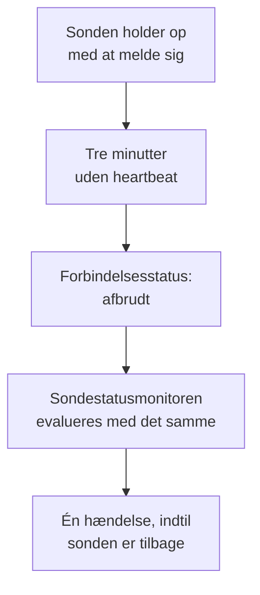

# Sondestatusmonitor

En sondestatusmonitor giver dig besked, når en sonde holder op med at melde sig: én hændelse, når den mister forbindelsen, som løser sig selv, når den er tilbage. Ret den mod dine brugerdefinerede sonder eller, på en selvhostet OneUptime, mod den globale sonde, som alle monitorer kører på, så en sonde, der bliver tavs, aldrig efterlader sine monitorer ukontrollerede, uden at nogen ved det. En ny monitor udløser også en advarsel, når en af dens sonder kommer bagud, så dens monitorer tjekkes, eller dens netværksenheder polles, sjældnere end indstillet.

:::cards
- [Opret en](#opret-en-sondestatusmonitor): Vælg sonderne, og behold standardkriterierne.
- [Kriterier](#kriterier): Tæl de forbundne, afbrudte eller bagudliggende sonder, nu eller over et tidsvindue.
- [Metrikker](#metrikker): Hvor mange sonder der var forbundet, minut for minut.
:::

## Sådan virker det

OneUptime evaluerer hver sondestatusmonitor én gang i minuttet og igen i det øjeblik, en af dens sonder får eller mister forbindelsen. Den læser hver sondes forbindelsesstatus, den samme som sondens side viser: en sonde er afbrudt, når der ikke er hørt fra den i tre minutter. Efter at OneUptime selv har været nede eller ikke har modtaget data, venter den tre hele minutter, før den kalder nogen sonde afbrudt, så en opgradering af OneUptime åbner aldrig en hændelse. Den læser også, om hver forbundet sonde er bagud, sådan som sondens side siger det ([En sonde er bagud](/docs/probe/custom-probe#en-sonde-er-bagud)), og evaluerer monitoren igen, i det øjeblik en kommer bagud eller indhenter det.

En sonde, der forbliver nede, er én hændelse, ikke én i minuttet. Monitoren forbliver offline med sin hændelse åben, indtil alle de sonder, den overvåger, er forbundet igen; så løser hændelsen sig selv.

En monitor kan overvåge sit eget projekts sonder og de globale sonder. En slettet sonde tælles ikke med nogen vej. Når ingen af de sonder, en monitor overvåger, er tilbage, beholder den sin status, og dens oversigt siger det efter en dag.

## Opret en sondestatusmonitor

:::steps
### Start en ny monitor

Gå til **Monitorer**, og klik på **Opret monitor**.

### Vælg sondestatus

Under **Monitortype** skal du klikke på **Flere monitortyper** og vælge **Sondestatus** under **Andet**. Udfyld **Navn**, og klik på **Næste**.

### Vælg sonderne

Under **Sonder, der skal overvåges** skal du vælge sonderne. En ny monitor starter med dit projekts egne sonder. En selvhostet OneUptime uden egne sonder starter med sine globale sonder; på OneUptime Cloud drives de globale sonder af OneUptime, så et projekt vælger dem selv, hvis det vil overvåge dem.

### Opret monitoren

Behold standardkriterierne, der er beskrevet nedenfor, og klik på **Opret monitor**. Monitoren evalueres med det samme, og dens oversigt viser hver sonde, den overvåger, med de afbrudte først.
:::

> [!TIP]
> **Overvåg denne sonde**, på en sondes side og i menuen i dens række under **Monitorer → Indstillinger → Sonder**, åbner **Opret monitor** med en sondestatusmonitor, der overvåger den sonde og er opkaldt efter den.

## Kriterier

En sondestatusmonitors filtre tæller sonder:

| Filter | Hvad det tæller |
| --- | --- |
| **Afbrudte sonder** | De overvågede sonder, der er afbrudt. |
| **Forbundne sonder** | De overvågede sonder, der er forbundet. |
| **Sonder bagud** | De overvågede sonder, der er forbundet, men bagud: Deres monitorer tjekkes, eller deres netværksenheder polles, sjældnere end indstillet. |

Alle tre er heltal, der sammenlignes med **Større end**, **Mindre end**, **Lig med** og de øvrige sammenligninger. En ny monitor starter med tre kriterier:

| Kriterium | Filter | Hvad det gør |
| --- | --- | --- |
| Tjek, om en sonde er afbrudt | **Afbrudte sonder** større end `0` | Sætter monitoren offline og erklærer en hændelse med titlen "Sonde afbrudt: {{disconnectedProbeNames}}", som løser sig selv. |
| Tjek, om en sonde er bagud | **Sonder bagud** større end `0` | Udløser en advarsel med titlen "Sonde bagud: {{behindProbeNames}}", som løser sig selv. Den ændrer ikke monitorens status og erklærer ingen hændelse: Sonden melder sig stadig. |
| Tjek, om alle sonder er forbundet | **Afbrudte sonder** lig med `0` | Sætter monitoren til operationel. |

En monitor, der blev oprettet, før **Sonder bagud** fandtes, beholder sine kriterier og får derfor ikke besked, når en sonde kommer bagud, før du føjer tjekket til dens kriterier.

Filteret **Forbundne sonder** passer til en monitor, der overvåger flere sonder og kan undvære én: **Forbundne sonder** mindre end `2` erklærer først en hændelse, når der er færre end to tilbage.

### Vent længere før en hændelse

En sonde er først afbrudt efter tre minutters stilhed, så en hurtig genstart åbner intet. For at vente længere skal du sætte flueben i **Evaluér disse kriterier over en periode** under filteret, vælge **Alle værdier** under **Evaluér** og et vindue under **For de seneste**. Med fem minutter skal en sonde forblive afbrudt fem minutter mere, før hændelsen erklæres.

## Metrikker

Hver evaluering registrerer tre serier på monitoren: `oneuptime.monitor.probes.connected`, `oneuptime.monitor.probes.disconnected` og `oneuptime.monitor.probes.behind`, antallet af overvågede sonder, der var forbundet, afbrudt og bagud. De vises i grafer på monitorens side **Metrikker**, og et dashboard eller en metrikmonitor læser dem som enhver anden serie.

## Skabelonvariabler

En sondestatusmonitors hændelses- og alarmskabeloner kan bruge disse variabler ud over dem, alle monitorer har:

| Variabel | Værdi |
| --- | --- |
| `{{disconnectedProbeNames}}` | Navnene på de afbrudte sonder, adskilt af kommaer. |
| `{{disconnectedProbeCount}}` | Hvor mange af sonderne der er afbrudt. |
| `{{connectedProbeNames}}` | Navnene på de forbundne sonder, adskilt af kommaer. |
| `{{connectedProbeCount}}` | Hvor mange af sonderne der er forbundet. |
| `{{behindProbeNames}}` | Navnene på de forbundne sonder, der er bagud, adskilt af kommaer. |
| `{{behindProbeCount}}` | Hvor mange af sonderne der er bagud. |
| `{{probeStatusSummary}}` | Én sætning, der nævner de afbrudte sonder, som `1 of 3 probes is disconnected: EU Probe.`, ellers dem, der er bagud, eller siger, at alle sonder er forbundet. |
| `{{probes}}` | Hver sonde med `probeName`, `isConnected`, `isBehind`, `isGlobalProbe` og `lastAliveAt`. |

## Fejlfinding

:::details Monitoren siger, at den venter på data
En ny monitor viser sin første evaluering inden for et minut eller to. Hvis den ikke overvåger nogen sonde, viser den i stedet **Ikke sat op**: vælg sonderne under **Kriterier**.
:::

:::details En sonde gik ned, og der blev ikke erklæret nogen hændelse
En sonde er afbrudt efter tre minutter uden heartbeat, og endnu senere efter at OneUptime selv har været nede. Kontrollér, at monitoren ikke er deaktiveret eller i et vedligeholdelsesvindue, og at dens kriterier stadig erklærer en hændelse.
:::

## Næste skridt

:::cards
- [Brugerdefinerede sonder](/docs/probe/custom-probe): Kør en sonde i dit eget netværk.
- [Monitorkriterier og -statusser](/docs/monitor/criteria-and-statuses): Hvordan kriterier afgør en monitors status.
- [Skabeloner til hændelser og alarmer](/docs/monitor/incident-alert-templating): Formulér den hændelse, en monitor erklærer.
:::
