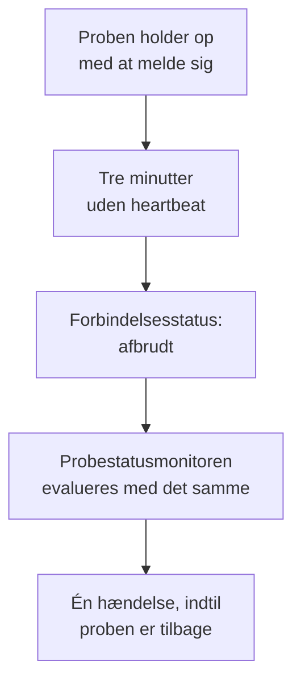

# Probestatusmonitor

En probestatusmonitor giver dig besked, når en probe holder op med at melde sig: én hændelse, når den mister forbindelsen, som løser sig selv, når den er tilbage. Ret den mod dine brugerdefinerede probes eller, på en selvhostet OneUptime, mod den globale probe, som alle monitorer kører på, så en probe, der bliver tavs, aldrig efterlader sine monitorer ukontrollerede, uden at nogen ved det.

:::cards
- [Opret en](#opret-en-probestatusmonitor): Vælg proberne, og behold standardkriterierne.
- [Kriterier](#kriterier): Tæl de forbundne eller afbrudte probes, nu eller over et tidsvindue.
- [Metrikker](#metrikker): Hvor mange probes der var forbundet, minut for minut.
:::

## Sådan virker det

OneUptime evaluerer hver probestatusmonitor én gang i minuttet og igen i det øjeblik, en af dens probes får eller mister forbindelsen. Den læser hver probes forbindelsesstatus, den samme som probens side viser: en probe er afbrudt, når der ikke er hørt fra den i tre minutter. Efter at OneUptime selv har været nede eller ikke har modtaget data, venter den tre hele minutter, før den kalder nogen probe afbrudt, så en opgradering af OneUptime åbner aldrig en hændelse.

En probe, der forbliver nede, er én hændelse, ikke én i minuttet. Monitoren forbliver offline med sin hændelse åben, indtil alle de probes, den overvåger, er forbundet igen; så løser hændelsen sig selv.

En monitor kan overvåge sit eget projekts probes og de globale probes. En slettet probe tælles ikke med nogen vej. Når ingen af de probes, en monitor overvåger, er tilbage, beholder den sin status, og dens oversigt siger det efter en dag.

## Opret en probestatusmonitor

:::steps
### Start en ny monitor

Gå til **Monitorer**, og klik på **Opret monitor**.

### Vælg probestatus

Under **Monitortype** skal du klikke på **Flere monitortyper** og vælge **Sondestatus** under **Andet**. Udfyld **Navn**, og klik på **Næste**.

### Vælg proberne

Under **Probes, der skal overvåges** skal du vælge proberne. En ny monitor starter med dit projekts egne probes. En selvhostet OneUptime uden egne probes starter med sine globale probes; på OneUptime Cloud drives de globale probes af OneUptime, så et projekt vælger dem selv, hvis det vil overvåge dem.

### Opret monitoren

Behold standardkriterierne, der er beskrevet nedenfor, og klik på **Opret monitor**. Monitoren evalueres med det samme, og dens oversigt viser hver probe, den overvåger, med de afbrudte først.
:::

> [!TIP]
> **Overvåg denne probe**, på en probes side og i menuen i dens række under **Monitorer → Indstillinger → Sonder**, åbner **Opret monitor** med en probestatusmonitor, der overvåger den probe og er opkaldt efter den.

## Kriterier

En probestatusmonitors filtre tæller probes:

| Filter | Hvad det tæller |
| --- | --- |
| **Disconnected Probes** | De overvågede probes, der er afbrudt. |
| **Connected Probes** | De overvågede probes, der er forbundet. |

Begge er heltal, der sammenlignes med **Større end**, **Mindre end**, **Lig med** og de øvrige sammenligninger. En ny monitor starter med to kriterier:

| Kriterium | Filter | Hvad det gør |
| --- | --- | --- |
| Check if a probe is disconnected | **Disconnected Probes** større end `0` | Sætter monitoren offline og erklærer en hændelse med titlen `Probe disconnected: {{disconnectedProbeNames}}`, som løser sig selv. |
| Check if every probe is connected | **Disconnected Probes** lig med `0` | Sætter monitoren til operationel. |

**Connected Probes** passer til en monitor, der overvåger flere probes og kan undvære én: **Connected Probes** mindre end `2` erklærer først en hændelse, når der er færre end to tilbage.

### Vent længere før en hændelse

En probe er først afbrudt efter tre minutters stilhed, så en hurtig genstart åbner intet. For at vente længere skal du sætte flueben i **Evaluér disse kriterier over en periode** under filteret, vælge **All Values** under **Evaluér** og et vindue under **For de seneste (i minutter)**. Med fem minutter skal en probe forblive afbrudt fem minutter mere, før hændelsen erklæres.

## Metrikker

Hver evaluering registrerer to serier på monitoren: `oneuptime.monitor.probes.connected` og `oneuptime.monitor.probes.disconnected`, antallet af overvågede probes, der var forbundet og afbrudt. De vises i grafer på monitorens side **Metrikker**, og et dashboard eller en metrikmonitor læser dem som enhver anden serie.

## Skabelonvariabler

En probestatusmonitors hændelses- og alarmskabeloner kan bruge disse variabler ud over dem, alle monitorer har:

| Variabel | Værdi |
| --- | --- |
| `{{disconnectedProbeNames}}` | Navnene på de afbrudte probes, adskilt af kommaer. |
| `{{disconnectedProbeCount}}` | Hvor mange af proberne der er afbrudt. |
| `{{connectedProbeNames}}` | Navnene på de forbundne probes, adskilt af kommaer. |
| `{{connectedProbeCount}}` | Hvor mange af proberne der er forbundet. |
| `{{probeStatusSummary}}` | Én sætning, der nævner de afbrudte probes, som `1 of 3 probes is disconnected: EU Probe.`, eller siger, at alle probes er forbundet. |
| `{{probes}}` | Hver probe med `probeName`, `isConnected`, `isGlobalProbe` og `lastAliveAt`. |

## Fejlfinding

:::details Monitoren siger, at den venter på data
En ny monitor viser sin første evaluering inden for et minut eller to. Hvis den ikke overvåger nogen probe, viser den i stedet **Not set up**: vælg proberne under **Kriterier**.
:::

:::details En probe gik ned, og der blev ikke erklæret nogen hændelse
En probe er afbrudt efter tre minutter uden heartbeat, og endnu senere efter at OneUptime selv har været nede. Kontrollér, at monitoren ikke er deaktiveret eller i et vedligeholdelsesvindue, og at dens kriterier stadig erklærer en hændelse.
:::

## Næste skridt

:::cards
- [Brugerdefinerede probes](/docs/probe/custom-probe): Kør en probe i dit eget netværk.
- [Monitorkriterier og -statusser](/docs/monitor/criteria-and-statuses): Hvordan kriterier afgør en monitors status.
- [Skabeloner til hændelser og alarmer](/docs/monitor/incident-alert-templating): Formulér den hændelse, en monitor erklærer.
:::
