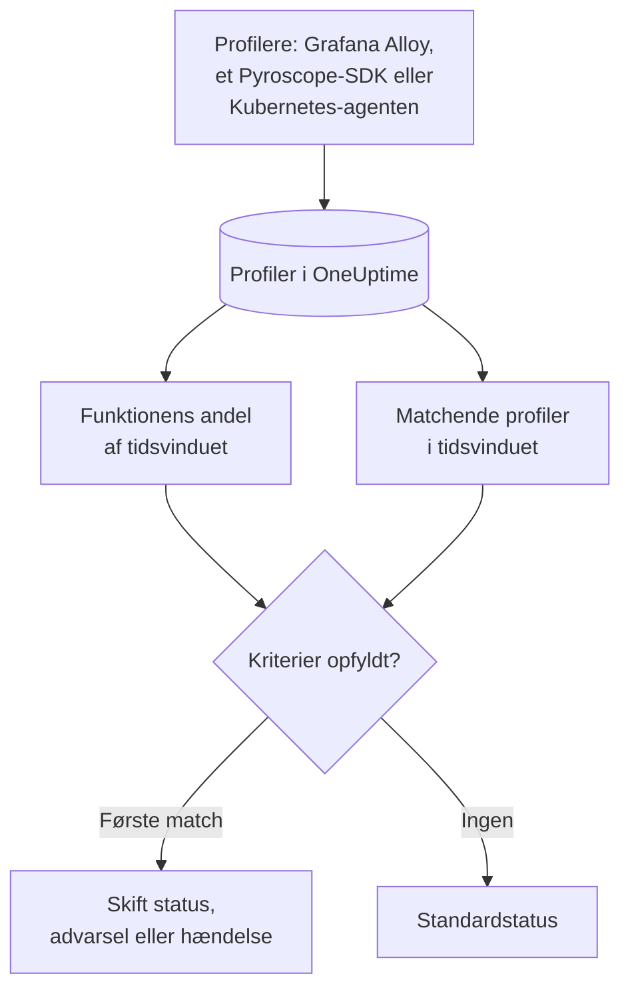

# Profil-monitor

En profil-monitor læser de kontinuerlige profiler, som dine tjenester sender til OneUptime, og advarer om to ting: en funktion, der tager en større andel af tiden, end den burde, som en parser, der blev tungere efter en udrulning, og profiler, der holder op med at komme fra en tjeneste. Hvert minut måler den, hvor meget af sit tidsvindue der gik gennem den funktion, du angiver, tæller de profiler, der matcher dens filtre, og ændrer monitorens status, opretter en advarsel eller erklærer en hændelse, når dine kriterier er opfyldt.

:::cards
- [Opret monitoren](#opret-en-profil-monitor): Fra en funktion i Profileren eller fra Opret monitor.
- [Hvad den forespørger](#hvad-den-forespørger): Funktionen, profiltypen, tjenesterne og vinduet.
- [Kriterier](#kriterier): En funktions andel af vinduet eller antallet af profiler.
- [En funktion bliver tungere](#gennemgået-eksempel-en-funktion-bliver-tungere): Få en advarsel, når en funktions andel springer op.
:::

## Sådan fungerer det



Hvert minut læser OneUptime de profiler, der matcher monitorens filtre og startede inden for dens tidsvindue. Den tæller dem og måler, når monitoren angiver en funktion, den andel af vinduets tid, der gik gennem funktionen. Den holder disse tal op mod monitorens kriterier fra top til bund, og det første kriterium, der matcher, afgør, hvad der sker. Når intet matcher, vender monitoren tilbage til sin standardstatus.

## Før du starter

- Dine tjenester sender kontinuerlige profileringsdata til OneUptime via Grafana Alloy (eBPF), et Pyroscope-SDK eller OneUptime-Kubernetes-agenten. Se [Kontinuerlig profilering](/docs/telemetry/profiles).
- For at holde øje med en funktion kender du dens navn eller en del af dens fil- eller pakkesti, sådan som Profileren viser den.

## Opret en profil-monitor

:::steps
### Start fra Profileren eller fra Opret monitor

Det hurtigste er at starte fra selve funktionen: Åbn funktionen i **Ydeevneprofiler**, og klik på linket, der tilbyder en advarsel om dens andel. **Opret monitor** åbner med monitoren udfyldt for den funktion og dens tjeneste, med en tærskel over det, den tager i dag, som beskrevet i [Gennemgået eksempel: en funktion bliver tungere](#gennemgået-eksempel-en-funktion-bliver-tungere). Ellers går du til **Monitorer** og klikker på **Opret monitor**.

### Vælg Profiles

Under **Monitortype** klikker du på **Flere monitortyper** og vælger **Profiler** under **Telemetri**, eller du skriver `profiles` i søgefeltet. Angiv et **Navn**, og klik derefter på **Næste**.

### Vælg, hvad den læser

I **Konfiguration af profilmonitor** sætter du **Funktion** til den funktion, der skal holdes øje med, **Hvad der skal analyseres** til profiltypen og **Overvåg profiler for (tid)** til vinduet. En ny monitor læser **CPU-tid** over de **Seneste 5 minutter**. **Hvad denne monitor læser nu** under felterne viser, hvor mange profiler der matcher, og hvor meget af vinduet funktionen tager i dag, så du kan sætte tærsklen over det. Åbn **Flere felter** for at filtrere efter telemetritjeneste eller infrastrukturenhed.

### Angiv kriterierne

En monitor, der er startet fra **Opret monitor**, har to kriterier: offline, med en hændelse, når **Antal profiler** er 0, og online, når det er over 0. For at få en advarsel om funktionen tilføjer du et filter **Funktionsandel (i %)**: se [Kriterier](#kriterier).

### Opret monitoren

Klik på **Opret monitor**. Monitoren åbner på sin side **Oversigt**, og dens første evaluering kører inden for et minut.
:::

### Opret den via API'et eller Terraform

En monitors trin indeholder de samme indstillinger som dens konfiguration `profileMonitor`. Denne holder øje med `parseOrder` i én tjenestes CPU-profiler over de seneste fem minutter:

```json
{
  "profileMonitor": {
    "telemetryServiceIds": [],
    "profileTypes": ["cpu"],
    "profileType": "",
    "functionName": "parseOrder",
    "attributes": {},
    "lastXSecondsOfProfiles": 300
  }
}
```

Sæt tjenestens ID i `telemetryServiceIds`, eller lad listen være tom for at læse profiler fra alle tjenester, og lad `functionName` være tom for kun at tælle profiler. Opret en monitor med monitortypen `Profiles` og et trin, der indeholder denne konfiguration og mindst ét kriterium, via [API'et](/docs/api-reference/api-reference) eller [Terraform](/docs/terraform/monitor-steps). I Terraform giver du konfigurationen som trinnets attribut `profile_monitor`, skrevet med `jsonencode()`.

## Hvad den forespørger

| Felt | Hvad det matcher | Standard |
| --- | --- | --- |
| `profileTypes` | Profiler af en af disse typer, sammenlignet præcist, som `cpu`. | Tom: alle typer |
| `profileType` | Profiler, hvis type indeholder denne tekst, uden hensyn til store og små bogstaver. Når den er angivet, ignoreres `profileTypes`. | Tom |
| `functionName` | Den kode, hvis andel **Funktionsandel (i %)** måler: stack-frames, hvis funktionsnavn eller filsti indeholder denne tekst, uden hensyn til store og små bogstaver. | Tom: ingen andel måles |
| `telemetryServiceIds` | Profiler fra en af disse telemetritjenester. | Tom: alle tjenester |
| `entityKeys` | Profiler fra en af disse værter, pods, containere og andre infrastrukturenheder. | Tom: alle enheder |
| `attributes` | Profiler, hvis attributter har disse værdier. | Tom: ingen betingelse |
| `lastXSecondsOfProfiles` | Profiler, der startede inden for dette antal sekunder før evalueringen. | Ingen: angiv den altid, ellers tælles hver gemt profil, og antallet falder aldrig til 0 |

Alle de filtre, du angiver, skal matche, for at en profil bliver læst. I formularen sætter **Funktion** `functionName`, **Hvad der skal analyseres** sætter `profileTypes` (**Alle slags profiler** lader den være tom), **Overvåg profiler for (tid)** sætter `lastXSecondsOfProfiles`, og **Filtrér efter telemetritjeneste** og **Filtrér efter infrastrukturenhed** sætter `telemetryServiceIds` og `entityKeys`.

## Sådan evalueres den

- **Hvert minut.** En profil-monitor tjekkes ikke af sonder, så den har intet interval at angive og ingen side **Sonder og interval**.
- **To tal pr. evaluering.** Monitoren tæller de profiler, der matcher alle filtre og startede inden for `lastXSecondsOfProfiles`, og måler funktionens andel af de samme profiler. En profiler uploader med et fast interval, så giv vinduet plads til flere uploads.
- **Én enhed ad gangen.** En andel lægger samples af én enhed sammen: Når de typer, den læser, blander enheder, som CPU-tid i nanosekunder fra et SDK og antal samples fra eBPF, læser den enheden med flest samples i vinduet.
- **Ingen profiler er et antal på 0 og ingen andel.** En tjeneste, hvis profiler holder op med at uploade, giver et antal på 0, og et kriterium **Funktionsandel (i %)** matcher ikke et vindue uden indhold: Få en advarsel om **Antal profiler** for at vide, at profileringen er stoppet.
- **OneUptimes egen nedetid er ikke stilhed.** Så længe tidsvinduet rummer tid, hvor OneUptime selv ikke modtog data (det genstartede, blev opgraderet eller indhentede et efterslæb), venter tjekket: statussen ændres ikke, og ingen hændelse eller advarsel åbnes eller løses. Se [Når OneUptime ikke modtager data](/docs/monitor/when-oneuptime-is-not-receiving).
- **Kriterier fra top til bund.** Det første kriterium, der matcher, afgør det, så sæt det alvorligste øverst.

Hver statusændring registreres med sin årsag på monitorens **Statustidslinje**.

## Kriterier

En profil-monitors kriterier sammenligner et af to tal med en værdi.

**Funktionsandel (i %)** er den andel af vinduets tid, fra 0 til 100, der gik gennem monitorens funktion: Hver stack med en frame, der matcher `functionName`, tæller én gang, uanset dybde, så både funktionens egen kode og alt det, den kalder, er med.

| Filterbetingelse | Matcher, når funktionens andel er… |
| --- | --- |
| **Større end** | over værdien |
| **Større end eller lig med** | værdien eller derover |
| **Mindre end** | under værdien |
| **Mindre end eller lig med** | værdien eller derunder |

**Antal profiler** er antallet af profiler, der matchede i vinduet:

| Filterbetingelse | Matcher, når antallet af profiler er… |
| --- | --- |
| **Større end** | over værdien |
| **Større end eller lig med** | værdien eller derover |
| **Mindre end** | under værdien |
| **Mindre end eller lig med** | værdien eller derunder |
| **Lig med** | præcis værdien |
| **Ikke lig med** | alt andet end værdien |

Antal profiler har ingen anomalibetingelser: der er ingen baseline at sammenligne dem med.

## Gennemgået eksempel: en funktion bliver tungere

I checkout-tjenesten tager `parseOrder` 18 % af dens CPU-tid. En udrulning, der parser en større payload, skal ikke gå ubemærket hen:

1. Vælg checkout-tjenesten i **Ydeevneprofiler**, og åbn `parseOrder`.
2. Klik på linket, der tilbyder en advarsel om dens andel. Profileren foreslår 30 %: halvdelen over dagens andel, mindst 10 point mere, rundet op til et multiplum af 5.
3. **Opret monitor** åbner med en profil-monitor for checkout-tjenesten, der læser **CPU-tid** over de **Seneste 5 minutter**, med to kriterier: **Funktionsandel (i %)** **Større end** `30` udløser en advarsel, der løser sig selv, og markerer monitoren som forringet; **Mindre end eller lig med** `30` markerer den som i drift. Hændelsen er udfyldt, men slået fra: Slå den til for at tilkalde nogen.
4. Klik på **Opret monitor**.

Når udrulningen får `parseOrder` til at tage 45 % af CPU-tiden, udløser den næste evaluering advarslen. Når en rettelse bringer den under 30 % igen, løser advarslen sig selv.

## Gennemgået eksempel: profiler holder op med at komme

Checkout-tjenesten kører et Pyroscope-SDK, der uploader CPU-profiler. Du vil have en hændelse, når de udebliver i fem minutter:

- `profileTypes`: `["cpu"]`, `telemetryServiceIds`: checkout-tjenesten, `lastXSecondsOfProfiles`: `300`
- Kriterium 1: **Antal profiler** **Lig med** `0`: sæt monitoren offline, og erklær en hændelse
- Kriterium 2: **Antal profiler** **Større end** `0`: sæt monitoren online

Mens SDK'et uploader, tæller hver evaluering nogle profiler, og kriterium 2 holder monitoren online. Når tjenesten udrulles uden SDK'et, falder antallet til 0 fem minutter efter den sidste upload, kriterium 1 matcher, og hændelsen erklæres. Den første upload efter rettelsen bringer antallet over 0 igen, og hændelsen løser sig selv, hvis **Løs hændelse automatisk** er slået til for den.

## Fejlfinding

:::details Monitoren tæller 0, men der vises profiler i OneUptime
Sammenlign filtrene med de profiler, du ser: `profileTypes` skal matche typen præcist, og `telemetryServiceIds` skal indeholde de rigtige tjeneste-id'er. Et kort `lastXSecondsOfProfiles` kan også falde mellem to uploads.
:::

:::details Funktionens andel bliver ved med at være 0 %
Ingen frame i vinduet indeholder funktionsteksten. Åbn funktionen i Profileren, og kopiér dens navn, som det står der; en del af navnet virker, og store og små bogstaver er ligegyldige. Tjek derefter, at tjenesten sender den profiltype, som **Hvad der skal analyseres** læser.
:::

## Næste skridt

:::cards
- [Kontinuerlig profilering](/docs/telemetry/profiles): Send profiler, og læs dem i Profileren.
- [Monitortrin](/docs/terraform/monitor-steps): Send trinnets konfiguration fra Terraform.
- [Trace-monitor](/docs/monitor/traces-monitor): Få advarsler om mislykkede spans.
- [Metrik-monitor](/docs/monitor/metrics-monitor): Få advarsler om CPU, hukommelse og andre metrikker.
:::
