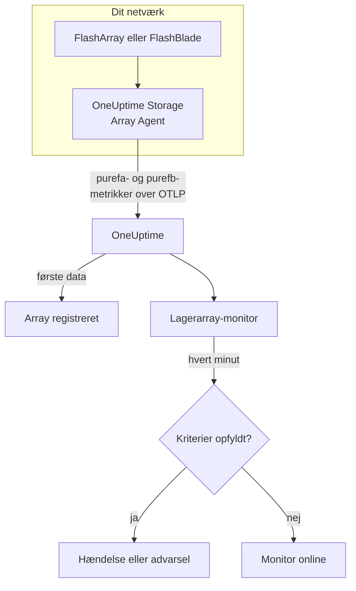

# Lagerarray-monitor

En lagerarray-monitor holder øje med ét lagerarray og fortæller dig, når arrayet selv udsender en advarsel, løber tør for plads, bliver langsomt, mister hardware eller en værtssti, eller kommer bagud med replikering. Den virker med Pure Storage FlashArray, Pure Storage FlashBlade og NetApp ONTAP (Amazon FSx for NetApp ONTAP medregnet) og læser de metrikker, som OneUptime Storage Array Agent indsamler: Pures serier `purefa_*` og `purefb_*` og de serier `netapp_*`, som NetApp Harvest læser fra en ONTAP-klynge.

Den fungerer også med Dell PowerStore (`dell.powerstore`), ud fra Dells serier `powerstore_*`.

:::cards
- [Opret monitoren](#opret-en-lagerarray-monitor): Seks trin i dashboardet.
- [Skabeloner](#færdige-advarselsskabeloner): Færdige advarsler, én hændelse pr. volumen, vært, appliance eller komponent.
- [Sådan fungerer Pures serier](#sådan-er-pures-serier-bygget-op): Ét metriknavn, mange værdier. ONTAPs [har deres eget afsnit](#sådan-er-ontaps-serier-bygget-op).
- [Metrikker](#indsamlede-metrikker): Hver serie, monitoren kan advare på.
:::

## Sådan fungerer det

OneUptime Storage Array Agent kører på en maskine, der kan nå arrayets administrationsgrænseflade. Den læser arrayets metrikker med et skrivebeskyttet API-token, mærker dem med arrayets navn, `storage.array.name`, og dets platform, `storage.system`, og sender dem til OneUptime over OTLP. De første data registrerer arrayet.

En Dell PowerMax (`dell.powermax`) kræver ingen agent: en OneUptime-sonde logger hvert 5. minut ind på Unisphere for PowerMax med en skrivebeskyttet konto og sender hvert array, den administrerer, på samme måde, navngivet efter sit Symmetrix ID, indtil du omdøber det ([Dell PowerMax](/docs/telemetry/storage-arrays#dell-powermax)).

En lagerarray-monitor er knyttet til ét array. Hvert minut kører den sin forespørgsel på det arrays metrikker og sammenligner resultatet med sine kriterier.



## Før du begynder

- **Installér Storage Array Agent** et sted, hvor den kan nå arrayet over HTTPS, med API-tokenet for en bruger, der har arrayets rolle **readonly**. [Vejledningen til Storage Array Agent](/docs/telemetry/storage-arrays) dækker brugeren, tokenet og installationen, gennem `ONEUPTIME_URL`, `ONEUPTIME_TELEMETRY_INGESTION_KEY`, `STORAGE_ARRAY_NAME` samt arrayets adresse og token (`PURE_FA_ENDPOINT` og `PURE_FA_API_TOKEN`, eller `PURE_FB_ENDPOINT` og `PURE_FB_API_TOKEN`) eller for ONTAP klyngens adresse og en skrivebeskyttet REST-bruger (`NETAPP_ONTAP_ENDPOINT`, `NETAPP_ONTAP_USERNAME` og `NETAPP_ONTAP_PASSWORD`).
- **Tjek, at arrayet er registreret.** Det vises under **Produkter → Infrastruktur → Lagerarrays → Alle lagerarrays**, opkaldt efter agentens `STORAGE_ARRAY_NAME`, cirka et minut efter den første aflæsning.
- **For en Dell PowerMax** forbinder du i stedet den Unisphere for PowerMax, der administrerer den, under **Produkter → Infrastruktur → Lagerarrays → Forbindelser**, som [Dell PowerMax](/docs/telemetry/storage-arrays#dell-powermax) forklarer.

## Opret en lagerarray-monitor

:::steps
### Start en ny monitor

Gå til **Monitorer**, og klik på **Opret monitor**.

### Vælg Lagerarray

Klik under **Monitortype** på **Flere monitortyper**, og vælg **Lagerarray** under **Infrastruktur**, eller skriv `storage` i søgefeltet. Angiv et **Navn** - det bruges i titlerne på hændelser og advarsler - og klik på **Næste**.

### Vælg arrayet

Vælg under **Storage Array Monitor Configuration** arrayet i **Lagerarray**. Hvert array, der har sendt data, står på listen. Dets platform afgør, hvilke metrikker og skabeloner formularen tilbyder. Når du har valgt, viser en linje under feltet, om der kommer data. **Tilføj lagerarray** åbner opsætningstrin med dine nøgler udfyldt, som venter på de første data.

### Vælg, hvad der skal overvåges

En ny monitor starter med **Array Stopped Reporting** under **Hvad der skal advares om**. Sådan overvåger du noget andet:

- **Skift** - vælg en anden [skabelon](#færdige-advarselsskabeloner). Den sætter metrikken, labelfiltrene, aggregeringen, tidsintervallet og tærsklerne og erstatter kriterierne nedenfor med sine egne. Du kan stadig ændre **Tidsinterval**.
- **Custom Metric** (under **Flere felter**) - vælg én metrik i **Storage Array Metric**, og sæt derefter **Aggregering** og **Tidsinterval**. [Filtrene](#monitorindstillinger) indsnævrer den til ét volumen, én vært, én pod, én komponent, ét filsystem eller én bucket.
- **Avanceret** (under **Flere felter**) - byg selv forespørgsler og formler under **Vælg metrikker**, for eksempel den brugte kapacitet som `purefa_array_space_bytes` filtreret til `space=capacity` minus den samme metrik filtreret til `space=empty`. Brug **Gruppér efter** med et objekts label for at bedømme hvert objekt for sig.

### Tjek kriterierne

Åbn hvert kriterium under **Kriterier**, og tjek dets **Metrik**, **Aggregering**, **Betingelse** og **Tærskel**. En skabelon udfylder dem. Med **Custom Metric** eller **Avanceret** starter monitoren med [standardkriterierne](#standardkriterier), som kun opdager, at metrikken ikke sender data, så sæt din egen tærskel.

### Opret monitoren

Klik på **Opret monitor**. OneUptime åbner monitorens side og evaluerer den hvert minut. Hændelser og advarsler, den udsender, vises også på arrayets sider **Hændelser** og **Advarsler**.
:::

> [!TIP]
> For at sætte flere skabeloner op på én gang åbner du arrayet fra **Produkter → Infrastruktur → Lagerarrays** og går til **Anbefalinger**. Vælg de skabeloner, du vil have, vælg, hvem der tilkaldes, og OneUptime opretter én monitor pr. skabelon.

## Monitorindstillinger

| Felt | Fane | Hvad det gør |
| --- | --- | --- |
| **Lagerarray** | Alle | Påkrævet. Begrænser hver forespørgsel til `resource.storage.array.name`, så to arrays, der begge har et volumen ved navn `vol-01`, aldrig blandes. |
| **Volumen** | Custom Metric, Avanceret | Ét volumen: på et FlashArray via labelen `name`, som `vol-db-01` (et volumen i en pod eller en volumengruppe hedder `pod::volume` eller `group/volume`); på ONTAP via labelen `volume`, som to SVM'er kan dele; på en PowerMax via labelen `volume`, dets enheds-ID som `00847`. |
| **Vært** | Custom Metric, Avanceret | Kun FlashArray. Én vært, som arrayet kender den, via labelen `host`, som `esxi-01`. |
| **Pod** | Custom Metric, Avanceret | Kun FlashArray. Én ActiveCluster- eller ActiveDR-pod, via labelen `name`, eller `local_pod` på serier for replikalinks. |
| **Hardwarekomponent** | Custom Metric, Avanceret | Én hardwarekomponent, som `CH0.BAY1` eller `CT0`: labelen `component_name` på et FlashArray, `name` på et FlashBlade, på ONTAP den label, dens serie navngiver den med (`node`, `disk`, `shelf` eller `port`), og `component` på en PowerMax, en director som `FA-1D` eller en port som `FA-1D:4`. |
| **Filsystem** | Custom Metric, Avanceret | Kun FlashBlade. Ét filsystem, via labelen `name`. |
| **Bucket** | Custom Metric, Avanceret | Kun FlashBlade. Én bucket til objektlager, via labelen `name`. |
| **Storage Array Metric** | Custom Metric | Én metrik fra [kataloget](#indsamlede-metrikker). Formularen tilføjer det labelfilter, der giver den dens betydning, og grupperer den efter det objekt, den beskriver, så hvert volumen, hver vært eller hver komponent bedømmes for sig. |
| **Aggregering** | Custom Metric | Hvordan prøver kombineres: **Gennemsnit**, **Maksimum**, **Minimum**, **Sum** eller **Antal**. Starter ved metrikkens sædvanlige aggregering. |
| **Tidsinterval** | Alle | Det glidende vindue, forespørgslen læser, fra **Past 1 Minute** til **Past 365 Days**. En ny monitor starter ved **Seneste 5 minutter**; en brugerdefineret metrik for et filsystem eller en bucket ved **Seneste 15 minutter**; skabeloner sætter deres eget. |
| **Vælg metrikker** | Avanceret | Forespørgselsbyggeren: **Metrik**, **Aggreger efter**, **Filtrer efter attributter**, **Gruppér efter**, plus **Tilføj metrik** og **Tilføj formel** til at kombinere forespørgsler. |

Agenten læser arrayets endpoint hvert 60. sekund, og volumener, værter og pods hvert 2. minut, så et vindue på 5 minutter altid indeholder en prøve. Et FlashBlades filsystemer og buckets læser den hvert 5. minut, deraf 15, og FlashArray-mapper hvert 30. minut: giv en mappemonitor et vindue på 60 minutter. På ONTAP læser Harvest klyngens ydeevne hvert minut og dens konfiguration, tilstand og EMS-begivenheder hvert 3. minut, så et vindue på 5 minutter altid indeholder en prøve.

Den læser en PowerStore hvert 5. minut og dens klynges tilstand hvert 60. sekund: giv en PowerStore-monitor et vindue på 15 minutter.

## Sådan er Pures serier bygget op

Pure lægger flere værdier på **ét** metriknavn og skelner dem med en label:

- **`dimension`** på ydeevneserierne. `purefa_array_performance_latency_usec` bærer læselatensen (`usec_per_read_op`), skrivelatensen (`usec_per_write_op`), latensen for spejlede skrivninger og SAN-, kø-, QoS- og servicetiden for hver af dem. Filtrér altid på én `dimension`: et gennemsnit på tværs af dem blander en læselatens på 200 µs med en køværdi.
- **`space`** på kapacitetsserierne: `capacity`, `empty`, `snapshots`, `total_provisioned`, `total_physical`, `available_ratio` og flere.

Flere serier bærer deres tilstand i en **label**, med en værdi, der altid er 1:

| Serie | Tilstandslabel | Én serie pr. |
| --- | --- | --- |
| `purefa_alerts_open` | `severity`, med `summary`, `code` og `component_type` | Åben advarsel |
| `purefa_hw_component_status` | `component_status` | Hardwarekomponent |
| `purefa_host_connectivity_info` | `status`, med `details` | Vært |
| `purefa_drive_capacity_bytes` | `component_status` (værdien er drevets kapacitet) | Drev |

En serie, der er filtreret til en dårlig tilstand, findes kun, så længe noget er i den tilstand, så ingen serie betyder sundt. Derfor er **Max over 0 udløser og 0 genopretter** den rigtige form for dem, og sådan er skabelonerne bygget: deres genopretningskriterier tæller en manglende serie som nul. Når der slet ingen serier er tilbage, genopretter sådan en skabelon kun, hvis `purefa_info`, `purefb_info` eller `powermax_array_info` er ankommet i samme vindue, så et array, der er holdt op med at rapportere, lukker intet.

En PowerMax' serier rummer hver én værdi og er opkaldt efter den: `powermax_array_response_time_usec` skelner læsninger fra skrivninger med `operation`. Dens tilstandsserier findes på samme måde kun, mens noget er galt: `powermax_alert_open`, mens Unisphere har en advarsel åben, `powermax_director_offline`, mens en director ikke er online, `powermax_port_offline`, mens en port, som nogen er afhængig af, er nede, og `powermax_srdf_group_not_healthy`, mens en SRDF-gruppe er suspenderet eller offline.

I monitorfiltre og grupperingsnøgler begynder agentens attributter med `resource.` (`resource.storage.array.name`, `resource.storage.system`), mens Pures egne labels ikke gør (`name`, `host`, `component_name`, `dimension`, `space`, `severity`), og det gør PowerMax' heller ikke (`storage_group`, `volume`, `director`, `port_id`, `srdf_group`).

## Sådan er PowerStores serier opbygget

Dells eksportør skriver én værdi pr. metriknavn, så en PowerStore-serie behøver intet labelfilter. Dens labels navngiver objektet: `appliance_id` en appliance, `name` en del, en diskenhed eller et filsystem, og `volume_id`, `fc_port_id`, `eth_port_id`, `nas_id` eller `volume_group_id` objektet for en ydeevneserie. Dens tilstandsserier er 1, mens alt er sundt, og ellers 0, så skabelonerne udløses under 1. Dens egne advarsler kommer via syslog, og deres skabeloner, protokolmonitorer, står efter dens tabel nedenfor.

## Sådan er ONTAPs serier bygget op

NetApp Harvest navngiver hver serie `netapp_<object>_<counter>` og navngiver objektet med dets labels: et volumen med `volume` inden for dets `svm`, et aggregat med `aggr`, en LUN med `lun` inden for dens `volume` og `svm`, en node med `node`, en disk med `disk`, en diskhylde med `shelf`, en SnapMirror-relation med `destination_location`. Latenser er mikrosekunder pr. operation, `_ops` operationer pr. sekund, `_data` bytes pr. sekund.

ONTAPs tilstande kommer på tre måder:

| Serie | Tilstand | Én serie pr. |
| --- | --- | --- |
| `netapp_*_new_status` | 1 sund, online, oppe eller kører, 0 ikke | Objekt, ved hver indsamling |
| `netapp_health_*_alerts` | Værdi 1, med `severity` (`error` eller `warning`) og årsagen i dens labels | Åbent problem: en defekt disk, en fejl på en diskhylde, en node, der ikke kan overtage sin partner, en port, der er nede, en advarsel om systemsundhed |
| `netapp_ems_events` | Værdi 1, med `message`, `severity` og begivenhedens parametre | EMS-begivenhed, i den ene indsamling, der hentede den; når en parret begivenhed ophører, eksporteres den én gang til som 0 |

En tilstand som tal udløser, når hver værdi i vinduet er under 1, og genopretter, så snart en værdi er 1 igen. Et åbent problem udløser, mens dets serie findes, og genopretter, når den er væk, så længe `netapp_cluster_new_status` stadig ankommer, så en stoppet agent lukker intet. En EMS-begivenhed udløser på sin ene værdi og forbliver åben, mens den er inden for skabelonens time; den genopretter, når der går en time uden en ny.

## Færdige advarselsskabeloner

OneUptime leverer 80 skabeloner — 12 til FlashArray, 8 til FlashBlade, 16 til PowerStore, 31 til ONTAP og 13 til PowerMax — og listen under **Hvad der skal advares om** tilbyder dem til arrayets platform. Hver bygger en komplet monitor: metrikforespørgslen, dens labelfiltre, en gruppering på objektets egen label, et kriterium, der udløser, og et, der genopretter. Tærskler er udgangspunkter, du kan redigere.

Et kriterium udløser kun, når betingelsen gælder for **hver** værdi i dets vindue, undtagen i en ONTAP-EMS-skabelon: Harvest eksporterer en begivenhed i én indsamling, så én værdi er nok. En monitor, der udløste på en tærskel for kapacitet, latens, forsinkelse eller forhold, genopretter først 10 % forbi den, så en værdi, der svinger omkring tærsklen, ikke skifter frem og tilbage. Skabelonerne for advarsler, hardware og forbindelser udløses, når en tilstand har vist sig i hele deres vindue på 5 minutter, og genopretter cirka 5 minutter efter, at den er forsvundet.

### FlashArray

| Skabelon                       | Kategori     | Alvorlighed | Overvåger                                                                                       | Udløser når                                                                                                                                      |
| ------------------------------ | ------------ | ----------- | ----------------------------------------------------------------------------------------------- | ------------------------------------------------------------------------------------------------------------------------------------------------ |
| Array Stopped Reporting        | Tilgængelighed | Kritisk     | `purefa_info`, Count, seneste 10 minutter                                                       | Ingen data i hele vinduet — Storage Array Agent er stoppet, har mistet sin rute til OneUptime eller har fået sit token tilbagekaldt, eller arrayet er holdt op med at svare den; genopretter, når data kommer igen |
| Critical Array Alert           | Arrayets sundhed | Kritisk     | `purefa_alerts_open` filtreret til `severity=critical`, Max pr. `summary`, seneste 5 minutter   | > 0 — arrayet har en åben kritisk advarsel (en defekt komponent, en kapacitetsnødsituation, en replikeringsfejl). Én hændelse pr. advarsel; genopretter, når advarslen lukker |
| Warning Array Alert            | Arrayets sundhed | Advarsel     | `purefa_alerts_open` filtreret til `severity=warning`, Max pr. `summary`, seneste 5 minutter    | > 0 — arrayet har en åben advarsel på niveau warning. Én hændelse pr. advarsel; genopretter, når advarslen lukker                               |
| Capacity Above 80%             | Kapacitet    | Advarsel     | `purefa_array_space_utilization`, Max, seneste 15 minutter                                      | > 80 — Pures egen første kapacitetstærskel; genopretter ved ≤ 72                                                                                 |
| Capacity Above 90%             | Kapacitet    | Kritisk     | `purefa_array_space_utilization`, Max, seneste 5 minutter                                       | > 90 — arrayet er tæt på at afvise skrivninger; genopretter ved ≤ 81                                                                             |
| High Read Latency              | Ydeevne      | Advarsel     | `purefa_array_performance_latency_usec` filtreret til `dimension=usec_per_read_op`, Avg, seneste 10 minutter  | > 5000 µs (5 ms) — læsninger på et FlashArray tager normalt langt under 1 ms; genopretter ved ≤ 4500                                |
| High Write Latency             | Ydeevne      | Advarsel     | `purefa_array_performance_latency_usec` filtreret til `dimension=usec_per_write_op`, Avg, seneste 10 minutter | > 5000 µs (5 ms); genopretter ved ≤ 4500                                                                                           |
| Hardware Component Failed      | Hardware     | Kritisk     | `purefa_hw_component_status` filtreret til `component_status=critical`, Max pr. `component_name`, seneste 5 minutter | > 0 — en controller, strømforsyning, blæser, bay eller port er kritisk, og redundansen er væk. Én hændelse pr. komponent; genopretter, når den melder ok |
| Hardware Component Degraded    | Hardware     | Advarsel     | `purefa_hw_component_status` filtreret til `component_status=degraded`, Max pr. `component_name`, seneste 5 minutter | > 0 — en komponent er forringet. Én hændelse pr. komponent; genopretter, når den melder ok                                 |
| Drive Failed                   | Hardware     | Kritisk     | `purefa_drive_capacity_bytes` filtreret til `component_status=failed`, Max pr. `component_name`, seneste 5 minutter | > 0 — et DirectFlash-modul eller en SSD er defekt, og arrayet genopbygger på de andre. Én hændelse pr. drev; genopretter, når det er udskiftet |
| Host Lost Redundant Paths      | Værter       | Advarsel     | `purefa_host_connectivity_info` filtreret til `status=critical`, Max pr. `host`, seneste 5 minutter | > 0 — værten når arrayet gennem én controller eller ingen; et controller-failover ville tage dens lager offline. Én hændelse pr. vært; genopretter, når dens stier er tilbage |
| Replication Lag Above 1 Minute | Replikering  | Advarsel     | `purefa_pod_replica_links_lag_max_msec`, Max pr. `local_pod`, seneste 10 minutter               | > 60000 ms (60 s) — et failover nu ville miste flere nylige skrivninger end planlagt. Én hændelse pr. pod; genopretter ved ≤ 54000              |

### FlashBlade

| Skabelon                     | Kategori     | Alvorlighed | Overvåger                                                                                                      | Udløser når                                                                                                         |
| ---------------------------- | ------------ | ----------- | -------------------------------------------------------------------------------------------------------------- | ------------------------------------------------------------------------------------------------------------------- |
| Array Stopped Reporting      | Tilgængelighed | Kritisk     | `purefb_info`, Count, seneste 10 minutter                                                                      | Ingen data i hele vinduet — agenten, dens exporter eller FlashBladen er holdt op med at svare; genopretter, når data kommer igen |
| Critical Array Alert         | Arrayets sundhed | Kritisk     | `purefb_alerts_open` filtreret til `severity=critical`, Max pr. `summary`, seneste 5 minutter                  | > 0 — FlashBladen har en åben kritisk advarsel. Én hændelse pr. advarsel; genopretter, når advarslen lukker         |
| Warning Array Alert          | Arrayets sundhed | Advarsel     | `purefb_alerts_open` filtreret til `severity=warning`, Max pr. `summary`, seneste 5 minutter                   | > 0 — FlashBladen har en åben advarsel på niveau warning. Én hændelse pr. advarsel; genopretter, når advarslen lukker |
| Capacity Above 80%           | Kapacitet    | Advarsel     | `purefb_array_space_utilization` filtreret til `type=array`, Max, seneste 15 minutter                          | > 80; genopretter ved ≤ 72                                                                                          |
| Capacity Above 90%           | Kapacitet    | Kritisk     | `purefb_array_space_utilization` filtreret til `type=array`, Max, seneste 5 minutter                           | > 90 — skrivninger fejler for hver klient, når den bliver fuld; genopretter ved ≤ 81                                |
| Hardware Component Unhealthy | Hardware     | Kritisk     | `purefb_hardware_health`, Min pr. `name`, seneste 5 minutter                                                   | < 1 — en blade, et fabric-modul, en strømforsyning eller en blæser er ikke sund (en ubrugt plads melder 2). Én hændelse pr. komponent; genopretter ved ≥ 1 |
| High Read Latency            | Ydeevne      | Advarsel     | `purefb_array_performance_latency_usec` filtreret til `dimension=usec_per_read_op` og `protocol=all`, Avg, seneste 10 minutter | > 10000 µs (10 ms) på tværs af alle protokoller; genopretter ved ≤ 9000                              |
| File System Near Full        | Filsystemer | Advarsel     | `purefb_file_systems_space_bytes` filtreret til `space=available_ratio`, Min pr. `name`, seneste 15 minutter   | < 0.1 — der er mindre end 10 % tilbage af et filsystems tildelte størrelse. Én hændelse pr. filsystem; genopretter ved ≥ 0.11 |

### PowerStore

| Skabelon                     | Kategori     | Alvorlighed | Overvåger                                                                                                      | Udløser når                                                                                                         |
| --- | --- | --- | --- | --- |
| Array Stopped Reporting | Tilgængelighed | Kritisk | `powerstore_cluster`, Count, seneste 10 minutter | Ingen data i hele vinduet — agenten, Dells eksportør eller klyngen holdt op med at svare; genopretter, når der igen kommer data |
| Capacity Above 80% | Kapacitet | Advarsel | `powerstore_cap_physical_used_percent`, Max pr. `appliance_id`, seneste 15 minutter | > 80 — en appliances kapacitet bliver fyldt op; genopretter ved ≤ 72 |
| Capacity Above 90% | Kapacitet | Kritisk | `powerstore_cap_physical_used_percent`, Max pr. `appliance_id`, seneste 15 minutter | > 90 — en appliance er tæt på at afvise skrivninger; genopretter ved ≤ 81 |
| High Read Latency | Ydeevne | Advarsel | `powerstore_perf_avg_read_latency`, Avg pr. `appliance_id`, seneste 15 minutter | > 5000 µs (5 ms); genopretter ved ≤ 4500 |
| High Write Latency | Ydeevne | Advarsel | `powerstore_perf_avg_write_latency`, Avg pr. `appliance_id`, seneste 15 minutter | > 5000 µs (5 ms); genopretter ved ≤ 4500 |
| Drive Failed | Hardware | Kritisk | `powerstore_hardware_Drive_state`, Min pr. `name`, seneste 10 minutter | < 1 — et drev er fejlet eller fjernet; genopretter ved ≥ 1 |
| Node Unhealthy | Hardware | Kritisk | `powerstore_hardware_node_state`, Min pr. `name`, seneste 10 minutter | < 1 — en knude er ikke Healthy; genopretter ved ≥ 1 |
| Power Supply Unhealthy | Hardware | Advarsel | `powerstore_hardware_Power_Supply_state`, Min pr. `name`, seneste 10 minutter | < 1 — en strømforsyning er fejlet eller uden strøm; genopretter ved ≥ 1 |
| Fan Unhealthy | Hardware | Advarsel | `powerstore_hardware_Fan_state`, Min pr. `name`, seneste 10 minutter | < 1 — en blæser er fejlet; genopretter ved ≥ 1 |
| Battery Unhealthy | Hardware | Advarsel | `powerstore_hardware_Battery_state`, Min pr. `name`, seneste 10 minutter | < 1 — et batteribackupmodul har fejl; genopretter ved ≥ 1 |
| Drive Wearing Out | Hardware | Advarsel | `powerstore_wear_metrics_by_drive`, Min pr. `name`, seneste 15 minutter | < 10 — et drev har mindre end 10 % af sin udholdenhed tilbage; genopretter ved ≥ 11 |
| NAS Server Not Started | Filsystemer | Advarsel | `powerstore_nas_server_operational_status`, Max pr. `name`, seneste 10 minutter | < 1 — en NAS-server er stoppet eller forringet; genopretter ved ≥ 1 |
| Volume Not Ready | Arrayets sundhed | Advarsel | `powerstore_volume_state`, Max pr. `name`, seneste 15 minutter | < 1 — en diskenhed er offline; genopretter ved ≥ 1 |
| File System Near Full | Filsystemer | Advarsel | `powerstore_filesystem_logical_used_percent`, Max pr. `name`, seneste 15 minutter | > 90 — et filsystem er næsten fuldt; genopretter ved ≤ 81 |
| Cluster Not Configured | Arrayets sundhed | Advarsel | `powerstore_cluster`, Max, seneste 10 minutter | < 1 — klyngen er ikke Configured; genopretter ved ≥ 1 |
| Metro Witness Not Connected | Replikering | Advarsel | `powerstore_metro_witness_status`, Min pr. `name`, seneste 10 minutter | > 0 — et Metro-vidne er ikke forbundet; genopretter, når det igen er OK |

### PowerStore-advarsler via syslog

En PowerStores egne advarsler kommer som protokoller, så deres skabeloner er monitorer af typen **Protokoller**, der tilbydes på arrayets side **Anbefalinger** under **Arrayadvarsler**. Hver åbner én advarsel pr. PowerStore-advarsel, grupperet efter `powerstore.resource.name` og `powerstore.alert.id`, og løser den, når PowerStore rydder advarslen:

| Skabelon | Alvorlighed | Åbner på en linje med | Løses ved |
| --- | --- | --- | --- |
| Critical Array Alert | Kritisk | `powerstore.alert.severity=Critical` | `powerstore.alert.state=Cleared` |
| Major Array Alert | Advarsel | `powerstore.alert.severity=Major` | `powerstore.alert.state=Cleared` |
| Port Link Down | Advarsel | `powerstore.event.code=0x00307404` | `powerstore.alert.state=Cleared` |

### ONTAP

| Skabelon | Kategori | Alvorlighed | Overvåger | Udløser når |
| --- | --- | --- | --- | --- |
| Array Stopped Reporting | Tilgængelighed | Kritisk | `netapp_cluster_new_status`, Count, seneste 10 minutter | Ingen data i hele vinduet — agenten eller Harvest er stoppet, eller klyngen er holdt op med at svare Harvest; genopretter, når data kommer igen |
| Cluster Not Healthy | Arrayets sundhed | Advarsel | `netapp_cluster_new_status`, Max, seneste 10 minutter | < 1 — ONTAP rapporterer klyngen som ikke sund; genopretter ved ≥ 1 |
| System Health Alert | Arrayets sundhed | Advarsel | `netapp_health_support_alerts`, Max pr. `name`, seneste 5 minutter | > 0 — ONTAPs systemsundhedsmonitor har udløst en advarsel (en manglende sti til en diskhylde, et forbindelsesproblem på en node). Én hændelse pr. advarsel; genopretter, når ONTAP rydder den |
| Emergency EMS Event | Arrayets sundhed | Kritisk | `netapp_ems_events` filtreret til `severity=emergency`, Max pr. `message`, seneste 1 time, én værdi er nok | > 0 — ONTAP har logget en begivenhed af typen emergency. Én hændelse pr. begivenhed; genopretter, når der går en time uden en ny |
| Alert EMS Event | Arrayets sundhed | Kritisk | `netapp_ems_events` filtreret til `severity=alert`, Max pr. `message`, seneste 1 time, én værdi er nok | > 0 — ONTAP har logget en begivenhed af typen alert (en blæser er svigtet); genopretter, når der går en time uden en ny |
| Disk Out of Service | Hardware | Advarsel | `netapp_ems_events` filtreret til `message=disk.outOfService`, Max pr. `disk`, seneste 1 time, én værdi er nok | > 0 — ONTAP har taget en disk ud af drift; genopretter, når der går en time uden en ny |
| Node Panic | Hardware | Kritisk | `netapp_ems_events` filtreret til `message=sk.panic`, Max pr. `node`, seneste 1 time, én værdi er nok | > 0 — en node gik i panik og genstartede, og dens partner overtog dens lager; genopretter, når der går en time uden en ny |
| Aggregate Above 80% | Kapacitet | Advarsel | `netapp_aggr_space_used_percent`, Max pr. `aggr`, seneste 15 minutter | > 80; genopretter ved ≤ 72 |
| Aggregate Above 90% | Kapacitet | Kritisk | `netapp_aggr_space_used_percent`, Max pr. `aggr`, seneste 5 minutter | > 90 — volumenerne på det kan ikke længere vokse; genopretter ved ≤ 81 |
| Volume Above 90% | Kapacitet | Advarsel | `netapp_volume_size_used_percent`, Max pr. `volume` og `svm`, seneste 15 minutter | > 90; genopretter ved ≤ 81 |
| Volume Above 98% | Kapacitet | Kritisk | `netapp_volume_size_used_percent`, Max pr. `volume` og `svm`, seneste 5 minutter | > 98 — klienter får fejl om manglende plads, og en LUN i det kan gå offline; genopretter ved ≤ 88.2 |
| High Read Latency | Ydeevne | Advarsel | `netapp_cluster_read_latency`, Avg, seneste 15 minutter | > 10000 µs (10 ms); genopretter ved ≤ 9000 |
| High Write Latency | Ydeevne | Advarsel | `netapp_cluster_write_latency`, Avg, seneste 15 minutter | > 10000 µs (10 ms); genopretter ved ≤ 9000 |
| Volume Latency Above 20 ms | Ydeevne | Advarsel | `netapp_volume_read_latency`, Avg pr. `volume` og `svm`, seneste 15 minutter | > 20000 µs; genopretter ved ≤ 18000 |
| Node Not Healthy | Hardware | Kritisk | `netapp_node_new_status`, Max pr. `node`, seneste 10 minutter | < 1 — ONTAP rapporterer noden som ikke sund; genopretter ved ≥ 1 |
| Takeover Not Possible | Hardware | Kritisk | `netapp_health_ha_alerts`, Max pr. `node`, seneste 5 minutter | > 0 — en node kan ikke overtage sin HA-partner, så et svigt ville tage partnerens lager offline; genopretter, når den kan igen |
| Disk Failed | Hardware | Kritisk | `netapp_health_disk_alerts` filtreret til `container_type=broken`, Max pr. `disk`, seneste 5 minutter | > 0 — en disk er defekt; genopretter, når den er udskiftet |
| Shelf Fault | Hardware | Kritisk | `netapp_health_shelf_alerts` filtreret til `severity=error`, Max pr. `shelf`, seneste 5 minutter | > 0 — ONTAP rapporterer en fejl på en diskhylde (en strømforsyning, et modul, en sti); genopretter, når ONTAP rydder den |
| Node Fan Failed | Hardware | Advarsel | `netapp_node_failed_fan`, Max pr. `node`, seneste 10 minutter | > 0 defekte blæsere; genopretter ved ≤ 0 |
| Node Power Supply Failed | Hardware | Kritisk | `netapp_node_failed_power`, Max pr. `node`, seneste 10 minutter | > 0 defekte strømforsyninger; genopretter ved ≤ 0 |
| Shelf Power Supply Failed | Hardware | Kritisk | `netapp_shelf_psu_status`, Max pr. `shelf`, seneste 10 minutter | < 1 — en diskhyldes strømforsyning er ikke normal; genopretter ved ≥ 1 |
| Shelf Fan Failed | Hardware | Advarsel | `netapp_shelf_fan_status`, Max pr. `shelf`, seneste 10 minutter | < 1 — en diskhyldes blæser er ikke normal; genopretter ved ≥ 1 |
| Ethernet Port Down | Hardware | Advarsel | `netapp_health_network_ethernet_port_alerts`, Max pr. `port` og `node`, seneste 5 minutter | > 0 — en aktiveret Ethernet-port er nede; genopretter, når dens forbindelse er oppe igen |
| FC Port Link Failures | Hardware | Advarsel | `netapp_fcp_link_failure`, Max pr. `port` og `node`, seneste 15 minutter | > 0 — en Fibre Channel-ports forbindelse svigtede i vinduet; genopretter ved ≤ 0 |
| SnapMirror Behind Schedule | Replikering | Advarsel | `netapp_snapmirror_lag_time` delt med `netapp_snapmirror_schedule_seconds`, Max pr. `destination_location`, seneste 15 minutter | > 1.5 — en relation er mere end halvandet tidsplaninterval bagud (med en tidsplan hver time 90 minutter); genopretter ved ≤ 1.35 |
| SnapMirror Relationship Unhealthy | Replikering | Kritisk | `netapp_snapmirror_labels` filtreret til `healthy=false`, Max pr. `destination_location`, seneste 5 minutter | > 0 — ONTAP rapporterer relationen som usund, med årsagen i dens label `unhealthy_reason`; genopretter, når ONTAP rapporterer den som sund |
| SnapMirror Lag Above 1 Day | Replikering | Advarsel | `netapp_snapmirror_lag_time`, Max pr. `destination_location`, seneste 15 minutter | > 86400 s, uanset tidsplan; genopretter ved ≤ 77760 |
| Aggregate Offline | Tilgængelighed | Kritisk | `netapp_aggr_new_status`, Max pr. `aggr`, seneste 10 minutter | < 1 — et aggregat er ikke online, så ingen af dets volumener kan nås; genopretter ved ≥ 1 |
| Volume Offline | Tilgængelighed | Advarsel | `netapp_volume_new_status`, Max pr. `volume` og `svm`, seneste 10 minutter | < 1 — et volumen er ikke online; genopretter ved ≥ 1 |
| LUN Offline | Tilgængelighed | Kritisk | `netapp_lun_new_status`, Max pr. `lun`, `volume` og `svm`, seneste 10 minutter | < 1 — en LUN er ikke online, og dens værter har mistet disken; genopretter ved ≥ 1 |
| SVM Stopped | Tilgængelighed | Advarsel | `netapp_svm_labels` filtreret til `state=stopped` og `type=data`, Max pr. `svm`, seneste 10 minutter | > 0 — en data-SVM er stoppet; genopretter, når den kører igen. De SVM'er, ONTAP beholder til sig selv, overvåges aldrig |

### PowerMax

| Skabelon | Kategori | Alvorlighed | Overvåger | Udløser når |
| --- | --- | --- | --- | --- |
| Array Stopped Reporting | Tilgængelighed | Kritisk | `powermax_array_info`, Count, seneste 10 minutter | Ingen data i hele vinduet — sonden er holdt op med at indsamle arrayet: dens forbindelse fejler (dens side under **Forbindelser** siger hvorfor), sonden er afbrudt, eller Unisphere administrerer ikke længere arrayet; genopretter, når data kommer igen |
| Critical Unisphere Alert | Arrayets sundhed | Kritisk | `powermax_alert_open` filtreret til `severity=critical`, Max pr. `description`, seneste 10 minutter | > 0 — Unisphere har en åben advarsel med alvorligheden Critical eller Fatal for arrayet. Én hændelse pr. advarsel; genopretter, når advarslen bekræftes eller ryddes i Unisphere |
| Warning Unisphere Alert | Arrayets sundhed | Advarsel | `powermax_alert_open` filtreret til `severity=warning`, Max pr. `description`, seneste 10 minutter | > 0 — Unisphere har en åben advarsel med alvorligheden Warning eller Minor. Én hændelse pr. advarsel; genopretter, når advarslen bekræftes eller ryddes |
| Performance Collection Off | Arrayets sundhed | Advarsel | `powermax_array_performance_collection`, Min, seneste 15 minutter | < 1 — Unisphere indsamler ikke arrayets 5-minutters ydeevnedata, så ingen svartid, IOPS eller gennemløb tegnes eller advares på; genopretter ved ≥ 1 |
| Storage Resource Pool Above 80% | Kapacitet | Advarsel | `powermax_srp_capacity_used_percent`, Max pr. `srp`, seneste 15 minutter | > 80 — puljens lagergrupper holder op med at tage imod nye skrivninger, når den bliver fuld. Én hændelse pr. pulje; genopretter ved ≤ 72 |
| Storage Resource Pool Above 90% | Kapacitet | Kritisk | `powermax_srp_capacity_used_percent`, Max pr. `srp`, seneste 15 minutter | > 90 — skrivninger til dens lagergrupper fejler, så snart den er fuld. Én hændelse pr. pulje; genopretter ved ≤ 81 |
| Storage Group Response Time Above 5 ms | Ydeevne | Advarsel | `powermax_storage_group_response_time_usec`, Avg pr. `storage_group`, seneste 15 minutter | > 5000 µs (5 ms) — en PowerMax svarer normalt på langt under et millisekund. Én hændelse pr. lagergruppe; genopretter ved ≤ 4500 |
| High Read Response Time | Ydeevne | Advarsel | `powermax_array_response_time_usec` filtreret til `operation=read`, Avg, seneste 15 minutter | > 3000 µs (3 ms); genopretter ved ≤ 2700 |
| High Write Response Time | Ydeevne | Advarsel | `powermax_array_response_time_usec` filtreret til `operation=write`, Avg, seneste 15 minutter | > 3000 µs (3 ms) — synkron SRDF lægger rundturen til det fjerne array oven i hver skrivning; genopretter ved ≤ 2700 |
| Director Not Online | Hardware | Kritisk | `powermax_director_offline`, Max pr. `component`, seneste 10 minutter | > 0 — en director er ikke online, og arrayet kører videre på de andre. Én hændelse pr. director; genopretter, når den er online igen |
| Port Down | Hardware | Advarsel | `powermax_port_offline`, Max pr. `component`, seneste 10 minutter | > 0 — en port i en portgruppe, en masking view eller en SRDF-gruppe er ikke oppe. Én hændelse pr. port; genopretter, når den er oppe igen |
| SRDF Group Suspended or Offline | Replikering | Kritisk | `powermax_srdf_group_not_healthy`, Max pr. `srdf_group`, seneste 10 minutter | > 0 — gruppens link er offline, eller dens par er suspenderede, splittede eller i failover, så den fjerne kopi ikke holdes ajour. Én hændelse pr. gruppe; genopretter, når den er synkron igen |
| SRDF/A Lag Above 2 Minutes | Replikering | Advarsel | `powermax_srdf_group_lag_seconds`, Avg pr. `srdf_group`, seneste 15 minutter | > 120 (2 minutter) — et failover nu ville miste flere nylige skrivninger end planlagt. Én hændelse pr. gruppe; genopretter ved ≤ 108 |

**Alvorlighed** er den label, vælgeren viser. Den hændelse og den advarsel, en skabelon opretter, starter på dit projekts mest alvorlige hændelses- og advarselsalvorlighed; skift dem i kriteriet.

- **Array Stopped Reporting** tæller platformens identitetsserie (`purefa_info` eller `purefb_info`, som hvert endpoint, agenten aflæser, eksporterer ved hver aflæsning, eller `powermax_array_info`, som hver PowerMax-indsamling skriver). Når data stopper, har de andre skabeloner intet at sammenligne og beholder deres seneste status, så det er denne skabelon, der giver dig besked.
- **Åbne advarsler og hardwaretilstande bruger Max** af en serie, der kun findes, mens advarslen er åben, eller komponenten er i den tilstand, så tilstanden udløser tærsklen, når den har vist sig i hele vinduet på 5 minutter.
- **Hver skabelon pr. objekt grupperer på objektets egen label** (`summary`, `component_name`, `host`, `local_pod`, `name` og på en PowerMax `description`, `component`, `srp`, `srdf_group` og `storage_group`), så der udløses én hændelse pr. berørt objekt, og hændelsen nævner det.
- **Latensskabeloner bruger Avg** af arrayets eget gennemsnit pr. operation, og kapacitetsskabeloner **Maks.** af dets egen udnyttelsesprocent. Latenser er fastlåst i mikrosekunder og kapacitet i procent.
- **Hardware Component Unhealthy bruger Min** pr. komponent: dens sundhed er 1, når den er sund, og falder til 0, når den ikke er.

Der er ingen FlashArray-skabelon for hvert volumens latens, fordi den rigtige tærskel afhænger af arbejdsbelastningen: byg den fra kataloget med en gruppering på `name`. Kapacitetsprognoser kræver en vækstkurve frem for en tærskel, og drevslid har ingen serie at advare på.

## Indsamlede metrikker

Agenten sender alt, hvad arrayet eksporterer, og en sonde alt, hvad den læser fra en PowerMax, i de samme enheder (Unispheres millisekunder som mikrosekunder, dens MB pr. sekund som bytes pr. sekund); serierne nedenfor er det katalog, monitorformularen tilbyder. Hver værdi er en gauge, som arrayet selv beregner - latenser er mikrosekunder pr. operation, og gennemløb er pr. sekund -, så der er ikke brug for rateberegning. **Filter** er det labelfilter, der giver serien den betydning, dens række angiver; formularen anvender det for dig.

### Arrayets sundhed

| Metrik               | Filter | Platform   | Enhed   | Beskrivelse                                                                                                                                                       |
| -------------------- | ------ | ---------- | ------- | ----------------------------------------------------------------------------------------------------------------------------------------------------------------- |
| `purefa_alerts_open` | —      | FlashArray | `count` | Én serie pr. åben advarsel på arrayet (værdi 1), med labelerne `severity` (`critical`, `warning`, `info`, `hidden`), `category`, `code`, `component_type` og `summary` |
| `purefb_alerts_open` | —      | FlashBlade | `count` | Én serie pr. åben advarsel på FlashBladen (værdi 1), med labelerne `severity` (`info`, `warning`, `critical`), `code`, `component_name`, `component_type`, `summary` og `kburl` (Pures artikel i vidensbasen) |
| `powerstore_cluster` | — | PowerStore | `count` | 1, mens PowerStore-klyngen er Configured (dannet og i drift), 0 i enhver anden tilstand: Configuring, Expanding, Removing, Clustering_Failed eller Unconfigured. |
| `netapp_cluster_new_status` | — | ONTAP | — | 1, mens ONTAP rapporterer klyngen som sund; viser også, at agenten stadig læser den |
| `netapp_cluster_subsystem_outstanding_alerts` | — | ONTAP | `count` | Åbne advarsler i hvert af ONTAPs sundhedsdelsystemer, efter `subsystem` |
| `netapp_health_support_alerts` | — | ONTAP | `count` | Én serie pr. advarsel, som ONTAPs systemsundhedsmonitor har åben, så længe den er åben |
| `netapp_ems_events` | — | ONTAP | `count` | Én serie pr. EMS-begivenhed, i den indsamling, der hentede den; når en parret begivenhed ophører, eksporteres den én gang til som 0 |
| `powermax_alert_open` | — | PowerMax | `count` | Én serie pr. advarsel, som Unisphere har åben for arrayet (værdi 1): ikke bekræftet, ikke ryddet og Minor eller værre. Dens label severity er critical (Critical og Fatal) eller warning (Warning og Minor); dens labels alert_type, object og description fortæller, hvad den handler om. Bekræft advarslen i Unisphere, så forsvinder serien |
| `powermax_array_health_score` | — | PowerMax | `score` | Unispheres sundhedsscore for arrayet fra 0 til 100 pr. health_metric: samlet og for hvert område, den vurderer (kapacitet, konfiguration, ydeevne, overholdelse af serviceniveau) |
| `powermax_array_performance_collection` | — | PowerMax | `count` | 1, mens Unisphere indsamler 5-minutters ydeevnedata for arrayet, 0, mens det ikke sker. Når det er slået fra, viser OneUptime stadig arrayets inventar og advarsler, men tegner ingen ydeevnegrafer. Slå det til i Unisphere under Settings > Performance > System Registrations |

### Kapacitet

| Metrik                                    | Filter                       | Platform   | Enhed   | Beskrivelse                                                                                                                           |
| ----------------------------------------- | ---------------------------- | ---------- | ------- | ------------------------------------------------------------------------------------------------------------------------------------- |
| `purefa_array_space_utilization`          | —                            | FlashArray | `%`     | Andelen af arrayets brugbare kapacitet, der er i brug. Pure udsender selv kapacitetsadvarsler ved 80 %, 90 % og 100 %                 |
| `purefa_array_space_bytes`                | `space=capacity`             | FlashArray | `bytes` | Arrayets brugbare kapacitet                                                                                                           |
| `purefa_array_space_bytes`                | `space=empty`                | FlashArray | `bytes` | Ubrugt kapacitet — følg tendensen for at forudsige, hvornår arrayet bliver fuldt                                                     |
| `purefa_array_space_bytes`                | `space=snapshots`            | FlashArray | `bytes` | Fysisk plads, som kun snapshots optager; en hurtig stigning betyder som regel, at en beskyttelsesgruppe beholder flere snapshots end planlagt |
| `purefa_array_space_data_reduction_ratio` | —                            | FlashArray | `ratio` | Deduplikering og komprimering på tværs af arrayet, f.eks. 4.2 for 4.2:1. Et vedvarende fald betyder, at nye data reduceres dårligt     |
| `purefb_array_space_utilization`          | `type=array`                 | FlashBlade | `%`     | Andelen af FlashBladens brugbare kapacitet, der er i brug                                                                             |
| `purefb_array_space_bytes`                | `type=array`, `space=empty`  | FlashBlade | `bytes` | FlashBladens ubrugte kapacitet                                                                                                        |
| `purefb_array_space_data_reduction_ratio` | `type=array`                 | FlashBlade | `ratio` | Datareduktion på tværs af FlashBladen                                                                                                 |
| `powerstore_cap_physical_used_percent` | — | PowerStore | `%` | Andel af hver appliances fysiske kapacitet i brug, i procent: dens fysisk brugte plads over dens samlede fysiske kapacitet, fra PowerStores daglige pladsopgørelse. PowerStore udløser sine egne kapacitetsadvarsler fra 70 %. Gruppér efter appliance_id. |
| `powerstore_cap_last_physical_total` | — | PowerStore | `bytes` | Brugbar fysisk kapacitet for hver appliance i bytes. |
| `powerstore_cap_last_physical_used` | — | PowerStore | `bytes` | Fysisk kapacitet, som hver appliance bruger, i bytes, efter deduplikering og komprimering. Følg tendensen for at forudsige, hvornår en appliance bliver fuld. |
| `powerstore_cap_last_logical_provisioned` | — | PowerStore | `bytes` | Logisk kapacitet tildelt på hver appliance i bytes: størrelsen på hver diskenhed, hvert filsystem og hver vVol, den rummer, som kan ligge langt over dens fysiske kapacitet. |
| `powerstore_cap_last_logical_used` | — | PowerStore | `bytes` | Data, som værter har skrevet til hver appliance i bytes, før deduplikering og komprimering. |
| `powerstore_cap_last_data_reduction` | — | PowerStore | `ratio` | Deduplikering og komprimering på hver appliance, for eksempel 3.4 for 3.4:1. Et vedvarende fald betyder, at nyskrevne data reduceres dårligt: krypterede eller allerede komprimerede data. |
| `powerstore_cap_last_efficiency_ratio` | — | PowerStore | `ratio` | Hver appliances samlede effektivitet: datareduktionen sammen med besparelserne fra snapshots og thin provisioning. |
| `netapp_aggr_space_used_percent` | — | ONTAP | `%` | Andel af hvert aggregats brugbare plads i brug — gruppér efter `aggr` |
| `netapp_aggr_space_total` | — | ONTAP | `bytes` | Hvert aggregats brugbare plads; klyngens kapacitet er summen af dem |
| `netapp_aggr_space_used` | — | ONTAP | `bytes` | Plads, hvert aggregat har i brug eller reserveret |
| `netapp_aggr_space_available` | — | ONTAP | `bytes` | Plads tilbage på hvert aggregat — følg tendensen for at forudsige, hvornår det bliver fuldt |
| `netapp_aggr_inode_used_percent` | — | ONTAP | `%` | Andel af hvert aggregats filer (inoder) i brug |
| `netapp_aggr_new_status` | — | ONTAP | — | 1, mens et aggregat er online |
| `netapp_aggr_logical_used_wo_snapshots_flexclones` | — | ONTAP | `bytes` | Hvad hvert aggregats data ville fylde uden lagereffektivitet, snapshots og FlexClones fraregnet |
| `netapp_aggr_physical_used_wo_snapshots_flexclones` | — | ONTAP | `bytes` | Hvad hvert aggregats data fylder på disk efter lagereffektivitet |
| `powermax_array_capacity_used_percent` | — | PowerMax | `%` | Andelen af arrayets brugbare kapacitet, der er i brug, i procent, på tværs af dets lagerressourcepuljer |
| `powermax_array_capacity_usable_bytes` | — | PowerMax | `bytes` | Arrayets brugbare kapacitet i bytes, som Unisphere rapporterer den |
| `powermax_array_capacity_used_bytes` | — | PowerMax | `bytes` | Den del af arrayets brugbare kapacitet, der er i brug, i bytes |
| `powermax_array_capacity_subscribed_bytes` | — | PowerMax | `bytes` | Kapaciteten af alle thin-volumener på arrayet i bytes: det, værterne har fået lovet, hvilket kan overstige den brugbare kapacitet |
| `powermax_array_data_reduction_ratio` | — | PowerMax | `ratio` | Hvor mange gange større de data, værterne skrev, er end den plads, de fylder efter komprimering og deduplikering, som Unisphere rapporterer det |
| `powermax_srp_capacity_used_percent` | — | PowerMax | `%` | Andelen af hver lagerressourcepuljes brugbare kapacitet, der er i brug, i procent, efter dens label srp. En pulje, der bliver fuld, holder op med at tage imod nye skrivninger for alle lagergrupper i den |
| `powermax_srp_capacity_used_bytes` | — | PowerMax | `bytes` | Den del af hver lagerressourcepuljes brugbare kapacitet, der er i brug, i bytes, efter dens label srp |

### Ydeevne

| Metrik                                     | Filter                                         | Platform   | Enhed     | Beskrivelse                                                                                                  |
| ------------------------------------------ | ---------------------------------------------- | ---------- | --------- | ------------------------------------------------------------------------------------------------------------ |
| `purefa_array_performance_latency_usec`    | `dimension=usec_per_read_op`                   | FlashArray | `µs`      | Gennemsnitlig latens for en læsning, som værterne ser den; læsninger på et FlashArray tager typisk langt under 1 ms |
| `purefa_array_performance_latency_usec`    | `dimension=usec_per_write_op`                  | FlashArray | `µs`      | Gennemsnitlig latens for en skrivning, som værterne ser den                                                  |
| `purefa_array_performance_latency_usec`    | `dimension=usec_per_mirrored_write_op`         | FlashArray | `µs`      | Gennemsnitlig latens for en skrivning til en udstrakt ActiveCluster-pod, inklusive rundturen til partnerarrayet |
| `purefa_array_performance_latency_usec`    | `dimension=san_usec_per_read_op`               | FlashArray | `µs`      | Tid en læsning bruger i SAN'et; høj SAN-latens med lav servicelatens peger på fabricen eller værten          |
| `purefa_array_performance_throughput_iops` | `dimension=reads_per_sec`                      | FlashArray | `ops/s`   | Læseoperationer pr. sekund                                                                                   |
| `purefa_array_performance_throughput_iops` | `dimension=writes_per_sec`                     | FlashArray | `ops/s`   | Skriveoperationer pr. sekund                                                                                 |
| `purefa_array_performance_bandwidth_bytes` | `dimension=read_bytes_per_sec`                 | FlashArray | `bytes/s` | Læste bytes pr. sekund                                                                                       |
| `purefa_array_performance_bandwidth_bytes` | `dimension=write_bytes_per_sec`                | FlashArray | `bytes/s` | Skrevne bytes pr. sekund                                                                                     |
| `purefa_array_performance_queue_depth_ops` | —                                              | FlashArray | `ops`     | Operationer i kø på arrayet; en voksende kø med stigende latens betyder, at værterne sender mere, end det kan betjene |
| `purefa_array_performance_average_bytes`   | `dimension=bytes_per_op`                       | FlashArray | `bytes`   | Gennemsnitlig størrelse på en operation — stor I/O hæver latensen, uden at noget er galt                     |
| `purefb_array_performance_latency_usec`    | `dimension=usec_per_read_op`, `protocol=all`   | FlashBlade | `µs`      | Gennemsnitlig læselatens på tværs af alle protokoller                                                        |
| `purefb_array_performance_latency_usec`    | `dimension=usec_per_write_op`, `protocol=all`  | FlashBlade | `µs`      | Gennemsnitlig skrivelatens på tværs af alle protokoller                                                      |
| `purefb_array_performance_throughput_iops` | `dimension=reads_per_sec`, `protocol=all`      | FlashBlade | `ops/s`   | Læseoperationer pr. sekund på tværs af alle protokoller                                                      |
| `purefb_array_performance_throughput_iops` | `dimension=writes_per_sec`, `protocol=all`     | FlashBlade | `ops/s`   | Skriveoperationer pr. sekund på tværs af alle protokoller                                                    |
| `purefb_array_performance_bandwidth_bytes` | `dimension=read_bytes_per_sec`, `protocol=all` | FlashBlade | `bytes/s` | Læste bytes pr. sekund på tværs af alle protokoller                                                          |
| `purefb_array_performance_bandwidth_bytes` | `dimension=write_bytes_per_sec`, `protocol=all` | FlashBlade | `bytes/s` | Skrevne bytes pr. sekund på tværs af alle protokoller                                                       |
| `powerstore_perf_avg_read_latency` | — | PowerStore | `µs` | Gennemsnitlig latens for en læsning på hver appliance, i mikrosekunder, over PowerStores seneste femminutters prøve. Læsninger på PowerStore er typisk færdige langt under 1 ms. |
| `powerstore_perf_avg_write_latency` | — | PowerStore | `µs` | Gennemsnitlig latens for en skrivning på hver appliance, i mikrosekunder. |
| `powerstore_perf_avg_read_iops` | — | PowerStore | `ops/s` | Læseoperationer pr. sekund på hver appliance. |
| `powerstore_perf_avg_write_iops` | — | PowerStore | `ops/s` | Skriveoperationer pr. sekund på hver appliance. |
| `powerstore_perf_avg_read_bandwidth` | — | PowerStore | `bytes/s` | Bytes læst pr. sekund på hver appliance. |
| `powerstore_perf_avg_write_bandwidth` | — | PowerStore | `bytes/s` | Bytes skrevet pr. sekund på hver appliance. |
| `powerstore_perf_avg_io_workload_cpu_utilization` | — | PowerStore | `%` | Andel af de CPU-kerner, hver appliance afsætter til lager-I/O, der er optaget, i procent. Vedvarende høje værdier betyder, at appliancen er tæt på den belastning, den kan betjene. |
| `netapp_cluster_read_latency` | — | ONTAP | `µs` | Gennemsnitlig latens for en læsning på tværs af klyngen |
| `netapp_cluster_write_latency` | — | ONTAP | `µs` | Gennemsnitlig latens for en skrivning på tværs af klyngen |
| `netapp_cluster_read_ops` | — | ONTAP | `ops/s` | Læseoperationer pr. sekund på tværs af klyngen |
| `netapp_cluster_write_ops` | — | ONTAP | `ops/s` | Skriveoperationer pr. sekund på tværs af klyngen |
| `netapp_cluster_total_ops` | — | ONTAP | `ops/s` | Alle operationer pr. sekund på tværs af klyngen, metadata medregnet |
| `netapp_cluster_read_data` | — | ONTAP | `bytes/s` | Læste bytes pr. sekund på tværs af klyngen |
| `netapp_cluster_write_data` | — | ONTAP | `bytes/s` | Skrevne bytes pr. sekund på tværs af klyngen |
| `netapp_aggr_read_latency` | — | ONTAP | `µs` | Gennemsnitlig latens for en læsning på hvert aggregat |
| `netapp_aggr_write_latency` | — | ONTAP | `µs` | Gennemsnitlig latens for en skrivning på hvert aggregat |
| `netapp_aggr_read_ops` | — | ONTAP | `ops/s` | Læseoperationer pr. sekund på hvert aggregat |
| `netapp_aggr_write_ops` | — | ONTAP | `ops/s` | Skriveoperationer pr. sekund på hvert aggregat |
| `netapp_svm_vol_read_latency` | — | ONTAP | `µs` | Gennemsnitlig latens for en læsning på hver SVM's volumener |
| `netapp_svm_vol_write_latency` | — | ONTAP | `µs` | Gennemsnitlig latens for en skrivning på hver SVM's volumener |
| `netapp_svm_vol_read_ops` | — | ONTAP | `ops/s` | Læseoperationer pr. sekund på hver SVM's volumener |
| `netapp_svm_vol_write_ops` | — | ONTAP | `ops/s` | Skriveoperationer pr. sekund på hver SVM's volumener |
| `netapp_svm_vol_read_data` | — | ONTAP | `bytes/s` | Bytes pr. sekund læst fra hver SVM's volumener |
| `netapp_svm_vol_write_data` | — | ONTAP | `bytes/s` | Bytes pr. sekund skrevet til hver SVM's volumener |
| `powermax_array_response_time_usec` | `operation=read` | PowerMax | `µs` | Gennemsnitlig tid for en værtslæsning på arrayet i mikrosekunder over Unispheres seneste 5-minutters interval (operation read) |
| `powermax_array_response_time_usec` | `operation=write` | PowerMax | `µs` | Gennemsnitlig tid for en værtsskrivning på arrayet i mikrosekunder over Unispheres seneste 5-minutters interval (operation write) |
| `powermax_array_read_iops` | — | PowerMax | `ops/s` | Værtslæsninger pr. sekund på arrayet: Unispheres værts-IO'er gange deres andel af læsninger |
| `powermax_array_write_iops` | — | PowerMax | `ops/s` | Værtsskrivninger pr. sekund på arrayet: Unispheres værts-IO'er gange deres andel af skrivninger |
| `powermax_array_read_throughput_bytes` | — | PowerMax | `bytes/s` | Bytes pr. sekund, som værter læser fra arrayet |
| `powermax_array_write_throughput_bytes` | — | PowerMax | `bytes/s` | Bytes pr. sekund, som værter skriver til arrayet |
| `powermax_array_cache_hit_percent` | — | PowerMax | `%` | Andelen af værts-I/O, som arrayet besvarede fra cachen, i procent |
| `powermax_array_write_pending_percent` | — | PowerMax | `%` | Andelen af arrayets cache, der rummer skrivninger, som endnu ikke er skrevet ned på dets drev, i procent. Tæt på arrayets grænse gør det værtsskrivninger langsommere |
| `powermax_array_frontend_busy_percent` | — | PowerMax | `%` | Hvor belastede de directorer, der betjener værter, er, i procent |
| `powermax_array_backend_busy_percent` | — | PowerMax | `%` | Hvor belastede de directorer, der betjener drevene, er, i procent |
| `powermax_array_srdf_busy_percent` | — | PowerMax | `%` | Hvor belastede de directorer, der replikerer til andre arrays, er, i procent |
| `powermax_srp_response_time_usec` | — | PowerMax | `µs` | Gennemsnitlig tid for en I/O i hver lagerressourcepulje i mikrosekunder efter dens label srp |

### Diskenheder

| Metrik                                      | Filter                           | Platform   | Enhed     | Beskrivelse                                                   |
| ------------------------------------------- | -------------------------------- | ---------- | --------- | ------------------------------------------------------------- |
| `purefa_volume_performance_latency_usec`    | `dimension=usec_per_read_op`     | FlashArray | `µs`      | Gennemsnitlig læselatens for hvert volumen — gruppér efter `name` |
| `purefa_volume_performance_latency_usec`    | `dimension=usec_per_write_op`    | FlashArray | `µs`      | Gennemsnitlig skrivelatens for hvert volumen                  |
| `purefa_volume_performance_throughput_iops` | `dimension=reads_per_sec`        | FlashArray | `ops/s`   | Læseoperationer pr. sekund for hvert volumen                  |
| `purefa_volume_performance_throughput_iops` | `dimension=writes_per_sec`       | FlashArray | `ops/s`   | Skriveoperationer pr. sekund for hvert volumen                |
| `purefa_volume_performance_bandwidth_bytes` | `dimension=read_bytes_per_sec`   | FlashArray | `bytes/s` | Bytes pr. sekund læst fra hvert volumen                       |
| `purefa_volume_performance_bandwidth_bytes` | `dimension=write_bytes_per_sec`  | FlashArray | `bytes/s` | Bytes pr. sekund skrevet til hvert volumen                    |
| `purefa_volume_space_bytes`                 | `space=total_provisioned`        | FlashArray | `bytes`   | Hvert volumens størrelse, som værterne ser den                |
| `purefa_volume_space_bytes`                 | `space=total_physical`           | FlashArray | `bytes`   | Fysisk plads, hvert volumen bruger efter datareduktion        |
| `purefa_volume_space_data_reduction_ratio`  | —                                | FlashArray | `ratio`   | Hvert volumens datareduktionsforhold                          |
| `powerstore_volume_state` | — | PowerStore | `count` | 1, mens en diskenhed er Ready, 0, mens den er Initializing, Offline eller ved at blive slettet. Gruppér efter name for at finde den diskenhed, værter ikke kan nå. |
| `powerstore_volume_size` | — | PowerStore | `bytes` | Størrelsen på hver diskenhed, som værter ser den, i bytes. |
| `powerstore_volume_logical_used` | — | PowerStore | `bytes` | Data, som værter har skrevet til hver diskenhed i bytes, før deduplikering og komprimering. |
| `powerstore_metricVolume_avg_read_latency` | — | PowerStore | `µs` | Gennemsnitlig læselatens for hver diskenhed i mikrosekunder. Gruppér efter volume_id, som indeholder diskenhedens navn, for at finde den langsomme diskenhed. |
| `powerstore_metricVolume_avg_write_latency` | — | PowerStore | `µs` | Gennemsnitlig skrivelatens for hver diskenhed i mikrosekunder. |
| `powerstore_metricVolume_avg_read_iops` | — | PowerStore | `ops/s` | Læseoperationer pr. sekund for hver diskenhed. |
| `powerstore_metricVolume_avg_write_iops` | — | PowerStore | `ops/s` | Skriveoperationer pr. sekund for hver diskenhed. |
| `powerstore_metricVolume_avg_read_bandwidth` | — | PowerStore | `bytes/s` | Bytes læst pr. sekund fra hver diskenhed. |
| `powerstore_metricVolume_avg_write_bandwidth` | — | PowerStore | `bytes/s` | Bytes skrevet pr. sekund til hver diskenhed. |
| `powerstore_volumegroup_logical_provisioned` | — | PowerStore | `bytes` | Kapacitet tildelt hver volumegruppes diskenheder, i bytes. Gruppér efter name. |
| `powerstore_volumegroup_logical_used` | — | PowerStore | `bytes` | Data, som værter har skrevet til hver volumegruppes diskenheder i bytes, før deduplikering og komprimering. |
| `powerstore_metricVg_avg_read_latency` | — | PowerStore | `µs` | Gennemsnitlig læselatens på tværs af hver volumegruppes diskenheder, i mikrosekunder. Gruppér efter volume_group_id, som indeholder gruppens navn. |
| `powerstore_metricVg_avg_write_latency` | — | PowerStore | `µs` | Gennemsnitlig skrivelatens på tværs af hver volumegruppes diskenheder, i mikrosekunder. |
| `powerstore_metricVg_avg_total_iops` | — | PowerStore | `ops/s` | Læse- og skriveoperationer pr. sekund på tværs af hver volumegruppes diskenheder. |
| `netapp_svm_new_status` | — | ONTAP | — | 1, mens en SVM kører — gruppér efter `svm` |
| `netapp_svm_labels` | `state=stopped`, `type=data` | ONTAP | — | Én serie pr. data-SVM, der er stoppet |
| `netapp_volume_size_used_percent` | — | ONTAP | `%` | Andel af hvert volumens plads i brug, som `volume show` rapporterer det — gruppér efter `volume` og `svm` |
| `netapp_volume_size_total` | — | ONTAP | `bytes` | Hvert volumens brugbare størrelse, snapshotreserven fraregnet |
| `netapp_volume_size_used` | — | ONTAP | `bytes` | Plads, hvert volumen har i brug |
| `netapp_volume_size_available` | — | ONTAP | `bytes` | Plads tilbage i hvert volumen |
| `netapp_volume_snapshots_size_used` | — | ONTAP | `bytes` | Plads, hvert volumens snapshots bruger |
| `netapp_volume_inode_used_percent` | — | ONTAP | `%` | Andel af hvert volumens filer (inoder) i brug |
| `netapp_volume_sis_total_saved_percent` | — | ONTAP | `%` | Andel af hvert volumens data, som deduplikering og komprimering sparer |
| `netapp_volume_new_status` | — | ONTAP | — | 1, mens et volumen er online |
| `netapp_volume_read_latency` | — | ONTAP | `µs` | Gennemsnitlig latens for en læsning på hvert volumen |
| `netapp_volume_write_latency` | — | ONTAP | `µs` | Gennemsnitlig latens for en skrivning på hvert volumen |
| `netapp_volume_read_ops` | — | ONTAP | `ops/s` | Læseoperationer pr. sekund på hvert volumen |
| `netapp_volume_write_ops` | — | ONTAP | `ops/s` | Skriveoperationer pr. sekund på hvert volumen |
| `netapp_volume_read_data` | — | ONTAP | `bytes/s` | Bytes pr. sekund læst fra hvert volumen |
| `netapp_volume_write_data` | — | ONTAP | `bytes/s` | Bytes pr. sekund skrevet til hvert volumen |
| `netapp_lun_size_used_percent` | — | ONTAP | `%` | Andel af hver LUN's størrelse, som dens vært har skrevet |
| `netapp_lun_size` | — | ONTAP | `bytes` | Den størrelse, hver LUN præsenterer for sine værter |
| `netapp_lun_size_used` | — | ONTAP | `bytes` | Plads, hver LUN bruger i sit volumen |
| `netapp_lun_new_status` | — | ONTAP | — | 1, mens en LUN er online |
| `netapp_lun_avg_read_latency` | — | ONTAP | `µs` | Gennemsnitlig latens for en læsning på hver LUN |
| `netapp_lun_avg_write_latency` | — | ONTAP | `µs` | Gennemsnitlig latens for en skrivning på hver LUN |
| `netapp_lun_read_ops` | — | ONTAP | `ops/s` | Læseoperationer pr. sekund på hver LUN |
| `netapp_lun_write_ops` | — | ONTAP | `ops/s` | Skriveoperationer pr. sekund på hver LUN |
| `netapp_lun_read_data` | — | ONTAP | `bytes/s` | Bytes pr. sekund læst fra hver LUN |
| `netapp_lun_write_data` | — | ONTAP | `bytes/s` | Bytes pr. sekund skrevet til hver LUN |
| `powermax_storage_group_response_time_usec` | — | PowerMax | `µs` | Gennemsnitlig tid for en I/O for hver lagergruppe i mikrosekunder efter dens label storage_group over Unispheres seneste 5-minutters interval |
| `powermax_storage_group_read_response_time_usec` | — | PowerMax | `µs` | Gennemsnitlig tid for en læsning for hver lagergruppe i mikrosekunder efter dens label storage_group |
| `powermax_storage_group_write_response_time_usec` | — | PowerMax | `µs` | Gennemsnitlig tid for en skrivning for hver lagergruppe i mikrosekunder efter dens label storage_group |
| `powermax_storage_group_iops` | — | PowerMax | `ops/s` | Værts-I/O'er pr. sekund for hver lagergruppe efter dens label storage_group |
| `powermax_storage_group_throughput_bytes` | — | PowerMax | `bytes/s` | Bytes pr. sekund, som værter læser og skriver for hver lagergruppe, efter dens label storage_group |
| `powermax_storage_group_used_bytes` | — | PowerMax | `bytes` | Den kapacitet, som volumenerne i hver lagergruppe bruger, i bytes efter dens label storage_group |
| `powermax_storage_group_host_io_limit_exceeded_percent` | — | PowerMax | `%` | Andelen af intervallet, hvor hver lagergruppe blev holdt tilbage af sin værts-I/O-grænse, i procent. Kun lagergrupper med en angivet grænse rapporterer den |
| `powermax_storage_group_realtime_read_response_time_usec` | — | PowerMax | `µs` | Svartid for læsninger for de lagergrupper, der er registreret til indsamling i realtid i Unisphere, i mikrosekunder, hvert 5. sekund. Op til 100 lagergrupper pr. array kan registreres |
| `powermax_storage_group_realtime_write_response_time_usec` | — | PowerMax | `µs` | Svartid for skrivninger for de lagergrupper, der er registreret til indsamling i realtid i Unisphere, i mikrosekunder, hvert 5. sekund |
| `powermax_storage_group_realtime_iops` | — | PowerMax | `ops/s` | Værts-I/O'er pr. sekund for de lagergrupper, der er registreret til indsamling i realtid, hvert 5. sekund |
| `powermax_storage_group_realtime_throughput_bytes` | — | PowerMax | `bytes/s` | Bytes pr. sekund for de lagergrupper, der er registreret til indsamling i realtid, hvert 5. sekund |
| `powermax_volume_response_time_usec` | — | PowerMax | `µs` | Gennemsnitlig tid for en I/O for hvert volumen i mikrosekunder efter dets label volume. Unisphere rapporterer den kun for volumener i lagergrupper, der er registreret til indsamling i realtid |
| `powermax_volume_iops` | — | PowerMax | `ops/s` | Værts-I/O'er pr. sekund for hvert volumen efter dets label volume, for volumener i lagergrupper, der er registreret til indsamling i realtid |
| `powermax_volume_used_bytes` | — | PowerMax | `bytes` | Den kapacitet, hvert volumen bruger, i bytes efter dets label volume |

### Værter

| Metrik                                    | Filter                        | Platform   | Enhed   | Beskrivelse                                                                                                                                    |
| ----------------------------------------- | ----------------------------- | ---------- | ------- | ---------------------------------------------------------------------------------------------------------------------------------------------- |
| `purefa_host_connectivity_info`           | —                             | FlashArray | `count` | Én serie pr. vært (værdi 1) med labelen for dens forbindelse `status` (`healthy`, `critical`, `unused`) og `details` (`Redundant`, `Single Controller`, `None`, ...) |
| `purefa_host_performance_latency_usec`    | `dimension=usec_per_read_op`  | FlashArray | `µs`    | Gennemsnitlig læselatens, som hver vært ser — gruppér efter `host`                                                                             |
| `purefa_host_performance_latency_usec`    | `dimension=usec_per_write_op` | FlashArray | `µs`    | Gennemsnitlig skrivelatens, som hver vært ser                                                                                                  |
| `purefa_host_performance_throughput_iops` | `dimension=reads_per_sec`     | FlashArray | `ops/s` | Læseoperationer pr. sekund for hver vært                                                                                                       |
| `purefa_host_performance_throughput_iops` | `dimension=writes_per_sec`    | FlashArray | `ops/s` | Skriveoperationer pr. sekund for hver vært                                                                                                     |

### Replikering

| Metrik                                               | Filter                                 | Platform   | Enhed     | Beskrivelse                                                                                                                                                  |
| ---------------------------------------------------- | -------------------------------------- | ---------- | --------- | ------------------------------------------------------------------------------------------------------------------------------------------------------------ |
| `purefa_pod_replica_links_lag_max_msec`              | —                                      | FlashArray | `ms`      | Største replikeringsforsinkelse for hvert pod-replikalink (ActiveDR / asynkront), med labelerne `local_pod`, `remote_pod`, `remote`, `direction` og `status` — gruppér efter `local_pod` |
| `purefa_pod_replica_links_lag_average_msec`          | —                                      | FlashArray | `ms`      | Gennemsnitlig replikeringsforsinkelse for hvert pod-replikalink                                                                                              |
| `purefa_pod_performance_replication_bandwidth_bytes` | `direction=total`                      | FlashArray | `bytes/s` | Hver pods replikeringstrafik, med labelerne `direction` og `dimension`                                                                                       |
| `purefa_pod_performance_latency_usec`                | `dimension=usec_per_mirrored_write_op` | FlashArray | `µs`      | Gennemsnitlig latens for spejlede skrivninger for hver ActiveCluster-pod                                                                                     |
| `powerstore_metro_witness_status` | — | PowerStore | `count` | Tilstanden for hvert Metro-vidne: 0 OK, 1 delvist forbundet, 2 afbrudt, 3 ved at blive slettet, 4 ved at blive initialiseret. Over 0 skifter en Metro-session måske ikke over af sig selv. |
| `netapp_snapmirror_lag_time` | — | ONTAP | `s` | Hvor langt hver SnapMirror-relations destination er bagud for sin kilde |
| `netapp_snapmirror_schedule_seconds` | — | ONTAP | `s` | Hvor ofte hver relations tidsplan overfører; agenten skriver den ud fra tidsplanens navn |
| `netapp_snapmirror_last_transfer_duration` | — | ONTAP | `s` | Hvor lang tid hver relations seneste overførsel tog |
| `netapp_snapmirror_last_transfer_size` | — | ONTAP | `bytes` | Hvor meget hver relations seneste overførsel sendte |
| `netapp_snapmirror_update_failed_count` | — | ONTAP | `count` | Hvor mange af hver relations opdateringer der er mislykkedes; tallet vokser kun |
| `netapp_snapmirror_labels` | `healthy=false` | ONTAP | — | Én serie pr. relation, som ONTAP rapporterer som usund, med årsagen i `unhealthy_reason` |
| `powermax_srdf_group_not_healthy` | — | PowerMax | `count` | Én serie pr. SRDF-gruppe, hvis link er offline, eller hvis par er suspenderede, partitionerede, splittede, i failover eller ugyldige (værdi 1), med dens labels srdf_group, state og remote_symmetrix_id. Serien findes ikke, så længe gruppen replikerer |
| `powermax_srdf_group_lag_seconds` | — | PowerMax | `s` | Hvor langt den fjerne kopi af hver asynkron SRDF-gruppe er bagud, i sekunder, efter dens label srdf_group. Et failover nu ville miste skrivningerne fra så lang tid |
| `powermax_srdf_group_throughput_bytes` | — | PowerMax | `bytes/s` | Bytes pr. sekund, som hver SRDF-gruppe sender til sit fjerne array, efter dens label srdf_group |
| `powermax_srdf_group_response_time_usec` | — | PowerMax | `µs` | Gennemsnitlig tid, før en replikeret skrivning når det fjerne array, for hver SRDF-gruppe i mikrosekunder efter dens label srdf_group |

### Hardware

| Metrik                                        | Filter                           | Platform   | Enhed      | Beskrivelse                                                                                                                                                                                                  |
| --------------------------------------------- | -------------------------------- | ---------- | ---------- | ------------------------------------------------------------------------------------------------------------------------------------------------------------------------------------------------------------ |
| `purefa_hw_component_status`                  | —                                | FlashArray | `count`    | Én serie pr. hardwarekomponent (værdi 1) — kabinet, controllere, drev- og NVRAM-bays, strømforsyninger, blæsere, temperatursensorer, Ethernet- og Fibre Channel-porte — med labelen `component_status` (`ok`, `critical`, `degraded`, `device_off`, `identifying`, `not_installed`, `unknown`) |
| `purefa_hw_component_temperature_celsius`     | —                                | FlashArray | `°C`       | Hver sensors temperatur — gruppér efter `component_name`                                                                                                                                                     |
| `purefa_drive_capacity_bytes`                 | —                                | FlashArray | `bytes`    | Hvert drevs rå kapacitet, med labelen for dets `component_status` (`healthy`, `failed`, `missing`, `recovering`, `unhealthy`, `empty`, ...) og type                                                           |
| `purefa_network_interface_performance_errors` | `dimension=total_errors_per_sec` | FlashArray | `errors/s` | Fejl pr. sekund på hvert Ethernet- og Fibre Channel-interface — vedvarende fejl betyder som regel et dårligt kabel, en dårlig optik eller en dårlig switchport                                                |
| `purefb_hardware_health`                      | —                                | FlashBlade | —          | Sundheden for hver hardwarekomponent (blades, fabric-moduler, strømforsyninger, blæsere, ...): 1 = sund, 2 = ubrugt, 0 = usund. Tag minimum pr. `name`                                                         |
| `powerstore_hardware_node_state` | — | PowerStore | `count` | 1, mens en knude i en appliance er Healthy, 0 i enhver anden tilstand, som dens label state nævner (Failed, Disconnected, Initializing...). Gruppér efter name og appliance_id. |
| `powerstore_hardware_Drive_state` | — | PowerStore | `count` | 1, mens et drev er Healthy, 0, når det er fejlet, fjernet eller ikke klar. Gruppér efter name for at udløse én hændelse pr. drev. |
| `powerstore_wear_metrics_by_drive` | — | PowerStore | `%` | Andel af hvert drevs skriveudholdenhed, der er tilbage, i procent. Et drev nær 0 er tæt på slutningen af sin levetid: planlæg udskiftningen. |
| `powerstore_hardware_Fan_state` | — | PowerStore | `count` | 1, mens en knudes blæsermodul er Healthy, 0, når det er fejlet eller fjernet. |
| `powerstore_hardware_Power_Supply_state` | — | PowerStore | `count` | 1, mens en knudes strømforsyning er Healthy, 0, når den er fejlet, har mistet indgangsstrøm eller er frakoblet. |
| `powerstore_hardware_Battery_state` | — | PowerStore | `count` | 1, mens en knudes batteribackupmodul er Healthy, 0, når det har fejl eller er frakoblet. |
| `powerstore_fc_port_is_link_up` | — | PowerStore | `count` | 1, mens forbindelsen på en Fibre Channel-port er oppe, 0, mens den er nede, hvilket en port uden kabel altid er. Gruppér efter fc_port_id, som indeholder portens navn. |
| `powerstore_eth_port_is_link_up` | — | PowerStore | `count` | 1, mens forbindelsen på en Ethernet-port er oppe, 0, mens den er nede. Gruppér efter eth_port_id, som indeholder portens navn. |
| `powerstore_metricFcPort_avg_read_latency` | — | PowerStore | `µs` | Gennemsnitlig latens for en læsning gennem hver Fibre Channel-port, i mikrosekunder. |
| `powerstore_metricFcPort_avg_write_latency` | — | PowerStore | `µs` | Gennemsnitlig latens for en skrivning gennem hver Fibre Channel-port, i mikrosekunder. |
| `powerstore_metricFcPort_avg_total_iops` | — | PowerStore | `ops/s` | Læse- og skriveoperationer pr. sekund gennem hver Fibre Channel-port. |
| `powerstore_metricFcPort_avg_total_bandwidth` | — | PowerStore | `bytes/s` | Bytes læst og skrevet pr. sekund gennem hver Fibre Channel-port. |
| `powerstore_metricFcPort_avg_invalid_crc_count_ps` | — | PowerStore | `errors/s` | Rammer modtaget med en ugyldig CRC pr. sekund på hver Fibre Channel-port. Vedvarende fejl betyder normalt et dårligt kabel, en dårlig optik eller en dårlig switchport. |
| `powerstore_metricFcPort_avg_link_failure_count_ps` | — | PowerStore | `errors/s` | Forbindelsesfejl pr. sekund på hver Fibre Channel-port. Enhver er et kig værd på portens kabel, optik og switch. |
| `powerstore_metricEthPort_avg_bytes_rx_ps` | — | PowerStore | `bytes/s` | Bytes modtaget pr. sekund på hver Ethernet-port. |
| `powerstore_metricEthPort_avg_bytes_tx_ps` | — | PowerStore | `bytes/s` | Bytes sendt pr. sekund på hver Ethernet-port. |
| `powerstore_metricEthPort_avg_pkt_rx_crc_error_ps` | — | PowerStore | `errors/s` | Pakker modtaget med en CRC-fejl pr. sekund på hver Ethernet-port. Vedvarende fejl betyder normalt et dårligt kabel, en dårlig optik eller en dårlig switchport. |
| `netapp_node_new_status` | — | ONTAP | — | 1, mens ONTAP rapporterer en node som sund — gruppér efter `node` |
| `netapp_node_avg_processor_busy` | — | ONTAP | `%` | Hvor travle hver nodes processorer er |
| `netapp_node_failed_fan` | — | ONTAP | `count` | Defekte blæsere i hver node |
| `netapp_node_failed_power` | — | ONTAP | `count` | Defekte strømforsyninger i hver node |
| `netapp_node_uptime` | — | ONTAP | `s` | Hvor længe hver node har været oppe; et fald er en genstart eller en tilbagelevering |
| `netapp_disk_new_status` | — | ONTAP | — | 1, mens en disk ikke rapporterer noget udfald — gruppér efter `disk` |
| `netapp_health_disk_alerts` | — | ONTAP | `count` | Én serie pr. disk, som ONTAP rapporterer som defekt eller ikke tildelt, så længe den er det |
| `netapp_shelf_new_status` | — | ONTAP | — | 1, mens en diskhylde er online |
| `netapp_health_shelf_alerts` | — | ONTAP | `count` | Én serie pr. fejl, som ONTAP rapporterer på en diskhylde, så længe den varer |
| `netapp_shelf_psu_status` | — | ONTAP | — | 1, mens en diskhyldes strømforsyning er normal |
| `netapp_shelf_fan_status` | — | ONTAP | — | 1, mens en diskhyldes blæser er normal |
| `netapp_shelf_temperature_status` | — | ONTAP | — | 1, mens en diskhyldes temperatursensor er inden for sine grænser |
| `netapp_shelf_temperature_reading` | — | ONTAP | `°C` | Hvad hver temperatursensor i en diskhylde måler |
| `netapp_environment_sensor_status` | — | ONTAP | — | 1, mens en nodes miljøsensor er inden for sine grænser |
| `netapp_health_node_alerts` | — | ONTAP | `count` | Én serie pr. node, som ONTAP rapporterer som usund, så længe den er det |
| `netapp_health_ha_alerts` | — | ONTAP | `count` | Én serie pr. node, der ikke kan overtage sin HA-partner, så længe den ikke kan |
| `netapp_net_port_status` | — | ONTAP | — | 1, mens en Ethernet-ports forbindelse er oppe |
| `netapp_health_network_ethernet_port_alerts` | — | ONTAP | `count` | Én serie pr. aktiveret Ethernet-port, der er nede, så længe den er det |
| `netapp_nic_rx_bytes` | — | ONTAP | `bytes/s` | Bytes, hver Ethernet-port modtager pr. sekund |
| `netapp_nic_tx_bytes` | — | ONTAP | `bytes/s` | Bytes, hver Ethernet-port sender pr. sekund |
| `netapp_nic_util_percent` | — | ONTAP | `%` | Hvor meget af hver Ethernet-ports hastighed der er i brug |
| `netapp_nic_rx_total_errors` | — | ONTAP | `count` | Modtagefejl, hver Ethernet-port har talt i det seneste minut |
| `netapp_fcp_read_data` | — | ONTAP | `bytes/s` | Bytes pr. sekund læst gennem hver Fibre Channel-port |
| `netapp_fcp_write_data` | — | ONTAP | `bytes/s` | Bytes pr. sekund skrevet gennem hver Fibre Channel-port |
| `netapp_fcp_util_percent` | — | ONTAP | `%` | Hvor meget af hver Fibre Channel-ports hastighed der er i brug |
| `netapp_fcp_link_failure` | — | ONTAP | `count` | Forbindelsesfejl, hver Fibre Channel-port har talt i det seneste minut |
| `powermax_director_offline` | — | PowerMax | `count` | Én serie pr. director, der ikke er online (værdi 1), med dens labels director, role og status. Serien findes ikke, så længe alle directorer er online |
| `powermax_director_busy_percent` | — | PowerMax | `%` | Hvor belastet hver director er, i procent, efter dens label component (f.eks. FA-1D) |
| `powermax_port_offline` | — | PowerMax | `count` | Én serie pr. port, der betjener værter eller SRDF (i en portgruppe, en masking view eller en SRDF-gruppe), men ikke er oppe (værdi 1), med dens labels component, protocol og status. Porte, som ingen bruger, udelades: de kan være slået fra med vilje |
| `powermax_port_busy_percent` | — | PowerMax | `%` | Hvor belastet hver port er, i procent, efter dens label component (f.eks. FA-1D:4) |
| `powermax_port_read_throughput_bytes` | — | PowerMax | `bytes/s` | Bytes pr. sekund læst gennem hver port efter dens label component |
| `powermax_port_rx_power_milliwatts` | — | PowerMax | `mW` | Den lyseffekt, hver optisk port modtager, i milliwatt efter dens label component. En faldende værdi er en optik eller et kabel, der er ved at gå i stykker. Kræver Unisphere 10.3 eller nyere |

### Filsystemer

| Metrik                                         | Filter                        | Platform   | Enhed   | Beskrivelse                                                                                  |
| ---------------------------------------------- | ----------------------------- | ---------- | ------- | -------------------------------------------------------------------------------------------- |
| `purefb_file_systems_performance_latency_usec` | `dimension=usec_per_read_op`  | FlashBlade | `µs`    | Gennemsnitlig læselatens for hvert filsystem — gruppér efter `name`                          |
| `purefb_file_systems_performance_latency_usec` | `dimension=usec_per_write_op` | FlashBlade | `µs`    | Gennemsnitlig skrivelatens for hvert filsystem                                               |
| `purefb_file_systems_space_bytes`              | `space=total_physical`        | FlashBlade | `bytes` | Fysisk plads, hvert filsystem bruger                                                         |
| `purefb_file_systems_space_bytes`              | `space=available_ratio`       | FlashBlade | `ratio` | Andelen af hvert filsystems tildelte størrelse, der stadig er ledig, fra 0 til 1 — tæt på 0 er det ved at fylde sin kvote |
| `powerstore_nas_server_operational_status` | — | PowerStore | `count` | 1, mens en NAS-server er Started, 0, mens den er Stopped, Starting, Stopping, overtaget eller Degraded (kører uden sin reserveknude). Gruppér efter name. |
| `powerstore_metricNas_avg_read_latency` | — | PowerStore | `µs` | Gennemsnitlig latens for en læsning, som hver NAS-server betjener, i mikrosekunder. Gruppér efter nas_id, som indeholder serverens navn. |
| `powerstore_metricNas_avg_write_latency` | — | PowerStore | `µs` | Gennemsnitlig latens for en skrivning, som hver NAS-server betjener, i mikrosekunder. |
| `powerstore_metricNas_avg_total_iops` | — | PowerStore | `ops/s` | Læse- og skriveoperationer pr. sekund, som hver NAS-server betjener. |
| `powerstore_filesystem_logical_used_percent` | — | PowerStore | `%` | Andel af hvert filsystems størrelse i brug, i procent: dets logisk brugte plads over dets tildelte størrelse. Gruppér efter name. |
| `powerstore_filesystem_logical_provisioned` | — | PowerStore | `bytes` | Størrelsen på hvert filsystem, som klienter ser den, i bytes. |
| `powerstore_filesystem_logical_used` | — | PowerStore | `bytes` | Data, som klienter har skrevet til hvert filsystem, i bytes. |
| `powerstore_metricFilesystem_avg_read_latency` | — | PowerStore | `µs` | Gennemsnitlig latens for en læsning fra hvert filsystem, i mikrosekunder. Gruppér efter name. |
| `powerstore_metricFilesystem_avg_write_latency` | — | PowerStore | `µs` | Gennemsnitlig latens for en skrivning til hvert filsystem, i mikrosekunder. |
| `powerstore_metricFilesystem_avg_read_iops` | — | PowerStore | `ops/s` | Læseoperationer pr. sekund for hvert filsystem. |
| `powerstore_metricFilesystem_avg_write_iops` | — | PowerStore | `ops/s` | Skriveoperationer pr. sekund for hvert filsystem. |

### Buckets

| Metrik                                    | Filter                       | Platform   | Enhed   | Beskrivelse                                           |
| ----------------------------------------- | ---------------------------- | ---------- | ------- | ----------------------------------------------------- |
| `purefb_buckets_performance_latency_usec` | `dimension=usec_per_read_op` | FlashBlade | `µs`    | Gennemsnitlig læselatens for hver bucket — gruppér efter `name` |
| `purefb_buckets_space_bytes`              | `space=total_physical`       | FlashBlade | `bytes` | Fysisk plads, hver bucket bruger                      |
| `purefb_buckets_object_count`             | —                            | FlashBlade | `count` | Antal objekter i hver bucket                          |

## Overvågningskriterier

Et kriterium sammenligner en af monitorens forespørgsler eller formler med en tærskel. En lagerarray-monitors kriterier har ingen **Filtertype**: hver regel tjekker metrikværdien, med disse felter.

| Felt | Hvad det gør |
| --- | --- |
| **Metrik** | Den forespørgsel eller formel, der skal tjekkes, efter dens variabelnavn. |
| **Aggregering** | Hvordan værdierne i vinduet bliver til ét svar: **Gennemsnit**, **Sum**, **Maksimumværdi**, **Minimumværdi**, **Alle værdier** (hver værdi skal matche, i hele vinduet) eller **Vilkårlig værdi** (én er nok). |
| **Betingelse** | **Større end**, **Mindre end**, **Større end eller lig med**, **Mindre end eller lig med**, **Lig med** eller **Ikke lig med** — eller en anomalibetingelse: **Unormalt høj**, **Unormalt lav** eller **Unormal**. **Har ingen data** passer, når forespørgslen intet sendte i vinduet, og **Har data**, når den sendte noget. **Forventes at stige over** og **Forventes at falde under** matcher, når metrikkens tendens i vinduet er forbi tærsklen ved udgangen af **Tidshorisont**. |
| **Tærskel** | Den værdi, der sammenlignes med. En enhedsliste står ved siden af, når metrikken har en enhed. Vises ikke for anomalibetingelser. |
| **Følsomhed** | Kun anomalibetingelser. **Lav** (4σ), **Mellem** (3σ, standarden) eller **Høj** (2σ). |
| **Baseline-vindue** | Kun anomalibetingelser. 14 dage (standarden), 28, 60 eller 90 dages historik. |
| **Hvis ingen data** | Under **Flere felter**. Hvad der sker, når vinduet ingen prøver har: **Ignore** (standarden), **Treat As Zero** eller **Trigger**. |

Anomalibetingelser sammenligner hver værdi med den samme time på ugen i baselinen. De forbliver i tilstanden "Learning", og udsender intet, indtil baseline-vinduet indeholder nok historik. Denne monitor filtrerer sine forespørgsler efter attributter, så hver forespørgsel, og hver serie i en grupperet forespørgsel, sammenlignes med sin egen historik, så langt tilbage som dine metrikker gemmes. Er det under to uger, forbliver en sum, en optælling eller en forespørgsel på et histogram i den tilstand for altid, og alt andet sammenlignes med alle metrikkens serier. En percentil af et histogram forbliver altid i den tilstand.

Nogle kriterier at starte med:

- **Et volumen er langsomt:** `purefa_volume_performance_latency_usec` filtreret til `dimension=usec_per_read_op`, Gennemsnit, grupperet efter `name`, **Større end** `2000`, over de seneste 10 minutter.
- **Arrayet er ved at blive fuldt:** `purefa_array_space_utilization`, Maksimum, **Større end** `85`, over de seneste 15 minutter.
- **En vært kører på én controller:** `purefa_host_connectivity_info` filtreret til `status=critical`, Maksimum, grupperet efter `host`, **Større end** `0`.
- **Et FlashBlade-filsystem er næsten fuldt:** `purefb_file_systems_space_bytes` filtreret til `space=available_ratio`, Minimum, grupperet efter `name`, **Mindre end** `0.05`.

### Standardkriterier

En monitor, du ikke bygger ud fra en skabelon, starter med to kriterier:

| Rækkefølge | Kriterium | Matcher når | Så |
| --- | --- | --- | --- |
| 1 | Tjek, om _monitornavn_ er offline | Den første forespørgsel har ingen data i hele vinduet | Markerer monitoren som **Offline** og erklærer hændelsen "_monitornavn_ er offline", som løser sig selv, når monitoren kommer sig. |
| 2 | Tjek, om _monitornavn_ er online | Den første forespørgsel har data | Markerer monitoren som **I drift**. |

> [!IMPORTANT]
> En værdi på `0` er data, så en metrik, der ofte er nul, som genstarter eller fejl, gør ikke monitoren offline. For at få en advarsel om en værdi skal du starte fra en skabelon eller tilføje et kriterium med en tærskel. Når der slet ikke kommer data, og intet kriterium passer, beholder monitoren sin status, og åbne hændelser forbliver åbne: stilhed er ikke en bedring. Tid, hvor OneUptime selv ikke modtog data, tæller aldrig som manglende data: en kontrol, hvis vindue indeholder den, venter i stedet, som [Når OneUptime ikke modtager data](/docs/monitor/when-oneuptime-is-not-receiving) forklarer.

## Terraform

[OneUptimes Terraform-provider](/docs/terraform/monitor-steps) bærer konfigurationen af et trin i en lagerarray-monitor i attributten `storage_array_monitor`: den rå JSON for konfigurationen `storageArrayMonitor` (`arrayIdentifier`, `storageSystem`, `resourceFilters`, `metricViewConfig`, `rollingTime`), skrevet med `jsonencode()`:

```hcl title="main.tf"
monitor_steps = [{
  storage_array_monitor = jsonencode({
    arrayIdentifier = "my-storage-array"
    storageSystem   = "purestorage.flasharray"
    resourceFilters = {}
    rollingTime     = "Past 15 Minutes"
    metricViewConfig = {
      queryConfigs = [{
        metricAliasData = { metricVariable = "capacity_used_percent", title = "Capacity Used", description = "", legend = "" }
        metricQueryData = {
          filterData = {
            metricName     = "purefa_array_space_utilization"
            attributes     = {}
            aggegationType = "Max"
            aggregateBy    = {}
          }
        }
      }]
      formulaConfigs = []
    }
  })
  criteria = [ /* ... */ ]
}]
```

`arrayIdentifier` er arrayets `storage.array.name` - det `STORAGE_ARRAY_NAME`, agenten blev startet med -, ikke dets OneUptime-ID. `storageSystem` er `purestorage.flasharray`, `purestorage.flashblade` eller `netapp.ontap`. Det afgør, hvilket katalog og hvilke skabeloner formularen viser, og hvilken label et volumen- eller hardwarefilter læser.

## Fejlfinding

:::details Arrayet står ikke på listen Lagerarray
Arrays registrerer sig selv ud fra agentens data. Tjek, at agenten kører og sender data (se [vejledningen til Storage Array Agent](/docs/telemetry/storage-arrays)), og at `STORAGE_ARRAY_NAME` er sat.
:::

:::details En advarsels- eller hardwareskabelon udløser aldrig
Det er det sunde tilfælde. `purefa_alerts_open`, `purefa_hw_component_status`, `purefa_drive_capacity_bytes` og `purefa_host_connectivity_info` bærer deres tilstand i en label, og en serie filtreret til en dårlig tilstand (`severity=critical`, `component_status=failed`) findes kun, så længe noget er i den tilstand. For at se serien bag en skabelon kører du dens forespørgsel uden filteret på siden **Metrikker**.
:::

:::details En latensmonitor viser forkerte værdier
Pure lægger læse-, skrive-, spejlet-skrive-, SAN-, kø- og QoS-værdier på ét metriknavn, kun skelnet af labelen `dimension`, og en forespørgsel uden et `dimension`-filter tager gennemsnittet af dem alle. Filtrér på én dimension, som skabelonerne og formularens katalog gør. Serier pr. volumen og pr. vært beholder kun `usec_per_read_op`, `usec_per_write_op` og `usec_per_mirrored_write_op`: agenten smider resten væk for at spare serier, og kun den arraydækkende `purefa_array_performance_latency_usec` beholder dem alle.
:::

:::details En ONTAP-skabelon for en EMS-begivenhed udløser aldrig
En EMS-skabelon udløser kun, mens en begivenhed af dens slags er i dens vindue: Harvest eksporterer en begivenhed én gang, i den indsamling, der hentede den. Tjek, at agentens Harvest kører collectoren `Ems` (det gør den som leveret), og at begivenheden er på Harvests standardliste: `sk.panic`, `disk.outOfService` og begivenhederne af typerne alert og emergency er. En ONTAP-fejl, der varer (en defekt disk, en fejl på en diskhylde, en node, der ikke kan overtage sin partner), overvåges også af dens skabelon for åbne problemer, som forbliver åben, indtil ONTAP rydder den.
:::

:::details Et vindue på 1 minut viser ingen data
Agenten læser volumener, værter og pods hvert 2. minut, et FlashBlades filsystemer og buckets hvert 5. og FlashArray-mapper hvert 30., så et vindue på 1 minut indeholder måske ingen prøve. Brug 5 minutter eller mere: 15 til filsystemer og buckets, 60 til mapper.
:::

:::details En PowerMax-monitor viser ingen data
En sonde læser en PowerMax hvert 5. minut, så brug et vindue på 10 minutter eller mere. Svartider, IOPS og gennemløb kræver Unispheres ydeevneindsamling, som skabelonen **Performance Collection Off** overvåger, og et volumens tal kræver, at dets lagergruppe er registreret til realtid i Unisphere. Forbindelsens side under **Produkter → Infrastruktur → Lagerarrays → Forbindelser** siger, hvad dens seneste indsamling ikke kunne læse.
:::

:::details Hændelser udløses én gang for hele arrayet i stedet for én gang pr. volumen
Gruppér forespørgslen efter objektets label: `name` for volumener, pods, mapper, filsystemer og buckets, `host` for værter og `component_name` for FlashArray-hardware; på en PowerMax `storage_group`, `volume`, `component` eller `srdf_group`. Pures og PowerMax' labels har intet præfiks, så `resource.name` matcher intet.
:::

## Næste skridt

:::cards
- [Lagerarray-agent](/docs/telemetry/storage-arrays): Installér den agent, der sender metrikkerne.
- [Ceph-monitor](/docs/monitor/ceph-monitor): Den samme slags monitor til Ceph-lagerclustere.
- [Metrik-monitor](/docs/monitor/metrics-monitor): Advar på enhver metrik, fra enhver kilde.
- [Hændelser – Oversigt](/docs/incidents/index): Hvad der sker, efter at et kriterium har erklæret en hændelse.
:::
