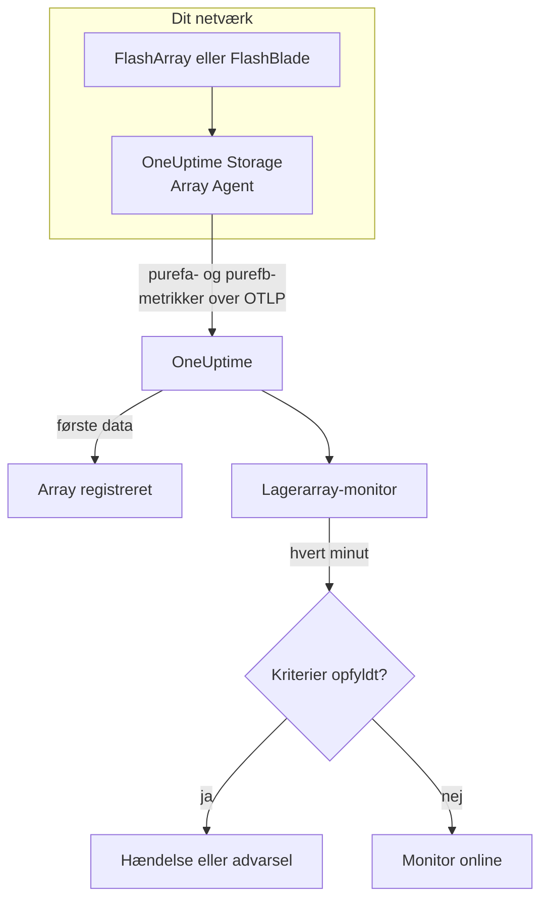

# Lagerarray-monitor

En lagerarray-monitor holder øje med ét lagerarray og fortæller dig, når arrayet selv udsender en advarsel, løber tør for plads, bliver langsomt, mister hardware eller en værtssti, eller kommer bagud med replikering. Den virker med Pure Storage FlashArray og Pure Storage FlashBlade og læser de metrikker, arrayet selv eksporterer - Pures serier `purefa_*` og `purefb_*` -, som OneUptime Storage Array Agent indsamler.

:::cards
- [Opret monitoren](#opret-en-lagerarray-monitor): Seks trin i dashboardet.
- [Skabeloner](#færdige-advarselsskabeloner): Atten færdige advarsler, én hændelse pr. volumen, vært eller komponent.
- [Sådan fungerer Pures serier](#sådan-er-pures-serier-bygget-op): Ét metriknavn, mange værdier.
- [Metrikker](#indsamlede-metrikker): Hver serie, monitoren kan advare på.
:::

## Sådan fungerer det

OneUptime Storage Array Agent kører på en maskine, der kan nå arrayets administrationsgrænseflade. Den læser arrayets metrikker med et skrivebeskyttet API-token, mærker dem med arrayets navn, `storage.array.name`, og dets platform, `storage.system`, og sender dem til OneUptime over OTLP. De første data registrerer arrayet.

En lagerarray-monitor er knyttet til ét array. Hvert minut kører den sin forespørgsel på det arrays metrikker og sammenligner resultatet med sine kriterier.



## Før du begynder

- **Installér Storage Array Agent** et sted, hvor den kan nå arrayet over HTTPS, med API-tokenet for en bruger, der har arrayets rolle **readonly**. [Vejledningen til Storage Array Agent](/docs/telemetry/storage-arrays) dækker brugeren, tokenet og installationen, gennem `ONEUPTIME_URL`, `ONEUPTIME_TELEMETRY_INGESTION_KEY`, `STORAGE_ARRAY_NAME` samt arrayets adresse og token (`PURE_FA_ENDPOINT` og `PURE_FA_API_TOKEN`, eller `PURE_FB_ENDPOINT` og `PURE_FB_API_TOKEN`).
- **Tjek, at arrayet er registreret.** Det vises under **Produkter → Infrastruktur → Storage Arrays → All Storage Arrays**, opkaldt efter agentens `STORAGE_ARRAY_NAME`, cirka et minut efter den første aflæsning.

## Opret en lagerarray-monitor

:::steps
### Start en ny monitor

Gå til **Monitorer**, og klik på **Opret monitor**.

### Vælg Lagerarray

Klik under **Monitortype** på **Flere monitortyper**, og vælg **Lagerarray** under **Infrastruktur**, eller skriv `storage` i søgefeltet. Angiv et **Navn** - det bruges i titlerne på hændelser og advarsler - og klik på **Næste**.

### Vælg arrayet

Vælg under **Storage Array Monitor Configuration** arrayet i **Lagerarray**. Hvert array, der har sendt data, står på listen. Dets platform afgør, hvilke metrikker og skabeloner formularen tilbyder.

### Vælg, hvad der skal overvåges

Vælg en af de tre faner:

- **Quick Setup** - klik på en [skabelon](#færdige-advarselsskabeloner). Den sætter metrikken, labelfiltrene, aggregeringen, tidsintervallet og tærsklerne og erstatter kriterierne nedenfor med sine egne. Du kan stadig ændre **Tidsinterval**.
- **Custom Metric** - vælg én metrik i **Storage Array Metric**, og sæt derefter **Aggregering** og **Tidsinterval**. [Filtrene](#monitorindstillinger) indsnævrer den til ét volumen, én vært, én pod, én komponent, ét filsystem eller én bucket.
- **Avanceret** - byg selv forespørgsler og formler under **Vælg målinger**, for eksempel den brugte kapacitet som `purefa_array_space_bytes` filtreret til `space=capacity` minus den samme metrik filtreret til `space=empty`. Brug **Group by** med et objekts label for at bedømme hvert objekt for sig.

### Tjek kriterierne

Åbn hvert kriterium under **Monitorkriterier**, og tjek dets **Metrik**, **Aggregering**, **Betingelse** og **Threshold**. En skabelon udfylder dem. Med **Custom Metric** eller **Avanceret** starter monitoren med [standardkriterierne](#standardkriterier), som kun opdager, at en metrik falder til nul, så sæt din egen tærskel.

### Opret monitoren

Klik på **Opret monitor**. OneUptime åbner monitorens side og evaluerer den hvert minut. Hændelser og advarsler, den udsender, vises også på arrayets sider **Hændelser** og **Advarsler**.
:::

> [!TIP]
> For at sætte flere skabeloner op på én gang åbner du arrayet fra **Produkter → Infrastruktur → Storage Arrays** og går til **Recommendations**. Vælg de skabeloner, du vil have, vælg, hvem der tilkaldes, og OneUptime opretter én monitor pr. skabelon.

## Monitorindstillinger

| Felt | Fane | Hvad det gør |
| --- | --- | --- |
| **Lagerarray** | Alle | Påkrævet. Begrænser hver forespørgsel til `resource.storage.array.name`, så to arrays, der begge har et volumen ved navn `vol-01`, aldrig blandes. |
| **Volumen** | Custom Metric, Avanceret | Kun FlashArray. Ét volumen, via labelen `name`, som `vol-db-01`. Et volumen i en pod eller en volumengruppe hedder `pod::volume` eller `group/volume`. |
| **Vært** | Custom Metric, Avanceret | Kun FlashArray. Én vært, som arrayet kender den, via labelen `host`, som `esxi-01`. |
| **Pod** | Custom Metric, Avanceret | Kun FlashArray. Én ActiveCluster- eller ActiveDR-pod, via labelen `name`, eller `local_pod` på serier for replikalinks. |
| **Hardware Component** | Custom Metric, Avanceret | Én hardwarekomponent, som `CH0.BAY1` eller `CT0`: labelen `component_name` på et FlashArray, `name` på et FlashBlade. |
| **File System** | Custom Metric, Avanceret | Kun FlashBlade. Ét filsystem, via labelen `name`. |
| **Bucket** | Custom Metric, Avanceret | Kun FlashBlade. Én bucket til objektlager, via labelen `name`. |
| **Storage Array Metric** | Custom Metric | Én metrik fra [kataloget](#indsamlede-metrikker). Formularen tilføjer det labelfilter, der giver den dens betydning, og grupperer den efter det objekt, den beskriver, så hvert volumen, hver vært eller hver komponent bedømmes for sig. |
| **Aggregering** | Custom Metric | Hvordan prøver kombineres: **Gennemsnit**, **Maksimum**, **Minimum**, **Sum** eller **Antal**. Starter ved metrikkens sædvanlige aggregering. |
| **Tidsinterval** | Alle | Det glidende vindue, forespørgslen læser, fra **Past 1 Minute** til **Past 365 Days**. En ny monitor starter ved **Past 5 Minutes**; en brugerdefineret metrik for et filsystem eller en bucket ved **Past 15 Minutes**; skabeloner sætter deres eget. |
| **Vælg målinger** | Avanceret | Forespørgselsbyggeren: **Metrik**, **Aggregate by**, **Filter by attributes**, **Group by**, plus **Tilføj metrik** og **Tilføj formel** til at kombinere forespørgsler. |

Agenten læser arrayets endpoint hvert 60. sekund, og volumener, værter og pods hvert 2. minut, så et vindue på 5 minutter altid indeholder en prøve. Et FlashBlades filsystemer og buckets læser den hvert 5. minut, deraf 15, og FlashArray-mapper hvert 30. minut: giv en mappemonitor et vindue på 60 minutter.

## Sådan er Pures serier bygget op

Pure lægger flere værdier på **ét** metriknavn og skelner dem med en label:

- **`dimension`** på ydeevneserierne. `purefa_array_performance_latency_usec` bærer læselatensen (`usec_per_read_op`), skrivelatensen (`usec_per_write_op`), latensen for spejlede skrivninger og SAN-, kø-, QoS- og servicetiden for hver af dem. Filtrér altid på én `dimension`: et gennemsnit på tværs af dem blander en læselatens på 200 µs med en køværdi.
- **`space`** på kapacitetsserierne: `capacity`, `empty`, `snapshots`, `total_provisioned`, `total_physical`, `available_ratio` og flere.

Flere serier bærer deres tilstand i en **label**, med en værdi, der altid er 1:

| Serie | Tilstandslabel | Én serie pr. |
| --- | --- | --- |
| `purefa_alerts_open` | `severity`, med `summary`, `code` og `component_type` | Åben advarsel |
| `purefa_hw_component_status` | `component_status` | Hardwarekomponent |
| `purefa_host_connectivity_info` | `status`, med `details` | Vært |
| `purefa_drive_capacity_bytes` | `component_status` (værdien er drevets kapacitet) | Drev |

En serie, der er filtreret til en dårlig tilstand, findes kun, så længe noget er i den tilstand, så ingen serie betyder sundt. Derfor er **Max over 0 udløser og 0 genopretter** den rigtige form for dem, og sådan er skabelonerne bygget: deres genopretningskriterier tæller en manglende serie som nul.

I monitorfiltre og grupperingsnøgler begynder agentens attributter med `resource.` (`resource.storage.array.name`, `resource.storage.system`), mens Pures egne labels ikke gør (`name`, `host`, `component_name`, `dimension`, `space`, `severity`).

## Færdige advarselsskabeloner

OneUptime leverer 18 skabeloner — 11 til FlashArray og 7 til FlashBlade — og **Quick Setup** tilbyder dem til arrayets platform. Hver bygger en komplet monitor: metrikforespørgslen, dens labelfiltre, en gruppering på objektets egen label, et kriterium, der udløser, og et, der genopretter. Tærskler er udgangspunkter, du kan redigere.

Et kriterium udløser kun, når betingelsen gælder for **hver** værdi i dets vindue. En monitor, der udløste på en tærskel for kapacitet, latens, forsinkelse eller forhold, genopretter først 10 % forbi den, så en værdi, der svinger omkring tærsklen, ikke skifter frem og tilbage; skabelonerne for advarsler og hardware genopretter, så snart tilstanden forsvinder.

### FlashArray

| Skabelon                       | Kategori     | Alvorlighed | Overvåger                                                                                       | Udløser når                                                                                                                                      |
| ------------------------------ | ------------ | ----------- | ----------------------------------------------------------------------------------------------- | ------------------------------------------------------------------------------------------------------------------------------------------------ |
| Critical Array Alert           | Array Health | Kritisk     | `purefa_alerts_open` filtreret til `severity=critical`, Max pr. `summary`, seneste 5 minutter   | > 0 — arrayet har en åben kritisk advarsel (en defekt komponent, en kapacitetsnødsituation, en replikeringsfejl). Én hændelse pr. advarsel; genopretter, når advarslen lukker |
| Warning Array Alert            | Array Health | Warning     | `purefa_alerts_open` filtreret til `severity=warning`, Max pr. `summary`, seneste 5 minutter    | > 0 — arrayet har en åben advarsel på niveau warning. Én hændelse pr. advarsel; genopretter, når advarslen lukker                               |
| Capacity Above 80%             | Kapacitet    | Warning     | `purefa_array_space_utilization`, Max, seneste 15 minutter                                      | > 80 — Pures egen første kapacitetstærskel; genopretter ved ≤ 72                                                                                 |
| Capacity Above 90%             | Kapacitet    | Kritisk     | `purefa_array_space_utilization`, Max, seneste 5 minutter                                       | > 90 — arrayet er tæt på at afvise skrivninger; genopretter ved ≤ 81                                                                             |
| High Read Latency              | Performance  | Warning     | `purefa_array_performance_latency_usec` filtreret til `dimension=usec_per_read_op`, Avg, seneste 10 minutter  | > 5000 µs (5 ms) — læsninger på et FlashArray tager normalt langt under 1 ms; genopretter ved ≤ 4500                                |
| High Write Latency             | Performance  | Warning     | `purefa_array_performance_latency_usec` filtreret til `dimension=usec_per_write_op`, Avg, seneste 10 minutter | > 5000 µs (5 ms); genopretter ved ≤ 4500                                                                                           |
| Hardware Component Failed      | Hardware     | Kritisk     | `purefa_hw_component_status` filtreret til `component_status=critical`, Max pr. `component_name`, seneste 5 minutter | > 0 — en controller, strømforsyning, blæser, bay eller port er kritisk, og redundansen er væk. Én hændelse pr. komponent; genopretter, når den melder ok |
| Hardware Component Degraded    | Hardware     | Warning     | `purefa_hw_component_status` filtreret til `component_status=degraded`, Max pr. `component_name`, seneste 5 minutter | > 0 — en komponent er forringet. Én hændelse pr. komponent; genopretter, når den melder ok                                 |
| Drive Failed                   | Hardware     | Kritisk     | `purefa_drive_capacity_bytes` filtreret til `component_status=failed`, Max pr. `component_name`, seneste 5 minutter | > 0 — et DirectFlash-modul eller en SSD er defekt, og arrayet genopbygger på de andre. Én hændelse pr. drev; genopretter, når det er udskiftet |
| Host Lost Redundant Paths      | Værter       | Warning     | `purefa_host_connectivity_info` filtreret til `status=critical`, Max pr. `host`, seneste 5 minutter | > 0 — værten når arrayet gennem én controller eller ingen; et controller-failover ville tage dens lager offline. Én hændelse pr. vært; genopretter, når dens stier er tilbage |
| Replication Lag Above 1 Minute | Replication  | Warning     | `purefa_pod_replica_links_lag_max_msec`, Max pr. `local_pod`, seneste 10 minutter               | > 60000 ms (60 s) — et failover nu ville miste flere nylige skrivninger end planlagt. Én hændelse pr. pod; genopretter ved ≤ 54000              |

### FlashBlade

| Skabelon                     | Kategori     | Alvorlighed | Overvåger                                                                                                      | Udløser når                                                                                                         |
| ---------------------------- | ------------ | ----------- | -------------------------------------------------------------------------------------------------------------- | ------------------------------------------------------------------------------------------------------------------- |
| Critical Array Alert         | Array Health | Kritisk     | `purefb_alerts_open` filtreret til `severity=critical`, Max pr. `summary`, seneste 5 minutter                  | > 0 — FlashBladen har en åben kritisk advarsel. Én hændelse pr. advarsel; genopretter, når advarslen lukker         |
| Warning Array Alert          | Array Health | Warning     | `purefb_alerts_open` filtreret til `severity=warning`, Max pr. `summary`, seneste 5 minutter                   | > 0 — FlashBladen har en åben advarsel på niveau warning. Én hændelse pr. advarsel; genopretter, når advarslen lukker |
| Capacity Above 80%           | Kapacitet    | Warning     | `purefb_array_space_utilization` filtreret til `type=array`, Max, seneste 15 minutter                          | > 80; genopretter ved ≤ 72                                                                                          |
| Capacity Above 90%           | Kapacitet    | Kritisk     | `purefb_array_space_utilization` filtreret til `type=array`, Max, seneste 5 minutter                           | > 90 — skrivninger fejler for hver klient, når den bliver fuld; genopretter ved ≤ 81                                |
| Hardware Component Unhealthy | Hardware     | Kritisk     | `purefb_hardware_health`, Min pr. `name`, seneste 5 minutter                                                   | < 1 — en blade, et fabric-modul, en strømforsyning eller en blæser er ikke sund (en ubrugt plads melder 2). Én hændelse pr. komponent; genopretter ved ≥ 1 |
| High Read Latency            | Performance  | Warning     | `purefb_array_performance_latency_usec` filtreret til `dimension=usec_per_read_op` og `protocol=all`, Avg, seneste 10 minutter | > 10000 µs (10 ms) på tværs af alle protokoller; genopretter ved ≤ 9000                              |
| File System Near Full        | File Systems | Warning     | `purefb_file_systems_space_bytes` filtreret til `space=available_ratio`, Min pr. `name`, seneste 15 minutter   | < 0.1 — der er mindre end 10 % tilbage af et filsystems tildelte størrelse. Én hændelse pr. filsystem; genopretter ved ≥ 0.11 |

**Alvorlighed** er den label, vælgeren viser. Den hændelse og den advarsel, en skabelon opretter, starter på dit projekts mest alvorlige hændelses- og advarselsalvorlighed; skift dem i kriteriet.

- **Åbne advarsler og hardwaretilstande bruger Max** af en serie, der kun findes, så længe advarslen er åben, eller komponenten er i den tilstand, så én aflæsning, der viser den, overskrider tærsklen.
- **Hver skabelon pr. objekt grupperer på objektets egen label** (`summary`, `component_name`, `host`, `local_pod`, `name`), så der udløses én hændelse pr. berørt objekt, og hændelsen nævner det.
- **Latensskabeloner bruger Avg** af arrayets eget gennemsnit pr. operation, og kapacitetsskabeloner **Max** af dets egen udnyttelsesprocent. Latenser er fastlåst i mikrosekunder og kapacitet i procent.
- **Hardware Component Unhealthy bruger Min** pr. komponent: dens sundhed er 1, når den er sund, og falder til 0, når den ikke er.

Der er ingen skabelon for hvert volumens latens, fordi den rigtige tærskel afhænger af arbejdsbelastningen: byg den fra kataloget med en gruppering på `name`. Kapacitetsprognoser kræver en vækstkurve frem for en tærskel, og drevslid har ingen serie at advare på.

## Indsamlede metrikker

Agenten sender alt, hvad arrayet eksporterer; serierne nedenfor er det katalog, monitorformularen tilbyder. Hver værdi er en gauge, som arrayet selv beregner - latenser er mikrosekunder pr. operation, og gennemløb er pr. sekund -, så der er ikke brug for rateberegning. **Filter** er det labelfilter, der giver serien den betydning, dens række angiver; formularen anvender det for dig.

### Array Health

| Metrik               | Filter | Platform   | Enhed   | Beskrivelse                                                                                                                                                       |
| -------------------- | ------ | ---------- | ------- | ----------------------------------------------------------------------------------------------------------------------------------------------------------------- |
| `purefa_alerts_open` | —      | FlashArray | `count` | Én serie pr. åben advarsel på arrayet (værdi 1), med labelerne `severity` (`critical`, `warning`, `info`, `hidden`), `category`, `code`, `component_type` og `summary` |
| `purefb_alerts_open` | —      | FlashBlade | `count` | Én serie pr. åben advarsel på FlashBladen (værdi 1), med labelerne `severity` (`info`, `warning`, `critical`), `code`, `component_name`, `component_type`, `summary` og `kburl` (Pures artikel i vidensbasen) |

### Capacity

| Metrik                                    | Filter                       | Platform   | Enhed   | Beskrivelse                                                                                                                           |
| ----------------------------------------- | ---------------------------- | ---------- | ------- | ------------------------------------------------------------------------------------------------------------------------------------- |
| `purefa_array_space_utilization`          | —                            | FlashArray | `%`     | Andelen af arrayets brugbare kapacitet, der er i brug. Pure udsender selv kapacitetsadvarsler ved 80 %, 90 % og 100 %                 |
| `purefa_array_space_bytes`                | `space=capacity`             | FlashArray | `bytes` | Arrayets brugbare kapacitet                                                                                                           |
| `purefa_array_space_bytes`                | `space=empty`                | FlashArray | `bytes` | Ubrugt kapacitet — følg tendensen for at forudsige, hvornår arrayet bliver fuldt                                                     |
| `purefa_array_space_bytes`                | `space=snapshots`            | FlashArray | `bytes` | Fysisk plads, som kun snapshots optager; en hurtig stigning betyder som regel, at en beskyttelsesgruppe beholder flere snapshots end planlagt |
| `purefa_array_space_data_reduction_ratio` | —                            | FlashArray | `ratio` | Deduplikering og komprimering på tværs af arrayet, f.eks. 4.2 for 4.2:1. Et vedvarende fald betyder, at nye data reduceres dårligt     |
| `purefb_array_space_utilization`          | `type=array`                 | FlashBlade | `%`     | Andelen af FlashBladens brugbare kapacitet, der er i brug                                                                             |
| `purefb_array_space_bytes`                | `type=array`, `space=empty`  | FlashBlade | `bytes` | FlashBladens ubrugte kapacitet                                                                                                        |
| `purefb_array_space_data_reduction_ratio` | `type=array`                 | FlashBlade | `ratio` | Datareduktion på tværs af FlashBladen                                                                                                 |

### Performance

| Metrik                                     | Filter                                         | Platform   | Enhed     | Beskrivelse                                                                                                  |
| ------------------------------------------ | ---------------------------------------------- | ---------- | --------- | ------------------------------------------------------------------------------------------------------------ |
| `purefa_array_performance_latency_usec`    | `dimension=usec_per_read_op`                   | FlashArray | `µs`      | Gennemsnitlig latens for en læsning, som værterne ser den; læsninger på et FlashArray tager typisk langt under 1 ms |
| `purefa_array_performance_latency_usec`    | `dimension=usec_per_write_op`                  | FlashArray | `µs`      | Gennemsnitlig latens for en skrivning, som værterne ser den                                                  |
| `purefa_array_performance_latency_usec`    | `dimension=usec_per_mirrored_write_op`         | FlashArray | `µs`      | Gennemsnitlig latens for en skrivning til en udstrakt ActiveCluster-pod, inklusive rundturen til partnerarrayet |
| `purefa_array_performance_latency_usec`    | `dimension=san_usec_per_read_op`               | FlashArray | `µs`      | Tid en læsning bruger i SAN'et; høj SAN-latens med lav servicelatens peger på fabricen eller værten          |
| `purefa_array_performance_throughput_iops` | `dimension=reads_per_sec`                      | FlashArray | `ops/s`   | Læseoperationer pr. sekund                                                                                   |
| `purefa_array_performance_throughput_iops` | `dimension=writes_per_sec`                     | FlashArray | `ops/s`   | Skriveoperationer pr. sekund                                                                                 |
| `purefa_array_performance_bandwidth_bytes` | `dimension=read_bytes_per_sec`                 | FlashArray | `bytes/s` | Læste bytes pr. sekund                                                                                       |
| `purefa_array_performance_bandwidth_bytes` | `dimension=write_bytes_per_sec`                | FlashArray | `bytes/s` | Skrevne bytes pr. sekund                                                                                     |
| `purefa_array_performance_queue_depth_ops` | —                                              | FlashArray | `ops`     | Operationer i kø på arrayet; en voksende kø med stigende latens betyder, at værterne sender mere, end det kan betjene |
| `purefa_array_performance_average_bytes`   | `dimension=bytes_per_op`                       | FlashArray | `bytes`   | Gennemsnitlig størrelse på en operation — stor I/O hæver latensen, uden at noget er galt                     |
| `purefb_array_performance_latency_usec`    | `dimension=usec_per_read_op`, `protocol=all`   | FlashBlade | `µs`      | Gennemsnitlig læselatens på tværs af alle protokoller                                                        |
| `purefb_array_performance_latency_usec`    | `dimension=usec_per_write_op`, `protocol=all`  | FlashBlade | `µs`      | Gennemsnitlig skrivelatens på tværs af alle protokoller                                                      |
| `purefb_array_performance_throughput_iops` | `dimension=reads_per_sec`, `protocol=all`      | FlashBlade | `ops/s`   | Læseoperationer pr. sekund på tværs af alle protokoller                                                      |
| `purefb_array_performance_throughput_iops` | `dimension=writes_per_sec`, `protocol=all`     | FlashBlade | `ops/s`   | Skriveoperationer pr. sekund på tværs af alle protokoller                                                    |
| `purefb_array_performance_bandwidth_bytes` | `dimension=read_bytes_per_sec`, `protocol=all` | FlashBlade | `bytes/s` | Læste bytes pr. sekund på tværs af alle protokoller                                                          |
| `purefb_array_performance_bandwidth_bytes` | `dimension=write_bytes_per_sec`, `protocol=all` | FlashBlade | `bytes/s` | Skrevne bytes pr. sekund på tværs af alle protokoller                                                       |

### Volumes

| Metrik                                      | Filter                           | Platform   | Enhed     | Beskrivelse                                                   |
| ------------------------------------------- | -------------------------------- | ---------- | --------- | ------------------------------------------------------------- |
| `purefa_volume_performance_latency_usec`    | `dimension=usec_per_read_op`     | FlashArray | `µs`      | Gennemsnitlig læselatens for hvert volumen — gruppér efter `name` |
| `purefa_volume_performance_latency_usec`    | `dimension=usec_per_write_op`    | FlashArray | `µs`      | Gennemsnitlig skrivelatens for hvert volumen                  |
| `purefa_volume_performance_throughput_iops` | `dimension=reads_per_sec`        | FlashArray | `ops/s`   | Læseoperationer pr. sekund for hvert volumen                  |
| `purefa_volume_performance_throughput_iops` | `dimension=writes_per_sec`       | FlashArray | `ops/s`   | Skriveoperationer pr. sekund for hvert volumen                |
| `purefa_volume_performance_bandwidth_bytes` | `dimension=read_bytes_per_sec`   | FlashArray | `bytes/s` | Bytes pr. sekund læst fra hvert volumen                       |
| `purefa_volume_performance_bandwidth_bytes` | `dimension=write_bytes_per_sec`  | FlashArray | `bytes/s` | Bytes pr. sekund skrevet til hvert volumen                    |
| `purefa_volume_space_bytes`                 | `space=total_provisioned`        | FlashArray | `bytes`   | Hvert volumens størrelse, som værterne ser den                |
| `purefa_volume_space_bytes`                 | `space=total_physical`           | FlashArray | `bytes`   | Fysisk plads, hvert volumen bruger efter datareduktion        |
| `purefa_volume_space_data_reduction_ratio`  | —                                | FlashArray | `ratio`   | Hvert volumens datareduktionsforhold                          |

### Hosts

| Metrik                                    | Filter                        | Platform   | Enhed   | Beskrivelse                                                                                                                                    |
| ----------------------------------------- | ----------------------------- | ---------- | ------- | ---------------------------------------------------------------------------------------------------------------------------------------------- |
| `purefa_host_connectivity_info`           | —                             | FlashArray | `count` | Én serie pr. vært (værdi 1) med labelen for dens forbindelse `status` (`healthy`, `critical`, `unused`) og `details` (`Redundant`, `Single Controller`, `None`, ...) |
| `purefa_host_performance_latency_usec`    | `dimension=usec_per_read_op`  | FlashArray | `µs`    | Gennemsnitlig læselatens, som hver vært ser — gruppér efter `host`                                                                             |
| `purefa_host_performance_latency_usec`    | `dimension=usec_per_write_op` | FlashArray | `µs`    | Gennemsnitlig skrivelatens, som hver vært ser                                                                                                  |
| `purefa_host_performance_throughput_iops` | `dimension=reads_per_sec`     | FlashArray | `ops/s` | Læseoperationer pr. sekund for hver vært                                                                                                       |
| `purefa_host_performance_throughput_iops` | `dimension=writes_per_sec`    | FlashArray | `ops/s` | Skriveoperationer pr. sekund for hver vært                                                                                                     |

### Replication

| Metrik                                               | Filter                                 | Platform   | Enhed     | Beskrivelse                                                                                                                                                  |
| ---------------------------------------------------- | -------------------------------------- | ---------- | --------- | ------------------------------------------------------------------------------------------------------------------------------------------------------------ |
| `purefa_pod_replica_links_lag_max_msec`              | —                                      | FlashArray | `ms`      | Største replikeringsforsinkelse for hvert pod-replikalink (ActiveDR / asynkront), med labelerne `local_pod`, `remote_pod`, `remote`, `direction` og `status` — gruppér efter `local_pod` |
| `purefa_pod_replica_links_lag_average_msec`          | —                                      | FlashArray | `ms`      | Gennemsnitlig replikeringsforsinkelse for hvert pod-replikalink                                                                                              |
| `purefa_pod_performance_replication_bandwidth_bytes` | —                                      | FlashArray | `bytes/s` | Hver pods replikeringstrafik, med labelerne `direction` og `dimension`                                                                                       |
| `purefa_pod_performance_latency_usec`                | `dimension=usec_per_mirrored_write_op` | FlashArray | `µs`      | Gennemsnitlig latens for spejlede skrivninger for hver ActiveCluster-pod                                                                                     |

### Hardware

| Metrik                                        | Filter                           | Platform   | Enhed      | Beskrivelse                                                                                                                                                                                                  |
| --------------------------------------------- | -------------------------------- | ---------- | ---------- | ------------------------------------------------------------------------------------------------------------------------------------------------------------------------------------------------------------ |
| `purefa_hw_component_status`                  | —                                | FlashArray | `count`    | Én serie pr. hardwarekomponent (værdi 1) — kabinet, controllere, drev- og NVRAM-bays, strømforsyninger, blæsere, temperatursensorer, Ethernet- og Fibre Channel-porte — med labelen `component_status` (`ok`, `critical`, `degraded`, `device_off`, `identifying`, `not_installed`, `unknown`) |
| `purefa_hw_component_temperature_celsius`     | —                                | FlashArray | `°C`       | Hver sensors temperatur — gruppér efter `component_name`                                                                                                                                                     |
| `purefa_drive_capacity_bytes`                 | —                                | FlashArray | `bytes`    | Hvert drevs rå kapacitet, med labelen for dets `component_status` (`healthy`, `failed`, `missing`, `recovering`, `unhealthy`, `empty`, ...) og type                                                           |
| `purefa_network_interface_performance_errors` | `dimension=total_errors_per_sec` | FlashArray | `errors/s` | Fejl pr. sekund på hvert Ethernet- og Fibre Channel-interface — vedvarende fejl betyder som regel et dårligt kabel, en dårlig optik eller en dårlig switchport                                                |
| `purefb_hardware_health`                      | —                                | FlashBlade | —          | Sundheden for hver hardwarekomponent (blades, fabric-moduler, strømforsyninger, blæsere, ...): 1 = sund, 2 = ubrugt, 0 = usund. Tag minimum pr. `name`                                                         |

### File Systems

| Metrik                                         | Filter                        | Platform   | Enhed   | Beskrivelse                                                                                  |
| ---------------------------------------------- | ----------------------------- | ---------- | ------- | -------------------------------------------------------------------------------------------- |
| `purefb_file_systems_performance_latency_usec` | `dimension=usec_per_read_op`  | FlashBlade | `µs`    | Gennemsnitlig læselatens for hvert filsystem — gruppér efter `name`                          |
| `purefb_file_systems_performance_latency_usec` | `dimension=usec_per_write_op` | FlashBlade | `µs`    | Gennemsnitlig skrivelatens for hvert filsystem                                               |
| `purefb_file_systems_space_bytes`              | `space=total_physical`        | FlashBlade | `bytes` | Fysisk plads, hvert filsystem bruger                                                         |
| `purefb_file_systems_space_bytes`              | `space=available_ratio`       | FlashBlade | `ratio` | Andelen af hvert filsystems tildelte størrelse, der stadig er ledig, fra 0 til 1 — tæt på 0 er det ved at fylde sin kvote |

### Buckets

| Metrik                                    | Filter                       | Platform   | Enhed   | Beskrivelse                                           |
| ----------------------------------------- | ---------------------------- | ---------- | ------- | ----------------------------------------------------- |
| `purefb_buckets_performance_latency_usec` | `dimension=usec_per_read_op` | FlashBlade | `µs`    | Gennemsnitlig læselatens for hver bucket — gruppér efter `name` |
| `purefb_buckets_space_bytes`              | `space=total_physical`       | FlashBlade | `bytes` | Fysisk plads, hver bucket bruger                      |
| `purefb_buckets_object_count`             | —                            | FlashBlade | `count` | Antal objekter i hver bucket                          |

## Overvågningskriterier

Et kriterium sammenligner en af monitorens forespørgsler eller formler med en tærskel. En lagerarray-monitors kriterier har ingen **Filtertype**: hver regel tjekker metrikværdien, med disse felter.

| Felt | Hvad det gør |
| --- | --- |
| **Metrik** | Den forespørgsel eller formel, der skal tjekkes, efter dens variabelnavn. |
| **Aggregering** | Hvordan værdierne i vinduet bliver til ét svar: **Gennemsnit**, **Sum**, **Maximum Value**, **Minimum Value**, **All Values** (hver værdi skal matche) eller **Any Value** (én er nok). |
| **Betingelse** | **Greater Than**, **Less Than**, **Greater Than Or Equal To**, **Less Than Or Equal To** eller **Equal To** — eller en anomalibetingelse: **Anomalously High**, **Anomalously Low** eller **Anomalous**. |
| **Threshold** | Den værdi, der sammenlignes med. En enhedsliste står ved siden af, når metrikken har en enhed. Vises ikke for anomalibetingelser. |
| **Følsomhed** | Kun anomalibetingelser. **Lav** (4σ), **Mellem** (3σ, standarden) eller **Høj** (2σ). |
| **Baseline-vindue** | Kun anomalibetingelser. 14 dage (standarden), 28, 60 eller 90 dages historik. |
| **Hvis ingen data** | Under **Flere felter**. Hvad der sker, når vinduet ingen prøver har: **Ignore** (standarden), **Treat As Zero** eller **Trigger**. |

Anomalibetingelser sammenligner hver værdi med den samme time på ugen i baselinen. De forbliver i tilstanden "Learning", og udsender intet, indtil baseline-vinduet indeholder nok historik.

Nogle kriterier at starte med:

- **Et volumen er langsomt:** `purefa_volume_performance_latency_usec` filtreret til `dimension=usec_per_read_op`, Gennemsnit, grupperet efter `name`, **Greater Than** `2000`, over de seneste 10 minutter.
- **Arrayet er ved at blive fuldt:** `purefa_array_space_utilization`, Maksimum, **Greater Than** `85`, over de seneste 15 minutter.
- **En vært kører på én controller:** `purefa_host_connectivity_info` filtreret til `status=critical`, Maksimum, grupperet efter `host`, **Greater Than** `0`.
- **Et FlashBlade-filsystem er næsten fuldt:** `purefb_file_systems_space_bytes` filtreret til `space=available_ratio`, Minimum, grupperet efter `name`, **Less Than** `0.05`.

### Standardkriterier

En monitor, du ikke bygger ud fra en skabelon, starter med to kriterier:

| Rækkefølge | Kriterium | Matcher når | Så |
| --- | --- | --- | --- |
| 1 | Check if _monitor name_ is offline | En vilkårlig værdi i den første forespørgsel er `0` | Markerer monitoren som **Offline** og erklærer hændelsen "_monitor name_ is offline", som løser sig selv, når monitoren kommer sig. |
| 2 | Check if _monitor name_ is online | En vilkårlig værdi er over `0` | Markerer monitoren som **I drift**. |

> [!IMPORTANT]
> Stilhed matcher ingen af kriterierne: et array, der holder op med at sende data, efterlader monitoren, som den var. For at få besked, når data udebliver, sætter du **Hvis ingen data** til **Trigger** på et kriterium. Tid, hvor OneUptime selv ikke modtog noget, tæller aldrig som manglende data: et tjek, hvis vindue indeholder den tid, venter i stedet, som [Når OneUptime ikke modtager data](/docs/monitor/when-oneuptime-is-not-receiving) forklarer.

## Terraform

[OneUptimes Terraform-provider](/docs/terraform/monitor-steps) bærer konfigurationen af et trin i en lagerarray-monitor i attributten `storage_array_monitor`: den rå JSON for konfigurationen `storageArrayMonitor` (`arrayIdentifier`, `storageSystem`, `resourceFilters`, `metricViewConfig`, `rollingTime`), skrevet med `jsonencode()`:

```hcl title="main.tf"
monitor_steps = [{
  storage_array_monitor = jsonencode({
    arrayIdentifier = "my-storage-array"
    storageSystem   = "purestorage.flasharray"
    resourceFilters = {}
    rollingTime     = "Past 15 Minutes"
    metricViewConfig = {
      queryConfigs = [{
        metricAliasData = { metricVariable = "capacity_used_percent", title = "Capacity Used", description = "", legend = "" }
        metricQueryData = {
          filterData = {
            metricName     = "purefa_array_space_utilization"
            attributes     = {}
            aggegationType = "Max"
            aggregateBy    = {}
          }
        }
      }]
      formulaConfigs = []
    }
  })
  criteria = [ /* ... */ ]
}]
```

`arrayIdentifier` er arrayets `storage.array.name` - det `STORAGE_ARRAY_NAME`, agenten blev startet med -, ikke dets OneUptime-ID. `storageSystem` er `purestorage.flasharray` eller `purestorage.flashblade`. Det afgør, hvilket katalog og hvilke skabeloner formularen viser, og om et hardwarefilter læser `component_name` eller `name`.

## Fejlfinding

:::details Arrayet står ikke på listen Lagerarray
Arrays registrerer sig selv ud fra agentens data. Tjek, at agenten kører og sender data (se [vejledningen til Storage Array Agent](/docs/telemetry/storage-arrays)), og at `STORAGE_ARRAY_NAME` er sat.
:::

:::details En advarsels- eller hardwareskabelon udløser aldrig
Det er det sunde tilfælde. `purefa_alerts_open`, `purefa_hw_component_status`, `purefa_drive_capacity_bytes` og `purefa_host_connectivity_info` bærer deres tilstand i en label, og en serie filtreret til en dårlig tilstand (`severity=critical`, `component_status=failed`) findes kun, så længe noget er i den tilstand. For at se serien bag en skabelon kører du dens forespørgsel uden filteret på siden **Metrikker**.
:::

:::details En latensmonitor viser forkerte værdier
Pure lægger læse-, skrive-, spejlet-skrive-, SAN-, kø- og QoS-værdier på ét metriknavn, kun skelnet af labelen `dimension`, og en forespørgsel uden et `dimension`-filter tager gennemsnittet af dem alle. Filtrér på én dimension, som skabelonerne og formularens katalog gør. Serier pr. volumen og pr. vært beholder kun `usec_per_read_op`, `usec_per_write_op` og `usec_per_mirrored_write_op`: agenten smider resten væk for at spare serier, og kun den arraydækkende `purefa_array_performance_latency_usec` beholder dem alle.
:::

:::details Et vindue på 1 minut viser ingen data
Agenten læser volumener, værter og pods hvert 2. minut, et FlashBlades filsystemer og buckets hvert 5. og FlashArray-mapper hvert 30., så et vindue på 1 minut indeholder måske ingen prøve. Brug 5 minutter eller mere: 15 til filsystemer og buckets, 60 til mapper.
:::

:::details Hændelser udløses én gang for hele arrayet i stedet for én gang pr. volumen
Gruppér forespørgslen efter objektets label: `name` for volumener, pods, mapper, filsystemer og buckets, `host` for værter og `component_name` for FlashArray-hardware. Pures labels har intet præfiks, så `resource.name` matcher intet.
:::

## Næste skridt

:::cards
- [Lagerarray-agent](/docs/telemetry/storage-arrays): Installér den agent, der sender metrikkerne.
- [Ceph-monitor](/docs/monitor/ceph-monitor): Den samme slags monitor til Ceph-lagerclustere.
- [Metrik-monitor](/docs/monitor/metrics-monitor): Advar på enhver metrik, fra enhver kilde.
- [Hændelser – Oversigt](/docs/incidents/index): Hvad der sker, efter at et kriterium har erklæret en hændelse.
:::
