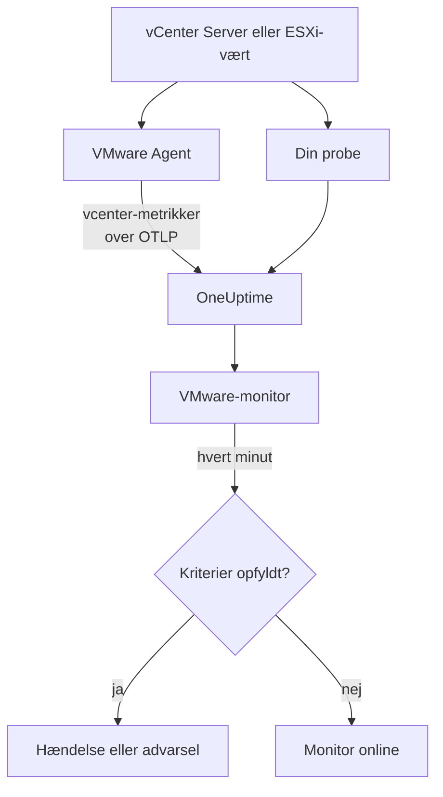

# VMware-monitor

En VMware-monitor holder øje med ét vCenter - dets datacentre, klynger, ESXi-værter, virtuelle maskiner, datastores, ressourcepuljer og vSAN - og fortæller dig, når en vært bliver mættet, en VM mangler CPU eller hukommelse, en datastore bliver fuld, eller vSphere udsender en alarm. Den læser de `vcenter.*`-metrikker, som OneUptime VMware Agent indsamler, eller som en af dine prober indsamler uden en agent.

:::cards
- [Opret monitoren](#opret-en-vmware-monitor): Seks trin i dashboardet.
- [Skabeloner](#færdige-advarselsskabeloner): Treogtyve færdige advarsler, én hændelse pr. vært, VM eller datastore.
- [Identitetsattributter](#identitetsattributter): Sådan rammer du én vært, VM eller datastore.
- [Metrikker](#indsamlede-metrikker): Hver `vcenter.*`-serie, monitoren kan advare på.
:::

## Sådan fungerer det

Metrikkerne kommer fra vCenters API og læses med en skrivebeskyttet konto på en af to måder:

- **VMware Agent**, en OpenTelemetry Collector med sin receiver `vcenter`, som du kører på en maskine, der kan nå vCenter. Se [VMware-agent](/docs/telemetry/vmware).
- **En probe**, uden noget at installere: du forbinder vCenteret i OneUptime og vælger den probe, der kan nå det. Se [VMware uden agent](/docs/telemetry/vmware-agentless).

Begge sender de samme serier hvert indsamlingsinterval (2 minutter som standard), mærket med vCenterets navn, `vmware.vcenter.name`. Et vCenter er ét vSphere-endpoint: en vCenter Server eller en selvstændig ESXi-vært. En VMware-monitor er knyttet til ét vCenter. Hvert minut kører den sin forespørgsel på det vCenters metrikker og sammenligner resultatet med sine kriterier.



## Før du begynder

- **Indsaml vCenterets metrikker**, med [VMware Agent](/docs/telemetry/vmware) eller [uden en agent](/docs/telemetry/vmware-agentless). Begge bruger en vSphere-bruger med rollen **Read-Only** på det øverste vCenter-objekt, med **Propagate to children** markeret. Agenten læser `ONEUPTIME_URL`, `ONEUPTIME_TELEMETRY_INGESTION_KEY`, `VMWARE_VCENTER_NAME`, `VCENTER_ENDPOINT`, `VCENTER_USERNAME` og `VCENTER_PASSWORD`.
- **Tjek, at vCenteret er registreret.** Det vises under **Produkter → Infrastruktur → VMware → Alle vCenter**: via agenten, opkaldt efter dens `VMWARE_VCENTER_NAME`, efter dens første fulde indsamling; uden agent fra det øjeblik, du forbinder det.

## Opret en VMware-monitor

:::steps
### Start en ny monitor

Gå til **Monitorer**, og klik på **Opret monitor**.

### Vælg VMware

Klik under **Monitortype** på **Flere monitortyper**, og vælg **VMware** under **Infrastruktur**, eller skriv `vmware` i søgefeltet. Angiv et **Navn** - det bruges i titlerne på hændelser og advarsler - og klik på **Næste**.

### Vælg vCenteret

Vælg under **VMware Monitor Configuration** vCenteret i **vCenter**. Hvert vCenter, der har sendt data, eller som du har forbundet uden en agent, står på listen.

### Vælg, hvad der skal overvåges

Vælg en af de tre faner:

- **Quick Setup** - klik på en [skabelon](#færdige-advarselsskabeloner). Den sætter metrikken, attributfiltrene, aggregeringen, tidsintervallet, grupperingen og tærsklerne og erstatter kriterierne nedenfor med sine egne. Du kan stadig ændre **Tidsinterval**.
- **Custom Metric** - vælg én metrik i **VMware Metric**, og sæt derefter **Aggregering** og **Tidsinterval**. Formularen grupperer den efter det objekt, den beskriver, så hver vært, VM eller datastore bedømmes for sig, og [filtrene](#monitorindstillinger) indsnævrer den til ét datacenter, én klynge, én vært, én VM, én datastore eller én ressourcepulje.
- **Avanceret** - byg selv forespørgsler og formler under **Vælg målinger**, med filtre på attributter som `disk_state`, `power_state` eller `status`. Brug **Group by** med en [identitetsattribut](#identitetsattributter) for at bedømme hvert objekt for sig.

### Tjek kriterierne

Åbn hvert kriterium under **Monitorkriterier**, og tjek dets **Metrik**, **Aggregering**, **Betingelse** og **Threshold**. En skabelon udfylder dem. Med **Custom Metric** eller **Avanceret** starter monitoren med [standardkriterierne](#standardkriterier), som kun opdager, at en metrik falder til nul, så sæt din egen tærskel.

### Opret monitoren

Klik på **Opret monitor**. OneUptime åbner monitorens side og evaluerer den hvert minut. Hændelser og advarsler, den udsender, vises også på vCenterets sider **Hændelser** og **Advarsler**.
:::

> [!TIP]
> For at sætte flere skabeloner op på én gang åbner du vCenteret fra **Produkter → Infrastruktur → VMware** og går til **Recommendations**. Vælg de skabeloner, du vil have, vælg, hvem der tilkaldes, og OneUptime opretter én monitor pr. skabelon.

## Monitorindstillinger

| Felt | Fane | Hvad det gør |
| --- | --- | --- |
| **vCenter** | Alle | Påkrævet. Begrænser hver forespørgsel til `resource.vmware.vcenter.name`. |
| **Datacenter** | Custom Metric, Avanceret | Valgfrit. Ét datacenter: `resource.vcenter.datacenter.name`. Hver serie bærer det. |
| **Klynge** | Custom Metric, Avanceret | Valgfrit. Én klynge: `resource.vcenter.cluster.name`. Matcher klyngens egne serier og dem for værterne, VM'erne og ressourcepuljerne i den; en selvstændig ESXi-vært har ingen. |
| **ESXi Host** | Custom Metric, Avanceret | Valgfrit. Én ESXi-vært: `resource.vcenter.host.name`. Matcher værtens egne serier **og** dem for hver VM, den kører, fordi en VM bærer sin værts navn. |
| **Virtual Machine** | Custom Metric, Avanceret | Valgfrit. Én VM: `resource.vcenter.vm.name`. VM-navne behøver ikke være unikke: tilføj en vært eller en klynge, når to VM'er deler et navn. |
| **Datastore** | Custom Metric, Avanceret | Valgfrit. Én datastore: `resource.vcenter.datastore.name`. |
| **Resource Pool Path** | Custom Metric, Avanceret | Valgfrit. Én ressourcepulje, via dens inventarsti (`/DC/host/Cluster/Resources/pool`): `resource.vcenter.resource_pool.inventory_path`. En sti, fordi puljenavne kun er unikke inden for deres overordnede objekt. |
| **VMware Metric** | Custom Metric | Én metrik fra [kataloget](#indsamlede-metrikker). |
| **Aggregering** | Custom Metric | Hvordan prøver kombineres: **Gennemsnit**, **Maksimum**, **Minimum**, **Sum** eller **Antal**. Starter ved metrikkens sædvanlige aggregering. |
| **Tidsinterval** | Alle | Det glidende vindue, forespørgslen læser, fra **Past 1 Minute** til **Past 365 Days**. En ny monitor starter ved **Past 5 Minutes**; skabeloner sætter deres eget. |
| **Vælg målinger** | Avanceret | Forespørgselsbyggeren: **Metrik**, **Aggregate by**, **Filter by attributes**, **Group by**, plus **Tilføj metrik** og **Tilføj formel** til at kombinere forespørgsler. |

vCenter læses én gang pr. indsamlingsinterval, 2 minutter som standard, så et vindue på 1 minut indeholder måske slet ingen prøve. Hold vinduet på 5 minutter eller mere, og længere, hvis du har hævet indsamlingsintervallet for et stort inventar.

## Identitetsattributter

Receiveren `vcenter` sender én OpenTelemetry-ressource pr. vSphere-objekt og navngiver den med **ressourceattributter**. Hvilke af dem en serie bærer, fortæller dig, hvilken slags objekt den beskriver:

| vSphere-objekt      | Ressourceattributter for identitet                                                                                             |
| ------------------- | ------------------------------------------------------------------------------------------------------------------------------ |
| Datacenter          | `vcenter.datacenter.name`                                                                                                      |
| Klynge              | `vcenter.datacenter.name`, `vcenter.cluster.name`                                                                              |
| ESXi-vært           | `vcenter.datacenter.name`, `vcenter.host.name` (+ `vcenter.cluster.name`, når den er i en klynge)                              |
| Virtuel maskine     | `vcenter.datacenter.name`, `vcenter.host.name`, `vcenter.vm.name`, `vcenter.vm.id` (+ `vcenter.cluster.name`; `vcenter.resource_pool.*` eller `vcenter.virtual_app.*`) |
| VM-skabelon         | `vcenter.datacenter.name`, `vcenter.host.name`, `vcenter.vm_template.name`, `vcenter.vm_template.id`                           |
| Datastore           | `vcenter.datacenter.name`, `vcenter.datastore.name`                                                                            |
| Ressourcepulje      | `vcenter.datacenter.name`, `vcenter.resource_pool.name`, `vcenter.resource_pool.inventory_path` (+ `vcenter.cluster.name` eller `vcenter.host.name`) |

I monitorfiltre og grupperingsnøgler begynder ressourceattributter med `resource.` (`resource.vcenter.host.name`), mens datapunktattributter ikke gør (`disk_state`, `power_state`, `status`, `effective`, `direction`, `object`, `type`). Den booleske attribut `effective` gemmes som teksten `"true"` eller `"false"`, så filtrér den med teksten. Filtrér på en identitetsattribut for at ramme ét objekt, og gruppér efter den for at bedømme hvert objekt for sig.

## Færdige advarselsskabeloner

OneUptime leverer 23 skabeloner til almindelige VMware-problemer, og **Quick Setup** tilbyder dem alle. Hver bygger en komplet monitor: metrikforespørgslen, dens attributfiltre, en gruppering på objektets egen identitetsattribut, et kriterium, der udløser, og et, der genopretter. Tærskler er udgangspunkter, du kan redigere.

Skabeloner læser de seneste 5 minutter, medmindre tabellen siger andet. Et kriterium udløser kun, når betingelsen gælder for hvert minut i dets vindue, og et tærskelkriterium genopretter 10 % forbi sin tærskel, så en værdi, der svinger omkring linjen, ikke skifter frem og tilbage.

| Skabelon | Kategori | Alvorlighed | Overvåger | Udløser når | Genopretter når |
| --- | --- | --- | --- | --- | --- |
| Host CPU Saturation | Vært | Warning | `vcenter.host.cpu.utilization`, Avg pr. `resource.vcenter.host.name` | Over 90 %: hver VM på værten konkurrerer om kerner og viser CPU-ready-tid | Ved 81 % eller derunder |
| Host Memory Saturation | Vært | Warning | `vcenter.host.memory.utilization`, Avg pr. vært | Over 90 %: værten begynder at tage hukommelse tilbage med ballooning, komprimering og swapping | Ved 81 % eller derunder |
| Host Disk Latency High | Vært | Warning | `vcenter.host.disk.latency.max`, Max pr. vært | Over 50 ms: hver VM, hvis diske ligger på den sti, venter på lager. Kræver ydeevnetællerniveau 3 | Ved 45 ms eller derunder |
| Host Network Packet Errors | Vært | Warning | `vcenter.host.network.packet.error.rate`, Max pr. vært | Over 0: næsten altid en fejl i kabel, SFP eller switchport | Ved 0 |
| Host Network Packet Drops | Vært | Warning | `vcenter.host.network.packet.drop.rate`, Max pr. vært | Over 0: et overbooket uplink eller NIC-ringbuffere, der løber over | Ved 0 |
| VM CPU Saturation | Virtual Machine | Warning | `vcenter.vm.cpu.utilization`, Avg pr. `resource.vcenter.vm.name`, **seneste 15 minutter** | Over 90 % af VM'ens vCPU'er i alle 15 minutter: en VM må bruge det, den har fået, så kun en, der aldrig kommer ned, tilkalder | Ved 81 % eller derunder |
| VM CPU Ready Contention | Virtual Machine | Warning | `vcenter.vm.cpu.readiness`, Avg pr. VM | Over 10 %: VM'en var klar til at køre, men værten havde ingen fysisk kerne til den. Usynligt inde fra gæsten | Ved 9 % eller derunder |
| VM Memory Saturation | Virtual Machine | Warning | `vcenter.vm.memory.utilization`, Avg pr. VM | Over 90 % af dens hukommelse: gæsten er ved at begynde at pagere | Ved 81 % eller derunder |
| VM Memory Ballooning | Virtual Machine | Warning | `vcenter.vm.memory.ballooned`, Max pr. VM | Over 0: værten mangler hukommelse og tager den tilbage fra denne gæst | Ved 0 |
| VM Memory Swapping | Virtual Machine | Kritisk | `vcenter.vm.memory.swapped`, Max pr. VM | Over 0: værten swapper VM'ens hukommelse, den sidste udvej efter ballooning og komprimering | Ved 0 |
| VM Disk Latency High | Virtual Machine | Warning | `vcenter.vm.disk.latency.max`, Max pr. VM | Over 50 ms: applikationer i gæsten får timeout på I/O | Ved 45 ms eller derunder |
| VM Disk Usage High | Virtual Machine | Warning | `vcenter.vm.disk.utilization`, Avg pr. VM | Over 90 % af dens tildelte lager er brugt: en thin-provisioneret VM er ved at gøre krav på sin fulde størrelse | Ved 81 % eller derunder |
| Datastore Capacity Warning | Datastore | Warning | `vcenter.datastore.disk.utilization`, Avg pr. `resource.vcenter.datastore.name` | Over 80 %: en tidlig advarsel, da thin-diske og snapshots hurtigt bruger resten | Ved 72 % eller derunder |
| Datastore Capacity Critical | Datastore | Kritisk | `vcenter.datastore.disk.utilization`, Avg pr. datastore | Over 90 %: en fuld datastore sætter hver VM med en disk på den på pause | Ved 81 % eller derunder |
| Cluster Host Not Effective | Klynge | Kritisk | `vcenter.cluster.host.count` filtreret til `effective = false`, Max pr. `resource.vcenter.cluster.name` | Over 0: en vært er i vedligeholdelsestilstand, afbrudt eller svarer ikke, så klyngen kører med mindre kapacitet, end den er dimensioneret til | Ved 0 |
| Datacenter Hosts Unhealthy | Datacenter | Kritisk | `vcenter.datacenter.host.count` filtreret til `status = red`, Max pr. `resource.vcenter.datacenter.name` | Over 0: en vært har en kritisk alarm, som en hardwaresensor, en tabt lagersti eller en fejl i HA-agenten | Ved 0 |
| Datacenter Hosts Degraded | Datacenter | Warning | `vcenter.datacenter.host.count` filtreret til `status = yellow`, Max pr. datacenter | Over 0: en vært har en advarselsalarm | Ved 0 |
| Datacenter Hosts Powered Off | Datacenter | Warning | `vcenter.datacenter.host.count` filtreret til `power_state = off`, Max pr. datacenter | Over 0: en vært er slukket - den gik ned, mistede strømmen eller blev sat på standby af DPM | Ved 0 |
| Datacenter VMs Unhealthy | Datacenter | Warning | `vcenter.datacenter.vm.count` filtreret til `status = red`, Max pr. datacenter | Over 0: en VM har en kritisk alarm, som en mislykket HA-genstart, en tabt datastore eller et tabt Tools-heartbeat | Ved 0 |
| Datacenter Clusters Unhealthy | Datacenter | Kritisk | `vcenter.datacenter.cluster.count` filtreret til `status = red`, Max pr. datacenter | Over 0: en klynge har en kritisk alarm, som for få HA-failoverressourcer, et mislykket HA-valg eller et kritisk vSAN-sundhedstjek | Ved 0 |
| vSAN Latency High | vSAN | Warning | `vcenter.cluster.vsan.latency.avg`, Avg pr. klynge | Over 20 000 µs (20 ms): lager bliver langsommere for hver VM på vSAN-datastoren. Tavs på klynger uden vSAN | Ved 18 000 µs eller derunder |
| vSAN Congestion | vSAN | Warning | `vcenter.cluster.vsan.congestions`, Max pr. klynge | Over 0: en diskgruppe kan ikke følge med, og vSAN bremser sine klienters I/O | Ved 0 |
| Resource Pool Memory Swapped | Klynge | Warning | `vcenter.resource_pool.memory.swapped`, Max pr. `resource.vcenter.resource_pool.inventory_path` | Over 0: puljens VM'er tager hukommelse fra værtens swap, som regel fordi puljens hukommelsesgrænse eller -andele er for lave | Ved 0 |

**Alvorlighed** er den label, vælgeren viser. Den hændelse og den advarsel, en skabelon opretter, starter på dit projekts mest alvorlige hændelses- og advarselsalvorlighed; skift dem i kriteriet.

- **Udnyttelsesskabeloner bruger Avg:** receiveren rapporterer en rigtig procent fra 0 til 100 for hvert objekt, så gennemsnittet i et minut er den vedvarende udnyttelse.
- **Latensskabeloner bruger Max:** metrikken er allerede den værste latens på tværs af objektets diske, så dens højeste prøve er den ærlige.
- **Antals- og tilstandsskabeloner bruger Max**, så én indsamling, der viser tilstanden, udløser dem: pakkefejl, ballooning, swapping, rød og gul status, værter, der ikke er effektive, overbelastning.
- **Hver skabelon grupperer på objektets egen identitetsattribut**, så der udløses én hændelse pr. berørt objekt, og hændelsen nævner det.
- **Tærskler er fastlåst i deres enhed** (`%`, `ms`, `us`), så de beholder deres betydning, uanset hvilken enhed en graf viser.

## Indsamlede metrikker

Metrikkerne nedenfor er det katalog, monitorformularen tilbyder. Enhederne er receiverens egne: `MHz`, `%`, `MiBy` (mebibytes), `By` (bytes), `KiBy`, `ms`, `us` (mikrosekunder), `{KiBy/s}`, `By/s` og antal. En metrik markeret som _slået fra som standard_ indsamles ikke, før du slår den til i agentens `otel-collector-config.yaml`; den medfølgende konfiguration slår allerede `vcenter.host.memory.capacity` til.

### Datacenter

| Metrik                               | Enhed               | Beskrivelse                                                                                                                                                    |
| ------------------------------------ | ------------------- | -------------------------------------------------------------------------------------------------------------------------------------------------------------- |
| `vcenter.datacenter.cluster.count`   | `{clusters}`        | Klynger i datacentret, opdelt efter `status` (`red` / `yellow` / `green` / `gray`). Læg sammen for at få totalen; filtrér `status = red` for klynger med en kritisk alarm |
| `vcenter.datacenter.cpu.limit`       | `MHz`               | Samlet CPU, der er tilgængelig for datacentret på tværs af alle ESXi-værter                                                                                    |
| `vcenter.datacenter.datastore.count` | `{datastores}`      | Datastores i datacentret                                                                                                                                       |
| `vcenter.datacenter.disk.space`      | `By`                | Datastoreplads på tværs af datacentret, opdelt efter `disk_state` (`used` / `available`). used ÷ (used + available) er hele datacentrets lagerudnyttelse       |
| `vcenter.datacenter.host.count`      | `{hosts}`           | ESXi-værter i datacentret, opdelt efter `status` og `power_state` (`on` / `off` / `standby` / `unknown`). Filtrér `status = red` eller `power_state = off`     |
| `vcenter.datacenter.memory.limit`    | `By`                | Samlet fysisk hukommelse, der er tilgængelig for datacentret på tværs af alle ESXi-værter                                                                     |
| `vcenter.datacenter.vm.count`        | `{virtual_machines}` | Virtuelle maskiner i datacentret, opdelt efter `status` og `power_state` (`on` / `off` / `suspended` / `unknown`). Filtrér `power_state = on` for kørende VM'er |

### Klynge

| Metrik                              | Enhed                         | Beskrivelse                                                                                                                                                  |
| ----------------------------------- | ----------------------------- | ------------------------------------------------------------------------------------------------------------------------------------------------------------ |
| `vcenter.cluster.cpu.effective`     | `MHz`                         | CPU, klyngen faktisk kan planlægge — uden værter i vedligeholdelsestilstand eller værter, der ikke svarer. Sammenlign med `vcenter.cluster.cpu.limit` for kapacitet ude af drift |
| `vcenter.cluster.cpu.limit`         | `MHz`                         | Samlet CPU for hver ESXi-vært i klyngen, uanset værtens tilstand                                                                                             |
| `vcenter.cluster.host.count`        | `{hosts}`                     | ESXi-værter i klyngen, opdelt efter `effective` (`"true"` / `"false"`). En vært er ikke effektiv, mens den er i vedligeholdelsestilstand, afbrudt eller ikke svarer |
| `vcenter.cluster.memory.effective`  | `By`                          | Hukommelse, klyngen faktisk kan tildele VM'er — uden værter i vedligeholdelse eller værter, der ikke svarer, og uden ESXi's egen reserverede hukommelse      |
| `vcenter.cluster.memory.limit`      | `By`                          | Samlet fysisk hukommelse for hver ESXi-vært i klyngen                                                                                                        |
| `vcenter.cluster.vm.count`          | `{virtual_machines}`          | Virtuelle maskiner i klyngen, opdelt efter `power_state`. Læg sammen for at få totalen; filtrér `power_state = on` for kørende VM'er                         |
| `vcenter.cluster.vm_template.count` | `{virtual_machine_templates}` | Skabeloner for virtuelle maskiner i klyngen                                                                                                                  |

### Vært (ESXi)

| Metrik                                   | Enhed         | Beskrivelse                                                                                                                                                       |
| ---------------------------------------- | ------------- | ----------------------------------------------------------------------------------------------------------------------------------------------------------------- |
| `vcenter.host.cpu.capacity`              | `MHz`         | ESXi-værtens samlede CPU-kapacitet (kerner × clock) — nævneren for `vcenter.host.cpu.usage`                                                                       |
| `vcenter.host.cpu.reserved`              | `MHz`         | CPU reserveret til virtuelle maskiner, opdelt efter `cpu_reservation_type` (`total` / `used`). Når `used` nærmer sig `total`, vil nye reservationer fejle i adgangskontrollen |
| `vcenter.host.cpu.usage`                 | `MHz`         | CPU, der lige nu forbruges på værten af alle VM'er og selve hypervisoren                                                                                          |
| `vcenter.host.cpu.utilization`           | `%`           | Værtens CPU-udnyttelse i procent (0–100) af dens kapacitet                                                                                                        |
| `vcenter.host.disk.latency.avg`          | `ms`          | Gennemsnitlig disklatens (enheds- + kernetid), opdelt efter `direction` (`read` / `write`) og `object` (diskenhed). Kræver ydeevnetællerniveau 2                   |
| `vcenter.host.disk.latency.max`          | `ms`          | Højeste latens set på tværs af alle diske, værten bruger, pr. `object`, over det seneste interval på 20 s. Kræver ydeevnetællerniveau 3                            |
| `vcenter.host.disk.throughput`           | `{KiBy/s}`    | Kilobytes pr. sekund læst fra eller skrevet til værtens diske, efter `direction` og `object`. Kræver ydeevnetællerniveau 4                                         |
| `vcenter.host.memory.active`             | `MiBy`        | Hukommelse, som værtens tændte VM'er aktivt bruger. _Slået fra som standard_ — slå `vcenter.host.memory.active` til i agentkonfigurationen                         |
| `vcenter.host.memory.ballooned`          | `MiBy`        | Gæstehukommelse, som balloon-driveren har taget tilbage fra værtens VM'er; over 0 betyder hukommelsespres på værten. _Slået fra som standard_                      |
| `vcenter.host.memory.capacity`           | `MiBy`        | Værtens samlede fysiske hukommelse — nævneren for `vcenter.host.memory.usage`. Slået fra som standard upstream; den medfølgende agentkonfiguration slår den til    |
| `vcenter.host.memory.granted`            | `MiBy`        | Maskinhukommelse tildelt de tændte VM'er på værten. _Slået fra som standard_                                                                                      |
| `vcenter.host.memory.usage`              | `MiBy`        | Hukommelse, der lige nu forbruges på værten, inklusive hypervisorens eget overhead                                                                                |
| `vcenter.host.memory.utilization`        | `%`           | Værtens hukommelsesudnyttelse i procent (0–100) af dens fysiske kapacitet                                                                                         |
| `vcenter.host.network.packet.drop.rate`  | `{packets/s}` | Pakker pr. sekund, der smides væk på hvert fysisk NIC, efter `direction` (`transmitted` / `received`) og `object` (f.eks. `vmnic0`) — et overbooket uplink eller et NIC, der svigter |
| `vcenter.host.network.packet.error.rate` | `{errors/s}`  | Pakkefejl pr. sekund på værtens fysiske NIC'er, efter `direction` og `object` — næsten altid en fejl i kabel, SFP eller switchport                                |
| `vcenter.host.network.packet.rate`       | `{packets/s}` | Pakker pr. sekund sendt eller modtaget på hvert fysisk NIC, efter `direction` og `object`                                                                        |
| `vcenter.host.network.throughput`        | `{KiBy/s}`    | Kilobytes pr. sekund sendt eller modtaget af værten, efter `direction` og `object`                                                                               |
| `vcenter.host.network.usage`             | `{KiBy/s}`    | Samlet sende- og modtagerate på tværs af værtens NIC'er, pr. `object`                                                                                             |

### Virtuel maskine

| Metrik                                     | Enhed         | Beskrivelse                                                                                                                                                                   |
| ------------------------------------------ | ------------- | ----------------------------------------------------------------------------------------------------------------------------------------------------------------------------- |
| `vcenter.vm.cpu.readiness`                 | `%`           | Procentdel af tiden, hvor VM'en var klar til at køre, men ikke kunne planlægges på en fysisk CPU (CPU ready). Over 5 % føles gæsten træg; over 10 % er værten overbooket. Kun tændte VM'er |
| `vcenter.vm.cpu.time`                      | `%`           | Tid, VM'ens vCPU'er brugte i hver tilstand, efter `cpu_state` (`idle` / `ready` / `wait`) og `object` (vCPU). _Slået fra som standard_ — slå `vcenter.vm.cpu.time` til          |
| `vcenter.vm.cpu.usage`                     | `MHz`         | CPU, VM'en forbruger. Kun tændte VM'er — dens tilstedeværelse er, hvordan OneUptime udleder en VM's strømtilstand                                                             |
| `vcenter.vm.cpu.utilization`               | `%`           | VM'ens CPU-udnyttelse i procent (0–100) af dens konfigurerede vCPU'er. Kun tændte VM'er                                                                                       |
| `vcenter.vm.disk.latency.avg`              | `ms`          | Gennemsnitlig disklatens, efter `direction` (`read` / `write`), `disk_type` (`virtual` / `physical`) og `object` (virtuel disk). Kræver ydeevnetællerniveau 2                  |
| `vcenter.vm.disk.latency.max`              | `ms`          | Højeste samlede latens (enheds- + kernetid), VM'en så på en disk over et interval på 20 s, pr. `object`                                                                       |
| `vcenter.vm.disk.throughput`               | `{KiBy/s}`    | Kilobytes pr. sekund læst fra eller skrevet til VM'ens diske, efter `direction` og `object`. Kræver ydeevnetællerniveau 2                                                      |
| `vcenter.vm.disk.usage`                    | `By`          | Datastoreplads, som VM'ens filer optager, opdelt efter `disk_state` (`used` / `available`). Sendes også for VM-skabeloner. Filtrér `disk_state = used` for den brugte størrelse |
| `vcenter.vm.disk.utilization`              | `%`           | Procentdel (0–100) af VM'ens tildelte lager, der er brugt på datastoren — en thin-provisioneret VM tæt på 100 % er ved at gøre krav på sin fulde størrelse                    |
| `vcenter.vm.memory.ballooned`              | `MiBy`        | Gæstehukommelse, som balloon-driveren (VMware Tools) har taget tilbage fra VM'en. Over 0 betyder, at ESXi-værten mangler hukommelse                                           |
| `vcenter.vm.memory.granted`                | `MiBy`        | Maskinhukommelse, værten har tildelt VM'en. _Slået fra som standard_ — slå `vcenter.vm.memory.granted` til                                                                    |
| `vcenter.vm.memory.swapped`                | `MiBy`        | Hukommelse, VM'en får fra værtens swapfil — den sidste udvej efter ballooning og komprimering; enhver værdi over 0 betyder, at VM'en betaler disklatens for RAM                |
| `vcenter.vm.memory.swapped_ssd`            | `KiBy`        | VM'ens hukommelse swappet til værtens flash-swapcache — mindre smertefuldt end swapfilen, men stadig hukommelsespres                                                          |
| `vcenter.vm.memory.usage`                  | `MiBy`        | Hukommelse, VM'ens gæst aktivt bruger. Sendes for både tændte og slukkede VM'er (0, når den er slukket)                                                                       |
| `vcenter.vm.memory.utilization`            | `%`           | VM'ens hukommelsesudnyttelse i procent (0–100) af dens konfigurerede hukommelse                                                                                                |
| `vcenter.vm.network.broadcast.packet.rate` | `{packets/s}` | Broadcast-pakker pr. sekund pr. vNIC, efter `direction` og `object`. _Slået fra som standard_                                                                                 |
| `vcenter.vm.network.multicast.packet.rate` | `{packets/s}` | Multicast-pakker pr. sekund pr. vNIC, efter `direction` og `object`. _Slået fra som standard_                                                                                 |
| `vcenter.vm.network.packet.drop.rate`      | `{packets/s}` | Pakker pr. sekund, som hvert vNIC smider væk, efter `direction` og `object`. Tab på modtagesiden betyder som regel, at gæsten ikke tømmer sin ringbuffer hurtigt nok          |
| `vcenter.vm.network.packet.rate`           | `{packets/s}` | Pakker pr. sekund sendt eller modtaget af hvert vNIC, efter `direction` og `object`                                                                                          |
| `vcenter.vm.network.throughput`            | `By/s`        | Bytes pr. sekund sendt eller modtaget over VM'ens netværk, efter `direction` og `object`                                                                                      |
| `vcenter.vm.network.usage`                 | `{KiBy/s}`    | VM'ens samlede sende- og modtagerate, pr. `object`                                                                                                                             |

### Datastore

| Metrik                               | Enhed | Beskrivelse                                                                                                                                  |
| ------------------------------------ | ----- | -------------------------------------------------------------------------------------------------------------------------------------------- |
| `vcenter.datastore.disk.usage`       | `By`  | Plads på datastoren, opdelt efter `disk_state` (`used` / `available`). used + available er datastorens kapacitet                           |
| `vcenter.datastore.disk.utilization` | `%`   | Procentdel (0–100) af datastorens kapacitet, der er i brug. En fuld datastore sætter hver VM, der skriver til den, på pause, så advar i god tid før 100 % |

### Ressourcepulje

| Metrik                                   | Enhed      | Beskrivelse                                                                                                                                                              |
| ---------------------------------------- | ---------- | ------------------------------------------------------------------------------------------------------------------------------------------------------------------------ |
| `vcenter.resource_pool.cpu.shares`       | `{shares}` | CPU-andele konfigureret på puljen — dens relative prioritet over for søskendepuljer, når det overordnede objekt er under pres                                             |
| `vcenter.resource_pool.cpu.usage`        | `MHz`      | CPU forbrugt af hver VM i puljen (og dens underpuljer)                                                                                                                   |
| `vcenter.resource_pool.memory.ballooned` | `MiBy`     | Hukommelse, som balloon-driveren har taget tilbage på tværs af alle VM'er i puljen                                                                                       |
| `vcenter.resource_pool.memory.granted`   | `MiBy`     | Værtshukommelse tildelt puljens VM'er, opdelt efter `type` (`private` / `shared` — delte sider deduplikeres af transparent page sharing)                                 |
| `vcenter.resource_pool.memory.shares`    | `{shares}` | Hukommelsesandele konfigureret på puljen                                                                                                                                 |
| `vcenter.resource_pool.memory.swapped`   | `MiBy`     | Hukommelse, puljens VM'er får fra ESXi-værternes swapplads — enhver værdi over 0 betyder, at mindst én VM i puljen bliver swappet af værten                             |
| `vcenter.resource_pool.memory.usage`     | `MiBy`     | Hukommelse brugt af puljen, opdelt efter `type` (`guest` / `host` / `overhead`) på nyere collector-builds; ældre builds sender én serie uden type. Filtrér `type = guest` |

### vSAN

Sendes kun for klynger med vSAN, værterne i dem og VM'erne på en vSAN-datastore. Latenser er i **mikrosekunder** (`us`), i modsætning til værters og VM'ers latenser i millisekunder:

| Metrik                              | Enhed             | Beskrivelse                                                                                                                                     |
| ----------------------------------- | ----------------- | ----------------------------------------------------------------------------------------------------------------------------------------------- |
| `vcenter.cluster.vsan.congestions`  | `{congestions/s}` | Overbelastningshændelser pr. sekund rejst mod I/O fra hver vSAN-klient i klyngen — vSAN's eget modtrykssignal                                   |
| `vcenter.cluster.vsan.latency.avg`  | `us`              | Gennemsnitlig latens, klyngen ser ved adgang til vSAN-lager, efter `type` (`read` / `write`). 20 000 µs = 20 ms                                 |
| `vcenter.cluster.vsan.operations`   | `{operations/s}`  | vSAN-I/O-operationer pr. sekund på tværs af klyngen, efter `type` (`read` / `write` / `unmap`)                                                  |
| `vcenter.cluster.vsan.throughput`   | `By/s`            | Klyngens vSAN-gennemløb, efter `direction` (`read` / `write`)                                                                                   |
| `vcenter.host.vsan.cache.hit_rate`  | `%`               | Procentdel af værtens vSAN-læse-I/O, der blev betjent fra dens lokale klientcache over det seneste interval på 5 min — en faldende rate betyder, at læsninger rammer kapacitetslaget |
| `vcenter.host.vsan.congestions`     | `{congestions/s}` | Overbelastningshændelser pr. sekund rejst mod værtens vSAN-I/O                                                                                  |
| `vcenter.host.vsan.latency.avg`     | `us`              | Gennemsnitlig latens, værten ser ved adgang til vSAN-lager, efter `type`                                                                        |
| `vcenter.host.vsan.operations`      | `{operations/s}`  | vSAN-I/O-operationer pr. sekund udstedt af værten, efter `type`                                                                                 |
| `vcenter.host.vsan.throughput`      | `By/s`            | Værtens vSAN-gennemløb, efter `direction`                                                                                                       |
| `vcenter.vm.vsan.latency.avg`       | `us`              | Gennemsnitlig latens, VM'en ser ved adgang til vSAN-lager, efter `type`                                                                         |
| `vcenter.vm.vsan.operations`        | `{operations/s}`  | vSAN-I/O-operationer pr. sekund udstedt af VM'en, efter `type`                                                                                  |
| `vcenter.vm.vsan.throughput`        | `By/s`            | VM'ens vSAN-gennemløb, efter `direction`                                                                                                        |

> [!NOTE]
> En VM's strømtilstand er ikke en metrik. Receiveren sender kun `vcenter.vm.cpu.*` for tændte VM'er, så OneUptime skelner **Powered on** fra **Powered off** ud fra, om der kom CPU-data i samme indsamling som VM'ens hukommelses- og diskdata; vCenterets side **Virtual Machines** viser resultatet. For at advare om slukkede værter eller om, hvor mange VM'er der kører, bruger du attributten `power_state` på `vcenter.datacenter.host.count`, `vcenter.datacenter.vm.count` eller `vcenter.cluster.vm.count`.

## Overvågningskriterier

Et kriterium sammenligner en af monitorens forespørgsler eller formler med en tærskel. En VMware-monitors kriterier har ingen **Filtertype**: hver regel tjekker metrikværdien, med disse felter.

| Felt | Hvad det gør |
| --- | --- |
| **Metrik** | Den forespørgsel eller formel, der skal tjekkes, efter dens variabelnavn. |
| **Aggregering** | Hvordan værdierne i vinduet bliver til ét svar: **Gennemsnit**, **Sum**, **Maximum Value**, **Minimum Value**, **All Values** (hver værdi skal matche) eller **Any Value** (én er nok). |
| **Betingelse** | **Greater Than**, **Less Than**, **Greater Than Or Equal To**, **Less Than Or Equal To** eller **Equal To** — eller en anomalibetingelse: **Anomalously High**, **Anomalously Low** eller **Anomalous**. |
| **Threshold** | Den værdi, der sammenlignes med. En enhedsliste står ved siden af, når metrikken har en enhed. Vises ikke for anomalibetingelser. |
| **Følsomhed** | Kun anomalibetingelser. **Lav** (4σ), **Mellem** (3σ, standarden) eller **Høj** (2σ). |
| **Baseline-vindue** | Kun anomalibetingelser. 14 dage (standarden), 28, 60 eller 90 dages historik. |
| **Hvis ingen data** | Under **Flere felter**. Hvad der sker, når vinduet ingen prøver har: **Ignore** (standarden), **Treat As Zero** eller **Trigger**. |

Anomalibetingelser sammenligner hver værdi med den samme time på ugen i baselinen. De forbliver i tilstanden "Learning", og udsender intet, indtil baseline-vinduet indeholder nok historik.

Nogle kriterier at starte med:

- **En vært er mættet:** `vcenter.host.cpu.utilization`, Gennemsnit, grupperet efter `resource.vcenter.host.name`, **Greater Than** `90`, over de seneste 5 minutter.
- **En datastore er ved at blive fuld:** `vcenter.datastore.disk.utilization`, Gennemsnit, grupperet efter `resource.vcenter.datastore.name`, **Greater Than** `80`.
- **En klynge mistede en vært:** `vcenter.cluster.host.count` filtreret til `effective = false`, Maksimum, grupperet efter `resource.vcenter.cluster.name`, **Greater Than** `0`.
- **Færre VM'er kører end forventet:** `vcenter.cluster.vm.count` filtreret til `power_state = on` og `resource.vcenter.cluster.name = Production`, Sum, **Less Than** det antal, du forventer.
- **En VM bliver swappet af værten:** `vcenter.vm.memory.swapped`, Maksimum, grupperet efter `resource.vcenter.vm.name`, **Greater Than** `0`.

### Standardkriterier

En monitor, du ikke bygger ud fra en skabelon, starter med to kriterier:

| Rækkefølge | Kriterium | Matcher når | Så |
| --- | --- | --- | --- |
| 1 | Check if _monitor name_ is offline | En vilkårlig værdi i den første forespørgsel er `0` | Markerer monitoren som **Offline** og erklærer hændelsen "_monitor name_ is offline", som løser sig selv, når monitoren kommer sig. |
| 2 | Check if _monitor name_ is online | En vilkårlig værdi er over `0` | Markerer monitoren som **I drift**. |

> [!IMPORTANT]
> Stilhed matcher ingen af kriterierne: et vCenter, der holder op med at sende data, efterlader monitoren, som den var. For at få besked, når data udebliver, sætter du **Hvis ingen data** til **Trigger** på et kriterium. Tid, hvor OneUptime selv ikke modtog noget, tæller aldrig som manglende data: et tjek, hvis vindue indeholder den tid, venter i stedet, som [Når OneUptime ikke modtager data](/docs/monitor/when-oneuptime-is-not-receiving) forklarer.

## Terraform

[OneUptimes Terraform-provider](/docs/terraform/monitor-steps) bærer konfigurationen af et trin i en VMware-monitor i attributten `vmware_monitor`: den rå JSON for konfigurationen `vmwareMonitor` (`vcenterIdentifier`, `resourceFilters`, `metricViewConfig`, `rollingTime`), skrevet med `jsonencode()`:

```hcl title="main.tf"
monitor_steps = [{
  vmware_monitor = jsonencode({
    vcenterIdentifier = "prod-vcenter"
    resourceFilters   = { clusterName = "Production" }
    rollingTime       = "Past 5 Minutes"
    metricViewConfig = {
      queryConfigs = [{
        metricAliasData = { metricVariable = "host_cpu", title = "Host CPU", description = "", legend = "" }
        metricQueryData = {
          filterData = {
            metricName     = "vcenter.host.cpu.utilization"
            attributes     = {}
            aggegationType = "Avg"
            aggregateBy    = {}
          }
          groupByAttributeKeys = ["resource.vcenter.host.name"]
        }
      }]
      formulaConfigs = []
    }
  })
  criteria = [ /* ... */ ]
}]
```

`vcenterIdentifier` er vCenterets `vmware.vcenter.name` - det `VMWARE_VCENTER_NAME`, agenten blev startet med -, ikke dets OneUptime-ID.

## Fejlfinding

:::details vCenteret står ikke på listen vCenter
Et vCenter, som agenten indsamler fra, registrerer sig selv ud fra agentens data. Tjek, at agenten kører og sender data (se [Bekræft installationen](/docs/telemetry/vmware#verify-the-installation)), at `VMWARE_VCENTER_NAME` er sat, og at der er gået et indsamlingsinterval: intet sendes, før den første fulde gennemgang af inventaret er færdig.
:::

:::details Værter har metrikker, men VM'er, datastores eller klynger har ikke
Den skrivebeskyttede vSphere-bruger fik sin rolle uden **Propagate to children**, eller på et objekt under vCenterets rod. Objekter, brugeren ikke kan se, mangler simpelthen i metrikkerne. Sæt tilladelsen på det øverste vCenter-objekt, med videregivelse markeret.
:::

:::details Host CPU Saturation udløser aldrig
Skabelonen tager gennemsnittet af `vcenter.host.cpu.utilization` pr. `resource.vcenter.host.name`, så hver vært tjekkes for sig. Hvis du byggede din egen forespørgsel, så gruppér den efter identitetsattributten med dens præfiks `resource.`: den bare `vcenter.host.name` matcher intet, og et gennemsnit på tværs af alle værter trækkes ned af de inaktive.
:::

:::details vSAN-skabelonerne udløser aldrig
`vcenter.cluster.vsan.*`, `vcenter.host.vsan.*` og `vcenter.vm.vsan.*` sendes kun for klynger med vSAN, værterne i dem og VM'erne på en vSAN-datastore. Uden vSAN findes serierne ikke, og skabelonerne forbliver tavse.
:::

:::details Et kriterium filtreret på effective matcher intet
Receiverens booleske attribut `effective` gemmes som teksten `"true"` eller `"false"`. Filtrér den med teksten, ikke med en boolesk værdi.
:::

:::details Metrikker for disklatens eller gennemløb mangler
`vcenter.host.disk.latency.avg` og `vcenter.vm.disk.*` kræver vCenters statistikniveau 2, `vcenter.host.disk.latency.max` kræver niveau 3, og `vcenter.host.disk.throughput` niveau 4. Hæv statistikniveauet for 5-minutters-intervallet under _vCenter → Configure → General → Statistics_.
:::

:::details Et vindue på 1 minut viser ingen data
vCenter læses én gang pr. indsamlingsinterval, 2 minutter som standard og ofte længere for et stort inventar, så et vindue på 1 minut indeholder måske ingen prøve. Brug 5 minutter eller mere.
:::

## Næste skridt

:::cards
- [VMware-agent](/docs/telemetry/vmware): Installér den agent, der indsamler fra vCenter.
- [VMware uden agent](/docs/telemetry/vmware-agentless): Lad i stedet en probe indsamle.
- [Proxmox-monitor](/docs/monitor/proxmox-monitor): Den samme slags monitor til Proxmox VE.
- [Hændelser – Oversigt](/docs/incidents/index): Hvad der sker, efter at et kriterium har erklæret en hændelse.
:::
