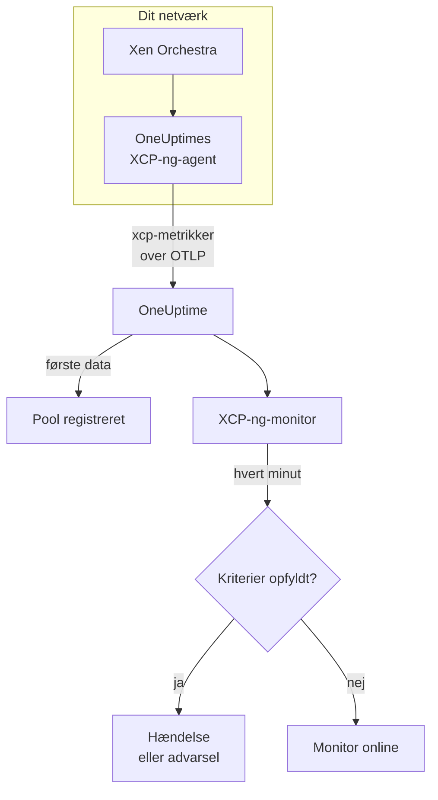

# XCP-ng-monitor

En XCP-ng-monitor overvåger én XCP-ng-pool – dens værter, VM'er, lagerdepoter og virtuelle diske – og giver dig besked, når Xen Orchestra mister poolen, en vært går offline eller forbliver deaktiveret, en VM, der kørte, stopper eller mangler CPU, eller et lagerdepot bliver fyldt op eller bliver langsomt. Den læser serierne `xcp_*` fra Xen Orchestras OpenMetrics-plugin, som OneUptimes XCP-ng-agent indsamler, og de sundhedsserier, OneUptime udleder af dem, så intet undersøges udefra.

:::cards
- [Opret monitoren](#opret-en-xcp-ng-monitor): Seks trin i dashboardet.
- [Skabeloner](#færdige-advarselsskabeloner): Ti færdige advarsler, én hændelse pr. vært, VM eller lagerdepot.
- [Ressourceidentitet](#ressourceidentitet): Sådan rammer du én vært, VM eller ét lagerdepot.
- [Metrikker](#indsamlede-metrikker): Hver serie, monitoren kan advare på.
:::

## Sådan virker det

OneUptimes XCP-ng-agent kører på en maskine, der kan nå Xen Orchestra. Hvert 60. sekund læser den Xen Orchestras OpenMetrics-plugin, som læser hver vært i hver pool, Xen Orchestra administrerer, og sender serierne til OneUptime over OTLP, én ressource pr. pool, stemplet med poolens UUID, `xcp_ng.pool.id`. De første data registrerer hver pool.

En XCP-ng-monitor er knyttet til én pool. Hvert minut kører den sin forespørgsel over poolens metrikker og sammenligner resultatet med sine kriterier.



## Før du begynder

- **Installér XCP-ng-agenten** et sted, hvor den kan nå Xen Orchestra, med hemmeligheden fra Xen Orchestras OpenMetrics-plugin. [Vejledningen til XCP-ng-agenten](/docs/telemetry/xcp-ng) dækker pluginet, Xen Orchestras certifikat og installationen.
- **Kontrollér, at poolen er registreret.** Den vises under **Produkter → Infrastruktur → XCP-ng → Alle pools**, navngivet, som Xen Orchestra navngiver den, cirka et minut efter den første indsamling.

## Opret en XCP-ng-monitor

:::steps
### Start en ny monitor

Gå til **Monitorer**, og klik på **Opret monitor**.

### Vælg XCP-ng

Klik under **Monitortype** på **Flere monitortyper**, og vælg **XCP-ng** under **Infrastruktur**, eller skriv `xcp` i søgefeltet. Angiv et **Navn** – det bruges i titler på hændelser og advarsler – og klik på **Næste**.

### Vælg poolen

Vælg poolen i **XCP-ng-pool** under **XCP-ng Monitor Configuration**. Hver pool, der har sendt data, er på listen. Når du har valgt, viser en linje under feltet, om der kommer data. **Tilføj XCP-ng-pool** åbner opsætningstrin med dine nøgler udfyldt, som venter på de første data.

### Vælg, hvad der skal overvåges

En ny monitor starter med **Pool Disconnected** under **Hvad der skal advares om**. Sådan overvåger du noget andet:

- **Skift** – vælg en anden [skabelon](#færdige-advarselsskabeloner). Den angiver metrikkerne, filtrene, aggregeringen, tidsintervallet og tærsklerne og erstatter kriterierne nedenfor med sine egne. Du kan stadig ændre **Tidsinterval**.
- **Custom Metric** (under **Flere felter**) – vælg én metrik i **XCP-ng Metric**, og angiv derefter **Aggregering** og **Tidsinterval**. [Filtrene](#monitorindstillinger) indsnævrer den til en slags objekt eller til ét objekt.
- **Avanceret** (under **Flere felter**) – byg selv forespørgsler og formler under **Vælg metrikker**, f.eks. et lagerdepots brugte andel ud fra `xcp_sr_physical_usage_bytes / xcp_sr_physical_size_bytes`. Brug **Gruppér efter** `xcp_ng.id` for at bedømme hvert objekt for sig.

### Kontrollér kriterierne

Åbn hvert kriterium under **Kriterier**, og kontrollér dets **Metrik**, **Aggregering**, **Betingelse** og **Tærskel**. En skabelon udfylder dem. Med **Custom Metric** eller **Avanceret** starter monitoren med [standardkriterierne](#standardkriterier), som kun bemærker, at metrikken ikke sender data, så angiv din egen tærskel.

### Opret monitoren

Klik på **Opret monitor**. OneUptime åbner monitorens side og evaluerer den hvert minut. Hændelser og advarsler, den åbner, vises også på poolens sider **Hændelser** og **Advarsler**.
:::

> [!TIP]
> For at opsætte flere skabeloner på én gang skal du åbne poolen fra **Produkter → Infrastruktur → XCP-ng** og gå til **Anbefalinger**. Vælg de skabeloner, du vil have, og hvem der tilkaldes, så opretter OneUptime én monitor pr. skabelon.

## Monitorindstillinger

| Felt | Fane | Hvad det gør |
| --- | --- | --- |
| **XCP-ng-pool** | Alle | Påkrævet. Afgrænser hver forespørgsel til `resource.xcp_ng.pool.id`, poolens UUID, så to pools med samme navn aldrig blandes. |
| **Ressourceomfang** | Custom Metric, Avanceret | Valgfri. **Vært**, **VM**, **Lagerdepot**, **Virtuel disk**, **XOSTOR** eller **XCP-ng-pool** – et præcist match på `xcp_ng.scope`. |
| **UUID** | Custom Metric, Avanceret | Valgfri. Præcist match på `xcp_ng.id`: UUID'et for én vært, VM, ét lagerdepot eller én virtuel disk, som Xen Orchestra viser det. Kombinér det med et omfang for at ramme ét objekt. |
| **Værtens navn** | Custom Metric, Avanceret | Valgfri. Præcist match på Xen Orchestras etiket `host_name`: værtens egne serier og dem fra de VM'er, der kører på den. |
| **XCP-ng Metric** | Custom Metric | Én metrik fra [kataloget](#indsamlede-metrikker). |
| **Aggregering** | Custom Metric | Hvordan metrikker kombineres: **Gennemsnit**, **Maksimum**, **Minimum**, **Sum** eller **Antal**. Starter ved metrikkens sædvanlige aggregering. |
| **Tidsinterval** | Alle | Det glidende vindue, forespørgslen læser, fra **Past 1 Minute** til **Past 365 Days**. En ny monitor starter ved **Past 1 Minute**; skabeloner angiver deres eget. |
| **Vælg metrikker** | Avanceret | Forespørgselsbyggeren: **Metrik**, **Aggreger efter**, **Filtrer efter attributter**, **Gruppér efter** samt **Tilføj metrik** og **Tilføj formel** til at kombinere forespørgsler. |

Agenten læser Xen Orchestra hvert 60. sekund, og Xen Orchestra læser sine værter med en opløsning på 60 sekunder, så et vindue på 1 minut indeholder omkring én måling; skabelonerne læser 5 minutter eller mere.

## Ressourceidentitet

Xen Orchestra navngiver en vært eller en VM via dens etiket `uuid`, et lagerdepot via `sr_uuid` og en virtuel disk via `vdi_uuid`. OneUptime sætter to attributter på hvert datapunkt, når det ankommer, så ét filter læser hver serie for et objekt, uanset hvilken etiket der navngav det. Skabelonerne bygger på dem:

| Attribut | Værdier | For en VM |
| --- | --- | --- |
| `xcp_ng.scope` | `pool`, `host`, `vm`, `sr` (et lagerdepot), `vdi` (en virtuel disk), `xostor` | `vm` |
| `xcp_ng.id` | Objektets UUID med små bogstaver: `uuid` for en vært eller VM, `sr_uuid` for et lagerdepot eller en XOSTOR-klynge, `vdi_uuid` for en virtuel disk og poolens eget UUID på poolens serier | `5c6d7e8f-1a2b-4c3d-9e8f-0a1b2c3d4e5f` |

Filtrér på `xcp_ng.scope` for én slags objekt, på `xcp_ng.id` for ét objekt, og gruppér efter `xcp_ng.id` for at bedømme hvert objekt for sig. Xen Orchestras egne etiketter bliver, som den sender dem: `host_name` navngiver en vært på dens serier og en VM's vært på VM'ens, `vm_name`, `sr_name` og `vdi_name` navngiver resten, `power_state` og `enabled` bærer en værts eller en VM's tilstand på statusserierne, og `is_control_domain` er `true` på et kontroldomænes VM-serier.

Selve poolen er den ressource, serierne ankommer på, så dens attributter får præfikset `resource.` i filtre og grupperingsnøgler: `resource.xcp_ng.pool.id` (dens UUID), `resource.xcp_ng.pool.name` (dens navn i Xen Orchestra) og `resource.xen_orchestra.name` (den Xen Orchestra, den læses fra).

## Færdige advarselsskabeloner

Listen under **Hvad der skal advares om** tilbyder 10 skabeloner. Hver bygger en komplet monitor – forespørgsler, attributfiltre, en gruppering, et kriterium, der udløses, og et, der genopretter. De fleste grupperer efter `xcp_ng.id`, så hver vært, VM eller hvert lagerdepot får sin egen hændelse og sin egen advarsel. Tærsklerne er udgangspunkter, du kan redigere.

Et kriterium udløses kun, når betingelsen gælder i hvert minut af dets vindue, og et tærskelkriterium genopretter 10 % forbi sin tærskel, så en værdi, der svæver ved grænsen, ikke blafrer. En 0/1-serie genopretter ved den anden værdi.

| Skabelon | Kategori | Alvorlighed | Overvåger | Udløses, når | Genopretter, når |
| --- | --- | --- | --- | --- | --- |
| Pool Disconnected | Tilgængelighed | Kritisk | `xcp_pool_connected`, Count over hele poolen, seneste 10 minutter | Ingen data i hele vinduet | Data kommer igen |
| Host Offline | Tilgængelighed | Kritisk | `xcp_ng.host.running` for `xcp_ng.scope = host`, Min pr. `xcp_ng.id`, seneste 5 minutter | Under 1 | Ved 1 |
| VM Stopped | VM | Advarsel | `xcp_ng.vm.stopped_after_running` for `xcp_ng.scope = vm`, Min pr. `xcp_ng.id`, seneste 5 minutter | Over 0 | Ved 0 |
| Storage Repository Near Full | Lagerplads | Kritisk | `xcp_sr_physical_usage_bytes` ÷ `xcp_sr_physical_size_bytes` × 100 for `xcp_ng.scope = sr` (begge Sum), pr. `xcp_ng.id`, seneste 5 minutter | Over 90 % | Ved eller under 81 % |
| Host Disabled | Vært | Advarsel | `xcp_ng.host.enabled` for `xcp_ng.scope = host`, Max pr. `xcp_ng.id`, seneste 30 minutter | Under 1 | Ved 1 |
| Host Restarted | Vært | Advarsel | `xcp_host_uptime_seconds` og `xcp_ng.host.running` for `xcp_ng.scope = host`, Min pr. `xcp_ng.id`, seneste 5 minutter | `xcp_host_uptime_seconds` er under 900 (15 minutter), mens `xcp_ng.host.running` er 1 | `xcp_host_uptime_seconds` er på 990 eller mere, eller `xcp_ng.host.running` er 0 |
| High Host CPU Usage | Vært | Advarsel | `xcp_host_cpu_average` for `xcp_ng.scope = host`, Avg pr. `xcp_ng.id`, seneste 10 minutter | Over 0,9 (90 % af værtens CPU) | Ved eller under 0,81 |
| High Host Memory Usage | Vært | Advarsel | (`xcp_host_memory_total_bytes` − `xcp_host_memory_free_bytes`) ÷ `xcp_host_memory_total_bytes` × 100 for `xcp_ng.scope = host` (begge Sum), pr. `xcp_ng.id`, seneste 10 minutter | Over 95 % | Ved eller under 85,5 % |
| VM Starved of CPU | VM | Advarsel | `xcp_vm_runstate_full_contention` for `xcp_ng.scope = vm`, Avg pr. `xcp_ng.id`, seneste 15 minutter | Over 0,1 (10 % af tiden) | Ved eller under 0,09 |
| Storage Repository Slow | Lagerplads | Advarsel | `xcp_host_disk_latency_seconds` for `xcp_ng.scope = host`, Avg pr. `sr`, seneste 15 minutter | Over 0,05 (50 ms) | Ved eller under 0,045 |

**Alvorlighed** er den etiket, vælgeren viser. Hændelsen og advarslen, som en skabelon opretter, starter på dit projekts mest alvorlige hændelses- og advarselsalvorlighed; ændr dem i kriterierne.

- **Pool Disconnected** udløses, når `xcp_pool_connected` holder op med at komme i ti minutter. Xen Orchestra sender den ved hver indsamling, så længe den er forbundet til poolen, og holder op med at sende den, i stedet for at sende 0, når den mister poolens master; den stopper også, når Xen Orchestra, dens plugin eller XCP-ng-agenten stopper, eller agenten mister sin rute til OneUptime. Den løser sig selv, når serien kommer tilbage. Når data stopper, har de andre skabeloner intet at sammenligne og beholder deres seneste status, så det er denne, der siger det til dig.
- **Host Offline** læser `xcp_ng.host.running`, som OneUptime udleder af `xcp_host_status`: 0, mens Xen Orchestra rapporterer værten som Halted, eller dens tilstand som Unknown, fordi pool-masteren mistede kontakten med den. De VM'er, der kørte på værten, er også nede, medmindre HA genstartede dem et andet sted.
- **VM Stopped** læser `xcp_ng.vm.stopped_after_running`: 1, mens en VM, der kørte inden for de sidste 24 timer, er Halted eller Paused. En VM, der har været slukket i mere end et døgn, tæller som slukket med vilje og holder op med at advare, en suspenderet VM advarer aldrig, og kontroldomæner og VM-skabeloner udelades.
- **Host Disabled** udløses for en vært, der forbliver deaktiveret i 30 minutter: i vedligeholdelsestilstand eller efterladt deaktiveret af en evakuering. XAPI starter ingen VM på den, og HA kan ikke flytte noget over til den. Tredive minutter lader en planlagt genstart eller opdatering passere uden at tilkalde nogen.
- **Host Restarted** udløses for en vært, der er oppe, men har kørt i mindre end 15 minutter: den er genstartet, eller den er gået ned og kommet tilbage. Den løser sig selv, når værten har været oppe i 16,5 minutter, 10 % forbi tærsklen; en vært, der er nede, udløser i stedet **Host Offline**.
- **Forholdsformler** tager **Sum** af begge sider. Begge kommer fra den samme indsamling, så resultatet er en ægte procent. Et lagerdepot, der rapporterer en størrelse på 0, som nogle ISO-biblioteker og flytbare medier gør, udløser aldrig.
- **VM Starved of CPU** læser den fulde konkurrence: den andel af tiden, hvor alle en VM's vCPU'er var klar til at køre, men ventede på en fysisk CPU. Dens vært har flere kørbare vCPU'er end CPU-tråde, så VM'en kører langsommere, end dens eget CPU-forbrug antyder.
- **Storage Repository Slow** grupperer efter `sr`, Xen Orchestras korte id for et lagerdepot på hver værts diskserier, så hvert lagerdepot får én hændelse med sin latens som gennemsnit over de værter, der læser og skriver på det.

Pluginet rapporterer ingen alarmer ud over XOSTOR's, ingen HA-tilstand, ingen pool-master, ingen manglende patches og ingen backups, så ingen skabelon overvåger dem endnu: se [Hvad pluginet ikke dækker endnu](/docs/telemetry/xcp-ng#hvad-pluginet-ikke-dækker-endnu).

## Indsamlede metrikker

Agenten læser hver serie fra Xen Orchestras OpenMetrics-plugin hvert 60. sekund; serierne nedenfor er det katalog, monitorformularen tilbyder. Xen Orchestra omregner allerede XAPI's KiB, MiB/s og mikrosekunder til bytes, bytes pr. sekund og sekunder. Otte serier, som den kalder `_total` og typer som tællere, indeholder rater pr. sekund, og OneUptime gemmer dem som de rater, de er, som [vejledningen til XCP-ng-agenten](/docs/telemetry/xcp-ng#hvad-agenten-indsamler) forklarer. De fire serier `xcp_ng.*` er OneUptimes egne, udledt af Xen Orchestras statusserier, når de ankommer.

### Tilgængelighed

| Metrik | Enhed | Beskrivelse |
| --- | --- | --- |
| `xcp_pool_connected` | — | 1, mens Xen Orchestra er forbundet til poolen. Xen Orchestra holder op med at sende den, når den mister poolen, i stedet for at sende 0: hold øje med, at den stopper. |
| `xcp_ng.host.running` | — | 1, mens Xen Orchestra rapporterer en vært som Running, 0, mens den er Halted, eller dens tilstand er Unknown. Udledt af OneUptime af værtens status. |
| `xcp_ng.host.enabled` | — | 1, mens en vært er aktiveret, 0, mens den er i vedligeholdelsestilstand eller under evakuering, hvor XAPI ikke starter nogen VM på den. Udledt af OneUptime af værtens status. |
| `xcp_ng.vm.running` | — | 1, mens en VM er Running, 0, mens den er Halted, Paused eller Suspended. Kontroldomæner udelades. Udledt af OneUptime af VM'ens status. |
| `xcp_ng.vm.stopped_after_running` | — | 1, mens en VM, der kørte inden for de sidste 24 timer, er Halted eller Paused, ellers 0. En VM, ingen har set køre i et døgn, tæller som slukket med vilje, og en suspenderet VM tæller aldrig. Udledt af OneUptime. |
| `xcp_host_status` | count | Altid 1 for hver vært, kørende eller ej; værtens tilstand står i etiketterne `power_state` (Running, Halted, Unknown) og `enabled`. |
| `xcp_vm_status` | count | Altid 1 for hver VM undtagen kontroldomæner og VM-skabeloner; VM'ens tilstand står i etiketten `power_state` (Running, Halted, Paused, Suspended). |
| `xcp_host_uptime_seconds` | seconds | Hvor længe en vært har været oppe, siden den startede. |
| `xcp_vm_uptime_seconds` | seconds | Hvor længe en kørende VM har været oppe, siden den startede. Rapporteres kun, mens VM'en kører. |

### Vært

| Metrik | Enhed | Beskrivelse |
| --- | --- | --- |
| `xcp_host_cpu_average` | ratio | En værts CPU-forbrug som gennemsnit over dens kerner, som et forhold fra 0 til 1. |
| `xcp_host_cpu_core_usage` | ratio | Én CPU-tråds forbrug på en vært, som et forhold fra 0 til 1; etiketten `core` siger hvilken. |
| `xcp_host_load` | — | De vCPU'er, der kører eller venter på at køre på en vært, pr. fysisk CPU. Over 1 venter VM'er på en CPU. |
| `xcp_host_load_average` | — | Load average for en værts kontroldomæne (dom0). |
| `xcp_host_memory_total_bytes` | bytes | En værts fysiske hukommelse. |
| `xcp_host_memory_free_bytes` | bytes | En værts hukommelse, der ikke er givet til nogen VM. Sammenlign den med `xcp_host_memory_total_bytes` for at se, hvor fuld værten er. |
| `xcp_host_memory_reclaimed_bytes` | bytes | Hukommelse, som dynamisk hukommelsesstyring har genvundet fra en værts VM'er. |
| `xcp_host_memory_reclaimed_max_bytes` | bytes | Den mest hukommelse, dynamisk hukommelsesstyring kunne genvinde fra en værts VM'er. |
| `xcp_host_running_vcpus` | count | vCPU'erne for de VM'er, der kører på en vært, lagt sammen. |
| `xcp_host_power_consumption_watts` | W | En værts strømforbrug, læst fra dens DCMI-sensor. Hvor Xen Orchestra i stedet læser det via IPMI, sender den målingen uden dens pool, så agenten beholder den ikke; hver VM's anslåede andel af det beholdes. |

### VM

| Metrik | Enhed | Beskrivelse |
| --- | --- | --- |
| `xcp_vm_cpu_usage` | ratio | En VM's CPU-forbrug som gennemsnit over dens vCPU'er, som et forhold fra 0 til 1. |
| `xcp_vm_cpu_core_usage` | ratio | Én vCPU's forbrug, som et forhold fra 0 til 1; etiketten `core` siger hvilken. |
| `xcp_vm_runstate_full_contention` | ratio | Den andel af tiden, hvor alle en VM's vCPU'er var klar til at køre, men ventede på en fysisk CPU, fra 0 til 1. En høj værdi betyder, at VM'en mangler CPU på grund af sine naboer. |
| `xcp_vm_runstate_partial_contention` | ratio | Den andel af tiden, hvor nogle af en VM's vCPU'er ventede på en fysisk CPU, mens resten var blokeret, fra 0 til 1. |
| `xcp_vm_runstate_concurrency_hazard` | ratio | Den andel af tiden, hvor nogle af en VM's vCPU'er kørte, mens andre ventede på en fysisk CPU, fra 0 til 1. |
| `xcp_vm_runstate_fullrun` | ratio | Den andel af tiden, hvor alle en VM's vCPU'er kørte, fra 0 til 1. |
| `xcp_vm_runstate_partial_run` | ratio | Den andel af tiden, hvor nogle af en VM's vCPU'er kørte og resten var blokeret, fra 0 til 1. |
| `xcp_vm_runstate_blocked` | ratio | Den andel af tiden, hvor alle en VM's vCPU'er var blokeret, uden noget at lave eller i venten på I/O, fra 0 til 1. |
| `xcp_vm_memory_bytes` | bytes | Den hukommelse, en VM har fået. |
| `xcp_vm_memory_target_bytes` | bytes | Den hukommelse, dynamisk hukommelsesstyring sigter mod at give en VM. |
| `xcp_vm_memory_internal_free_bytes` | bytes | Den hukommelse, gæsten rapporterer som ledig. Kræver gæsteværktøjerne i VM'en. |
| `xcp_vm_power_consumption_watts` | W | Xen Orchestras skøn over en VM's andel af dens værts strømforbrug, fordelt efter CPU-belastning. Dens etiket `data_complete` er `false`, når VM'ens CPU-måling manglede. |

### Lagerplads

| Metrik | Enhed | Beskrivelse |
| --- | --- | --- |
| `xcp_sr_physical_size_bytes` | bytes | Et lagerdepots fysiske størrelse. Nogle ISO-biblioteker og flytbare medier rapporterer 0. |
| `xcp_sr_physical_usage_bytes` | bytes | Den brugte plads på et lagerdepot. Del den med størrelsen for at se, hvor fuldt det er. |
| `xcp_sr_virtual_size_bytes` | bytes | Den virtuelle størrelse af hver disk på et lagerdepot, lagt sammen. Over dets størrelse er depotet via thin provisioning tildelt ud over, hvad det kan rumme. |
| `xcp_vdi_virtual_size_bytes` | bytes | En virtuel disks størrelse, som dens VM ser den. |
| `xcp_vdi_physical_usage_bytes` | bytes | Den plads, en virtuel disk optager på sit lagerdepot. |
| `xcp_host_disk_iops_read` | ops/s | Læseoperationer pr. sekund fra en vært til et lagerdepot; etiketten `sr_name` siger hvilket. |
| `xcp_host_disk_iops_write` | ops/s | Skriveoperationer pr. sekund fra en vært til et lagerdepot. |
| `xcp_host_disk_iops_total` | ops/s | Læse- og skriveoperationer pr. sekund fra en vært til et lagerdepot. |
| `xcp_host_disk_throughput_read_bytes` | bytes/s | Bytes pr. sekund, en vært læser fra et lagerdepot. |
| `xcp_host_disk_throughput_write_bytes` | bytes/s | Bytes pr. sekund, en vært skriver til et lagerdepot. |
| `xcp_host_disk_throughput_total_bytes` | bytes/s | Bytes pr. sekund, en vært læser fra og skriver til et lagerdepot. |
| `xcp_host_disk_read_latency_seconds` | seconds | Hvor lang tid en værts læsninger fra et lagerdepot tager. |
| `xcp_host_disk_write_latency_seconds` | seconds | Hvor lang tid en værts skrivninger til et lagerdepot tager. |
| `xcp_host_disk_latency_seconds` | seconds | Hvor lang tid en værts læsninger og skrivninger på et lagerdepot tager. |
| `xcp_host_disk_iowait` | ratio | Den andel af tiden, hvor en vært ventede på et lagerdepot, fra 0 til 1. |
| `xcp_vm_disk_read_bytes_total` | bytes/s | Bytes pr. sekund, en VM læser fra en af sine diske; etiketten `device` siger hvilken. En rate, selvom Xen Orchestra kalder den `_total` og typer den som en tæller. |
| `xcp_vm_disk_write_bytes_total` | bytes/s | Bytes pr. sekund, en VM skriver til en af sine diske. En rate, selvom Xen Orchestra kalder den `_total` og typer den som en tæller. |
| `xcp_vm_disk_iops_read` | ops/s | Læseoperationer pr. sekund på en VM's disk. |
| `xcp_vm_disk_iops_write` | ops/s | Skriveoperationer pr. sekund på en VM's disk. |
| `xcp_vm_disk_iops_total` | ops/s | Læse- og skriveoperationer pr. sekund på en VM's disk. |
| `xcp_vm_disk_throughput_read_bytes` | bytes/s | Bytes pr. sekund læst fra en VM's disk. |
| `xcp_vm_disk_throughput_write_bytes` | bytes/s | Bytes pr. sekund skrevet til en VM's disk. |
| `xcp_vm_disk_throughput_total_bytes` | bytes/s | Bytes pr. sekund læst fra og skrevet til en VM's disk. |
| `xcp_vm_disk_read_latency_seconds` | seconds | Hvor lang tid læsninger fra en VM's disk tager. |
| `xcp_vm_disk_write_latency_seconds` | seconds | Hvor lang tid skrivninger til en VM's disk tager. |
| `xcp_vm_disk_latency_seconds` | seconds | Hvor lang tid læsninger og skrivninger på en VM's disk tager i gennemsnit. |
| `xcp_vm_disk_iowait` | ratio | Den andel af tiden, hvor en VM ventede på en af sine diske, fra 0 til 1. |
| `xcp_vm_disk_inflight` | count | De forespørgsler på en VM's disk, der endnu ikke er besvaret. |
| `xcp_vm_disk_queue_size` | count | Den gennemsnitlige kø af forespørgsler på en VM's disk. |

### Netværk

| Metrik | Enhed | Beskrivelse |
| --- | --- | --- |
| `xcp_host_network_receive_bytes_total` | bytes/s | Bytes pr. sekund, en vært modtager på ét fysisk interface; etiketten `interface` siger hvilket. En rate, selvom Xen Orchestra kalder den `_total` og typer den som en tæller. |
| `xcp_host_network_transmit_bytes_total` | bytes/s | Bytes pr. sekund, en vært sender på ét fysisk interface. En rate, selvom Xen Orchestra kalder den `_total` og typer den som en tæller. |
| `xcp_host_network_aggregated_receive_bytes` | bytes/s | Bytes pr. sekund, en vært modtager på alle sine fysiske interfaces. |
| `xcp_host_network_aggregated_transmit_bytes` | bytes/s | Bytes pr. sekund, en vært sender på alle sine fysiske interfaces. |
| `xcp_vm_network_receive_bytes_total` | bytes/s | Bytes pr. sekund, en VM modtager på et af sine netværksinterfaces; etiketten `vif` siger hvilket. En rate, selvom Xen Orchestra kalder den `_total` og typer den som en tæller. |
| `xcp_vm_network_transmit_bytes_total` | bytes/s | Bytes pr. sekund, en VM sender på et af sine netværksinterfaces. En rate, selvom Xen Orchestra kalder den `_total` og typer den som en tæller. |
| `xcp_vm_network_receive_errors_total` | errors/s | Modtagefejl pr. sekund på et af en VM's netværksinterfaces. En rate, selvom Xen Orchestra typer den som en tæller. |
| `xcp_vm_network_transmit_errors_total` | errors/s | Sendefejl pr. sekund på et af en VM's netværksinterfaces. En rate, selvom Xen Orchestra typer den som en tæller. |

### XOSTOR

Sendes kun for pools, der kører XOSTOR, Vates' replikerede lager bygget på LINSTOR.

| Metrik | Enhed | Beskrivelse |
| --- | --- | --- |
| `xcp_xostor_up` | — | 1, når Xen Orchestra kunne læse en XOSTOR-klynges sundhed, 0, når den ikke kunne. |
| `xcp_xostor_node_status` | count | Altid 1 for hver node i en XOSTOR-klynge; dens rolle og tilstand står i etiketterne `role` og `state`. |
| `xcp_xostor_resource_total` | count | De LINSTOR-ressourcer, en XOSTOR-klynge definerer. |
| `xcp_xostor_resource_state_count` | count | En XOSTOR-klynges ressourcereplikaer i hver disktilstand; etiketten `state` siger hvilken. |
| `xcp_xostor_alarms_up` | — | 1, når Xen Orchestra kunne læse en XOSTOR-klynges alarmer, 0, når den ikke kunne. |
| `xcp_xostor_alarms_count` | count | Aktive XAPI-alarmer på et XOSTOR-lagerdepot eller dets værter, efter `alarm_name` og `target_type`. Fraværende, når ingen er udløst. |
| `xcp_xostor_smart_up` | — | 1, når Xen Orchestra kunne læse en værts SMART-data til XOSTOR, 0, når den ikke kunne. |
| `xcp_xostor_disk_smart_status` | count | Altid 1 for hver disk på en XOSTOR-vært; dens SMART-sundhed står i etiketten `status`. |
| `xcp_xostor_updates_up` | — | 1, når en værts XOSTOR-opdateringskontrol svarede, 0, når den fejlede. |
| `xcp_xostor_package_update_available` | count | 1 for hver XOSTOR-pakke med en opdatering, der venter på en vært; etiketten `package` siger hvilken. |

## Overvågningskriterier

Et kriterium sammenligner en af monitorens forespørgsler eller formler med en tærskel. En XCP-ng-monitors kriterier har ingen **Filtertype**: hver regel kontrollerer metrikværdien med disse felter.

| Felt | Hvad det gør |
| --- | --- |
| **Metrik** | Den forespørgsel eller formel, der kontrolleres, efter dens variabelnavn. |
| **Aggregering** | Hvordan værdierne i vinduet bliver til ét svar: **Gennemsnit**, **Sum**, **Maksimumværdi**, **Minimumværdi**, **Alle værdier** (hver værdi skal matche, i hele vinduet) eller **Vilkårlig værdi** (én er nok). |
| **Betingelse** | **Større end**, **Mindre end**, **Større end eller lig med**, **Mindre end eller lig med**, **Lig med** eller **Ikke lig med** – eller en anomalibetingelse: **Unormalt høj**, **Unormalt lav** eller **Unormal**. **Har ingen data** passer, når forespørgslen intet sendte i vinduet, og **Har data**, når den sendte noget. **Forventes at stige over** og **Forventes at falde under** matcher, når metrikkens tendens i vinduet er forbi tærsklen ved udgangen af **Tidshorisont**. |
| **Tærskel** | Den værdi, der sammenlignes med. En liste over enheder står ved siden af, når metrikken har en enhed. Vises ikke for anomalibetingelser. |
| **Følsomhed** | Kun anomalibetingelser. **Lav** (4σ), **Mellem** (3σ, standard) eller **Høj** (2σ). |
| **Baseline-vindue** | Kun anomalibetingelser. 14 dage (standard), 28, 60 eller 90 dages historik. |
| **Hvis ingen data** | Under **Flere felter**. Hvad der sker, når vinduet ikke har nogen målinger: **Ignore** (standard), **Treat As Zero** eller **Trigger**. |

Anomalibetingelser sammenligner hver værdi med samme time på ugen i baselinen. De forbliver i en "Learning"-tilstand og giver intet, før baseline-vinduet rummer nok historik. Denne monitor filtrerer sine forespørgsler efter attributter, så hver forespørgsel, og hver serie i en grupperet forespørgsel, sammenlignes med sin egen historik, så langt tilbage som dine metrikker gemmes. Er det under to uger, forbliver en sum, en optælling eller en forespørgsel på et histogram i den tilstand for altid, og alt andet sammenlignes med alle metrikkens serier. En percentil af et histogram forbliver altid i den tilstand.

Hvert kriterium siger også, hvad der skal ske, når det matcher: ændre monitorens status, oprette en advarsel eller erklære en hændelse. Kriterier kontrolleres fra top til bund, og det første, der matcher, afgør det.

### Standardkriterier

En monitor, som du ikke bygger ud fra en skabelon, starter med to kriterier:

| Rækkefølge | Kriterium | Matcher, når | Så |
| --- | --- | --- | --- |
| 1 | Tjek, om _monitornavn_ er offline | Den første forespørgsel har ingen data i hele vinduet | Markerer monitoren som **Offline** og erklærer hændelsen "_monitornavn_ er offline", som løser sig selv, når monitoren kommer sig. |
| 2 | Tjek, om _monitornavn_ er online | Den første forespørgsel har data | Markerer monitoren som **I drift**. |

> [!IMPORTANT]
> En værdi på `0` er data, så en metrik, der ofte er nul, som en VM's netværksfejl, gør ikke monitoren offline. For at få en advarsel om en værdi skal du starte fra en skabelon eller tilføje et kriterium med en tærskel. Når der slet ikke kommer data, og intet kriterium passer, beholder monitoren sin status, og åbne hændelser forbliver åbne: stilhed er ikke en bedring. Tid, hvor OneUptime selv ikke modtog data, tæller aldrig som manglende data: en kontrol, hvis vindue indeholder den, venter i stedet, som [Når OneUptime ikke modtager data](/docs/monitor/when-oneuptime-is-not-receiving) forklarer.

## Terraform

[OneUptimes Terraform-provider](/docs/terraform/monitor-steps) bærer konfigurationen af et trin i en XCP-ng-monitor i attributten `xcp_ng_monitor`: den rå JSON for konfigurationen `xcpNgMonitor` (`poolIdentifier`, `resourceFilters`, `metricViewConfig`, `rollingTime`), skrevet med `jsonencode()`:

```hcl title="main.tf"
monitor_steps = [{
  xcp_ng_monitor = jsonencode({
    poolIdentifier  = "b7569d99-30f8-178a-7d94-801de3e29b5b"
    resourceFilters = { scope = "host" }
    rollingTime     = "Past 10 Minutes"
    metricViewConfig = {
      queryConfigs = [{
        metricAliasData = { metricVariable = "host_cpu", title = "Host CPU", description = "", legend = "" }
        metricQueryData = {
          filterData = {
            metricName     = "xcp_host_cpu_average"
            attributes     = {}
            aggegationType = "Avg"
            aggregateBy    = {}
          }
          groupByAttributeKeys = ["xcp_ng.id"]
        }
      }]
      formulaConfigs = []
    }
  })
  criteria = [ /* ... */ ]
}]
```

`poolIdentifier` er poolens UUID, dens `xcp_ng.pool.id`, som poolens **Indstillinger** viser det, ikke dens OneUptime-ID. `resourceFilters` indeholder de [filtre](#monitorindstillinger), formularen kalder **Ressourceomfang**, **UUID** og **Værtens navn**: `scope` (`host`, `vm`, `sr`, `vdi`, `xostor` eller `pool`), `xcpNgId` og `hostName`.

## Fejlfinding

:::details Poolen er ikke på listen XCP-ng-pool
Pools registrerer sig selv ud fra agentens data. Kontrollér, at agenten kører og sender data (se [vejledningen til XCP-ng-agenten](/docs/telemetry/xcp-ng)), og at Xen Orchestra er forbundet til poolen: en pool, Xen Orchestra ikke rapporterer, når aldrig frem til OneUptime.
:::

:::details Host Offline eller VM Stopped udløses aldrig
De læser `xcp_ng.host.running` og `xcp_ng.vm.stopped_after_running`, som OneUptime udleder af `xcp_host_status` og `xcp_vm_status`. Begge statusserier kommer fra OpenMetrics-pluginet i Xen Orchestra 6.9 eller senere: opgrader en ældre Xen Orchestra. **VM Stopped** forbliver også stille for en VM, ingen har set køre inden for de sidste 24 timer, og for en suspenderet.
:::

:::details Hændelser udløses én gang for hele poolen i stedet for én gang pr. vært
Gruppér forespørgslen efter `xcp_ng.id`, som skabelonerne gør. Uden en gruppering læser forespørgslen hver vært, VM eller hvert lagerdepot i poolen som én serie, og et gennemsnit over dem skjuler den, der er i problemer.
:::

:::details Et gennemløbsdiagram viser alt for højt eller falder under nul
De otte serier `_total`, der indeholder rater, gemmes som gauges i bytes eller fejl pr. sekund, de værdier, Xen Orchestra leverer. Læs dem, som de er, med **Gennemsnit** eller **Maksimum**: **Omregn til rate pr. sekund** i forespørgselsbyggeren ville tage en rate af en rate. En collector, du selv har konfigureret, skal også gøre dem til gauges, som agentens processor `transform/xcp-ng-rates` gør; OneUptime konverterer også enhver, der stadig ankommer som tæller.
:::

:::details Pool Disconnected udløses for alle en Xen Orchestras pools på én gang
Agenten, Xen Orchestra eller dens OpenMetrics-plugin stoppede, eller agenten mistede sin rute til OneUptime: alle den Xen Orchestras pools blev stille samtidig. Agentens `troubleshoot.sh` nævner det trin, der fejler, som [vejledningen til XCP-ng-agenten](/docs/telemetry/xcp-ng#fejlfinding) forklarer.
:::

## Næste trin

:::cards
- [XCP-ng-agent](/docs/telemetry/xcp-ng): Installer den agent, der sender metrikkerne.
- [Proxmox-monitor](/docs/monitor/proxmox-monitor): Den samme slags monitor til Proxmox VE.
- [VMware-monitor](/docs/monitor/vmware-monitor): Den samme slags monitor til vSphere.
- [Hændelser – Oversigt](/docs/incidents/index): Hvad der sker, efter at et kriterium har erklæret en hændelse.
:::
