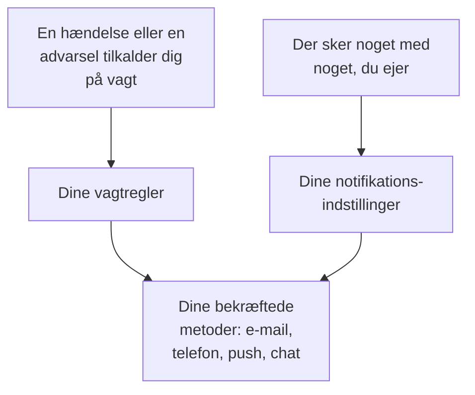

# Sådan når OneUptime dig

OneUptime når dig på to måder. Den tilkalder dig, når en hændelse eller en advarsel udløses, mens du har vagt, og den holder dig orienteret om det, du ejer: en note på din hændelse, en overvågning, der skiftede status, din næste vagt. Begge dele når frem til de adresser, du har i **Brugerindstillinger**, projekt for projekt. Denne side forklarer, hvordan delene hænger sammen, hvor de findes, og hvad du starter med.

:::cards
- [Tre sider, tre spørgsmål](#tre-sider-tre-spørgsmål): Metoder, vagtregler og notifikationsindstillinger, og hvad hver af dem afgør.
- [Hvor du finder dem](#hvor-du-finder-dem): Siderne i brugerindstillingerne, sektion for sektion.
- [Det starter du med](#det-starter-du-med): De metoder, regler og indstillinger, et nyt medlem får.
- [Når ingen regel passer](#når-ingen-regel-passer): Hvordan et tilkald alligevel når dig, og hvem der får besked.
:::

## Sådan virker det

- En vagtpolitik tilkalder dig, når en af dens eskaleringsregler nævner dig, et team, du er med i, eller en vagtplan, hvor du har vagt. Dine vagtregler afgør så, hvilke af dine metoder OneUptime prøver, og efter hvor lang tid.
- Når der sker noget med noget, du ejer, eller med dine vagter, afgør dine notifikationsindstillinger, hvilke kanaler nyheden går ad.
- I begge tilfælde bruger OneUptime kun metoder, du har bekræftet, i det projekt, tilkaldet eller nyheden kommer fra.

## Tre sider, tre spørgsmål

| Side | Hvad den indeholder | Spørgsmålet, den besvarer |
| --- | --- | --- |
| **Notifikationsmetoder** | Dine e-mailadresser, telefonnumre, WhatsApp-numre, Telegram-, Slack- og Microsoft Teams-konti, push-enheder og webhooks | Hvor kan OneUptime nå mig? |
| **Vagtregler** | For hver slags tilkald og hver alvorlighed: hvilken metode der prøves, og efter hvor lang tid | Hvordan bliver jeg tilkaldt, mens jeg har vagt? |
| **Notifikationsindstillinger** | For hver begivenhed om noget, du ejer, eller om dine vagter: hvilke kanaler der bruges | Hvad hører jeg ellers om, og hvor? |

De er adskilt med vilje. At slå alle kanaler til i **Notifikationsindstillinger** tilkalder dig aldrig, og en metode, du ikke har bekræftet, bliver aldrig brugt, uanset hvad dine regler siger.

> [!IMPORTANT]
> Metoder, regler og indstillinger hører til ét projekt. Sæt dem op i hvert projekt, du arbejder i: **Brugerindstillinger** viser altid det projekt, du er i.

## Hvor du finder dem

Åbn **Brugerindstillinger**, til højre i bjælken under topbjælken. Sidemenuen samler alt om, hvordan OneUptime når dig:

| Sektion | Sider |
| --- | --- |
| **Kom godt i gang** | **Opsætningstjekliste**: hvad der mangler at blive sat op, i den rækkefølge, der tæller |
| **Advarsler og notifikationer** | **Notifikationsmetoder**, **Vagtregler**, **Notifikationsindstillinger** og **E-mailindstillinger**, hvor du bestemmer, hvor mange e-mails dine nyheder bliver til |
| **Vagtlogs** | **Vagtlogs**: hver gang du blev tilkaldt i dette projekt, og hvad der blev sendt |
| **Indgående opkaldspolitik** | **Indgående telefonnumre**: det nummer, en politik for indgående opkald ringer dig op på |
| **Kalender** | **Kalenderfeed**: dine vagter i din kalenderapp, og påmindelser, før de starter |
| **Profil** | **Brugerdefinerede felter**: oplysninger, dit projekt beder sine medlemmer om |
| **Arbejdsområde** | **Slack** og **Microsoft Teams**: din egen konto, i hvert arbejdsområde, projektet har forbundet |

**Kom godt i gang** og **Advarsler og notifikationer** er åbne; de andre sektioner starter foldet sammen, og en sektion åbner af sig selv, når du er på en af dens sider. **Arbejdsområde** vises kun, når projektet har forbundet Slack eller Microsoft Teams.

Projektejere og administratorer kan også se din opsætning: Under **Brugere** åbner de din række og dens sektion **Vagt**, med **Parathed**, **Notifikationsmetoder** og **Vagtregler**. De kan tilføje en metode for dig der, men koden går til selve metoden, så kun du kan bekræfte den.

## Det starter du med

Når du bliver medlem af et projekt med en bekræftet login-e-mail, sætter OneUptime dig op, så et tilkald altid kan nå dig:

1. Din login-e-mail tilføjes som en bekræftet e-mailmetode.
2. For hver alvorlighed, på hver af de fire faner i **Vagtregler**, sender en regel dig en e-mail, så snart du bliver tilkaldt.
3. En række nyheder om det, du ejer, og om dine vagter, er slået til via e-mail. Se [Notifikationsindstillinger](/docs/notifications/notification-settings#hvad-der-er-slået-til-for-et-nyt-medlem).

Hver metode, du bekræfter senere, får de samme regler: en regel for hver alvorlighed, sendt så snart du bliver tilkaldt. At bekræfte et telefonnummer til sms betyder altså, at hvert tilkald også sender dig en sms. Vil du kun have sms ved kritiske tilkald, så slet sms-reglerne for de andre alvorligheder. Se [Personlige vagtregler](/docs/notifications/on-call-rules#de-regler-du-starter-med).

## Opsætningstjeklisten

**Brugerindstillinger → Opsætningstjekliste** åbner **Your setup checklist**: alt, hvad OneUptime har brug for for at nå dig, i den rækkefølge, der tæller. Et trin linker til den side, hvor det klares, og **Kontrollér igen** læser det hele igen.

| Sektion | Hvad den tjekker |
| --- | --- |
| **So we can reach you** | Du har en metode, hver tilføjet metode er bekræftet, og mindst én af dem er på en kanal, projektet har slået til |
| **How you want to be paged** | Hver alvorlighed har en regel, på hver af de fire faner i **Vagtregler** |
| **Staying informed** | Du får besked, når en vagt starter, og bag hver kanal, du har slået til i **Notifikationsindstillinger**, står en bekræftet metode |
| **Nice to have** | Et nummer til indgående opkald, dine Slack- og Microsoft Teams-konti, et kalenderlink og dine profilfelter |

Push tæller ikke med under **Staying informed**: det kræver kun mobilappen, og hver opdatering, et nyt medlem får via push, kommer også via e-mail.

**Nice to have** tæller ikke med i statuslinjen, og det gør et trin, som kun en anden kan klare, heller ikke. Linjen øverst opsummerer det hele:

| Overskrift | Hvad den betyder |
| --- | --- |
| **Alt er klar** | Tilkald når dig, og der er intet tilbage at gøre |
| **Et par ting mangler stadig at blive sat op** | En alvorlighed har ingen regel, eller et trin er ikke gjort endnu |
| **Intet kan nå dig endnu** | Ingen af dine metoder kan bruges: ingen er bekræftet, eller hver bekræftet metode er på en kanal, dette projekt har slået fra |
| **Du er sat op og har ikke vagt lige nu** | Alt er klar til den dag, en politik nævner dig |

## Når ingen regel passer

Et tilkald kan nå dig for en slags og en alvorlighed, du ikke har en regel for: for eksempel en alvorlighed, der er tilføjet, efter du blev medlem. OneUptime tilkalder dig alligevel, via det, du har bekræftet:

1. Hver gratis metode, du har: push-enheder, e-mailadresser, Slack og Microsoft Teams.
2. Har du ingen af dem, én betalt metode, i denne rækkefølge: sms, et telefonopkald, WhatsApp, Telegram. Det er den første, du har bekræftet, på en kanal, projektet har slået til.
3. Har du heller ingen af dem, en webhook.

Du får en e-mail om det, og det gør vagtpolitikkens ejere også, eller projektets ejere, hvis politikken ingen har. Er intet bekræftet, kan tilkaldet ikke leveres, og e-mailen siger det i stedet. Disse e-mails holdes tilbage, mens tilkaldene bliver ved med at komme, så en storm af tilkald ikke bliver en storm af e-mails. Hvordan du tilføjer den manglende regel, står under [Personlige vagtregler](/docs/notifications/on-call-rules#når-en-alvorlighed-ingen-regel-har).

## Fejlfinding

:::details Jeg havde vagt, men intet nåede mig
Åbn **Brugerindstillinger → Vagtlogs**. Ingen række for hændelsen betyder, at dens vagtpolitik aldrig tilkaldte dig: tjek dens eskaleringsregler, og hvem der havde vagt. Ved en række med status **Fejl** fortæller **Vis statusbesked** hvorfor, for eksempel en kanal, projektet har slået fra. Tjek derefter, at dine metoder er bekræftet, og at **Your setup checklist** ikke har noget udestående under **So we can reach you**.
:::

:::details Jeg får e-mails om ting, jeg aldrig har bedt om
Du ejer tingen, direkte eller gennem et team, eller tingen har ingen ejere, og du er projektejer. Slå begivenheden fra under **Brugerindstillinger → Notifikationsindstillinger**, eller skru ned for mængden under **Brugerindstillinger → E-mailindstillinger**.
:::

:::details Jeg har tilføjet et telefonnummer, men det er ikke i mine regler
Et nummer kommer med i dine regler, når det er bekræftet. Klik på **Bekræft** i dets række, og indtast koden. Har dets kort ingen tilføj-knap, har projektet slået den kanal fra. Se [Notifikationsmetoder](/docs/notifications/notification-methods#slå-en-kanal-til-for-dit-projekt).
:::

## Næste skridt

:::cards
- [Notifikationsmetoder](/docs/notifications/notification-methods): Tilføj og bekræft de adresser, OneUptime må nå dig på.
- [Personlige vagtregler](/docs/notifications/on-call-rules): Bestem, hvilken metode hvert tilkald prøver, og hvornår.
- [Notifikationsindstillinger](/docs/notifications/notification-settings): Vælg de nyheder, du hører om, og via hvilke kanaler.
- [Eskaleringsregler](/docs/on-call/escalation-rules): Hvordan en vagtpolitik afgør, hvem der tilkaldes, niveau for niveau.
:::
