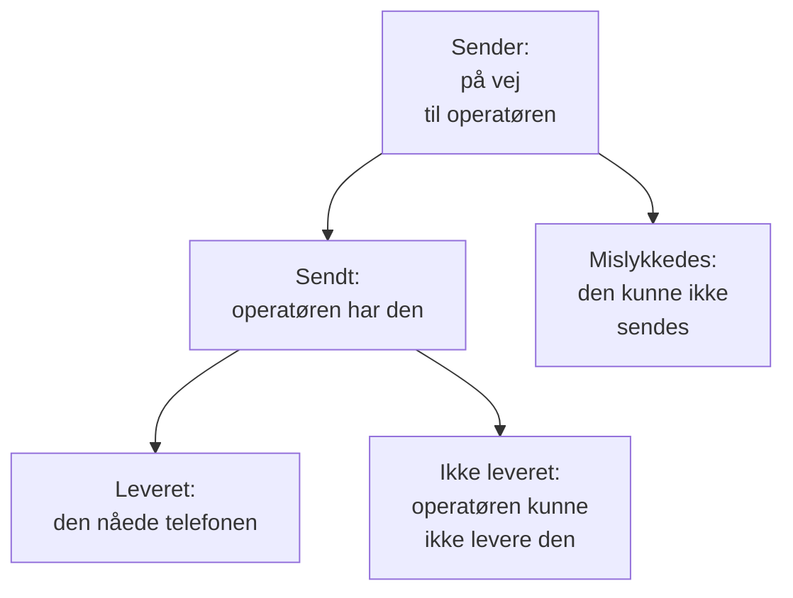

# Notifikationslogs

Notifikationslogs viser hver besked, OneUptime har sendt for dit projekt, med én fane pr. kanal, og hvad der blev af hver: om den gik ud, om den kom frem og, hvis ikke, hvorfor. Åbn dem under **Projektindstillinger → Notifikationer → Notifikationslogs**, eller under **Notifikationslogs** på en hændelse, en advarsel, en vedligeholdelseshændelse, en statusside eller en vagtpolitik, for det, der blev sendt om den.

:::cards
- [Sådan læser du en status](#sådan-læser-du-en-status): Farven viser, hvor beskeden er, og peger du på den, siger den, hvad den betyder.
- [SMS](#sms): Sender, så Sendt, så Leveret, sådan som operatøren melder det.
- [Opkald](#opkald): Ringer op, og så hvordan opkaldet endte.
- [WhatsApp og Telegram](#whatsapp-og-telegram): Hvad hver app melder, efter den har taget imod en besked.
- [E-mail, push, webhooks og arbejdsområder](#e-mail-push-webhooks-og-arbejdsområder): Succes, eller Fejl og hvorfor.
- [Når en SMS bliver stående på Sendt](#når-en-sms-bliver-stående-på-sendt): Operatører, der aldrig melder tilbage, og meldinger, der aldrig kommer frem.
:::

## Sådan læser du en status

Hver status er et mærke, hvis farve viser, hvor beskeden er:

| Farve | Hvor beskeden er |
| --- | --- |
| Grå | Givet videre, og intet er kommet tilbage endnu, som **Sender**. |
| Blå | Udbyderen har den og mangler at sige, hvordan det endte, som **Sendt** for en SMS eller **Ringer op** for et opkald. |
| Grøn | Den nåede personen, som **Leveret**, eller dette er den sidste status, den får. |
| Gul | Den nåede telefonen, og ingen svarede, som **Ubesvaret opkald**, eller den gik ud med en advarsel. |
| Rød | Den nåede ikke personen, som **Ikke leveret**, **Mislykkedes**, **Fejl** eller **For lav saldo**. |

Peg på en status, tryk på den, eller gå til den med Tab-tasten, så siger den, hvad den betyder, og hvad der kommer bagefter. **Vis statusbesked** i rækkens menu viser, hvad udbyderen svarede, som beskedens ID eller hvorfor den mislykkedes. Filteret **Status** på hver fane viser hver status, fanen kan vise, i den rækkefølge en besked går igennem dem.

Kortet **Hvem fik besked** i oversigten for en hændelse eller en advarsel og resultatet af et testkald viser hver beskeds status på samme måde, i de samme farver: Et opkald, der stadig ringer, står også der som **Ringer op**, aldrig som **Sendt**.

## SMS

| Status | Hvad det betyder |
| --- | --- |
| **Sender** | OneUptime har givet SMS'en til Twilio, som sender den videre til operatøren. |
| **Sendt** | Operatøren har accepteret SMS'en. Den skifter til **Leveret** eller **Ikke leveret**, så snart operatøren melder tilbage. |
| **Leveret** | Operatøren har bekræftet, at SMS'en nåede telefonen. Det er den sidste status for en SMS, der kom frem. |
| **Ikke leveret** | Operatøren kunne ikke levere den. **Fejlkode** fortæller hvorfor, og hvad koden betyder. |
| **Mislykkedes** | Twilio kunne ikke sende den. **Fejlkode** fortæller hvorfor. |
| **Fejl** | Den blev ikke sendt, for eksempel fordi SMS er slået fra for projektet, eller fordi Twilio afviste nummeret. **Vis statusbesked** fortæller hvorfor. |
| **For lav saldo** | Den blev ikke sendt: Projektets saldo var for lav til at betale for den. |
| **Succes** | Den blev sendt, før OneUptime fulgte leveringen, og Twilio accepterede den. |

En SMS, som serverens egen SMS- og opkaldsgateway har taget imod, bliver stående på **Sendt**, i grønt: Gatewayen melder ikke om levering, så det er dens sidste status.

Twilio melder hver ændring til OneUptime, så snart den sker, signeret med auth-tokenet for den konto, som SMS'en gik ud fra, og OneUptime afviser enhver melding, der ikke kommer fra Twilio. Derfor skal Twilio kunne nå din server: se [Twilio-integration](/docs/self-hosted/twilio-integration).

### Fejlkoder

Hver kode under **Fejlkode** åbner Twilios side om koden, som viser, hvad der kan forårsage den. Under de koder, som en SMS oftest mislykkes med, fortæller loggen på én linje, hvad de betyder:

| Kode | Hvad det betyder |
| --- | --- |
| `20003` | Twilio accepterede ikke kontoens loginoplysninger. |
| `21211` | Nummeret er ikke et gyldigt telefonnummer. |
| `21408` | Twilio-kontoen må ikke sende SMS til dette land. |
| `21606` | Afsendernummeret kan ikke sende SMS for denne Twilio-konto. |
| `21608` | En Twilio-prøvekonto kan kun sende til numre, der er verificeret i den. |
| `21610` | Modtageren svarede STOP, så Twilio sender ikke længere SMS til vedkommende fra dette nummer. |
| `21612` | Afsendernummeret kan ikke nå dette nummer. |
| `21614` | Nummeret er ikke et mobilnummer, men for eksempel en fastnettelefon. |
| `30001` | Der blev sendt for mange SMS'er på én gang, og Twilios kø løb over. |
| `30002` | Twilio-kontoen blev suspenderet, før SMS'en gik ud. |
| `30003` | Telefonen er slukket eller uden for rækkevidde. |
| `30004` | Nummeret er blokeret for at modtage SMS'en. |
| `30005` | Nummeret er ukendt og findes måske ikke længere. |
| `30006` | Nummeret kan ikke modtage SMS, for eksempel fordi det er en fastnettelefon. |
| `30007` | Twilio eller operatøren filtrerede SMS'en fra som spam. |
| `30008` | Operatøren kunne ikke levere SMS'en og sagde ikke hvorfor. |
| `30032` | Det afsendende gratisnummer er ikke verificeret endnu. |
| `30034` | Afsendernummeret er ikke registreret til A2P 10DLC, som operatører i USA kræver. |

En kode, der ikke er fra Twilio, som den HTTP-status, din SMS- og opkaldsgateway svarede med, vises, som den er.

## Opkald

| Status | Hvad det betyder |
| --- | --- |
| **Ringer op** | Twilio har foretaget opkaldet. Det ændres, så snart Twilio melder, hvordan opkaldet endte. |
| **Succes** | Opkaldet blev besvaret, og **Vis statusbesked** fortæller, hvor længe det varede. Et opkald, som serverens egen SMS- og opkaldsgateway har taget imod, er **Succes**, så snart gatewayen accepterer det. |
| **Ubesvaret opkald** | Opkaldet ringede ud: Ingen svarede. |
| **Optaget** | Linjen var optaget, eller opkaldet blev afvist. |
| **Telefonsvarer** | Telefonsvareren besvarede et vagtopkald. **Vis statusbesked** fortæller, om der blev lagt en besked. |
| **Fejl** | Opkaldet kunne ikke foretages eller forbindes. |
| **For lav saldo** | Det blev ikke foretaget: Projektets saldo var for lav til at betale for det. |

## WhatsApp og Telegram

En WhatsApp-besked er **I kø**, mens OneUptime giver den videre, **Sendt**, så snart WhatsApp accepterer den, **Leveret**, så snart den når telefonen, og **Læst**, så snart den åbnes, hvis personen deler læsekvitteringer. **Mislykkedes** er en besked, WhatsApp ikke kunne levere, og **Advarsel** en, den sendte med en advarsel: **Vis statusbesked** fortæller, hvad WhatsApp meldte. **Fejl** og **For lav saldo** betyder, at den ikke blev sendt, ligesom for en SMS.

Telegram melder intet, efter det har taget imod en besked, så **Sendt** er grøn for en Telegram-besked: Telegram har lagt den i chatten, og det er dens sidste status.

## E-mail, push, webhooks og arbejdsområder

Disse faner viser **Succes** eller **Fejl**. **Succes** er den sidste status: Mailserveren har accepteret e-mailen, push-tjenesten notifikationen, webhookens adresse har svaret, at den tog imod anmodningen, eller arbejdsområdet har gjort det, der blev bedt om. OneUptime følger ikke en e-mail, efter mailserveren har accepteret den, og en push-notifikation skifter til **Fejl**, hvis push-tjenesten senere melder, at den ikke blev leveret. **Vis statusbesked** fortæller, hvorfor en besked er **Fejl**, ligesom **Årsag** gør det på fanen **Arbejdsområde**.

## Når en SMS bliver stående på Sendt

**Sendt** betyder, at operatøren har SMS'en og endnu ikke har meldt tilbage. De fleste operatører melder tilbage inden for sekunder eller minutter, men nogle gør det aldrig: Så holder Twilio også SMS'en på `sent`, som dens beskedlogs viser, og OneUptime kan ikke vide, om den kom frem.

En SMS, der bliver stående på **Sender**, er noget andet: Twilios meldinger når ikke frem til OneUptime. Tjek, at Twilio kan nå din server, og søg i serverens log efter linjer, der begynder med `Twilio callback refused`: se [Twilio-integration](/docs/self-hosted/twilio-integration).

## Næste skridt

:::cards
- [Twilio-integration](/docs/self-hosted/twilio-integration): Forbind Twilio, og lad dets leveringsmeldinger nå frem til OneUptime.
- [SMS- og opkaldsgateway](/docs/self-hosted/sms-and-call-gateway): Send SMS og opkald gennem en gateway, du selv har.
- [Metrikker for notifikationslevering](/docs/self-hosted/notification-delivery-metrics): Tæl, hvad der blev leveret i hele installationen.
:::
