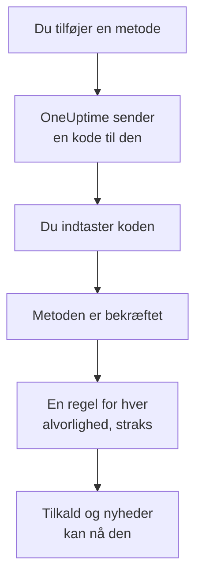

# Notifikationsmetoder

En notifikationsmetode er en adresse, OneUptime må nå dig på i ét projekt: en e-mailadresse, et telefonnummer til sms eller opkald, et WhatsApp-nummer, en Telegram-konto, din Slack- eller Microsoft Teams-konto, en telefon eller browser til push-notifikationer eller en webhook. Du tilføjer dem under **Brugerindstillinger → Notifikationsmetoder**, bekræfter dem, og OneUptime begynder straks at bruge dem til dine tilkald.

:::cards
- [Vælg en metode](#vælg-en-metode): Hvad hver metode kræver, og hvordan den bekræftes.
- [Tilføj og bekræft en metode](#tilføj-og-bekræft-en-metode): E-mail, sms, opkald og WhatsApp, med en kode på 6 cifre.
- [Webhooks](#webhooks): Send tilkald til dit eget endpoint, signeret hvis du vil.
- [Slå en kanal til for dit projekt](#slå-en-kanal-til-for-dit-projekt): Hvorfor sms, opkald, WhatsApp eller Telegram kan mangle.
:::

## Sådan bliver en metode aktiv



En metode, du ikke har bekræftet, bliver aldrig brugt. Push-enheder, Slack, Microsoft Teams og webhooks klarer sig uden kode: at registrere en enhed eller forbinde din konto beviser, at den er din, og en webhook kræver intet bevis. At bekræfte en metode tilføjer straks dine [standardregler](/docs/notifications/on-call-rules#de-regler-du-starter-med) for den, så et nyt telefonnummer tilkalder dig for hver alvorlighed, indtil du ændrer dets regler.

## Vælg en metode

Hver fane i **Notifikationsmetoder** indeholder et eller flere kort, ét pr. slags metode:

| Kort | Fane | Hvad du tilføjer | Hvordan den bekræftes |
| --- | --- | --- | --- |
| **E-mails til meddelelser** | **Direct Contact** | En e-mailadresse | En kode via e-mail |
| **Telefonnumre til SMS-meddelelser** | **Direct Contact** | Et telefonnummer | En kode via sms |
| **Telefonnumre til opkaldsnotifikationer** | **Direct Contact** | Et telefonnummer | En kode, der læses op i et opkald, eller ingen for et nummer, der er bekræftet til sms |
| **WhatsApp-numre til notifikationer** | **Direct Contact** | Et WhatsApp-nummer | En kode via WhatsApp |
| **Telegram-konti til notifikationer** | **Direct Contact** | Din Telegram-konto | En besked til OneUptime-botten |
| **Slack Account for Notifications** | **Workspace Apps** | Din Slack-konto | At forbinde din konto med projektets arbejdsområde |
| **Microsoft Teams Account for Notifications** | **Workspace Apps** | Din Microsoft Teams-konto | At forbinde din konto med projektets arbejdsområde |
| **Enheder til push-notifikationer** | **Push Notifications** | En telefon med appen OneUptime On-Call, eller en browser | At registrere enheden |
| **Webhooks til notifikationer** | **Webhooks** | Et HTTPS-endpoint af dine egne | Ingen |

**Workspace Apps** vises kun, når projektet har forbundet Slack eller Microsoft Teams, og indeholder kun dem, det har forbundet. Sms, opkald, WhatsApp og Telegram kan være slået fra for hele projektet; se [Slå en kanal til for dit projekt](#slå-en-kanal-til-for-dit-projekt).

## Tilføj og bekræft en metode

E-mailadresser, sms-numre, opkaldsnumre og WhatsApp-numre bekræftes med en kode på 6 cifre.

:::steps
### Åbn dine metoder

Gå til **Brugerindstillinger → Notifikationsmetoder**. **Direct Contact** er den første fane.

### Tilføj adressen

Klik på metodens tilføj-knap i dens kort, for eksempel **Tilføj Telefonnummer til SMS-meddelelser**. Indtast **E-mail**, eller **Telefonnummer** i internationalt format, for eksempel `+11234567890`, og gem.

### Indtast koden

Bekræftelsesdialogen åbner af sig selv og fortæller, hvor koden blev sendt hen, og hvor længe den gælder. Skriv koden i **Bekræftelseskode**, og klik på **Bekræft**.

### Tjek rækken

Rækken er nu markeret som **Bekræftet**. Lukkede du dialogen for tidligt? Klik på **Bekræft** i rækken for at åbne den igen.
:::

- En kode gælder i 15 minutter. Fem forkerte forsøg annullerer den, og du skal bruge en ny.
- **Send a new code**, eller **Call me with a new code** for et opkaldsnummer, findes i dialogen. Du kan bede om en ny et minut efter den forrige.
- Et nummer, du har bekræftet til sms, er også bekræftet til opkald. At tilføje det under **Telefonnumre til opkaldsnotifikationer** kræver ingen kode, og at bekræfte et sms-nummer bekræfter også det opkaldsnummer, du har tilføjet til det.
- Din login-e-mail er der allerede, bekræftet, fra den dag, du blev medlem af projektet.

## Forbind Telegram

:::steps
### Tilføj kontoen

Klik i **Telegram-konti til notifikationer** på **Tilføj Telegram-konto**. **Telegram-brugernavn (valgfrit)** er kun en etiket til dig selv og kan stå tomt.

### Skriv til botten

Klik på **Bekræft** i den nye række. Dialogen **Bekræft Telegram-konto** giver dig tre måder at nå OneUptime-botten på: scan QR-koden med din telefon, klik på **Open in Telegram**, eller søg efter botten i Telegram, og send den `/start`-kommandoen, som dialogen viser.

### Bekræft det

Klik tilbage i OneUptime på **I've sent the message — check**. Så snart botten har din besked, er kontoen bekræftet.
:::

**Rotér kode** laver en ny kode til en konto, der endnu ikke er bekræftet. QR-koden og linket, du åbnede før, holder så op med at virke. I en selvhostet OneUptime forbinder serverens administrator en Telegram-bot, før nogen kan forbinde en konto.

## Slack og Microsoft Teams

1. Forbind din egen konto med projektets arbejdsområde: **Brugerindstillinger → Arbejdsområde → Slack**, eller **Microsoft Teams**. Se [Slack](/docs/workspace-connections/slack) og [Microsoft Teams](/docs/workspace-connections/microsoft-teams).
2. Klik på fanen **Workspace Apps** på **Add Slack Account** eller **Add Microsoft Teams Account**. Kontoen er bekræftet, så snart den er tilføjet.
3. Klik på **Send Test Message** i dens række. Tilkald kommer som direkte beskeder fra OneUptime-appen.

## Push-notifikationer

Fanen **Push Notifications** viser dine **Enheder til push-notifikationer**.

- **En telefon.** Installér appen OneUptime On-Call, forbind den til dit OneUptime, log ind, og tillad notifikationer: telefonen tilføjer sig selv til listen. Se [Apps – Oversigt](/docs/mobile-desktop-apps/index).
- **Denne browser.** Klik på **Registrer enhed**, udfyld **Enhedsnavn**, og tillad notifikationer, når browseren spørger.
- **Testnotifikation** i en enheds række sender en push til den med det samme.
- **Kritiske advarsler** viser, om telefonens tilkald bryder igennem lydløs tilstand og Forstyr ikke. Det slås til i appen, aldrig her, og en browser kan ikke. Se [Kritiske vagtadvarsler](/docs/self-hosted/push-notifications#kritiske-vagtalarmer-tilsidesætter-lydløs-tilstand).
- En enhed markeret med **Modtager ikke notifikationer** får intet sendt. Åbn appen på den telefon, eller registrer browseren igen, så er den med igen.

## Webhooks

En webhook sender hvert tilkald som JSON til et HTTPS-endpoint af dine egne, så et værktøj af dine egne kan handle på det.

:::steps
### Tilføj webhooken

Klik på fanen **Webhooks** på **Tilføj Webhook**. Udfyld **Navn** med noget, du kan genkende, derefter **Webhook-URL** og **Signeringshemmelighed (valgfri)**.

### Send en test

Klik på **Send test** i dens række. Dit endpoint modtager en begivenhed, hvis `eventType` er `test`.

### Tjek, hvad der kommer

Et tilkald er en JSON-`POST` som den nedenfor. Svar med en vilkårlig `2xx`-status inden for 10 sekunder; omdirigeringer følges ikke.
:::

```json title="A page, as your endpoint receives it"
{
  "eventType": "on-call.incident.created",
  "timestamp": "2026-10-15T09:30:00.000Z",
  "projectId": "6a3f0d2e-1c4b-4e8a-9b7d-2f5c8e1a0b3c",
  "userId": "0c9e8d7f-6b5a-4c3d-8e2f-1a0b9c8d7e6f",
  "incident": {
    "id": "5b4a3c2d-1e0f-4a9b-8c7d-6e5f4a3b2c1d",
    "title": "Checkout API is down",
    "description": "Health check failed from 3 probes.",
    "incidentNumber": 42,
    "incidentNumberWithPrefix": "INC-42",
    "severity": "Critical Incident",
    "state": "Identified"
  },
  "onCallPolicyId": "7d6c5b4a-3e2f-4d1c-9b8a-7f6e5d4c3b2a",
  "onCallPolicyEscalationRuleId": "8e7d6c5b-4a3f-4e2d-8c1b-9a8f7e6d5c4b"
}
```

| `eventType` | Sendes for | Postens nøgle |
| --- | --- | --- |
| `on-call.incident.created` | En hændelse | `incident` |
| `on-call.alert.created` | En advarsel | `alert` |
| `on-call.incidentEpisode.created` | En hændelsesepisode | `incidentEpisode` |
| `on-call.alertEpisode.created` | En advarselsepisode | `alertEpisode` |

De nyheder, du slår til for Webhook i **Notifikationsindstillinger**, kommer til det samme endpoint, med indstillingens begivenhed i `eventType` og et kort resumé i `subject` og `message`.

Hver anmodning har `X-OneUptime-Event`, begivenhedstypen. Med en signeringshemmelighed har den også `X-OneUptime-Signature`: `sha256=` efterfulgt af HMAC-SHA256 af den rå body, i hex. Tjek den, før du stoler på anmodningen:

```javascript title="verify-signature.js"
const crypto = require("crypto");

// rawBody: the request body exactly as it arrived, before any JSON parsing.
function isFromOneUptime(rawBody, signatureHeader, secret) {
  const expected =
    "sha256=" + crypto.createHmac("sha256", secret).update(rawBody).digest("hex");
  const received = Buffer.from(signatureHeader || "");
  const wanted = Buffer.from(expected);
  return received.length === wanted.length && crypto.timingSafeEqual(received, wanted);
}
```

En webhook kræver ingen bekræftelse, så når du tilføjer den, tilføjes dens regler med det samme. Private og interne adresser afvises, medmindre administratoren af en selvhostet server tillader dem: se [Adgang til privat netværk](/docs/self-hosted/private-network-access#webhooks-og-workflows).

## Slå en kanal til for dit projekt

**SMS**, **Telefonopkald**, **WhatsApp** og **Telegram** er slået fra i hvert nyt projekt, fordi hver besked koster penge: I OneUptime Cloud betales den af projektets saldo, og sms og opkald går i stedet gennem projektets egen Twilio-konto, når projektets standardkonto sender dem. E-mail, push, Slack, Microsoft Teams og webhooks er altid slået til.

Så længe en kanal er slået fra, kan ingen i projektet tilføje en metode på den: dens kort har ingen tilføj-knap og fortæller, hvem der kan slå den til. En projektejer, en **Faktureringsadministrator** eller en person med **Manage Billing** slår den til, i kortet **Notifikationskanaler** under **Projektindstillinger → Notifikationer → Notifikationsindstillinger**. En projektadministrator kan ikke. I en selvhostet OneUptime kræver sms og opkald desuden en Twilio-konto, og Telegram en bot, som serverens administrator forbinder; se [Twilio-integration](/docs/self-hosted/twilio-integration).

## Slet en metode

Klik på **Slet** i metodens række. At slette en metode sletter hver vagtregel, der bruger den, så dialogen tæller først disse regler og nævner hver alvorlighed, som sletningen ville efterlade helt uden regel.

## Fejlfinding

:::details Et kort har ingen tilføj-knap
Den kanal er slået fra i dette projekt. Kortet fortæller, hvem der kan slå den til; se [Slå en kanal til for dit projekt](#slå-en-kanal-til-for-dit-projekt).
:::

:::details Koden kom aldrig
E-mails kan tage et par minutter og havner nogle gange i spam; sms'er kan tage et minut. Vent et minut, og klik så på **Send a new code** i dialogen. **Projektindstillinger → Notifikationer → Notifikationslogs** viser, hvad der skete med beskeden.
:::

:::details Det mislykkes at tilføje min Slack-konto
Forbind først din konto under **Brugerindstillinger → Arbejdsområde → Slack**, og klik så igen på **Add Slack Account**. Fejldialogen har en knap, der fører dig derhen.
:::

:::details Min telefon får ingen push-notifikationer
Tjek, at telefonen står under **Enheder til push-notifikationer**, og send den en **Testnotifikation**. Se [Ofte stillede spørgsmål og fejlfinding](/docs/mobile-desktop-apps/faq-troubleshooting#notifikationer).
:::

## Næste skridt

:::cards
- [Personlige vagtregler](/docs/notifications/on-call-rules): Bestem, hvilken metode hvert tilkald prøver, og hvornår.
- [Notifikationsindstillinger](/docs/notifications/notification-settings): Vælg de nyheder, du hører om, og via hvilke kanaler.
- [Apps – Oversigt](/docs/mobile-desktop-apps/index): Få tilkald på din telefon eller computer.
- [Sådan når OneUptime dig](/docs/notifications/index): Hvordan metoder, regler og indstillinger hænger sammen.
:::
