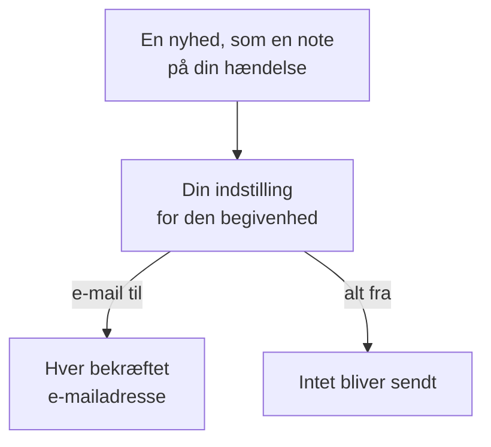

# Notifikationsindstillinger

Notifikationsindstillinger afgør, hvilke nyheder der når dig om de ting, du ejer, som en hændelse, en overvågning eller en statusside, og om dine egne vagter, og via hvilke kanaler. De tilkalder dig aldrig: at tilkalde er dine vagtreglers opgave. Du sætter dem op under **Brugerindstillinger → Notifikationsindstillinger**, med én kontakt pr. begivenhed og kanal.

:::cards
- [Sådan virker indstillingerne](#sådan-virker-indstillingerne): Én kontakt pr. begivenhed og kanal, sendt til hver bekræftet metode.
- [Skift en indstilling](#skift-en-indstilling): Tre klik, gemt med det samme.
- [Hvad der er slået til for et nyt medlem](#hvad-der-er-slået-til-for-et-nyt-medlem): Standardindstillingerne, fane for fane.
- [Færre e-mails](#færre-e-mails): Saml bølgerne, eller drop rutinemails.
:::

## Sådan virker indstillingerne

- Hver række er en begivenhed, og hver kolonne en kanal: E-mail, SMS, Opkald, Push, WhatsApp, Telegram, Slack og Microsoft Teams samt Webhook. Slack og Microsoft Teams er kun kolonner, når projektet har forbundet dem.
- En kanal, der er slået til, sender til hver bekræftet metode, du har på den i dette projekt, ikke kun til én.
- En kanal, der er slået til uden en bekræftet metode bagved, sender intet. **Your setup checklist** siger det under **Staying informed**.
- En nyhed går til tingens ejere: de personer, der er angivet som ejere, og medlemmerne af dens ejerteams. Har en ting ingen ejere, går den i stedet til projektets ejere. En begivenhed om at være blevet tilføjet som ejer går kun til den person, der blev tilføjet.
- Sikkerhedssager har ingen ejere. En ny sag går til alle, der kan se projektets sager, ved den prioritet, hver af dem vælger, og en tildelt sag går til de personer, den er tildelt. Se [Sikkerhedssager](/docs/telemetry/security-cases#notifikationer).
- Hver e-mail til ejere slutter med et link, "Manage notification preferences", der fører tilbage hertil.

## Skift en indstilling

:::steps
### Åbn dine indstillinger

Gå til **Brugerindstillinger → Notifikationsindstillinger**. Fanerne er **Hændelser**, **Advarsler**, **Overvågning**, **Statussider**, **Planlagt vedligeholdelse**, **Vagt** og **Sikkerhed**.

### Find begivenheden

Hver fane har et eller flere kort, som **Hændelse Episoder** på fanen **Hændelser**. Hver række er en begivenhed, med en linje, der siger, hvornår den sendes.

### Klik på en kanal

Klik på en kanals cirkel for at slå den til, og igen for at slå den fra. Et flueben betyder slået til. Ændringer gemmes automatisk.
:::

## Hvad der er slået til for et nyt medlem

Når du bliver medlem af et projekt, er disse begivenheder slået til, via e-mail. Alt andet starter slået fra og sender intet, før du slår en kanal til.

| Fane | Slået til via e-mail | Slået fra, indtil du slår dem til |
| --- | --- | --- |
| **Hændelser** | **Hændelse oprettet**, **Hændelsestilstand ændret**, **Incident reminder**, **Hændelsens SLA overskredet**, **Hændelsesepisode oprettet**, **Tilstand for hændelsesepisode ændret**, **Hændelse tilføjet til hændelsesepisode** | **Hændelsesnote oprettet**, **Tilføjet som hændelsesejer**, **Tildelt en hændelse**, **Note til hændelsesepisode oprettet**, **Tilføjet som ejer af hændelsesepisode** |
| **Advarsler** | **Advarsel oprettet**, **Advarselstilstand ændret**, **Alert reminder**, **Advarselsepisode oprettet**, **Tilstand for advarselsepisode ændret**, **Advarsel tilføjet til advarselsepisode** | **Advarselsnote offentliggjort**, **Tilføjet som advarselsejer**, **Note til advarselsepisode offentliggjort**, **Tilføjet som ejer af advarselsepisode** |
| **Overvågning** | **Sondestatus ændret for din overvågning**, **Overvågning har ingen aktive sonder**, **SLO status changed**, **Added as SLO owner**, **Sondestatus ændret**, **Tilføjet som sondeejer** | **Overvågning oprettet**, **Overvågningsstatus ændret**, **Tilføjet som overvågningsejer**, **AI-agentstatus ændret**, **Tilføjet som AI-agentejer** |
| **Statussider** | Ingen | **Statusside oprettet**, **Statusside-meddelelse offentliggjort**, **Tilføjet som statussideejer** |
| **Planlagt vedligeholdelse** | **Maintenance reminder** | **Vedligeholdelseshændelse oprettet**, **Vedligeholdelsestilstand ændret**, **Vedligeholdelsesnote oprettet**, **Tilføjet som vedligeholdelsesejer** |
| **Vagt** | **Du går på vagt**, **Du er den næste på vagt**, **Du går af vagt**, **Tilføjet til vagtordningspolitik**, **Fjernet fra vagtordningspolitik**, **Ubesvaret opkald**, og også via push: **Før min vagt starter**, **Min kommende vagt bliver tildelt en anden** | Ingen |
| **Sikkerhed** | Også via push: **Ny sikkerhedssag** (sager med prioritet High og Kritisk), **Sikkerhedssag tildelt mig**, **Playbook-trin venter på min godkendelse**, **Responsmål for sikkerhedssag**, **Opgave i sikkerhedssag tildelt mig**, **En hunt fandt sikkerhedsbegivenheder** | Ingen |

> [!IMPORTANT]
> **Overvågningsstatus ændret** starter slået fra. Vil du vide, når en overvågning, du ejer, går ned eller kommer op igen, så slå den til på fanen **Overvågning**.

## Dine vagter

Fanen **Vagt** handler om dig, ikke om de ting, du ejer:

- **Du går på vagt**, **Du er den næste på vagt** og **Du går af vagt** følger dine tørn i de vagtplaner, du er med i.
- **Tilføjet til vagtordningspolitik** og **Fjernet fra vagtordningspolitik** fortæller dig, når en vagtpolitik begynder eller holder op med at nævne dig.
- **Før min vagt starter** sender påmindelser på de tidspunkter, du vælger under **Brugerindstillinger → Kalender → Kalenderfeed**, og **Min kommende vagt bliver tildelt en anden** fortæller dig, når en anden dækker en vagt, du er blevet mindet om. Se [Kalenderfeeds](/docs/on-call/calendar-feeds#påmindelser-og-meddelelser-om-ny-tildeling).
- **Ubesvaret opkald**, på kortet **Indgående opkaldspolitikker**, fortæller ejerne af en politik for indgående opkald, at en, der ringede, ikke nåede nogen. Se [Politik for indgående opkald](/docs/on-call/incoming-call-policy#ubesvarede-opkald).

## Sikkerhedssager

Fanen **Sikkerhed** handler om de sikkerhedssager, du kan se:

- **Ny sikkerhedssag** har en prioritet under sit navn: den laveste prioritet, en sag skal have for at give dig besked. Den er **Høj og højere**, medmindre du vælger **Kun Kritisk**, **Mellem og højere**, **Lav og højere** eller **Alle sager**.
- **Sikkerhedssag tildelt mig** følger de sager, der er tildelt dig, og dem, der er tildelt de teams, du er med i.
- **Playbook-trin venter på min godkendelse** beder dig godkende eller afvise et playbook-trin på en sag, hvor du må godkende trin.

Se [Sikkerhedssager](/docs/telemetry/security-cases#notifikationer).

## Færre e-mails

Disse kontakter afgør, hvilke nyheder der når dig, ikke hvor mange e-mails de bliver til. **Brugerindstillinger → E-mailindstillinger** har to kort til det, begge kun for dig, i dette projekt:

- **Email Rollup** samler en bølge af nyheder i én e-mail: de første kommer stadig én ad gangen, resten samlet et par minutter senere.
- **Fewer routine emails** slår med **Reduce routine emails** e-mails fra om noter, nye ejere, nye overvågninger og statussider, tilføjelser til episoder og ændringer i vagtpolitikker.

Se [Notifikationsoversigt](/docs/emails/notification-rollup).

## Fejlfinding

:::details En kontakt er slået til, men intet kommer frem
Tjek, at du har en bekræftet metode på den kanal under **Brugerindstillinger → Notifikationsmetoder**. For sms, opkald, WhatsApp og Telegram skal projektet også have slået kanalen til.
:::

:::details Jeg ejer en overvågning, men hører aldrig, når den går ned
**Overvågningsstatus ændret** starter slået fra. Slå en kanal til for den, på fanen **Overvågning**.
:::

:::details Jeg får stadig e-mails, efter at jeg har slået alt fra
Tilkald følger dine vagtregler, ikke disse kontakter, og e-mails om login, sikkerhed og fakturering er ikke nyheder om ting. Hvert projekt har sine egne indstillinger, så tjek det projekt, e-mailen kom fra. Se [Personlige vagtregler](/docs/notifications/on-call-rules).
:::

## Næste skridt

:::cards
- [Notifikationsmetoder](/docs/notifications/notification-methods): Tilføj de metoder, dine indstillinger sender til.
- [Personlige vagtregler](/docs/notifications/on-call-rules): Bestem, hvordan et tilkald når dig.
- [Notifikationsoversigt](/docs/emails/notification-rollup): Færre, fyldigere e-mails under en bølge.
- [Sådan når OneUptime dig](/docs/notifications/index): Hvordan metoder, regler og indstillinger hænger sammen.
:::
