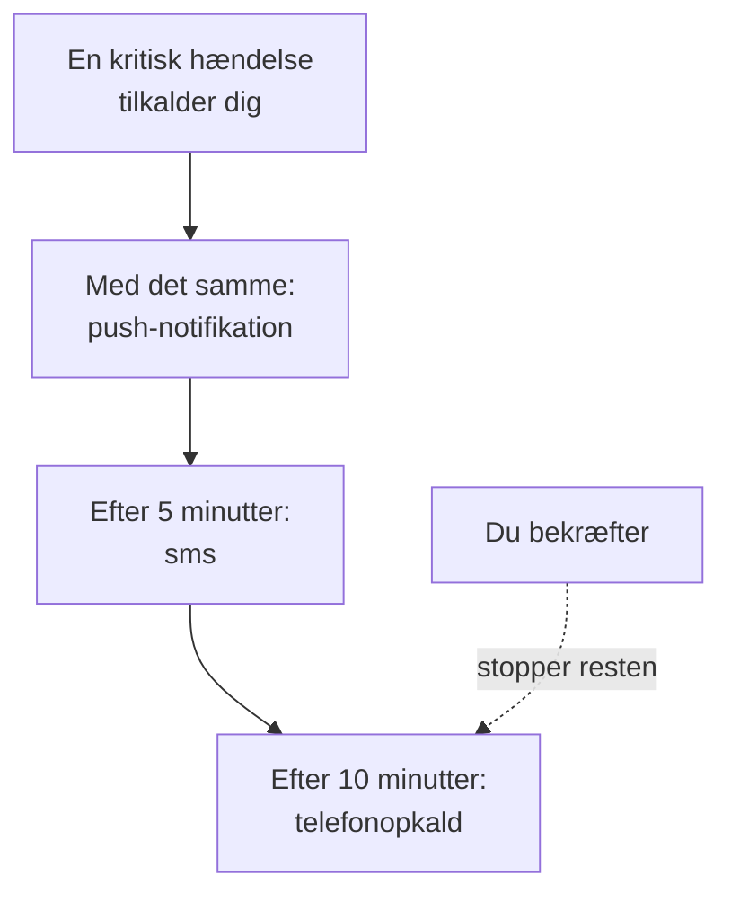

# Personlige vagtregler

Dine vagtregler afgør, hvordan et tilkald når dig: hvilke af dine notifikationsmetoder OneUptime prøver, og hvor lang tid efter tilkaldets start. Hver slags tilkald har sine egne regler, ét sæt pr. alvorlighed, så en kritisk hændelse kan ringe til dig med det samme, mens en mindre advarsel venter på en e-mail. Du sætter dem op under **Brugerindstillinger → Vagtregler**.

> [!NOTE]
> Disse regler er kun dine. **Vagtregler** under **Hændelser → Regler** og **Advarsler → Regler** er noget andet: de afgør, hvilke vagtpolitikker en ny hændelse eller advarsel kører.

:::cards
- [Sådan når et tilkald dig](#sådan-når-et-tilkald-dig): Dine regler for ét tilkald, trin for trin.
- [De regler, du starter med](#de-regler-du-starter-med): Hvad hver bekræftet metode tilføjer, og hvordan du skærer ned.
- [Tilføj en regel](#tilføj-en-regel): En metode og en ventetid for én alvorlighed.
- [Push-regler](#push-regler): Bryd igennem lydløs, og gentag, indtil nogen bekræfter.
:::

## Sådan når et tilkald dig

En vagtpolitik tilkalder dig, når en af dens eskaleringsregler nævner dig, et team, du er med i, eller en vagtplan, hvor du har vagt. OneUptime gennemgår så dine regler for den slags tilkald og dens alvorlighed: hver regel udløses via sin egen metode, når dens ventetid er gået, regnet fra tilkaldets start. At bekræfte hændelsen eller advarslen, fra en hvilken som helst besked eller i OneUptime, stopper hver regel, der ikke er udløst endnu.

De fleste beskeder kan bekræfte tilkaldet: e-mails, sms'er og beskeder i WhatsApp, Telegram, Slack og Microsoft Teams har et bekræftelseslink, og et opkald beder dig trykke 1. Kan du ikke tage et tilkald, kan du eskalere det fra de samme beskeder, og et opkald beder dig trykke 2: politikken tilkalder straks sit næste niveau, og du bliver ikke tilkaldt om det igen. Se [Eskalér et tilkald](/docs/on-call/escalation-rules#eskalér-et-tilkald). Hvert tilkald, du får, står under **Brugerindstillinger → Vagtlogs**, hvor **Vis tidslinje** viser hver sendt besked, og om den blev leveret.

## De fire faner

**Brugerindstillinger → Vagtregler** har en fane for hver slags tilkald. Hver fane har et kort pr. alvorlighed, med det navn og den farve, dit projekt har givet den:

| Fane | Tilkald for | Kort for |
| --- | --- | --- |
| **Hændelser** | Hændelser | Hændelsers alvorligheder |
| **Hændelse Episoder** | Episoder, der samler hændelser | Hændelsers alvorligheder |
| **Advarsler** | Advarsler | Advarslers alvorligheder |
| **Advarsel Episoder** | Episoder, der samler advarsler | Advarslers alvorligheder |

En episode tilkalder dig gennem sine egne vagtpolitikker, adskilt fra hændelserne eller advarslerne i den, og derfor har dens regler deres egen fane. Sidens adresse angiver den åbne fane, for eksempel `/dashboard/{projectId}/user-settings/on-call-rules?type=alerts`; de andre værdier er `incident-episodes` og `alert-episodes`, og uden `type` åbner siden på **Hændelser**.

## De regler, du starter med

Hver metode, du bekræfter, får en regel på hvert kort på hver fane, sendt så snart du bliver tilkaldt. Din login-e-mail har dem fra den dag, du blev medlem, så et tilkald altid når dig. Bekræft et telefonnummer til sms, og hvert tilkald sender dig også en sms.

Det er en sikker start, og som regel for meget. Skær det ned til det, hver alvorlighed fortjener:

| Alvorlighed | Et fornuftigt sæt |
| --- | --- |
| Kritisk | Push med det samme, et opkald efter 5 minutter |
| Alvorlig | Push med det samme, en sms efter 10 minutter |
| Mindre eller lav | En e-mail med det samme |

Dine egne regler har ingen stille timer: hold lave alvorligheder på e-mail, eller på en push-regel sat til **Normal**, så de aldrig vækker dig. For at lade tilkaldelsen for en lav alvorlighed vente på arbejdstiden for alle, sætter du den vagtregel, der tilkalder, til **Kun i arbejdstiden**: se [Vagtregler](/docs/alerts/settings#vagtregler).

## Tilføj en regel

:::steps
### Åbn kortet

Gå til **Brugerindstillinger → Vagtregler**, åbn fanen for den slags tilkald, og find alvorlighedens kort.

### Vælg metoden

Klik på **Tilføj Meddelelse Regel**. Vælg under **Notifikationsmetode** en af dine bekræftede metoder; en metode, du ikke har bekræftet, bliver ikke tilbudt.

### Vælg, hvordan en push lyder

Vælg for en telefon under **Push-notifikation** enten **Kritisk advarsel** eller **Normal**. Vælg for enhver push-enhed **Gentag indtil bekræftelse**. Se [Push-regler](#push-regler).

### Sæt ventetiden

Vælg **Underret mig efter**: **Med det samme**, **5 minutter**, **10 minutter**, **15 minutter**, **30 minutter** eller **1 time**. Klik så på **Tilføj Meddelelse Regel** i dialogen.
:::

Kortet viser sine regler i rækkefølge efter ventetid, med **Notifikationsmetode** og **Underret efter** for hver.

## Ændr eller slet en regel

- **Rediger** i en regels række ændrer dens ventetid. Vil du sende en regel til en anden metode, så slet den, og tilføj en ny.
- Klik ved en push-regel på mærkatet under metoden for at skifte mellem **Kritisk advarsel** og **Normal**, eller for at ændre, hvor ofte den gentages. Det gemmes straks.
- **Slet** spørger først og fortæller, om alvorligheden står uden regel. En alvorlighed uden regel falder tilbage på dine bekræftede metoder; se [Når en alvorlighed ingen regel har](#når-en-alvorlighed-ingen-regel-har).

## Push-regler

En regel, der tilkalder en telefon, bestemmer, hvordan dens push lyder:

| Valg | Hvad telefonen gør |
| --- | --- |
| **Kritisk advarsel** | Ringer, selv når telefonen er på lydløs eller i Forstyr ikke, når Critical On-Call Alerts er slået til i appen OneUptime On-Call. En ny telefonregel starter her. |
| **Normal** | Følger telefonens indstillinger for lyd, lydløs og Forstyr ikke. |

En push-regel, til en telefon eller en browser, kan også sende sin push igen, indtil nogen bekræfter: **Gentag ikke**, standarden, eller **Hvert minut**, **Hvert 2. minut**, **Hvert 3. minut**, **Hvert 5. minut**, **Hvert 10. minut**, **Hvert 15. minut** eller **Hvert 30. minut**. Den gentages op til 10 gange mere og stopper, så snart hændelsen, advarslen eller episoden er bekræftet. Se [Kritiske vagtadvarsler](/docs/self-hosted/push-notifications#kritiske-vagtalarmer-tilsidesætter-lydløs-tilstand).

## Når en alvorlighed ingen regel har

En alvorlighed, dit projekt tilføjer senere, får regler inden for få minutter, lavet ud fra de valg, du allerede har truffet på den fane: de samme metoder, efter de samme ventetider. Havde du ingen regler på den fane, får den din bekræftede e-mail, med det samme.

Et tilkald, der alligevel ikke finder en regel, sendes til dine bekræftede metoder alligevel, og du får en e-mail om det; se [Når ingen regel passer](/docs/notifications/index#når-ingen-regel-passer).

:::details Slå en alvorlighed fra med vilje
API'et kan gemme en fravalgsregel, med `isOptOut` sat og uden metode: du bliver så slet ikke tilkaldt for den slags tilkald og den alvorlighed, og intet træder i stedet. Rækken viser **Muted - notifications turned off for this rule**, og at slette den slår tilkaldene til igen. En alvorlighed, der tilføjes senere, er også lydløs, når hver regel, du har på den fane, er et fravalg.
:::

:::details Slå reserven fra for et helt projekt
En projektejer, eller en person med **Manage Billing**, kan sætte projektets `disableOnCallNotificationFallback` via API'et. Et tilkald, der ingen regel finder, bliver så ikke leveret, og dets log siger, at brugeren skal tilføje regler under **Brugerindstillinger → Vagtregler**.
:::

## En kollegas regler

Projektejere og administratorer kan se og ændre den samme side for alle i projektet: Under **Brugere** åbner de personen og derefter **Vagtregler** i sektionen **Vagt**. **Parathed**, lige ved siden af, viser, om hver alvorlighed når personen. Når en anden tilføjer, ændrer eller sletter dine regler, får du en e-mail om det, og hver ændring står i projektets revisionslog.

## Fejlfinding

:::details Min telefon forblev tavs ved et kritisk tilkald
Tjek, at reglens push er **Kritisk advarsel** og ikke **Normal**, og at **Kritiske advarsler** er slået til for telefonen under **Brugerindstillinger → Notifikationsmetoder**, på fanen **Push Notifications**.
:::

:::details Jeg bliver tilkaldt to gange for hver hændelse
Hver bekræftet metode har en regel for hver alvorlighed, sendt med det samme. Slet de regler, du ikke vil have, eller giv dem en ventetid. En hændelse i en episode kan tilkalde dig én gang for hændelsen og én gang for episoden, gennem to politikker.
:::

:::details Jeg fik en e-mail, selvom min regel siger sms
Tilkaldet fandt ingen regel for sin slags eller alvorlighed og faldt tilbage på dine gratis metoder: tilføj reglen på den rigtige fane og det rigtige kort. Eller e-mailen var en nyhed om noget, du ejer, og den følger **Notifikationsindstillinger**, ikke dine regler. Dine **Vagtlogs** viser kun tilkald.
:::

## Næste skridt

:::cards
- [Notifikationsmetoder](/docs/notifications/notification-methods): Tilføj og bekræft de metoder, dine regler peger på.
- [Eskaleringsregler](/docs/on-call/escalation-rules): Hvordan en vagtpolitik tilkalder folk, niveau for niveau.
- [Push-notifikationer](/docs/self-hosted/push-notifications): Kritiske advarsler, alarmlyde og gentagelser på telefoner.
- [Sådan når OneUptime dig](/docs/notifications/index): Hvordan metoder, regler og indstillinger hænger sammen.
:::
