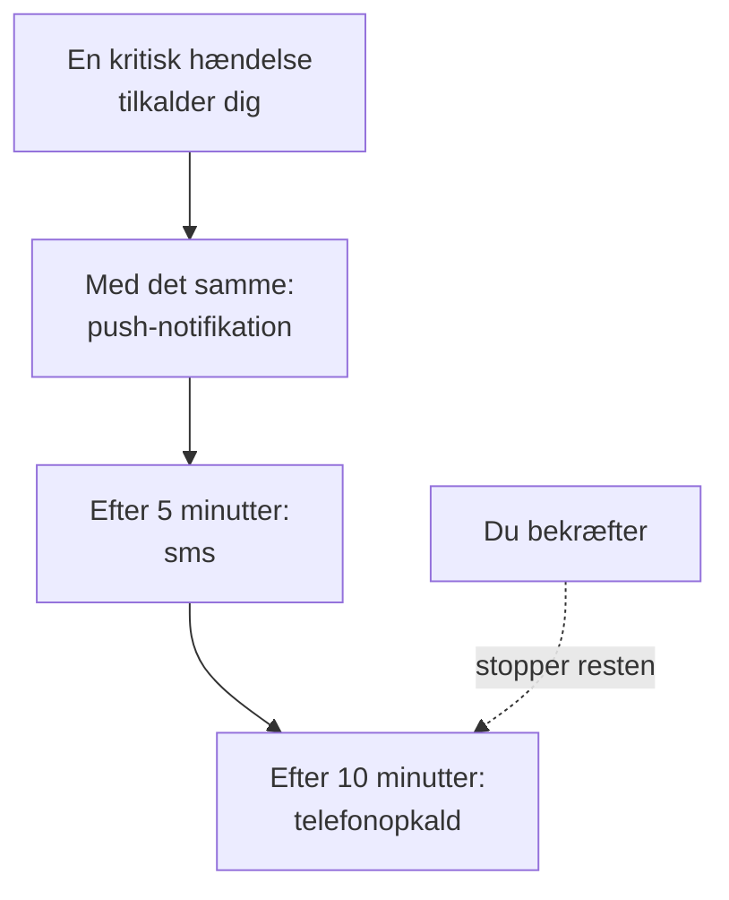

# Sådan når man mig

Dine vagtregler afgør, hvordan et tilkald når dig: hvilke af dine notifikationsmetoder OneUptime prøver, og hvor lang tid efter tilkaldets start. Hver slags tilkald har sine egne regler, ét sæt pr. alvorlighed, så en kritisk hændelse kan ringe til dig med det samme, mens en mindre advarsel venter på en e-mail. Du sætter dem op under **Brugerindstillinger → Sådan når man mig**.

> [!NOTE]
> Disse regler er kun dine. **Vagtregler** under **Hændelser → Regler** og **Advarsler → Regler** er noget andet: de afgør, hvilke vagtpolitikker en ny hændelse eller advarsel kører.

:::cards
- [Sådan når et tilkald dig](#sådan-når-et-tilkald-dig): Dine regler for ét tilkald, trin for trin.
- [Én rækkefølge til alt](#én-rækkefølge-til-alt): De trin, hvert kald prøver, sat op én gang.
- [De regler, du starter med](#de-regler-du-starter-med): Hvad hver bekræftet metode tilføjer, og hvordan du skærer ned.
- [Tilføj en regel](#tilføj-en-regel): En metode og en ventetid for én alvorlighed.
- [Push-regler](#push-regler): Bryd igennem lydløs, og gentag, indtil nogen bekræfter.
:::

## Sådan når et tilkald dig

En vagtpolitik tilkalder dig, når en af dens eskaleringsregler nævner dig, et team, du er med i, eller en vagtplan, hvor du har vagt. OneUptime gennemgår så dine regler for den slags tilkald og dens alvorlighed: hver regel udløses via sin egen metode, når dens ventetid er gået, regnet fra tilkaldets start. At bekræfte hændelsen eller advarslen, fra en hvilken som helst besked eller i OneUptime, stopper hver regel, der ikke er udløst endnu.

De fleste beskeder kan bekræfte tilkaldet: e-mails, sms'er og beskeder i WhatsApp, Telegram, Slack, Microsoft Teams og Mattermost har et bekræftelseslink, og et opkald beder dig trykke 1. Kan du ikke tage et tilkald, kan du eskalere det fra de samme beskeder, og et opkald beder dig trykke 2: politikken tilkalder straks sit næste niveau, og du bliver ikke tilkaldt om det igen. Se [Eskalér et tilkald](/docs/on-call/escalation-rules#eskalér-et-tilkald). Hvert tilkald, du får, står under **Brugerindstillinger → Vagtlogs**, hvor **Vis tidslinje** viser hver sendt besked, og om den blev leveret.

## Én rækkefølge til alt

**Brugerindstillinger → Sådan når man mig** åbner med din rækkefølge: nummererede trin, som hvert kald prøver efter tur, for hændelser, advarsler og episoder af enhver alvorlighed. Hvert trin er et tidspunkt, for eksempel med det samme eller efter 5 minutter, med de bekræftede metoder, der sendes samtidig da. Et senere trin sendes kun, hvis ingen har bekræftet kaldet inden da.

:::steps
### Tilføj en måde at nå dig på

Klik på **Tilføj** ved et trin for at sende en af dine bekræftede metoder på trinnets tidspunkt, eller på **Tilføj trin** for at starte et nyt trin efter det sidste. Et nummer eller en adresse, der stadig venter på sin kode, står under **Ikke bekræftet endnu**, med **Bekræft**. Uden at forlade siden sender **Tilføj din telefon** under trinnene en kode til dit nummer, og når det er bekræftet, tilkalder nummeret dig via sms og telefonopkald; **Brug denne browser** og **Hent appen** tilføjer push på samme måde.

### Vælg, hvornår den bruges

Klik på et trins tidspunkt, for eksempel **Med det samme**, og vælg et andet, op til en time: hele trinnet flytter med. Et push-trin siger også, hvordan det lyder, og om det gentages: se [Push-regler](#push-regler).

### Gem den

Klik på **Gem ændringer**, som vises, så snart noget er ændret. Det skriver de samme regler i hvert kort på hver fane: de regler, du ville tilføje til hvert kort i hånden.
:::

**Test dine kald**, nederst på siden, sender dig et testkald gennem dem.

Når din server ikke kan sende e-mail, sms eller telefonopkald lige nu, er et trin af den slags markeret **Sendes ikke lige nu**, og siden siger én gang, hvem der kan sætte det op.

Når en alvorlighed fortjener noget andet, åbner **Anderledes for nogle alvorligheder**, knappen ved siden af titlen, fanerne og kortene, der er beskrevet nedenfor. Et kort, der afviger fra din rækkefølge, er markeret med **Afviger fra rækkefølgen**. Siden åbner stadig på dine trin og viser under dem hvert kort, der afviger, og hvad det gør i stedet. **Gem ændringer** lader de kort være, som de er; **Brug denne rækkefølge for alle alvorligheder**, sidst i listen, giver dem også din rækkefølge, efter at have nævnt de kort, der mister deres afvigelse. En alvorlighed, dit projekt har arkiveret, beholder sine egne regler.

En vagtpolitik bestemmer, hvem der kaldes, og hvornår dens næste niveau kommer. Hvordan du nås, er denne rækkefølge, for hver politik, der kalder dig.

## De fire faner

**Brugerindstillinger → Sådan når man mig** har en fane for hver slags tilkald. Hver fane har et kort pr. alvorlighed, med det navn og den farve, dit projekt har givet den:

| Fane | Tilkald for | Kort for |
| --- | --- | --- |
| **Hændelser** | Hændelser | Hændelsers alvorligheder |
| **Hændelsesepisoder** | Episoder, der samler hændelser | Hændelsers alvorligheder |
| **Advarsler** | Advarsler | Advarslers alvorligheder |
| **Advarselsepisoder** | Episoder, der samler advarsler | Advarslers alvorligheder |

En episode tilkalder dig gennem sine egne vagtpolitikker, adskilt fra hændelserne eller advarslerne i den, og derfor har dens regler deres egen fane. Sidens adresse angiver den åbne fane, for eksempel `/dashboard/{projectId}/user-settings/on-call-rules?type=alerts`; de andre værdier er `incident-episodes` og `alert-episodes`, og uden `type` åbner siden på **Hændelser**.

En alvorlighed, som dit projekt har arkiveret, kommer efter de andre, markeret med **Arkiveret**, så længe du har regler for den: Hændelser og advarsler, der stadig har den, tilkalder dig efter dem. Du kan ændre eller fjerne de regler, men ikke tilføje nye.

## De regler, du starter med

Hver metode, du bekræfter, får en regel på hvert kort på hver fane, sendt så snart du bliver tilkaldt. Din login-e-mail har dem fra den dag, du blev medlem, så et tilkald altid når dig. Bekræft et telefonnummer til sms, og hvert tilkald sender dig også en sms. Når dit projekt har en standardrækkefølge, følger en metode, du bekræfter, den i stedet: se [Standardrækkefølgen](#standardrækkefølgen).

Det er en sikker start, og som regel for meget. Skær det ned til det, hver alvorlighed fortjener:

| Alvorlighed | Et fornuftigt sæt |
| --- | --- |
| Kritisk | Push med det samme, et opkald efter 5 minutter |
| Alvorlig | Push med det samme, en sms efter 10 minutter |
| Mindre eller lav | En e-mail med det samme |

Dine egne regler har ingen stille timer: hold lave alvorligheder på e-mail, eller på en push-regel sat til **Normal**, så de aldrig vækker dig. For at lade tilkaldelsen for en lav alvorlighed vente på arbejdstiden for alle, sætter du den vagtregel, der tilkalder, til **Kun i arbejdstiden**: se [Vagtregler](/docs/alerts/settings#vagtregler).

## Standardrækkefølgen

Et projekt kan have en standardrækkefølge: hvordan et medlem tilkaldes, når det bekræfter en måde at blive nået på. En Projektejer eller Projektadministrator angiver den i **Standardrækkefølge for nye medlemmer**, sammenklappet under **Yderligere indstillinger** på **Projektindstillinger → Notifikationer → Notifikationskanaler**, med kanaler i stedet for nogens egne enheder: for eksempel push med det samme og et telefonopkald efter 5 minutter.

Med en standardrækkefølge får en metode, du bekræfter, en regel ved hvert af sin kanals trin, på hvert kort på hver fane, og en kanal, som rækkefølgen udelader, får ingen. Regler, du allerede har, ændres aldrig, og et tilkald, der ikke finder nogen regel, falder stadig tilbage på dine bekræftede metoder.

For at give den til medlemmer, der allerede har regler, bruger en administrator **Anvend standardrækkefølge** på siden Parathed: se [Anvend standardrækkefølgen](/docs/on-call/readiness#anvend-standardrækkefølgen). Hver af dem får én e-mail.

For selv at følge den skal du klikke på **Start fra projektets standardrækkefølge** ved siden af **Anderledes for nogle alvorligheder**. Dine trin bliver standardens, med dine egne bekræftede metoder: en måde, du ikke har bekræftet, udelades og nævnes, og du beholder dine egne trin i stedet. Intet ændres, før du klikker på **Gem ændringer**.

**Telefon for folk på vagt**, ved siden af, beder alle på vagt om at have et bekræftet nummer til sms, telefonopkald eller WhatsApp. Så længe du ikke har et, siger denne side det over **Tilføj din telefon**, og Parathed og Opsætningens tilstand nævner dig. Ingen bliver låst ude.

## Tilføj en regel

:::steps
### Åbn kortet

Gå til **Brugerindstillinger → Sådan når man mig**, åbn fanen for den slags tilkald, og find alvorlighedens kort.

### Vælg metoden

Klik på **Tilføj notifikationsregel**. Vælg under **Notifikationsmetode** en af dine bekræftede metoder; en metode, du ikke har bekræftet, bliver ikke tilbudt.

### Vælg, hvordan en push lyder

Vælg for en telefon under **Push-notifikation** enten **Kritisk advarsel** eller **Normal**. Vælg for enhver push-enhed **Gentag indtil bekræftelse**. Se [Push-regler](#push-regler).

### Sæt ventetiden

Vælg **Underret mig efter**: **Med det samme**, **5 minutter**, **10 minutter**, **15 minutter**, **30 minutter** eller **1 time**. Klik så på **Tilføj notifikationsregel** i dialogen.
:::

Kortet viser sine regler i rækkefølge efter ventetid, med **Notifikationsmetode** og **Underret efter** for hver.

## Ændr eller slet en regel

- **Rediger** i en regels række ændrer dens ventetid. Vil du sende en regel til en anden metode, så slet den, og tilføj en ny.
- Klik ved en push-regel på mærkatet under metoden for at skifte mellem **Kritisk advarsel** og **Normal**, eller for at ændre, hvor ofte den gentages. Det gemmes straks.
- **Slet** spørger først og fortæller, om alvorligheden står uden regel. En alvorlighed uden regel falder tilbage på dine bekræftede metoder; se [Når en alvorlighed ingen regel har](#når-en-alvorlighed-ingen-regel-har).

## Push-regler

En regel, der tilkalder en telefon, bestemmer, hvordan dens push lyder:

| Valg | Hvad telefonen gør |
| --- | --- |
| **Kritisk advarsel** | Ringer, selv når telefonen er på lydløs eller i Forstyr ikke, når Critical On-Call Alerts er slået til i appen OneUptime On-Call. En ny telefonregel starter her. |
| **Normal** | Følger telefonens indstillinger for lyd, lydløs og Forstyr ikke. |

En push-regel, til en telefon eller en browser, kan også sende sin push igen, indtil nogen bekræfter: **Gentag ikke**, standarden, eller **Hvert minut**, **Hvert 2. minut**, **Hvert 3. minut**, **Hvert 5. minut**, **Hvert 10. minut**, **Hvert 15. minut** eller **Hvert 30. minut**. Den gentages op til 10 gange mere og stopper, så snart hændelsen, advarslen eller episoden er bekræftet. Et tilkald, der fortsætter efter en bekræftelse, som et nyt tilkald, gentages, indtil nogen, det har tilkaldt, svarer, eller hændelsen, advarslen eller episoden er løst: [Når flere politikker tilkalder](/docs/on-call/policies#når-flere-politikker-tilkalder) nævner dem. Se [Kritiske vagtadvarsler](/docs/self-hosted/push-notifications#kritiske-vagtalarmer-tilsidesætter-lydløs-tilstand).

## Når en alvorlighed ingen regel har

En alvorlighed, dit projekt tilføjer senere, får regler inden for få minutter, lavet ud fra de valg, du allerede har truffet på den fane: de samme metoder, efter de samme ventetider, og en push, der lyder og gentages på samme måde. Havde du ingen regler på den fane, får den din bekræftede e-mail, med det samme. Når dit projekt har en standardrækkefølge, følger din e-mail den i stedet: se [Standardrækkefølgen](#standardrækkefølgen).

Et tilkald, der alligevel ikke finder en regel, sendes til dine bekræftede metoder alligevel, og du får en e-mail om det; se [Når ingen regel passer](/docs/notifications/index#når-ingen-regel-passer).

:::details Slå en alvorlighed fra med vilje
API'et kan gemme en fravalgsregel, med `isOptOut` sat og uden metode: du bliver så slet ikke tilkaldt for den slags tilkald og den alvorlighed, og intet træder i stedet. Rækken viser **Slået lyd fra – notifikationer er slået fra for denne regel**, og at slette den slår tilkaldene til igen. En alvorlighed, der tilføjes senere, er også lydløs, når hver regel, du har på den fane, er et fravalg.
:::

:::details Slå reserven fra for et helt projekt
En Projektejer, eller en person med **Manage Billing**, kan sætte projektets `disableOnCallNotificationFallback` via API'et. Et tilkald, der ingen regel finder, bliver så ikke leveret, og dets log siger, at brugeren skal tilføje regler under **Brugerindstillinger → Sådan når man mig**.
:::

## En kollegas regler

Projektejere og Projektadministratorer kan se og ændre den samme side for alle i projektet: Under **Brugere** åbner de personen og derefter **Sådan når man mig** i sektionen **Vagt**. **Parathed**, lige ved siden af, viser, om hver alvorlighed når personen. Når en anden tilføjer, ændrer eller sletter dine regler, får du en e-mail om det, og hver ændring står i projektets revisionslog.

## Fejlfinding

:::details Min telefon forblev tavs ved et kritisk tilkald
Tjek, at reglens push er **Kritisk advarsel** og ikke **Normal**, og at **Kritiske advarsler** er slået til for telefonen under **Brugerindstillinger → Notifikationsmetoder**, på fanen **Push-notifikationer**.
:::

:::details Jeg bliver tilkaldt to gange for hver hændelse
Hver bekræftet metode har en regel for hver alvorlighed, sendt med det samme. Slet de regler, du ikke vil have, eller giv dem en ventetid. En hændelse i en episode kan tilkalde dig én gang for hændelsen og én gang for episoden, gennem to politikker.
:::

:::details Jeg fik en e-mail, selvom min regel siger sms
Tilkaldet fandt ingen regel for sin slags eller alvorlighed og faldt tilbage på dine gratis metoder: tilføj reglen på den rigtige fane og det rigtige kort. Eller e-mailen var en nyhed om noget, du ejer, og den følger **Notifikationsindstillinger**, ikke dine regler. Dine **Vagtlogs** viser kun tilkald.
:::

## Næste skridt

:::cards
- [Notifikationsmetoder](/docs/notifications/notification-methods): Tilføj og bekræft de metoder, dine regler peger på.
- [Eskaleringsregler](/docs/on-call/escalation-rules): Hvordan en vagtpolitik tilkalder folk, niveau for niveau.
- [Push-notifikationer](/docs/self-hosted/push-notifications): Kritiske advarsler, alarmlyde og gentagelser på telefoner.
- [Sådan når OneUptime dig](/docs/notifications/index): Hvordan metoder, regler og indstillinger hænger sammen.
:::
