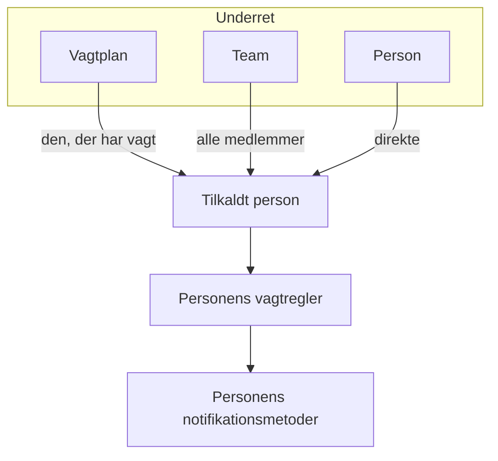

# Eskaleringsregler

En vagtpolitik tilkalder folk i niveauer. Hver eskaleringsregel er ét niveau: hvem der tilkaldes, og hvor længe der ventes på, at nogen kvitterer, før næste niveau tilkaldes. En politiks regler står i rækkefølge på dens side **Eskaleringsregler**.

```mermaid title="En vagtpolitik tilkalder niveau for niveau, indtil nogen kvitterer"
flowchart TB
    trigger["Hændelse eller advarsel"] --> level1["Level 1 tilkalder"]
    level1 --> ack1{"Kvitteret<br/>i tide?"}
    ack1 -->|"Ja"| stop["Tilkaldet stopper"]
    ack1 -->|"Nej"| level2["Level 2 tilkalder"]
    level2 --> ack2{"Kvitteret<br/>i tide?"}
    ack2 -->|"Ja"| stop
    ack2 -->|"Nej, sidste niveau"| repeat{"Gentage politikken?"}
    repeat -->|"Ja"| level1
    repeat -->|"Nej"| done["Politikken stopper"]
```

:::cards
- [Hvem der tilkaldes først](#hvem-der-tilkaldes-først): Opret en politik med dens første niveau.
- [Tilføj en eskaleringsregel](#tilføj-en-eskaleringsregel): Tilføj næste niveau, trin for trin.
- [Sådan tilkalder niveauerne folk](#sådan-tilkalder-niveauerne-folk): Timing, gentagelser og hvordan hver person nås.
- [Den næste person i rotationen](#eskalér-til-den-næste-person-i-rotationen): Tilkald backup for den, der har vagt, fra samme rotation.
- [Eskalér et tilkald](#eskalér-et-tilkald): Kan du ikke tage et tilkald? Få næste niveau tilkaldt med det samme.
- [API og Terraform](#opret-regler-med-apiet-eller-terraform): Opret politikker og regler som kode.
:::

## Hvem der tilkaldes først

Når du opretter en vagtpolitik på siden **Vagtpolitikker**, beder formularen om dens **Navn** og **Hvem tilkaldes først?**. Spørgsmålet bruger samme vælger som **Underret**: vagtplaner, teams og personer, så mange du har brug for. Dem, du vælger, bliver politikkens første eskaleringsregel, **Level 1**, som venter **30 minutter** på en kvittering, før næste niveau tilkaldes.

:::steps
1. Gå til **Vagtordning** > **Vagtpolitikker**, og klik på **Opret Vagtpolitik**.
2. Indtast et **Navn**.
3. Klik under **Hvem tilkaldes først?** på **Tilføj modtager**, og vælg de vagtplaner, teams og personer, der skal tilkaldes først.
4. Klik på **Opret Vagtpolitik**. Den nye politik åbner derefter på sin side **Eskaleringsregler**, hvor du kan tilføje flere niveauer.
:::

**Hvem tilkaldes først?** er valgfrit. Lader du det stå tomt, starter politikken uden eskaleringsregler: den tilkalder ingen, før du tilføjer en, og dens oversigt siger det. Beskrivelsen og etiketterne ligger under **Flere felter**. Spørgsmålet stilles kun til dem, der må tilføje eskaleringsregler.

## Tilføj en eskaleringsregel

:::steps
### Åbn politikkens eskaleringsregler

Åbn vagtpolitikken, vælg **Eskaleringsregler** i dens sidemenu, og klik på **Tilføj eskaleringsregel**. Dialogen er én kort side.

### Vælg, hvem der skal underrettes

Klik under **Underret** på **Tilføj modtager**, søg, og vælg så mange vagtplaner, teams og personer, som dette niveau skal tilkalde. Tilføj mindst én.

| Modtager | Hvem der tilkaldes, når niveauet kører |
| --- | --- |
| En **vagtplan** | Den, der har vagt i den, når niveauet kører, ikke en fast person. |
| En vagtplans **Næste i rotationen** | Personen efter den, der har vagt i den, fra samme rotation. Se [Eskalér til den næste person i rotationen](#eskalér-til-den-næste-person-i-rotationen). |
| Et **team** | Alle teamets medlemmer. |
| En **person** | Den person, direkte. |

### Angiv, hvor længe der ventes

**Eskalér efter (i minutter)** er, hvor længe der ventes på en kvittering, før næste niveau tilkaldes. Den starter på **30 minutter**; ret den til det, der passer til niveauet.

### Giv reglen et navn, hvis du vil

Alt andet ligger under **Flere felter**, foldet sammen, indtil du åbner det:

- **Navn**: valgfrit. En regel, du ikke navngiver, opkaldes efter sit niveau: en politiks første regel er **Level 1**, den anden **Level 2** og så videre. Navnefeltet viser det navn, reglen får.
- **Beskrivelse**: valgfrie noter, fx hvem dette niveau tilkalder og hvorfor.

Sammenfoldet nævner overskriften på **Flere felter** de to og viser dem, reglen har: en beskrivelse eller et navn, du selv har valgt.

### Opret reglen

Klik på **Opret regel**. Reglen tilføjes under de andre, som politikkens næste niveau.
:::

## Sådan tilkalder niveauerne folk

Når en hændelse eller advarsel når politikken, tilkalder **Level 1** straks sine modtagere. Kvitterer ingen inden for ventetiden, tilkaldes **Level 2**, og så videre ned gennem listen. Når det sidste niveaus ventetid er gået uden kvittering, starter politikken forfra fra **Level 1**, hvis dens **Gentagelsespolitik** (under reglerne) siger, at der skal gentages, så mange gange som den tillader, og ellers stopper den. Kvitterer man for eller løser hændelsen eller advarslen, stopper tilkaldet på ethvert niveau. Den, der bliver tilkaldt og ikke kan tage det, kan eskalere tilkaldet, og næste niveau tilkaldes uden at vente: se [Eskalér et tilkald](#eskalér-et-tilkald).

En hændelse, en advarsel eller en episode, der oprettes allerede bekræftet eller løst — registreret bagefter — udfører ingen af sine politikker: ingen tilkaldes, og dens feed siger det og nævner dem ved navn. Se [Erklæret allerede bekræftet eller løst](/docs/incidents/declaring-incidents#erklæret-allerede-bekræftet-eller-løst).

For at gentage en politik skal du klikke på **Rediger** på kortet **Gentagelsespolitik**, vælge **Start forfra fra Level 1** og angive **Hvor mange gange mere?**.

### Eskaleringsoversigten

Oversigten øverst på siden **Eskaleringsregler** viser hele stigen: hvornår hvert niveau tilkaldes, hvem det tilkalder, og hvad der sker efter det sidste. Et niveau, hvis modtagere ikke alle kan tilkaldes, siger det på sit kort; klik på etiketten for at se hvem og hvorfor.

### Sådan nås hver person

Hver person, et niveau tilkalder, nås sådan, som personens egne vagtregler siger: **Brugerindstillinger** > **Vagtregler**, med en fane for hændelser, hændelsesepisoder, advarsler og advarselsepisoder og et kort pr. alvorlighed, der viser, hvilken notifikationsmetode der prøves og efter hvor lang tid. En projektadministrator kan se og ændre et medlems regler under **Brugere** > medlemmet > **Vagtregler**. Se [Personlige vagtregler](/docs/notifications/on-call-rules).



En brugeroverride, der gælder for en person, sender personens tilkald til den, der dækker for vedkommende, i stedet. En override, der ikke nævner nogen til at dække, springer personen over: vedkommende får ingen tilkald, politikkens kørsel viser, at vedkommende er fraværende og til hvornår, og i en vagtplan går hver af vedkommendes vagter til den næste person i rotationen. Se [Brugertilsidesættelser](/docs/on-call/user-overrides).

Hver besked er en, som udbyderen tager imod, så et tilkald går altid ud. Så meget bærer hver kanal:

| Kanal | Den længste besked, den bærer |
| --- | --- |
| SMS | 1.600 tegn |
| Telefonopkald | Det, der kan være i Twilios opkaldsscript på 4.000 tegn |
| Pushnotifikation | 4 KB, hvoraf titel, tekst og data fylder højst 3 KB |
| WhatsApp | 1.024 tegn |
| Telegram | 4.096 tegn |

En længere besked, med en lang titel eller en lang beskrivelse, som en skabelon har sat ind, bliver afkortet og slutter med en bemærkning om, at den fulde tekst står i OneUptime: "… (truncated — see OneUptime for the full text)". Ordlyden i en WhatsApp-besked er en fast skabelon, så dér afkortes de længste værdier i stedet, hver med "…" til sidst. Links i en besked afkortes aldrig.

### Hvad et tilkalds sms siger

En sms sendes, og betales, i dele på 160 tegn. Et tilkald pr. sms skrives, så det passer i én del, hvor det overhovedet kan, og siger kun det, du har brug for på en låst telefon: hvem der sender det, hvad der er sket, og det ene link til at kvittere for tilkaldet eller eskalere det. På en telefon ser det sådan ud:

```text
OneUptime: Critical Incident INC-42 in Acme Prod: Checkout API is down.
Ack or escalate: https://oneuptime.com/l/XJlaZRsd
```

Det nævner alvorligheden og hvad der er sket (en hændelse, en advarsel eller en episode af en af dem), dens nummer, projektet og titlen, i den rækkefølge. Når det ikke alt sammen kan være i én del:

1. Først udelades projektet.
2. Derefter afkortes titlen, og den slutter med `...`.

Alvorligheden, nummeret og linket afkortes aldrig. En titel beholder mindst 20 tegn: kan selv det ikke være der, for eksempel med en meget lang adresse eller et meget langt produktnavn, tager sms'en en ekstra del og siger det hele.

Ét tegn uden for sms'ers enkle alfabet får hele beskeden til at gå ud i dele på 70 tegn. Derfor skrives typografiske anførselstegn og tankestreger som `"`, `'` og `-`, `…` som `...`, og bogstaver som `ç` og `ł` mister deres accenter; emojis udelades. En titel i en anden skrift, for eksempel japansk eller russisk, sendes, som den er skrevet, og fylder to dele eller flere.

De andre sms'er, OneUptime sender dig, for eksempel om en ændring i en hændelse, du ejer, eller om starten på din vagt, begynder også med `OneUptime:` og slutter med `Turn off in User Settings > Notification Settings.`, en sætning, der udelades, når det er det, der får sms'en til at passe i én del.

### Når et tilkald ikke sendes

Et tilkald, der ikke sendes, siger hvorfor i personens **Vagtlogs** (Brugerindstillinger): rækken viser **Fejl**, og statusbeskeden giver årsagen. Det bliver ikke længere stående på **Sender**. Beskeden siger én af disse ting:

- projektets saldo kunne ikke betale for det, og hvem der kan tilføje saldo;
- kanalen er slået fra i projektet, og hvem der kan slå den til.

Projektets ejere får én e-mail om det, indtil saldoen er fyldt op, eller kanalen er slået til igen.

På OneUptime Cloud betales hver SMS, hvert opkald, hver WhatsApp- og Telegram-besked af projektets saldo på **Projektindstillinger > Notifikationer > Notifikationsindstillinger**: den præcise pris trækkes fra saldoen, når udbyderen tager imod beskeden, uanset hvor mange beskeder der går ud på én gang.

- Er **Automatisk genopfyldning** slået til dér, lægger den besked, der finder saldoen under tærsklen, først det beløb til, som automatisk genopfyldning er sat til, og trækker det på projektets kort; beskeder, der finder saldoen lav i samme øjeblik, trækker på kortet én gang.
- Mislykkes trækket (der er ingen betalingsmetode, eller kortet blev afvist), prøver automatisk genopfyldning kortet igen en time senere, og **Notifikationsindstillinger** siger det øverst indtil da. At tilføje saldo manuelt eller gemme automatisk genopfyldning igen prøver med det samme.
- Tilkald bliver ved med at gå ud på den resterende saldo, mens automatisk genopfyldning ikke kan trække på kortet.

> [!IMPORTANT]
> SMS, telefonopkald, WhatsApp og Telegram er slået fra i et nyt projekt: på OneUptime Cloud betales hver besked af projektets saldo, og en selvhostet installation skal først have en Twilio-konto eller en Telegram-bot sat op. Så længe en kanal er slået fra, kan ingen i projektet tilføje en metode på den. Kun en projektejer, en **Faktureringsadministrator** eller en person med tilladelsen **Manage Billing** kan slå en til, i kortet **Notifikationskanaler** på **Projektindstillinger > Notifikationer > Notifikationsindstillinger** — en projektadministrator kan ikke. Alle andre får præcis at vide, hvem der kan, overalt hvor en kanal er slået fra: over deres egen liste over metoder på den, på deres opsætningstjekliste og i den besked, de får, når noget har brug for den.

## Eskalér til den næste person i rotationen

Et niveau kan tilkalde den næste person i en vagtplans rotation: personen efter den, der har vagt i den. Så kan en politik først tilkalde den, der har vagt, derefter vedkommendes backup fra samme rotation og derefter et team eller en chef, alt sammen fra én vagtplan.

| Niveau | Underret | Hvem der tilkaldes |
| --- | --- | --- |
| **Level 1** | Vagtplanen Payments primary | Den, der har vagt i den, fx Alex |
| **Level 2** | Samme vagtplans **Næste i rotationen** | Personen efter Alex i rotationen, fx Sam |
| **Level 3** | Teamet Platform | Alle teamets medlemmer |

:::steps
1. Sørg for, at politikkens første niveau, **Level 1**, underretter vagtplanen.
2. Klik på **Tilføj eskaleringsregel**, derefter på **Tilføj modtager**, og vælg den samme vagtplan under **Næste i rotationen**. Angiv **Eskalér efter (i minutter)**, og klik på **Opret regel**.
3. Tilføj ét niveau mere for det team eller den chef, der skal have besked bagefter.
:::

Den næste person findes, når niveauet kører, ud fra vagtplanen, som den ser ud på det tidspunkt:

- Det er personen efter den, der har vagt, i den rækkefølge, rotationens personer skiftes i. Efter den sidste person kommer den første igen.
- Fraværende personer springes over, uanset om nogen dækker for dem, og det samme gælder enhver, der har vagt i stedet for en anden.
- Det er altid en person fra samme rotation: med flere lag det lag, som den, der har vagt, kommer fra. En rotation uden andre i, eller hvor alle andre er fraværende, har ingen næste person, og niveauet tilkalder ingen der og siger det.
- Når ingen overhovedet har vagt i vagtplanen, er der heller ingen næste person, og niveauet forsøges igen i et par minutter, ligesom for selve vagtplanen.

Kørslens besked i Slack og Microsoft Teams, hændelsens feed og **Tidslinje for udførelsen** viser, hvem der blev tilkaldt som den næste i rotationen, og fra hvilken vagtplan: "Sam Lee (next in the Payments primary rotation)".

> [!TIP]
> Én vagtplan er nok: der er ingen anden backup-vagtplan, der skal holdes i takt med den første, og det fravær, dens personer registrerer, gælder for begge niveauer.

## Eskalér et tilkald

Den, der bliver tilkaldt og ikke kan tage det, fordi vedkommende sover, sidder i et fly eller allerede arbejder på en anden hændelse, kan eskalere tilkaldet i stedet for at lade det ringe ud. Politikken tilkalder så straks sit næste niveau uden at vente niveauets **Eskalér efter (i minutter)** ud, og vedkommende bliver ikke tilkaldt om det igen.

```mermaid title="Et eskaleret tilkald flytter politikken straks til næste niveau"
flowchart TB
    page["Level 1 tilkalder Alex"] --> take{"Kan Alex<br/>tage det?"}
    take -->|"Ja"| ack["Alex kvitterer:<br/>tilkaldet stopper"]
    take -->|"Nej"| pass["Alex eskalerer det"]
    pass --> others{"Tilkaldes andre på<br/>Level 1 stadig?"}
    others -->|"Ja"| wait["Politikken venter<br/>på dem som før"]
    others -->|"Nej"| next["Level 2 tilkaldes<br/>nu"]
```

Hvert tilkald kan eskaleres fra der, hvor det nåede dig:

| Hvor | Sådan eskalerer du det |
| --- | --- |
| E-mail | Knappen **Escalate**, derefter **Escalate** på siden, den åbner |
| SMS og WhatsApp | Linket i beskeden åbner kvitteringssiden, hvor **Escalate** også står |
| Telegram, Slack og Microsoft Teams | Linket "Can't take it? Escalate", derefter **Escalate** på siden, det åbner |
| Opkald | Tryk 2. Opkaldet siger derefter, hvad der skete |
| Pushnotifikation | Tryk på den: hændelsen, advarslen eller episoden åbner i OneUptime On-Call-appen med **Escalate** under sig |
| OneUptime | **Eskalér** øverst i hændelsen, advarslen eller episoden, efter dens tilstandsknapper |

Alle veje undtagen opkaldet spørger, før de gør noget, og siger, hvad der vil ske, for eksempel "This will immediately page Platform leads (Level 2 of 3), without waiting."; i et opkald er det at trykke 2 svaret. Kun den, der bliver tilkaldt, kan eskalere sit tilkald: knappen i OneUptime vises kun for vedkommende, og linket i en besked eskalerer kun det tilkald, det blev sendt om, for den person, det blev sendt til, i 7 dage.

Hvad der sker bagefter, afhænger af, hvem der ellers bliver tilkaldt:

- Andre på samme niveau bliver stadig tilkaldt: politikken venter på dem som før. Den går videre, når niveauets ventetid udløber, eller så snart den sidste af dem også eskalerer tilkaldet.
- Der er ingen andre tilbage på niveauet: næste niveau tilkaldes straks.
- Det var det sidste niveau: hvis **Gentagelsespolitik** siger, at der skal gentages, starter politikken straks forfra fra **Level 1**. Ellers stopper tilkaldet, og nogen skal tage sig af det.

At eskalere et tilkald kvitterer ikke for det: hændelsen eller advarslen venter stadig på, at nogen kvitterer, og den, der eskalerede det, kan stadig selv kvittere. Denne kørsel tilkalder ikke vedkommende om det igen: et senere niveau eller en gentagelse, der nævner vedkommende, springer vedkommende over. Når alle, den tilkaldte, har eskaleret det, og der ikke er nogen tilbage at tilkalde, stopper tilkaldet, og hændelsens feed siger det.

Et tilkald, som et workflow sender direkte til personer, har ingen niveauer: eskalerer du det, bliver du ikke tilkaldt mere, og når alle, det tilkaldte, har eskaleret det, stopper tilkaldet.

Hver gang et tilkald eskaleres, bliver det registreret. Kørslens **Tidslinje for udførelsen** markerer personens linje **Eskaleret**, hændelsens feed siger "Alex Kim escalated the page from on-call policy Payments at escalation rule Level 1.", kørslens besked i Slack og Microsoft Teams siger, at vedkommende eskalerede det, og vedkommendes **Vagtlogs** viser tilkaldet som **Eskaleret**.

## Rediger, omarranger og slet regler

Hver regels kort har **Rediger regel** og en **⋯**-menu med de andre handlinger:

- **Rediger regel** åbner den samme dialog på én side, udfyldt med reglen, som den er: dens modtagere, dens ventetid og dens navn og beskrivelse under **Flere felter**. Tilføj eller fjern modtagere, og klik på **Gem ændringer**. Rydder du navnet, får reglen sit niveaus navn igen.
- **Flyt op** og **Flyt ned** i en regels **⋯**-menu ændrer dens niveau. En regel, der er opkaldt efter sit niveau, beholder et navn, der passer til dens plads: når **Level 3** rykker op forbi **Level 2**, bytter de to navne. Et navn, du selv har valgt, fx **Ledere**, forbliver det samme, uanset hvor reglen flytter hen.
- **Slet regel** spørger først og siger, hvem niveauet tilkalder. Sletter du et niveau, rykker niveauerne under det op, og regler, der er opkaldt efter deres niveau, omdøbes, så de passer.

## Opret regler med API'et eller Terraform

Eskaleringsregler er ressourcen `/api/on-call-duty-policy-escalation-rule`; de personer, teams og vagtplaner, en regel tilkalder, er ressourcerne `/api/on-call-duty-policy-escalation-rule-user`, `-team` og `-schedule`.

- En regel, der oprettes uden `name`, opkaldes efter sit niveau, ligesom i dashboardet: **Level 3** for en regel, der bliver det tredje niveau i sin politik. Terraforms ressource for eskaleringsregler kræver stadig et navn.
- `escalateAfterInMinutes` har ingen standardværdi uden for dashboardet. En regel, der oprettes uden den, venter ikke: næste niveau tilkaldes, så snart dette har kørt. Angiv den eksplicit — 30 er det, dashboardet foreslår.
- En regel, der oprettes med `onCallSchedules`, `teams` eller `users` (lister med id'er) i sine `miscDataProps`, får de modtagere; det er sådan, dashboardets vælger **Underret** sender dem. En regel, der oprettes uden dem, tilkalder ingen, før du tilføjer modtagere via ressourcerne ovenfor.
- En regel, der oprettes med `nextInRotationSchedules` (en liste med vagtplan-id'er) i sine `miscDataProps`, tilkalder den næste person i rotationen for hver af de vagtplaner. På ressourcen `-schedule` gør en række med `pageNextInRotation` sat til `true` det samme; værdien sættes, når rækken oprettes.
- Regler, der er opkaldt efter deres niveau, omdøbes, når du flytter eller sletter regler i dashboardet. At ændre `order` via API'et eller Terraform ændrer kun rækkefølgen.
- At oprette en vagtpolitik på `/api/on-call-duty-policy` med `onCallSchedules`, `teams` eller `users` (lister med id'er) i dens `miscDataProps` giver den dens første eskaleringsregel, ligesom dashboardet gør: **Level 1**, som tilkalder dem, med en `escalateAfterInMinutes` på 30. Hvert id skal høre til projektet, og kalderen skal have lov til at oprette eskaleringsregler, ellers oprettes politikken ikke. En politik, der oprettes uden dem, har ingen regler, som før; Terraforms ressource for politikker sender dem ikke.

```bash
curl -X POST https://oneuptime.com/api/on-call-duty-policy \
  -H "apikey: $ONEUPTIME_API_KEY" \
  -H "Content-Type: application/json" \
  -d '{
    "data": {
      "projectId": "<project-id>",
      "name": "Production on-call"
    },
    "miscDataProps": {
      "onCallSchedules": ["<schedule-id>"],
      "users": ["<user-id>"]
    }
  }'
```

## Næste trin

:::cards
- [Vagtplaner](/docs/on-call/schedules): Byg de rotationer, et niveau tilkalder.
- [Tidslinje for vagtplaner](/docs/on-call/schedule-timeline): Se, hvem der har vagt på tværs af alle vagtplaner, og find huller i dækningen.
- [Politik for indgående opkald](/docs/on-call/incoming-call-policy): Lad opkaldere nå den vagthavende ingeniør over telefonen.
:::
