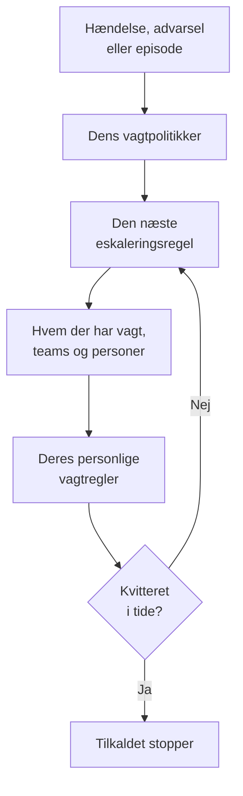

# Vagt – Oversigt

Vagt er den måde, OneUptime får en person sat på et problem, på alle tider af døgnet. Når en hændelse, en advarsel eller en episode har brug for nogen, tilkalder dens vagtpolitikker folk niveau for niveau, indtil nogen kvitterer, og hver person nås på den måde, de har valgt: en pushnotifikation, en sms, et opkald, en e-mail eller en chatbesked. Denne side viser, hvordan delene hænger sammen, og hvor hver del findes.

:::cards
- [Sådan når et tilkald frem](#sådan-når-et-tilkald-frem): Fra en ny hændelse til den person, der svarer.
- [Byggestenene](#byggestenene): Politikker, eskaleringsregler, vagtplaner, tilsidesættelser og personlige regler.
- [Opsæt vagt](#opsæt-vagt): Fra ingenting til et team, der tilkaldes, i fem trin.
- [Hvor vagt findes](#hvor-vagt-findes): Menuen Vagtordning, sektion for sektion.
:::

## Sådan når et tilkald frem

1. En ny hændelse, advarsel eller episode kører straks sine vagtpolitikker: dem, der er valgt på den, og dem, dens vagtregler tilføjer. Hver politik kører for sig. En vagtregel sat til **Kun i arbejdstiden** lader de politikker, den tilføjer, vente, til arbejdstiden begynder.
2. En politiks første eskaleringsregel tilkalder med det samme: den, der har vagt i dens vagtplaner lige nu, hvert medlem af dens teams og de personer, den nævner.
3. Er en af dem fraværende, sender en brugertilsidesættelse tilkaldet til den person, der dækker for dem, eller springer dem over.
4. Hver person nås via sine personlige vagtregler: hvilken af deres metoder der prøves, og efter hvor lang tid. Et tilkald uden regel når dem alligevel på de metoder, de har bekræftet.
5. Kvitterer ingen, før reglens ventetid er gået, tilkalder den næste regel. Efter den sidste starter politikken forfra, hvis den gentages, og ellers stopper den.

At kvittere for eller løse hændelsen, advarslen eller episoden stopper alle politikker, der stadig tilkalder for den. OneUptime fører kørende politikker et skridt videre hvert minut og registrerer hver kørsel, regel for regel, i **Udførelseslogs**.

Første gang et tilkald når frem til nogen, registrerer OneUptime det på hændelsen, advarslen eller episoden som `First Paged At`. En måling kan tælle derfra: **Tid til bekræftelse efter tilkald** måler, hvor lang tid folk var om at svare, når de først var tilkaldt, ikke hvor længe hændelsen, advarslen eller episoden ventede, før nogen blev tilkaldt. Se [Tid til bekræftelse efter tilkald](/docs/incidents/settings#tid-til-bekræftelse-efter-tilkald).

> [!NOTE]
> En hændelse, advarsel eller episode, der oprettes allerede bekræftet eller løst, kører ingen af sine politikker, og dens feed siger det. Se [Oprettet allerede bekræftet eller løst](/docs/alerts/index#oprettet-allerede-bekræftet-eller-løst).

## Byggestenene

| Del | Hvad den afgør | Læs mere |
| --- | --- | --- |
| Vagtpolitik | Hvem der tilkaldes om en hændelse eller advarsel, niveau for niveau | [Vagtpolitikker](/docs/on-call/policies) |
| Eskaleringsregel | Ét niveau i en politik: hvem det tilkalder, og hvor længe det venter på en kvittering | [Eskaleringsregler](/docs/on-call/escalation-rules) |
| Vagtplan | Hvem der har vagt på et givet tidspunkt, efterhånden som folk skiftes | [Vagtplaner](/docs/on-call/schedules) |
| Brugertilsidesættelse | Hvem der dækker for nogen, mens de er fraværende | [Brugertilsidesættelser](/docs/on-call/user-overrides) |
| Personlige vagtregler | Hvordan én person nås: hvilken metode, og efter hvor lang tid | [Personlige vagtregler](/docs/notifications/on-call-rules) |
| Politik for indgående opkald | Et telefonnummer, der ringer til den, der har vagt | [Politik for indgående opkald](/docs/on-call/incoming-call-policy) |

Politikker, eskaleringsregler, vagtplaner og tilsidesættelser hører til projektet, under **Vagtordning**. Notifikationsmetoder og personlige vagtregler hører til hver person, under **Brugerindstillinger**: en administrator kan se nogens opsætning, men kun personen selv kan bekræfte sin telefon eller e-mail. Se [Sådan når OneUptime dig](/docs/notifications/index).

## Opsæt vagt

:::steps
### Byg en vagtplan

Åbn **Vagtordning** fra menuen **Produkter**, og gå til **Vagtplaner**. Klik på **Opret vagtplan**, giv den et navn, og vælg under **Hvem skiftes til at have vagt?** personerne i den rækkefølge, de skiftes. Se [Vagtplaner](/docs/on-call/schedules).

### Opret en politik

Gå til **Vagtpolitikker**, og klik på **Opret Vagtpolitik**. Vælg vagtplanen under **Hvem tilkaldes først?**. Den bliver politikkens første eskaleringsregel, **Level 1**, som venter 30 minutter på en kvittering.

### Tilføj de næste niveauer

Klik på politikkens side **Eskaleringsregler** på **Tilføj eskaleringsregel** for hvert niveau efter det første: den næste person i samme vagtplans rotation, en teamleder, en chef. Se [Eskaleringsregler](/docs/on-call/escalation-rules).

### Kør politikken automatisk

Et projekts første politik kan gøre det allerede, når den oprettes: lad **Udløs den ved hver ny hændelse og hver ny advarsel** være slået til. For enhver anden politik går du til **Hændelser → Regler → Vagtregler** eller **Advarsler → Regler → Vagtregler** og tilføjer en regel, der kører den for de hændelser eller advarsler, den matcher, fx alle kritiske. Se [Hvad der kører en politik](/docs/on-call/policies#hvad-der-kører-en-politik).

### Tjek, at alle kan nås

Åbn **Vagtordning → Parathed**. Alle, dine politikker kan tilkalde, står som **Klar**, **Kræver opsætning** eller **Utilgængelig**, med det, der mangler. Se [Parathed og rapporter](/docs/on-call/readiness).
:::

> [!NOTE]
> I OneUptime Cloud er vagtpolitikker og eskaleringsregler med i alle abonnementer. Vagtplaner, brugertilsidesættelser, udførelseslogs og rapporten over vagttid kræver abonnementet **Growth**.

## Hvor vagt findes

Åbn **Vagtordning** fra menuen **Produkter** i den øverste bjælke. Den åbner på **Vagtpolitikker**, på `/dashboard/{projectId}/on-call-duty/policies`, og dens sidemenu rummer resten:

| Sektion | Sider |
| --- | --- |
| **Politikker** | **Vagtpolitikker** og **Parathed**: hvem dine politikker faktisk kan nå |
| **Tidsplaner** | **Vagtplaner**, **Tidslinje for vagtplaner** og **Kalenderfeeds** |
| **Indgående opkald** | **Indgående opkaldspolitikker**: et telefonnummer, der ringer til den, der har vagt |
| **Avanceret** | **Brugertilsidesættelser**, **Udførelseslogs** og **Arkiverede politikker** |
| **Rapporter** | **Brugerens vagttid**: hvor længe hver person havde vagt |
| **Arbejdsområde** | **Slack** og **Microsoft Teams**: regler, der sender vagthændelser til en kanal |
| **Indstillinger** | **Brugerdefinerede felter**, **Etiketregler** og **Ejerregler** |
| **Udvikler** | **Terraform**, **API** og **AI-assistenter**: vagt sat op fra kode |

**Politikker**, **Tidsplaner** og **Indgående opkald** er åbne; de andre sektioner starter foldet sammen, og en sektion åbner af sig selv, når du er på en af dens sider. **Arbejdsområde** viser de chatværktøjer, projektet har forbundet, eller **Forbind Slack eller Teams**, når det ikke har nogen.

Når du har vagt for en politik, viser klokken øverst til højre det. Klik på den for at åbne **Mine vagtpolitikker**: alle politikker, du har vagt for, i alle dine projekter, og om du er nævnt direkte, via et team eller via en vagtplan.

## Fejlfinding

:::details Ingen blev tilkaldt for en ny hændelse
Åbn hændelsens side **Vagtudførelser**. Er den tom, havde hændelsen ingen vagtpolitik: ingen blev valgt på den, og ingen vagtregel matchede den. En kørsel med **Execution Completed - No One Notified** gik gennem alle eskaleringsregler uden at finde nogen: som regel en vagtplan, hvor ingen har vagt. Se [Udførelseslogs](/docs/on-call/policies#udførelseslogs). En kørsel med **Venter** venter på arbejdstiden for en vagtregel sat til **Kun i arbejdstiden** og tilkalder ingen, før den begynder.
:::

:::details Nogen blev tilkaldt på den forkerte kanal, eller slet ikke
Åbn **Vagtordning → Parathed**, og klik på **Coverage** i personens række. Den viser de metoder, personen har bekræftet, og hver alvorlighed, personen ikke har en regel for. Kun personen selv kan rette det, under **Brugerindstillinger**: send en påmindelse om opsætningen fra samme side. Se [Parathed og rapporter](/docs/on-call/readiness). På OneUptime Cloud kan en telefon, der blokerer ukendte opkald, tavsgøre et kald: føj [OneUptimes numre](/docs/on-call/phone-number-whitelist) til dens tilladelsesliste.
:::

:::details En person på ferie bliver stadig tilkaldt
Tilføj en brugertilsidesættelse med personen under **Hvem er fraværende?**. En under **Vagtordning → Avanceret → Brugertilsidesættelser** gælder for alle politikker; en på en politiks egen side **Brugertilsidesættelser** gælder kun for den politik. Se [Brugertilsidesættelser](/docs/on-call/user-overrides).
:::

## Næste trin

:::cards
- [Vagtpolitikker](/docs/on-call/policies): Opret en politik, afgør, hvad der kører den, og læs, hvad den gjorde.
- [Eskaleringsregler](/docs/on-call/escalation-rules): Tilkald folk niveau for niveau, indtil nogen svarer.
- [Vagtplaner](/docs/on-call/schedules): Rotationer, lag og overdragelser.
- [Sådan når OneUptime dig](/docs/notifications/index): De metoder og regler, der afgør, hvordan hver person nås.
:::
