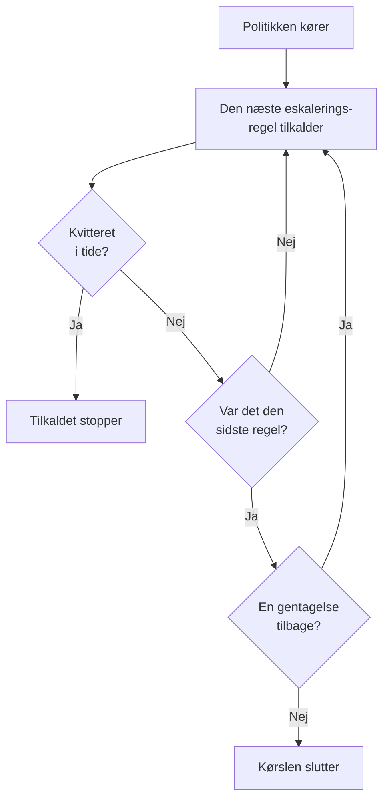

# Vagtpolitikker

En vagtpolitik afgør, hvem der tilkaldes om en hændelse eller advarsel, og hvem der er den næste, hvis ingen kvitterer. Dens eskaleringsregler er dens niveauer, og de hændelser, advarsler og episoder, der bruger den, kører den. Denne side handler om at oprette en politik, hvad der kører den, hvad dens sider viser, og hvordan hver kørsel registreres.

:::cards
- [Opret en politik](#opret-en-politik): Et navn, og hvem der tilkaldes først.
- [Hvad der kører en politik](#hvad-der-kører-en-politik): Regler, skabeloner, overvågninger, chat og dig selv.
- [Udførelseslogs](#udførelseslogs): Hver kørsel, regel for regel, og hvorfor den stoppede.
- [Arkivér eller slet en politik](#arkivér-eller-slet-en-politik): Tag en politik ud af drift.
:::

## Opret en politik

:::steps
1. Gå til **Vagtordning → Vagtpolitikker**, og klik på **Opret Vagtpolitik**.
2. Angiv et **Navn**, fx "Betalinger primær".
3. Klik under **Hvem tilkaldes først?** på **Tilføj modtager**, og vælg de vagtplaner, teams og personer, der skal tilkaldes først.
4. Klik på **Opret Vagtpolitik**. Politikken åbner på sin side **Eskaleringsregler**, med **Level 1** på plads.
:::

**Hvem tilkaldes først?** er valgfrit og vises kun for folk, der må tilføje eskaleringsregler: står det tomt, tilkalder politikken ingen, før den har en regel. **Beskrivelse** og **Etiketter** venter under **Flere felter**. Se [Eskaleringsregler](/docs/on-call/escalation-rules) for at tilføje de næste niveauer.

Listen **Vagtpolitikker** viser hver politiks **Navn**, **Beskrivelse**, **Etiketter** og **Ejere**. Vælg politikker for at bruge **Add Labels**, **Remove Labels**, **Add Owner**, **Remove Owner**, **Arkiver** eller **Eksportér JSON**, eller for at slette dem. **Import JSON** opretter politikker fra en eksport: en eksport rummer en politiks egne indstillinger, ikke dens eskaleringsregler eller ejere.

## Hvad der kører en politik

En politik tilkalder ingen, før noget kører den. Hver hændelse, advarsel og episode kører sine politikker, så snart den er oprettet:

| Hvad | Hvordan politikken tilføjes | Læs mere |
| --- | --- | --- |
| Selve posten | Feltet **Vagtpolitik**, når en hændelse eller advarsel oprettes, en hændelsesskabelon eller den sammenfoldede del **Vagt** i en overvågnings kriterier | [Opret en hændelse](/docs/incidents/declaring-incidents) |
| Vagtregler | **Hændelser → Regler → Vagtregler** og **Advarsler → Regler → Vagtregler** tilføjer politikkerne fra hver regel, der matcher | [Vagtregler for hændelser](/docs/incidents/settings#vagtregler-for-hændelser) |
| Grupperingsregler | En grupperingsregel kører sine politikker, når den åbner en episode | [Advarselsepisoder og grupperingsregler](/docs/alerts/episodes) |
| Manuelt | **Udfør vagtpolitik**, i menuen **Handlinger** i et feed, eller på en besked i Slack eller Microsoft Teams | [Hændelsens feed](/docs/incidents/notes-owners-and-feed#hændelsens-feed) |
| Chat og workflows | `/oneuptime page` i Slack eller Microsoft Teams, og et workflows trin **Page an On-Call Policy** | [Paging](/docs/workflows/components#paging) |

En politik, som flere regler tilføjer, kører én gang. En alvorlighed kører aldrig en politik af sig selv: det gør en vagtregel, der matcher alvorligheden. En hændelse eller advarsel, der oprettes allerede bekræftet eller løst, kører ingen af sine politikker. En vagtregel sat til **Kun i arbejdstiden** lader de politikker, den tilføjer, vente, til arbejdstiden begynder.

## En politiks sider

Åbn en politik fra listen. Dens sidemenu rummer alt om den:

| Sektion | Sider |
| --- | --- |
| **Grundlæggende** | **Oversigt**, **Eskaleringsregler** og **Ejere** |
| **Protokoller** | **Udførelseslogs** og **Notifikationslogs** |
| **Udvikler** | **Terraform**, **API** og **AI-assistenter** |
| **Avanceret** | **Brugertilsidesættelser**, **Brugerdefinerede felter**, **Indstillinger**, **Auditlogs** og **Slet politik** |

**Grundlæggende** er åben; de andre sektioner starter foldet sammen, indtil du klikker på dem.

- **Oversigt** viser **Detaljer om vagtpolitik** og derefter **Policy at a glance**: hvor mange niveauer og modtagere politikken har, hvor lang tid der går til dens sidste niveau, og hvor ofte den gentages. **Responder readiness** siger, om alle, den kan tilkalde, kan nås nu, og **Vagtpolitikkens feed** viser, hvad der er ændret: personer, teams og vagtplaner, der er tilføjet eller fjernet, tilsidesættelser og overdragelser.
- **Ejere** er de personer og teams, der er ansvarlige for politikken. Når et tilkald fra den ikke finder en regel for nogen eller ikke kan leveres, får de en e-mail; en politik uden ejere sender i stedet en e-mail til projektets ejere.
- **Notifikationslogs** viser hver besked, politikken har sendt, med en fane pr. kanal.
- **Brugertilsidesættelser** dækker kun for folk i denne politik. Se [Brugertilsidesættelser](/docs/on-call/user-overrides).
- **Indstillinger** har **Eksportér Vagtpolitik** og kortet, der arkiverer politikken.

## Gentag en politik

Når det sidste niveaus ventetid er gået, uden at nogen har kvitteret, stopper en politik, medmindre den gentages. For at vælge skal du åbne politikkens side **Eskaleringsregler** og klikke på **Rediger** på kortet **Gentagelsespolitik** under reglerne. **Rediger gentagelsespolitik** spørger **Hvis ingen bekræfter efter det sidste niveau**:

| Svar | Hvad det gør |
| --- | --- |
| **Stop tilkald** | Ingen tilkaldes igen, så politikken kører én gang. En ny politik starter med dette svar. |
| **Start forfra fra Level 1** | Hvert niveau tilkaldes igen, i rækkefølge. **Hvor mange gange mere?** siger hvor mange: 1 eller flere. |

En politik, der starter forfra tre gange mere, går gennem sine niveauer fire gange i alt. Kortets række **Efter det sidste niveau** siger, hvad politikken gør, og **Policy at a glance** på **Oversigt** siger det samme med ord.

## Tilkald igen, hvis den ikke bliver løst

En bekræftelse stopper en politiks tilkald for altid, også selv om ingen løser hændelsen eller advarslen bagefter. En politik kan i stedet tilkalde igen: åbn dens side **Eskaleringsregler**, åbn **Yderligere indstillinger** nederst, og klik på **Rediger** på kortet **Timeout efter bekræftelse**. **Rediger timeout efter bekræftelse** spørger **Hvis den er bekræftet, men ikke løst**:

| Svar | Hvad det gør |
| --- | --- |
| **Tilkald ikke igen** | En bekræftelse stopper tilkaldet for altid. En ny politik starter med dette svar. |
| **Tilkald igen** | Tilkalder den, der bekræftede, og den, der har vagt nu. **Efter hvor mange minutter?** siger hvornår: fra 5 til 1440, først 30. |

Minutterne tælles fra hver bekræftelse, og en politik tilkalder højst 5 gange igen om den samme hændelse, advarsel eller episode. Et nyt tilkald starter på det niveau, der tilkaldte, da der blev bekræftet, tilkalder den, der har vagt der nu, og fortsætter gennem niveauerne som den første kørsel. Hændelsen eller advarslen forbliver bekræftet: det nye tilkald er en kørsel for sig, i dens feed og i politikkens udførelseslogs, hvor dens **Status** siger "Tilkaldt igen (1 af 5)".

Den, der tilkaldes igen, bekræfter fra beskeden eller med **Bekræft igen** på hændelsens eller advarslens side, og minutterne starter forfra; **Eskalér** sender tilkaldet videre til næste niveau. Hvis hændelsen eller advarslen løses eller slettes, politikken arkiveres eller slettes, eller nogen vælger **Tilkald ikke igen**, stopper det. Kortets række **Efter en bekræftelse** siger, hvad politikken gør, og **Yderligere indstillinger** viser minutterne, mens det er foldet sammen. **Policy at a glance** på **Oversigt** og **Escalation summary** siger det samme med ord.

## Udførelseslogs

Hver gang en politik kører, skriver den en udførelseslog, og loggen går gennem sine statusser, efterhånden som kørslen skrider frem:

| Status | Hvad den betyder |
| --- | --- |
| **Venter** | En vagtregel sat til **Kun i arbejdstiden** lader kørslen vente, til arbejdstiden begynder: den siger, hvornår tilkaldelsen starter, og tilkalder ingen indtil da. Den slutter uden at tilkalde, hvis hændelsen eller advarslen bliver bekræftet eller løst først. Den begynder at tilkalde straks, hvis hændelsen eller advarslen ændrer sig og nu matcher en vagtregel, der tilkalder med det samme. |
| **Planlagt**, **Startet** | Kørslen sættes op. En, der stadig står her efter 5 minutter, stoppes som **Fejl**. |
| **Executing** | Kørslen tilkalder. OneUptime fører den et skridt videre hvert minut. |
| **Execution Completed** | Nogen kvitterede, hændelsen eller advarslen blev løst, alle regler og gentagelser blev brugt, eller politikken blev arkiveret. |
| **Execution Completed - No One Notified** | Kørslen gik gennem alle regler og tilkaldte ingen: som regel en vagtplan, hvor ingen har vagt. |
| **Fejl** | Kørslen mislykkedes. **Vis statusbesked** siger hvorfor. |

Du finder udførelseslogs tre steder:

- i politikkens egne **Udførelseslogs**, under **Protokoller**;
- under **Vagtordning → Avanceret → Udførelseslogs**, for alle politikker, hvor direkte tilkald fra workflows og chat står som **Direkte tilkald**;
- på en hændelses eller en advarsels side **Vagtudførelser**.

Hver række viser, hvad der startede kørslen, hvornår, dens **Status** og hvem der kvitterede. **View Timeline** åbner dens **Tidslinje for udførelsen**: hver eskaleringsregel, hvem den tilkaldte, via hvilken vagtplan, og hvordan hvert tilkald endte. En vagtplan, hvor ingen har vagt, viser **No one was on call** i stedet for en person. I OneUptime Cloud kræver udførelseslogs abonnementet **Growth**.

## Arkivér eller slet en politik

Arkivering tager en politik ud af drift og beholder alt: åbn politikkens **Indstillinger**, og klik på **Arkiver** på dens arkiveringskort, eller vælg politikker i listen, og vælg **Arkiver**.

- En arkiveret politik tilkalder ingen. Hændelser og advarsler, der bruger den, springer den over, og en kørsel, der stadig eskalerer, stopper ved sit næste skridt.
- Den forlader listen **Vagtpolitikker** og flytter til **Vagtordning → Avanceret → Arkiverede politikker**, hvor **Fjern fra arkiv** sætter den i drift igen.

**Slet politik**, under **Avanceret**, sletter politikken med dens eskaleringsregler og brugertilsidesættelser. Sletning fra listen spørger først og foreslår at arkivere i stedet.

## Hvem der må ændre en politik

**Project Owner**, **Project Admin**, **Project Member**, **On-Call Admin** og **On-Call Member** må oprette, ændre og slette politikker; **Viewer** og **On-Call Viewer** må læse dem. I en brugerdefineret rolle hedder tilladelserne **Create On-Call Duty Policy**, **Edit On-Call Duty Policy**, **Delete On-Call Duty Policy** og **Read On-Call Duty Policy**, og en rolle, der er begrænset til bestemte etiketter, når kun de politikker, der har dem. At tilføje ejere og brugerdefinerede felter kræver abonnementet **Growth** i OneUptime Cloud.

## API og Terraform

Vagtpolitikker er ressourcen `/api/on-call-duty-policy`, og ressourcen `oneuptime_on_call_policy` i Terraform:

| Indstilling | API-felt |
| --- | --- |
| **Navn** | `name` |
| **Beskrivelse** | `description` |
| **Hvis ingen bekræfter efter det sidste niveau** | `repeatPolicyIfNoOneAcknowledges` |
| **Hvor mange gange mere?** | `repeatPolicyIfNoOneAcknowledgesNoOfTimes` |
| **Efter hvor mange minutter?** | `acknowledgementTimeoutInMinutes` |
| Arkiveret | `isArchived` |

`repeatPolicyIfNoOneAcknowledges` er `false` for **Stop tilkald** og `true` for **Start forfra fra Level 1**. Med `true` skal `repeatPolicyIfNoOneAcknowledgesNoOfTimes` være et helt tal på 1 eller mere: OneUptime afviser `0`. En ældre politik, der er gemt med `0`, gentages aldrig, og dashboardet viser den som **Stop tilkald**.

`acknowledgementTimeoutInMinutes` er `null` for **Tilkald ikke igen** og et helt antal minutter fra 5 til 1440 for **Tilkald igen**. OneUptime afviser alt andet.

Se [Opret regler med API'et eller Terraform](/docs/on-call/escalation-rules#opret-regler-med-apiet-eller-terraform) for at oprette en politik med dens første niveau i én forespørgsel.

## Fejlfinding

:::details En politik kørte, men ingen blev tilkaldt
Dens kørsel viser **Execution Completed - No One Notified**. Åbn **View Timeline**: en række med **No one was on call** peger på en vagtplan med et hul, og statusbeskeden i en række med **Sprunget over** siger hvorfor, fx nogen, der var fraværende uden nogen til at dække. **Vagtordning → Parathed** viser, hvem der ikke kunne nås.
:::

:::details Det næste niveau blev tilkaldt et minut efter sin ventetid
OneUptime fører kørende politikker et skridt videre én gang i minuttet, så et niveau tilkaldes ved det første tjek, efter at ventetiden er gået.
:::

:::details En hændelse viser en politik, der ikke tilkaldte nogen
Politikken er arkiveret: en arkiveret politik bliver stående på de hændelser og advarsler, der bruger den, tilkalder ingen, og dens udførelseslog siger, at den ikke blev udført. Fjern den fra arkivet under **Vagtordning → Avanceret → Arkiverede politikker**.
:::

## Næste trin

:::cards
- [Eskaleringsregler](/docs/on-call/escalation-rules): Tilføj de niveauer, en politik tilkalder, og hvor længe hvert enkelt venter.
- [Brugertilsidesættelser](/docs/on-call/user-overrides): Send nogens tilkald til en kollega, mens de er fraværende.
- [Parathed og rapporter](/docs/on-call/readiness): Tjek, at alle, en politik tilkalder, kan nås.
:::
