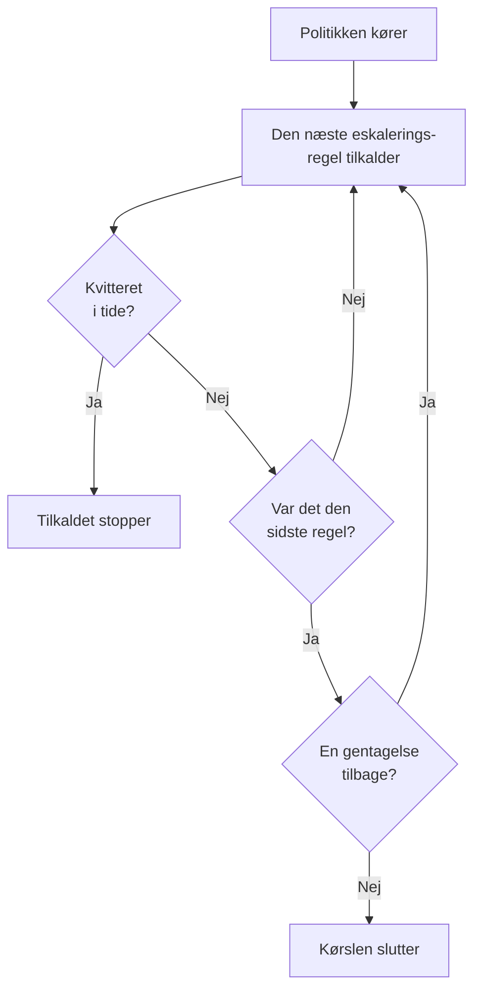

# Vagtpolitikker

En vagtpolitik afgør, hvem der tilkaldes om en hændelse eller advarsel, og hvem der er den næste, hvis ingen kvitterer. Dens eskaleringsregler er dens niveauer, og de hændelser, advarsler og episoder, der bruger den, kører den. Denne side handler om at oprette en politik, hvad der kører den, hvad dens sider viser, og hvordan hver kørsel registreres.

:::cards
- [Opret en politik](#opret-en-politik): Et navn, og hvem der tilkaldes først.
- [Hvad der kører en politik](#hvad-der-kører-en-politik): Regler, skabeloner, monitorer, chat og dig selv.
- [Udførelseslogs](#udførelseslogs): Hver kørsel, regel for regel, og hvorfor den stoppede.
- [Arkiver eller slet en politik](#arkiver-eller-slet-en-politik): Tag en politik ud af drift.
:::

## Opret en politik

:::steps
1. Gå til **Vagt → Vagtpolitikker**, og klik på **Opret vagtpolitik**.
2. Angiv et **Navn**, fx "Betalinger primær". Et navn, som en anden politik i projektet allerede har, også en arkiveret, afvises, uanset store og små bogstaver og mellemrum, så politikkerne kan skelnes fra hinanden i enhver vælger.
3. Klik under **Hvem tilkaldes først?** på **Tilføj modtager**, og vælg de vagtplaner, teams og personer, der skal tilkaldes først.
4. Klik på **Opret vagtpolitik**. Politikken åbner på sin side **Eskaleringsregler**, med **Level 1** på plads.
:::

**Hvem tilkaldes først?** er valgfrit og vises kun for folk, der må tilføje eskaleringsregler: står det tomt, tilkalder politikken ingen, før den har en regel. **Beskrivelse** og **Etiketter** venter under **Flere felter**. Se [Eskaleringsregler](/docs/on-call/escalation-rules) for at tilføje de næste niveauer.

Formularen spørger også **Udløs den ved hver ny hændelse og hver ny advarsel**, hvis du må tilføje vagtregler. Den tilføjer en regel under **Hændelser → Regler → Vagtregler** og en under **Advarsler → Regler → Vagtregler**, der hver matcher alt og kører denne politik. Den starter slået til for et projekts første politik, så længe projektet hverken har en vagtpolitik eller en vagtregel, og slået fra for senere politikker: at udløse to politikker ved hver ny hændelse og advarsel er et valg, du skal træffe. Slået fra tilkalder politikken ingen, før en regel, en monitor eller en person kører den.

Vil du hellere guides trin for trin, fra din telefon til et testtilkald, så klik på **Guidet opsætning**: på den tomme liste **Vagtpolitikker** eller under **Sådan fungerer det**. Se [Bliv tilkaldt via opkald, SMS eller push](/docs/guides/paging).

Listen **Vagtpolitikker** viser hver politiks **Navn**, **Tilkaldes først**, **Beskrivelse**, **Etiketter** og **Ejere**. **Tilkaldes først** viser, hvem politikkens første eskaleringsregel tilkalder: dens vagtplaner, hver med den, der har vagt i den lige nu, dens teams og de personer, den nævner, eller **Ingen eskaleringsregler** eller **Ingen modtagere**, når den ikke tilkalder nogen. Vælg politikker for at bruge **Tilføj etiketter**, **Fjern etiketter**, **Tilføj ejer**, **Fjern ejer**, **Arkiver** eller **Eksportér JSON**, eller for at slette dem. **Importér JSON** opretter politikker fra en eksport: en eksport rummer en politiks egne indstillinger, ikke dens eskaleringsregler eller ejere. En politik, der har samme navn som en anden politik fra dengang, navne ikke behøvede at være forskellige, er markeret med **Samme navn som en anden politik**, og listen viser, hvor mange der er: sammenlign deres eskaleringsregler, og omdøb så én af dem med **Omdøb** i dens række.

## Hvad der kører en politik

En politik tilkalder ingen, før noget kører den. Hver hændelse, advarsel og episode kører sine politikker, så snart den er oprettet:

| Hvad | Hvordan politikken tilføjes | Læs mere |
| --- | --- | --- |
| Selve posten | Feltet **Vagtpolitik**, når en hændelse eller advarsel oprettes, en hændelsesskabelon eller den sammenfoldede del **Vagt** i en monitor kriterier | [Opret en hændelse](/docs/incidents/declaring-incidents) |
| Vagtregler | **Hændelser → Regler → Vagtregler** og **Advarsler → Regler → Vagtregler** tilføjer politikkerne fra hver regel, der matcher | [Vagtregler for hændelser](/docs/incidents/settings#vagtregler-for-hændelser) |
| Grupperingsregler | En grupperingsregel kører sine politikker, når den åbner en episode | [Advarselsepisoder og grupperingsregler](/docs/alerts/episodes) |
| Manuelt | **Udfør vagtpolitik**, i menuen **Handlinger** i et feed, eller på en besked i Slack eller Microsoft Teams | [Hændelsens feed](/docs/incidents/notes-owners-and-feed#hændelsens-feed) |
| Chat og arbejdsgange | `/oneuptime page` i Slack eller Microsoft Teams, og en arbejdsgangs trin **Page an On-Call Policy** | [Paging](/docs/workflows/components#paging) |

En politik, som flere regler tilføjer, kører én gang. En alvorlighed kører aldrig en politik af sig selv: det gør en vagtregel, der matcher alvorligheden. En hændelse eller advarsel, der oprettes allerede bekræftet eller løst, kører ingen af sine politikker. En vagtregel sat til **Kun i arbejdstiden** lader de politikker, den tilføjer, vente, til arbejdstiden begynder.

## En politiks sider

Åbn en politik fra listen. Dens sidemenu rummer alt om den:

| Sektion | Sider |
| --- | --- |
| **Grundlæggende** | **Oversigt**, **Eskaleringsregler** og **Ejere** |
| **Protokoller** | **Udførelseslogs** og **Notifikationslogs** |
| **Udvikler** | **Terraform**, **API**, **CLI** og **AI-assistenter** |
| **Avanceret** | **Brugertilsidesættelser**, **Brugerdefinerede felter**, **Indstillinger**, **Auditlogs** og **Slet politik** |

**Grundlæggende** er åben; de andre sektioner starter foldet sammen, indtil du klikker på dem.

- **Oversigt** viser **Detaljer om vagtpolitik** og derefter **Politikken i overblik**: hvor mange niveauer og modtagere politikken har, hvor lang tid der går til dens sidste niveau, og hvor ofte den gentages. **Modtagernes parathed** siger, om alle, den kan tilkalde, kan nås nu, og **Vagtpolitikkens feed** viser, hvad der er ændret: personer, teams og vagtplaner, der er tilføjet eller fjernet, tilsidesættelser og overdragelser. Dens regler for Slack, Microsoft Teams og Mattermost slår dem op i dine kanaler, et vagtskifte i én linje: se [Vagtbeskeder](/docs/workspace-connections/slack#vagtbeskeder).
- **Ejere** er de personer og teams, der er ansvarlige for politikken. Når et tilkald fra den ikke finder en regel for nogen eller ikke kan leveres, får de en e-mail; en politik uden ejere sender i stedet en e-mail til Projektejere.
- **Notifikationslogs** viser hver besked, politikken har sendt, med en fane pr. kanal.
- **Brugertilsidesættelser** dækker kun for folk i denne politik. Se [Brugertilsidesættelser](/docs/on-call/user-overrides).
- **Indstillinger** har **Eksportér Vagtpolitik** og kortet, der arkiverer politikken.

**Hvad der udløser denne politik**, på **Oversigt**, viser vagtreglerne, de monitorer, hvis kriterier udløser politikken, de skabeloner og andre regler, der udløser den, og de arbejdsgange, der gør det, hver med et link. En regel, der er slået fra, viser **Fra**. Når intet udløser politikken, siger kortet det: den tilkalder ingen, før noget udløser den. Når du sletter eller arkiverer politikken, siges det samme først. Det, du ikke må åbne, tælles, men nævnes ikke.

## Gentag en politik

Når det sidste niveaus ventetid er gået, uden at nogen har kvitteret, stopper en politik, medmindre den gentages. For at vælge skal du åbne politikkens side **Eskaleringsregler** og klikke på **Rediger** på kortet **Gentagelsespolitik** under reglerne. **Rediger gentagelsespolitik** spørger **Hvis ingen bekræfter efter det sidste niveau**:

| Svar | Hvad det gør |
| --- | --- |
| **Stop tilkald** | Ingen tilkaldes igen, så politikken kører én gang. En ny politik starter med dette svar. |
| **Start forfra fra Level 1** | Hvert niveau tilkaldes igen, i rækkefølge. **Hvor mange gange mere?** siger hvor mange: 1 eller flere. |

En politik, der starter forfra tre gange mere, går gennem sine niveauer fire gange i alt. En gennemgang, hvor intet niveau havde nogen at tilkalde, gentages ikke: en til ville heller ikke tilkalde nogen, så politikken stopper. Kortets række **Efter det sidste niveau** siger, hvad politikken gør, og **Politikken i overblik** på **Oversigt** siger det samme med ord.

## Tilkald igen, hvis den ikke bliver løst

En bekræftelse stopper en politiks tilkald for altid, også selv om ingen løser hændelsen eller advarslen bagefter. En politik kan i stedet tilkalde igen: åbn dens side **Eskaleringsregler**, åbn **Yderligere indstillinger** nederst, og klik på **Rediger** på kortet **Timeout efter bekræftelse**. **Rediger timeout efter bekræftelse** spørger **Hvis den er bekræftet, men ikke løst**:

| Svar | Hvad det gør |
| --- | --- |
| **Tilkald ikke igen** | En bekræftelse stopper tilkaldet for altid. En ny politik starter med dette svar. |
| **Tilkald igen** | Tilkalder den, der bekræftede, og den, der har vagt nu. **Efter hvor mange minutter?** siger hvornår: fra 5 til 1440, først 30. |

Minutterne tælles fra hver bekræftelse, og en politik tilkalder højst 5 gange igen om den samme hændelse, advarsel eller episode. Et nyt tilkald starter på det niveau, der tilkaldte, da der blev bekræftet, tilkalder den, der har vagt der nu, og fortsætter gennem niveauerne som den første kørsel. Hændelsen eller advarslen forbliver bekræftet: det nye tilkald er en kørsel for sig, i dens feed og i politikkens udførelseslogs, hvor dens **Status** siger "Tilkaldt igen (1 af 5)".

Den, der tilkaldes igen, bekræfter fra beskeden eller med **Bekræft igen** på hændelsens eller advarslens side, og minutterne starter forfra; **Eskalér** sender tilkaldet videre til næste niveau. Hvis hændelsen eller advarslen løses eller slettes, politikken arkiveres eller slettes, eller nogen vælger **Tilkald ikke igen**, stopper det. Kortets række **Efter en bekræftelse** siger, hvad politikken gør, og **Yderligere indstillinger** viser minutterne, mens det er foldet sammen. **Politikken i overblik** på **Oversigt** og **Oversigt over eskalering** siger det samme med ord.

## Når flere politikker tilkalder

En hændelse, advarsel eller episode kører hver af sine politikker for sig, på samme tid.

- Den, der har vagt i to af dem, tilkaldes kun én gang. Når et niveau i en politik når en person, som en anden politik allerede tilkalder om det samme, tilkalder den ikke vedkommende igen: dens udførelseslog viser vedkommende som **Allerede kaldt**, og hændelsens feed og politikkens besked i Slack og Microsoft Teams nævner den politik, der tilkalder vedkommende. Niveauet venter alligevel sine minutter ud, før næste niveau tilkaldes, som det gør for alle, det har tilkaldt. Et svar på det ene tilkald gælder for begge politikker. Inden for én politik tilkaldes en person, som et niveau nævner to gange, personligt og gennem et team eller en vagtplan, kun én gang.
- Et tilkald sendt direkte til personer tæller også. Når et niveau i en politik når en person, som et tilkald fra Slack eller Microsoft Teams eller en arbejdsgangs tilkaldeblok allerede tilkalder om det samme, tilkalder den ikke vedkommende igen: dens udførelseslog nævner, hvem der sendte det tilkald, eller arbejdsgangen. En arbejdsgangs tilkaldeblok tilkalder heller ikke igen en person, som en politik eller et andet tilkald allerede tilkalder.
- En bekræftelse af hændelsen eller advarslen stopper inden for et minut alle politikker, der kører for den, uanset hvor den bekræftes: fra et hvilket som helst tilkald om den, på dens egen side, i mobilappen eller i Slack eller Microsoft Teams. Intet næste niveau tilkaldes, og intet opkald eller sms, der stadig venter, sendes. Notifikationer, der allerede er sendt, forbliver sendt.

Ingen går glip af et tilkald ved kun at blive tilkaldt én gang. Det ene tilkald kan ende uden svar: vedkommende eskalerer det fra en af dets beskeder, hvilket kun eskalerer det tilkald, tilkaldet kan ikke sendes, eller det stopper. Så tilkalder den anden politik eller arbejdsgangens blok selv vedkommende inden for et minut uden at sende det, der allerede er nået frem, igen. **Eskalér** på hændelsens side eller i mobilappen eskalerer begge. Et nyt tilkald, en politik, der er startet manuelt, og et tilkald, som nogen har sendt fra Slack eller Microsoft Teams, tilkalder altid selv deres egne personer, også en person, som en anden politik allerede tilkalder. Et tilkald til en observatør og et tilkald til en modtager slås aldrig sammen.

Nogle tilkald fortsætter, efter den er bekræftet, indtil nogen, de har tilkaldt, svarer, eller den er løst: et nyt tilkald, et tilkald til observatører, et tilkald, som nogen har sendt til personer fra Slack eller Microsoft Teams, og en politik, der er startet manuelt.

En politik, der er startet manuelt, er en, der er startet med **Udfør vagtpolitik** eller af et tilkald fra Slack eller Microsoft Teams, der nævner den. Den tilkalder niveau for niveau som enhver kørsel, med opkald og gentagne push-notifikationer, og at en anden bekræfter hændelsen, stopper den ikke: sådan tilkalder du endnu et team til en hændelse, som nogen allerede arbejder på. Den, den har tilkaldt, svarer fra sit tilkalds besked, et opkald eller en sms, eller ved selv at bekræfte hændelsen; når hændelsen er bekræftet, tilbyder hændelsens side vedkommende **Bekræft igen**. **Eskalér** sender den videre til næste niveau. På en hændelse, advarsel eller episode, der er løst, startes intet, og du får at vide hvorfor: dashboardet slår **Udfør vagtpolitik** fra og viser årsagen. Dens notifikationer siger, hvem der startede hvilken politik, og indeholder den besked, der blev sendt med et tilkald fra Slack eller Microsoft Teams.

## Test en politik

**Test denne politik**, i en politiks eskaleringsregler, kalder dens første niveau som en test, uden en hændelse bag: der står TEST i hver besked, og ingen statusside, abonnent eller kanal får besked. Slå **Gå gennem hvert eskaleringsniveau** til for at kalde hvert niveau efter tur, højst 2 minutter fra hinanden, indtil nogen kvitterer. Før noget sendes, viser dialogen, hvem testen kalder og hvordan, og hvad den koster på OneUptime Cloud.

**Send testkald** forbliver slået fra, så længe testen ikke ville nå nogen: alle, den kalder, har fravalgt alvorligheden, har ingen regel for den og intet at falde tilbage på, eller har kun metoder, der ikke er bekræftet eller er slået fra i projektet. En linje under listen siger hvorfor. Kan kun et senere niveau nås, tilbyder linjen **Gå gennem hvert eskaleringsniveau** med ét klik.

Den, der kaldes, kvitterer for testen fra enhver af dens beskeder: linket i en e-mail, en sms eller en chatbesked, 1 i et opkald eller dens pushnotifikation i OneUptime On-Call-appen i versioner nyere end 1.6.0. En politik kan testes én gang hvert 5. minut, og et projekt sender højst 20 test i timen.

### Hold en beredskabsøvelse for en monitor

**Hold en beredskabsøvelse**, på kortet **Når den går ned** for en monitor, øver en af dens fejl: en hændelse eller advarsel, som et af dens kriterier åbner, eller den hændelse, som en hændelsesregel for advarsler opretter ud fra sådan en advarsel. Den tester hver vagtpolitik, som den fejl ville kalde, hver som **Test denne politik** tester den, og intet offentligt sker: der oprettes ingen hændelse eller advarsel, og ingen statusside, abonnent eller kanal får besked. Før noget sendes, nævner dialogen fejlen, hver politik og hvem den politik kalder nu. For en oprettet hændelse nævner den også reglen, og hvor længe advarslen først står åben: øvelsen tester hændelsens politikker med det samme, uden den ventetid.

En øvelse kalder hver politiks første niveau. Under **Flere felter** kan du slå **Gå gennem hvert eskaleringsniveau** til for at kalde hver politiks niveauer efter tur, højst 2 minutter fra hinanden, indtil nogen kvitterer: dialogen viser så hvert niveau, hver politik når, og hvad gennemgangen højst koster. Når ingen på de første niveauer kan nås, men et senere niveau kan, tilbyder linjen under listen **Gå gennem hvert eskaleringsniveau** med ét klik.

**Start beredskabsøvelse** forbliver slået fra, så længe en af de politikker er en, du ikke kan teste, fordi du ikke kan redigere den, eller så længe ingen, de kalder, kan nås. Hver politik i en øvelse tæller som sin egen test: en politik, der er testet inden for de sidste 5 minutter, stopper hele øvelsen, og en øvelse med tre politikker bruger tre af projektets 20 test i timen.

Når dialogen er lukket, siger **Seneste beredskabsøvelse** på kortet, hvilken fejl monitorens seneste øvelse øvede, hvornår og af hvem den blev startet, og hvor mange af dens test der blev kvitteret for. **Vis detaljer** viser hver politiks test: om der blev kvitteret for den, af hvem, hvordan og hvor hurtigt. Hver test bliver i sin politiks udførelseslogs, markeret som en beredskabsøvelse for monitoren. En øvelses resultater vises for den, der kan læse monitoren og hver af de udførelseslogs.

## Udførelseslogs

Hver gang en politik kører, skriver den en udførelseslog, og loggen går gennem sine statusser, efterhånden som kørslen skrider frem:

| Status | Hvad den betyder |
| --- | --- |
| **Venter** | En vagtregel sat til **Kun i arbejdstiden** lader kørslen vente, til arbejdstiden begynder: den siger, hvornår tilkaldelsen starter, og tilkalder ingen indtil da. Den slutter uden at tilkalde, hvis hændelsen eller advarslen bliver bekræftet eller løst først. Den begynder at tilkalde straks, hvis hændelsen eller advarslen ændrer sig og nu matcher en vagtregel, der tilkalder med det samme. |
| **Planlagt**, **Startet** | Kørslen sættes op. En, der stadig står her efter 5 minutter, blev ikke færdig med at starte: den går videre til **Udføres** og tilkalder derfra, hvor starten stoppede. Et direkte tilkald eller et testtilkald, der stadig står her, stoppes som **Fejl**. |
| **Udføres** | Kørslen tilkalder. OneUptime fører den et skridt videre hvert minut. Et skridt, der fejler et øjeblik, for eksempel fordi databasen ikke kunne nås, prøves igen et minut senere, så 2 og 4 minutter senere, og derefter hvert 5. minut. |
| **Udførelse fuldført** | Nogen kvitterede, hændelsen eller advarslen blev løst, alle regler og gentagelser blev brugt, eller politikken blev arkiveret. |
| **Udførelse fuldført - ingen underrettet** | Kørslen gik gennem alle regler og tilkaldte ingen: som regel en vagtplan, hvor ingen har vagt, eller et niveau uden modtagere. |
| **Fejl** | Kørslen mislykkedes: et skridt fejlede på en måde, som et nyt forsøg ikke kan rette, for eksempel en slettet eskaleringsregel, eller fejlede 10 forsøg i træk over omkring 37 minutter. **Vis statusbesked** siger hvorfor. |

Du finder udførelseslogs tre steder:

- i politikkens egne **Udførelseslogs**, under **Protokoller**;
- under **Vagt → Avanceret → Udførelseslogs**, for alle politikker, hvor direkte tilkald fra arbejdsgange og chat står som **Direkte tilkald**;
- på en hændelses eller en advarsels side **Vagtudførelser**.

Hver række viser, hvad der startede kørslen, hvornår, dens **Status** og hvem der kvitterede. **Vis tidslinje** åbner dens **Tidslinje for udførelsen**: hver eskaleringsregel, hvem den tilkaldte, via hvilken vagtplan, og hvordan hvert tilkald endte. **Notificeret via** viser, hvordan hvert tilkald nåede frem til personen: telefonopkald, SMS, e-mail, push-notifikation og så videre. En vagtplan, hvor ingen har vagt, viser **Ingen havde vagt** i stedet for en person. Et niveau, der ikke tilkaldte nogen, siger hvorfor, med **Gik videre med det samme** nedenunder: politikken ventede ikke på det. En person, som en anden politik eller et direkte tilkald allerede tilkaldte, viser **Allerede kaldt**: se [Når flere politikker tilkalder](#når-flere-politikker-tilkalder). I OneUptime Cloud kræver udførelseslogs abonnementet **Growth**.

## Arkiver eller slet en politik

Arkivering tager en politik ud af drift og beholder alt: åbn politikkens **Indstillinger**, og klik på **Arkiver** på dens arkiveringskort, eller vælg politikker i listen, og vælg **Arkiver**.

- En arkiveret politik tilkalder ingen. Hændelser og advarsler, der bruger den, springer den over, og en kørsel, der stadig eskalerer, stopper ved sit næste skridt.
- Den forlader listen **Vagtpolitikker** og flytter til **Vagt → Avanceret → Arkiverede politikker**, hvor **Fjern fra arkivet** sætter den i drift igen. Den beholder sit navn: den, der opretter en ny politik med det navn, bliver bedt om i stedet at fjerne denne fra arkivet.

**Slet politik**, under **Avanceret**, sletter politikken med dens eskaleringsregler og brugertilsidesættelser. Sletning fra listen spørger først og foreslår at arkivere i stedet.

## Hvem der må ændre en politik

**Projektejer**, **Projektadministrator**, **Projektmedlem**, **Vagtadministrator** og **Vagtmedlem** må oprette, ændre og slette politikker; **Seer** og **Vagtseer** må læse dem. I en brugerdefineret rolle hedder tilladelserne **Create On-Call Policy**, **Edit On-Call Policy**, **Delete On-Call Policy** og **Read On-Call Policy**, og en rolle, der er begrænset til bestemte etiketter, når kun de politikker, der har dem. At tilføje ejere og brugerdefinerede felter kræver abonnementet **Growth** i OneUptime Cloud.

## API og Terraform

Vagtpolitikker er ressourcen `/api/on-call-duty-policy`, og ressourcen `oneuptime_on_call_policy` i Terraform:

| Indstilling | API-felt |
| --- | --- |
| **Navn** | `name` |
| **Beskrivelse** | `description` |
| **Hvis ingen bekræfter efter det sidste niveau** | `repeatPolicyIfNoOneAcknowledges` |
| **Hvor mange gange mere?** | `repeatPolicyIfNoOneAcknowledgesNoOfTimes` |
| **Efter hvor mange minutter?** | `acknowledgementTimeoutInMinutes` |
| Arkiveret | `isArchived` |

`repeatPolicyIfNoOneAcknowledges` er `false` for **Stop tilkald** og `true` for **Start forfra fra Level 1**. Med `true` skal `repeatPolicyIfNoOneAcknowledgesNoOfTimes` være et helt tal på 1 eller mere: OneUptime afviser `0`. En ældre politik, der er gemt med `0`, gentages aldrig, og dashboardet viser den som **Stop tilkald**.

`acknowledgementTimeoutInMinutes` er `null` for **Tilkald ikke igen** og et helt antal minutter fra 5 til 1440 for **Tilkald igen**. OneUptime afviser alt andet.

Se [Opret regler med API'et eller Terraform](/docs/on-call/escalation-rules#opret-regler-med-apiet-eller-terraform) for at oprette en politik med dens første niveau i én forespørgsel.

## Fejlfinding

:::details En politik kørte, men ingen blev tilkaldt
Dens kørsel viser **Udførelse fuldført - ingen underrettet**. Åbn **Vis tidslinje**: en række med **Ingen havde vagt** peger på en vagtplan med et hul, og statusbeskeden i en række med **Sprunget over** siger hvorfor, fx nogen, der var fraværende uden nogen til at dække. **Vagt → Parathed** viser, hvem der ikke kunne nås.
:::

:::details Det næste niveau blev tilkaldt et minut efter sin ventetid
OneUptime fører kørende politikker et skridt videre én gang i minuttet, så et niveau tilkaldes ved det første tjek, efter at ventetiden er gået.
:::

:::details Det næste niveau blev tilkaldt med det samme uden at vente
Niveauet før havde ingen at tilkalde: ingen modtagere, ingen med vagt i dets vagtplaner eller ingen, der kunne nås. Et niveau, der ikke tilkalder nogen, har ingen ventetid, så næste niveau tilkaldes, så snart politikken når det. **Vis tidslinje** viser, hvorfor det niveau ikke tilkaldte nogen.
:::

:::details En hændelse viser en politik, der ikke tilkaldte nogen
Politikken er arkiveret: en arkiveret politik bliver stående på de hændelser og advarsler, der bruger den, tilkalder ingen, og dens udførelseslog siger, at den ikke blev udført. Fjern den fra arkivet under **Vagt → Avanceret → Arkiverede politikker**.
:::

:::details Nogen blev tilkaldt to gange om én hændelse
Den, der har vagt i to af de politikker, hændelsen kører, tilkaldes kun én gang, af den første politik, der når vedkommende, og det samme gælder en person, som både en politik og et tilkald fra Slack, Microsoft Teams eller en arbejdsgang når. Den anden tilkalder også vedkommende, når det er et nyt tilkald, en politik, der er startet manuelt, et tilkald sendt fra Slack eller Microsoft Teams eller et tilkald til observatører, som alle selv tilkalder deres egne personer, eller når vedkommendes første tilkald var forbi, før den anden nåede frem til vedkommende: vedkommende havde eskaleret det, eller det var stoppet. **Vis tidslinje** for det andet tilkald viser **Allerede kaldt** for en person, den ikke tilkaldte igen.
:::

:::details En politik blev ved med at tilkalde, efter hændelsen var bekræftet
Den blev startet manuelt, eller det er et nyt tilkald: den fortsætter, indtil nogen, den har tilkaldt, svarer, eller hændelsen er løst. Se [Når flere politikker tilkalder](#når-flere-politikker-tilkalder).
:::

## Næste trin

:::cards
- [Eskaleringsregler](/docs/on-call/escalation-rules): Tilføj de niveauer, en politik tilkalder, og hvor længe hvert enkelt venter.
- [Brugertilsidesættelser](/docs/on-call/user-overrides): Send nogens tilkald til en kollega, mens de er fraværende.
- [Parathed og rapporter](/docs/on-call/readiness): Tjek, at alle, en politik tilkalder, kan nås.
:::
