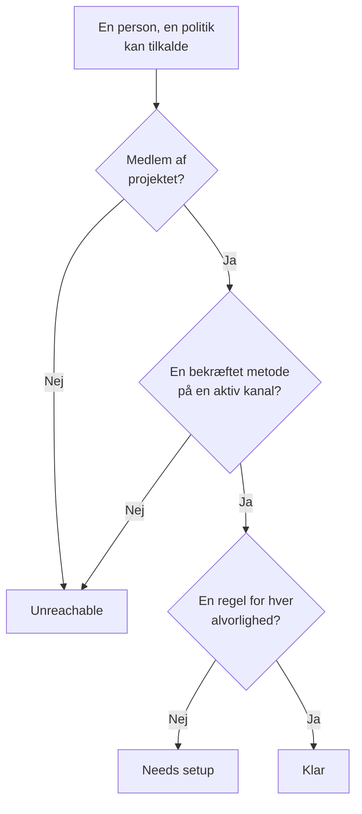

# Parathed og rapporter

Parathed besvarer et spørgsmål, før en hændelse gør det: hvis noget gik i gang lige nu, ville alle, dine vagtpolitikker tilkalder, så faktisk blive nået? Siden viser hver modtager i projektet, siger, hvem der er klar, og hvem der ikke er, og lader dig minde folk om at gøre deres opsætning færdig. Rapporten **Brugerens vagttid** viser derefter, hvor længe hver person havde vagt.

:::cards
- [Sådan fastlægges en status](#sådan-fastlægges-en-status): Klar, Needs setup eller Unreachable, og hvorfor.
- [Siden Parathed](#siden-parathed): Hver modtager i projektet, i én liste.
- [Mind folk om at gøre opsætningen færdig](#mind-folk-om-at-gøre-opsætningen-færdig): En e-mail, der nævner, hvad der mangler.
- [Brugerens vagttid](#brugerens-vagttid): Hvor længe hver person havde vagt.
:::

## Sådan fastlægges en status

En modtager er enhver, en vagtpolitik kan tilkalde: en person, der er nævnt i en eskaleringsregel, et medlem af et team, som en regel tilkalder, en person i et lag i en vagtplan, som en regel tilkalder, og den, der dækker i en brugertilsidesættelse, som ikke er slut. En vagtplan, som ingen politik tilkalder, tilføjer ingen.

| Status | Hvad den betyder |
| --- | --- |
| **Klar** | Personen har en bekræftet metode på en kanal, projektet har slået til, og en regel for hver alvorlighed, på hver fane i sine vagtregler. |
| **Kræver opsætning** | Personen kan nås, men nogle alvorligheder har ingen regel. Rækken tæller disse huller. |
| **Utilgængelig** | Intet når personen: ingen bekræftet metode, hver bekræftet metode er på en kanal, projektet har slået fra, eller personen er ikke medlem af projektet. |

Et hul er en alvorlighed uden regel, på fanen for hændelser, hændelsesepisoder, advarsler eller advarselsepisoder. En regel, der bevidst slår en alvorlighed fra, er ikke et hul. Et tilkald, der rammer et hul, når alligevel personen på de bekræftede metoder, medmindre projektet har slået den mulighed fra: se [Når ingen regel passer](/docs/notifications/index#når-ingen-regel-passer).

## Siden Parathed

Åbn **Vagtordning → Parathed**. Kortet **On-call readiness** viser alle, som en vagtpolitik i projektet kan nå, med dem, der har brug for noget, først. Alle i projektet kan åbne det.

Over listen tæller felterne **Modtagere**, **Klar**, **Kræver opsætning** og **Utilgængelig**. Klik på **Klar**, **Kræver opsætning** eller **Utilgængelig** for kun at vise de modtagere, og klik igen for at vise alle.

| Kolonne | Hvad den viser |
| --- | --- |
| **Modtager** | Personen, med e-mailadresse. |
| **Status** | **Klar**, **Utilgængelig** eller hvor mange huller personen har. |
| **Teams** | De teams, der tilkalder personen via en eskaleringsregel. |
| **Kanaler** | Et segment pr. kanal: udfyldt for en bekræftet metode, hult for en, der ikke er bekræftet endnu. |
| **Coverage** | Hvor mange alvorligheder der har en regel, på hver fane, ud af dem alle. |
| **Reached via** | Hvordan politikkerne når personen: `Direct`, `Team`, `Schedule` eller `Override`. |

**Coverage** i en række viser personens notifikationsmetoder, hvorfor personen har sin status, og et gitter over hver alvorlighed med eller uden regel. Tragten filtrerer listen efter **Modtager**, **Status**, **Team** eller **Reached via**. Svaret kan være et minut gammelt: **Opdater** fastlægger det igen.

## Mind folk om at gøre opsætningen færdig

Kun personen selv kan tilføje og bekræfte sine notifikationsmetoder og regler, så løsningen er at bede dem om det.

:::steps
1. Sæt flueben ved de modtagere, du vil minde, på siden Parathed. Modtagere, der er klar, kan ikke markeres: der er intet at minde dem om.
2. Klik på **Send påmindelse om opsætning**. Bekræftelsen nævner alle, der er ved at få en e-mail.
3. Bekræft. Hver person får én e-mail, der nævner, hvad der mangler i deres egen opsætning, med et link til den side, hvor de retter det.
:::

Et banner viser derefter, hvor mange påmindelser der blev sendt, sprunget over eller mislykkedes, og hvorfor for hver, der ikke blev sendt. Ingen mindes mere end én gang på 24 timer, og én omgang minder højst 250 personer. At sende påmindelser kræver **Projektejer**, **Projektadministrator** eller **Vagtadministrator**, eller **Edit On-Call Duty Policy** i en brugerdefineret rolle.

## Parathed på andre sider

- På en politiks **Oversigt** viser **Modtagernes parathed** alle, den politik kan tilkalde, som kræver opmærksomhed, og **Kontrollér igen** læser det igen. Din egen række har en knap til den side, der retter det; en andens række åbner en e-mail til dem i dit eget mailprogram, med løsningen i.
- På en politiks **Eskaleringsregler** siger et niveau på sit kort, hvis ikke alle dets modtagere kan tilkaldes. Se [Eskaleringsoversigten](/docs/on-call/escalation-rules#eskaleringsoversigten).
- Under **Brugere** åbner du et medlem og derefter **Parathed** i sektionen **Vagt**: personens status, metoder og dækningsgitter.
- Til din egen opsætning guider **Brugerindstillinger → Opsætningstjekliste** dig igennem. Se [Opsætningstjeklisten](/docs/notifications/index#opsætningstjeklisten).

## Den ugentlige e-mail om parathed

Én gang om ugen tjekker OneUptime hvert projekt, der har en vagtpolitik. Er nogen i det **Utilgængelig** eller **Kræver opsætning**, får projektets ejere én e-mail, der viser dem i to grupper, hvem der slet ikke kan tilkaldes, og hvem der kan nås med huller, op til 20 navne i hver, med et link til siden Parathed.

En uge, hvor alle er klar, sender intet, så e-mailen betyder altid, at noget skal rettes. Når nogen slet ikke kan tilkaldes, starter emnet med `[Action Required]`.

## Brugerens vagttid

**Vagtordning → Rapporter → Brugerens vagttid** viser, hvor længe hver person havde vagt, over et tidsrum, du vælger: **Seneste måned** til at starte med.

| Kolonne | Hvad den viser |
| --- | --- |
| **Bruger** | Personen. |
| **Tid brugeren var på vagt** | Personens tid på vagt i tidsrummet, i timer og minutter. |

Tiden registreres, efterhånden som folk går på og af vagt: fra en vagtplan, som en regel tilkalder, giver dem en vagt, eller de føjes til en regel direkte eller via et team, indtil overdragelsen, eller indtil de tages af. Tid på vagt via to politikker på én gang tæller én gang, og tid, der stadig løber, tæller op til nu.

**Tidslinje for vagtplaner** og kalenderfeedsene viser tidligere vagter, som rotationen er sat op i dag. Denne rapport skrives, mens det sker, så brug den til retfærdig fordeling og vagtbetaling.

> [!NOTE]
> I OneUptime Cloud kræver rapporten abonnementet **Growth**, og tid, der sluttede for mere end 200 dage siden, slettes. En selvhostet installation beholder det hele.

## Fejlfinding

:::details Nogen kan ikke nås, men har et bekræftet telefonnummer
Personens metoder ligger måske alle på kanaler, projektet har slået fra: sms, opkald, WhatsApp og Telegram starter slået fra i et nyt projekt. Se [Slå en kanal til for dit projekt](/docs/notifications/notification-methods#slå-en-kanal-til-for-dit-projekt).
:::

:::details Nogen mangler på listen
Listen rummer kun folk, en vagtpolitik kan tilkalde. Et teammedlem, der ikke har accepteret sin invitation, en person i en vagtplan, som ingen politik tilkalder, og en, der dækker i en tilsidesættelse, der er slut, er udeladt.
:::

:::details Ejerne får aldrig den ugentlige e-mail
Den sendes kun i en uge, hvor nogen er **Utilgængelig** eller **Kræver opsætning**, og kun til projektets ejere.
:::

## Næste trin

:::cards
- [Sådan når OneUptime dig](/docs/notifications/index): Metoderne, reglerne og reserveløsningen bag hver status.
- [Notifikationsmetoder](/docs/notifications/notification-methods): Tilføj og bekræft de måder, OneUptime når nogen på.
- [Personlige vagtregler](/docs/notifications/on-call-rules): Luk hullerne, alvorlighed for alvorlighed.
:::
