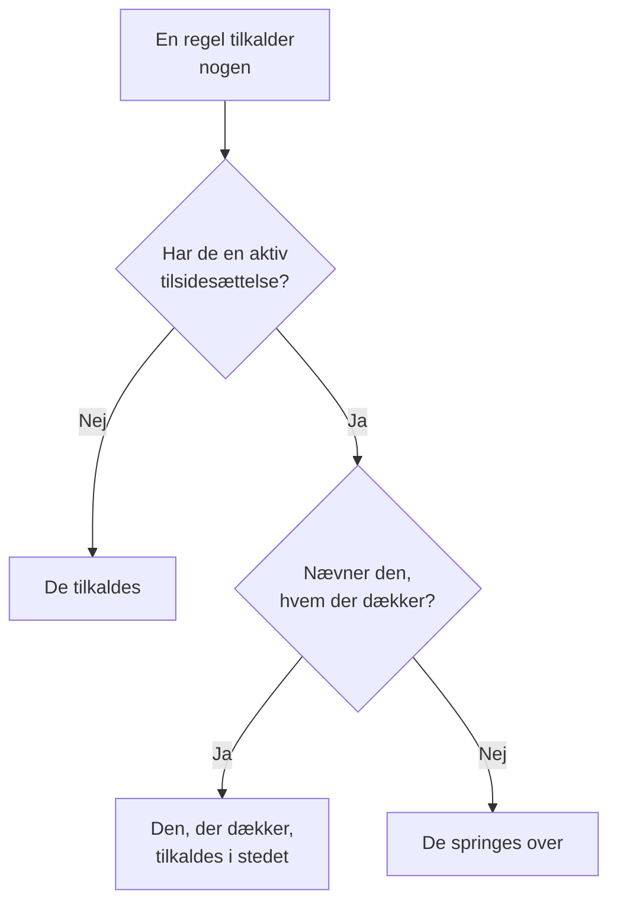

# Brugertilsidesættelser

Mens nogen er fraværende, sender en brugertilsidesættelse de tilkald, der ville nå dem, til den person, der dækker for dem, i et fastsat tidsrum. Er ingen valgt til at dække, springer den dem i stedet over: hver af deres vagter i en vagtplan går til den næste person i rotationen. Brug en til en ferie, en sygedag eller en byttet vagt.

:::cards
- [Sådan ændrer en tilsidesættelse et tilkald](#sådan-ændrer-en-tilsidesættelse-et-tilkald): Hvem der tilkaldes i stedet, og hvornår.
- [Tilføj en tilsidesættelse](#tilføj-en-tilsidesættelse): Hvem der er fraværende, hvem der dækker, fra hvornår og til hvornår.
- [Alle politikker eller én](#alle-politikker-eller-én): Hvor du tilføjer en tilsidesættelse, og hvilken der vinder.
- [Andre måder at tilføje en på](#andre-måder-at-tilføje-en-på): Fra en vagtplan og fra dine kommende vagter.
:::

## Sådan ændrer en tilsidesættelse et tilkald



Mens en tilsidesættelse gælder, fra dens start til dens slutning:

- Står der nogen under **Hvem dækker?**, får den person alle den fraværende persons tilkald fra alle vagtplaner, teams og regler, tilsidesættelsen gælder for. Tilkaldet når dem via deres egne personlige vagtregler.
- Er der ingen til at dække, springes personen over. I en vagtplan går hver af deres vagter til den næste person i rotationen, som ikke er fraværende; er alle i et lag fraværende, overtager lagene under det. En regel, der nævner dem direkte eller via et team, tilkalder dem ikke, og politikkens kørsel viser, at de er fraværende, og til hvornår.
- Tilsidesættelser kædes ikke sammen. Er den, der dækker, også fraværende, er det stadig dem, der tilkaldes for den person, de dækker for.

Når tilsidesættelsen slutter, er tilkaldene deres igen. **Tidslinje for vagtplaner**, en vagtplans lag og kalenderfeedsene viser alle, hvem der har hver dækket vagt.

## Tilføj en tilsidesættelse

:::steps
### Åbn tilsidesættelserne

Gå til **Vagtordning → Avanceret → Brugertilsidesættelser** for at dække for nogen i alle vagtpolitikker, eller til en politiks egen side **Brugertilsidesættelser**, under **Avanceret**, for kun at dække for dem i den politik. Klik på **Tilføj Brugertilsidesættelse**.

### Angiv, hvem der er fraværende

**Hvem er fraværende?** starter med dig, fordi det oftest er din egen fritid, der skal registreres. Vælg en anden for at finde dækning for dem.

### Angiv, hvem der dækker

Lad **Hvem dækker?** stå på **Næste person i rotationen** for at springe dem over, eller vælg den kollega, der overtager alle deres tilkald. Den fraværende person tilbydes ikke.

### Indstil tidspunktet

**Starter** er nu, medmindre du vælger et andet tidspunkt. Sæt **Slutter** til, når de er tilbage: det skal ligge efter starten. Klik på **Tilføj Brugertilsidesættelse**.
:::

Hver tilsidesættelse er en række: **Fraværende**, **Dækket af**, **Starter** og **Slutter**, filtreret efter start og slutning. **Dækket af** viser **Næste person i rotationen** ved et overspring. En tilsidesættelse kan ikke redigeres: slet den, og tilføj en ny, eller slet den for at få nogen tilbage tidligere.

## Alle politikker eller én

| Tilføjet under | Kort | Gælder for |
| --- | --- | --- |
| **Vagtordning → Avanceret → Brugertilsidesættelser** | **Globale brugertilsidesættelser** | Alle vagtpolitikker i projektet |
| En politiks **Brugertilsidesættelser** | **Vagtpolitikkens brugertilsidesættelser** | Kun den politik |

Når to tilsidesættelser for den samme person overlapper, vinder politikkens egen over en global, og en, der nævner, hvem der dækker, vinder over et overspring. Et tilkald uden en politik, fra et workflow eller fra chat, følger kun de globale tilsidesættelser.

## Andre måder at tilføje en på

- Fra en vagtplan: Fold et lag ud på vagtplanens side **Lag**, og klik på **Spring over indtil…** ved siden af en person. Det åbner den samme formular med personen som fraværende og rotationen som den, der dækker, som en global tilsidesættelse. Se [Når nogen er fraværende](/docs/on-call/schedules#når-nogen-er-fraværende).
- Fra dine kommende vagter: **Find afløser** på en af dine vagter, under **Brugerindstillinger → Kalender → Kalenderfeed**, åbner formularen med dig som fraværende i den vagts tidsrum, så kun **Hvem dækker?** er tilbage. Se [Kommende vagter og afløsning](/docs/on-call/calendar-feeds#kommende-vagter-og-afløsning).

Når nogen forlader projektet, slettes hver tilsidesættelse, der nævner dem og ikke er slut endnu, på begge sider.

## Hvem der må tilføje tilsidesættelser

**Projektejer**, **Projektadministrator**, **Projektmedlem**, **Vagtadministrator** og **Vagtmedlem** må tilføje og slette tilsidesættelser; **Seer** og **Vagtseer** må se dem. I en brugerdefineret rolle hedder tilladelserne **Create On-Call Duty Policy User Override**, **Delete On-Call Duty Policy User Override** og **Read On-Call Duty Policy User Override**. På **Tidslinje for vagtplaner** ser kun folk, der må læse tilsidesættelser, hvis vagt der dækkes.

I OneUptime Cloud kræver brugertilsidesættelser abonnementet **Growth**.

## API

Brugertilsidesættelser er ressourcen `/api/on-call-duty-policy-user-override`:

| Felt | Hvad det indeholder |
| --- | --- |
| `overrideUserId` | Den person, der er fraværende. Påkrævet. |
| `routeAlertsToUserId` | Den person, der dækker. Udelad det for i stedet at springe personen over. |
| `startsAt`, `endsAt` | Hvornår tilsidesættelsen starter og slutter. Begge er påkrævet, og slutningen ligger efter starten. |
| `onCallDutyPolicyId` | Den politik, den gælder for. Udelad det for en global tilsidesættelse. |

```bash
curl -X POST https://oneuptime.com/api/on-call-duty-policy-user-override \
  -H "apikey: $ONEUPTIME_API_KEY" \
  -H "Content-Type: application/json" \
  -d '{
    "data": {
      "projectId": "<project-id>",
      "overrideUserId": "<away-user-id>",
      "routeAlertsToUserId": "<cover-user-id>",
      "startsAt": "2026-12-22T09:00:00Z",
      "endsAt": "2027-01-05T09:00:00Z"
    }
  }'
```

En tilsidesættelse, hvor den fraværende person og den, der dækker, er den samme, afvises, og det samme gør en, der slutter, før den starter.

## Fejlfinding

:::details Personen på ferie blev stadig tilkaldt
Tjek, hvor tilsidesættelsen blev tilføjet. En på en politiks side **Brugertilsidesættelser** dækker kun den politik, og andre politikker tilkalder stadig personen: tilføj den under **Vagtordning → Avanceret → Brugertilsidesættelser** for at dække alle politikker. Tjek også **Starter** og **Slutter**: tidspunkter vises i din tidszone.
:::

:::details Den, der dækker, blev heller ikke tilkaldt
De nås via deres egne personlige vagtregler og bekræftede metoder. Slå dem op under **Vagtordning → Parathed**, og tjek kørslen i politikkens **Udførelseslogs**.
:::

:::details Jeg kan ikke tilføje en tilsidesættelse
Det kræver en af rollerne ovenfor og, i OneUptime Cloud, abonnementet **Growth**.
:::

## Næste trin

:::cards
- [Vagtplaner](/docs/on-call/schedules): Rotationer, lag og at springe nogen over i et lag.
- [Tidslinje for vagtplaner](/docs/on-call/schedule-timeline): Se hver dækket vagt på tværs af alle vagtplaner.
- [Kalenderfeeds](/docs/on-call/calendar-feeds): Find en afløser til en af dine egne vagter.
:::
