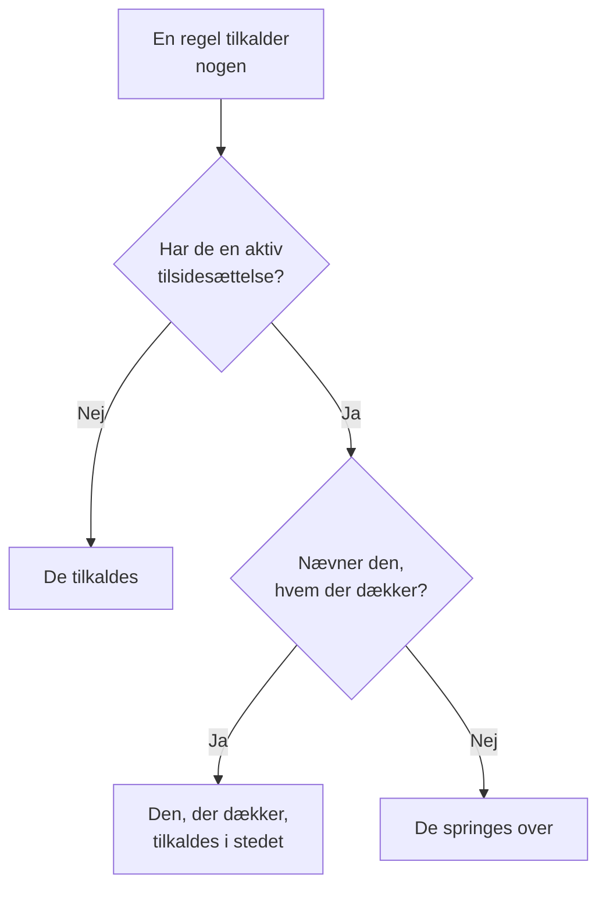

# Brugertilsidesættelser

Mens nogen er fraværende, sender en brugertilsidesættelse de tilkald, der ville nå dem, til den person, der dækker for dem, i et fastsat tidsrum. Er ingen valgt til at dække, springer den dem i stedet over: hver af deres vagter i en vagtplan går til den næste person i rotationen. Brug en til en ferie, en sygedag eller en byttet vagt.

:::cards
- [Sådan ændrer en tilsidesættelse et tilkald](#sådan-ændrer-en-tilsidesættelse-et-tilkald): Hvem der tilkaldes i stedet, og hvornår.
- [Tilføj en tilsidesættelse](#tilføj-en-tilsidesættelse): Hvem der er fraværende, hvem der dækker, fra hvornår og til hvornår.
- [Rediger en tilsidesættelse](#rediger-en-tilsidesættelse): Skift, hvem der dækker, eller hvornår den starter og slutter.
- [Alle politikker eller én](#alle-politikker-eller-én): Hvor du tilføjer en tilsidesættelse, og hvilken der vinder.
- [Andre måder at tilføje en på](#andre-måder-at-tilføje-en-på): Fra en vagtplan og fra dine kommende vagter.
:::

## Sådan ændrer en tilsidesættelse et tilkald



Mens en tilsidesættelse gælder, fra dens start til dens slutning:

- Står der nogen under **Hvem dækker?**, får den person alle den fraværende persons tilkald fra alle vagtplaner, teams og regler, tilsidesættelsen gælder for. Tilkaldet når dem via deres egne personlige vagtregler.
- Er der ingen til at dække, springes personen over. I en vagtplan går hver af deres vagter til den næste person i rotationen, som ikke er fraværende; er alle i et lag fraværende, overtager lagene under det. En regel, der nævner dem direkte eller via et team, tilkalder dem ikke, og politikkens kørsel viser, at de er fraværende, og til hvornår.
- Tilsidesættelser kædes ikke sammen. Er den, der dækker, også fraværende, er det stadig dem, der tilkaldes for den person, de dækker for.

Når tilsidesættelsen slutter, er tilkaldene deres igen. **Tidslinje for vagtplaner**, en vagtplans lag og kalenderfeedsene viser alle, hvem der har hver dækket vagt.

## Tilføj en tilsidesættelse

:::steps
### Åbn tilsidesættelserne

Gå til **Vagt → Avanceret → Brugertilsidesættelser** for at dække for nogen i alle vagtpolitikker, eller til en politiks egen side **Brugertilsidesættelser**, under **Avanceret**, for kun at dække for dem i den politik. Klik på **Tilføj Brugertilsidesættelse**.

### Angiv, hvem der er fraværende

**Hvem er fraværende?** starter med dig, fordi det oftest er din egen fritid, der skal registreres. Vælg en anden for at finde dækning for dem.

### Angiv, hvem der dækker

Lad **Hvem dækker?** stå på **Næste person i rotationen** for at springe dem over, eller vælg den kollega, der overtager alle deres tilkald. Den fraværende person tilbydes ikke.

### Indstil tidspunktet

**Starter** er nu, medmindre du vælger et andet tidspunkt. Sæt **Slutter** til, når de er tilbage: det skal ligge efter starten. Klik på **Tilføj Brugertilsidesættelse**.
:::

Hver tilsidesættelse er en række: **Fraværende**, **Dækket af**, **Starter** og **Slutter**, filtreret efter start og slutning. **Dækket af** viser **Næste person i rotationen** ved et overspring.

## Rediger en tilsidesættelse

Klik på **Rediger** i en tilsidesættelses række, på en af de to sider **Brugertilsidesættelser** eller i listen over brugertilsidesættelser på vagtplanens side **Lag**. Formularen åbner med tilsidesættelsen, som den blev gemt: ret den, og klik på **Gem ændringer**.

- **Hvem dækker?** kan ændres, indtil tilsidesættelsen slutter. Sæt den tilbage til **Næste person i rotationen** for i stedet at springe personen over.
- **Starter** kan flyttes, indtil tilsidesættelsen starter, og bliver derefter, som den er. **Slutter** kan flyttes, indtil tilsidesættelsen slutter: sæt den til nu for at afslutte tilsidesættelsen tidligere. Ingen af dem kan flyttes til fortiden.
- **Hvem er fraværende?** kan ikke ændres. Tilføj en ny tilsidesættelse for en anden person.

En tilsidesættelse, der er slut, kan ikke længere ændres: dens **Rediger** er låst og siger hvorfor.

## Alle politikker eller én

| Tilføjet under | Kort | Gælder for |
| --- | --- | --- |
| **Vagt → Avanceret → Brugertilsidesættelser** | **Globale brugertilsidesættelser** | Alle vagtpolitikker i projektet |
| En politiks **Brugertilsidesættelser** | **Vagtpolitikkens brugertilsidesættelser** | Kun den politik |

To tilsidesættelser for den samme person må ikke overlappe i den samme politik, heller ikke når begge er globale. Formularen siger det, så snart tidspunkterne er valgt, med **Rediger den tilsidesættelse** for i stedet at ændre den anden. Den ene kan slutte, når den næste starter.

En politiks egen tilsidesættelse må overlappe en global for den samme person: i den politik bruges dens egen, mens begge gælder, og formularen siger det. Et tilkald uden en politik, fra et workflow eller fra chat, følger kun de globale tilsidesættelser.

Tilsidesættelser, der allerede overlappede før denne regel, forbliver som de er. Begge er markeret med **Overlapper**, som siger, hvilken der bruges: en, der nævner, hvem der dækker, før et overspring, derefter den, der starter først, derefter den, der blev tilføjet først.

## Andre måder at tilføje en på

- Fra en vagtplan: Fold et lag ud på vagtplanens side **Lag**, og klik på **Spring over indtil…** ved siden af en person. Det åbner den samme formular med personen som fraværende og rotationen som den, der dækker, som en global tilsidesættelse. Se [Når nogen er fraværende](/docs/on-call/schedules#når-nogen-er-fraværende).
- Fra dine kommende vagter: **Find afløser** på en af dine vagter, under **Brugerindstillinger → Kalender → Kalenderfeed**, åbner formularen med dig som fraværende i den vagts tidsrum, så kun **Hvem dækker?** er tilbage. Se [Kommende vagter og afløsning](/docs/on-call/calendar-feeds#kommende-vagter-og-afløsning).

Når nogen forlader projektet, slettes hver tilsidesættelse, der nævner dem og ikke er slut endnu, på begge sider.

## Hvem der må tilføje tilsidesættelser

**Projektejer**, **Projektadministrator**, **Projektmedlem**, **Vagtadministrator** og **Vagtmedlem** må tilføje, redigere og slette tilsidesættelser; **Seer** og **Vagtseer** må se dem. I en brugerdefineret rolle hedder tilladelserne **Create On-Call Policy User Override**, **Edit On-Call Policy User Override**, **Delete On-Call Policy User Override** og **Read On-Call Policy User Override**. På **Tidslinje for vagtplaner** ser kun folk, der må læse tilsidesættelser, hvis vagt der dækkes.

En tilsidesættelse i en politik følger politikkens omfang. Giv et team **Vagtmedlem** begrænset til de politikker, det ejer, eller til dets label, så tilføjer, redigerer og sletter dets medlemmer kun tilsidesættelser i de politikker. En global tilsidesættelse gælder for alle politikker, også et andet teams, så det at tilføje, redigere eller slette en kræver tilladelsen til tilsidesættelser over hele projektet. Med en snævrere tilladelse er **Tilføj Brugertilsidesættelse**, **Rediger** og **Slet** under **Vagt → Avanceret → Brugertilsidesættelser** låst og siger hvorfor. **Spring over indtil…** i en vagtplans lag og **Find afløser** på dine kommende vagter, som tilføjer globale tilsidesættelser, tilbyder i stedet de politikker, du må tilføje tilsidesættelser på, med én tilsidesættelse pr. politik, og det samme gør afløsningen i mobilappen; hvor du ikke må på nogen af dem, er de låst og siger hvorfor. Teamet tilføjer sine tilsidesættelser på hver politiks egen side **Brugertilsidesættelser**. Det samme gælder for API'et: en tilsidesættelse uden `onCallDutyPolicyId` afvises for en tilladelse begrænset til labels eller til ejede politikker.

I OneUptime Cloud kræver brugertilsidesættelser abonnementet **Growth**.

## API

Brugertilsidesættelser er ressourcen `/api/on-call-duty-policy-user-override`:

| Felt | Hvad det indeholder |
| --- | --- |
| `overrideUserId` | Den person, der er fraværende. Påkrævet. |
| `routeAlertsToUserId` | Den person, der dækker. Udelad det for i stedet at springe personen over. |
| `startsAt`, `endsAt` | Hvornår tilsidesættelsen starter og slutter. Begge er påkrævet, og slutningen ligger efter starten. |
| `onCallDutyPolicyId` | Den politik, den gælder for. Udelad det for en global tilsidesættelse. |

```bash
curl -X POST https://oneuptime.com/api/on-call-duty-policy-user-override \
  -H "apikey: $ONEUPTIME_API_KEY" \
  -H "Content-Type: application/json" \
  -d '{
    "data": {
      "projectId": "<project-id>",
      "overrideUserId": "<away-user-id>",
      "routeAlertsToUserId": "<cover-user-id>",
      "startsAt": "2026-12-22T09:00:00Z",
      "endsAt": "2027-01-05T09:00:00Z"
    }
  }'
```

En tilsidesættelse, hvor den fraværende person og den, der dækker, er den samme, afvises, og det samme gør en, der slutter, før den starter. Det samme gør en, der overlapper en anden tilsidesættelse for den samme person i den samme politik, eller når begge er globale: afvisningen nævner den, den overlapper.

For at ændre en tilsidesættelse skal du sende `PUT /api/on-call-duty-policy-user-override/<override-id>` med de felter, der skal ændres, i `data`: `routeAlertsToUserId` (`null` for i stedet at springe personen over), `startsAt` og `endsAt`. `overrideUserId` og `onCallDutyPolicyId` kan ikke ændres. En tilsidesættelse, der er slut, kan ikke ændres, det kan starten på en, der er startet, heller ikke, og et tidspunkt, der ændres, kan ikke flyttes til fortiden.

## Fejlfinding

:::details Personen på ferie blev stadig tilkaldt
Tjek, hvor tilsidesættelsen blev tilføjet. En på en politiks side **Brugertilsidesættelser** dækker kun den politik, og andre politikker tilkalder stadig personen: tilføj den under **Vagt → Avanceret → Brugertilsidesættelser** for at dække alle politikker. Tjek også **Starter** og **Slutter**: tidspunkter vises i din tidszone.
:::

:::details Den, der dækker, blev heller ikke tilkaldt
De nås via deres egne personlige vagtregler og bekræftede metoder. Slå dem op under **Vagt → Parathed**, og tjek kørslen i politikkens **Udførelseslogs**.
:::

:::details Jeg kan ikke tilføje en tilsidesættelse
Det kræver en af rollerne ovenfor og, i OneUptime Cloud, abonnementet **Growth**. En global tilsidesættelse kræver rollen over hele projektet: er dit teams rolle begrænset til dets egne politikker eller til nogle labels, så tilføj tilsidesættelsen på politikkens egen side **Brugertilsidesættelser**. **Spring over indtil…**, **Find afløser** og mobilappen tilbyder så kun de politikker, du må tilføje tilsidesættelser på, og er låst, hvor du ikke må på nogen af dem.
:::

:::details En tilsidesættelse kan ikke gemmes, fordi den overlapper en anden
Personen har allerede en tilsidesættelse på nogle af de tidspunkter: i den samme politik, eller en global, når denne også er global. Klik på **Rediger den tilsidesættelse** under **Slutter** for i stedet at ændre den, eller vælg tidspunkter, der ikke overlapper den.
:::

## Næste trin

:::cards
- [Vagtplaner](/docs/on-call/schedules): Rotationer, lag og at springe nogen over i et lag.
- [Tidslinje for vagtplaner](/docs/on-call/schedule-timeline): Se hver dækket vagt på tværs af alle vagtplaner.
- [Kalenderfeeds](/docs/on-call/calendar-feeds): Find en afløser til en af dine egne vagter.
:::
