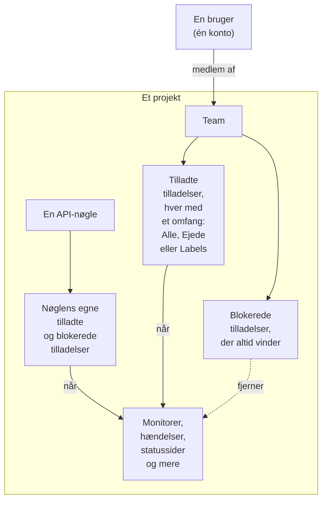
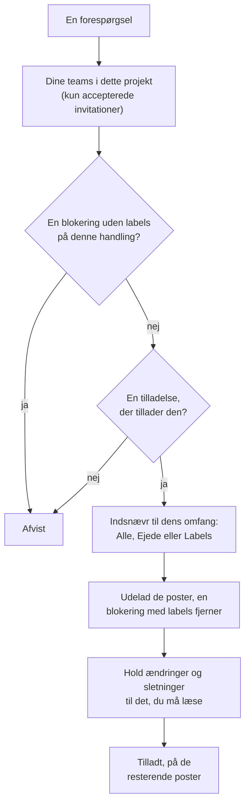

# Brugere, teams og tilladelser

Alt i OneUptime lever inde i et **projekt**. Hvem der må hvad i det projekt, afhænger af tre ting: **brugerne** i det, de **teams**, brugerne tilhører, og de **tilladelser**, de teams har fået.

> [!IMPORTANT]
> **Brugere har aldrig tilladelser direkte.** En brugers adgang er foreningsmængden af tilladelserne fra alle de teams, brugeren tilhører i det projekt. Vil du ændre, hvad nogen må, ændrer du deres teammedlemskab eller det teams tilladelser.

**Ejere** er en anden ting. En ejer er den, der har ansvaret for en bestemt ressource — en monitor, en hændelse, et dashboard. Ejere får besked om deres ressourcer, og tilladelser kan valgfrit indsnævres til "kun det, jeg ejer".

## Sådan virker adgang

| Begreb | Hvad det er |
| --- | --- |
| Bruger | Én OneUptime-konto. Ét login, et vilkårligt antal projekter. |
| Projekt | Lejergrænsen. Monitorer, hændelser, teams og data hører til præcis ét projekt. |
| Team | En navngivet gruppe i et projekt, der bærer tilladelser. |
| Teammedlem | En bruger, der er inviteret til et team og har accepteret. |
| Tilladelse | Én enkelt evne, f.eks. `CreateProjectMonitor`, eller en rolle, der samler mange, f.eks. `MonitorAdmin`. |
| Brugerdefineret rolle | Et sæt tilladelser, du navngiver én gang og giver til teams og API-nøgler. |
| Omfang | Hvor langt en tilladt rettighed rækker: alle ressourcer, kun ejede eller kun mærkede. |
| Ejer | En bruger eller et team, der er markeret som ansvarlig for én bestemt ressource. |
| Label | Et mærke, du sætter på ressourcer, brugt til at begrænse tilladelser og til at organisere. |

## Brugere

En brugerkonto er global for OneUptime-instansen — det samme login virker i alle de projekter, brugeren er inviteret til.

En bruger er "i" et projekt, når vedkommende er medlem af **mindst ét team** i det. Der er ikke noget separat trin "føj bruger til projekt": at invitere nogen til et projekt er at invitere dem til et team.

:::steps
1. Åbn **Brugere** i menuen **Produkter** under **Indstillinger**, og klik på **Inviter bruger**. Listen viser alle i projektet og status for deres invitation.
2. Skriv personens **E-mail**. Den, der endnu ikke har en OneUptime-konto, bliver også bedt om et **Navn**.
3. Vælg personens **Team**, som afgør, hvad personen må, og klik på **Inviter**.
4. Personen accepterer via klokken øverst til højre på **Projektinvitationer** og er derefter med i projektet.
:::

- Invitationer opretter et afventende teammedlem. Brugeren tæller først som projektmedlem — og får først nogen tilladelse — **efter at have accepteret invitationen.**
- **Inviter bruger** starter på projektets medlemsteam: det team, der har `ProjectMember` for hele projektet, altså **Members**, medmindre du har omdøbt det. Vælg et andet team for at give personen mere eller mindre adgang. Intet er valgt, når du ikke selv ville kunne invitere til det team — at invitere nogen giver dem teamets tilladelser, og du kan kun give tilladelser videre, som du selv har — eller når projektet ikke har et sådant team. Administratordashboardet starter på det samme team, overalt hvor en administrator af instansen føjer nogen til et projekt: **Inviter bruger** på et projekt, **Føj til projekt** på en bruger og på flere brugere på én gang, og de projekter, der er knyttet til en [global SSO-udbyder](/docs/identity/global-sso).
- Fjernes en bruger fra alle teams i et projekt, mistes adgangen til projektet fra brugerens næste forespørgsel — også mens brugeren er logget ind. Kontoen og brugerens andre projekter berøres ikke. Brugeren fjernes fra projektets vagtplaner, eskaleringsregler og overrides, fra rollerne i dets åbne hændelser og episoder og fra ejerne af dets ressourcer; løste hændelser beholder oplysningen om, hvem der ejede og ledte dem.
- På en selvhostet installation mister en person, hvis adgang som hovedadministrator fjernes i Admin Dashboard, den fra sin næste forespørgsel — også mens personen er logget ind. Personen forbliver logget ind og beholder de projekter, vedkommende er medlem af.
- Den, der forlader et projekt, får ikke længere dets notifikationer. Personens egne notifikationsmetoder, -regler og -indstillinger for projektet fjernes sammen med det sidste team — e-mail, SMS, opkald, WhatsApp, Telegram, push, webhook, Slack og Microsoft Teams, e-mailopsamlingen og den endnu ikke sendte e-mail, nummeret til indgående opkald og vagtpåmindelserne —, så en ny tilmelding starter fra standardindstillingerne. Det, der stadig nævner personen, som brugeren en regel for indgående opkald ringer til eller en ejer, der bevares på en løst hændelse, sender ikke længere noget til personen: intet sendes på et projekts vegne til nogen, der ikke er medlem, og en afventende invitation er endnu ikke et medlemskab. Disse steder viser **Ikke længere medlem** ved siden af navnet, så du kan sætte en anden ind. Den, der er inviteret og endnu ikke har accepteret, viser i stedet **Invitation endnu ikke accepteret**. Hvis en override sender nogens kald videre til en person, der har forladt projektet, bliver den person, overriden dækker, kaldt i stedet. At forlade projektet afbryder også de MCP-klienter, personen har forbundet til projektet, og personens personlige link til vagtkalenderen viser derefter en tom kalender. På OneUptime Cloud bekræfter en, der vender tilbage via projektets single sign-on, det igen fra sin mailboks.
- Hvis projektet kræver SSO, og en bruger endnu ikke har godkendt sig via identitetsudbyderen, behandles vedkommende som uautoriseret SSO-bruger og ser intet, før det sker. Se [SSO](/docs/identity/sso).
- Med SCIM opsat kan din identitetsudbyder automatisk oprette, opdatere og fjerne brugere og deres teammedlemskaber. Se [SCIM](/docs/identity/scim).

## Teams

Teams er vejen, ad hvilken tilladelser når frem til mennesker. Hvert nyt projekt starter med tre:

| Team | Tilladelse, det har | Kan redigeres |
| --- | --- | --- |
| Owners | `ProjectOwner` | Nej. Har altid mindst ét medlem. |
| Admin | `ProjectAdmin` | Nej |
| Members | `ProjectMember` | Ja — dette er et udgangspunkt, ret det frit |

Teamsene **Owners** og **Admin** er bevidst låst: deres tilladelser kan ikke redigeres, og teamsene kan hverken slettes eller omdøbes. Det er dét, der forhindrer, at et projekt ved et uheld låser sig selv ude. Owners-teamet skal altid beholde mindst ét medlem.

`ProjectOwner` er det højeste adgangsniveau: fakturering, sletning af projektet og alt, hvad en administrator kan. `ProjectAdmin` dækker alt undtagen fakturering og sletning af projektet.

At slå SMS, telefonopkald, WhatsApp eller Telegram til eller fra for projektet hører under fakturering, fordi hver besked koster penge. Kun `ProjectOwner`, rollen `BillingAdmin` (**Faktureringsadministrator**) og tilladelsen `ManageProjectBilling` (**Manage Billing**) kan slå dem til eller fra, under **Projektindstillinger > Notifikationer > Notifikationsindstillinger** — ikke `ProjectAdmin`.

At genoplade projektets forudbetalte saldi hører også under fakturering. På OneUptime Cloud betales SMS, telefonopkald, WhatsApp og Telegram fra saldoen under **Projektindstillinger > Notifikationer > Notifikationsindstillinger**, og AI fra AI-kreditterne under **Projektindstillinger > AI > AI-kreditter**. Kun en projektejer eller nogen med **Manage Billing** kan genoplade dem eller ændre deres **Automatisk genopfyldning** — en projektadministrator kan ikke. En besked om en saldo, der er ved at løbe tør, nævner, hvem der kan fylde den op, og kun de personer får en knap **Genoplad saldo**, der virker, eller et link til siden.

Opret så mange ekstra teams, du vil — "Frontend-vagt", "Support", "Skrivebeskyttede revisorer" — og giv hvert enkelt de tilladelser, det har brug for. På OneUptime Cloud kræver det Scale-planen at oprette et team og ændre dets tilladelser.

**At oprette et team** beder om et navn og teamets **Adgang**, altså hvad teamets medlemmer må:

| Adgang | Hvad teamets medlemmer må |
| --- | --- |
| Projektadministrator | Oprette, ændre og slette alt i projektet, også dets indstillinger. Ikke fakturering, og ikke sletning af projektet. |
| Projektmedlem | Oprette, ændre og slette monitorer, hændelser, statussider og projektets øvrige ressourcer. |
| Seer | Læse alt i projektet og ikke ændre noget. |
| Vælg tilladelser senere | Intet endnu. Valgt fra start. |

:::steps
1. Åbn **Teams** i menuen **Produkter** under **Indstillinger**, og klik på **Opret team**.
2. Skriv teamets **Navn**, og vælg dets **Adgang**. Beskrivelsen ligger under **Flere felter**.
3. Opret teamet. Et team med en rolle åbner på sin side **Medlemmer**, klar til at invitere personer; med **Vælg tilladelser senere** åbner det på sin side **Tilladelser**, hvor du tilføjer en snævrere rolle som `IncidentMember` eller enkelte tilladelser.
:::

Den rolle, du vælger, bliver teamets første tilladelse, for alle ressourcer i projektet, så snart teamet findes — præcis som hvis du havde tilføjet den med **Tilføj rolle** på teamets side Tilladelser. Du får kun tilbudt de roller, du selv har, fordi alle, du inviterer til teamet, får dets tilladelser, og den, der må oprette teams, men ikke ændre, hvad de må, bliver ikke spurgt. Kan rollen ikke tilføjes, oprettes teamet alligevel, og en besked over listen linker til det.

Hvor du finder det: åbn et team under **Teams** for at komme til **Medlemmer** og **Tilladelser**; dets brugerdefinerede roller og **Bloker tilladelser** ligger under **Yderligere indstillinger** nederst på siden Tilladelser, hvis sammenklappede overskrift viser, hvor mange af hver teamet har.

## Tilladelser

En tilladelse er én evne. Der er to måder at give dem på, og begge ligger på teamets fane **Tilladelser**.

### Roller

En rolle samler et helt produktområde på ét af tre niveauer:

- **Admin** — det, Member gør, plus områdets egen konfiguration, som alvorlighedsgrader og tilstande for hændelser og advarsler, monitorstatusser og vedligeholdelsestilstande.
- **Member** — det daglige arbejde: oprette, ændre og slette områdets ressourcer med deres noter, ejere og skabeloner. For statussider og vagter gør Member alt, hvad Admin gør.
- **Viewer** — kun læsning.

`MonitorAdmin`, `IncidentMember`, `StatusPageViewer` og så videre. Roller er næsten altid det, du vil have — de forbliver korrekte, efterhånden som OneUptime tilføjer funktioner, fordi en ny monitorrelateret tabel føjes til de eksisterende monitorroller i stedet for at kræve en ny tildeling fra dig.

**Tilføj rolle** spørger først, hvor langt rollen rækker. **Hele projektet** viser de fire roller, der dækker hele projektet — Project Owner, Projektadministrator, Projektmedlem og Seer — hver med en linje om, hvad den er til. **Ét område** viser områderne, hvert med sit produkts ikon: vælg et, og derefter niveauet. **Søg roller** finder enhver rolle ud fra navn, område eller hvad den gør.

Workflows og runbooks er undtagelsen. Begge kører kode i dit projekt — et workflow sine trin, en runbook sine scripts på dine Runners —, så `WorkflowMember` åbner workflows og deres kørsler og kører dem manuelt, og `RunbookMember` åbner runbooks og deres kørsler og kører dem: den starter en kørsel, fuldfører eller springer dens trin over og annullerer den. Ingen af dem opretter, ændrer eller sletter det, de kører; `WorkflowAdmin` og `RunbookAdmin` bygger dem. En rolle kører kun de runbooks, dens omfang når, så en `RunbookMember` begrænset til nogle labels kører de runbooks, der bærer dem. Se [Workflow-tilladelser](/docs/workflows/configuration#tilladelser) og [Runbook-tilladelser](/docs/runbooks/configuration#tilladelser).

Et områdes regler (label-, ejer-, vagt-, grupperings- og påmindelsesregler), brugerdefinerede felter, SLA'er og hemmeligheder er projektkonfiguration: de kræver `ProjectAdmin`, uanset hvilken områderolle nogen har. Det samme gælder API-nøgler, teams og deres tilladelser, labels, SSO og domæner — Settings-rollerne tager sig af projektets tjenester, prober, infrastruktur og integrationer, ikke af hvem der må hvad.

Fakturering har tre roller for sig selv. `BillingViewer` læser projektets fakturering — planen og abonnementet, fakturaer, forbrug, saldi, AI-kreditter, betalingsmetoder og faktureringskontaktoplysningerne — og ændrer intet. `BillingMember` henter desuden fakturaer og ændrer faktureringskontaktoplysningerne. `BillingAdmin` gør det, `BillingMember` gør, og slår SMS, telefonopkald, WhatsApp og Telegram til og fra. At ændre planen, betalingsmetoderne eller saldiene og at betale fakturaer kræver `ProjectOwner` eller **Manage Billing**; på faktureringssiderne er de knapper låst for alle andre og siger, hvem der må.

Alle {{PERMISSION_ROLE_COUNT}} roller står i [Tilladelsesreferencen](/docs/permissions/reference).

### Granulære tilladelser

Hver enkelt evne kan også tildeles for sig — `CreateProjectMonitor`, `ReadProjectIncident`, `DeleteProjectStatusPage` og {{PERMISSION_TOTAL_COUNT}} andre. Brug dem, når en rolle er for bred, og du skal give præcis én ting.

En tilladelse til at ændre eller slette noget når kun det, du også må læse, så giv den tilsvarende læsetilladelse med: `EditProjectIncident` ændrer ingen hændelse uden `ReadProjectIncident`. En post, der læses gennem en anden, f.eks. en note på en hændelse, kræver også en tilladelse til at læse den anden post: `ReadIncidentInternalNote` når ingen note uden en tilladelse til at læse hændelser, og `CreateIncidentInternalNote` tilføjer kun en note på en hændelse, du må læse. Rollerne indeholder allerede begge.

Det er også de nøgler, du bruger, når du opretter API-nøgler, og dem, API'et og Terraform-provideren forventer.

Den fulde liste står i [Tilladelsesreferencen](/docs/permissions/reference).

### Brugerdefinerede roller

En brugerdefineret rolle er et sæt tilladelser, du navngiver én gang og giver til teams og API-nøgler: fx en "Hændelsesansvarlig" med `IncidentMember`, `AlertMember` og `OnCallViewer` eller en "Teamleder". Hvert team og hver nøgle, du giver den, får de samme tilladelser, og du ændrer dem for dem alle ét sted. På OneUptime Cloud kræver brugerdefinerede roller Scale-planen, ligesom det at ændre et teams tilladelser. Ved selvhosting er de en del af Enterprise Edition: på Community Edition gælder de roller, dine teams og API-nøgler allerede har, fortsat, og de kan tages fra et team eller en nøgle eller slettes, men ikke oprettes eller ændres.

:::steps
1. Åbn **Teams** i menuen **Produkter** under **Indstillinger**. Fold **Indstillinger** ud i sidemenuen, vælg **Roller**, og klik på **Opret Brugerdefineret rolle**.
2. Skriv dens **Navn**, og vælg under **Tilladelser** de indbyggede roller, den samler, for hver ressource i projektet. Beskrivelsen ligger under **Flere felter**.
3. Opret rollen. Den åbner på sin side, hvor **Tilføj rolle** tilføjer endnu en indbygget rolle og **Tilføj tilladelse** (i menuen **⋯** på kortet) en enkelt tilladelse, hver med et omfang og etiketter, som på et team.
4. Klik på **Giv til et team** under **Teams med denne rolle**, eller på **Giv til en API-nøgle** under **API-nøgler med denne rolle**. Et teams side **Tilladelser** og en API-nøgles side har også **Tilføj brugerdefineret rolle**, under **Yderligere indstillinger**, og **Opret team** og **Opret API-nøgle** tilbyder under **Adgang** de brugerdefinerede roller, du kunne give.
:::

- Et teams medlemmer får hver tilladelse fra teamets brugerdefinerede roller, med samme omfang og samme etiketter, præcis som hvis teamet selv havde dem. En blokering på teamet vinder stadig.
- En rolle forbliver knyttet til de teams og API-nøgler, der har den: en ændring af den når dem alle med det samme, og rollens side fortæller, hvor mange teams, personer og nøgler det er. **Fjern** tager rollen fra ét team eller én nøgle. Sletter du selve rollen, mister hvert team og hver nøgle, der har den, dens tilladelser; de beholder alt det andet, de har.
- Du kan kun lægge i en rolle, og give et team eller en API-nøgle som rolle, hvad du kunne give det direkte: en rolle med en tilladelse, du ikke har med samme eller et bredere omfang, afvises, og afvisningen nævner tilladelsen. En rolle indeholder aldrig `ProjectOwner`, og **Owners** og **Admin** får aldrig en.
- Et teams side **Tilladelser** og en API-nøgles side viser deres brugerdefinerede roller under **Yderligere indstillinger**, efter deres egne tilladelser; den sammenklappede overskrift siger, hvor mange de har. Hvad en rolle giver, ændres på rollens side, ikke på teamets eller nøglens.
- En API-nøgle får hver tilladelse fra sine brugerdefinerede roller, med de samme etiketter, som hvis nøglen selv havde dem, og en blokering på nøglen vinder stadig. En tilladelse, som rollen begrænser til det, nogen ejer, giver en nøgle intet: en nøgle ejer intet.
- De indbyggede roller står under **Indbyggede roller** nederst på siden **Roller**.

### Tillad og blokér

Hvert team har to lister:

- **Tilladelser** (tillad) — hvad dette team må.
- **Bloker tilladelser** — hvad dette team aldrig må, uanset nogen tilladt post.

Begge ligger på teamets side **Tilladelser**. Få teams har brug for en blokering, så blokerede tilladelser er klappet sammen under **Yderligere indstillinger** nederst på siden.

> [!WARNING]
> **Blokering vinder altid.** En blokeringspost uden labels fjerner evnen helt for teamet. En blokeringspost med labels fjerner den kun for ressourcer med de labels — nyttigt til "dette team må redigere monitorer, undtagen dem med label Production".

En tilladelse kan ikke bære begrænsningslabels i begge lister på én gang; OneUptime afviser den anden med en forklaring.

En brugers tilladte poster lægges sammen på tværs af alle brugerens teams, men en blokering gælder for alt, brugeren gør: en blokering uden labels på ét team fjerner evnen, også hvor et andet team tillader den, og en blokeringspost giver aldrig noget. Har nogen mindre adgang, end du forventer, så tjek hvert af deres teams for en blokering; har de mere, så tjek hvert team for en tilladelse.

### Ændring af en tilstand

En hændelse, en advarsel, en advarsels- eller hændelsesepisode og en planlagt vedligeholdelse skifter tilstand, og en monitor skifter status, med en ny række på deres tilstandstidslinje. **Bekræft**, **Løs**, **Skift tilstand**, siden **Tilstandstidslinje**, API'et og workflows tilføjer alle en. At tilføje den kræver tidslinjens egen oprettelsestilladelse sammen med en tilladelse til at læse den post, den ændrer:

| For at ændre tilstanden for | Kræves |
| --- | --- |
| En hændelse | **Create Incident State Timeline** |
| En advarsel | **Create Alert State Timeline** |
| En advarselsepisode | **Create Alert Episode State Timeline** |
| En hændelsesepisode | **Create Incident Episode State Timeline** |
| En planlagt vedligeholdelse | **Create Scheduled Maintenance State Timeline** |
| En monitor (dens status) | **Create Monitor Status Timeline** |

Posten får derefter den nye tilstand fra OneUptime selv, med det, der følger med, som hvornår en episode blev løst, eller hvornår en vedligeholdelse næste gang minder sine abonnenter om den. En ændring kræver altså ikke også en tilladelse til at redigere posten: en brugerdefineret rolle med **Create Incident State Timeline**, men uden **Edit Incident**, ændrer en hændelses tilstand. Vil du forhindre et team i at ændre tilstande, så bloker tidslinjens oprettelsestilladelse; en blokering af **Edit Incident** lader tilstandsændringer være. Labels, ejere og private poster indsnævrer tidslinjens oprettelsestilladelse, som de indsnævrer enhver anden, gennem den post, hvis tilstand den ændrer: se reglerne for omfang nedenfor.

Kun tilstanden skrives for dig. En note, der sendes med en ændring, sendes som dig og kræver notens egen tilladelse, som beskrevet i [Giv statussidens abonnenter besked om en tilstandsændring](/docs/incidents/states-and-severities#giv-statussideabonnenter-besked-om-en-tilstandsændring). At bekræfte en hændelses advarsler, mens du erklærer den, kræver det samme som at bekræfte hver af dem på deres egen side: **Create Alert State Timeline**, indsnævret gennem hver advarsel, og ingen **Edit Alert**. Se [Bekræft advarslerne, mens du erklærer](/docs/incidents/linked-alerts#bekræft-advarslerne-mens-du-erklærer).

## Omfang: hvor langt en tilladt rettighed rækker

Hver tilladt rettighed gives med et omfang: når du tilføjer den, ligger **Omfang** under **Flere felter** og starter på det første af disse svar:

| Omfang | Betydning |
| --- | --- |
| Alle ressourcer i projektet | Standarden, og hvad de fleste teams har brug for. Tilladelsen gælder for alle matchende ressourcer. |
| Kun ressourcer, de ejer | Tilladelsen gælder kun for ressourcer, som den handlende person eller det team, den er givet til, ejer — ikke for ressourcer, som kun et andet af vedkommendes teams ejer. |
| Kun ressourcer med bestemte etiketter | Tilladelsen gælder kun for ressourcer, der bærer mindst én af de valgte etiketter. |

**Ejede** er den enkleste måde at bygge en model på, hvor "I passer på jeres egne tjenester": giv et team `MonitorAdmin` med omfanget Ejede, og gør så teamet til ejer af de monitorer, det har ansvaret for. Det indsnævrer alle ressourcer, der kan have ejere — monitorer, hændelser, dashboards, tjenester, monitorgrupper, vagtplaner og lignende — og det, der hører til dem, såsom en vagtplans lag. Sonder, Runnere, AI-agenter, vagtplaner samt hændelses- og vedligeholdelsesskabeloner er det, andre ressourcer sættes op med, så en tilladelse med omfanget Ejede læser stadig dem alle, og du kan vælge enhver af dem; den ændrer og sletter kun dem, du eller dine teams ejer. En Runners nøgle, som lader den, der har den, optræde som Runneren, vises kun på de Runnere, du eller dine teams ejer. Projektkonfiguration (hændelsestilstande, labels, teamsene selv) har ingen ejer, så en rolle med omfanget Ejede opfører sig normalt der.

Hvert teams tilladelse med omfanget Ejede rækker til det, teamet selv ejer, ikke til det, personens andre teams ejer. En person på to teams, hvor det ene har fået `IncidentMember` med omfanget Ejede og det andet `Viewer` med omfanget Ejede, ændrer de hændelser, det første team ejer, og dem, personen selv ejer, og ser kun de hændelser, det andet team ejer. En tilladelse med omfanget Ejede tilføjer også kun ejere til ressourcer, som personen eller det team, den er givet til, ejer, så det første team kan ikke gøres til ejer af det andet teams hændelser for at komme uden om det. En brugerdefineret rolles tilladelse med omfanget Ejede rækker til det, hvert team, der har fået rollen, ejer.

**Labels** er den mere manuelle udgave af samme idé: mærk ressourcer, og giv så tilladelser begrænset til de mærker.

**At handle på hele projektet kræver en tilladelse, der når det.** En regels **Kør nu** anvender reglen på alle projektets ressourcer, og et netværks regler for site-tildeling, enhedslabels og automatisk import på alle netværksenheder eller scanninger, så det kræver tilladelser med omfang over alle ressourcer i projektet: en tilladelse begrænset til labels eller til ejede ressourcer er ikke nok, og en blokering med labels på de ressourcer, en kørsel ændrer, afviser kørslen, fordi den også ville ændre ressourcerne med de labels.

Nogle roller gælder per definition hele projektet og tilbyder slet ikke noget omfang, fordi en indsnævring ville være meningsløs — "Billing Admin, men kun for den fakturering, jeg ejer" beskriver ingenting:

{{PERMISSION_SCOPE_EXEMPT_ROLES}}

## Ejere

En ejer er en bruger eller et team, der er knyttet til én bestemt ressource. De fleste ressourcer, der repræsenterer noget, du driver — monitorer, hændelser, advarsler, planlagte vedligeholdelser, vagtpolitikker, dashboards, tjenester, statussider, workflows, runbooks og SLO'er — har en fane **Ejere**.

Ejere har to opgaver:

1. **Notifikation.** Ejere er dem, OneUptime giver besked, når der sker noget med ressourcen — en monitor går ned, en hændelse oprettes, et SLO begynder at bruge af sit fejlbudget.
2. **Adgang, når du beder om det.** Ejerskab er dét, tilladelsesomfanget `Owned` (Ejede) opløses imod. En bruger matcher, hvis vedkommende personligt er ejer, eller hvis et af brugerens teams er ejer.

Ejerskab i sig selv giver ingenting. At eje en monitor giver ikke ret til at redigere den, medmindre et af dine teams også har en monitortilladelse. Ejerskab indsnævrer adgang; det udvider den aldrig.

Hvem der ejer en ressource, læses gennem ressourcen. Ejerne af en monitor eller af en anden ressource vises, læses, tilføjes og fjernes kun af en, der må læse ressourcen, og en tilladelse til ejere alene når ikke ejerne af en ressource, du ikke må læse. Tilføjelse og fjernelse af ejere holder sig også til omfanget af den tilladelse, der giver lov til det: med omfanget `Owned` når den kun de ressourcer, som du eller et af dine teams allerede ejer, uanset hvor mange flere du må læse, så at du må læse en monitor, giver dig ikke lov til at gøre dig selv til dens ejer. En ejer tilføjes eller fjernes, men flyttes aldrig til en anden ressource.

## Labels

Labels er projektdækkende mærker, du sætter på ressourcer. De har to formål: filtrering og gruppering i dashboardet og begrænsning af tilladelser som beskrevet ovenfor.

En labelbegrænsning er opfyldt, hvis ressourcen bærer **mindst ét** af tilladelsens labels. En ressource helt uden labels opfylder ingen labelbegrænset tilladelse.

En post uden egne labels, f.eks. en note på en hændelse, en meddelelse på en statusside eller en AI-indsigt om en tjeneste, bærer labels fra de poster, den hører til eller handler om. En tilladelse begrænset til labels når den, når en af de poster bærer et af tilladelsens labels, og en blokering med labels fjerner den, når en af dem bærer et blokeret label, ved læsning, ændring og sletning ens. En post, der ikke handler om nogen af dem, f.eks. en AI-indsigt, der ikke handler om nogen tjeneste, hører til projektet: en labelbegrænsning afgrænser den ikke, og en blokering med labels fjerner den ikke.

Hvor du finder det: **Projektindstillinger > Grundlæggende > Etiketter**. Et nyt labels farve er allerede valgt, når dets formular åbner, en farve, som de labels, siden viser, endnu ikke bruger; vælg en anden, hvis du vil. På OneUptime Cloud kræver det Growth-planen at oprette og ændre labels.

## Telemetri

Logs, traces, metrics, undtagelser, profiler og sessionsafspilninger hører til den ressource, der sendte dem: en tjeneste, en vært, en Kubernetes-klynge, en monitor, en RUM-applikation og lignende. En telemetritilladelse læser så langt, som dens omfang rækker:

- **Alle ressourcer** læser telemetrien fra alle ressourcer i projektet.
- **Ejede** læser telemetrien fra de ressourcer, du eller et af dine teams ejer, og telemetri, der ikke nævner nogen ressource.
- **Labels** læser telemetrien fra de ressourcer, der bærer et af tilladelsens labels.

En blokering med labels på en telemetritilladelse udelader telemetrien fra de ressourcer, der bærer de labels, uanset hvad du ellers har. Det gælder overalt, hvor telemetri læses: stifinderne og deres diagrammer, filtre og attributlister, eksporter, sessionsafspilninger og det, AI-assistenten læser for dig. Listen over metriknavne viser de metrics, som en tjeneste, du må læse, rapporterer, og de metrics, som ingen tjeneste rapporterer, f.eks. værts- og klyngemetrics. Må du også læse telemetri fra andre slags ressourcer, f.eks. værter eller klynger, viser den alle metriknavne.

Sletning af telemetri holder sig til de samme ressourcer: en sletning når rækkerne fra de ressourcer, som både din tilladelse til at læse signalet og din tilladelse til at slette det når, minus dem, en blokering med labels på en af dem fjerner, og den foretages i ét projekt ad gangen.

Monitorlogs, SLO-historik, netværksflows og omkostningsfordelinger for Kubernetes læses på samme måde, gennem den monitor, det SLO, den netværksenhed eller den klynge, de hører til: Ejede og Labels når rækkerne for de poster, du må læse, og en blokering med labels udelader rækkerne for de poster, der bærer de labels. Revisionsloggen og trusselsefterretningsindikatorerne læses i hele projektet af den, der må læse dem.

## API-nøgler

API-nøgler får tilladelser direkte, på selve nøglen, eller gennem de brugerdefinerede roller, de får — de tilhører ikke teams og påvirkes ikke af teammedlemskab.

- Tildel de samme granulære tilladelser, roller og brugerdefinerede roller, som du ville give et team.
- Nøgler understøtter **blokerede tilladelser** og **labelbegrænsninger** på samme måde som teams.
- Nøgler understøtter **ikke** omfanget Ejede. Ejerskab opløses mod en bruger, og en nøgle er ikke en bruger, så giv nøgler den adgang, de har brug for, eksplicit. En brugerdefineret rolles tilladelse med omfanget Ejede giver en nøgle intet.

**At oprette en nøgle** beder om et navn og nøglens **Adgang**:

| Adgang | Hvad nøglen må |
| --- | --- |
| Projektadministrator | Oprette, ændre og slette alt i projektet, også dets indstillinger. Ikke fakturering, og ikke sletning af projektet. |
| Projektmedlem | Oprette, ændre og slette monitorer, hændelser, statussider og projektets øvrige ressourcer, som et projektmedlem kan. |
| Seer | Læse alt i projektet og ikke ændre noget. |
| En brugerdefineret rolle | Alt, hvad rollen tillader, undtagen det, den begrænser til ressourcer, som nogen ejer. Vises, når dit projekt har en, du kunne give. |
| Vælg tilladelser senere | Intet endnu. Valgt fra start. |

:::steps
1. Åbn **Projektindstillinger > Avanceret > API-nøgler**, og klik på **Opret API-nøgle**. På OneUptime Cloud kræver API-nøgler Growth-planen.
2. Skriv nøglens **Navn**, og vælg dens **Adgang**. Beskrivelsen og udløbsdatoen ligger under **Flere felter**; en nøgle udløber et år efter den dag, den oprettes, medmindre du vælger en anden dato, og den sammenklappede sektion siger det.
3. Opret nøglen. Den åbner på sin side, hvor du kopierer den.
:::

Den rolle, du vælger, bliver nøglens første tilladelse, så snart nøglen findes, præcis som hvis du havde tilføjet den på nøglens side. Du får kun tilbudt de roller, du selv har — en nøgle kan aldrig få mere, end den, der giver den, har — og den, der må oprette nøgler, men ikke ændre, hvad de må, bliver ikke spurgt.

På en nøgles side viser **Brugerdefinerede roller**, under **Yderligere indstillinger**, nøglens brugerdefinerede roller, så snart dit projekt har en, og **Tilføj brugerdefineret rolle** giver den en mere. **Tilføj rolle** tilføjer en rolle fra den samme liste, som et teams fane Tilladelser tilbyder, og **Tilføj tilladelse** (i kortets menu **⋯**) tilføjer én granulær tilladelse. **Bloker tilladelser** ligger under **Yderligere indstillinger** nederst på siden, hvis sammenklappede overskrift viser, hvor mange nøglen har.

> [!TIP]
> Giv hver integration sin egen nøgle med det snævreste sæt tilladelser, der virker, så du kan tilbagekalde én uden at forstyrre de andre.

## Sådan afgør OneUptime, om en forespørgsel er tilladt

For en indlogget bruger, i rækkefølge:

1. Find de teams, brugeren tilhører i dette projekt — kun accepterede invitationer tæller. En forespørgsel når kun posterne i dette projekt: en post i et andet projekt, angivet med sit id eller i et filter, behandles, som om den ikke fandtes.
2. Saml alle tilladelsesrækker fra de teams — tilladte og blokerede, hver med labels og omfang.
3. Tjek blokeringslisten først. En blokering uden labels på en hvilken som helst tilladelse, som måltabellen accepterer for denne handling, afviser forespørgslen med det samme, uanset hvilket team den er sat på.
4. Tjek tilladelseslisten. Forespørgslen kræver mindst én tilladelse, som måltabellen accepterer for denne handling. For en driftsressource — en monitor, en hændelse, et dashboard og lignende — tæller den tilsvarende **All Operational Resources**-tilladelse (Create, Read, Edit eller Delete) også, medmindre den selv er blokeret.
5. Anvend omfanget. Tildelinger med omfanget Ejede indsnævrer forespørgslen til ejede ressourcer; labelbaserede indsnævrer til matchende labels. Er en anden tildeling for samme handling bredere, vinder den bredere. En tildeling med omfanget Ejede og en labelbaseret tildeling for samme handling, f.eks. på to teams, når deres ressourcer sammen: de ressourcer, der bærer et af labelsene, og de ressourcer, du eller den ejede tildelings team ejer. En post uden egne labels, f.eks. en note på en hændelse, matcher en labelbaseret tildeling, når en af de poster, den hører til, bærer et af tildelingens labels. Poster, der læses gennem sådan en post, følger den: noterne på en sikkerhedssag nås, når den hændelse, sagen nævner, bærer et af tildelingens labels. En **All Operational Resources**-tilladelse begrænset til labels indsnævrer på samme måde: den når de driftsressourcer, der bærer et af dens labels, som ressourcens egen tilladelse begrænset til de samme labels ville. En oprettelse afgrænses på samme måde: en tilladelse til at oprette statussider begrænset til labels opretter kun statussider, der bærer et af dens labels, og en tilladelse til at oprette noter på hændelser begrænset til labels tilføjer kun noter på hændelser, der bærer et, medmindre en anden tilladelse til oprettelsen når hele projektet; en oprettelse uden for dem afvises med en besked, der nævner de labels, den tillader. En tilladelse til at oprette med omfanget Ejede opretter kun en ressource med egne ejere, f.eks. en monitor eller en statusside, for en person, som bliver dens ejer, og kun en note på en hændelse, som du eller et af dine teams ejer. En ændring af de labels, en post bærer, afgrænses på samme måde: med en tilladelse til at ændre den begrænset til labels beholder posten mindst ét af dem, medmindre en anden tilladelse til at ændre den når hele projektet, og en ændring, der fjerner det sidste af dem, afvises med en meddelelse, der nævner de tilladte labels. Når din tilladelse til at oprette en slags post kun når det, du ejer, bliver du gjort til ejer af det, du opretter, før der sker noget andet med det, og oprettelsen afvises, uden at noget bliver tilbage, hvis det ikke kan lade sig gøre.
6. Anvend labelblokeringer. En blokering med labels afviser forespørgslen, hvis målressourcen bærer et af dem. En blokering med labels på en **All Operational Resources**-tilladelse fjerner de ressourcer, der bærer de labels, fra det, tilladelsen giver. Når en post ikke har egne labels, f.eks. en note på en hændelse eller en meddelelse på en statusside, udelader en blokering med labels posten ved læsning, ændring og sletning, hvis en post, den hører til, bærer et af de labels. En liste med poster fra alle dine projekter på én gang, f.eks. hændelserne på din startside, afgrænser hvert projekts poster med dine blokeringer og tildelinger i det projekt. En blokering med labels på en tilladelse til at oprette afviser en ny post, der bærer et af dens labels eller, for en post uden egne labels, hører til en post, der bærer et. En blokering med labels på en tilladelse til at ændre forhindrer dig i at give en post et af dens labels eller, for en post uden egne labels, i at pege den på en post, der bærer et.
7. Hold ændringer og sletninger til det, du må læse. En ændring eller sletning afgrænses af dine læsetilladelser såvel som af tilladelsen til ændringen: en post, du ikke må læse — uden for dine labels eller ejere, eller med et label, som en blokering af læsning fjerner — er ikke en, du må ændre eller slette, og en blokering uden labels af læsning af en slags post fjerner også ændring og sletning af den. En post, der læses gennem en anden, f.eks. en note på en hændelse eller en meddelelse på en statusside, nås kun gennem en post, du må læse: uden tilladelse til at læse hændelser når en tilladelse til noter ingen note, en blokering med labels af læsning af hændelser udelader noterne på de hændelser, der bærer dem, og er din tilladelse til at læse hændelser begrænset til omfanget Ejede, når en tilladelse til noter kun noterne på de hændelser, som du eller et af dine teams ejer. En sådan post oprettes også kun under en post, du må læse: en note kun på en hændelse, du må læse, og en meddelelse kun på statussider, du må læse, hver eneste af dem; angiver du en post, du ikke må læse, afvises det, som om den ikke fandtes. En ændring følger samme regel: en post, der flyttes under en anden, f.eks. en meddelelse, der sættes på en anden statusside, kommer kun under en post, du må læse, og det, den allerede hører under, forbliver, som det er. De poster, en oprettelse eller en ændring angiver i en liste, f.eks. monitorerne på en hændelse eller tjenesterne på en advarsel, holdes til din tilladelse til at læse dem, når du har en, og altid til en blokering med labels af læsning af dem: en post uden for dem afvises, som om den ikke fandtes, mens en post, som listen allerede har, bliver stående. Den ene post, som en oprettelse eller en ændring angiver i et felt for sig, f.eks. monitoren på en advarsel eller den monitor, en statusside viser, følger samme regel, og det gør de poster, en skabelon udfylder, også, f.eks. de monitorer og statussider, en hændelsesskabelon tilføjer til en hændelse, der oprettes ud fra den; OneUptimes globale prober og AI-agenter forbliver åbne for alle projekter. En ændring eller sletning af én post, angivet med dens ID, som ikke når noget, besvares, som om posten ikke fandtes (`404`), når du ikke må læse den, og afvises, når du må læse den, men ikke ændre den. En læsning af én post ud fra dens ID besvares med `404` på samme måde, når posten ikke findes, eller du ikke må læse den.

Hvert felt i en post læses med postens egen læsetilladelse: en tilladelse til en anden slags post åbner det aldrig. Nogle felter er bevidst snævrere. Hemmeligheder læses kun af personer, der må redigere eller administrere den post, de hører til, f.eks. en monitors nøgler til indgående anmodninger og indgående e-mail og dens serveragentnøgle eller et workflows webhook- og e-mailnøgler. At se optagelsen af en sessionsafspilning kræver **Watch Session Replays**, ikke kun **List Session Replays**. Telemetri læses signal for signal: **Read Telemetry Service Log** læser logs, **Read Telemetry Service Traces** læser traces, og **Read Telemetry Service Metrics** læser metrics, metrikdiagrammer inklusive.

Felter følger samme regel. En blokering uden labels på et felts tilladelse fjerner feltet, og for en driftsressource åbner den tilsvarende **All Operational Resources**-tilladelse hvert felt, som alle, der må læse eller ændre posten, må åbne — men ikke et felt, der bevidst er snævrere, som en hemmelig nøgle.

En indstilling, der indeholder legitimationsoplysninger, angives kun af en, der må læse den. En oprettelse eller en ændring angiver en SMTP-server, en opkalds- og SMS-udbyder, SNMP-legitimationsoplysninger, en videoopkaldsforbindelse, en API-nøgle eller en ekstern MCP-server — som den SMTP-server, en statusside sender e-mail med — kun når du må læse den slags indstilling; en, du ikke må læse, afvises, som om den ikke fandtes, mens en post beholder den, den allerede angiver. At søge efter numre at købe hos en opkalds- og SMS-udbyder eller vise de numre, den ejer, kræver samme læseadgang. Et workflow-trin handler som en Project Admin, men får aldrig lånt læseadgangen til en indstilling, der indeholder legitimationsoplysninger: det angiver ingen af dem; det må en person, der må læse dem, gøre.

Samme regel afgør alt andet, der spørger, om du har en tilladelse: handlinger, der ikke er en simpel læsning eller skrivning — at tilføje SMS-, opkalds- eller AI-kredit, betale en faktura eller teste en notifikationsregel — og de knapper, OneUptime viser. En knap, du ikke må bruge, vises låst og siger hvorfor; er en blokering i et af dine teams grunden, nævner den den blokerede tilladelse.

Liveopdateringer følger samme regel. Når en post oprettes, ændres eller slettes, giver OneUptime besked til de åbne sider hos de personer, der må læse posten, og ingen andre. Det, der begrænser, hvad du må læse, begrænser også dine liveopdateringer: labels, ejere, en blokering med labels, en privat hændelse eller en andens AI-samtale. Når en ændring tager en post fra dig, for eksempel når den gøres privat, får dine åbne sider også besked, så de holder op med at vise den. En ændring af dine tilladelser, en blokering eller at du ikke længere er master admin, når dine åbne sider med det samme.

Liveopdateringer slutter også med det login, der startede dem. Når du logger ud, skifter adgangskode eller bliver blokeret, stopper liveopdateringerne på dine åbne sider med det samme. En åben side fornyer sit login hvert 15. minut og fortsætter derefter med liveopdateringerne; kan login ikke fornyes, sender siden dig til login-siden. Et projekt, der kræver SSO, giver kun liveopdateringer til sider, der er logget ind med SSO, ligesom med alt andet.

Enhver logget ind bruger har derudover et lille sæt automatiske tilladelser, der dækker ting som at læse sin egen profil og sine egne notifikationsregler. Det er ikke administratorrettigheder, og de giver ikke adgang til andres data.

Opløste tilladelser caches pr. bruger og projekt og opdateres, når teammedlemskab eller teamtilladelser ændres. Ændrer du tilladelser, og en bruger ikke ser ændringen med det samme, så bed vedkommende genindlæse.

## Opskrifter

**Et team, der kun kigger med.** Opret teamet med **Seer** under **Adgang**. For kun nogle områder vælger du **Vælg tilladelser senere** og tilføjer de områdespecifikke `*Viewer`-roller, teamet skal se.

**Vagtingeniører, der passer deres egne tjenester.** Giv teamet `MonitorAdmin`, `IncidentMember` og `OnCallMember` med omfanget **Ejede**, og tilføj så teamet som ejer af de monitorer, vagtpolitikker og vagtplaner, det driver. Hvad dets folk opretter med disse tilladelser, ejer de allerede.

**Konsulenter holdt væk fra produktion.** Giv teamet de roller, det har brug for, med omfanget **Alle**, og tilføj så en **blokeret tilladelse** (under **Yderligere indstillinger** på teamets side Tilladelser) for de følsomme evner, begrænset til labelet `Production`.

**En CI-pipeline, der kun melder udrulninger.** Opret en API-nøgle med **Vælg tilladelser senere**, og tilføj så kun de granulære tilladelser, den har brug for, på dens side — ingen roller.

**En, der ikke må ændre faktureringen eller se fakturaer.** Giv vedkommende `ProjectMember`, ikke `ProjectAdmin`: en projektadministrator kan ikke ændre planen, betalingsmetoderne eller saldiene, men læser og henter fakturaer. Skal nogen kunne læse faktureringssiderne uden at ændre noget, så giv dem `BillingViewer`.

Når adgangen ikke er, som du forventer:

:::details Nogen kan ikke se eller ændre noget, de burde kunne
Tjek, at de har accepteret invitationen: et afventende teammedlem har ingen tilladelser. Åbn derefter hvert af deres teams: en blokering uden labels på et hvilket som helst team fjerner evnen, og et omfang Ejede eller med labels når kun ejede eller mærkede ressourcer. En låst knap nævner den tilladelse, den kræver, eller den blokering, der afviser den.
:::

:::details Nogen kan mere, end du forventer
Deres adgang er foreningsmængden af alle de teams, de er med i, så kig efter en tilladelse på hvert team, også **Admin** og **Owners**. For at fjerne en evne, uanset hvad deres teams tillader, så tilføj en blokeret tilladelse på et af deres teams.
:::

## Næste trin

:::cards
- [Tilladelsesreference](/docs/permissions/reference): Alle roller og alle granulære tilladelser, genereret fra OneUptimes kildekode.
- [SSO](/docs/identity/sso): Lad folk logge ind med din identitetsudbyder.
- [SCIM](/docs/identity/scim): Opret brugere og teammedlemskaber fra din identitetsudbyder.
- [API-reference](/docs/api-reference/api-reference): Kald API'et med en API-nøgle og dens tilladelser.
:::
