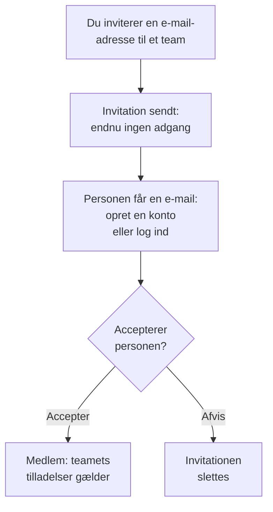

# Inviter personer

Folk kommer ind i et projekt via en invitation. Du inviterer en persons e-mailadresse til et team, personen accepterer, og fra da af bestemmer teamet, hvad personen må. Denne side viser, hvordan du inviterer folk, hvad de ser, og hvordan du ændrer eller fjerner deres adgang senere.

:::cards
- [Inviter nogen](#inviter-nogen): En e-mailadresse og et team.
- [Accepter en invitation](#accepter-en-invitation): Hvad den inviterede ser og gør.
- [Skift en persons teams](#skift-en-persons-teams): Giv mere adgang, eller mindre.
- [Fjern nogen](#fjern-nogen-fra-projektet): Hvad det tager med sig at forlade projektet.
:::

## Sådan fungerer en invitation

- **Teamet bestemmer, hvad personen må.** Ingen har egne tilladelser: en person må det, de teams, personen er med i, tillader. Se [Brugere, teams og tilladelser](/docs/permissions/index).
- **Intet gives, før personen accepterer.** En ventende invitation vises som **Invitation sendt** og giver ingen adgang til projektet.
- **Én accept gælder hele projektet.** Når en invitation accepteres, accepteres alle personens andre invitationer til samme projekt også. Et medlem, du senere tilføjer til et andet team, er med med det samme, uden noget at acceptere.

## Før du går i gang

- **En rolle, der må invitere.** Project Owner, Project Admin eller en rolle med tilladelsen **Invite New Members**. Du kan kun invitere folk til et team, hvis tilladelser du selv har, fordi en invitation giver dem teamets adgang. En Project Admin uden blokeringer regnes for at have alt, hvad Project Admin allerede kan: de kan invitere personer til **Members** eller til et team med en hvilken som helst snævrere rolle, men ikke til et team, der har Project Owner, en faktureringstilladelse, **Delete Project**, **Edit Project**, **Edit Team** eller **Invite New Members**.
- **I OneUptime Cloud: plads i din plan.** Hver person i projektet er en plads på regningen, fra det øjeblik de inviteres. Free-planen har plads til én person. Se [Fakturering og forbrug](/docs/configuration/billing#din-plan-og-dine-pladser).
- **Ingen SCIM Push Groups.** Så længe din identitetsudbyder styrer projektets teams via SCIM Push Groups, inviterer og fjerner du folk dér, ikke i OneUptime.

## Inviter nogen

:::steps
### Åbn Brugere

Gå til **Produkter → Indstillinger → Brugere**. Listen **Brugere** viser alle i projektet, deres teams, og om de er kommet med.

### Klik på Inviter bruger

Klik på **Inviter bruger**. Dialogen **Inviter ny bruger** åbner.

### Skriv e-mailadressen

Skriv adressen i **E-mail**. Hvis ingen OneUptime-konto bruger den endnu, beder dialogen også om et **Navn**, som den nye konto starter med.

### Vælg teamet

**Team** starter på projektets medlemsteam: det team, der har Project Member for hele projektet, ellers det, der hedder Members. Vælg et andet team for at give mere eller mindre adgang. **Team** er tomt, når projektet ikke har sådan et team, eller når du ikke selv kunne invitere nogen til det.

### Send invitationen

Klik på **Inviter**. OneUptime sender invitationen pr. e-mail og åbner personens side. Personen vises som **Invitation sendt**, indtil invitationen er accepteret.
:::

> [!TIP]
> Inviter folk til det mindste team, der lader dem gøre deres arbejde. Du kan tilføje dem til flere teams senere, og hvert team, de kommer med i, udvider, hvad de må.

## Accepter en invitation

Invitationsmailen nævner projektet. Dens knap er **Create Your Account** for den, der ikke har en OneUptime-konto endnu, og **Sign In to OneUptime** for den, der har en. Efter login accepterer personen et af to steder:

| Hvor personen er | Hvad personen ser | Hvad personen klikker på |
| --- | --- | --- |
| Endnu ikke i noget projekt | Invitationen, på siden personen lander på efter login | **Accept & Join** eller **Decline** |
| Allerede i et andet projekt | Den ventende invitation ved klokken øverst til højre, som åbner **Projektinvitationer** | **Accepter** eller **Afvis** |

Når personen accepterer, er den med i projektet med det samme, med teamets tilladelser og den notifikationsopsætning, alle medlemmer starter med: se [Det, du starter med](/docs/notifications/index#det-starter-du-med). Afvisning sletter invitationen, så det kræver en ny at komme med senere.

## Se, hvem der er i projektet

**Brugere** har én række pr. person:

| Kolonne | Hvad den viser |
| --- | --- |
| **Bruger** | Navn og e-mailadresse. |
| **Teams** | Hvert af projektets teams, personen er med i eller inviteret til. |
| **Status** | **Medlem**, når personen er kommet med, med antallet af invitationer til andre teams, der ikke er accepteret endnu. **Invitation sendt** indtil da. |

Filtrér listen efter **Bruger**, **Status** eller **Team**. Klik på en række for at åbne personens side:

| Side | Hvad den bruges til |
| --- | --- |
| **Profil** | Navn, e-mailadresse, billede og bruger-ID. |
| **Teams** | De teams, personen er med i. Tilføj eller fjern et team her. |
| **Parathed**, **Notifikationsmetoder**, **Vagtregler** | Om personen kan blive tilkaldt, og hvordan. Vises for Project Owners, Project Admins, personen selv og alle, der må læse andres notifikationsregler. Se [Parathed og rapporter](/docs/on-call/readiness). |
| **Brugerdefinerede felter** | Projektets brugerdefinerede felter for personer, hvis det har nogen. |
| **Fjern fra projekt** | Tag personen ud af projektet. |

## Skift en persons teams

:::steps
### Åbn personens Teams-side

Under **Brugere** klikker du på personen og derefter på **Teams**.

### Tilføj personen til et team

Klik på **Inviter**, vælg **Team**, og klik på **Inviter** i dialogen. Et medlem er med i det nye team med det samme. Den, der ikke er kommet med endnu, får en invitation mere, og når den ene accepteres, accepteres begge.

### Tag personen ud af et team

Klik på **Fjern** i teamets række. Er det det sidste team, personen er kommet med i, tager fjernelsen personen ud af projektet, og dialogen siger det, før noget ændres.
:::

Owners-teamet beholder altid mindst ét medlem, der er kommet med, så et projekt aldrig mister sin sidste ejer.

## Fjern nogen fra projektet

Under **Brugere** åbner du rækkemenuen for personen, **⋯**, og klikker på **Fjern fra projekt**. Eller åbn personen, og vælg **Fjern fra projekt** i sidemenuen. For at fjerne flere personer på én gang markerer du deres rækker og sletter markeringen: hver af dem fjernes på samme måde.

At fjerne nogen tager personen ud af alle projektets teams. Personen mister adgangen med det samme, også selvom den er logget ind, tages af vagtplaner og eskaleringsregler og får ikke længere projektets notifikationer. Personens OneUptime-konto slettes ikke, og du kan invitere personen igen. [Brugere, teams og tilladelser](/docs/permissions/index#brugere) viser alt, hvad det tager med sig at forlade et projekt.

## Andre måder at komme med på

- **Single sign-on.** Den, der logger ind med projektets identitetsudbyder første gang, kommer med i de teams, udbyderen nævner. Se [Roller og teams for SSO-brugere](/docs/identity/sso#roller-og-teams-for-sso-brugere).
- **SCIM.** Din identitetsudbyder opretter personer og tilføjer dem til forbindelsens standardteams. Se [SCIM](/docs/identity/scim#sådan-klargøres-en-projektbruger).
- **Admin Dashboard.** På en selvhostet installation kan en masteradministrator tilføje nogen til et projekt og acceptere invitationen for personen. Se [Brugere, teams og tilladelser](/docs/permissions/index#brugere).

## Fejlfinding

:::details "This user has already been invited to this team"
Personen er allerede med i teamet, som medlem eller med en invitation, der ikke er accepteret. Åbn personen under **Brugere** for at se teamene, eller inviter personen til et andet team.
:::

:::details "You have reached the user limit for the free plan"
I OneUptime Cloud har et projekt på Free-planen plads til én person. Skift plan, og inviter så igen. Se [Skift plan](/docs/configuration/billing#skift-plan).
:::

:::details "Too many invitations were sent to this email address in the last hour"
Én adresse kan få 10 invitationer i timen, til projekter og private statussider tilsammen, uanset hvem der sender dem. Vent en time, og inviter så personen igen.
:::

:::details Invitationsmailen kom ikke frem, eller linket er udløbet
Invitationen afhænger ikke af e-mailen. Bed personen om at tilmelde sig med den inviterede adresse: OneUptime sender den adresse et nyt link til at gøre kontoen færdig. Den, der allerede har en konto, logger ind og finder invitationen.
:::

:::details Inviter bruger siger, at brugerne styres af SCIM Push Groups
Din identitetsudbyder styrer projektets teams. Inviter eller fjern folk i identitetsudbyderen, eller slå Push Groups fra under **Projektindstillinger → Sikkerhed → SCIM** for at styre dem her.
:::

## Næste skridt

:::cards
- [Brugere, teams og tilladelser](/docs/permissions/index): Bestem, hvad hvert team må.
- [Projektindstillinger](/docs/configuration/project-settings): Alt, hvad der gælder for hele projektet.
- [Din konto](/docs/introduction/your-account): Login, profil og de projekter, du er med i.
- [SCIM](/docs/identity/scim): Lad din identitetsudbyder styre personer og teams.
:::
