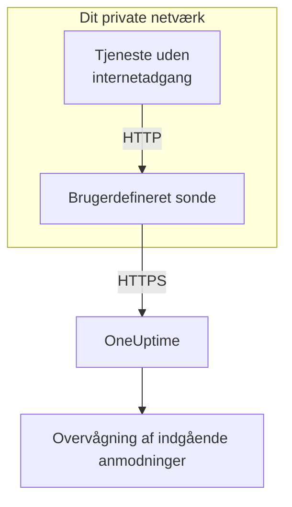

# Indgående anmodning ingress

En tjeneste uden internetadgang kan stadig sende heartbeats til en [overvågning af indgående anmodninger](/docs/monitor/incoming-request-monitor). Den sender dem i stedet til en [brugerdefineret sonde](/docs/probe/custom-probe) i sit eget netværk, og sonden sender dem videre til OneUptime.

:::cards
- [Sådan virker det](#sådan-virker-det): Fra din tjeneste, gennem sonden, til overvågningen.
- [Slå lytteren til](#slå-lytteren-til): Én indstilling på sonden, til Docker, Docker Compose eller Kubernetes.
- [Send anmodninger til sonden](#send-anmodninger-til-sonden): Skift den URL, din tjeneste sender til, og intet andet.
- [Fejlfinding](#fejlfinding): Hvad sonden logger, når en anmodning ikke kommer igennem.
:::

## Sådan virker det



1. **Din tjeneste sender anmodningen til sonden.** Den samme `GET` eller `POST`, med den samme hemmelige nøgle, som den ville sende til OneUptime, til en port, sonden lytter på.
2. **Sonden svarer med det samme.** Den svarer `200`, før den sender anmodningen videre, så din tjeneste aldrig venter på OneUptime.
3. **Sonden sender den videre.** Den sender anmodningen videre til OneUptime med metode, headere og body og tilføjer en header `OneUptime-Probe-Id`, der nævner sonden.
4. **OneUptime læser den som sædvanligt.** Overvågningens kriterier ser anmodningen, som om tjenesten havde sendt den direkte.

Lytteren kører på sin egen port, adskilt fra sondens sundhedstjek, så du kan åbne den for dit private netværk uden at åbne noget andet.

## Hvornår du bruger den

Brug lytteren, når:

- Dine tjenester kører i et isoleret netværkssegment uden udgående HTTPS-adgang
- Du skal holde al overvågningstrafik inden for din VPC eller dit lokale netværk
- Du vil have ét udgangspunkt, sonden, der må nå OneUptime
- Du allerede har en [brugerdefineret sonde](/docs/probe/custom-probe) kørende og vil genbruge den til indgående heartbeats

Kan dine tjenester allerede nå `https://oneuptime.com` (eller din selvhostede URL) direkte, har du **ikke** brug for denne funktion: kald heartbeat-URL'en direkte fra tjenesten.

## Før du begynder

- **En kørende brugerdefineret sonde.** Dens **Status** viser **Forbundet**. Se [Brugerdefinerede probes](/docs/probe/custom-probe) for at installere en.
- **En overvågning af indgående anmodninger.** Dens heartbeat-URL indeholder den hemmelige nøgle, din tjeneste sender: se [Indgående anmodning-monitor](/docs/monitor/incoming-request-monitor).
- **En port på sondens vært, som dine tjenester kan nå.** Eksemplerne bruger `3875`.

## Slå lytteren til

Sæt `PROBE_INGRESS_PORT` til den port, lytteren skal bruge. Enhver værdi større end `0` slår den til; ikke sat, eller `0`, lader den være slået fra.

:::tabs
@tab Docker
```bash
docker run --name oneuptime-probe --network host \
  -e PROBE_KEY=<probe-key> \
  -e PROBE_ID=<probe-id> \
  -e ONEUPTIME_URL=https://oneuptime.com \
  -e PROBE_INGRESS_PORT=3875 \
  -d oneuptime/probe:release
```

Uden `--network host` skal du publicere porten med `-p 3875:3875`.
@tab Docker Compose
```yaml title="docker-compose.yml"
services:
  oneuptime-probe:
    image: oneuptime/probe:release
    container_name: oneuptime-probe
    environment:
      - PROBE_KEY=<probe-key>
      - PROBE_ID=<probe-id>
      - ONEUPTIME_URL=https://oneuptime.com
      - PROBE_INGRESS_PORT=3875
    network_mode: host
    restart: always
```

Uden `network_mode: host` skal du publicere porten under `ports:` som `"3875:3875"`.
@tab Kubernetes
```yaml title="oneuptime-probe.yaml"
apiVersion: apps/v1
kind: Deployment
metadata:
  name: oneuptime-probe
spec:
  selector:
    matchLabels:
      app: oneuptime-probe
  template:
    metadata:
      labels:
        app: oneuptime-probe
    spec:
      containers:
        - name: oneuptime-probe
          image: oneuptime/probe:release
          env:
            - name: PROBE_KEY
              value: "<probe-key>"
            - name: PROBE_ID
              value: "<probe-id>"
            - name: ONEUPTIME_URL
              value: "https://oneuptime.com"
            - name: PROBE_INGRESS_PORT
              value: "3875"
          ports:
            - name: ingress
              containerPort: 3875
---
apiVersion: v1
kind: Service
metadata:
  name: oneuptime-probe-ingress
spec:
  selector:
    app: oneuptime-probe
  ports:
    - name: ingress
      port: 3875
      targetPort: 3875
  type: ClusterIP
```

Tjenester i klyngen sender så til `http://oneuptime-probe-ingress.<namespace>.svc.cluster.local:3875/heartbeat/<secret-key>`.
:::

Når lytteren kører, står der i sondens log `Probe ingress listener started on port 3875 (heartbeat / incoming-request endpoints)`.

## Send anmodninger til sonden

Din tjeneste sender til sonden i stedet for til OneUptime. Erstat den offentlige heartbeat-URL:

```text
https://oneuptime.com/heartbeat/<secret-key>
```

med sondens ingress-URL:

```text
http://<probe-host>:<PROBE_INGRESS_PORT>/heartbeat/<secret-key>
```

Sti, metode, body og headere er ellers de samme, så eksisterende klientkode skal kun skifte basis-URL'en. Sonden tager også imod `/incoming-request/<secret-key>`, som virker på samme måde.

```bash
# GET heartbeat
curl http://probe.internal:3875/heartbeat/YOUR_SECRET_KEY

# POST heartbeat with JSON body
curl -X POST http://probe.internal:3875/heartbeat/YOUR_SECRET_KEY \
  -H "Content-Type: application/json" \
  -d '{"status": "healthy", "version": "1.2.3"}'

# Cron job
*/5 * * * * curl -s http://probe.internal:3875/heartbeat/YOUR_SECRET_KEY > /dev/null
```

## Sådan sendes anmodninger videre

| Hvad | Hvordan sonden håndterer det |
| --- | --- |
| Svaret | `200` med et tomt JSON-objekt (`{}`), sendt før anmodningen sendes videre. Som hos OneUptime sendes det, uanset hvad der sker bagefter: også en forkert hemmelig nøgle får det. |
| Metoder | `POST` sendes videre som `POST`. `GET` og `HEAD` sendes videre som `GET`. Andre metoder får et `404` fra sonden. |
| Headere | Alle undtagen hop-by-hop-headerne (`Host`, `Connection`, `Content-Length`, `Transfer-Encoding`, `Keep-Alive`, `Proxy-Authenticate`, `Proxy-Authorization`, `TE`, `Trailer`, `Upgrade`). Sonden tilføjer `OneUptime-Probe-Id`. |
| Body | JSON- og formular-bodies på op til 50 MB, som når du sender direkte til OneUptime. Ligesom dér når enhver anden body frem til overvågningen tom. |
| Nye forsøg | Når en videresendelse fejler, prøver sonden igen op til `PROBE_INGRESS_FORWARD_RETRY_LIMIT` gange og venter 2 s, så 4 s, så 8 s, og aldrig mere end 15 s. Derefter logger den fejlen og dropper anmodningen. |
| Proxyer | Videresendelsen går gennem sondens proxy, når `HTTP_PROXY_URL` eller `HTTPS_PROXY_URL` er sat. |
| Hvor den går hen | `ONEUPTIME_URL` efterfulgt af `/incoming-request-ingest/incoming-request/<secret-key>`. |

## Miljøvariabler

| Variabel | Standard | Hvad den gør |
| --- | --- | --- |
| `PROBE_INGRESS_PORT` | ikke sat (fra) | Den port, lytteren bruger. Enhver værdi større end `0` slår den til. |
| `PROBE_INGRESS_FORWARD_TIMEOUT_MS` | `10000` | Hvor længe hver videresendelse til OneUptime må tage, i millisekunder. En værdi under `1000` falder tilbage til standarden. |
| `PROBE_INGRESS_FORWARD_RETRY_LIMIT` | `3` | Hvor mange gange en mislykket videresendelse prøves igen. `0` slår nye forsøg fra. |

Sondens almindelige variabler (`PROBE_KEY`, `PROBE_ID`, `ONEUPTIME_URL` og proxyvariablerne) gælder alle: se [Brugerdefinerede probes](/docs/probe/custom-probe) for den fulde liste.

## Sikkerhedsovervejelser

- **Endpointet er bevidst uden godkendelse**: den hemmelige nøgle i URL-stien *er* godkendelsen, præcis som på det offentlige endpoint `oneuptime.com`. Behandl den hemmelige nøgle som en adgangskode.
- **Hold lytteren på dit private netværk.** Den bør ikke kunne nås fra internettet. Brug en network policy, en firewallregel eller en `ClusterIP`-tjeneste til at begrænse, hvem der kan nå den.
- **Sæt TLS foran, hvis du har brug for kryptering på dit netværk.** Lytteren taler almindelig HTTP. Sæt den bag en intern load balancer eller ingress controller for at få TLS på den strækning. Videresendelsen fra sonden til OneUptime bruger HTTPS, når `ONEUPTIME_URL` begynder med `https://`.
- **Begræns selv body-størrelsen, hvis 50 MB er for meget.** Sæt en reverse proxy med en lavere grænse foran lytteren.

## Fejlfinding

:::details Sondens log siger aldrig, at lytteren er startet
`PROBE_INGRESS_PORT` er ikke sat, er `0` eller er ikke et tal. Sæt den til et portnummer, og genstart sonden. Loglinjen er `Probe ingress listener started on port <port> (heartbeat / incoming-request endpoints)`.
:::

:::details Sonden logger `Probe ingress: failed to forward to <url> after N attempts`
Sonden kunne ikke nå OneUptime, heller ikke efter sine nye forsøg. Tjek sondens udgående forbindelse, dens proxyindstillinger og værdien af `ONEUPTIME_URL`. Viser sonden også **Afbrudt**, så se [Brugerdefinerede probes](/docs/probe/custom-probe) for at finde ud af, hvor dens forespørgsler går i stå.
:::

:::details Sonden logger `Probe ingress: probe ID not available, forwarding without it`
Sonden er endnu ikke færdig med at forbinde til OneUptime, så den sender anmodningen videre uden headeren `OneUptime-Probe-Id`. Anmodningen når stadig frem til overvågningen.
:::

:::details Overvågningen får anmodningerne, men ikke gennem sonden
Din tjeneste sender stadig til den offentlige URL. Tjek, at den sender til `http://<probe-host>:<port>/...`: et DNS-navn eller en post i `/etc/hosts`, der peger et andet sted hen, er den sædvanlige årsag.
:::

:::details Overvågningen får intet, og sonden logger intet
Anmodningen nåede aldrig frem til sonden. Tjek, at tjenesten kan nå sondens vært på porten: en firewallregel, en port, der ikke er publiceret, eller en Kubernetes-Service, der ikke vælger sondens pod.
:::

## Næste skridt

:::cards
- [Indgående anmodning-monitor](/docs/monitor/incoming-request-monitor): Beslut, hvad der tæller som et sundt heartbeat.
- [Brugerdefinerede probes](/docs/probe/custom-probe): Installér sonden, og se hver indstilling, den læser.
:::
