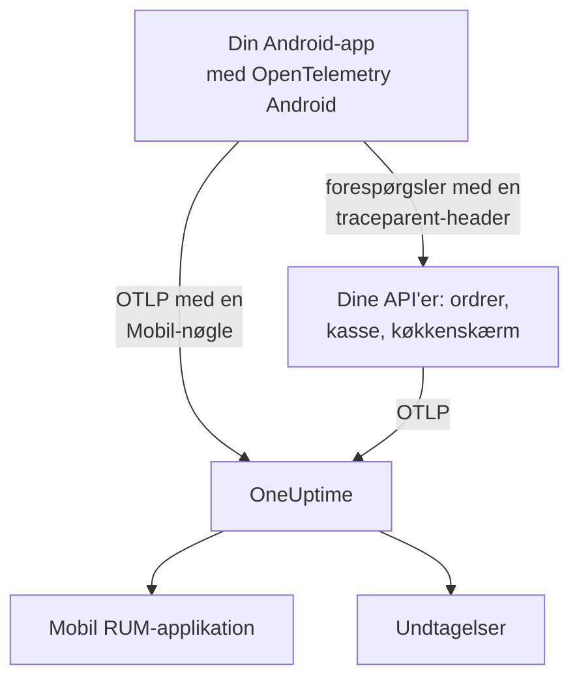

# Android-opsætning

Instrumenter en native Android-app med OpenTelemetry Android, så den rapporterer til OneUptime som en mobil RUM-applikation: dens nedbrud og ANR'er, langsomme og frosne frames, appstarter, skærme, sessioner og netværksforespørgsler, sporet hele vejen ind i din backend.

:::cards
- [Tilføj OpenTelemetry Android](#tilføj-opentelemetry-android): Én Gradle-afhængighed og nogle få linjer, når appen starter.
- [Hvad den rapporterer](#hvad-den-rapporterer): Nedbrud, ANR'er, frosne frames, starter og sessioner, og hvor hver enkelt havner.
- [Spor forespørgsler til din backend](#spor-forespørgsler-til-din-backend): Et span for hvert OkHttp-kald, med en `traceparent` på.
- [Spor dine egne arbejdsgange](#spor-dine-egne-arbejdsgange): En ordre fra menuen til køkkenet, en betalingsterminal, en printer.
- [Kiosker og andre enheder, du ejer](#kiosker-og-andre-enheder-du-ejer): Navngiv hver enhed, konfigurer den fra din MDM, behold data, mens den er offline.
:::

## Sådan virker det

OpenTelemetry Android kører inde i din app. Den sender spor, logs og metrikker til OneUptime over OTLP med en **Mobil**-indtagelsesnøgle, fastgjort til din app, og tilføjer en W3C-header `traceparent` til de forespørgsler, din app sender, så din backends spans slutter sig til appens spor.



## Før du begynder

- En Android-app, hvis `minSdk` er 23 eller højere, bygget med `compileSdk` 34 eller højere. Med en `minSdk` under 26 skal du slå [core library desugaring](https://developer.android.com/studio/write/java8-support#library-desugaring) til, med Android Gradle Plugin 8.3.0 eller nyere og `android.useFullClasspathForDexingTransform=true` i `gradle.properties`.
- En **Mobil**-indtagelsesnøgle, oprettet under **Projektindstillinger → Telemetri og APM → Indtagelsesnøgler** med **Opret indtagelsesnøgle**, med din apps `service.name` som **Fastgjort tjenestenavn**. En **Browser**-nøgle afvises fra en app: Den tjekkes mod headeren `Origin`, som en app ikke sender.
- Disse OTLP-indstillinger. Hvis du selv hoster OneUptime, så erstat `https://oneuptime.com` med din egen vært.

| Indstilling | Værdi |
| --- | --- |
| OTLP-endpoint | `https://oneuptime.com/otlp` |
| Header | `x-oneuptime-token: YOUR_TELEMETRY_INGESTION_TOKEN` |

> [!WARNING]
> Nøglen følger med i din app, og en app kan pakkes ud, så gå ud fra, at nogen kopierer den. Sæt et **Fastgjort tjenestenavn**, en **Grænse for anmodninger pr. minut** og en dato under **Udløber den** på nøglens side, og udskift nøglen med dine udgivelser.

## Tilføj OpenTelemetry Android

:::steps
### Tilføj afhængigheden

```kotlin title="app/build.gradle.kts"
dependencies {
    implementation("io.opentelemetry.android:android-agent:1.8.1")
}
```

Agenten har instrumenteringen af nedbrud, ANR'er, langsom rendering, aktiviteter, fragmenter, netværk og sessioner med sig. Se [dens udgivelser](https://github.com/open-telemetry/opentelemetry-android/releases) for en nyere version.

### Start den, når appen starter

```kotlin title="KioskApplication.kt"
import android.app.Application
import io.opentelemetry.android.OpenTelemetryRum
import io.opentelemetry.android.agent.OpenTelemetryRumInitializer

class KioskApplication : Application() {
    lateinit var otelRum: OpenTelemetryRum

    override fun onCreate() {
        super.onCreate()

        otelRum = OpenTelemetryRumInitializer.initialize(this) {
            httpExport {
                baseUrl = "https://oneuptime.com/otlp"
                baseHeaders = mapOf("x-oneuptime-token" to BuildConfig.ONEUPTIME_TOKEN)
            }
            resource {
                put("service.name", "kiosk-ordering")
                put("deployment.environment.name", "production")
            }
        }
    }
}
```

`baseUrl` er endpointet uden et signal: Agenten føjer `/v1/traces`, `/v1/logs` og `/v1/metrics` til det. Sæt `service.name`, ellers navngives appen efter sin launcher-etiket. Det er applikationens identitet i OneUptime, så hold det uændret fra udgivelse til udgivelse.

Angiv klassen i `android:name` på manifestets `<application>`-element. `BuildConfig.ONEUPTIME_TOKEN` står for det sted, hvor dit build opbevarer nøglen; en flåde kan i stedet modtage den fra sin MDM, som [Kiosker og andre enheder, du ejer](#kiosker-og-andre-enheder-du-ejer) viser.

### Start appen, og tjek, at det kommer frem

```bash
curl -i https://oneuptime.com/otlp/v1/validate \
  -H "x-oneuptime-token: YOUR_TELEMETRY_INGESTION_TOKEN"
```

`200` med `"valid": true` betyder, at nøglen accepteres. Start derefter appen, og brug den et øjeblik: Den vises under **Produkter → Ressourcer → Overvågning af reelle brugere**, navngivet efter sin `service.name`. Agenten skriver telemetri til disk, før den sender den, så den første batch kan tage et minut om at komme frem.
:::

## Hvad den rapporterer

OpenTelemetry Android registrerer alt dette af sig selv. De enhedsattributter, den sætter, `device.model.identifier`, `device.model.name` og `device.manufacturer`, arkiverer appen som en mobil RUM-applikation og udfylder dens side **Klienter**. Den sætter også `os.name`, `os.version` og et `app.installation.id` for hver installation, og intet `device.id`.

| Hvad | Hvordan agenten sender det | Hvor det vises i OneUptime |
| --- | --- | --- |
| Nedbrud | En `app.crash`-hændelse med undtagelsens type, besked og stack trace | **Undtagelser**, som ikke-håndterede |
| ANR'er | En `device.anr`-hændelse med hovedtrådens stack, så snart appen holder op med at svare i omkring 5 sekunder | **Undtagelser**, som ikke-håndterede, under typen `ANR` |
| Langsomme og frosne frames | En `app.jank`-hændelse med `app.jank.frame_count`, de frames, der er langsommere end 16 ms (`app.jank.threshold` er `0.016`) eller 700 ms (`0.7`) | **Protokoller**, med `@event.name:app.jank` |
| Appstarter | Et `AppStart`-span, med `start.type` sat til `cold`, `warm` eller `hot` | **Spor** |
| Skærme | Et span for hvert trin i en aktivitets eller et fragments livscyklus, og `app.screen.name` på hvert span og hver log | **Spor** |
| Sessioner | `session.id` på hvert span og hver log, og hændelserne `session.start` og `session.end` | **Spor** og **Protokoller**, søgt med `@session.id:` |
| Netværksændringer | En `network.change`-hændelse, og `network.connection.type` på hvert span og hver log | **Protokoller** |

Nedbrud og ANR'er når **Undtagelser** som ikke-håndterede, grupperet efter deres stack traces, med den session, de skete i. Agenten gemmer et nedbrud på disk, mens appen dør, og sender det derfra, så et nedbrud, der sker offline, stadig kommer frem, når appen kører igen med netværk.

Applikationens side **Oversigt** læser dem for dig: **Sessioner**, **Sessioner uden nedbrud**, **Nedbrud**, **ANR'er**, **Appstarter**, **Koldstart (p95)** og **Frosne frames**, og hvert felt åbner de undtagelser, spans eller hændelser, det tæller. Indtil appen sender appstarter eller frames, fortæller de tilhørende diagrammer, hvordan du slår dem til. Siden **Anbefalinger** tilbyder monitorer for nedbrud, ANR'er, langsomme koldstarter, frosne frames og en app eller en af dens enheder, der holder op med at rapportere.

Under **Sessioner uden nedbrud** viser linjen den samme andel for installationerne: det `app.installation.id`, som OpenTelemetry Android 1.1 og nyere sætter på hvert span og hver log, et id, der bevares, så længe appen er installeret, så det står for appens brugere. For en app med hundredvis af sessioner i timen, hvor et nedbrud om dagen er normalt, advarer **App Crash Rate** og **App ANR Rate** ved andelen af en times sessioner, der gik ned eller frøs, over Android vitals' 1,09 % og 0,47 %, i stedet for ved hvert enkelt nedbrud. **Daily Crash Rate** og **Daily ANR Rate** advarer ved andelen af en dags installationer, der gik ned eller frøs, over de samme 1,09 % og 0,47 % af mindst 250 installationer: de brugeroplevede rater, som Android vitals bedømmer, og som Play Console viser.

En session slutter efter 15 minutter i baggrunden eller efter 4 timer. En app, der aldrig går i baggrunden, som en kiosk, beholder én session i 4 timer, så spor hver kundes besøg som sit eget span, som [Spor dine egne arbejdsgange](#spor-dine-egne-arbejdsgange) viser.

Din apps egne `android.util.Log`-kald bliver også til logs, når du tilføjer `android-log-library` og `android-log-agent` ved siden af OkHttp-modulerne nedenfor: Hvert kalds tag havner i `android.log.tag`, og et kald med en throwable er en undtagelse i **Undtagelser**. OpenTelemetry Android læser ikke Logcat.

## Spor forespørgsler til din backend

Tilføj OkHttp-instrumenteringen og det ByteBuddy-plugin, den bygges med:

```kotlin title="app/build.gradle.kts"
plugins {
    // ...the plugins your app already applies, then:
    id("net.bytebuddy.byte-buddy-gradle-plugin") version "1.18.15"
}

dependencies {
    implementation("io.opentelemetry.android:android-agent:1.8.1")
    implementation("io.opentelemetry.android.instrumentation:okhttp3-library:1.8.1-alpha")
    byteBuddy("io.opentelemetry.android.instrumentation:okhttp3-agent:1.8.1-alpha")
}
```

Pluginet instrumenterer selve klassen `OkHttpClient`, så hver klient i appen spores, også dem, som biblioteker opretter. Hver forespørgsel bliver et klient-span, navngivet efter sin metode, med sin URL, statuskode og varighed, og bærer en W3C-header `traceparent`. En backend, der er instrumenteret med [OpenTelemetry](/docs/telemetry/open-telemetry), fortsætter sporet fra den header, så bestillings-API'et, kassebroen og køkkenskærmstjenesten føjer deres spans til det samme spor som trykket på kiosken.

- `HttpURLConnection` har det samme par moduler: `httpurlconnection-library` og `httpurlconnection-agent`.
- Uden pluginet pakker du selv en klient ind: `OkHttpTelemetry.builder(otelRum.openTelemetry).build().createCallFactory(client)`, fra `io.opentelemetry.instrumentation:opentelemetry-okhttp-3.0`.
- Et span, der åbnes i din kode, som i næste afsnit, er forælder til de forespørgsler, der sendes inde i det.

## Spor dine egne arbejdsgange

Hent en tracer fra agenten, og lav ét span for én kundes ordre, med et underordnet span for hvert trin i den. Hvert trin har så sin egen varighed og sine egne fejl, og ordren fortæller, hvordan den endte:

```kotlin title="OrderTrace.kt"
import io.opentelemetry.api.trace.Span
import io.opentelemetry.api.trace.StatusCode
import io.opentelemetry.api.trace.Tracer
import io.opentelemetry.context.Context

class OrderTrace(private val tracer: Tracer) {
    // order.session: from the first tap to the order reaching the kitchen.
    private val order: Span = tracer.spanBuilder("order.session").startSpan()
    private val parent: Context = Context.current().with(order)

    // One step: menu.browse, cart.customize, payment.process, pos.inject.
    fun <T> step(name: String, block: (Span) -> T): T {
        val span = tracer.spanBuilder(name).setParent(parent).startSpan()
        return try {
            span.makeCurrent().use { block(span) }
        } catch (error: Throwable) {
            span.recordException(error)
            span.setStatus(StatusCode.ERROR)
            throw error
        } finally {
            span.end()
        }
    }

    fun complete() = finish("completed")

    fun abandon(reason: String) {
        order.setAttribute("order.abandon_reason", reason)
        finish("abandoned")
    }

    private fun finish(outcome: String) {
        order.setAttribute("order.outcome", outcome)
        order.end()
    }
}
```

```kotlin title="CheckoutFlow.kt"
val order = OrderTrace(otelRum.openTelemetry.getTracer("kiosk.ordering"))

order.step("cart.customize") { span ->
    span.setAttribute("cart.items", cart.size.toLong())
}
order.step("payment.process") { terminal.charge(cart.total) }
order.step("pos.inject") { posApi.submit(cart) } // its OkHttp span is a child
order.complete()
```

Pak hvert kald til SDK'et for en betalingsterminal, en printer, en scanner eller en NFC-læser ind på samme måde, og angiv, hvilken enhed det var, så en langsom eller fejlende enhed er et langsomt eller fejlende span:

```kotlin title="ReceiptPrinter.kt"
order.step("printer.print") { span ->
    span.setAttribute("peripheral.type", "printer")
    span.setAttribute("peripheral.model", printer.model)
    span.setAttribute("peripheral.connection", "usb")
    printer.print(receipt, timeoutMillis = 10_000)
}
```

Attributnavnene vælger du selv: Hold dem ens i alle apps, så ét filter finder alle printere. Giv hvert kald en timeout, fordi et span først slutter, når dets kald returnerer. Et trin, der strækker sig over flere skærme, som at bladre i menuen, er et span, du starter, når skærmen åbner, og afslutter, når den lukker, med samme forælder. For et faktum uden varighed, som at en printer løber tør for papir, sender du en hændelse: `otelRum.emitEvent("printer.paper_low")`.

I **Spor** filtrerer du på et trins navn for at se, hvor lang tid det tager, og hvor ofte det fejler, og på `@order.outcome:abandoned` for at finde de ordrer, der aldrig blev afsluttet.

## Kiosker og andre enheder, du ejer

### Navngiv hver enhed

OneUptime arkiverer en mobilapp efter applikation, aldrig efter enhed, så en app på tusindvis af telefoner aldrig viser sine brugeres telefoner. For enheder, du ejer, navngiver du hver enkelt i `host.name`. Hver enhed vises så i **Inventar** som en vært, ved siden af dine andre maskiner, med det mærke, den model og den OS-version, agenten rapporterer, det, du tilføjer nedenfor, og hvornår den sidst blev set:

```kotlin title="KioskApplication.kt"
resource {
    put("service.name", "kiosk-ordering")
    put("host.name", deviceName)
    put("host.serial_number", serialNumber)
    put("device.type", "kiosk")
    put("device.location", "Store 0412")
}
```

Appens telemetri bliver hos dens RUM-applikation, og enheden bliver ikke en vært i **Værter**: En app rapporterer ingen værtsmetrikker, så der ville ikke være noget at vise der. Enhedens side i **Inventar** viser dens egne logs, spor og undtagelser, og `@resource.host.name:` finder dem i **Spor** og **Protokoller**. En enhed, der ikke sender noget i 30 dage, forsvinder fra **Inventar**. Hvis du vil se selve enheden, dens hukommelse, lagerplads og genstarter og nedbrud i alle apps på den, så tilføj [Android-agent](/docs/telemetry/android-agent), og giv den samme navn i dens `device_name`: Enheden er så også en vært i **Værter** og stadig ét element i **Inventar**.

### Få besked, når en enhed bliver stille

Applikationens side **Anbefalinger** tilbyder **Device Stopped Reporting**: en advarsel for hver enhed, der ikke sender nogen spans i en time efter at have sendt nogle i den seneste uge, skelnet fra hinanden ved det `app.installation.id`, agenten sætter. Hver enheds advarsel navngiver enheden ved det `host.name`, dens seneste spans bar, som i [Navngiv hver enhed](#navngiv-hver-enhed), og ved dens model, med dens installation ved siden af; en enhed, der ikke sender noget `host.name`, navngives kun ved sin installation. At omdøbe en enhed ændrer kun, hvad dens advarsel siger: Det er stadig én enhed med én advarsel, som løses, så snart enheden rapporterer igen. Når alle enheder bliver stille på én gang, fx når en butiks netværk går ned, advarer ingen enhed: **App Stopped Reporting** rapporterer det én gang for hele appen.

En kiosk, der står på én skærm, sender intet, før nogen bruger den. Send et span med få minutters mellemrum, mens appen kører, så en kiosk, der ikke bruges, ikke forveksles med en, der er blevet stille:

```kotlin title="KioskHeartbeat.kt"
import android.os.Handler
import android.os.Looper
import io.opentelemetry.api.trace.Tracer

class KioskHeartbeat(private val tracer: Tracer) {
    private val handler = Handler(Looper.getMainLooper())

    private val beat = object : Runnable {
        override fun run() {
            tracer.spanBuilder("kiosk.heartbeat").startSpan().end()
            handler.postDelayed(this, 5 * 60 * 1000L)
        }
    }

    fun start() = handler.post(beat)

    fun stop() = handler.removeCallbacks(beat)
}
```

Start den, når agenten er startet, med `KioskHeartbeat(otelRum.openTelemetry.getTracer("kiosk.heartbeat")).start()`. Et span hvert femte minut holder en kiosk, der virker, et godt stykke inden for timen.

### Konfigurer flåden fra din MDM

En app kan læse Androids administrerede konfigurationer, som enhver tjeneste til enhedsadministration sender ud til sine enheder. Læs nøglen og enhedens navn derfra i stedet for at bygge dem ind i appen:

```kotlin title="KioskApplication.kt"
import android.content.RestrictionsManager

val restrictions = (getSystemService(RESTRICTIONS_SERVICE) as RestrictionsManager)
    .applicationRestrictions
val token = restrictions.getString("oneuptime_token").orEmpty()
val deviceName = restrictions.getString("device_name") ?: android.os.Build.MODEL
val serialNumber = restrictions.getString("device_serial").orEmpty()
```

Giv derefter `token` til `baseHeaders` i stedet for `BuildConfig.ONEUPTIME_TOKEN`, og `deviceName` og `serialNumber` til ressourcen ovenfor. I Esper indsætter du konfigurationen nedenfor under appens **Managed Configuration** i en blueprint. Esper udfylder pladsholderne på hver enhed, med Esper Agent 8.00.0764 eller nyere:

```json title="Managed configuration"
{
  "oneuptime_token": "YOUR_TELEMETRY_INGESTION_TOKEN",
  "device_name": "${esper.deviceName}",
  "device_serial": "${esper.serialNumber}"
}
```

Konverger enhederne efter en ændring, så de læser de nye værdier. Erklær de samme nøgler i en `app_restrictions.xml`, hvis din MDM beder om et skema. Esper afviser en APK uden v1-signatur, så signer udgivelsen med v1-skemaet ud over v2 eller v3.

### Importer flåden fra Esper

Forbind din Esper-lejer med inventaret, og alle enheder, som Esper tilmelder, vises, også de enheder, hvis app aldrig er startet, med det, kun Esper ved: deres gruppe, Android-version, sikkerhedspatchniveau, serienummer, batteri, lagerplads, installerede apps og seneste check-in. En enhed, der holder op med at tjekke ind, vises som offline med, hvor længe siden den sidst gjorde det. Se [Importer enheder fra Esper](/docs/inventory/overview#importer-enheder-fra-esper).

En enhed, hvis app navngiver den som ovenfor, er ét element med det, appen sender: `host.name` er dens navn i Esper. OneUptime finder en enheds element ud fra `host.name` og derefter ud fra `host.serial_number`, så giv hver enhed samme navn og serienummer i alle apps, der rapporterer fra den, og i Android Agents indstillinger `device_name` og `device_serial`.

### Behold det, der registreres offline

Agenten skriver hvert span, hver log og hver metrik til disk, før den sender dem. Mens netværket er nede, beholder den dem der og sender dem, når det er tilbage, op til 18 timer senere. Den beholder 10 MB; hæv det for en enhed, der ofte er offline:

```kotlin title="KioskApplication.kt"
diskBuffering {
    maxCacheSize = 50 * 1024 * 1024
}
```

## Fejlfinding

:::details Appen vises under Tjenester i stedet for Overvågning af reelle brugere
OpenTelemetry Android sætter selv `device.model.identifier`, så appen blev sat op med et andet SDK, eller dens ressource blev erstattet med `resource(Resource)`, som smider agentens egne attributter væk. Brug blokken `resource { }`, som føjer til dem. Den tjeneste, der allerede blev oprettet, bliver ikke til en RUM-applikation, så slet den under **Produkter → Tjenester**, når RUM-telemetrien kommer ind.
:::

:::details Intet kommer frem, eller nøglen afvises
Kør nøgletjekket i [Tilføj OpenTelemetry Android](#tilføj-opentelemetry-android). En `401` betyder, at nøglen er ukendt, tilbagekaldt, slået fra eller udløbet. En **Browser**-nøgle afvises fra en app: Brug en **Mobil**-nøgle. Tjek, at `baseUrl` slutter på `/otlp`, uden `/v1/traces`: Agenten tilføjer selv stien.
:::

:::details Et nedbrud eller en ANR er ikke i Undtagelser
Et nedbrud gemmes, mens appen dør, og en ANR, så snart hovedtråden har siddet fast i omkring 5 sekunder. Begge venter på disk, indtil enheden kan sende dem, så kig igen, når appen har kørt et minut med netværk. Start agenten øverst i `onCreate` i din `Application`, før noget, der kan gå ned, så dens nedbrudshåndtering er på plads først.
:::

:::details En enhed mangler i Inventar
Kun en enhed, hvis app sætter `host.name`, vises. Tjek værdien i et spans ressourceattributter: En tom værdi navngiver ingen enhed, og to enheder med samme navn er én række.
:::

## Næste skridt

:::cards
- [Mobilopsætning](/docs/rum/mobile-setup): iOS, React Native og de andre platforme.
- [Android-agent](/docs/telemetry/android-agent): Overvåg selve enheden: dens tilstand, genstarter, installerede apps og alle apps' nedbrud.
- [Undtagelser](/docs/telemetry/exceptions): Triager de nedbrud og ANR'er, din app rapporterer.
- [Sporudforsker](/docs/telemetry/traces-explorer): Følg en ordre fra kiosken til køkkenet.
- [Administrer applikationer](/docs/rum/applications): Navne, etiketter, ejere og opbevaring.
:::
