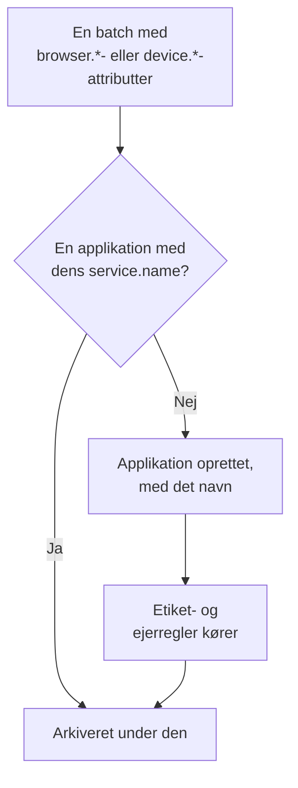

# Administrer applikationer

OneUptime opretter en RUM-applikation, første gang telemetrien fra din app kommer ind. Denne side dækker det, du administrerer derfra: applikationens navn, dens etiketter og ejere, hvor længe dens data opbevares, arkivering, hvem der kan se den, og alarmer.

:::cards
- [Sådan oprettes en applikation](#sådan-oprettes-en-applikation): Genkendt på sit `service.name` og oprettet med sin første batch.
- [Etiketter](#etiketter): Gruppér applikationer, og bestem, hvem der kan få adgang til dem.
- [Opbevaring](#opbevaring): Hvor længe telemetri og optagelser opbevares.
- [Tilladelser](#tilladelser): Hvem der kan se applikationer, og hvem der kan se optagelser.
:::

## Sådan oprettes en applikation

Du behøver ikke at oprette en RUM-applikation. Når en batch telemetri med browser- eller enhedsattributter og et `service.name` kommer ind, arkiverer OneUptime den under applikationen med det `service.name`, og opretter applikationen, hvis projektet ikke har en.



- `service.name` er applikationens identitet og sammenlignes uden forskel på store og små bogstaver: `Storefront-Web` og `storefront-web` er én applikation.
- Et nyt `service.name` starter en ny applikation. Den gamle beholder sin historik og skifter til **Afbrudt**, den nye starter tom, og de to bliver aldrig slået sammen.
- Brug ét `service.name` pr. app, ikke ét pr. miljø. Skeln mellem miljøer med en etiket som `oneuptime.label.env=production`, så de deler én applikation og én historik.

### Omdøb en applikation

**Visningsnavn** starter som `service.name`. For at ændre det skal du åbne applikationens side **Indstillinger** og klikke på **Rediger detaljer** på kortet **Applikationsdetaljer**, hvor du også redigerer dens beskrivelse og etiketter. Telemetri matches på **App-navn (service.name)**, som kortet viser, og som aldrig ændres, så det er sikkert at omdøbe.

### Tilføj selv en applikation

Opret selv en applikation, når du vil have dens etiketter, ejere eller afspilningspolitik klar, før den første besøgende kommer.

:::steps
#### Åbn listen over applikationer

Gå til **Produkter → Ressourcer → Overvågning af reelle brugere**, og klik på **Opret RUM-applikation**.

#### Indtast app-navnet

Udfyld **App-navn (service.name)** med det `service.name`, din app vil sende, præcis som den sender det.

#### Giv den et navn, og gem

Applikationen får navnet på sin app, ligesom en opdaget applikation. For at vise et andet navn skal du åbne **Flere felter** og indtaste et **Visningsnavn**; beskrivelsen og etiketterne findes også der. Gem derefter formularen.
:::

Hvis projektet allerede har en applikation med det `service.name`, opdaget, tilføjet tidligere eller arkiveret, siger formularen det i stedet for at oprette en til.

## Forbindelsesstatus

En applikation viser **Forbundet**, mens der kommer telemetri ind, og **Afbrudt** efter 15 minutter uden. Både OpenTelemetry-telemetri og trafik fra sessionsafspilning tæller med.

**Sidst set** opdateres med få minutters mellemrum i stedet for ved hver batch, så den kan halte op til omkring fem minutter efter den reelle trafik, og de 15 minutter giver plads til det. Tid, hvor OneUptime selv var nede eller var ved at indhente sin indtagelseskø, tæller ikke.

**Afbrudt** er ikke en fejl i sig selv: et internt værktøj uden besøgende om natten er virkelig afbrudt. Hvis folk bruger appen, så se [RUM-fejlfinding](/docs/rum/troubleshooting).

## Etiketter

Etiketter grupperer applikationer i lister og filtre. De bestemmer også, hvad et medlem, der er begrænset til bestemte etiketter, kan nå: det medlem ser kun de applikationer, der har en af de etiketter. En applikation får etiketter på tre måder:

| Hvordan | Hvor |
| --- | --- |
| Manuelt | I oprettelsesformularen under **Flere felter**, eller senere med **Rediger detaljer** på kortet **Applikationsdetaljer** på applikationens side **Indstillinger**. For flere ad gangen markerer du dem på listen og vælger **Add Labels** under **Massehandlinger**. |
| Fra telemetri | En ressourceattribut med navnet `oneuptime.label.<name>` tilføjer etiketten `<name>:<value>`, som vist nedenfor. |
| Fra en etiketregel | En regel tilføjer etiketter til hver ny applikation, der matcher den. Se [Etiketregler og ejerregler](#etiketregler-og-ejerregler). |

Sæt attributterne på den samme ressource som `service.name`, for eksempel i filen `src/telemetry.ts` fra [Browseropsætning](/docs/rum/browser-setup):

```ts
const resource = defaultResource().merge(
  resourceFromAttributes({
    [ATTR_SERVICE_NAME]: "storefront-web",
    "oneuptime.label.team": "payments",
    "oneuptime.label.env": "production",
  }),
);
```

Det tilføjer etiketterne `team:payments` og `env:production` og opretter dem i projektet, hvis de ikke findes. Når attributnavnet står i etiketten, holdes `oneuptime.label.team=prod` og `oneuptime.label.env=prod` adskilt. En etiket på mere end 100 tegn afkortes til 100, og en tom værdi eller en værdi, der ikke er en streng, tilføjer intet.

## Etiketregler og ejerregler

En regel tilføjer etiketter eller ejere til hver ny applikation, der matcher den. Åbn **Overvågning af reelle brugere → Indstillinger → Etiketregler**, eller **Ejerregler**, og opret reglen i to trin:

1. Under **Match** matcher **Alle RUM-applikationer**, som en ny regel starter på, alle applikationer. For at indsnævre reglen vælger du **Kun RUM-applikationer, der opfylder betingelserne** og tilføjer betingelser på **Applikationsetiketter** (har en, alle eller ingen af de etiketter, du vælger), **Applikationsnavn** eller **Applikationsbeskrivelse** (er lig med, indeholder, starter med, slutter med eller matcher et mønster).
2. Under **Etiketter**, eller **Ejere** for en ejerregel, vælger du, hvad reglen tilføjer. En ny regel skal tilføje mindst én etiket eller ejer. **Navn** udfyldes ud fra det, du vælger, som _Add team:payments_ eller _Add Payments as owners_, indtil du skriver dit eget. **Beskrivelse**, og **Underret ejere** for en ejerregel, venter under **Flere felter**.

Regler kører, når en applikation oprettes, også når den er opdaget. For at anvende en regel på applikationer, du allerede har, skal du åbne rækkens menu **⋯** og vælge **Run Now**: se [Kør regler på eksisterende ressourcer](/docs/configuration/run-rules-now). En regel, som en redigering har efterladt uden noget at tilføje, er markeret med **Tilføjer intet** i listen. [Etiket- og ejerregler](/docs/configuration/label-and-owner-rules) dækker de fulde formularer.

### Ejere

Ejere er de personer og teams, der er ansvarlige for en applikation. Ejerregler tilføjer dem til nye applikationer. For at tilføje eller fjerne dem manuelt markerer du applikationer på listen og vælger **Add Owner** eller **Remove Owner** under **Massehandlinger**; API'et tilføjer dem via `/rum-application-owner-user` og `/rum-application-owner-team`. Med **Underret ejere** slået til, som er standard, får hver ejer, som en regel tilføjer, besked. Slå det fra, før du kører en regel på mange applikationer, hvis ingen skal have besked.

## Opbevaring

En applikations telemetri og dens optagelser opbevares i forskellig tid:

| Data | Opbevares | Indstilles på |
| --- | --- | --- |
| Logs, metrikker, spor og profiler | Projektets opbevaring, medmindre applikationen tilsidesætter den | Applikationens side **Indstillinger** |
| Optagelser fra sessionsafspilning | 7 dage som standard, eller 1, 14, 30 eller 90 dage | **Replay Policy**, med **Edit Policy → Limits** |

### Opbevaring af telemetri

Som standard opbevares en applikations telemetri i projektets opbevaringsperiode, der indstilles under **Projektindstillinger → Telemetri og APM → Dataopbevaring**. To kort på applikationens side **Indstillinger** tilsidesætter den:

- **Opbevaring af telemetridata** indeholder **Bevar telemetridata i (dage)**, én værdi for al applikationens telemetri. Lad den være tom for at bruge projektets opbevaring.
- **Opbevaring efter telemetritype** indeholder en standard for logs, spor, metrikker og profiler og for logs efter alvorlighed og spor efter status. En værdi, der efterlades tom, falder tilbage til applikationens værdi og derefter til projektets.

Tilsidesættelser af opbevaring er en del af [Enterprise Edition](/docs/self-hosted/enterprise) og af Scale-abonnementet og derover på OneUptime Cloud. Uden dem viser kortene, hvad abonnementet tilføjer, og applikationen beholder projektets opbevaring.

På et lavere Cloud-abonnement fortsætter en tilsidesættelse, der er tilbage fra en prøveperiode, med at gælde for ny telemetri. Siden **Indstillinger** viser den på et kort **Tilsidesættelse af opbevaring** med en knap **Fjern tilsidesættelse**, som virker på alle abonnementer: derefter beholder applikationen projektets opbevaring, og det, der allerede er gemt, beholder den opbevaring, det blev gemt med. At sætte en tilsidesættelse igen kræver Scale-abonnementet.

### Opbevaring af sessionsafspilninger

Optagelser har deres egen opbevaring, der indstilles på applikationens side **Replay Policy** med **Edit Policy → Limits**: 7 dage som standard, eller 1, 14, 30 eller 90 dage. Den er kort med vilje, fordi en optagelse er langt mere følsom, og langt større, end et span. Kortet **Session Replay Retention** på siden **Indstillinger** viser den (_Session replays are kept for 7 days._), og dets knap **Rediger i Replay Policy** åbner politikken.

En længere opbevaring af telemetri bevarer ikke optagelser længere. En sessions tællinger, signaler og enhed udløber sammen med dens optagelse; kun sessionens logs, spans og undtagelser følger telemetriens opbevaring. Se [Opbevaring og sletning](/docs/telemetry/session-replay#opbevaring-og-sletning).

> [!TIP]
> RUM er ofte den mest omfangsrige telemetri i et projekt, fordi den vokser med dine brugere og ikke med dine servere. En kortere opbevaring her, og en længere på dine backend-tjenester, er en almindelig opsætning.

## Arkivering og sletning

**Arkiver** skjuler en applikation fra **Alle applikationer**, mens den fortsætter med at indsamle telemetri. Arkivér en applikation, du ikke længere holder øje med, men hvis historik du vil beholde.

- Klik på **Arkiver** på applikationens side **Indstillinger**, eller vælg flere applikationer i listen, og arkivér dem samlet.
- Arkiverede applikationer findes under **Overvågning af reelle brugere → Avanceret → Arkiveret**. **Avanceret** starter sammenklappet i sidemenuen: klik på den for at vise **Arkiveret**. Brug **Fjern fra arkiv** der på én applikation eller på flere ad gangen.

**Slet applikation**, i sektionen **Avanceret** i applikationens sidemenu, sletter applikationen permanent. Hvis appen stadig sender telemetri, genopretter dens næste batch applikationen uden nogen af dens indstillinger, så stop instrumenteringen først.

For at slette én persons data i stedet for en hel applikation skal du indsende en sletteanmodning: se [Slet sessioner](/docs/telemetry/session-replay#slet-sessioner).

## Tilladelser

Alle med projektets Viewer-rolle kan se RUM-applikationer og deres telemetri. Sessionsafspilning er holdt uden for den rolle med vilje: at vise optagelser, at se en og at læse, hvem der så den, er separate tilladelser. Projektejere og -administratorer har dem alle. Tilladelsesvælgerne viser hver tilladelse med dens titel, her vist i kursiv.

| Tilladelse | Lader et medlem |
| --- | --- |
| `ReadRumApplication` (_Read RUM Application_) | Se applikationer og deres telemetrisider. |
| `CreateRumApplication`, `EditRumApplication`, `DeleteRumApplication` | Tilføje, redigere og slette applikationer. |
| `ReadRumSessionReplay` (_List Session Replays_) | Vise optagede sessioner og deres detaljer uden at afspille dem eller vide, hvem brugeren var. |
| `ReadRumSessionReplayPayload` (_Watch Session Replays_) | Afspille optagelser og læse den identificerede brugers reference og egenskaber. |
| `ReadRumSessionReplayAudit` (_Read Session Replay Audit_) | Læse **Replay Access Log**: hvem der så hvilken optagelse. |
| `DeleteRumSessionReplay` (_Delete Session Replays_) | Slette optagelser. |
| `CreateRumSessionErasureRequest`, `ReadRumSessionErasureRequest` | Indsende sletteanmodninger og følge dem. |
| `ReadRumApplicationLabelRule`, `ReadRumApplicationOwnerRule` (og deres Create, Edit og Delete) | Administrere etiketregler og ejerregler. |
| `ReadRumApplicationOwnerUser`, `ReadRumApplicationOwnerTeam` (og deres Create, Edit og Delete) | Tilføje og fjerne ejere via API'et. |

En nyttig fordeling: giv en supportmedarbejder `ReadRumApplication` og `ReadRumSessionReplay`. Vedkommende kan se, hvilke sessioner der havde fejl, uden at se nogens skærm eller vide, hvem brugeren var. Giv kun `ReadRumSessionReplayPayload` til de personer, der har brug for det; medlemmer med `ReadRumSessionReplayAudit` ser derefter hver visning på applikationens side **Replay Access Log**. [Hvem kan se en optagelse](/docs/telemetry/session-replay#hvem-kan-se-en-optagelse) viser, hvad hver tilladelse låser op for i sessionslisten og afspilleren.

## Alarmer på RUM-data

RUM-telemetri er almindelige logs, metrikker og spor, så der er ingen separat RUM-monitor: de sædvanlige monitorer virker med den. Den hurtigste start er applikationens side **Recommendations**, som tilbyder monitorer, der allerede er afgrænset til applikationen:

| Gruppe | Anbefalinger |
| --- | --- |
| Core Web Vitals | Poor Largest Contentful Paint, Poor Interaction to Next Paint, Poor Cumulative Layout Shift, Slow First Contentful Paint og Slow Time to First Byte. Se [Core Web Vitals](/docs/rum/web-vitals). |
| Fejl | Failed User Operations og Unhandled Browser Exceptions. |
| Sessionsafspilning | De fire [alarmer for lagerbudgettet](/docs/telemetry/session-replay#alarmer-for-lagerbudgettet), som advarer, før projektets daglige grænse eller applikationens månedlige budget er brugt op. De tilbydes, så snart applikationen har optaget en afspilning, og det månedlige par, når den også har et månedligt budget. |

For at oprette din egen monitor skal du vælge den, der læser signalet:

- [Metrik-monitor](/docs/monitor/metrics-monitor): en Core Web Vital eller en anden metrik, din app sender.
- [Trace-monitor](/docs/monitor/traces-monitor): fejlrate eller latens på klientsiden.
- [Log-monitor](/docs/monitor/logs-monitor): et mønster i browserlogs.
- [Undtagelse-monitor](/docs/monitor/exceptions-monitor): nye eller hastigt stigende undtagelser på klientsiden.

Afgræns den monitor, du opretter, til applikationen, så en backend-tjeneste med en lignende signatur ikke udløser den.

## Næste skridt

:::cards
- [Sessionsafspilning](/docs/telemetry/session-replay): Optag, hvad brugerne så, med sin egen politik og opbevaring.
- [Etiket- og ejerregler](/docs/configuration/label-and-owner-rules): De to regelformularer, trin for trin.
- [Kør regler på eksisterende ressourcer](/docs/configuration/run-rules-now): Anvend en ny regel på de applikationer, du allerede har.
- [RUM-fejlfinding](/docs/rum/troubleshooting): Når en applikation mangler, er tom eller viser Afbrudt.
:::
