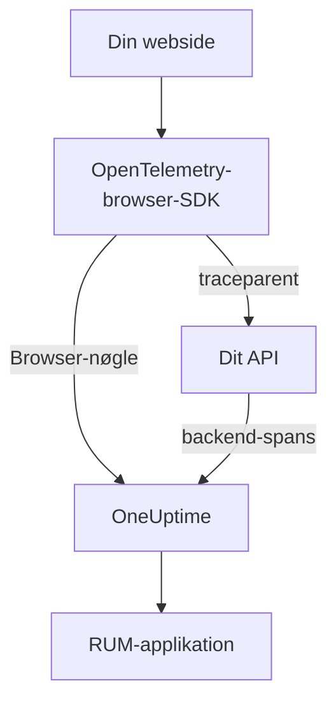

# Browseropsætning

Instrumenter en webapp med OpenTelemetry-browser-SDK'et, så den rapporterer til OneUptime som en RUM-applikation. Sideindlæsninger og forespørgsler kommer ind som spor, og den samme opsætning bærer også dine fejl, logs, metrikker og Core Web Vitals.

:::cards
- [Sæt det op](#sæt-det-op): Seks trin fra en Browser-nøgle til din første sideindlæsning.
- [Forbind til din backend](#forbind-til-dine-backend-spor): Knyt browserens spans til de backend-spor, de starter.
- [Rapporter fejl](#rapporter-ufangede-fejl): Send ufangede fejl til visningen Undtagelser.
- [Fejlfinding](#fejlfinding): Hvad du skal tjekke, når intet kommer frem.
:::

## Sådan virker det

SDK'et kører i dine besøgendes browsere. Det registrerer et span for hver sideindlæsning og hver forespørgsel og eksporterer dem direkte til OneUptime med en **Browser**-indtagelsesnøgle, uden en collector eller proxy af dine egne imellem.



## Før du begynder

- En webapp, hvis kode du kan ændre og udrulle igen, med afhængigheder installeret via npm.
- De oprindelser, dine sider serveres fra, for eksempel `https://app.example.com`. En Browser-nøgle accepterer kun forespørgsler fra de oprindelser, du angiver på den.
- En rolle, der kan oprette indtagelsesnøgler: Projektejere og -administratorer kan, og det kan alle med tilladelsen **Create Telemetry Ingestion Key** også.

## Sæt det op

:::steps
### Opret en Browser-indtagelsesnøgle

1. Gå til **Produkter → Projektindstillinger**.
2. Fold **Telemetri og APM** ud i sidemenuen, og vælg **Indtagelsesnøgler**.
3. Klik på **Opret ingestion-nøgle**, og vælg **Browser** som **Nøgletype**.
4. Angiv dine oprindelser under **Allowed Origins** i trinnet **Browserindstillinger** som et JSON-array, for eksempel `["https://app.example.com"]`, og opret så nøglen. På OneUptime Clouds gratisplan viser et sidste trin **Fakturering** først prisen for telemetri.


Den nye nøgle åbner på sin egen side. Kopiér dens **Hemmelig nøgle**: Det er det token, SDK'et sender som `x-oneuptime-token`.


### Installer pakkerne

```bash
npm install @opentelemetry/api \
  @opentelemetry/sdk-trace-web \
  @opentelemetry/resources \
  @opentelemetry/semantic-conventions \
  @opentelemetry/opentelemetry-browser-detector \
  @opentelemetry/exporter-trace-otlp-http \
  @opentelemetry/context-zone \
  @opentelemetry/instrumentation \
  @opentelemetry/instrumentation-document-load \
  @opentelemetry/instrumentation-fetch \
  @opentelemetry/instrumentation-xml-http-request
```

### Opret telemetrifilen

Opret `src/telemetry.ts`. `browserDetector` tilføjer de `browser.*`-attributter, der klassificerer telemetrien som RUM, og `service.name` giver applikationen navn.

```ts title="src/telemetry.ts"
import {
  WebTracerProvider,
  BatchSpanProcessor,
} from "@opentelemetry/sdk-trace-web";
import { OTLPTraceExporter } from "@opentelemetry/exporter-trace-otlp-http";
import { ZoneContextManager } from "@opentelemetry/context-zone";
import { registerInstrumentations } from "@opentelemetry/instrumentation";
import { DocumentLoadInstrumentation } from "@opentelemetry/instrumentation-document-load";
import { FetchInstrumentation } from "@opentelemetry/instrumentation-fetch";
import { XMLHttpRequestInstrumentation } from "@opentelemetry/instrumentation-xml-http-request";
import {
  defaultResource,
  detectResources,
  resourceFromAttributes,
} from "@opentelemetry/resources";
import { browserDetector } from "@opentelemetry/opentelemetry-browser-detector";
import { ATTR_SERVICE_NAME } from "@opentelemetry/semantic-conventions";

const ONEUPTIME_URL = "https://oneuptime.com";
// Public: it ships in your page. It must be a Browser ingestion key.
const ONEUPTIME_TOKEN = "YOUR_TELEMETRY_INGESTION_TOKEN";

/*
 * browserDetector supplies the browser.* attributes. Without them this
 * telemetry is classified as a backend Service, not a RUM application.
 * The attributes set last win, so service.name here overrides the
 * "unknown_service" that defaultResource() provides.
 */
const resource = defaultResource()
  .merge(detectResources({ detectors: [browserDetector] }))
  .merge(
    resourceFromAttributes({
      [ATTR_SERVICE_NAME]: "storefront-web",
    }),
  );

const provider = new WebTracerProvider({
  resource: resource,
  spanProcessors: [
    new BatchSpanProcessor(
      new OTLPTraceExporter({
        url: `${ONEUPTIME_URL}/otlp/v1/traces`,
        headers: { "x-oneuptime-token": ONEUPTIME_TOKEN },
      }),
    ),
  ],
});

provider.register({
  contextManager: new ZoneContextManager(),
});

registerInstrumentations({
  instrumentations: [
    new DocumentLoadInstrumentation(),
    new FetchInstrumentation({
      // See "Linking to your backend traces" before widening this.
      propagateTraceHeaderCorsUrls: [/^https:\/\/api\.example\.com/],
    }),
    new XMLHttpRequestInstrumentation({
      propagateTraceHeaderCorsUrls: [/^https:\/\/api\.example\.com/],
    }),
  ],
});
```

### Importer den først

Gør den til den første import i din app. Instrumenteringerne patcher `fetch` og `XMLHttpRequest`, og en forespørgsel fra før patchen spores ikke.

```ts
// src/index.tsx (React), src/main.ts (Vue / Angular), etc.
import "./telemetry";
import React from "react";
// ... the rest of your app
```

### Tjek nøglen

Spørg OneUptime, om den accepterer nøglen, før du leder andre steder:

```bash
curl -i https://oneuptime.com/otlp/v1/validate \
  -H "x-oneuptime-token: YOUR_TELEMETRY_INGESTION_TOKEN"
```

`200` med `"valid": true` betyder, at nøglen accepteres; for en Browser-nøgle tilføjer beskeden, at den kun virker fra en browser og fra en af dens tilladte oprindelser. `401` betyder, at nøglen er ukendt, tilbagekaldt, slået fra eller udløbet.

### Indlæs en side

Åbn dit websted. Inden for et minut vises applikationen under **Produkter → Ressourcer → Overvågning af reelle brugere**, navngivet efter sin `service.name`.
:::

## Hvad en Browser-nøgle tillader

Alt i snippet'et sendes til dine besøgende, så alle kan kopiere tokenet fra din side. En Browser-nøgle begrænser, hvad en kopi kan gøre:

| Indstilling | Hvad den gør |
| --- | --- |
| **Allowed Origins** | Forespørgsler accepteres kun fra disse oprindelser, hver med sit skema og eventuelle port. En vært må begynde med ét jokertegn `*.`: `https://*.example.com` dækker alle underdomæner af `example.com`, men ikke selve `example.com`. |
| **Requests Per Minute Limit** | Ét loft for alle besøgende, der bruger nøglen: 6000 forespørgsler pr. minut, medmindre du sætter dit eget. |
| **Pinned Service Name** | Gennemtvinger `service.name` på alt, hvad nøglen skriver, så en kopi ikke kan udgive sin telemetri for at være en af dine backend-tjenester. |
| **Udløber den** | Efter denne dato accepteres nøglen ikke længere. |
| **Aktiveret** | Slå den fra for straks at stoppe en lækket nøgle. |

En Browser-nøgle skriver OTLP-spor, -logs og -metrikker samt sessionsafspilninger; alle andre indtagelsesveje afviser den. Du ændrer disse indstillinger på nøglens egen side. Nøgletypen kan ikke ændres, efter at nøglen er oprettet.

> [!WARNING]
> Læg aldrig en **Server**-nøgle i en side. En Server-nøgle skriver enhver slags telemetri fra hvor som helst uden oprindelsestjek, så alle, der læser din side, kan skrive ind i dit projekt.

## Sæt `browser.*` uden detektoren

`browserDetector` læser [UA Client Hints API'et](https://wicg.github.io/ua-client-hints/), som kun Chromium-browsere har. I Safari og Firefox sætter den `browser.language` og `user_agent.original`, men ikke `browser.platform`, `browser.brands` eller `browser.mobile`.

Det er stadig nok til at klassificere telemetrien som RUM, fordi `browser.language` alene markerer en batch som browser-RUM. Siden **Klienter** viser dog platforme ud fra `browser.platform`, så besøg fra Safari og Firefox tilføjer ingen række der.

For at undvære detektoren, eller for at give alle browsere en platform, sætter du selv attributterne:

```ts
const resource = defaultResource().merge(
  resourceFromAttributes({
    [ATTR_SERVICE_NAME]: "storefront-web",
    // browser.language or browser.platform marks the telemetry as browser RUM.
    "browser.language": navigator.language,
    "browser.platform":
      (navigator as any).userAgentData?.platform ?? "unknown",
    "browser.mobile": (navigator as any).userAgentData?.mobile ?? false,
    "user_agent.original": navigator.userAgent,
  }),
);
```

Hold `browser.platform` grov. Hver særskilt værdi bliver en række på siden **Klienter**, så en fuld user-agent-streng eller en værdi pr. bruger giver en endeløs liste og er desuden et privatlivsproblem.

## Spor ruteskift

`DocumentLoadInstrumentation` sporer kun den første indlæsning. I en single-page-app forbliver ruteskift usynlige, indtil du registrerer dem, hvilket kræver få linjer i din router:

```ts
import { trace } from "@opentelemetry/api";

const tracer = trace.getTracer("app-router");

function onRouteChange(to: string): void {
  const span = tracer.startSpan("route-change", {
    attributes: { "app.route": to },
  });
  // End it when the route's data has loaded and the view has painted.
  requestAnimationFrame(() => {
    return span.end();
  });
}
```

Tilføj `@opentelemetry/instrumentation-user-interaction` for også at spore klik og andre DOM-hændelser. For INP pr. rute, se [Single-page-apps](/docs/rum/web-vitals#single-page-apps).

## Forbind til dine backend-spor

`propagateTraceHeaderCorsUrls` afgør, hvilke forespørgsler på tværs af oprindelser der får en W3C-header `traceparent`, som knytter browserens span til det backend-spor, det startede. Forespørgsler til din sides egen oprindelse får den uden nogen konfiguration.

> [!WARNING]
> Sæt den ikke til `/.*/`. Headeren gør en simpel forespørgsel på tværs af oprindelser til en med preflight, så ethvert tredjeparts-API, der ikke har `traceparent` i sin `Access-Control-Allow-Headers`, begynder at fejle.

Angiv kun oprindelser, du styrer og har konfigureret:

```ts
new FetchInstrumentation({
  propagateTraceHeaderCorsUrls: [
    /^https:\/\/api\.example\.com/,
    /^https:\/\/auth\.example\.com/,
  ],
});
```

Med [Sessionsafspilning](/docs/telemetry/session-replay) installeret bærer forespørgsler til din egen oprindelse også afspilningens sessions-id, som arkiverer din backend-telemetri under optagelsen: se [Knyt spor til sessionsafspilning](#knyt-spor-til-sessionsafspilning).

## Knyt spor til sessionsafspilning

Hvis du også kører [Sessionsafspilning](/docs/telemetry/session-replay), slutter din **backend**-telemetri sig til optagelsen uden kode her. Mens en session uploades, tilføjer optageren et `tracestate`-medlem med sessions-id'et til de forespørgsler, din side sender til sin egen oprindelse, og overlader `traceparent` til din `FetchInstrumentation` / `XMLHttpRequestInstrumentation`. Din backends spans får sessions-id'et ved indtagelsen, i alle tjenester, der fører W3C-sporkonteksten videre, og dens logs og undtagelser slutter sig til optagelsen via spor-id'et. Se [Korrelering med din øvrige telemetri](/docs/telemetry/session-replay#correlating-with-your-other-telemetry) for, hvordan det virker, hvad det ikke dækker, og hvilken kontakt der slår det fra.

Optageren læser også den `traceparent`, dine instrumenteringer sætter, uanset om kaldet sender en URL (med eller uden init-objekt) eller et `Request`-objekt, så hver forespørgselsrække i afspilningen linker til sit backend-spor. Et API på en anden oprindelse angiver du i `propagateTraceHeaderCorsUrls` ovenfor; dets forespørgsler bærer intet sessions-id og slutter sig til optagelsen via spor-id'et. **Trace propagation origins** i applikationens afspilningspolitik gør det samme for sider *uden* dette SDK.

Det, headerne ikke når, er dette SDK's egne browser-spans: dokumentindlæsninger, ruteskift og de fejl, du rapporterer. For også at arkivere dem under optagelsen sætter du `session.id` på hvert span, når det starter. Optageren giver dig id'et gennem `onSessionChange`, som udløses med det samme, hvis der allerede findes en session, og igen hver gang id'et ændres: når den besøgende vender tilbage efter 30 minutters inaktivitet, ved loftet på 4 timer, når `identify()` angiver en anden bruger, eller når en anden fane hos samme besøgende ændrede det først.

```ts title="src/replaySession.ts"
import type { Context } from "@opentelemetry/api";
import type {
  ReadableSpan,
  Span,
  SpanProcessor,
} from "@opentelemetry/sdk-trace-web";

declare global {
  interface Window {
    OneUptimeReplayQueue?: Array<Array<unknown>>;
  }
}

let replaySessionId: string | null = null;

// The recorder script loads asynchronously. The queue is applied the
// moment it starts and stays live afterwards, so this works either way.
(window.OneUptimeReplayQueue = window.OneUptimeReplayQueue || []).push([
  "onSessionChange",
  (sessionId: string): void => {
    replaySessionId = sessionId;
  },
]);

export class ReplaySessionSpanProcessor implements SpanProcessor {
  public onStart(span: Span, _parentContext: Context): void {
    if (replaySessionId) {
      span.setAttribute("session.id", replaySessionId);
    }
  }

  public onEnd(_span: ReadableSpan): void {}

  public forceFlush(): Promise<void> {
    return Promise.resolve();
  }

  public shutdown(): Promise<void> {
    return Promise.resolve();
  }
}
```

Placer den derefter først blandt providerens span-processorer i `src/telemetry.ts`:

```ts
import { ReplaySessionSpanProcessor } from "./replaySession";

const provider = new WebTracerProvider({
  resource: resource,
  spanProcessors: [
    new ReplaySessionSpanProcessor(),
    new BatchSpanProcessor(
      new OTLPTraceExporter({
        url: `${ONEUPTIME_URL}/otlp/v1/traces`,
        headers: { "x-oneuptime-token": ONEUPTIME_TOKEN },
      }),
    ),
  ],
});
```

Spans, der startes derefter, bærer id'et, afspillerens fane **Spor** viser dem på optagelsens ur, og hver af dem linker i dashboardet tilbage til øjeblikket i afspilningen. En span-processor stempler hvert span med det id, der gjaldt, da det startede; at skrive id'et i `resource.attributes` i stedet ville ommærke spans, der stadig ventede i eksportbatchen, da sessionen skiftede. Lytteren får id'et, så snart optageren starter, før samtykke eller en optageudløser, så hvis det betyder noget, så stempl først, når din side har samtykke.

## Content Security Policy

Hvis dit websted sender en Content Security Policy, blokerer browseren eksportørens forespørgsler, indtil du tillader OneUptime i `connect-src`. Intet fejler synligt: Siden rapporterer bare ingenting.

```text
connect-src 'self' https://oneuptime.com;
```

Flet det ind i dit eksisterende `connect-src`-direktiv. Hvis du selv hoster OneUptime, så brug din egen vært.

## Rapporter ufangede fejl

OpenTelemetry-browser-SDK'et fanger ikke ufangede fejl. Rapporter dem selv, så vises de under **Undtagelser** ved siden af dine backend-fejl:

```ts
import { trace, SpanStatusCode } from "@opentelemetry/api";

const tracer = trace.getTracer("app-errors");

window.addEventListener("error", (event: ErrorEvent) => {
  const span = tracer.startSpan("window.onerror");
  span.recordException(event.error ?? new Error(event.message));
  span.setStatus({ code: SpanStatusCode.ERROR });
  span.end();
});

window.addEventListener("unhandledrejection", (event: PromiseRejectionEvent) => {
  const span = tracer.startSpan("unhandledrejection");
  span.recordException(
    event.reason instanceof Error ? event.reason : new Error(String(event.reason)),
  );
  span.setStatus({ code: SpanStatusCode.ERROR });
  span.end();
});
```

Med [Sessionsafspilning](/docs/telemetry/session-replay) fanger optageren også ufangede fejl og markerer dem på afspilningens tidslinje. Undtagelsens side viser så et kort **Watch what the user saw**, som åbner afspilningen ti sekunder før fejlen. Med standardpolitikken optages hver session, uanset om noget fejler eller ej; fejlen afgør kun, hvor kortet åbner.

## Tilføj logs og metrikker

Spor er nok til at udfylde oversigten. Tilføj log- og metrikpipelines, når du vil have browserlogs i OneUptime, eller for at sende [Core Web Vitals](/docs/rum/web-vitals):

```bash
npm install @opentelemetry/api-logs @opentelemetry/sdk-logs \
  @opentelemetry/exporter-logs-otlp-http \
  @opentelemetry/sdk-metrics @opentelemetry/exporter-metrics-otlp-http
```

```ts
import { LoggerProvider, BatchLogRecordProcessor } from "@opentelemetry/sdk-logs";
import { OTLPLogExporter } from "@opentelemetry/exporter-logs-otlp-http";
import { MeterProvider, PeriodicExportingMetricReader } from "@opentelemetry/sdk-metrics";
import { OTLPMetricExporter } from "@opentelemetry/exporter-metrics-otlp-http";
import { logs } from "@opentelemetry/api-logs";
import { metrics } from "@opentelemetry/api";

const headers = { "x-oneuptime-token": ONEUPTIME_TOKEN };

logs.setGlobalLoggerProvider(
  new LoggerProvider({
    resource: resource,
    processors: [
      new BatchLogRecordProcessor({
        exporter: new OTLPLogExporter({
          url: `${ONEUPTIME_URL}/otlp/v1/logs`,
          headers,
        }),
      }),
    ],
  }),
);

metrics.setGlobalMeterProvider(
  new MeterProvider({
    resource: resource,
    readers: [
      new PeriodicExportingMetricReader({
        exporter: new OTLPMetricExporter({
          url: `${ONEUPTIME_URL}/otlp/v1/metrics`,
          headers,
        }),
        exportIntervalMillis: 30000,
      }),
    ],
  }),
);
```

Byg dem med det samme `resource`-objekt. En log- eller metrikpipeline, hvis ressource mangler `browser.*`, arkiveres som en separat backend-tjeneste.

## Endpoint-reference

| Signaltype | Endpoint | Header |
| --- | --- | --- |
| Spor | `POST {host}/otlp/v1/traces` | `x-oneuptime-token: <token>` |
| Metrikker | `POST {host}/otlp/v1/metrics` | `x-oneuptime-token: <token>` |
| Logs | `POST {host}/otlp/v1/logs` | `x-oneuptime-token: <token>` |

`{host}` er `https://oneuptime.com` eller din egen vært, hvis du selv driver OneUptime; ret den i OTLP-URL'erne og i posten i Content Security Policy. OneUptime accepterer OTLP/JSON og OTLP/protobuf. Endpointene besvarer forespørgsler på tværs af oprindelser fra enhver oprindelse og tillader headeren `x-oneuptime-token`, så en browser eksporterer direkte til dem.

## Fejlfinding

:::details Ingen forespørgsel til OneUptime på fanen Netværk
Åbn browserens udviklerværktøjer, gå til fanen Netværk, og filtrer på `otlp`: Du leder efter `POST /otlp/v1/traces`. Ingen forespørgsel overhovedet betyder, at SDK'et aldrig startede:

- `telemetry.ts` er ikke den første import, eller din bundler har droppet den.
- Batch-processoren har ikke eksporteret endnu. Den venter nogle sekunder på at fylde en batch, så vent, eller gå til en anden side, før du konkluderer, at intet sendes.
- En miljøvariabel fra buildet blev til `undefined`, så eksportørens URL er i stykker. Log URL'en én gang ved opstart.
:::

:::details Browseren blokerer forespørgslen
- En fejl fra Content Security Policy i konsollen betyder, at `connect-src` endnu ikke tillader OneUptime: se [Content Security Policy](#content-security-policy).
- En CORS-fejl betyder næsten altid, at forespørgslen aldrig nåede OneUptime, hvis endpoints tillader enhver oprindelse: Kig efter en firmaproxy, en adblocker eller en tastefejl i værten.
:::

:::details OneUptime afviser forespørgslen
- `422` med `Origin https://app.example.com is not allowed for this browser ingestion key.` betyder, at sidens præcise oprindelse (skema, vært og port) mangler i nøglens **Allowed Origins**.
- `422` med `This telemetry ingestion key has been disabled.` betyder, at nogen har slået nøglen fra. Slå den til igen, eller brug en anden nøgle.
- `401` betyder, at nøglen er ukendt, tilbagekaldt eller udløbet. Kør nøgletjekket i [Sæt det op](#sæt-det-op), og opret derefter en gyldig Browser-nøgle.
- `404` betyder, at URL'en er forkert. Sporeksportøren skal have den fulde sti, `/otlp/v1/traces`.
:::

:::details Appen vises under Tjenester i stedet for Overvågning af reelle brugere
Ressourcen har ingen `browser.*`-attribut, så telemetrien blev arkiveret som en backend-tjeneste. Tilføj `browserDetector`, eller sæt attributterne som i [Sæt `browser.*` uden detektoren](#sæt-browser-uden-detektoren).

Tjek på fanen Netværk i forespørgslens payload, hvad du sender: `resourceSpans[0].resource.attributes` er den liste, der afgør det. Den tjeneste, der allerede blev oprettet, bliver ikke til en RUM-applikation, så slet den under **Produkter → Tjenester**, når RUM-telemetrien kommer ind.
:::

:::details Siden Klienter er tom i Safari eller Firefox
Klientrækker kommer fra `browser.platform`, som `browserDetector` kun sætter i Chromium-browsere. Sæt den selv for at vise besøg fra Safari og Firefox: se [Sæt `browser.*` uden detektoren](#sæt-browser-uden-detektoren).
:::

## Næste skridt

:::cards
- [Core Web Vitals](/docs/rum/web-vitals): Send LCP, INP, CLS, FCP og TTFB fra den samme side.
- [Sessionsafspilning](/docs/telemetry/session-replay): Optag, hvad brugeren så, ved siden af disse spor.
- [Administrer applikationer](/docs/rum/applications): Navne, etiketter, ejere og opbevaring.
- [RUM-fejlfinding](/docs/rum/troubleshooting): Hvert tjek, i den rækkefølge problemer typisk opstår.
:::
